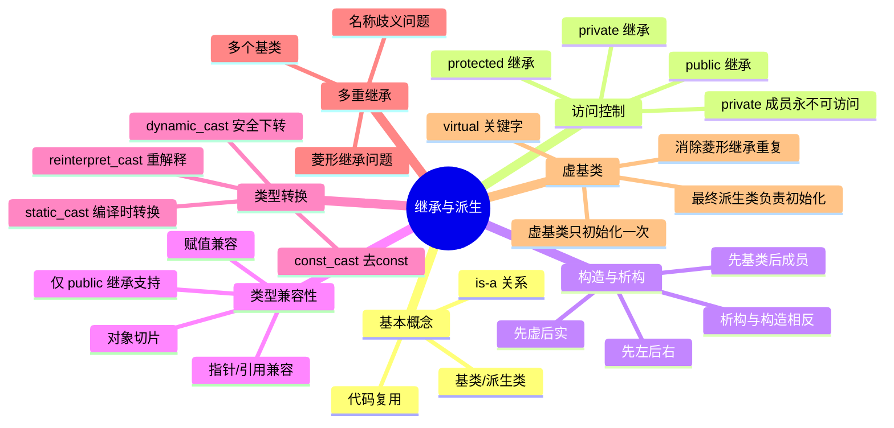

> [!info] 课程信息 中山大学计算机学院 · 田海博主讲  
> Tags: #CPP #面向对象 #继承 #派生 #多重继承 #虚基类
## 目录

1. [[#一、继承与派生的基本概念]]
2. [[#二、语法与访问控制]]
3. [[#三、构造与析构顺序]]
4. [[#四、派生与构造函数]]
5. [[#五、派生与成员函数]]
6. [[#六、改变访问控制]]
7. [[#七、类型兼容性（Type Compatibility）]]
8. [[#八、对象的类型转换（Casting）]]
9. [[#九、多重继承（Multiple Inheritance）]]
10. [[#十、虚基类（Virtual Base Class）]]
11. [[#例题精选]]

---

## 一、继承与派生的基本概念

### 什么是继承？

**继承（Inheritance）** 是面向对象编程的核心机制之一。它允许一个类（**派生类/子类**）"继承"另一个类（**基类/父类**）的属性和行为，同时可以扩展或修改这些行为。在已有类（基类/父类）的基础上，通过**扩充**和**修改**创建新类（派生类/子类）。

> [!tip] 通俗理解 就像"人 → 学生"：学生是一种人，拥有人的所有特征（姓名、年龄等），还额外有学号、专业等属性。继承就是表达这种"是一种（is-a）"的关系。

表达的是**IS-A**关系（派生类是一个基类）。    
~~~cpp

// 基类
class Animal {
public:
    void eat() { cout << "I have eaten!" << endl; }
};
// 派生类 Dog 继承 Animal
class Dog : public Animal {
public:
    void bark() { cout << "I am Barking, wang wang wang" << endl; }
};
int main() {
    Dog d;
    d.eat();   // 继承自 Animal
    d.bark();  // Dog 自己的方法
}
~~~

**严谨定义：**

- **基类（Base Class）**：被继承的类，也叫父类、超类。
- **派生类（Derived Class）**：继承基类的新类，也叫子类。派生类包含基类的所有成员，并可添加新成员或重写基类成员。
- **继承**：建立类层次结构的机制，使派生类自动获得基类的数据成员和成员函数（受访问控制限制）。

### 继承的意义

- **代码复用**：不必重复编写已有功能。
- **扩展性**：在已有类基础上增加新功能，而不修改原有代码。
- **多态基础**：继承是实现运行时多态（虚函数）的前提。

---

## 二、语法与访问控制

### 派生类语法

```cpp
class 派生类名 : 继承方式 基类名 {
    成员访问控制:
    成员声明列表;
};
```
- **继承访问控制**：`public`、`protected`、`private`，**默认（不写）为 `private`**
- **成员访问控制**：`public`、`protected`、`private`

三种继承方式：

| 基类成员访问           | `public` 继承           | `protected` 继承   | `private` 继承   |
| ---------------- | --------------------- | ---------------- | -------------- |
| `public` 基类成员    | 在派生类中**仍为 public**    | 变为 **protected** | 变为 **private** |
| `protected` 基类成员 | 在派生类中**仍为 protected** | 变为 **protected** | 变为 **private** |
| `private` 基类成员   | **不可访问**              | **不可访问**         | **不可访问**       |

> [!warning] 易错点 **基类的 `private` 成员永远不能被派生类直接访问**，无论何种继承方式。若需让派生类访问，应将其设为 `protected`。

> [!note] 最常用的是 `public` 继承 `public` 继承保留了基类的接口特性，表达"is-a"关系。`private`/`protected` 继承更多用于实现复用，不推荐初学者频繁使用。

- **私有成员**：派生类**本身可以访问自己定义的**私有成员
- **不可访问成员**：基类的 `private` 成员在派生类中**完全不可触及**，即使是派生类自己的成员函数也无法访问
~~~~cpp

class BASE {
private:
    int x_temp;    // 基类私有
protected:
    int i, j;      // 基类受保护
public:
    void get_ij();
};
class Y1 : public BASE {
public:
    void increment() {
        i++;        // OK：protected 成员，派生类可访问
        j++;        // OK
        x_temp++;  // 错误！基类的 private 成员不可访问
    }
private:
    float nmember;  // Y1 自己的私有成员，Y1 内部可访问
};
~~~~

完整访问控制示例分析
~~~cpp

class BASE {
public:    BASE(); void get_ij();
protected: int i, j;
private:   int x_temp;
};
class Y1 : public BASE {
public:    void increment();
private:   float nmember;
};
~~~

**从 main 函数（客户端）角度看**：
- 可访问：`Y1::increment()`、`Y1::get_ij()`（公有成员）
- 不可访问：`i`、`j`（protected）、`x_temp`（private）、`nmember`（private）

**从派生类 Y1 内部角度看**：
- 可访问：`i`、`j`（继承的 protected）、`get_ij()`（继承的 public）、`nmember`（自己的 private）
- 不可访问：`x_temp`（基类的 private）

**使用建议**：
> **大多数情况下使用 `public` 继承**（如 MFC 全部使用 public，AT&T iostream 库 95% 以上使用 public）

## 三、构造与析构顺序
#### 3.1 派生类对象的存储
派生类对象在内存中**先存放基类部分，再存放派生类新增部分**。
~~~text
obj1 (BASE):    [i] [j] [x_temp]
obj2 (Y1):      [i] [j] [x_temp] [nmember]
                 ← 基类部分 →  ← 派生类新增 →
~~~
#### 3.2 构造函数调用顺序
**创建派生类对象时**：
1. **基类构造函数**（多重继承按声明顺序从左到右）
2. **本类对象成员的构造函数**（按声明顺序）
> [!warning] 易错点：顺序由声明决定，不由初始化列表决定！ 基类构造顺序和成员对象构造顺序，**取决于类定义中的声明顺序**，而不是初始化列表的书写顺序！
3. **本类的构造函数**
#### 3.3.3 析构函数调用顺序
**撤销派生类对象时（与构造顺序完全相反）**：
1. **本类的析构函数**
2. **本类对象成员的析构函数**
3. **基类的析构函数**
#### 3.3.4 完整示例
~~~cpp
class C {
public:
    C()  { cout << "Constructing C object.\n"; }
    ~C() { cout << "Destructing C object.\n"; }
};
class BASE {
public:
    BASE()  { cout << "Constructing BASE object.\n"; }
    ~BASE() { cout << "Destructing BASE object.\n"; }
};
class DERIVED : public BASE {
    C mOBJ;  // 对象成员
public:
    DERIVED()  { cout << "Constructing derived object.\n"; }
    ~DERIVED() { cout << "Destructing derived object.\n"; }
};
int main() {
    DERIVED obj;
    return 0;
}
/* 输出结果：
Constructing BASE object.         ← 先基类
Constructing C object.            ← 再对象成员
Constructing derived object.      ← 最后自己
Destructing derived object.       ← 先自己（逆序）
Destructing C object.             ← 再对象成员
Destructing BASE object.          ← 最后基类
*/
~~~
#### 3.3.5 ⚠️ 基类构造函数必须显式调用的情况
- 首先确定基类有无构造函数：
	- 有：看是否有无参构造函数
		- 有：派生类构造函数默认调用基类的**无参构造函数**
		- 没有：（或有 `=delete`），则必须在派生类**初始化列表中显式调用**基类有参构造函数
		- 注意：必须在初始化列表里调用
	- 没有：必须在函数体内，使用 `this` 指针来对成员变量进行赋值
		- 注意：不允许初始化列表

~~~cpp
class BASE {
public:
    BASE(int x) {}  // 只有有参构造，无默认构造
};
class DERIVED : public BASE {
public:
    // 必须显式调用基类构造函数
    DERIVED(int x) : BASE(x) {}  // ✅ 正确
    // DERIVED() {}              // ❌ 编译错误：BASE 没有默认构造
};
~~~
**⚠️ 注意不能在派生类构造函数体内调用基类构造函数，必须在初始化列表中！**
## 四、派生与构造函数

### 初始化列表传参给基类

派生类不能直接初始化基类的成员，必须通过基类构造函数（在初始化列表中调用）：

```cpp
class Base {
public:
    Base(int x) : val(x) {}
protected:
    int val;
};

class Derived : public Base {
public:
    // 通过初始化列表调用基类构造函数
    Derived(int x, int y) : Base(x), extra(y) {}
private:
    int extra;
};
```

> [!tip] 若不显式调用，则自动调用基类**默认构造函数**。若基类没有默认构造函数，则编译报错。
## 五、派生与成员函数

### 函数重写（Override）与屏蔽（Hide）

- **重写（Override）**：虚函数机制，派生类重新定义基类虚函数，实现多态。**显式说明**该函数意图重写基类中的虚函数。如果基类中没有匹配的虚函数（签名不一致或不存在），编译器会报错，从而提高代码安全性
- **屏蔽（Hide/Shadow）**：派生类定义了与基类同名的函数（无论参数是否相同），基类版本被隐藏。

```cpp
class Base {
public:
    void show(int x) { cout << "Base: " << x << endl; }
};

class Derived : public Base {
public:
    void show() { cout << "Derived" << endl; }  // 屏蔽了 Base::show(int)
};

Derived d;
d.show();       // OK
d.show(10);     // 错误！Base::show(int) 被屏蔽
d.Base::show(10); // OK，用作用域限定符访问
```

> [!warning] 易错点 派生类中哪怕只定义了 `show()`（无参数），也会将基类所有名为 `show` 的重载版本全部屏蔽！

### 多态、重载、虚函数、重写（覆盖）、模板函数
- 多态：
- 虚函数：基类中以 `virtual` 声明的成员函数，主要功能是实现多态
	- 纯虚函数：不需要在基类中实现（定义即可，不能包含函数体），但在派生类中必须被实现（否则派生类也是抽象类）
- **重载**和**模板**函数用于实现编译时多态
- **虚函数**和**重写**用于实现运行时多态
	- 运行时多态必须满足**成员函数为virtual**并且**通过指针或引用访问**
- 覆盖要求派生类函数与基类虚函数具有完全相同的函数签名
- 重载要求函数名相同即可
## 六、改变访问控制

在派生类中，可以用 `using` 声明将基类成员"恢复"到某个访问级别：

```cpp
class Base {
public:
    void func();
protected:
    int val;
};

class Derived : private Base {  // private 继承，func 变成 private
public:
    using Base::func;           // 恢复为 public
protected:
    using Base::val;            // 恢复为 protected
};
```

## 七、类型兼容性（Type Compatibility）

### 核心规则

> [!important] 类型兼容性核心 **只有 `public` 继承才满足类型兼容性**（is-a 关系）！
#### 规则1：赋值兼容
```cpp
Base obj1;
Derived obj2;   // Derived 是 Base 的公有派生类

obj1 = obj2;    // ✅ 可以：将 obj2 的基类部分赋给 obj1（发生切片）
obj2 = obj1;    // ❌ 不行：基类对象不能赋给派生类对象
```

> [!note] 对象切片（Object Slicing） `obj1 = obj2` 时，只有 `obj2` 中属于 `Base` 的那部分被赋值，派生类自己扩展的成员被"切掉"了。

#### 规则2：指针/引用兼容
```cpp
Base *p;
Derived d;

p = &d;        // ✅ 基类指针可指向派生类对象（向上转型，隐式）
// d_ptr = p;  // ❌ 派生类指针不能指向基类对象（需显式 dynamic_cast）
```

**示例：同一基类指针调用不同对象**
```cpp
void fun(Base *ptr) {
    ptr->display();   // 调用哪个 display 取决于函数是否为虚函数
}

Base b;
D1 d1;
D2 d2;
Base *p;

p = &b;  fun(p);   // 输出 Base::display()
p = &d1; fun(p);   // 若 display 非虚：输出 Base::display()（静态绑定）
p = &d2; fun(p);   // 若 display 非虚：输出 Base::display()
```

> [!warning] 关键区别
> 
> - `display()` **不是虚函数**时：通过基类指针调用，始终调用**基类版本**（静态绑定）。
> - `display()` **是虚函数**时：通过基类指针调用，调用**实际指向对象的版本**（动态绑定/多态）。

## 八、对象的类型转换（Casting）

C++ 提供了四种类型转换运算符，比 C 风格强制转换更安全、意图更明确。
### 8.1 Upcasting 与 Downcasting

|转换方向|英文|说明|是否需要显式|
|---|---|---|---|
|派生类 → 基类|Upcasting（向上转型）|类型兼容，安全|隐式（自动）|
|基类 → 派生类|Downcasting（向下转型）|不一定安全|需显式，用 `dynamic_cast`|

```cpp
Figure *p = new Circle(1);  // 向上转型，隐式
Circle *p1 = dynamic_cast<Circle*>(p);  // 向下转型，显式
```

### 8.2 四种 Cast 运算符

#### `dynamic_cast`

- **用途**：继承体系中的安全向下转型。
- **要求**：基类必须有**至少一个虚函数**（即多态类型）。
- **运行时检查**：若转型失败，指针返回 `nullptr`，引用抛出 `std::bad_cast`。

```cpp
Base *bp = new Derived();
Derived *dp = dynamic_cast<Derived*>(bp);  // 安全，运行时检查
if (dp != nullptr) {
    dp->derivedOnlyFunc();
}
```

#### `static_cast`

- **用途**：编译时确定的合理类型转换（数值类型、有继承关系的类指针等）。
- **无运行时检查**，比 `dynamic_cast` 快，但不安全。

```cpp
float avg = static_cast<float>(hits) / static_cast<float>(at_bats);
```

#### `const_cast`

- **用途**：去除或添加 `const`/`volatile` 限定符。
- **注意**：去除 `const` 后修改原本为 `const` 的对象是**未定义行为**！

```cpp
const int i = 100;
const int *p = &i;
int *q = const_cast<int*>(p);   // 去掉 const
// *q = 200;  // 未定义行为！i 本身是 const
```

#### `reinterpret_cast`

- **用途**：最危险的转换，将指针重新解释为完全不同的类型（如 `int*` → `char*`）。
- **C vs C++ 区别**：C 语言中 `void*` 可隐式转换为任何指针，C++ 中**必须显式转换**。

```cpp
int *ip;
char *cp = reinterpret_cast<char*>(ip);  // 强制重解释内存
```

> [!warning] C++ 与 C 的重要区别
> 
> ```c
> // C 语言：合法（void* 隐式转换）
> void *gp;
> char *cp = gp;    // OK in C
> 
> // C++：必须显式转换
> char *cp = static_cast<char*>(gp);       // OK
> char *cp = reinterpret_cast<char*>(gp);  // 也可以（若目标不是 void*）
> ```

---

## 九、多重继承（Multiple Inheritance）

### 基本语法

```cpp
class 派生类 : 继承方式1 基类1, 继承方式2 基类2, ... {
    成员声明;
};
```

**代表语义**：派生类"既是 A 又是 B"。

### 多继承构造函数

在初始化列表中分别调用各基类的构造函数：

```cpp
class DeviceNew : public Device1, public Device2 {
public:
    DeviceNew(float w, int vol, bool on, int talk, int standby, float pwr)
        : Device1(vol, on),             // 调用 Device1 的构造函数
          Device2(talk, standby, pwr),  // 调用 Device2 的构造函数
          weight(w) {}
private:
    float weight;
};
```

> [!warning] 构造顺序由**声明顺序**决定，不是初始化列表顺序 上例中 `Device1` 先被声明，所以先调用 `Device1` 的构造，再调用 `Device2` 的构造，即使初始化列表中 `Device2` 写在前面。

### 菱形继承问题

```
    A
   / \
  B   C
   \ /
    D
```

若 `B` 和 `C` 都普通继承自 `A`，则 `D` 中会有**两份 `A` 的副本**，导致：

- 数据冗余（两份相同数据）
- 访问歧义（`d.A_member` 不知道用哪份）

解决方案：**虚基类**。

---

## 十、虚基类（Virtual Base Class）

### 定义

在继承时用 `virtual` 关键字修饰基类，使其成为**虚基类**：

```cpp
class Base { public: int i; };

class B1 : virtual public Base { public: int j; };
class B2 : virtual public Base { public: int k; };

class Derived : public B1, public B2 {
    // Base 的内容只有一份！
};

Derived obj;
obj.i = 3;  // ✅ 唯一，不歧义
obj.j = 5;  // ✅ 来自 B1
obj.k = 7;  // ✅ 来自 B2
```

### 虚基类的构造规则

> [!important] 虚基类构造规则（重点！）
> 
> 1. 若派生类有虚基类祖先，**必须**在派生类构造函数的初始化列表中显式调用虚基类构造函数（否则调用虚基类默认构造函数）。
> 2. 虚基类的构造函数**总是先于**普通基类的构造函数执行。
> 3. `virtual` 关键字保证：无论多少条继承路径经过该虚基类，虚基类只被**初始化一次**。

### 含虚基类时的完整构造顺序

```
1. 所有虚基类（按继承体系从上到下，从左到右）
2. 普通基类（按派生类声明时的左到右顺序）
3. 成员对象（按类中声明顺序）
4. 派生类自身构造函数体
```

### 复杂例子分析

```cpp
class baseA { };                          // 普通类
class baseB { };                          // 普通类

class derivedA : public baseB, virtual public baseA { };
//              ↑普通继承 baseB  ↑虚继承 baseA

class derivedB : public baseB, virtual public baseA { };

class Derived : public derivedA, virtual public derivedB { };
```

构造 `Derived obj` 时的调用顺序：

```
1. 虚基类：baseA（被 derivedA、derivedB 虚继承，只初始化一次）
2. 虚基类：derivedB（被 Derived 虚继承）
   └─ derivedB 内部：先 baseA（已构造，跳过）→ 再 baseB → derivedB 自身
3. 普通基类：derivedA（Derived 的普通基类）
   └─ derivedA 内部：先 baseA（已构造，跳过）→ 再 baseB → derivedA 自身
4. Derived 自身
```

**实际输出顺序：**

```
This is baseA class.      ← 虚基类 baseA（整个体系只一次）
This is baseB class.      ← derivedB 的普通基类 baseB
This is derivedB class.   ← derivedB 自身（虚基类，先处理）
This is baseB class.      ← derivedA 的普通基类 baseB
This is derivedA class.   ← derivedA 自身
This is Derived class.    ← Derived 自身
```

> [!warning] 易错点 `baseB` 出现了**两次**！因为 `baseB` 是**普通基类**（非虚继承），`derivedA` 和 `derivedB` 各继承了一份 `baseB`，不会合并。只有**虚继承**的基类才会合并为一份。

---

## 例题精选
### 例题1：访问控制与继承方式

```cpp
class A {
public:    int x;
protected: int y;
private:   int z;
};

class B : protected A { };
class C : public B { };
```

**问：在 `C` 的成员函数中，`x`、`y`、`z` 各是什么访问级别？**

<details> <summary>解析（点击展开）</summary>

- `A` 中：`x`(public), `y`(protected), `z`(private)
- `B` 以 `protected` 继承 `A`：
    - `x` → `protected`（public 降为 protected）
    - `y` → `protected`（protected 保持 protected）
    - `z` → 不可访问（private 无论如何不可访问）
- `C` 以 `public` 继承 `B`：
    - `x` → `protected`（从 B 继承，保持 protected）
    - `y` → `protected`（从 B 继承，保持 protected）
    - `z` → 不可访问

**结论**：在 `C` 的成员函数中，`x` 和 `y` 均为 `protected` 可访问，`z` 不可访问。

</details>

---

### 例题2：构造顺序陷阱

```cpp
#include <iostream>
using namespace std;

class M {
public:
    M() { cout << "M()" << endl; }
    ~M() { cout << "~M()" << endl; }
};

class Base {
public:
    Base() { cout << "Base()" << endl; }
    ~Base() { cout << "~Base()" << endl; }
};

class Derived : public Base {
public:
    Derived() : m2(), m1() {   // 注意：初始化列表 m2 在前
        cout << "Derived()" << endl;
    }
    ~Derived() { cout << "~Derived()" << endl; }
private:
    M m1;   // 声明 m1 在前
    M m2;   // 声明 m2 在后
};

int main() {
    Derived d;
    return 0;
}
```

**问：输出顺序是什么？**

<details> <summary>解析（点击展开）</summary>

关键：**成员对象构造顺序由类中声明顺序决定，不是初始化列表顺序。**

构造顺序：

1. `Base`（基类）
2. `m1`（声明在前，即使初始化列表写的 m2 在前）
3. `m2`
4. `Derived` 构造体

析构顺序反转。

**输出：**

```
Base()
M()    ← m1
M()    ← m2
Derived()
~Derived()
~M()   ← m2 先析构
~M()   ← m1 后析构
~Base()
```

</details>

---

### 例题3：类型兼容性与静态绑定

```cpp
#include <iostream>
using namespace std;

class Animal {
public:
    void speak() { cout << "Animal speaks" << endl; }
};

class Dog : public Animal {
public:
    void speak() { cout << "Dog barks" << endl; }
};

class Cat : public Animal {
public:
    void speak() { cout << "Cat meows" << endl; }
};

void makeSound(Animal *a) {
    a->speak();
}

int main() {
    Dog d;
    Cat c;
    makeSound(&d);
    makeSound(&c);
    return 0;
}
```

**问：输出是什么？若想输出"Dog barks"和"Cat meows"，应如何修改？**

<details> <summary>解析（点击展开）</summary>

**当前输出（speak 非虚函数）：**

```
Animal speaks
Animal speaks
```

因为 `speak()` 不是虚函数，`makeSound` 中通过 `Animal*` 调用时使用**静态绑定**，始终调用 `Animal::speak()`。

**修改方法**：将 `Animal::speak()` 声明为虚函数：

```cpp
class Animal {
public:
    virtual void speak() { cout << "Animal speaks" << endl; }
};
```

修改后输出：

```
Dog barks
Cat meows
```

这就是**动态绑定（运行时多态）**。

</details>

---

### 例题4：dynamic_cast 安全向下转型

```cpp
#include <iostream>
using namespace std;

class Shape {
public:
    virtual ~Shape() {}
    virtual double area() = 0;
};

class Circle : public Shape {
public:
    Circle(double r) : radius(r) {}
    double area() override { return 3.14 * radius * radius; }
    double getRadius() { return radius; }
private:
    double radius;
};

class Rectangle : public Shape {
public:
    Rectangle(double w, double h) : width(w), height(h) {}
    double area() override { return width * height; }
private:
    double width, height;
};

void printCircleInfo(Shape *s) {
    Circle *c = dynamic_cast<Circle*>(s);
    if (c != nullptr) {
        cout << "Circle radius: " << c->getRadius() << endl;
    } else {
        cout << "Not a circle!" << endl;
    }
}

int main() {
    Shape *s1 = new Circle(5.0);
    Shape *s2 = new Rectangle(3.0, 4.0);
    printCircleInfo(s1);
    printCircleInfo(s2);
    delete s1;
    delete s2;
}
```

**问：输出是什么？`dynamic_cast` 为何需要虚函数？**

<details> <summary>解析（点击展开）</summary>

**输出：**

```
Circle radius: 5
Not a circle!
```

**为何需要虚函数？**

`dynamic_cast` 在运行时通过对象的**虚函数表（vtable）**来确认对象的真实类型（RTTI，运行时类型信息）。若类没有虚函数，编译器不会为其生成虚函数表，`dynamic_cast` 就无法在运行时获取类型信息，编译报错。

因此：**使用 `dynamic_cast` 的基类必须至少有一个虚函数**（析构函数设为虚函数是最常见做法）。

</details>

---

### 例题5：虚基类与菱形继承

```cpp
#include <iostream>
using namespace std;

class A {
public:
    A(int v) : val(v) { cout << "A(" << v << ")" << endl; }
    int val;
};

class B : virtual public A {
public:
    B(int v) : A(v) { cout << "B()" << endl; }
};

class C : virtual public A {
public:
    C(int v) : A(v) { cout << "C()" << endl; }
};

class D : public B, public C {
public:
    D(int v) : A(v), B(v+1), C(v+2) { cout << "D()" << endl; }
};

int main() {
    D d(10);
    cout << "d.val = " << d.val << endl;
    return 0;
}
```

**问：(1) 输出是什么？(2) `d.val` 是多少？(3) 若去掉 `virtual`，会发生什么？**

<details> <summary>解析（点击展开）</summary>

**(1) 输出：**

```
A(10)    ← 虚基类 A 由 D 直接调用（A(v) 即 A(10)）
B()      ← B 的构造（B 中对 A(v+1) 的调用被忽略！）
C()      ← C 的构造（C 中对 A(v+2) 的调用被忽略！）
D()
```

**(2) `d.val = 10`**

关键：有虚基类时，**虚基类的构造函数只由最终派生类调用**，中间类（B、C）初始化列表中对虚基类的调用被**忽略**。所以 `A` 只被 `D` 以参数 `10` 初始化一次。

**(3) 若去掉 `virtual`：**

- `D` 中存在**两份 `A`**（一份来自 `B`，一份来自 `C`）
- `d.val` 产生**歧义**，编译报错：`ambiguous access`
- 必须用 `d.B::val` 或 `d.C::val` 区分

</details>

---

### 例题6：const_cast 的陷阱

```cpp
#include <iostream>
using namespace std;

int main() {
    const int x = 42;
    int *p = const_cast<int*>(&x);
    *p = 100;
    cout << x << endl;    // 输出 A
    cout << *p << endl;   // 输出 B
    return 0;
}
```

**问：A 和 B 分别输出什么？为什么？**

<details> <summary>解析（点击展开）</summary>

**输出（典型编译器结果）：**

```
42     ← x（编译器将 x 优化为常量 42）
100    ← *p（实际修改了内存）
```

**解释：**

`x` 被声明为 `const int`，编译器在编译时会将 `x` 的所有使用**直接替换为字面量 42**（常量折叠优化），所以 `cout << x` 输出 42。

但 `*p` 实际上修改了 `x` 的内存地址的值（UB），所以 `*p` 读内存得到 100。

**这是未定义行为（Undefined Behavior）！** 不同编译器/优化级别下结果可能不同。`const_cast` 去掉 const 后修改原本 const 对象，**不应该这样做**。`const_cast` 的正确用途是处理"函数接口不完善导致的 const 不匹配"，而非真正绕过不变性。

</details>

---

### 例题7：多重继承中的名称歧义

```cpp
class A {
public:
    void func() { cout << "A::func" << endl; }
};

class B {
public:
    void func() { cout << "B::func" << endl; }
};

class C : public A, public B {
    // 没有定义 func
};

int main() {
    C obj;
    obj.func();         // ❓
    obj.A::func();      // ❓
    obj.B::func();      // ❓
}
```

**问：三行输出各是什么？**

<details> <summary>解析（点击展开）</summary>

- `obj.func();` → **编译错误**：`func` 在 `A` 和 `B` 中均存在，产生**歧义**（ambiguous），编译器无法确定调用哪个。
- `obj.A::func();` → 输出 `A::func`（显式指定作用域）
- `obj.B::func();` → 输出 `B::func`

**解决方法**：在 `C` 中定义自己的 `func()`，或使用作用域限定符。

```cpp
class C : public A, public B {
public:
    void func() { A::func(); }  // 明确选择 A 的版本
};
```

</details>

---

## 知识点总结



> [!summary] 重难点速记
> 
> 1. **访问控制**：`private` 成员对任何派生类都不可见；继承方式决定继承后的最高访问级别。
> 2. **构造顺序**：虚基类 → 普通基类（声明顺序）→ 成员对象（声明顺序）→ 派生类；**初始化列表书写顺序不影响构造顺序**。
> 3. **类型兼容**：只有 `public` 继承才有 is-a 关系；基类指针可指向派生类对象（隐式），反之需显式转换。
> 4. **静态 vs 动态绑定**：非虚函数通过基类指针调用时永远调用基类版本；加 `virtual` 才有多态。
> 5. **虚基类**：解决菱形继承中的数据冗余；虚基类由最终派生类负责初始化，中间类的调用被忽略。
> 6. **C++ cast**：优先用具名 cast 代替 C 风格强制转换，意图更明确，更安全。