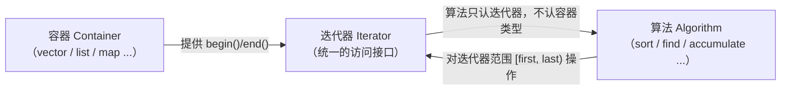
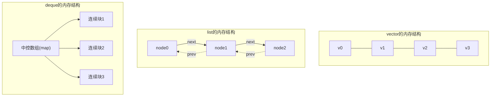
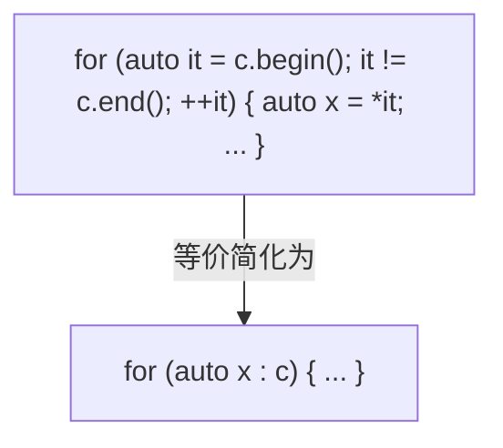
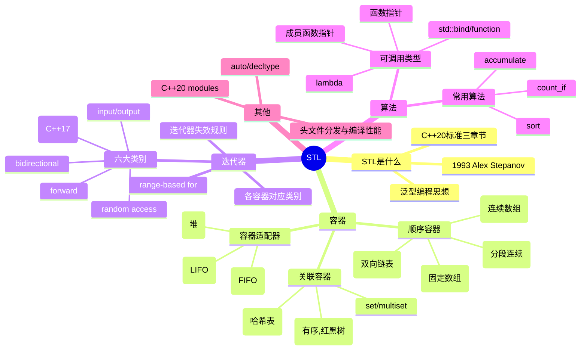

 > [!info]
 **title**: C++ STL（标准模板库）完整笔记 
**course**: 中山大学《C++语言》Week16-17 
**author**: 笔记整理（根据田海博老师课件）
**tags**: #CPP, #STL, #容器, #迭代器, #算法, #数据结构

> [!info] 写在前面 本笔记基于《C++语言标准模板库(STL)》第16、17周课件整理，在课件原有内容基础上，对每个概念做了**通俗化解释 + 严谨定义**双重展开，并补充了较高难度的例题（含逐步推演），方便复习与自测。 建议配合 Obsidian 的大纲视图（Outline）食用。

## 目录

- [[#1. STL 是什么|1. STL 是什么]]
    - [[#1.1 严谨定义|1.1 严谨定义]]
    - [[#1.2 STL 的历史|1.2 STL 的历史]]
    - [[#1.3 STL 的核心思想：泛型编程|1.3 STL 的核心思想：泛型编程]]
- [[#2. 容器（Containers）|2. 容器（Containers）]]
    - [[#2.0 基本概念：容器与迭代器|2.0 基本概念：容器与迭代器]]
    - [[#2.1 顺序容器（Sequence Containers）|2.1 顺序容器（Sequence Containers）]]
    - [[#2.2 关联容器（Associative Containers）|2.2 关联容器（Associative Containers）]]
    - [[#2.3 容器适配器（Container Adaptors）|2.3 容器适配器（Container Adaptors）]]
- [[#3. 迭代器（Iterators）|3. 迭代器（Iterators）]]
    - [[#3.1 迭代器的六大类别|3.1 迭代器的六大类别]]
    - [[#3.2 各容器对应的迭代器类别|3.2 各容器对应的迭代器类别]]
    - [[#3.3 基于范围的 for 循环（C++11）|3.3 基于范围的 for 循环（C++11）]]
    - [[#3.4 迭代器失效（重点难点）|3.4 迭代器失效（重点难点）]]
- [[#4. 算法（Algorithms）|4. 算法（Algorithms）]]
    - [[#4.1 可调用（Callable）类型（选讲但重要）|4.1 可调用（Callable）类型（选讲但重要）]]
    - [[#4.2 常用泛型算法实例|4.2 常用泛型算法实例]]
- [[#5. 其他选讲内容|5. 其他选讲内容]]
    - [[#5.1 auto 与 decltype|5.1 auto 与 decltype]]
    - [[#5.2 STL 编译性能问题|5.2 STL 编译性能问题]]
    - [[#5.3 C++20 Modules 展望|5.3 C++20 Modules 展望]]
- [[#6. 全局知识导图|6. 全局知识导图]]
- [[#7. 综合提升例题（难度较高）|7. 综合提升例题（难度较高）]]
- [[#8. 易错点 速查清单|8. 易错点 速查清单]]

---

## 1. STL 是什么

### 1.1 严谨定义

很多人以为 STL 是某个"库文件"，其实并不准确。我们先给出通俗理解，再给严谨定义。

**通俗理解**：STL 是 C++ 标准库里专门用来"装数据 + 操作数据"的那一部分内容。打个比方，如果把写程序比作做菜：

- **容器（Container）** 就是各种锅碗瓢盆（用来"盛放"食材/数据）；
- **迭代器（Iterator）** 就是夹菜的筷子/勺子（用来"夹取/遍历"容器里的东西，且不关心锅是什么材质）；
- **算法（Algorithm）** 就是炒、煮、炖等具体操作手法（拿到"筷子"就能对任何"锅"里的食材操作，不需要为每种锅单独写一套炒菜方法）。

**严谨定义**：STL（Standard Template Library）这个名字本身是**历史遗留称呼**——在 C++20 标准草案中已经找不到"STL"这个词了。现行标准把原来 STL 所指代的内容拆分成三个独立的库章节：

|标准章节|中文名|内容|
|---|---|---|
|Chap. 26 Containers library|容器库|`vector`、`list`、`map` 等数据结构|
|Chap. 27 Iterators library|迭代器库|遍历容器的统一接口规范|
|Chap. 28 Algorithms library|算法库|`sort`、`accumulate` 等通用算法|

> [!note] 严谨说明 因此严格来说，"STL" ≈ "容器库 + 迭代器库 + 算法库" 这三章定义的内容的统称，是一个**约定俗成的概念**，而不是标准中一个正式定义的术语。这也是为什么不同教材对"STL 包含哪些内容"的描述可能略有差异（有的还把 `<functional>`、`<numeric>` 也算进去）。

### 1.2 STL 的历史

- **1993 年**，Alex Stepanov 在 HP 实验室开发出 STL 的原型，当时命名为 _Generic C++ Components_（通用 C++ 组件）。
- 后被 C++ 标准委员会采纳进入 C++ 标准，正式命名为 _The Standard Template Library_。
- Stepanov 早年在贝尔实验室与 Andrew Koenig 共事时就已经在探讨模板机制与库设计，他的核心理念是：**"模板要更通用，性能要更强"**。

> [!tip] 一句话记忆 STL 诞生的根本驱动力是**泛型编程（Generic Programming）**——希望"一份算法代码"能套用在"任意满足条件的数据结构"上，而不必为每种数据结构重复实现同一个算法。

### 1.3 STL 的核心思想：泛型编程

为什么 STL 要把"容器""迭代器""算法"拆成三个独立的库？这是这门课最值得理解透的一点。

如果不用 STL 的设计思路，你想对 `vector` 排序，得写一个 `sortVector()`；对 `list` 排序，又要写一个 `sortList()`——算法和数据结构**强耦合**，重复劳动巨大。

STL 用"**迭代器**"做了一层**解耦**：



> [!note] 严谨说明 这正是"泛型编程"的本质：**算法对"概念"（Concept，比如"随机访问迭代器"）编程，而不是对"具体类型"编程**。只要某个迭代器满足"随机访问迭代器"的所有操作要求（`++`、`--`、`+n`、`[]` 等），`sort` 就能对它工作，完全不关心它背后到底是 `vector` 还是程序员自己写的某种容器。这也解释了为什么本笔记后面要单独花大篇幅讲"迭代器类别"——**类别决定了一个容器能用哪些算法**。

---

## 2. 容器（Containers）

### 2.0 基本概念：容器与迭代器

**C++ 标准对容器的定义**（原文翻译）：_Containers are objects that store other objects._（容器是储存其他对象的对象。）

这句话看似简单，但背后有严谨含义：容器**不只是"存"**，它还要按统一规范提供"存取、增删、遍历、容量查询"等一整套接口，这样不同容器才能被同一套算法操作。

**容器的四大分类**：

|类别|特点|代表|
|---|---|---|
|序列式容器（Sequence）|元素按线性顺序排列，位置由插入操作决定，不强制排序|`vector`、`list`、`deque`、`array`|
|关联式容器（Associative）|元素按**键（key）**组织，内部有序（通常是红黑树）|`map`、`set`、`multimap`、`multiset`|
|无序关联式容器（Unordered Associative）|同上但内部用哈希表实现，**不保证顺序**|`unordered_map`、`unordered_set`|
|容器适配器（Container Adaptor）|不是独立容器，是"包装"某个顺序容器，**限制并重新包装接口**|`stack`、`queue`、`priority_queue`|

> [!tip] 通俗理解 简单说，每一类容器对应一种"取数据的方式偏好"：序列式容器关心"第几个"；关联式容器关心"按什么键查"；容器适配器关心"按什么规则进出"（后进先出/先进先出/优先级）。

**迭代器的概念（先导入，第 3 章详细展开）**：

迭代器是**每种容器各自定义的、与容器本身不同的一个类**（例如 `vector<T>::iterator`、`map<K,V>::iterator`），它的职责是：访问、修改、增加、删除容器中的元素，但**对外暴露统一的操作符接口**（如 `*`、`++`、`==`），从而让算法可以"盲操作"。

按功能强弱，C++17 之前迭代器分为 5 类（输入、输出、单向/正向、双向、随机访问），C++17 又加入了第 6 类——**连续迭代器（Contiguous Iterator）**，专门描述像 `vector`、`array` 这种"元素物理上连续存放"的特性（这一点在 3.1 节详细展开）。

---

### 2.1 顺序容器（Sequence Containers）

#### 2.1.1 三大主力容器对比

|容器|中文|头文件|底层实现|插入/删除特点|随机访问|
|---|---|---|---|---|---|
|`vector`|动态连续数组|`<vector>`|一段连续内存的数组|尾部插入/删除快（O(1) 均摊），中间插删慢（O(n)）|✅ 支持，O(1)|
|`list`|双向链表|`<list>`|每个节点含数据+前后指针|任意位置插入/删除快（O(1)）|❌ 不支持，只能逐个移动|
|`deque`|双端队列|`<deque>`|若干段连续内存块，由一个"中控数组"管理这些块的指针|两端插入/删除快（O(1)），中间慢（O(n)）|✅ 支持，O(1)（但比 vector 略复杂）|
|`array`|固定长度数组|`<array>`|编译期确定大小的连续数组（对 C 数组的封装）|**不支持插入删除**，大小在编译期固定|✅ 支持，O(1)|

> [!note] 严谨说明：deque 的底层结构 `deque` 不是简单的一段连续内存，而是"**分段连续**"：用一个中控数组（map）存放若干指针，每个指针指向一段固定大小的连续内存块。这样设计的好处是：在**两端**插入元素时，只需在头部或尾部新开一个内存块（不需要像 `vector` 那样整体搬迁），所以 `deque` 特别适合**两端频繁插入和删除**的场景；而它依然能做到 O(1) 随机访问，是因为"第几块 + 块内第几个"可以通过简单的除法/取余计算出来。



> [!warning] 易错点：选错容器
> 
> - 需要**频繁随机访问**（按下标读写）→ 优先 `vector`。
> - 需要**频繁在中间插入/删除** → 优先 `list`。
> - 需要**两端频繁插入/删除**（如实现队列、滑动窗口）→ 优先 `deque`。
> - 大小**编译期已知且固定**、追求零额外开销 → `array`。 选错容器不会报错，但会导致性能严重退化（典型考点：在 `vector` 头部反复 `insert` 是 O(n)，而 `list`/`deque` 是 O(1)）。

#### 2.1.2 顺序容器的构造函数

|写法|含义|
|---|---|
|`C<T> c;`|创建空容器|
|`C<T> c(cx);`|用容器 `cx` 拷贝构造（类型、元素类型必须一致）|
|`C<T> c(b, e);`|用迭代器区间 `[b, e)` 内的元素初始化（左闭右开！）|
|`C<T> c(n, t);`|创建 n 个值为 t 的元素|
|`C<T> c(n);`|创建 n 个**值初始化**（对内置类型即 0）的元素|
|`C<T> c({...});` 或 `C<T> c = {...};`|C++11 列表初始化，最常用|

> [!warning] 易错点：`[b, e)` 是半开区间 凡是 STL 里用"一对迭代器"表示范围的地方，**几乎全部约定为左闭右开** `[b, e)`：包含 `b` 指向的元素，**不包含** `e` 指向的元素。这是贯穿整个 STL 的统一规约（`insert`、`erase`、`assign`、`sort` 等全部遵守），考试中经常通过"边界是否多删/少删一个元素"来设陷阱。

```cpp
// 5 种典型构造方式（务必记住"值初始化 vs 指定初值"的区别）
vector<int> ivec1(10);                                   // 10 个 0（值初始化）
vector<int> ivec2(10, 1);                                 // 10 个 1（指定初值）
int ia[10] = {0,1,2,3,4,5,6,7,8,9};
vector<int> ivec3(ia, ia + 10);                            // 用数组区间拷贝（左闭右开，ia+10 不包含）
vector<int> ivec4(ivec3);                                  // 拷贝构造
vector<int> ivec5 = {1, 2, 3, 4};                           // C++11 列表初始化
```

#### 2.1.3 访问元素

|用法|返回|备注|
|---|---|---|
|`c.front()`|第 0 个元素的**引用**|容器为空时行为未定义|
|`c.back()`|最后一个元素的**引用**|容器为空时行为未定义|
|`c[index]`|下标为 index 的元素引用|**不检查越界**；`list` 不支持该操作（因为底层链表无法 O(1) 随机访问）|
|`c.at(index)`|下标为 index 的元素引用|**检查越界**，越界抛出 `std::out_of_range` 异常；`list` 同样不支持|

> [!example] 课件例题 exp1.cpp 逐步推演
> 
> ```cpp
> vector<int> ivec = {0,1,2,3,4,5,6,7,8,9};
> ivec.front() = 100;          // 第0个元素 0 -> 100
> cout << ivec[0];             // 输出 100
> ivec[1] = 102;                // 第1个元素 1 -> 102
> ivec.at(2) = 103;             // 第2个元素 2 -> 103
> ivec.back() = 999;            // 最后一个元素 9 -> 999
> // 最终 ivec = {100,102,103,3,4,5,6,7,8,999}
> ```
> 
> **要点解释**：`operator[]` 和 `front()/back()/at()` 都返回**左值（引用）**，因此可以直接赋值修改元素，这一点在赋值号左边出现 `front()`、`at()` 时很容易被忽视。

> [!danger] 重难点：operator[] 不检查越界 = 未定义行为 `ivec[100]`（远超容器大小）**不会**抛异常、**不会**报错退出，而是**未定义行为（Undefined Behavior, UB）**——可能崩溃，也可能"看似正常"地读到一个无意义的值，这恰恰是最危险的地方：程序不报错却已经出错。这是 C++ 高频考点：`operator[]` 为性能放弃了安全检查，`at()` 为安全放弃了一点性能（多一次比较）。

#### 2.1.4 用迭代器访问容器

|用法|返回|备注|
|---|---|---|
|`c.begin()` / `c.cbegin()`|指向第 0 个元素的迭代器|带 `c` 前缀返回**常迭代器**（只读，C++11 引入）|
|`c.end()` / `c.cend()`|指向"最后一个元素的下一位置"的迭代器（**不可解引用！**）|同上|
|`c.rbegin()` / `c.crbegin()`|指向最后一个元素的**逆向迭代器**|用于反向遍历|
|`c.rend()` / `c.crend()`|指向第 0 个元素**前一位置**的逆向迭代器|同上|

> [!note] 严谨说明：为什么 `end()` 不指向最后一个元素？ 这是 STL 统一约定的"哨兵"设计：`[begin(), end())` 永远是一个合法的左闭右开区间，无论容器是否为空（容器为空时 `begin() == end()`）。如果让 `end()` 直接指向最后一个元素，那么空容器和非空容器的判空、遍历逻辑就要分别处理，代码会复杂得多。这个设计贯穿所有容器、所有算法。

> [!example] 课件例题 exp2.cpp（反向迭代器）逐步推演
> 
> ```cpp
> vector<int> ivec(10, 2);                 // 10个值为2的元素
> auto iter = ivec.begin();
> *iter += 10;                              // 第0个元素 2 -> 12
> auto riter = ivec.rend();                 // riter 指向"第0个元素前一位置"
> *(riter - 1) += 10;                        // riter-1 恰好指向第0个元素！ 12 -> 22
> iter = ivec.end();
> *(iter - 1) = 100;                         // iter-1 指向最后一个元素   2 -> 100
> riter = ivec.rbegin();                     // riter指向最后一个元素
> *riter -= 20;                              // 100 -> 80
> // 最终: {22,2,2,2,2,2,2,2,2,80}
> ```
> 
> **理解关键**：`rend() - 1` 恰好"绕回"指向第 0 个元素，`rbegin()` 直接指向最后一个元素——这是因为逆向迭代器内部对 `*` 操作做了"偏移一位再取值"的封装（`*riter` 实际等价于 `*(base() - 1)`，`base()` 是其对应的正向迭代器位置）。**不要死记结论，理解"逆向迭代器与正向迭代器存在一位偏移"这一原理**，遇到变体题才不会出错。

#### 2.1.5 在序列式容器中插入元素

|用法|返回值|操作效果|
|---|---|---|
|`c.insert(iter, t)`|指向新插入元素的迭代器|在 `iter` 所指元素**之前**插入值为 `t` 的元素|
|`c.insert(iter, n, t)`|无|在 `iter` 之前插入 n 个值为 t 的元素|
|`c.insert(iter, b, e)`|无|在 `iter` 之前插入区间 `[b, e)` 的元素|
|`c.push_back(t)`|无|尾部插入|
|`c.push_front(t)`|无|头部插入（**`vector` 不支持！**因为头部插入需要把所有现有元素整体后移，O(n) 代价 STL 认为不该被设计为"看起来很轻量"的成员函数名）|

> [!example] 课件例题 addElementsDemo.cpp 逐步推演
> 
> ```cpp
> vector<int> ivec;
> for (int i = 1; i < 11; i++) ivec.push_back(i);     // {1,2,...,10}
> ivec.insert(ivec.begin(), 20);                       // 头部插入20: {20,1,2,...,10}
> ivec.insert(ivec.begin() + 4, 2, 30);                // 第4个位置前插入2个30
> //                                                       下标0,1,2,3 是 20,1,2,3 → 在下标4之前插
> //                                                       结果: {20,1,2,3,30,30,4,5,6,7,8,9,10}
> int iarr[] = {100,100,100};
> ivec.insert(ivec.end(), iarr, iarr + 3);             // 尾部追加整个数组
> ```
> 
> **易错点**：`ivec.insert(ivec.begin() + 4, 2, 30)` 中的"4"是**插入点的下标**，不是"在第4个元素后面插入"；并且 `iarr + 3` 是**左闭右开**的终点，要插入 `iarr` 全部 3 个元素，终点必须是 `iarr + 3` 而不是 `iarr + 2`——这是这门课反复强调的"差一错误"（off-by-one error）高发区。

#### 2.1.6 在序列式容器中删除元素

|用法|返回值|操作效果|备注|
|---|---|---|---|
|`c.clear()`|无|删除所有元素||
|`c.erase(iter)`|指向被删除元素**下一元素**的迭代器|删除 `iter` 所指元素|若 `iter == c.end()`，行为未定义|
|`c.erase(b, e)`|指向被删除元素段**下一元素**的迭代器|删除区间 `[b, e)` 的所有元素||
|`c.pop_back()`|无|删除最后一个元素|容器为空则未定义行为|
|`c.pop_front()`|无|删除第一个元素|**`vector` 不支持**（原理同 push_front：头部删除需整体前移 O(n)）|

> [!example] 课件例题 elementDeleteDemo.cpp ——**这是本章最值得吃透的难点**
> 
> ```cpp
> deque<int> ideq = {1,2,3,4,5,6,7,8,9,10};
> ideq.pop_front();                 // 删除1 → {2,3,4,5,6,7,8,9,10}
> ideq.pop_back();                  // 删除10 → {2,3,4,5,6,7,8,9}
> auto iter = ideq.begin();         // iter -> 指向元素 2
> ideq.erase(ideq.erase(iter + 1));  // ★ 这一行是重点，逐步拆解见下
> ```
> 
> **逐步拆解 `ideq.erase(ideq.erase(iter + 1))`：**
> 
> 1. C++ 函数实参求值顺序要求**内层调用先完整执行**：先算 `iter + 1`，指向当前序列 `{2,3,4,5,6,7,8,9}` 中下标 1 的元素，即值 `3`。
>     
> 2. 执行内层 `ideq.erase(iter+1)`：删除值为 `3` 的元素，容器变为 `{2,4,5,6,7,8,9}`，**返回值**是"指向被删元素的下一个元素"的迭代器，也就是现在指向值 `4` 的位置。
>     
> 3. 外层 `ideq.erase(...)` 拿到内层返回的、指向 `4` 的迭代器，**再删一次**：删除值为 `4` 的元素，容器变为 `{2,5,6,7,8,9}`。
>     
> 4. **最终结果**：`{2,5,6,7,8,9}`，与课件给出的输出完全一致。
>     
> 
> > [!danger] 为什么这是一个"重难点" 很多同学第一眼会以为这行代码"只删除了 1 个元素"，但实际上**嵌套调用 `erase` 会连续删除两个元素**：内层删一个，并把"删除后空出的下一个位置"作为迭代器传给外层，外层再删一次。**牢记套路**：`c.erase(c.erase(it))` 总是删除 `it` 和 `it` 删除后紧邻的下一个元素，效果等价于删除原序列中连续两个元素 `*it` 和 `*(it+1)`（按删除前的下标看）。

#### 2.1.7 比较操作

|操作|结果|
|---|---|
|`==`|元素个数相同 **且** 对应位置元素全部相等 → `true`|
|`!=`|与 `==` 相反|
|`<`、`<=`、`>`、`>=`|**字典序（lexicographic order）比较**：逐位比较，若全部对应位置相等但一个容器先结束，则较短的容器"更小"；否则以第一对不相等的元素的比较结果为准|

> [!note] 严谨说明：字典序比较的精确定义 设两个序列 A、B，从头开始逐位比较：
> 
> - 若某一位 `A[i] != B[i]`，则整个序列的比较结果 = `A[i]` 与 `B[i]` 的比较结果；
> - 若一直相等比到某个序列结束，则**较短的序列视为更小**（哪怕剩下的元素都更大）。
> 
> 这正是字典里单词排序的逻辑：`"app"` < `"apple"`（前者是后者的前缀，更短）。

> [!example] 课件例题 containerCompare.cpp
> 
> ```cpp
> int iarr[] = {1,2,3,4,5,6,7,8,9,10};
> list<int> ilist1(iarr, iarr+10);        // {1,...,10}
> list<int> ilist2(iarr, iarr+5);         // {1,2,3,4,5}
> list<int> ilist3(ilist2);               // {1,2,3,4,5}
> list<int> ilist4(ilist2);
> ilist4.push_back(12); ilist4.push_back(7); // {1,2,3,4,5,12,7}
> 
> ilist2 == ilist3;   // true  （元素逐一相等）
> ilist1 < ilist2;    // false （比较：1=1,2=2,3=3,4=4,5=5，到这里ilist2结束，
>                      //         ilist2更短 → ilist2 < ilist1，故 ilist1<ilist2 为 false）
> ```

#### 2.1.8 容量操作

|用法|返回|备注|
|---|---|---|
|`c.empty()`|容器是否为空||
|`c.size()`|当前元素个数（类型 `C::size_type`，是无符号整型！）||
|`c.max_size()`|该容器理论上能容纳的最大元素数|通常是个巨大的理论值，意义不大|
|`c.resize(n)`|无|调整为 n 个元素：若 `n < size()` 则截断多余元素；否则尾部补"值初始化"新元素|
|`c.resize(n, t)`|无|同上，但新增元素的值为 `t`|

> [!danger] 易错点：`size()` 是无符号类型 `c.size()` 返回的是无符号整型 `size_type`。如果你写 `if (c.size() - 1 >= 0)` 来判断"长度大于1"，**当 `c.size() == 0` 时，`0 - 1` 在无符号运算下会变成一个巨大的正数**（环绕/溢出），导致条件永远为真，造成访问越界！这是非常经典的 C++ 笔试陷阱题。安全写法是 `if (c.size() >= 1)` 或先转换为 `int`/`long` 再做减法。

#### 2.1.9 赋值和交换

|用法|操作效果|备注|
|---|---|---|
|`c1 = c2`|先清空 c1，再把 c2 的元素全部复制给 c1|c1、c2 须同类型|
|`c.assign(b, e)`|先清空 c，再复制区间 `[b,e)` 的元素到 c|`b,e` 不能指向 c 自身的元素；元素类型只需"类型兼容"，不必完全相同|
|`c.assign(n, t)`|先清空 c，再放入 n 个值为 t 的元素||
|`c1.swap(c2)`|交换 c1、c2 的全部元素|**本质是交换内部指针/句柄（"交换名字"），是 O(1) 操作！不是逐元素拷贝**|

> [!tip] 重点记忆：swap 是 O(1) 很多同学会以为 `swap` 是把两个容器的元素一个个搬过去，其实标准库实现里 `swap` 只是交换两个容器对象内部指向数据的指针（以及容量、大小等元信息），**复杂度是 O(1)**，与容器大小无关。这也是为什么"交换两个巨大 vector 的内容"在 STL 里几乎零成本，而手写 `for` 循环逐个赋值则是 O(n)。

---

### 2.2 关联容器（Associative Containers）

#### 2.2.1 基础术语（务必先吃透概念再看代码）

关联容器解决的是"**按某种标识快速查找一条记录**"的问题，类比生活中的字典数据：学生名册、电话簿、维基百科词典、图书目录……它们的共同结构是"**关键字 → 内容**"：

|抽象概念|严谨术语|例子|
|---|---|---|
|整个"字典"|Map / Dict（映射/字典）|整本电话簿|
|用来查找的标识|Key（关键字）|姓名|
|对应的内容|Value（映射值）|电话号码|
|一条"关键字-内容"记录|Pair / Item（对/项）|"张三 → 1380000xxxx" 这一条|
|只关心"有没有"，不关心"对应什么值"|Set（集合）|一份只记录"已注册学号"的名单|

> [!note] 严谨说明：Set 的两个本质特征 Set 是一种特殊的"只存 Key、不存 Value"的关联容器，它有两个数学意义上的性质：**元素无顺序意义上的"位置"概念**（不能像 vector 那样按下标取第 i 个）、以及**元素不重复**（这与数学中"集合"的定义一致：集合中元素互不相同）。

#### 2.2.2 关联容器家族总览

|类名|说明|头文件|
|---|---|---|
|`map`|通过键存取元素的关联数组，**键唯一**|`<map>`|
|`multimap`|支持**重复键**的关联数组|`<map>`|
|`set`|任意元素的集合，**元素唯一**|`<set>`|
|`multiset`|可以重复的集合|`<set>`|
|`unordered_map`|无序版 map，底层是哈希表|`<unordered_map>`|
|`unordered_set`|无序版 set，底层是哈希表|`<unordered_set>`|

> [!note] 严谨说明：有序 vs 无序的本质差异 `map`/`set` 系列底层通常用**红黑树**（一种自平衡二叉搜索树）实现，因此元素按 Key **始终保持排序**，查找/插入/删除均为 O(log n)；而 `unordered_map`/`unordered_set` 底层用**哈希表**实现，元素顺序与插入顺序、Key大小都无关，平均情况下查找/插入/删除是 **O(1)**，但最坏情况（哈希冲突严重）退化为 O(n)。**选择依据**：需要"按 Key 排序遍历"或者"做范围查询（如 `lower_bound`）" → 必须用有序版；只追求平均最快查找、不关心顺序 → 用无序版。

#### 2.2.3 std::pair —— 关联容器的"原子单位"

`map` 的很多接口背后都用到了 `<utility>` 头文件里的 `std::pair`：`pair<T1, T2>` 代表一个由类型 `T1` 和 `T2` 组成的**有序对**。

```cpp
std::pair<string, int> p1("Tom", 18);     // 直接构造
auto p2 = make_pair("Tom", 18);            // 用 make_pair 自动推导类型，更省心
cout << p2.first << " " << p2.second;       // 通过 .first / .second 访问
```

> [!tip] 通俗理解 把 `pair` 想象成一个**只有两个格子的固定结构体**：第一个格子叫 `first`，第二个格子叫 `second`。`map` 里存的每一条记录，本质上都是一个 `pair<const Key, Value>`（注意 Key 部分是 `const`，防止你不小心改了已经排好序的关键字，破坏树结构——这是个常被忽视的细节）。

#### 2.2.4 map 的构造函数

|写法|说明|
|---|---|
|`map<K,T> m;`|创建空 map|
|`map<K,T> m(mx);`|拷贝构造，键值类型须一致|
|`map<K,T> m(b, e);`|用迭代器区间初始化|
|`map<K,T> m = {{...}, {...}};`|C++11 初始化列表，最方便|

#### 2.2.5 向 map 中插入元素

`map::insert` 有多达 9 种重载，但实际常用的就两种思路：

```cpp
std::map<string,int> m = {{"hello", 1}};
m.insert({"h", 10});                       // 用初始化列表构造 pair 插入
m.insert(std::pair{"Kageyama", 180.6});     // 用 pair 显式插入

// 最简便、也是推荐写法：用 operator[]
m["me"] = 10;
```

`insert` 的返回值是一个 `pair<iterator, bool>`：第一个元素是指向被插入（或已存在）元素的迭代器，第二个元素表示**插入是否真正发生**（如果 Key 已存在，`insert` 不会覆盖原值，`bool` 为 `false`）。

> [!danger] 重难点：`operator[]` 的"插入或修改"双重语义 `m["me"] = 10` 这行代码背后藏着一个常被忽略的细节：**`operator[]` 在 Key 不存在时会先用 `mapped_type`（即 Value 的类型）的默认构造函数创建一个值，插入这个新的 `(key, 默认值)` 对，再把右边的值赋给它**。也就是说：
> 
> - 若 Key **不存在** → 等价于"先插入一个默认值的新元素，再赋值"（新增一条记录）；
> - 若 Key **已存在** → 直接覆盖原来的 Value（修改一条记录）。
> 
> 这意味着 **`operator[]` 要求 Value 类型必须有默认构造函数**，否则编译失败；而 `insert` 没有这个要求。课件中提到"我们推荐 `operator[]` 这种写法以保证代码的洁净"，是因为它用一种语法统一处理了"插入"和"修改"两种语义，但代价是**你无法用它区分"这是新插入的"还是"我刚刚覆盖了一条已有数据"**——这种场合就必须改用 `insert` 并检查其返回的 `bool`。

#### 2.2.6 在 map 中查找元素

|用法|返回值|
|---|---|
|`m.find(k)`|若存在键为 `k` 的元素，返回指向它的迭代器；**否则返回 `m.end()`**|
|`m.count(k)`|键 `k` 在容器中出现的次数|

> [!note] 严谨说明 对 `map`/`set` 这种"键唯一"的容器，`m.count(k)` 的结果**只能是 0 或 1**（因为不允许重复键）。这与 `multimap`/`multiset` 形成鲜明对比——后者的 `count` 可以返回任意大于 1 的值。**所以在 `map` 上用 `m.count(k)` 来判断"是否存在该键"，效果等价于、但语义上不如 `m.find(k) != m.end()` 直观**，这也是为何很多写法上偏好 `find`。

#### 2.2.7 在 map 中删除元素

|用法|返回值|操作效果|
|---|---|---|
|`m.erase(k)`|被删除元素个数（0 或 1）|删除键为 `k` 的元素，若返回 0 说明该键不存在|
|`m.erase(iter)`|指向下一元素的迭代器（现行 C++ 标准）|删除 `iter` 所指元素，`iter == c.end()` 时行为未定义|
|`m.erase(b, e)`|同上|删除区间 `[b,e)` 内所有元素|

> [!note] 关于 `erase(iter)` 返回值的版本差异（严谨补充） 课件表格标注 `m.erase(iter)` "返回值：无"，这其实是较早期标准的行为；**自 C++11 起，关联容器的 `erase(iter)` 与 `erase(b,e)` 同样返回"指向被删元素之后位置"的迭代器**，与顺序容器的行为一致。写代码时建议以现行标准为准，但读老教材描述时要能识别这种历史差异。

#### 2.2.8 multimap 的特殊性

`multimap` 允许重复键，因此带来一些 `map` 没有的限制和功能：

- **不支持下标操作** `m[k]`（因为一个键可能对应多个值，`[]` 无法返回唯一的引用）。
- `insert` 每调用一次都增加一个新元素（**键相同的元素相邻存放**，这是底层红黑树/有序结构保证的）。
- `erase(k)` 删除该键关联的**所有**元素，返回被删除的元素数目（可能 > 1）。
- `count(k)` 返回该键的出现次数（可能 > 1）。
- `find(k)` 返回指向"第一个"匹配元素的迭代器。
- 要遍历某个键对应的**全部**元素，需要结合 `find` + `count`，或更标准的做法——`equal_range`。

|用法|返回值|说明|
|---|---|---|
|`m.lower_bound(k)`|指向第一个键 **≥** k 的元素的迭代器|若 k 不存在，指向"k 应该插入的位置"|
|`m.upper_bound(k)`|指向第一个键 **>** k 的元素的迭代器||
|`m.equal_range(k)`|一对迭代器 `pair<iterator,iterator>`，`first = lower_bound(k)`，`second = upper_bound(k)`|等价于"键为 k 的元素所在的整个区间"|


> [!example] multimap 遍历某个键的全部元素的标准写法
> 
> ```cpp
> multimap<string,string> phoneBook; // 姓名 -> 多个电话号码
> // ... 插入若干 LiSi 的多个号码 ...
> auto range = phoneBook.equal_range("LiSi");
> for (auto it = range.first; it != range.second; ++it) {
>     cout << it->second << endl;     // 依次输出 LiSi 的所有号码
> }
> ```

#### 2.2.9 set 与 map 的三点区别

1. **不支持下标操作**（map 支持，set 不支持，原因同上——一个 Key 不一定能"被取下标取出 Value"，set 本身就没有独立的 Value）。
2. set **没有** `mapped_type` 这个成员类型（因为没有"映射值"概念）。
3. set 定义的 `value_type` **不是 `pair` 类型**，而是直接等于 `key_type`——也就是说，set 中"元素"和"键"是同一个东西，体现了 set "只有键、没有值"的本质。

> [!example] set 的一个易忽视细节
> 
> ```cpp
> std::set<int> s = {1, 2, 3, 4};
> auto iter1 = s.find(3);
> auto iter2 = s.insert(3);   // 3 已存在，不会真的插入
> auto b = (iter1 == iter2);  // b 为 true！
> ```
> 
> **解释**：`set::insert` 在元素已存在时，**不会**做任何插入或覆盖动作，而是直接返回**指向已存在的那个相同元素**的迭代器（其返回值实际是 `pair<iterator,bool>`，这里 `iter2` 取的是 `.first`）。因此 `iter1`（之前 `find` 得到的迭代器）与 `iter2`（这次插入返回的迭代器）指向同一个元素，比较结果为 `true`。

---

### 2.3 容器适配器（Container Adaptors）

#### 2.3.1 什么是"适配器"

> [!tip] 通俗理解 "适配器模式（Adapter Pattern）"是一种通用的软件设计思想：**不重新发明轮子，而是给已有的东西"换一层包装"，让外部看到的接口符合新的使用习惯**。比如一个"USB 转 Type-C 转接头"——内部还是 USB 接口的电路，但对外呈现的是 Type-C 的形状。

**严谨定义**：标准库中的容器适配器（`stack`、`queue`、`priority_queue`）**不是独立实现的数据结构**，而是基于某个已有的**顺序容器**，通过限制/重新组合其成员函数，对外提供一套新的、更受限但语义更明确的接口。

#### 2.3.2 三种适配器接口总览

| 类名               | 说明                                    | 头文件       |
| ---------------- | ------------------------------------- | --------- |
| `stack`          | 栈，只能在栈顶插入/删除，**后进先出**（LIFO）           | `<stack>` |
| `queue`          | 队列，尾部插入、头部删除，**先进先出**（FIFO）           | `<queue>` |
| `priority_queue` | 优先队列，元素始终按优先级从高到低排列，用元素的 `<` 运算符确定优先级 | `<queue>` |
|                  |                                       |           |

**接口与底层容器操作的对应关系**（这张表是理解"适配器到底适配了什么"的关键）：

|适配器操作|stack 底层调用|queue 底层调用|priority_queue 底层调用|
|---|---|---|---|
|`push(item)`|`push_back`|`push_back`|`push_back` + 堆算法 `push_heap` 重排|
|`pop()`|`pop_back`|`pop_front`|堆算法 `pop_heap` 移堆顶到末尾 + `pop_back`|
|取栈顶/队首 `top()`/`front()`|`back()`|`front()`|`front()`（其实就是堆顶）|
|`empty()` / `size()`|直接转调底层容器同名函数|同左|同左|

> [!note] 严谨说明：priority_queue 的 push/pop 不是简单转调 `stack` 和 `queue` 的每个操作都**直接**转调底层容器的对应函数（一行代码搞定）；但 `priority_queue` 的 `push`/`pop` 多了一步——它需要维护"堆"这种隐式的有序结构（具体是**二叉堆**），所以 `push` 之后还要调用 `<algorithm>` 里的 `push_heap` 把新元素"浮"到正确位置，`pop` 之前要先调用 `pop_heap` 把堆顶（最大/最小）元素换到末尾，然后才能用底层容器的 `pop_back` 把它真正移除。

#### 2.3.3 适配器可以建立在哪些底层容器上

|适配器|可用的底层容器|默认底层容器|
|---|---|---|
|`stack`|`vector`、`list`、`deque`|`deque`|
|`queue`|`list`、`deque`（**不能用 vector**）|`deque`|
|`priority_queue`|`vector`、`deque`（**不能用 list**）|`vector`|

> [!danger] 重难点：为什么不能任意搭配？——必须从"需要哪种操作"反推
> 
> - `stack` 只需要 `back()`、`push_back()`、`pop_back()` 三个操作。这三者在 `vector`、`list`、`deque` 上都是 O(1)，所以三者皆可，是最"宽容"的适配器。
> - `queue` 需要 `back()`（入队）、`front()`（出队取值）、`push_back()`（入队）、`pop_front()`（出队删除）。**`vector` 没有 `pop_front()`**（如前文所述，`vector` 头部删除是 O(n)，标准库压根没给它提供这个成员函数），所以 `queue` 不能用 `vector` 做底层。
> - `priority_queue` 内部要靠 `<algorithm>` 的堆算法（`push_heap`/`pop_heap`）维护一个二叉堆。**堆的标准实现方式是把二叉树"压"进一个连续数组**，通过下标运算（父节点 `i`，左孩子 `2i+1`，右孩子 `2i+2`）定位元素，这要求底层容器支持**随机访问迭代器**。`list` 只提供双向迭代器，没有 `[]` 和 `+n` 操作，无法支撑堆算法，因此 `priority_queue` 不能用 `list`。

```cpp
// stack 模板定义（节选自标准库头文件 <stack>）
template<
    class T,
    class Container = std::deque<T>     // 默认用 deque
> class stack;
// 要求 Container 必须提供：back()、push_back()、pop_back()
// std::vector、std::deque、std::list 都满足这一要求
```

```cpp
#include <stack>
#include <deque>
int main() {
    std::stack<int> c1;          // 默认用 deque 做底层
    c1.push(5);
    std::cout << c1.size();       // 1

    std::stack<int> c2(c1);       // 拷贝构造

    std::deque<int> deq{3,1,4,1,5};
    std::stack<int> c3(deq);      // 指定底层容器内容来构造 stack
    std::cout << c3.size();       // 5
}
```

#### 2.3.4 综合例题：用 stack 判断回文串（课件 palindrome.cpp）

```cpp
bool palindrome(const string& text) {
    stack<char, std::vector<char>> cstack;     // 指定用 vector 做底层容器
    size_t length = text.size();
    size_t comparePos;
    // 1. 把前半部分逐个压入栈（压入后，栈顶是"前半部分的最后一个字符"）
    for (size_t i = 0; i < length / 2; i++)
        cstack.push(text[i]);
    // 2. 确定后半部分开始比较的位置（要跳过奇数长度时的"正中间那个字符"）
    comparePos = (length % 2 == 0) ? length / 2 : length / 2 + 1;
    // 3. 不断出栈并与后半部分逐个比较
    while (!cstack.empty()) {
        if (text[comparePos] != cstack.top()) break;   // 不相等，提前退出
        cstack.pop();
        comparePos++;
    }
    return cstack.empty();   // 栈完全弹空 = 全部匹配 = 是回文
}
```

> [!example] 原理推演：以 `"level"` 为例（长度5，奇数）
> 
> 1. `length/2 = 2`，压入前两个字符 `'l'`,`'e'` → 栈内（从底到顶）：`l, e`。
> 2. `comparePos = 2/2 + 1 = 3`（跳过下标2的 `'v'`，即正中间字符）。
> 3. 循环比较：栈顶 `'e'` vs `text[3]='e'` → 相等，弹出，`comparePos=4`；栈顶 `'l'` vs `text[4]='l'` → 相等，弹出，`comparePos=5`；栈为空，循环结束。
> 4. `cstack.empty()` 为 `true` → 是回文。✅
> 
> **设计精髓**：利用栈"后进先出"的特性，把字符串前半部分**反转**地存了一遍（栈顶变成最靠近中心的字符），这样出栈顺序恰好与"从中心往两边比较"的顺序自然对齐，不需要额外写反转逻辑。

---

## 3. 迭代器（Iterators）

### 3.1 迭代器的六大类别
迭代器按"支持的操作能力"由弱到强分为：

|类别|功能|支持的操作|备注|
|---|---|---|---|
|输入迭代器（Input Iterator）|只读|`*`（只能作右值）、`->`|解引用结果**只能作右值**使用，即只能读不能写|
|输出迭代器（Output Iterator）|只写|`*`（可作左值）、`->`|解引用结果**可作左值**，即可以写入但通常不能读|
|正向/单向迭代器（Forward Iterator）|读/写|`++`、`==`、`!=`|只能向前移动，不能后退|
|双向迭代器（Bidirectional Iterator）|读/写|`++`、`--`、`==`、`!=`|可前进也可后退|
|随机访问迭代器（Random Access Iterator）|读/写|`++`、`--`、`+`、`-`、`+=`、`-=`、`==`、`!=`、`<`、`<=`、`>`、`>=`、`[]`|`iter[n]` 等价于 `*(iter+n)`；支持任意跳转|
|连续迭代器（Contiguous Iterator，C++17 新增）|读/写|随机访问迭代器的全部操作|额外保证"元素在物理内存上连续存放"，可以安全转换为原生指针|

> [!note] 严谨说明：类别之间是"能力递增"的包含关系 这六类不是互相独立的平行分类，而是**层层递增**：双向迭代器一定满足正向迭代器的全部要求（再加上 `--`）；随机访问迭代器一定满足双向迭代器的全部要求（再加上算术运算）；连续迭代器一定满足随机访问迭代器的全部要求（再加上"内存物理连续"这一保证）。这意味着**一个能用随机访问迭代器的算法，自然也能接受连续迭代器；但一个要求随机访问迭代器的算法（如 `sort`），绝不能只用正向或双向迭代器**（这正是 `list` 不能直接用 `std::sort` 排序、必须用其自带成员函数 `list::sort()` 的根本原因）。

```cpp
int main() {
    // DEMO1：只读迭代器（const 容器的迭代器，或显式 cbegin）
    const vector<int> iv{1,2,3,4,5,6,7};
    auto it1 = iv.begin();
    // *it1 = 3;   // 错误：assignment of read-only location

    set<int> is{1,2,1,3,1,4};
    auto it2 = is.begin();
    // *it2 = 5;   // 错误：set 的迭代器对 Key 部分总是只读
}
```

```cpp
int main() {
    // DEMO2：forward / bidirectional / random access 的能力差异
    forward_list<int> ifl{1,2,3,4,5,6,7};
    list<int> ils{11,12,13,14,15,16,17};
    auto it3 = ifl.begin();
    it3++;
    // it3--;   // 错误：forward_list 的迭代器没有 operator--
    auto it4 = ils.begin();
    it4++; it4--;          // list 是双向迭代器，++、-- 都支持
    // it4 += 7;   // 错误：list 的迭代器没有 +=（不是随机访问）
}
```

### 3.2 各容器对应的迭代器类别

|容器|读/写|迭代器类别|备注|
|---|---|---|---|
|`array`|R/W|随机访问||
|`vector`|R/W|随机访问||
|`deque`|R/W|随机访问||
|`list`|R/W|双向|链表结构无法 O(1) 跳跃式访问，只能逐个 `++`/`--`|
|`set` / `multiset`|**R（只读）**|双向|见下方说明|
|`map` / `multimap`|**R（只读，针对 Key 部分）**|双向|见下方说明|
|`forward_list`|R/W|正向|单向链表，没有 `prev` 指针|

> [!danger] 重难点：为什么 set/map 的迭代器是"只读"的？ 这是一个非常高频的考点，很多人只记结论不理解原理。`set`/`map` 底层通常是红黑树，**元素的存储位置是按 Key 的大小严格排序排列好的**。如果允许通过迭代器直接修改 Key（比如 `*it = 新值`），那么这个元素在树中的位置就不再符合排序规则，整棵树的有序性就被破坏了，后续的查找、`lower_bound` 等操作全部失效。
> 
> - 对 `set`：元素本身就是 Key，所以**整个元素**都被设为只读（`set::iterator` 本质等同于 `const_iterator`）。
> - 对 `map`：元素是 `pair<const Key, Value>`，**Key 部分被 `const` 修饰为只读，但 Value 部分仍然可写**——这就是为什么你能用 `it->second = 新值` 修改 `map` 里的值，却不能用 `it->first = 新键` 修改键。
> 
> 严格来说，`set`/`map` 的迭代器类别本身允许"读写"操作（双向迭代器规范不要求一定只读），只是**它们对应的元素类型把 Key 设为了 `const`**，这是一种"类型层面的保护"，而不是"迭代器类别层面的限制"——理解这一点能帮你区分"迭代器能做什么操作"和"元素本身是否可修改"这两个不同维度的问题。

### 3.3 基于范围的 for 循环（C++11）



C++11 引入了"range-based for"语法糖：

```cpp
for (const auto& x : container) { /* ... */ }
```

`container` 需要满足以下任意一种条件才能使用这个语法：

1. 是一个数组（`array` 类型，编译期已知边界）；
2. 提供 `begin()` 和 `end()` 成员函数（或者有同名的非成员函数能找到）；
3. 是一个花括号初始化器列表（如直接 `for (int x : {1,2,3})`）。

其中 `const` 和 `&`（引用）都是**可选**的，但建议：

- 只读遍历用 `const auto&`（避免拷贝、防止误改）；
- 需要修改容器内元素用 `auto&`（拿到引用，修改才会影响原容器）；
- `auto x`（不加引用）会**拷贝**每个元素，对大对象效率低，且修改 `x` 不影响原容器。

> [!example] 课件 Demo3 对比
> 
> ```cpp
> list<int> ils{11,12,13,14,15,16,17};
> auto _begin = ils.begin();
> auto _end = ils.end();
> for (auto it = _begin; it != _end; it++) {
>     auto x = *it;
>     cout << x << ",";
> }
> // 与下面这行完全等价，但更简洁：
> for (auto x : ils) {
>     cout << x << ",";
> }
> ```

### 3.4 迭代器失效（重点难点）

#### 3.4.1 总原则

> **只读方法决不使迭代器或引用非法化（失效）；会修改容器内容的方法，则有可能使迭代器和/或引用非法化。**

这里的"插入"指任何向容器添加一个或多个元素的方法（`insert`、`push_back` 等），"擦除"指任何从容器移除一个或多个元素的方法（`erase`、`pop_back` 等）。

> [!note] 严谨说明：不同容器的失效规则差异很大（这是考试细节高发区）
> 
> - **`vector`/`deque`**：插入元素如果触发了**底层数组重新分配内存（扩容）**，那么**所有**指向该容器的迭代器、引用、指针**全部失效**；即便没有重新分配，插入点**之后**的元素也会因为搬移而使相关迭代器失效。删除元素会使被删元素及其之后所有元素的迭代器失效。
> - **`list`/`forward_list`**：因为底层是链表，节点的内存地址不会因为插入/删除其他节点而改变，所以插入操作**不会**使任何现有迭代器失效；删除操作只会使**指向被删除元素本身**的迭代器/引用失效，其余全部仍然有效。
> - **`map`/`set`**（红黑树）：插入不会使现有迭代器失效；删除只会使**指向被删除元素**的迭代器失效，其余有效（这一点与 `list` 类似，因为树节点地址同样不受其他节点增删影响）。

#### 3.4.2 经典错误案例研究（课件原题，强烈建议手推一遍）

```cpp
// EX：删除vector中所有值为3的元素（这段代码有缺陷！）
vector<int> ivv1{1,2,3,4,5};
for (auto it = ivv1.begin(); it != ivv1.end(); it++) {
    if (*it == 3) ivv1.erase(it);
}
for (auto x : ivv1) cout << x << ",";
```

> [!danger] 找出缺陷 **问题所在**：`vector::erase(it)` 删除元素后，**该元素之后的所有元素都会向前搬移一位**，并且这次调用本身让 `it` 这个迭代器**立即失效**（它原本指向的"槛位"现在指向了被删元素之后挪上来的新元素，但根据标准，`erase` 返回的迭代器才是"新位置的合法迭代器"，原来那个 `it` 在某些实现中虽然数值上"恰好可用"，但严格来说已经失效，继续对它做 `it++` 是未定义行为）。 退一步说，即便不考虑"严格意义上的未定义行为"，这段代码还有一个**逻辑 bug**：当 `if (*it == 3) ivv1.erase(it);` 执行后，循环体末尾的 `it++` 会让 `it` **跳过**刚刚被搬移上来、原本紧跟在 3 后面的那个元素——也就是说，**如果连续出现两个 3（如 `{1,3,3,5}`），第二个 3 会被漏删**，因为删除第一个 3 后，第二个 3 被搬移到了 `it` 当前指向的位置，但循环马上执行 `it++` 把它跳过去了。
> 
> **正确写法（用 `erase` 的返回值来更新迭代器，不手动 `it++`）**：
> 
> ```cpp
> vector<int> ivv1{1,2,3,4,5};
> for (auto it = ivv1.begin(); it != ivv1.end(); ) {
>     if (*it == 3)
>         it = ivv1.erase(it);   // erase 返回删除后"下一个元素"的合法迭代器
>     else
>         ++it;                  // 没删除才前进，否则不能 ++（已经在新位置上了）
> }
> ```
> 
> > [!tip] 拓展知识：erase-remove 惯用法（更地道的写法） 实践中更推荐使用 `<algorithm>` 提供的 **erase-remove idiom**：
> > 
> > ```cpp
> > #include <algorithm>
> > ivv1.erase(std::remove(ivv1.begin(), ivv1.end(), 3), ivv1.end());
> > ```
> > 
> > `std::remove` 并不真正改变容器大小，而是把"要保留的元素"整体前移，返回新的"逻辑末尾"，再用 `erase` 把后面那段"已经没用的尾巴"真正删掉。这种写法效率更高（一次性整体搬移，而不是反复单次删除），也是面试中考察 STL 熟练度的经典考点。

---

## 4. 算法（Algorithms）

> 这里说的"算法"特指头文件 `<algorithm>` 和 `<numeric>` 中定义的、作用于迭代器区间上的各种**泛型算法**。

### 4.1 可调用（Callable）类型（选讲但重要）

STL 算法大量依赖"**把一段行为当作参数传进去**"（比如 `sort` 的自定义比较规则），这就要求理解 C++ 里有哪些东西可以"被调用"。

**严谨定义**：可调用（Callable）类型是可以应用 `INVOKE` 和 `INVOKE<R>` 操作的类型（这两个操作是标准内部定义的抽象操作，用于统一描述"调用"这件事，`std::function`、`std::bind`、`std::thread` 等设施内部都基于它）。可调用类型大致包括四类：

1. **普通函数**（及类的静态成员函数）及其指针；
2. **类的非静态成员函数**及其指针；
3. **函数对象**：重载了 `operator()` 的类的对象；
4. **匿名函数（Lambda 表达式）**。

#### 4.1.1 普通函数回调

```cpp
typedef int (*FP)(int, int);              // 函数指针类型别名
int Add(int lhs, int rhs) { return lhs + rhs; }
int Mul(int lhs, int rhs) { return lhs * rhs; }
void callback_client(FP f, int a, int b) {
    std::cout << f(a, b) << std::endl;     // 通过函数指针调用
}
int main() {
    callback_client(Add, 2, 3);  // 5
    callback_client(Mul, 2, 3);  // 6
}
```

#### 4.1.2 类成员函数回调（难点：成员函数指针语法）

```cpp
typedef int (*FP)(int, int);
class Foo {
public:
    int Add(int lhs, int rhs) { return lhs + rhs; }      // 非静态成员函数
    static int Mul(int lhs, int rhs) { return lhs * rhs; } // 静态成员函数
};
void callback_client(FP f, int a, int b) {
    std::cout << f(a, b) << std::endl;
}
// 注意：为非静态成员函数指针单独定义了一个重载！
void callback_client(int (Foo::*f)(int,int), Foo& foo, int a, int b) {
    std::cout << (foo.*f)(a, b) + 1000 << std::endl;
}
int main() {
    Foo foo;
    callback_client(Foo::Mul, 2, 3);          // 静态成员函数 ≈ 普通函数，可直接用 FP 类型
    callback_client(&Foo::Add, foo, 2, 3);    // 非静态成员函数：必须用 &Foo::Add 取地址，并配合对象 foo
}
```

> [!danger] 重难点：为什么非静态成员函数需要"单独的语法"？ 普通函数指针类型 `int (*)(int,int)` 只能存"两个参数的函数地址"。但**非静态成员函数隐含一个 `this` 指针参数**（编译器在背后把 `foo.Add(2,3)` 翻译成类似 `Add(&foo, 2, 3)`），所以它的类型本质上是 `int (Foo::*)(int,int)`，与普通函数指针**完全不是同一种类型**，不能互相赋值或混用。调用非静态成员函数指针时必须用专门的 `.*` 或 `->*` 运算符，并显式提供一个对象：`(foo.*f)(a,b)`（注意外层括号不能省，因为 `.*` 优先级比函数调用低）。这正是课件里特意写两个 `callback_client` 重载的原因——一个接普通函数指针，一个接成员函数指针+对象。

#### 4.1.3 std::bind 与 std::function

- **`std::bind`**：可调用对象的"绑定器/包装器"。可以把一个可调用对象的部分参数**预先固定**，生成一个新的可调用对象。未绑定的参数用 `std::placeholders::_1, _2, _3...` 占位。
- **`std::function<返回类型(参数类型...)>`**：一个**通用多态函数包装器**，可以装下"函数指针、成员函数+bind、lambda、函数对象"中的任意一种，只要签名匹配。它是把"四种可调用类型"统一成"同一种类型"的关键工具。

```cpp
typedef std::function<int(int,int)> FP;     // 统一的可调用对象类型
class Foo {
public:
    int Add(int lhs,int rhs) { return lhs+rhs; }
    static int Mul(int lhs,int rhs) { return lhs*rhs; }
    int operator()(int lhs,int rhs) { return this->Add(lhs,rhs); }  // 函数对象写法
};
void callback_client(FP f, int a, int b) { std::cout << f(a,b) << std::endl; }
int main() {
    using namespace std::placeholders;
    Foo foo;
    callback_client(Foo::Mul, 2, 3);                       // 静态函数，可直接装入 std::function
    auto f = std::bind(&Foo::Add, &foo, _1, _2);            // 把成员函数 + 对象绑定成一个"无需对象"的可调用对象
    callback_client(f, 2, 3);
    callback_client(foo, 2, 3);                              // foo 本身是函数对象（因为重载了operator()）
}
```

> [!tip] 通俗理解 std::bind `std::bind(&Foo::Add, &foo, _1, _2)` 可以理解为："把 `foo.Add(?, ?)` 这件事打包成一个新函数，调用这个新函数时传进去的两个参数，会自动填进原来的两个 `?` 位置"。这就是为什么 `f(2,3)` 等价于 `foo.Add(2,3)`。

#### 4.1.4 Lambda 表达式（匿名函数）

**语法**：`[捕获列表](参数列表) -> 返回类型 { 函数体 }`（返回类型可省略，由编译器自动推导）。

```cpp
auto f1 = [] { return "hello lambda!"; };
std::cout << f1() << std::endl;

int i = 3;
auto f2 = [&i](int a) { i++; return a + i; };   // 引用捕获 i
std::cout << i << "-" << f2(5) << std::endl;     // i变成4，f2(5)返回5+4=9 → 输出 "4-9"
```

> [!danger] 重难点：值捕获 `[i]` vs 引用捕获 `[&i]`
> 
> - `[i]`：在 lambda **创建的那一刻**，把外部变量 `i` 的值**拷贝**一份保存进 lambda 内部，之后 lambda 内部对这份拷贝的修改（如果 lambda 不是 `mutable` 的，默认甚至不允许修改）**完全不影响外部的 `i`**，外部 `i` 之后再怎么变也不会影响 lambda 内已经拷贝好的值。
> - `[&i]`：lambda 内部持有的是外部 `i` 的**引用**，调用 lambda 时操作的就是外部那个真实的 `i`，修改会**直接影响外部变量**，并且外部变量此后的变化也会被 lambda "看到"。
> 
> 上面例子中 `f2` 用的是 `[&i]`，所以 `i++` 真实修改了外部的 `i`（从 3 变成 4），这是一个常见的"输出结果到底是几"的坑点，考试时务必看清是 `[i]` 还是 `[&i]`。

### 4.2 常用泛型算法实例

#### 4.2.1 sort：排序

```cpp
vector<int> vec = {13219, 1203, 3213, 4132};
sort(vec.begin(), vec.end());                                  // 默认升序（用 < 比较）
sort(vec.begin(), vec.end(), [](int a, int b){ return a > b; }); // 传入比较器实现降序
```

> [!note] 严谨说明：`sort` 的比较器约定 第三个参数（比较器）必须是一个**严格弱序（strict weak ordering）**关系，常见写法是返回 `bool`，表示"第一个参数是否应排在第二个参数之前"。`a > b` 意味着"更大的元素应排在前面"，因此整体效果是降序排列。`sort` 要求迭代器至少是**随机访问迭代器**（内部用的是快速排序/堆排序等算法，需要任意跳转），这也是为什么 `list` 不能直接传给 `std::sort`。

#### 4.2.2 count_if：按条件计数

```cpp
vector<int> vec = {1, 10, 20, 15, 30};
auto greater_than_20 = count_if(vec.begin(), vec.end(), [](int i){ return i > 20; });  // 结果 1（只有30）
auto greater_than_15 = count_if(vec.begin(), vec.end(), [](int i){ return i > 15; });  // 结果 2（20和30）
```

#### 4.2.3 accumulate：累积运算（不只是求和！）

```cpp
vector<int> v = {1, 2, 3, 4};
auto res = accumulate(v.begin(), v.end(), 1,
                       [](decltype(v[0]) i, decltype(v[0]) j){ return i * j; });
// 初值为1，二元操作改成"乘法"，结果 = 1*1*2*3*4 = 24
```

> [!tip] 通俗理解 accumulate `accumulate(first, last, init, op)` 的本质是：从 `init` 开始，按顺序把区间内每个元素依次用 `op` "并入"累积值——如果不传第四个参数，`op` 默认是加法（`std::plus`），所以最常见用法 `accumulate(v.begin(),v.end(),0)` 就是求和；但只要换一个二元操作（比如这里换成乘法 lambda，或者标准库自带的 `std::multiplies<int>()`），就能用同一个算法完成连乘、求最大值、字符串拼接等各种"累积型"运算。这正是泛型编程"一个算法、多种用法"的典型体现。

---

## 5. 其他选讲内容

### 5.1 auto 与 decltype

#### auto：占位符类型说明符

```cpp
auto x = expr;   // x 的类型由 expr 的类型自动推导
```

> [!note] 严谨说明：auto 的推导规则
> 
> 1. `auto` 必须有初始化器才能使用（不能写 `auto x;` 不赋初值，因为没有任何信息可供推导）。
> 2. `auto` 推导时，默认会**丢弃顶层 `const`** 和**引用**（除非你显式写 `const auto&` 或 `auto&`）。例如 `const int& r = x; auto y = r;` 中 `y` 的类型是 `int`（普通值），不是 `const int&`。
> 3. 一行中声明多个 `auto` 变量，它们推导出的类型必须完全一致，否则编译错误。

#### decltype：声明从表达式得到的类型

```cpp
vector<int> ivec(10, 2);
decltype(ivec.begin()) iter;          // iter 的类型与 ivec.begin() 的返回类型完全一致
for (auto it = ivec.begin(); it != ivec.end(); it++) {
    std::cout << *it << ",";
}
```

> [!note] 严谨说明：decltype 与 auto 的核心区别 `decltype(expr)` **不会真正求值** `expr`（只在编译期分析它的类型），并且它**完整保留**表达式本身的引用、`const` 等修饰符——这与 `auto` 默认"退化丢弃"的行为正好相反。简单说：`auto` 关心"用这个值初始化变量"，`decltype` 关心"这个表达式原原本本的类型是什么"。
> 
> **使用场景**：灵活使用 `auto` 和 `decltype` 可以减少程序对具体模板实参类型的依赖，提升程序的通用性和可读性——比如不用写出 `vector<int>::iterator` 这种冗长且与容器类型强耦合的写法。

### 5.2 STL 编译性能问题

由于 C++ 模板**必须在使用点保证完整定义可见**（模板代码本质上要在编译期为每种实际用到的类型"现场生成"对应版本的代码，这一步必须在编译阶段、看到完整模板定义的前提下完成；如果像普通函数一样把模板的实现单独放进 `.cpp` 文件编译，链接阶段会找不到具体类型实例化出来的版本，导致链接错误），所以**STL 几乎全部以头文件方式分发**，没有像传统库一样区分"声明的 `.h`"和"实现的 `.cpp`"。

这意味着：每次 `#include` 一个 STL 头文件，编译器实际上要把这个头文件里**全部内容**（包括所有模板定义）复制粘贴进你的源文件再编译，文件越"大杂烩"，编译开销越大。

```cpp
// bits.cpp —— 几乎是空程序
#include <bits/stdc++.h>
int main() {}
```

```bash
$ time g++ bits.cpp
real    0m1.005s
user    0m0.834s    # 编译一个"空程序"用了0.834秒！
```

```bash
$ g++ -E bits.cpp | wc -l
105803     # 预处理（仅展开头文件）后得到10万+行源代码
```

> [!warning] 重要建议 **绝对不要在工程项目中使用 `<bits/stdc++.h>`**，它会把几乎整个标准库的所有头文件全部包含进来，无论你实际用不用。正确做法是**只 `#include` 你真正用到的头文件**（比如只用了 `vector` 和 `iostream` 就只包含这两个），这样能显著缩短编译时间，尤其是大型工程，编译时间的累积差异会非常明显。

### 5.3 C++20 Modules 展望

C++20 引入了现代编程语言普遍具有的**模块（module）系统**，理论上可以从根本上解决"头文件必须整体复制粘贴"带来的编译速度问题（模块经过一次编译可以生成可直接复用的二进制接口，不需要每个源文件重新解析整段文本）。

```cpp
import std;              // 直接导入整个标准库模块（std.core 这个早期命名方案已被放弃）
using namespace std;
int main() {
    cout << "hello, world";
}
```

> [!warning] 不要过于乐观 截至目前，**C++ 标准库本身在 C++20 标准里仍然以头文件方式分发**，`import std;` 这种写法属于各编译器厂商的**实验性扩展**。目前只有 **MSVC 16.8 及以上版本**对这种写法提供了支持，GCC/Clang 对标准库模块化的完整支持仍在推进中。换句话说：模块系统的"语言层面规范"已经在 C++20 里定义好了，但"标准库本身完全模块化"这件事在工业界还没有全面落地。

---

## 6. 全局知识导图



---

## 7. 综合提升例题（难度较高）

> [!example] 例题1：operator[] 与 at() 的差异 + 未定义行为陷阱
> 
> ```cpp
> vector<int> v = {1,2,3};
> cout << v[5] << endl;      // (a)
> cout << v.at(5) << endl;   // (b)
> ```
> 
> **问**：(a)、(b) 两行代码的执行结果分别是什么？
> 
> **解析**：
> 
> - (a) `v[5]` 越界访问，但 `operator[]` **不做任何检查**，行为属于**未定义行为**——程序可能输出一个无意义的垃圾值，也可能直接崩溃（段错误），这两种结果都"合法"（因为标准本身没有规定该怎么处理）。**绝不能假设它会抛异常或者输出固定的值。**
> - (b) `v.at(5)` 会检查下标范围，发现 `5 >= v.size()`，**抛出 `std::out_of_range` 异常**。如果这行代码外层没有 `try-catch`，程序会因为异常未被捕获而**终止（调用 `std::terminate`）**，并打印类似 `terminate called after throwing an instance of 'std::out_of_range'` 的信息。
> 
> **延伸**：如果把 `v.at(5)` 包在 `try { ... } catch (const std::out_of_range& e) { cout << e.what(); }` 中，则可以安全捕获并打印异常信息，不会导致程序终止——这是实际工程中处理"可能越界访问"场景的正确姿势。

> [!example] 例题2：嵌套 erase 调用结果推演
> 
> ```cpp
> deque<int> d = {10, 20, 30, 40, 50, 60};
> auto it = d.begin();           // it -> 10
> d.erase(d.erase(it + 2));       // 求最终 d 的内容
> ```
> 
> **解析**（按 2.1.6 节方法分步拆解）：
> 
> 1. `it + 2` 指向第 2 个元素（下标从0开始），即值 `30`。
> 2. 内层 `d.erase(it+2)`：删除 `30`，容器变为 `{10,20,40,50,60}`，返回值指向"被删元素的下一个"，也就是现在的值 `40`（它原本在下标3，现在挪到了下标2）。
> 3. 外层 `d.erase(...)`：删除值 `40`。容器最终变为 `{10,20,50,60}`。
> 
> **答案**：`{10, 20, 50, 60}`。**易错警示**：很多人只看到一层 `erase`，漏算了被连续删除的第二个元素。

> [!example] 例题3：map 的 operator[] 引发的"隐性插入"陷阱
> 
> ```cpp
> map<string, int> scores = {{"Alice", 90}, {"Bob", 85}};
> cout << scores.size() << endl;          // (1)
> if (scores["Carol"] > 60) {              // (2)
>     cout << "Carol passed" << endl;
> } else {
>     cout << "Carol failed" << endl;
> }
> cout << scores.size() << endl;          // (3)
> ```
> 
> **问**：(1)(2)(3) 分别输出什么？这段代码是否存在潜在问题？
> 
> **解析**：
> 
> - (1) 输出 `2`（初始两个元素）。
> - (2) `scores["Carol"]` 因为 `"Carol"` 这个键**不存在**，`operator[]` 会先**插入**一条 `{"Carol", 0}`（`int` 的默认构造值是 0），然后返回这个新元素的引用进行比较：`0 > 60` 为假，所以走 `else` 分支，输出 `"Carol failed"`。
> - (3) 输出 `3`！因为上一步的 `scores["Carol"]` **已经把 "Carol" 真正插入了 map**，即便我们的本意只是"查询"。
> 
> **潜在问题**：这是 `operator[]` "插入或修改"双重语义带来的典型陷阱——本来只想**判断**某个学生的成绩是否及格，结果不小心**新增**了一条无意义的记录（"Carol", 0）。**正确的只读查询写法**应该用 `find`：
> 
> ```cpp
> auto it = scores.find("Carol");
> if (it != scores.end() && it->second > 60) { ... }
> else { ... }   // 包含"不存在"和"存在但不及格"两种情况，必要时应区分处理
> ```

> [!example] 例题4：为什么 `priority_queue<int, std::list<int>>` 编译不通过？ **问**：尝试声明 `std::priority_queue<int, std::list<int>> pq;`，编译器会报错，请解释原因，并说明该用什么容器替代。
> 
> **解析**：`priority_queue` 内部依赖 `<algorithm>` 的堆算法（`push_heap`、`pop_heap`），这些算法的实现要求底层迭代器是**随机访问迭代器**（需要用 `it + k` 这种跳跃式定位来模拟二叉堆的父子节点关系）。`std::list` 的迭代器只是**双向迭代器**，不支持 `+`、`-`、`[]` 等随机跳转操作，因此堆算法无法对 `list` 工作，编译器会在实例化模板代码时报出"没有匹配的 `operator+`"之类的错误。 **替代方案**：应使用 `std::vector<int>`（默认）或 `std::deque<int>`，两者都提供随机访问迭代器。

> [!example] 例题5：lambda 捕获方式辨析（结果到底是什么）
> 
> ```cpp
> int base = 100;
> auto byValue = [base](int x) { return base + x; };
> auto byRef   = [&base](int x) { return base + x; };
> base = 200;
> cout << byValue(1) << " " << byRef(1) << endl;
> ```
> 
> **问**：输出是什么？
> 
> **解析**：`byValue` 在**定义那一刻**（`base` 还是 100 时）就把 `base` 的值拷贝进了闭包内部，之后 `base` 怎么变都不影响它，所以 `byValue(1) = 100 + 1 = 101`。`byRef` 持有的是 `base` 的引用，调用时读取的是 `base` **当前**的值（已经被改成 200），所以 `byRef(1) = 200 + 1 = 201`。 **输出**：`101 201`。

> [!example] 例题6：multimap 综合编程题 **题目**：给定 `multimap<string,int> records` 存储"姓名 → 多次考试分数"，请写一段代码，统计姓名为 `"Tom"` 的所有成绩之和。
> 
> **参考解答**：
> 
> ```cpp
> multimap<string,int> records = {
>     {"Tom", 80}, {"Jerry", 70}, {"Tom", 95}, {"Tom", 60}
> };
> int sum = 0;
> auto range = records.equal_range("Tom");          // 一次定位"Tom"对应的所有元素区间
> for (auto it = range.first; it != range.second; ++it) {
>     sum += it->second;
> }
> cout << "Tom 的总分: " << sum << endl;             // 80+95+60 = 235
> ```
> 
> **要点**：不要写成 `records.find("Tom")` 后只读一个值就结束——`find` 只返回**第一个**匹配元素；`equal_range` 才能拿到该键对应的**完整区间**，这是处理 `multimap` 的标准范式。

> [!example] 例题7：accumulate 自定义操作的"陷阱"
> 
> ```cpp
> vector<int> v = {1, 2, 3, 4};
> auto res1 = accumulate(v.begin(), v.end(), 0,
>                         [](int i, int j){ return i * j; });
> auto res2 = accumulate(v.begin(), v.end(), 1,
>                         [](int i, int j){ return i * j; });
> ```
> 
> **问**：`res1` 和 `res2` 分别是多少？哪一个才是"v 中所有元素的乘积"？
> 
> **解析**：`accumulate` 的运算顺序是 `op(op(op(op(init, v[0]), v[1]), v[2]), v[3])`。
> 
> - `res1`：初值是 `0`，第一步就是 `0 * 1 = 0`，之后无论乘什么都还是 0，**最终结果是 0**。
> - `res2`：初值是 `1`，依次 `1*1=1 → 1*2=2 → 2*3=6 → 6*4=24`，**最终结果是 24**，这才是真正的"全部元素乘积"。 **要点**：用 `accumulate` 做"连乘"时，**初值必须是乘法的单位元 `1`**，而不能照搬"求和习惯"沿用初值 `0`——这是把"加法初值思维"错误带入"乘法场景"的常见陷阱。

> [!example] 例题8：综合编程——正确删除 vector 中所有偶数 **题目**：写一个函数，删除 `vector<int>` 中所有偶数，要求时间复杂度尽量低，并说明为什么不能用课件 3.4.2 节中那种"边遍历边erase"的朴素写法直接套用解决。
> 
> **参考解答（erase-remove 惯用法）**：
> 
> ```cpp
> #include <algorithm>
> void removeEvens(vector<int>& v) {
>     // 1. remove_if 把所有"要保留的奇数"整体前移，返回新的逻辑末尾
>     auto newEnd = std::remove_if(v.begin(), v.end(),
>                                   [](int x){ return x % 2 == 0; });
>     // 2. 真正删除 [newEnd, v.end()) 这一段已经没用的"尾巴"
>     v.erase(newEnd, v.end());
> }
> ```
> 
> **为什么更优**：3.4.2 节朴素写法每次 `erase` 都要把删除点之后的全部元素逐个前移一位，如果有 k 个元素被删除，最坏情况下总搬移次数是 O(n·k)（每删一个就整体搬一次）；而 `remove_if` 只需要一次遍历，把所有"保留元素"依次搬到前面紧凑排列（每个元素至多被搬动一次），整体是 **O(n)**，之后再用一次 `erase` 真正释放尾部空间，效率显著更高。这也是 STL 算法库"组合使用"思想的典型范例——`remove_if` 本身并不真正改变容器大小，必须配合容器自己的 `erase` 才能完成"真删除"。

---

## 8. 易错点 速查清单

> [!warning] 容器相关
> 
> - `vector` 没有 `push_front`/`pop_front`；`list` 没有 `operator[]`/`at`。
> - `operator[]` 不检查越界（未定义行为）；`at()` 检查越界并抛 `std::out_of_range`。
> - 所有用"一对迭代器"表示范围的地方，统一是**左闭右开** `[b, e)`。
> - `c.size()` 是无符号类型，慎用 `size() - 1` 这种可能下溢的写法。
> - `swap` 交换的是内部句柄/指针，复杂度 O(1)，不是逐元素拷贝。

> [!warning] 关联容器相关
> 
> - `map::operator[]`：键不存在时会**先插入默认值再赋值**，纯查询场景请用 `find`，避免"意外插入"。
> - `map`/`set` 的 `count(k)` 结果只能是 0 或 1；`multimap`/`multiset` 才可能 > 1。
> - 遍历 `multimap` 某个键的全部元素要用 `equal_range`，不要只用一次 `find`。
> - `set`/`map` 的迭代器对 Key 部分是只读的（保护底层有序结构），但 `map` 的 Value 部分可写。
> - `set::insert` 遇到重复元素不会替换，返回的是指向**已有**元素的迭代器。

> [!warning] 容器适配器相关
> 
> - `queue` 不能用 `vector` 做底层（缺 `pop_front`）；`priority_queue` 不能用 `list` 做底层（缺随机访问迭代器，堆算法无法工作）。
> - `priority_queue` 的 `push`/`pop` 内部多了一步堆重排（`push_heap`/`pop_heap`），不是简单转调底层容器函数。

> [!warning] 迭代器相关
> 
> - `vector`/`deque` 的插入/删除可能让大量（甚至全部）迭代器失效；`list`/`map`/`set` 的删除只让**被删元素本身**的迭代器失效。
> - 边遍历边 `erase` 时，必须用 `it = c.erase(it)` 来更新迭代器，绝不能 `erase` 之后还手动 `it++`。
> - `c.erase(c.erase(it))` 会连续删除**两个**元素，不是一个。

> [!warning] 算法/Callable 相关
> 
> - 非静态成员函数指针类型与普通函数指针类型**不兼容**，调用需要 `.*`/`->*` 运算符并配合一个对象。
> - lambda 的 `[i]`（值捕获）与 `[&i]`（引用捕获）结果可能完全不同，捕获时刻 vs 调用时刻的变量值要分清楚。
> - `accumulate` 做连乘时初值要用 `1`，照搬求和的初值 `0` 会导致结果恒为 0。
> - `sort` 等算法要求随机访问迭代器，`list` 不能直接传给 `std::sort`（应使用 `list::sort()` 成员函数）。

> [!warning] 其他
> 
> - 绝不要在工程项目里 `#include <bits/stdc++.h>`，会显著拖慢编译速度。
> - `auto` 默认丢弃顶层 `const` 和引用，`decltype` 完整保留表达式原本的类型（包括引用、const）。
> - C++20 的 `import std;` 目前只有 MSVC 较新版本支持，标准库本身仍主要以头文件分发。

---

> [!success] 复习建议
> 
> 1. 先过一遍第 2、3 章的表格，确认每个操作的"返回值"和"边界条件"（容器为空/越界时的行为）能脱口而出。
> 2. 重点手推第 7 章的例题 2、3、8——这三题最容易在考试中以变体形式出现。
> 3. 理解"迭代器类别决定了能用哪些算法/适配器"这条主线，比死记某个容器"能不能用某操作"更重要，因为它能让你推导出从未见过的组合题。