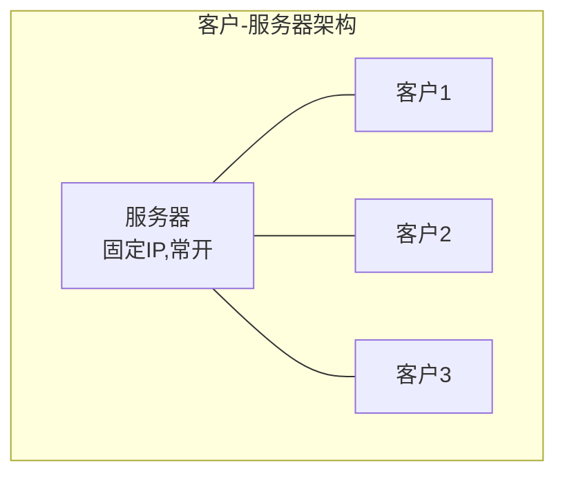
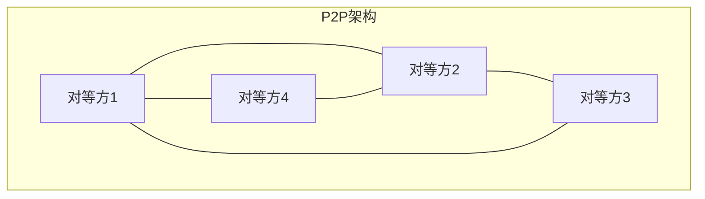
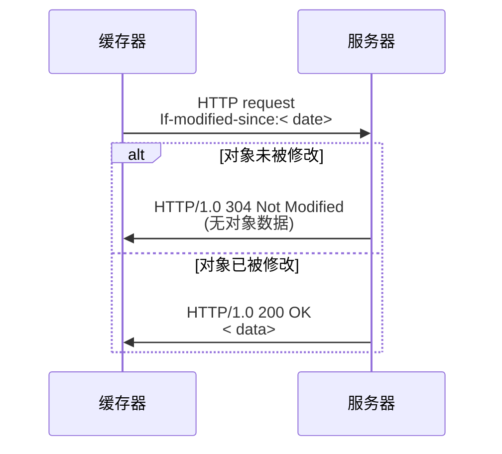
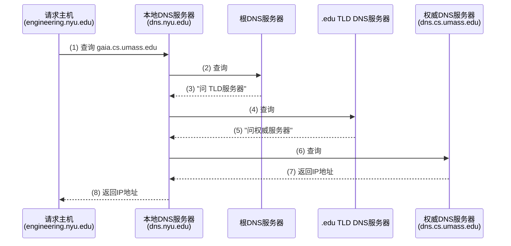
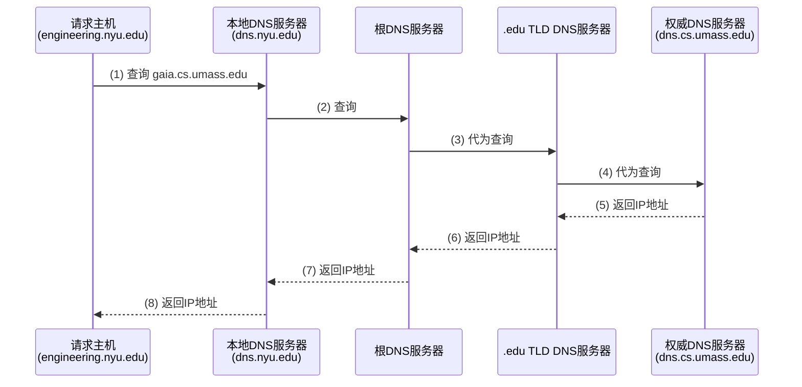
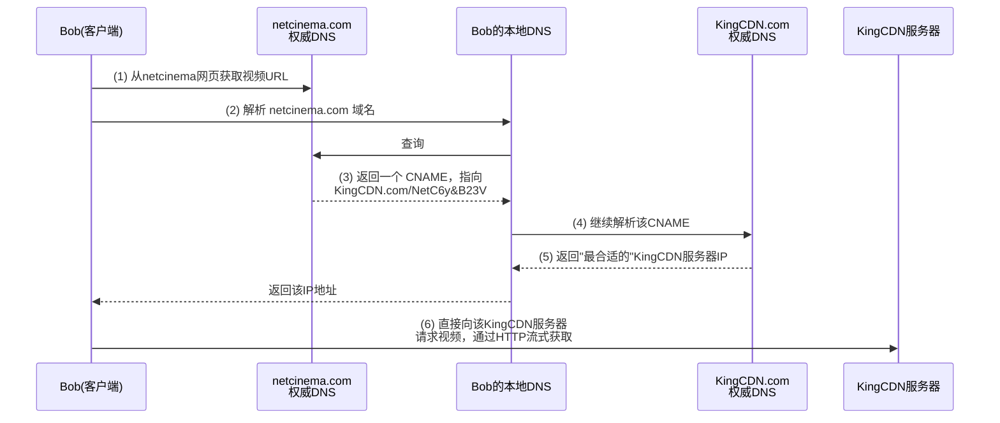
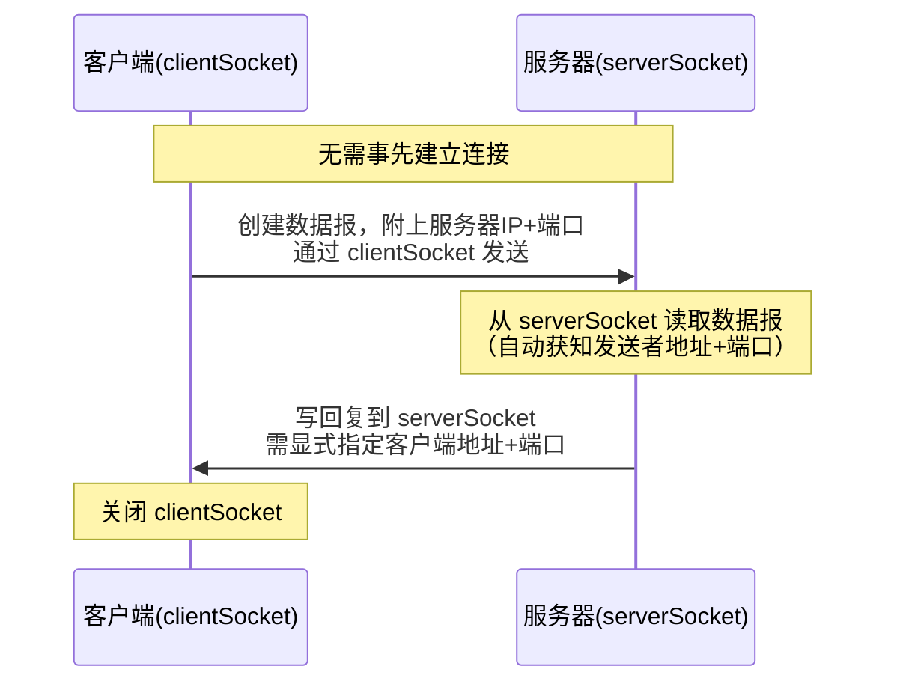
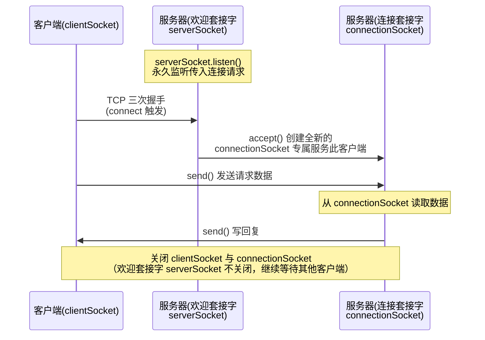

> [!info] 本章定位
> 应用层是**唯一**在端系统上实现的一层——网络核心（路由器、交换机）不运行应用层协议。理解这一点是理解整章内容的钥匙：正因为应用层只存在于"边缘"，新应用才能被快速地设计、部署，而不需要改动网络内部的任何设备。

## 目录

- [[#1. 网络应用原理|1. 网络应用原理]]
	- [[#1.1 两种网络应用体系结构|1.1 两种网络应用体系结构]]
	- [[#1.2 进程通信与套接字|1.2 进程通信与套接字]]
	- [[#1.3 应用层协议要定义什么|1.3 应用层协议要定义什么]]
	- [[#1.4 应用程序对传输层的需求|1.4 应用程序对传输层的需求]]
	- [[#1.5 Internet 提供的传输服务：TCP 与 UDP|1.5 Internet 提供的传输服务]]
- [[#2. Web 与 HTTP|2. Web 与 HTTP]]
	- [[#2.1 HTTP 基础|2.1 HTTP 基础]]
	- [[#2.2 非持续连接与持续连接|2.2 非持续连接与持续连接]]
	- [[#2.3 HTTP 报文格式|2.3 HTTP 报文格式]]
	- [[#2.4 HTTP 响应状态码|2.4 HTTP 响应状态码]]
	- [[#2.5 用户/服务器状态维护——Cookies|2.5 Cookies]]
	- [[#2.6 Web 缓存与条件 GET|2.6 Web 缓存与条件 GET]]
	- [[#2.7 HTTP1.1、HTTP2、HTTP3|2.7 HTTP 版本演进]]
- [[#3. 电子邮件：SMTP 与 IMAP|3. 电子邮件]]
- [[#4. 域名系统 DNS|4. 域名系统 DNS]]
- [[#5. P2P 应用|5. P2P 应用]]
- [[#6. 视频流与内容分发网络 CDN|6. 视频流与 CDN]]
- [[#7. 套接字编程：UDP 与 TCP|7. 套接字编程]]
- [[#8. 易错点与难点汇总|8. 易错点与难点汇总]]
- [[#9. 综合例题（进阶）|9. 综合例题（进阶）]]

---

## 1. 网络应用原理

### 1.1 两种网络应用体系结构

网络应用的**体系结构（architecture）** 指的是应用程序中各个组件如何在不同的端系统上组织、分布并相互通信。这与"网络体系结构"（五层/七层协议栈）是完全不同的两个概念——一定不要混淆：网络体系结构是网络本身的分层结构，是固定的；而应用体系结构是**应用开发者自己选择**的组织方式。目前主流的应用体系结构只有两种：

#### （1）客户-服务器体系结构（Client-Server Architecture）

**通俗理解**：想象一个永远开门营业的商店（服务器）和随时可能来、随时可能走的顾客（客户）。顾客只能找商店买东西，顾客和顾客之间不会互相交易

**严谨定义**：在客户-服务器体系结构中，存在一台（或一组）不间断运行的主机——**服务器**，它拥有固定、周知的 IP 地址，专门等待并响应来自其他主机——**客户**——的服务请求；客户之间不直接通信，一切通信都要经过服务器中转或由服务器提供。

| 特性 | 服务器 | 客户 |
|---|---|---|
| 运行时间 | 不间断运行（7×24） | 可能间歇性接入 |
| IP 地址 | 固定、永久 | 可能是动态分配的 |
| 位置 | 通常部署在数据中心，便于扩容 | 分散在网络边缘 |
| 通信对象 | 与多个客户通信 | 只与服务器通信，客户间不直接通信 |
| 典型应用 | HTTP（Web）、IMAP、FTP | 浏览器、邮件客户端 |

> [!warning] 易错点
> **数据中心里的服务器集群本质上仍属于客户-服务器架构**，而不是 P2P——即便集群内部由成百上千台机器组成，对外表现出来的仍是"永久在线、集中提供服务"的单一逻辑角色。判断架构类型的关键不是"有多少台机器"，而是"服务提供方与请求方的角色是否固定、对等"。

#### （2）P2P（对等方到对等方）体系结构（Peer-to-Peer Architecture）

**通俗理解**：没有老板坐镇的自由市场，每个人既是买家也是卖家，大家互相交换东西，市场规模越大反而越热闹（因为能交换的东西也越多）。

**严谨定义**：P2P 体系结构中不存在（或最小化地依赖）一台专门的、不间断运行的服务器；任意两个端系统（称为**对等方，peer**）之间可以直接通信；每个对等方既会向其他对等方**请求**服务，也会向其他对等方**提供**服务。

**核心优点——自扩展性（self-scalability）**：这是 P2P 最值得深挖的特性。在客户-服务器架构下，服务器的处理能力和带宽是固定的资源，用户越多，人均可得资源越少（拥塞）。而在 P2P 架构中，**每新加入一个对等方，不仅带来新的服务需求（下载请求），同时也带来新的服务能力（上传带宽和已有数据）**。理想情况下，系统整体的服务能力增长速度不慢于需求增长速度，因此可以自然地随用户数扩展。

**代价与挑战**：
- 对等方间歇连接，且可能随时改变 IP 地址，管理和寻址复杂；
- 非集中式结构意味着没有统一的信任中心，面临**安全性**（如何确认对方可信）、**性能**（依赖不受控的普通用户主机）和**可靠性**（对等方随时"流失"，chunk 可能全网都没人有）等挑战。

> [!example] 例题 1.1
> **题目**：某教师认为"只要多台机器互相通信就是 P2P 架构"，请指出这句话的问题，并举一个反例说明。
>
> **参考解答**：这句话是错误的，混淆了"多机通信"与"对等、去中心化"两个不同维度。判断依据应该是：通信双方的**角色是否对称、是否存在固定不变的、专门提供服务的中心节点**。
> 反例：CDN（内容分发网络，如 Akamai）由分布在全球的成千上万台服务器组成，客户端与其中某台服务器通信，但这些服务器**不会互相请求服务**，也不会向发起请求的客户端"下载"内容——服务器和客户的角色始终固定，因此这依然是**大规模的客户-服务器架构**，而非 P2P。真正的 P2P（如 BitTorrent）中，一个正在下载文件的对等方，同时也在向别的对等方上传自己已经拥有的数据块。





> [!note] 补充说明
> 现实中很多"P2P 应用"其实是**混合体系结构**：例如 Skype 早期版本用 P2P 传输语音数据，但用集中式服务器完成用户注册和地址发现；BitTorrent 用 P2P 传输文件块，但用集中式的 **tracker（追踪器）** 来管理"谁在下载这个文件"。所以纯粹的两分法只是理论上的极端，实际系统常常两者兼用。

### 1.2 进程通信与套接字

#### 进程（Process）

**定义**：进程是运行在端系统中的一个程序实例。

- **同一端系统内**的两个进程之间通信，使用操作系统定义的**进程间通信机制**（如管道、共享内存），这与计算机网络无关。
- **不同端系统**中的进程要通信，必须通过跨越计算机网络**交换报文（message）** 来实现——这才是应用层协议真正要解决的问题。

在客户-服务器架构中：**客户进程**是发起通信的一方；**服务器进程**是等待被联系的一方。

> [!warning] 易错点
> 使用 P2P 架构的应用程序，其内部通信仍然有"客户进程"和"服务器进程"之分！在某一次具体的连接中，发起下载请求的一方仍然扮演客户进程的角色，被请求数据的一方扮演服务器进程的角色——只是这两个角色可以在同一个对等方身上**互换**（这次我是客户，下次我可能是服务器）。不要以为 P2P 就完全没有"客户/服务器"这两个术语了。

#### 套接字（Socket）

**类比理解**：把进程想象成一栋房子，套接字就是这栋房子唯一对外的**门**。进程要发送数据，就是把报文从这扇门推出去，交给"传输基础设施"（操作系统 + 网络协议栈）去搬运；进程要接收数据，就是等报文从这扇门被送进来。

**严谨定义**：套接字是应用层进程与传输层协议之间的**软件接口**（Application Programming Interface，API）。发送进程通过套接字将报文交给传输层，并"信任"该门到对方进程的门之间存在完整的传输基础设施来负责搬运。**一次通信涉及两个套接字：通信双方各一个。**

- 应用开发者能**控制**套接字的应用层一侧（如决定发什么数据、何时发）；
- 套接字的传输层及以下部分由**操作系统**控制，开发者一般无法干预（例如无法直接设定 TCP 的拥塞控制算法细节）。

#### 进程寻址

**问题的提出**：接收报文的进程要能被唯一标识，才能把报文正确地送到它手上。那么，主机的 IP 地址（32 位）本身是否足以标识一个进程？

> [!question] Q & A（重要概念）
> **Q**：进程所在主机的 IP 地址是否足以识别进程？
> **A**：**不足**。一台主机上可以同时运行许多进程（例如同时打开浏览器和邮件客户端），如果只用 IP 地址寻址，报文送到主机后，操作系统不知道该交给哪个进程。

**解决方案**：**标识一个进程需要两个信息的组合——IP 地址 + 端口号（port number）**。

- IP 地址：**节点地址**，定位到具体的**主机**；
- 端口号：**进程地址**，在该主机上进一步定位到具体的**进程**（更准确地说，是该主机上正在监听这个端口的套接字）。

常见知名端口：HTTP 服务器默认端口 **80**，邮件服务器（SMTP）默认端口 **25**，DNS 默认端口 **53**。例如向 `gaia.cs.umass.edu` 的 Web 服务器发送 HTTP 请求，需要同时知道其 **IP 地址（如 128.119.245.12）** 和**端口号（80）**

### 1.3 应用层协议要定义什么

**严谨定义**：应用层协议规定了运行在不同端系统上的应用进程如何相互传递报文，具体包含以下四个要素：

1. **交换的报文类型（types of messages exchanged）**：例如请求报文、响应报文；
2. **报文语法（message syntax）**：报文中包含哪些字段，字段如何分隔、如何描述——即报文"长什么样"；
3. **报文语义（message semantics）**：字段中信息的含义——即报文"每部分是什么意思"；
4. **规则（rules）**：进程何时、如何发送报文，以及如何响应收到的报文——即"先做什么后做什么"的流程。

**开放协议 vs 专用协议**：
- **开放协议（open protocols）**：在 RFC（Request for Comments）中公开定义，任何人都可以阅读、实现，从而保证**互操作性**——即不同厂商的实现可以互相通信。典型例子：HTTP、SMTP。
- **专用协议（proprietary protocols）**：协议细节不公开，通常只有一家公司自己的客户端才能与其服务器通信。典型例子：（早期的）Skype。

### 1.4 应用程序对传输层的需求

不同的应用对底层传输服务有不同的要求，这是理解"为什么会有 TCP 和 UDP 两种传输协议"的根本原因。可以从四个维度评估一个应用对传输服务的需求：

| 需求维度 | 含义 | 说明 |
|---|---|---|
| **可靠数据传输**（reliable data transportation） | 数据是否允许丢失 | 文件传输、电子邮件、金融交易等**必须**100%可靠；网络电话、视频会议等可以**容忍**一定程度的丢包 |
| **吞吐量**（throughput） | 需要多快的数据传送速率 | **带宽敏感型**应用（如网络电话）需要传输层保证一个最小可用吞吐量才能"有效"工作；**弹性应用**（如文件传输、电子邮件）能利用任意多少的可用吞吐量，越多越好但没有下限要求 |
| **定时**（timing） | 端到端延迟的容忍度 | 实时应用（网络电话、多方游戏）需要**低延迟**才"有效"，否则用户体验极差 |
| **安全性**（security） | 数据是否需要加密、完整性校验、身份鉴别 | 传输层本身（原始的 TCP/UDP socket）不提供加密；需要在应用层之上另加 SSL/TLS |

> [!example] 常见应用对传输服务的要求（务必记住的对照表）
> | 应用 | 数据丢失 | 吞吐量 | 时间敏感性 |
> |---|---|---|---|
> | 文件传输 | 不丢失 | 弹性 | 无 |
> | e-mail | 不丢失 | 弹性 | 无 |
> | Web 网页 | 不丢失 | 弹性 | 无 |
> | 实时音频/视频 | 允许丢失 | 音频：5Kb~1Mb；视频：10Kb~5Mb | 100ms 级 |
> | 存储音频/视频 | 允许丢失 | 同上 | 几秒 |
> | 交互式游戏 | 允许丢失 | 几 Kb/s 以上 | 100ms 级 |
> | 文本信息 | 不丢失 | 弹性 | 因人而异 |

### 1.5 Internet传输服务：TCP 与 UDP

|            | **TCP 服务**                      | **UDP 服务**            |
| ---------- | ------------------------------- | --------------------- |
| 可靠传输       | **可靠传输**                        | ❌ 不提供（"尽力而为"，可能丢失或乱序） |
| 连接方式       | **面向连接**：通信前需要在客户和服务器之间"握手"建立连接 | 无连接，发送前不需要握手          |
| 流量控制       | **流量控制**：发送速度不超过接收方的接收能力        | ❌ 不提供                 |
| 拥塞控制       | **拥塞控制**：网络拥塞时主动降低发送速率          | ❌ 不提供                 |
| 实时性/最小带宽保证 | ❌ 不提供                           | ❌ 不提供                 |
| 典型应用       | 文件传输、HTTP、SMTP                  | DNS、流式视频（部分）、网络电话     |
![[Pasted image 20260921082148.png|391]]

> [!question]- 为什么还需要 UDP？（经典思考题）
> 既然 TCP 提供可靠传输、流量控制、拥塞控制，功能看起来"更强"，为什么还需要功能"更弱"的 UDP？
>
> **参考解答**，从多个角度回答：
> 1. **没有连接建立时延**：TCP 需要三次握手才能开始发送数据，UDP 可以直接发送，对于 DNS 这种"一问一答"的小额查询，省下的握手开销占比很大；
> 2. **没有拥塞控制带来的降速**：TCP 一旦检测到拥塞就会主动降低发送速率，这对文件传输是合理的，但对实时应用（如网络电话）是灾难性的——语音数据"迟到"了就没有意义了，还不如按固定速率发送、容忍偶尔丢包；
> 3. **无需维护连接状态**：TCP 需要在发送方和接收方两端维护复杂的连接状态（缓冲区、序号、定时器等），UDP 无状态，更适合需要同时服务大量短连接的场景，也更节省服务器资源；
> 4. **应用层可以自己实现所需的可靠性**：如果某应用只需要"部分可靠"（比如丢一两个包无所谓，但不要整体卡顿），完全可以在 UDP 之上自己定制一套轻量级的可靠性机制，而不必被 TCP 的通用机制"绑架"。

> [!warning] 易错点
> **TCP/UDP 原生 socket 都不提供加密**！很多同学误以为"用了 TCP 就是安全的"。事实上，明文数据（包括密码）通过 TCP/UDP 套接字发送后是**未加密**地在互联网上传播的。要获得安全性，必须在应用层增加 **SSL/TLS**（Secure Socket Layer / Transport Layer Security）：应用程序调用 TLS 库的接口，TLS 库在底层仍然使用 TCP 来传输，但在发送到套接字之前，先对明文数据加密；TLS 通过**加密**保证机密性、通过**数字签名**保证数据完整性、并提供**端点鉴别**功能。

---

## 2. Web 与 HTTP

### 2.1 HTTP 基础

- **HTTP（HyperText Transfer Protocol，超文本传输协议）** 是 **Web 的应用层协议**
- Web 页面（文档）由**对象（object）** 组成
	- 一个对象可以是一个 HTML 文件、一张 JPEG 图片、一个 Java 小程序、一段音频等
- 不同对象可以存储在**不同**的 Web 服务器上
- 一个 Web 页面通常包含 **1 个 HTML 基本文件（base HTML file）** + **若干个被引用的对象（referenced objects）**
- HTML 基本文件通过 **URL（Uniform Resource Locator）** 来引用这些对象
	- 例如 `www.someschool.edu/someDept/pic.gif` 中，`www.someschool.edu` 是**主机名**，`/someDept/pic.gif` 是**路径名**
- **客户/服务器模式**：
	- **client**：客户（浏览器）使用 HTTP 协议**请求并接收**、展示 Web 对象
	- **server**：服务器使用 HTTP 协议**发送**对象，对请求做出响应
- **HTTP 使用 TCP 作为传输层底层传输协议**：
	- 客户发起到服务器的 TCP 连接（创建套接字），服务器默认监听端口 **80**
	- 服务器接受来自客户的 TCP 连接
	- 双方通过该 TCP 连接交换 HTTP 报文
	- 最终 TCP 连接被关闭

> [!warning] 核心易错点——HTTP 是"**无状态的**"（stateless）**可靠**  但是 **不安全** 
> - **HTTP 服务器不会保留关于过去客户请求的任何信息**。也就是说，即使同一个浏览器连续发送了 100 个请求，服务器在处理第 101 个请求时，完全不知道前 100 个请求的存在，每个请求都被独立处理。
> 	这带来一个深刻的设计影响（旁注）：**维护"状态"的协议非常复杂！**
> 	- 如果协议本身需要记忆状态，历史交互记录（状态）必须持续保留；
> 	- 如果服务器或客户崩溃重启，双方对"状态"的认识可能不一致，还必须专门设计协议来处理这种**不一致**——这正是为什么 HTTP 选择无状态设计：简单、健壮，但代价是"记住用户"这件事必须依赖 HTTP 协议之外的手段（见 2.5 节 Cookies）
> - 底层传输协议是TCP，是可靠的
> - 明文传输，并不安全，安全的是HTTPS

### 2.2 非持续连接与持续连接
#### 非持续连接（Non-persistent connection）

流程（对每一个对象都要重复）：
1. 打开 1 个到服务器的 TCP 连接
2. 通过该 TCP 连接**最多传送 1 个对象**，仅处理 1 个"请求-响应"事务
3. **关闭**该 TCP 连接

**推论**：如果一个网页包含 1 个 HTML 基本文件和 10 个引用的 jpeg 图片，那么下载整个页面**至少需要建立、关闭 11 次独立的 TCP 连接**（1 次拿 HTML，之后浏览器解析出 10 个引用对象，再逐个建立连接下载）

> [!tip] 提速手段
> 虽然每个对象要单独建连接，但浏览器通常会**并行打开多个 TCP 连接**（大部分浏览器每次打开 5~10 个并行连接），从而部分抵消非持续连接的低效。

#### 持续连接（Persistent connection）

流程：
1. 打开 1 个到服务器的 TCP 连接；
2. **通过该同一个连接传送多个对象**——同一台服务器上的一个完整页面（HTML + 所有引用对象），乃至同一服务器上的**多个不同页面**，都可以复用这一个持续 TCP 连接发送给同一用户；
3. 关闭该 TCP 连接（可能在空闲一段时间后才关闭）。

#### 非持续连接的响应时间计算——重点掌握的公式

先明确一个基本概念：

> **RTT（Round-Trip Time，往返时间）**：一个（很小的）分组从客户端到服务器，再从服务器返回客户端所花费的时间

对于**每一个对象**，非持续连接下的 HTTP 响应时间由三部分组成：
- **1 个 RTT** 用于创建 TCP 连接（这里特指三次握手中**前两次**所占用的时间，即 SYN 和 SYN+ACK 的往返）；
- **1 个 RTT** 用于：客户端发出三次握手的第三次确认（ACK，此时通常捎带上 HTTP 请求报文），加上服务器返回 HTTP 响应报文所需要的时间；
- 对象本身的**传输时间**（文件大小 / 带宽），通常记为一个可忽略或单独计算的量

$$
\text{非持续连接的 HTTP 响应时间} = 2\text{RTT} + \text{（HTML/对象文件的传输时间）}
$$
![[Pasted image 20260916174209.png|471]]
> [!danger] 极易考的易错点
> 千万不要把"建立连接需要三次握手"直接算成 **1.5 RTT**（很多同学会犯这个直觉性错误）。正确的拆解方式是：**三次握手的前两次算 1 个 RTT**（因为这一步是一去一回，SYN 出去、SYN+ACK 回来，构成一次完整往返）；**握手的第三次（客户端发出的 ACK）与 HTTP 请求捎带在一起发出，服务器处理完请求后返回响应，这一去一回又构成 1 个 RTT**。两段相加正好是 **2 个 RTT**，而不是 1.5 个。

如果一个页面除了 1 个基本 HTML 文件外还引用了 $n$ 个对象，且这些对象**串行**（一个接一个）下载，则总响应时间约为：

$$
T_{\text{总}} = (n+1) \times 2\text{RTT} + \sum \text{各对象传输时间}
$$

若浏览器使用 $k$ 个**并行**非持续连接，可以近似认为总时间被压缩为约 $\lceil (n+1)/k \rceil \times 2\text{RTT}$（并行连接之间存在带宽竞争，实际情况更复杂，这里是简化模型，用于估算数量级）
![[Pasted image 20260916174422.png|478]]

> [!example]- 例题 2.1（响应时间计算，难度：中偏难）
> 某网页的基本 HTML 文件引用了 8 个小图片对象，全部位于**同一台**服务器上。已知客户端到该服务器的 RTT = 40 ms，每个对象的传输时间可忽略不计。分别计算：
> (a) 使用**非持续连接、串行下载**（浏览器同一时刻只维护 1 个 TCP 连接）时，下载整个页面所需的总时间；
> (b) 使用**非持续连接、但浏览器允许同时打开 4 个并行连接**下载 8 个图片对象（HTML 文件仍需先单独下载）时的总时间；
> (c) 使用 **HTTP 1.1 持续连接（非流水线）** 时的总时间；
> (d) 使用 **HTTP 1.1 持续连接 + 流水线（pipelining）** 时的总时间。
>
> **参考解答**：
> (a) 串行非持续连接：一共有 1 个 HTML + 8 个图片 = 9 个对象，每个对象都要 2RTT，共 $9 \times 2 \times 40\text{ms} = 720\text{ms}$。
> (b) 先取 HTML：2RTT = 80ms。拿到 HTML 解析出 8 个图片引用后，分 2 批并行下载（每批 4 个，同批内并行只需 1 个 2RTT 的时间），共需 $2 \times 2\text{RTT} = 160\text{ms}$。总时间 $= 80 + 160 = 240\text{ms}$。
> (c) 持续连接、非流水线：只需 **1 个 RTT** 建立 TCP 连接（首次），之后每取一个对象都要经历"发请求→等响应"这 1 个来回（1 RTT），因为非流水线意味着客户端必须收到上一个对象的完整响应后才能发送下一个请求。共有 9 个对象，因此总时间 $= 1\text{RTT（建连）} + 9 \times 1\text{RTT（逐个取对象）} = 10\text{RTT} = 400\text{ms}$。
> (d) 持续连接 + 流水线：建连 1RTT；之后客户端可以**不等响应、连续发出**所有 9 个请求，服务器按序返回，理想情况下（忽略处理和排队时间）总共只需要再花 1RTT 就能收到最后一个对象的响应。总时间 $\approx 1\text{RTT} + 1\text{RTT} = 2\text{RTT} = 80\text{ms}$。
>
> **易错点提醒**：(c) 是最容易出错的一问——很多同学会把持续连接和流水线混为一谈，误以为持续连接天然就能把 9 个对象压缩到 2RTT。**持续连接只解决"要不要重新建 TCP 连接"的问题，流水线才解决"能不能连续发多个请求而不必逐个等待响应"的问题**，这是两件不同的事。HTTP 1.1 默认支持持续连接，但是否使用流水线取决于具体实现。

### 2.3 HTTP 报文格式

HTTP 报文分为**请求报文**和**响应报文**两种类型，都是 **ASCII 文本**（可读性强
#### HTTP 请求报文的通用格式

```
GET /index.html HTTP/1.1\r\n     ← 请求行：方法 sp URL sp 版本 cr lf
Host: www-net.cs.umass.edu\r\n   ← 首部行
User-Agent: Mozilla/5.0\r\n      ← 首部行
Accept: text/html\r\n            ← 首部行
Accept-Language: fr\r\n          ← 首部行
Connection: close\r\n            ← 首部行
\r\n                              ← 空行，表示首部结束
```

- 结构
	- **请求行（request line）**：`方法(method) sp URL sp 版本(version) cr lf`。常见方法：`GET`（请求获取对象）、`POST`（向服务器提交数据）、`HEAD`（类似 GET 但服务器只返回首部不返回实体）、`PUT`、`DELETE` 等
	- **首部行（header lines）**：每行一个 `字段名: 值`，用于携带附加信息（如浏览器类型、可接受的语言、连接方式等）
	- **实体体（entity body）**：只有在 `POST` 等方法中才会用到，用来携带客户提交给服务器的数据。
	- 报文以一个**空行（回车+换行）** 表示首部区域结束

- 类型
	- **POST**
	- **GET**
	- **HEAD**
	- **PUT**

**GET 与 POST 方法的区别**（重要辨析）：
- **POST 方法**：用户提交的数据放在请求报文的**实体体**中，常用于表单提交；
- **GET 方法**：也可以用来向服务器传数据，但数据是拼接在 **URL 字段**中（用 `?` 分隔），例如：`www.somesite.com/animalsearch?monkeys&banana`

> [!warning] 易错点
> GET 请求把参数暴露在 URL 中，因此**长度有限制**、**会被浏览器历史/服务器日志记录**、**不适合传输敏感信息**（如密码）；POST 请求数据在报文体内，相对更"隐蔽"（但**并不等于加密**，明文仍然可以被抓包看到，安全性依赖的是 HTTPS/TLS 而不是"用了 POST"）。

#### HTTP 响应报文的通用格式

```
HTTP/1.1 200 OK\r\n                                   ← 状态行：版本 sp 状态码 sp 短语 cr lf
Date: Sun, 26 Sep 2010 20:09:20 GMT\r\n               ← 首部行
Server: Apache/2.0.52 (CentOS)\r\n
Last-Modified: Tue, 30 Oct 2007 17:00:02 GMT\r\n
Content-Length: 2652\r\n
Content-Type: text/html; charset=ISO-8859-1\r\n
\r\n                                                    ← 空行
data data data data data ...                           ← 实体体（被请求的对象）
```

- **状态行**：`版本(version) sp 状态码(status code) sp 状态短语(status phrase)`；
- **首部行**：如 `Content-Length`（对象大小，字节数）、`Content-Type`（对象类型，MIME 类型）、`Last-Modified`（最后修改时间，配合条件 GET 使用）；
- **实体体**：被请求的对象本身的数据。

### 2.4 HTTP 响应状态码

状态码位于响应报文的第一行，用来告知客户端请求处理的结果。**分类规律**（隐含但重要）：`1xx` 信息性、`2xx` 成功、`3xx` 重定向、`4xx` 客户端错误、`5xx` 服务器错误

| 状态码 | 含义 |
|---|---|
| 200 OK | 请求成功，信息包含在返回的响应报文中 |
| 301 Moved Permanently | 请求的对象已被永久转移，新 URL 定义在响应报文的 `Location:` 首部中，客户端软件会自动获取新 URL |
| 400 Bad Request | 服务器无法理解该请求（通用性错误，与请求报文本身语法有关） |
| 404 Not Found | 被请求的文档不在此服务器上 |
| 505 HTTP Version Not Supported | 服务器不支持请求报文所使用的 HTTP 协议版本 |

> [!example]- 例题 2.2
> 假设浏览器发起对某图片资源的条件 GET 请求，服务器返回了状态码 `304 Not Modified`。请解释这一状态码出现的前提条件，以及它相比返回完整的 `200 OK` 节省了什么。
>
> **参考解答**：`304 Not Modified` 出现的前提是浏览器在请求首部中携带了 `If-modified-since: <date>`（缓存副本的最后修改时间），而服务器检查后发现该对象**自这个日期之后没有被修改过**。此时服务器返回 `304`，[[#### 条件 GET（Conditional GET）|响应报文不包含任何对象数据（实体体为空）]]。相比 `200 OK`，它节省了整个对象的传输时间（无对象传输延迟），也降低了链路利用率（带宽消耗）——这正是"条件 GET"机制存在的意义，详见 2.6 节。

### 2.5 用户/服务器状态维护——Cookies

既然 HTTP 是无状态的，但很多应用（购物车、登录状态、个性化推荐）又**确实需要**"记住"用户，怎么办？答案是：**用 Cookie 在 HTTP 协议之外、之上再叠加一层状态维护机制**

**Cookie 技术由 4 个组件构成**（这是一个经常被考察"是否记全"的知识点）：
1. HTTP **响应**报文中的一个 `Set-Cookie` 首部行；
2. HTTP **请求**报文中的一个 `Cookie` 首部行；
3. 在用户端系统中保留一个 **cookie 文件**，由用户的浏览器进行管理；
4. 位于 Web 站点的一个**后端数据库**。

**工作流程**（以 Susan 首次访问电商网站为例）：
![[Pasted image 20260916180136.png|685]]
**Cookie 的常见用途**：授权（登录态）、购物车、Recommendations 推荐、用户会话状态（如 Web 邮件）

> [!warning]- 易错点与争议点（Cookie 与隐私）
> - Cookie 允许网站了解更多关于用户的信息，这本身就是一种权衡（便利 vs 隐私）；
> - **第三方持久 Cookie（也称"跟踪 Cookie"）**：不是当前正在访问的网站直接设置的 Cookie，而是嵌入在页面中的第三方广告脚本设置的 Cookie，它能够**跨网站**追踪同一用户的浏览行为——这是隐私争议的核心焦点，也是浏览器近年来陆续禁用第三方 Cookie 的原因。
> - **本质挑战**：如何"保持状态"是一个协商端点问题——协议本身（HTTP）不管这件事，必须由通信双方（浏览器+服务器）在多个事务之间自行维护发送方/接收方的状态，Cookie 只是这一问题的一种工程解法，而不是 HTTP 协议规范本身的一部分。

### 2.6 Web 缓存与条件 GET

#### Web 缓存器（代理服务器，proxy server）

**目标**：代表初始 Web 服务器满足 HTTP 请求，从而减少响应时间、减少带宽占用。

**工作原理**：
- 用户将浏览器配置为指向 Web 缓存器（或由网络管理员透明地重定向流量）；
- 浏览器把所有 HTTP 请求都发给缓存器；
  - **若**请求的对象在缓存器中：缓存器**直接**把对象返回给浏览器（无需联系初始服务器）；
  - **否则**：缓存器代表客户向初始服务器请求对象，收到后**既**返回给客户**又**在本地留存一份副本。

**缓存器同时扮演两种角色**：对最初发起请求的客户来说，它是**服务器**；对拥有真正内容的初始服务器来说，它是**客户**。

**部署 Web 缓存器的意义**：
1. 大大减少客户请求的响应时间（缓存离客户更近，尤其当客户与初始服务器之间的瓶颈带宽远低于客户与缓存器之间时，效果尤其显著）；
2. 大大减少一个机构接入互联网的通信量（很多重复请求不必再穿越昂贵的广域网链路）；
3. 使"缺钱"的内容提供商（服务器带宽有限）也能通过遍布各处的缓存较高效地交付内容——这正是 CDN 思想的雏形（详见第 6 章）

> [!example]- 例题 2.3（Web 缓存性能计算
> 某机构网络的接入链路速率为 1.54 Mbps，机构路由器到公共互联网上初始服务器的 RTT 为 2 秒，每个 Web 对象大小为 100K 比特，机构内浏览器发出的平均请求速率为 15 个请求/秒，机构内局域网速率为 1 Gbps（可视为不构成瓶颈）。
>
> (a) 若不安装任何缓存器，计算接入链路的**流量强度**，并据此说明该链路是否已接近饱和；
> (b) 现安装一台本地 Web 缓存器，缓存**命中率为 0.4**（即 40% 的请求可以直接由缓存满足，无需使用接入链路），计算此时接入链路的流量强度，以及平均端到端时延（假设缓存命中时时延可忽略不计，未命中时时延等于"接入链路时延+初始服务器RTT"）。
>
> **参考解答**：
> (a) 接入链路上需要传输的总数据速率 $= 15 \text{个/秒} \times 100\text{K比特} = 1500 \text{K比特/秒} = 1.5 \text{Mbps}$。
> 流量强度 $= \dfrac{1.5\text{Mbps}}{1.54\text{Mbps}} = $。
> **流量强度接近/等于 1 意味着链路已经饱和，排队时延将趋于无穷大**——这是排队论中的一个经典结论：当到达速率接近服务速率时，平均排队时延急剧上升（而非线性增长）。原始的 154 Mbps 升级方案能立刻把流量强度降到 0.0097，但代价是"更快的接入链路"通常意味着更高的成本。
> (b) 有 40% 请求命中缓存，意味着只有 **60%** 的请求需要走接入链路，此时接入链路上的数据速率 $= 0.6 \times 1.5\text{Mbps} = 0.9\text{Mbps}$，流量强度 $= 0.9/1.5 = 0.6$，链路远未饱和，排队时延将显著降低（不再趋于无穷大）。
> 平均端到端时延 $= 0.6 \times (\text{未命中时延}) + 0.4 \times (\text{命中时延，视为约 0})$。若未命中时延近似为 2 秒（RTT）+ 接入链路传输时延（可忽略或单独计算），则平均时延 $\approx 0.6 \times 2\text{s} = 1.2\text{s}$，远低于全部走接入链路时的（趋于无穷大或数分钟级）。
>
> **易错点**：命中率是"缓存能满足的请求比例"，因此**只有未命中的那部分（1-命中率）流量真正会消耗接入链路带宽**，命中率越高，接入链路流量强度越低。很多同学会搞反乘的对象。

#### 条件 GET（Conditional GET）

**目标**：如果缓存中存储的对象**已经是最新版本**，就不必再传输一次完整对象——即允许缓存器向服务器核实自己存的东西是不是最新的。

**流程**：
- **缓存器**：在 HTTP 请求中携带 `If-modified-since: <date>` 首部，date 是缓存副本的最后修改日期；
- **服务器**：检查该对象自 `<date>` 之后是否被修改过：
	- **若没有修改**：返回 `HTTP/1.0 304 Not Modified`，且响应报文中**不包含任何对象数据**——省去了对象传输的时延，也降低了链路利用率
	- **若已修改**：正常返回 `HTTP/1.0 200 OK` 以及最新的对象数据



### 2.7 HTTP1.1、HTTP2、HTTP3

| 版本           | 核心目标              | 关键机制                                                                                     |
| ------------ | ----------------- | ---------------------------------------------------------------------------------------- |
| **HTTP/1.1** | 减少多对象请求中的延迟       | 默认使用**持久连接**；支持**流水线（pipelining）**：通过单个 TCP 连接连续发出多个 GET 请求；服务器按 **FCFS（先到先服务）** 顺序响应    |
| **HTTP/2**   | 进一步减少延迟，解决 HOL 阻塞 | 根据客户端指定的对象优先级安排响应顺序（不一定 FCFS）；支持服务器主动**推送**未被请求的对象；把每个对象**划分成帧**，多个对象的帧**交替传输**，从而缓解队首阻塞 |
| **HTTP/3**   | 更彻底地解决延迟与安全问题     | 基于 **UDP** 的流水线传输，独立处理拥塞控制、安全性（内置 TLS），错误恢复不再阻塞其它无关对象的传输                                 |

#### HOL 阻塞（Head-of-Line Blocking，队首阻塞

**问题场景**：假设客户端通过一个持续连接依次请求了 1 个**大**对象（如视频文件）和 3 个**小**对象。在 HTTP/1.1 中，由于服务器**按请求顺序、逐个完整传输**对象，如果大对象排在前面，那么排在它后面的小对象即便体积很小、本可以瞬间传完，也必须**等待**大对象**完全**传输结束才能开始传输——这就是"队首阻塞"：排在队首的大任务阻塞了后面本可以很快完成的小任务

**HTTP/2 的解法**：把每个对象**切分成许多小"帧"**，服务器按照某种调度策略（如轮流）在多个对象的帧之间**交替发送**。这样，小对象的帧很快就能全部发送完，用户很早就能看到小对象加载完成，大对象虽然总耗时不变，但不会再"堵住"其它对象——本质是**最短工作优先**思想，降低了**平均**响应时延（不是降低总时延，而是改善了用户感知到的等待体验）

> [!warning] 易错点
> HTTP/2 的多路复用**不会**改变传输总字节数或总带宽消耗，也没有让整体下载"变快"，它优化的是**多个对象之间的调度顺序**，从而降低**平均**完成时间（尤其是小对象的完成时间）

> [!example]- 例题 2.4
> 简述 HTTP/1.1 的流水线机制与 HTTP/2 的多路复用（帧交织）机制在解决"队首阻塞"问题上的**根本区别**。为什么说 HTTP/1.1 的流水线并不能真正解决队首阻塞？
>
> **参考解答**：HTTP/1.1 的流水线只是允许客户端**连续发送多个请求**而不必等待前一个请求的响应，但**服务器仍然按 FCFS 顺序、以"整个对象"为单位逐个响应**——如果队首的对象很大或传输过程中发生丢包需要重传，后面所有对象都必须排队等待，这就是"传输层面"的队首阻塞依然存在。而 HTTP/2 从根本上改变了传输的**粒度**：不再以"整个对象"为调度单位，而是把对象切成**帧**，让不同对象的帧交替传输，从而使得体积小的对象可以插队式地提前完成，避免被大对象长时间占用连接。因此 HTTP/2 才是真正意义上在应用层解决了队首阻塞（HTTP/3 更进一步在传输层——即用 UDP 替代 TCP——解决了因丢包重传导致的、连累无关对象的队首阻塞）。

---

## 3. 电子邮件：SMTP 与 IMAP

电子邮件系统由**三个主要组成部分（不止3个）** 构成：
- **用户代理（User Agent）**
- **邮件服务器（Mail Server）**
- **简单邮件传输协议 SMTP**

### 3.1 邮件系统结构

- **用户代理**：又称"邮件阅读器"，用于撰写、编辑、阅读邮件（如 Outlook、iPhone 邮件客户端）；负责**向**邮件服务器发送邮件、**从**邮件服务器的邮箱中取得邮件
- **邮件服务器**：
  - **邮箱（mailbox）**：管理和维护发送给该用户的邮件报文；
  - **报文队列**：存放外发（待发送）邮件的队列；
  - 使用 SMTP 协议，把邮件报文从**发送方**的邮件服务器发送到**接收方**的邮件服务器。此时发送方邮件服务器扮演**客户端**，接收方邮件服务器扮演**服务器端**

### 3.2 SMTP 协议

**基本信息**：SMTP 定义在 **RFC 5321**（最初的 RFC 可追溯到 1982 年）。使用 **TCP** 可靠地把邮件从客户端（发起连接的邮件服务器）传输到接收方邮件服务器的 **端口 25**。

**传输方式**：**直接传输**——从发送服务器（此时行为类似于客户）直接传输到接收服务器，中间不经过其他邮件服务器中转

**三个传输阶段**：
1. **握手（问候）**：TCP 连接建立后，双方交换问候报文
2. **报文传输**：逐条命令与响应，传输邮件的首部与正文
3. **关闭**：结束会话

**交互方式**：**命令/响应交互（类似 HTTP）**——命令是 ASCII 文本，响应包含状态码和状态短语。**特殊规定**：包括首部在内，邮件报文的**体部分也必须采用 7 位 ASCII 编码**（这也是历史遗留问题——早期只能传英文文本，非 ASCII 字符如中文、附件需要通过 Base64 等方式先编码成 ASCII 才能传输）

> [!example]- SMTP 交互报文示例
> ```
> S: 220 hamburger.edu
> C: HELO crepes.fr
> S: 250 Hello crepes.fr, pleased to meet you
> C: MAIL FROM: <alice@crepes.fr>
> S: 250 alice@crepes.fr... Sender ok
> C: RCPT TO: <bob@hamburger.edu>
> S: 250 bob@hamburger.edu ... Recipient ok
> C: DATA
> S: 354 Enter mail, end with "." on a line by itself
> C: Do you like ketchup?
> C: How about pickles?
> C: .
> S: 250 Message accepted for delivery
> C: QUIT
> S: 221 hamburger.edu closing connection
> ```
> **解读**：`S:` 表示服务器（hamburger.edu，Bob 的邮件服务器）的响应，`C:` 表示客户端（Alice 的邮件服务器进程）发出的命令。注意结束正文时**单独一行的英文句号 `.`** 是约定的正文结束标志。

#### SMTP 报文格式（RFC 5322）

RFC 5321 定义了**交换邮件的协议**，而 **RFC 5322 定义了邮件本身的格式**——这是两个不同层面的规范，考试中容易混淆！

邮件报文由**首部行**（如 `To:`、`From:`、`Subject:`）+ 一个**空白行** + **正文（body）** 组成，正文只能是 ASCII 字符（未使用 MIME 扩展的情况下）。

#### SMTP 是一种"推"协议（Push Protocol）——与 HTTP 的对比

|              | HTTP                       | SMTP                                                       |
| ------------ | -------------------------- | ---------------------------------------------------------- |
| 拉/推          | **拉（pull）**协议：客户主动向服务器索取内容 | **推（push）**协议：发送方主动把邮件"推"给接收方                              |
| 报文体 ASCII 限制 | 不受限制，可以承载任意二进制数据（图片、视频等）   | 要求整个报文（含体）必须为 **7 位 ASCII 字符**                             |
| 多对象的组织方式     | 每个对象封装在自己独立的 HTTP 响应报文中传输  | 对于既包含文本又包含图片的复合文档，SMTP 把**所有报文对象都放在同一个报文**中（使用 MIME 多部分编码） |
| 相同之处         | 两者都具有 ASCII 命令/响应          | 交互，都有状态码；都可以使用**持续连接**                                     |

> [!warning] 易错点
> "SMTP 是推协议"这句话具体指的是：**发送方的邮件服务器主动发起 TCP 连接、把邮件"推"给接收方的邮件服务器**，而不是指用户代理与自己邮件服务器之间的交互方式。用户从邮件服务器**读取**邮件时使用的是完全不同的**邮件访问协议**（IMAP/POP3），那个方向其实更像"拉"。

### 3.3 邮件访问协议（IMAP / POP3 / HTTP）

> [!note] 重要区分
> SMTP 只负责把邮件**从发送方传递/存储到接收方的邮件服务器**；用户要**从服务器上把邮件取回**到自己的用户代理（收信箱），用的不是 SMTP，而是另一类**邮件访问协议**

| 协议 | 全称/来源 | 功能特点 |
|---|---|---|
| **IMAP** | 因特网邮件访问协议，RFC 3501 | 支持在**服务器上**对存储的报文进行取回、删除，并支持在服务器上为邮件**创建文件夹**（多设备之间文件夹结构保持同步） |
| **POP3** | 第三版邮局协议，RFC 1939 | 功能更简单：在服务器上存储报文的显示列表、取回、删除；一般不支持在服务器端建立复杂的文件夹层级 |
| **HTTP** | （如 Gmail、Hotmail、Yahoo!Mail） | 在 SMTP（发送）与 IMAP 或 POP3（收取）之上，再提供一层基于 Web 的图形界面，方便用户通过浏览器检索电子邮件 |


> [!example]- 例题 3.1
> Alice 使用 Gmail 网页版给 Bob（使用某公司自建邮件服务器 + Outlook 客户端，走 IMAP 协议收信）发送了一封带附件的邮件。请指出整个过程中依次使用了哪些应用层协议，并分别说明每一段发生在哪两个实体之间
>
> **参考解答**：
> 1. Alice 的浏览器 ↔ Gmail 服务器：Alice 在网页里撰写邮件并点击"发送"，这一步 Alice 的浏览器与 Gmail 的 Web 服务器之间使用的是 **HTTP（S）** 协议（Gmail 提供的 Web 界面）；
> 2. Gmail 服务器 ↔ Bob 公司的邮件服务器：Gmail 邮件服务器充当发送方，使用 **SMTP** 协议把邮件（连同附件，经过 MIME 编码为 7 位 ASCII）"推"给 Bob 公司的邮件服务器；
> 3. Bob 的 Outlook 客户端 ↔ Bob 公司的邮件服务器：Bob 打开 Outlook 收信，Outlook 使用 **IMAP** 协议主动从邮件服务器"拉取"这封邮件，并可以在服务器端管理文件夹（如把这封邮件移动到某个子文件夹）。
> **易错点提示**：很多同学会误以为"发邮件也用 IMAP"或者"HTTP 全程参与传输"，实际上 HTTP 只出现在 Alice 与 Gmail Web 界面这一段，两台邮件服务器之间的核心传输协议**只能是 SMTP**。

---

## 4. 域名系统 DNS

### 4.1 要解决的问题

- 人：可以通过许多标识符互相区分（如身份证号、姓名）
- 互联网上的主机、路由器：通过 **IP 地址（32 位）** 来寻址、寻路不便于人记忆和使用
- **主机名**：是**分配给网络中某一台设备（主机）的名字**，用来在本地或局域网内标识这台机器，比如个人电脑叫 `PC-01`，服务器叫 `web-server`
- **域名**：**互联网上按层次结构组织的名称系统（DNS）中的名字**，用来标识一个域、一个网站或一台主机，例如 `example.com`、`www.baidu.com`
- **FQDN**（完全限定域名）：=**主机名 + 域名 + 根域**，能唯一确定互联网上的一台主机
	- 例：
		- 主机名：`www`
		- 域名：`example.com`
		- FQDN：`www.example.com.`（末尾的点代表根域，通常省略）
	- 在 DNS 查询时，系统会把 FQDN 解析成 IP 地址，比如 `www.example.com` → `93.184.216.34`

- **核心问题（Q）**：如何在 IP 地址和名称（FDQN）之间进行映射？
- **域名系统（DNS，Domain Name System）**：
	- 一个由**分层的 DNS 服务器**实现的**分布式数据库**
	- 一个使得主机能够查询该分布式数据库的**应用层协议**（完成地址/名称的相互转换）
		- **DNS 协议运行在 UDP 之上**，使用**端口 53**（因为 DNS 查询报文短小、要求低时延，UDP 更合适
	- DNS 服务器通常是运行 **BIND（Berkeley Internet Name Domain）** 软件的 UNIX 机器；
	- 注意：**DNS 虽然是"应用层协议"，却在实现着互联网的核心功能**——如果 DNS 瘫痪，几乎所有依赖域名的互联网服务（网页、邮件等）都会无法访问

### 4.2 提供的服务

- ==核心功能==：主机名到 IP 地址的映射
- **主机别名（host aliasing）**
	- 一台主机可以拥有 1 个**规范主机名（canonical hostname）** 和若干个**主机别名**，别名通常更容易记忆
- **邮件服务器别名**
- **负载分配（load distribution）**：
	- 繁忙的站点（如大型网站）会在多台冗余的 Web 服务器上复制内容，**多个 IP 地址对应同一个主机名**
	- DNS 服务器收到查询后，返回**一组** IP 地址，并在**每次回答中轮流改变这组地址的排列顺序（round-robin）**，从而把不同用户的请求近似均匀地分散到不同的服务器上

### 4.3 为什么 DNS 不采用集中式设计

> [!question] DNS 为什么不采用集中式设计？
> 直觉上，用**一台**巨大的、装有全世界所有域名映射记录的服务器不是更简单吗？为什么要设计得如此复杂（分布式、分层）？

**答案：集中式数据库根本不能"扩展"（does not scale）！** 具体原因有四点，务必逐条理解：

1. **单点故障（single point of failure）**：如果这台服务器宕机，全世界的 DNS 查询都会失败，互联网事实上瘫痪；
2. **通信流量（traffic volume）**：全世界所有的 DNS 查询都要发往同一台服务器，流量将是天文数字（据统计，量级可达每天 **600 亿次**查询），任何单机都无法承受；
3. **远距离的集中式数据库（distant centralized database）**：无论这台服务器物理放在哪里，都必然离世界上大多数用户"很远"，造成较大的查询时延；
4. **维护（maintenance）**：域名的注册、修改、删除极其频繁，由单一机构/单台设备维护全球所有记录也不现实。

**分布式设计的应对**：正是针对以上四点，DNS 被设计成分层的分布式数据库——每一层服务器只负责一部分命名空间，且天然具有**冗余**（多台镜像）、**就近**（离用户地理更近）与**缓存**能力，从而解决了扩展性问题。

### 4.4 DNS 分布式、层次数据库结构

DNS 名字空间被组织成一棵**层次树**，自顶向下分为三层：
![[Pasted image 20260921093440.png|626]]

| 层级  | 名称                           |              | 职责                                                                                                                                                        |
| --- | ---------------------------- | ------------ | --------------------------------------------------------------------------------------------------------------------------------------------------------- |
| 第一层 | **根 DNS 服务器（Root）**          | 存储顶级域的IP地址   | 官方的、"当所有其他方式都无法解析名字时"应该联系的最终地方。全世界共有 **13 组**"根服务器"标识（每组标识背后有多个实例部署在不同地理位置，如美国本土就有约 200 个物理服务器实例）。**没有它，互联网将无法运行！**由 **ICANN**（互联网名称与数字地址分配机构）负责管理根 DNS 域 |
| 第二层 | **顶级域（TLD）DNS 服务器**          | 存储权威服务器的IP地址 | 负责 `.com`、`.org`、`.net`、`.edu`以及所有国家/地区顶级域名（如 `.cn`、`.uk`、`.fr`、`.ca`、`.jp`），提供**权威 DNS 服务器**的 IP 地址。每个顶级域都有自己的 TLD 服务器（集群）                               |
| 第三层 | **权威（Authoritative）DNS 服务器** |              | 某个组织**自己**（或委托付费给某服务提供商代管）的 DNS 服务器，里面存有该组织下互联网上可公共访问的主机名到 IP 地址的映射记录                                                                                     |

>[!Warning] 易错
>- **`.cn` 是顶级域名**，由 CNNIC（中国互联网络信息中心）运营
>- **`.edu.cn` 不是顶级域名**，它是 `.cn` 下的一个**二级域**，专门分配给中国的教育机构
>- **`.edu` 本身是另一个顶级域名**（如 `mit.edu`），但国内大学用的是 `.edu.cn`，不是 `.edu`

**额外一类：本地 DNS 服务器（Local DNS Name Server）**

> [!warning] 易错点
> 本地 DNS 服务器**不严格属于**上述 DNS 服务器层次结构（根→TLD→权威）之中的任何一层！它是每个 ISP（居民 ISP、公司、大学）**各自拥有**的一台"就近"服务器，也称为"默认名称服务器"。主机进行 DNS 查询时，查询首先被发送到其本地 DNS 服务器；本地 DNS 服务器**代理**用户，把查询转发到 DNS 服务器的层次结构中去完成真正的解析，并且它会**缓存**已查到过的名称到地址转换对（但缓存的信息可能已过期）。

**客户端解析 `www.amazon.com` 的 IP 地址的完整流程**
1. 客户端（经由本地 DNS 服务器）查询**根**域名服务器，得到 `.com` 这个 **TLD** DNS 服务器的 IP 地址
2. 客户端查询 `.com` TLD DNS 服务器，获得 `amazon.com` **权威** DNS 服务器的 IP 地址
3. 客户端查询 `amazon.com` 权威 DNS 服务器，最终获得 `www.amazon.com` 的 IP 地址

### 4.5 迭代查询 vs 递归查询

#### 迭代查询（Iterative Query）

**定义**：被查询的服务器，如果自己不知道答案，**不会替你去问**下一级服务器，而是回答"我不知道，但你可以去问某某服务器"，然后由**发起查询的一方（通常是本地 DNS 服务器）自己**依次联系被告知的下一级服务器，直到得到最终答案



关键理解要点：所联系的每一级服务器只回复"需要联系的下一个服务器名称"，本质是"我不知道这个名字，但是问这个服务器"，**8 次交互中真正做"跑腿"工作的始终是本地 DNS 服务器**

#### 递归查询（Recursive Query）

**定义**：把解析的整个任务"甩"给所联系的域名服务器——即请求方只问一次，被问的服务器如果自己不知道，就**代替请求方**继续向下一级追问，直到拿到答案后再一次性返回给最初的请求方



**对高层域名服务器造成较重的负载**——这是递归查询的代价：根、TLD 这些"上层"服务器不得不承担本应由本地 DNS 服务器完成的"跑腿"任务，负载显著增加

> [!warning] 极易考的辨析点
> **实践中采用的是"混合模式"**：主机到本地 DNS 服务器之间的查询几乎总是**递归**的（主机只想要最终答案，不想自己一层层去问）；而本地 DNS 服务器到根/TLD/权威服务器之间的查询几乎总是**迭代**的（这样根/TLD 服务器不需要承担额外的转发负载）。**不要死记"DNS 用的是哪一种"，而要记住"两段查询链上，两种模式各司其职"**。

> [!example] 例题 4.1（DNS 查询过程分析，难度：较高）
> 假设某本地 DNS 服务器的缓存中**已经**存有 `.edu` TLD 服务器的 IP 地址（此前查询过其他 `.edu` 域名而缓存下来），但**没有**任何关于 `umass.edu` 权威服务器的记录。此时某主机发起对 `gaia.cs.umass.edu` 的查询（假设本地服务器与其余各级服务器之间均采用迭代查询）。
> (a) 画出（用文字描述即可）此次查询所需要的完整交互步骤，并指出相比"完全没有缓存"的情况，本次查询节省了哪一步；
> (b) 若干天后，`umass.edu` 权威服务器把某台服务器的 IP 地址做了变更，但没有主动通知任何缓存过旧记录的本地 DNS 服务器，请解释这会带来什么后果，以及 DNS 通常依靠什么机制来**缓解**（而非彻底解决）这一问题。
>
> **参考解答**：
> (a) 由于本地服务器已缓存了 `.edu` TLD 服务器的地址，**不再需要先去问根服务器**：
> 1. 主机 → 本地 DNS 服务器：查询 `gaia.cs.umass.edu`（递归请求）；
> 2. 本地 DNS 服务器（利用缓存）直接 → `.edu` TLD 服务器：查询；
> 3. `.edu` TLD 服务器回复：不知道具体 IP，但告知 `umass.edu` 权威服务器的地址；
> 4. 本地 DNS 服务器 → `umass.edu` 权威服务器：查询；
> 5. 权威服务器回复 `gaia.cs.umass.edu` 的 IP 地址；
> 6. 本地 DNS 服务器 → 主机：返回结果。
> 相比完全没有缓存的情形（需要先联系根服务器获取 TLD 服务器地址），本次省去了"联系根服务器"这一步，减少了 2 次报文交互（1 次去、1 次回），从而降低了总体查询时延，也减轻了根服务器的负载。
> (b) 后果：在旧记录的 **TTL（生存时间）** 到期之前，本地 DNS 服务器仍然会返回**过期（stale）**的 IP 地址，导致用户可能连接到错误的、甚至已下线的主机——即所谓"尽力而为的名称到地址转换"，DNS 并不保证任何时刻的绝对实时准确。缓解机制：DNS 记录都带有一个 **TTL** 值，缓存条目在 TTL 到期后会被**丢弃**，下次查询时会被强制重新从权威服务器获取最新记录；另外，IETF 也提出了 **RFC 2136** 定义的更新/通知机制（DNS UPDATE），允许权威服务器主动推送更新，但这并非所有部署都启用，TTL 到期仍是最基础、最普遍依赖的机制。

### 4.6 缓存 DNS 信息（Caching）

- 一旦某 DNS 服务器接收到一个 DNS **回答**，它就会**缓存**该映射关系
	- 缓存条目在一段时间（**TTL**(Time to Live)，通常约 **2 天**）之后会被丢弃；
	- 由于缓存机制的存在，**根域名服务器并不会被非常频繁地访问**——绝大多数查询在本地 DNS 服务器这一层，借助缓存就能被满足，这也是 DNS 分布式设计能够扛住海量查询请求的关键；
- 代价：缓存的条目可能已经**过期**（这体现了"尽力而为的名称到地址转换"这一设计哲学）——如果主机更改了自己的 IP 地址，在所有相关缓存的 TTL 都到期之前，互联网上的其它主机可能暂时无法正确地找到它

### 4.7 资源记录（RR）与报文格式

DNS 分布式数据库中存储的**资源记录（RR）** 是一个四元组：`(name, value, type, ttl)`。**`name` 和 `value` 的具体含义取决于 `type` 字段**，这是理解 RR 最重要的一点

| Type | name 的含义 | value 的含义 | 举例 |
|---|---|---|---|
| **A** | 主机名 | 该主机名对应的 IP 地址 | `(relay1.bar.foo.com, 145.37.93.126, A)` |
| **NS** | 域名（如 `foo.com`） | 知道如何获得该域中主机 IP 地址的**权威 DNS 服务器**的主机名 | `(foo.com, dns.foo.com, NS)` |
| **CNAME** | 别名 | 对应的规范（真实）主机名 | 用于实现主机别名 |
| **MX** | 邮件域名 | 该域名对应邮件服务器的规范主机名 | 用于邮件路由 |

> [!warning] 易错点
> 类型为 **NS** 的记录，其 `value` 字段存的不是 IP 地址，而是**另一台服务器的主机名**（还需要再查一次 A 记录才能拿到 IP）！这是很多同学初次接触 RR 时最容易搞错的地方——不要以为所有资源记录的 `value` 都是 IP 地址

#### DNS 报文格式

DNS 的查询报文和回答报文采用**相同的格式**，由**首部区域**（前 12 字节）和四个变长区域组成：

```
identification (2字节)      flags (2字节)
# questions                 # answer RRs
# authority RRs             # additional RRs
--------------------------------------------
questions (可变长度)
--------------------------------------------
answers (可变长度)
--------------------------------------------
authority (可变长度)
--------------------------------------------
additional info (可变长度)
```

- **标识符（identification）**：16 位，用于查询和对该查询的回答**配对**——客户端发出查询时生成一个标识符，服务器的回答报文携带**同样**的标识符，客户端据此知道这是对哪次查询的响应；
- **标志（flags）**：包含"查询/回答"标志位、"权威"标志位（表明某 DNS 服务器是所请求名字的权威服务器）、"希望递归查询"标志位、"递归可用"标志位；
- 四类数据区域：**问题区域**（正在被查询的主机名和查询类型）、**回答区域**（对所请求名字的资源记录）、**权威区域**（其它权威服务器的记录）、**附加区域**（其它有帮助的记录，例如对于 MX 请求，附加区域可能提供一条 A 类型记录，直接给出该邮件服务器的 IP 地址，省去客户端再发一次查询）。

### 4.8 如何将某公司信息放入 DNS 数据库

以创业公司 `mycompany.com` 为例：
1. 在 **DNS 注册商**（DNS 注册登记机构，如 Network Solutions）处注册域名 `mycompany.com`，提供权威名称服务器的 IP 地址（主要和辅助两个，保证冗余）；
2. 注册商随即把 **NS** 和 **A** 类型的资源记录插入 `.com` TLD 服务器：
	- `(mycompany.com, dns1.mycompany.com, NS)`
	- `(dns1.mycompany.com, 212.212.212.1, A)`
3. 在自己（本地）搭建的、IP 地址为 `212.212.212.1` 的权威服务器上，录入 `www.mycompany.com` 的 **A** 记录，以及公司邮件服务器的 **MX** 记录

### 4.9 DNS 安全

| 攻击类型                   | 手段               | 说明/应对                                                                                                  |
| ---------------------- | ---------------- | ------------------------------------------------------------------------------------------------------ |
| **DDoS 攻击（对根服务器）**     | 用海量流量攻击根服务器      | 迄今为止未取得实质性成功；应对手段包括**流量过滤**，以及本地 DNS 服务器普遍缓存 TLD 服务器的 IP，从而使根服务器"被绕过"，间接分担了压力                          |
| **DDoS 攻击（对 TLD 服务器）** | 直接攻击 TLD 层       | 可能比攻击根服务器更危险，因为绕过 TLD 层更困难                                                                             |
| **欺骗攻击（Spoofing）**     | 拦截 DNS 查询，返回虚假答复 | 手段包括**缓存中毒（cache poisoning）**——诱骗 DNS 服务器缓存虚假的映射记录；应对方案：**DNSSEC**（RFC 4033），通过身份验证服务确保 DNS 数据的真实性和完整性 |

> [!note] 补充说明——缓存被污染的三种可能场景
> 幻灯片中提到"本地 DNS 服务器缓存 TLD 服务器的 IP，从而允许绕过根服务器，但代价是：a) 缓存被污染；b) 缓存虽未过期，但数据库中的记录却已被删掉了；c) 根服务器的内容被修改了"——这三点共同说明：**缓存机制在提升性能的同时，天然引入了"数据陈旧/被篡改却难以及时发现"的安全与一致性风险**，这是分布式缓存系统的通病，不仅限于 DNS。

---

## 5. P2P 应用

### 5.1 P2P体系结构

- 没有永远在线的服务器
- 任意端系统直接通信
- 对等方向其他对等方请求服务，也向其他对等方提供服务
	- **自可扩展性**
- 对等方间歇连接并更改IP地址
- 常见应用：P2P文件共享、流媒体、语音传输（Skype）
### 5.2 文件分发时间：客户-服务器 vs P2P

**问题设定**：一台服务器要向 $N$ 个对等方分发一个大小为 $F$（比特）的文件，需要多少时间？记：
- $u_s$：服务器的**上传**容量（比特/秒）；
- $u_i$：第 $i$ 个对等方的**上传**容量；
- $d_i$：第 $i$ 个对等方的**下载**容量，$d_{\min} = \min_i d_i$ 为最小的对等方下载速率。

#### 客户-服务器结构下的最小分发时间

- **服务器**必须**顺序**发送（上传）$N$ 份文件副本：发送 1 份副本需要时间 $F/u_s$；发送 $N$ 份需要时间 $NF/u_s$。（这是因为服务器的上传带宽是有限的、被 $N$ 个客户端共享的总资源，不管客户端如何并行接收，服务器这一侧终归要把 $N$ 份数据都推出去）
- 每个**客户端**都必须下载完整的文件副本，所以最小分发时间不可能小于 $F/d_{\min}$（下载能力最差的那个客户端所需的时间）。

$$
D_{C\text{-}S} \geq \max\left\{\frac{NF}{u_s},\ \frac{F}{d_{\min}}\right\}
$$

**关键结论**：$D_{C\text{-}S}$ 随 $N$ **线性增长**——当客户数量翻倍时，分发时间也大约翻倍（在服务器带宽是瓶颈的情况下）

#### P2P 结构下的最小分发时间

- **服务器**依然要把文件的至少一份完整副本发送出去（否则谁都拿不到原始数据），因此仍有 $D \geq F/u_s$ 这一下界（但注意，这里只需要发**一份**，不是 $N$ 份，因为发出去之后对等方之间可以互相传播）；
- 每个**对等方**依然必须下载完整文件，故 $D \geq F/d_{\min}$；
- **关键的新增约束**：系统整体必须向 $N$ 个对等方交付总共 $NF$ 比特的数据。而这些数据可以**由多个源头同时提供**——不仅服务器可以上传，每个已经拥有部分数据的对等方也可以上传给别人。因此，系统整体的"供给能力"$=$ 服务器上传速率 $u_s$ **加上**所有对等方上传速率之和 $\sum u_i$

$$
D_{P2P} \geq \max\left\{\frac{F}{u_s},\ \frac{F}{d_{\min}},\ \frac{NF}{u_s+\sum_{i=1}^{N} u_i}\right\}
$$

**关键结论**：随着 $N$ 增大，分子 $NF$ 确实在增大，但分母 $\sum u_i$（每个新对等方也带来了自己的上传能力）**通常也在同步增大**——这正是"自扩展性"的数学体现：**每个新加入的对等方，都为系统带来了新的服务能力**

![[Pasted image 20260923175426.png|544]]

> [!example]- 例题 5.1（P2P vs C-S 定量对比
> 已知文件大小 $F = 15\text{Gbits}$，服务器上传速率 $u_s = 30\text{Mbps}$，$N=10$ 个对等方，每个对等方的下载速率 $d_i = 2\text{Mbps}$，上传速率 $u_i = 300\text{Kbps}$。
> (a) 分别计算客户-服务器架构与 P2P 架构下的最小理论分发时间；
> (b) 若对等方数量增加到 $N=100$（其余参数不变，且新增对等方与原有对等方具有相同的 $u_i, d_i$），分别计算此时两种架构下的最小分发时间，并说明反映了什么规律。
>
> **参考解答**：
> (a) 单位统一：$F = 15\times 10^9 \text{bits}$，$u_s = 30\times10^6\text{bps}$，$d_{\min}=2\times10^6\text{bps}$，$u_i = 0.3\times10^6\text{bps}$。
> **客户-服务器**：
> $NF/u_s = 10 \times 15\times10^9 / 30\times10^6 = 5000\text{s}$；
> $F/d_{\min} = 15\times10^9/2\times10^6 = 7500\text{s}$；
> $D_{C\text{-}S} = \max\{5000, 7500\} = 7500\text{s}$。
> **P2P**：
> $F/u_s = 15\times10^9/30\times10^6=500\text{s}$；
> $F/d_{\min}=7500\text{s}$；
> $NF/(u_s+\sum u_i) = 10\times15\times10^9 / (30\times10^6 + 10\times0.3\times10^6) = 150\times10^9/33\times10^6 \approx 4545.5\text{s}$；
> $D_{P2P} = \max\{500, 7500, 4545.5\} = 7500\text{s}$。
> **本例中两种架构的下界相同**（都被 $F/d_{\min}$ 卡住），说明当**对等方自身的下载能力才是瓶颈**时，P2P 架构相较客户-服务器架构**不一定**能带来任何优势——这是一个非常重要、极易被忽视的细节：**P2P 的优势体现在"服务器/系统整体上传能力不足"这一场景下，如果瓶颈根本在客户端自己的下载带宽，两种架构表现一致**。
> (b) $N=100$ 时：
> **客户-服务器**：$NF/u_s = 100\times15\times10^9/30\times10^6=50000\text{s}$；$F/d_{\min}$ 不变 $=7500\text{s}$；$D_{C\text{-}S}=\max\{50000,7500\}=50000\text{s}$——**随 $N$ 线性暴涨**。
> **P2P**：$NF/(u_s+\sum u_i)=100\times15\times10^9/(30\times10^6+100\times0.3\times10^6)=1500\times10^9/60\times10^6=25000\text{s}$；$D_{P2P}=\max\{500,7500,25000\}=25000\text{s}$。
> **规律**：客户-服务器时间从 7500s 暴涨到 50000s（约 6.7 倍），而 P2P 时间只从 7500s 增长到 25000s（约 3.3 倍）——**P2P 随 $N$ 增长的速度明显慢于客户-服务器**，充分体现了自扩展性；但也要注意，本例中 P2P 时间同样在增长（因为对等方自身上传能力有限，$\sum u_i$ 增长的速度跟不上 $NF$ 增长的速度），这提醒我们：**"自扩展性"是相对而言的改善，不是"分发时间与 $N$ 无关"这种绝对结论**。

### 5.3 BitTorrent 协议——P2P 文件分发的经典实现

- **基本单位**：文件被划分成**等长度**的**文件块（chunk）**，通常大小为 **256 KB**，`.torrent` 是元数据文件的扩展名

- **核心术语**
	- **洪流（torrent）**：参与某一个特定文件分发的**所有对等方的集合**；一个洪流在某一时刻可能有成千上万的对等方；
	- **追踪器（tracker）**：每个洪流的**基础设施节点**（通常是集中式服务器，注意这也是 BitTorrent 并非"纯粹"P2P 的证据之一）。当一个对等方加入洪流时，需向追踪器**注册**自己，并**周期性**地通知追踪器自己是否仍在洪流中；追踪器负责跟踪参与该洪流的所有对等方

- **加入与下载的完整流程**：
	1. Alice 加入洪流，并向追踪器注册自己；
	2. Alice 周期性地从追踪器获得对等方的**部分**列表（不是全部，规模太大不现实）；
	3. Alice 询问她的**邻近对等方（neighbors，即已建立 TCP 连接的对等方）**：他们各自拥有哪些文件块（chunk 列表）；
	4. Alice 对她**还没有的**块发出请求；同时，Alice 也会向那些**向她请求块**的邻居发送块（因为她自己已下载的部分也可以贡献出去）

由此引出 BitTorrent 中每个对等方必须解决的**两个核心决策问题**：

> **决策 1**：Alice 应该向她的邻居请求**哪些**块？
> **决策 2**：Alice 应该向哪些**向她请求块的邻居**发送块？

#### 决策 1 的答案：最稀缺优先（Rarest First）

**通俗理解**：好比图书馆借书，如果某本书全城只有一本，你应该优先想办法借到它并复印传播，而不是先去借那些满大街都有的畅销书——这样才能保证"稀有资源"不会因为持有者突然下线而在洪流中彻底消失。

**严谨说明**：
- **最稀缺的块**：指的是在 Alice 的邻居中，副本数量**最少**的那些块；
- 针对 Alice **没有**的块，**优先**请求那些**最稀缺**的块；
- **目标**：（大致地）**均衡**==每个块在整个洪流中的副本数目==——避免出现"某个块只有极少数人拥有，一旦这些人集体下线，该文件就永远无法被完整下载"的风险

#### 决策 2 的答案：一报还一报（Tit-for-Tat）/ 乐观地疏通（Optimistic Unchoking）

这是 BitTorrent 设计中最精妙、也最常被考察细节的**激励机制**，本质是用博弈论的思想促使每个自私的对等方"愿意"为别人做贡献

**核心规则**：
- Alice 把数据块发送给**当前以最高速率向她发送数据**的 **4 个**邻近对等方（这 4 个被称为**疏通（unchoked）** 的对等方）：
  - **每 10 秒**：重新评估、更新这"前 4 名"邻居列表；
  - **每 30 秒**：额外随机选择**另一个**邻居（不在当前 4 名之内），开始尝试向其发送数据——这称为**乐观地疏通（optimistic unchoking）**。由于 Alice 在给这个新邻居发数据，这个邻居就有机会（如果它也愿意回报）成为 Alice 未来"前 4 名"中的一员，从而给了新的、原本可能被"晾在一边"的对等方一个证明自己的机会；
  - 除了这 5 个对等方（4 个固定 + 1 个试探性）之外，其余的邻居都被 Alice **阻塞（choked）**——即无法从 Alice 这里得到任何文件块；
- 通过这种"随机选择新伙伴、试探性交换"的机制，系统能够**趋向于让互相"门当户对"（速率相近）的对等方彼此配对**，从而提升整体交换效率

**"一报还一报"名称的直观含义**（结合三步过程理解）：
1. Alice **乐观地疏通** Bob（试探性地开始给 Bob 发数据，即使此前 Bob 未必对 Alice 有任何贡献）；
2. 若 Bob 回报以较高的上传速率，Alice **成为 Bob 的前四名提供者之一**；
3. 对称地，**Bob 也成为 Alice 的前四名提供者之一**——双方从"陌生"变成"互惠的固定合作伙伴"。

**流失（churn）**：对等方会随时"来来去去"——这是 P2P 系统与客户-服务器系统的本质区别之一，客户-服务器架构中"服务方"是稳定的，而 P2P 架构中充当"服务方"角色的普通对等方随时可能掉线，系统必须能容忍这种动态性

**最终目标**：一旦某对等方拥有了整个文件，它可能（自私地）**立即离开**洪流，也可能（以利他的方式）**继续留在**洪流中，充当"纯粹的上传者（seeder）"来帮助其他人——这完全取决于客户端软件的策略和用户的选择，协议本身**不强制**要求下载完毕后必须留下

> [!warning] 易错点辨析
> **不要混淆"最稀缺优先"和"一报还一报"这两个机制解决的问题**：前者回答"**我该要什么**"（决定下载策略，与激励无关，纯粹为了让整个洪流的块分布更健康）；后者回答"**我该给谁**"（决定上传策略，是一种带有博弈论色彩的激励机制，目的是抑制"只下载不上传"的自私（free-rider）行为）。两者是 BitTorrent 协议中并行、但目标完全不同的两套决策

> [!example]- 例题 5.2（BitTorrent 机制辨析
> 某用户 Carol 一直保持很高的下载速率，但从不主动向任何人上传数据（即"只吃不吐"）。请结合 BitTorrent 的"一报还一报"机制，分析长期来看 Carol 的下载体验会受到怎样的影响，并说明这体现了该机制设计上怎样的巧思。
>
> **参考解答**：由于 Carol 从不上传数据，她给邻居们的"数据交换贡献速率"始终为 0。根据一报还一报机制，其他对等方在每 10 秒重新评估"前 4 名疏通对象"时，**会优先选择那些回报速率高的邻居**，Carol 因为贡献为 0，几乎不可能进入任何人的"前 4 名"列表。她唯一能获得数据的渠道，就是依靠别人**每 30 秒一次的"乐观疏通"**这种带有随机性、试探性质的机会——但这个机会每次也只给一个邻居、持续时间有限，如果 Carol 依然不回报，很快又会被打回"阻塞"状态。因此，Carol 的下载速率会显著低于那些愿意积极上传的正常用户。**这体现的设计巧思在于**：BitTorrent 没有依赖中心化的"信誉系统"或强制规则来惩罚自私行为，而是通过一个**分布式的、本地化的博弈机制**（每个对等方只根据自己观察到的直接交换历史来做决策），自然地让"贡献越多、获得越多"，从而在没有中心权威裁决的情况下，依然能有效抑制免费搭车（free-riding）行为。

---

## 6. 视频流与内容分发网络 CDN

### 6.1 视频与流媒体基础

- **视频**：本质是以**恒定速率**显示的**图像序列**（如常见的 24 帧/秒）；
- **数字图像**：由**像素阵列**构成，每个像素用若干位表示颜色信息；
- **编码（Encoding）**：利用图像内部和图像之间的**冗余**来减少编码所需的比特数，即"压缩"，以去除**空间**维度（同一帧图像内部，如大片相同颜色的背景只需记录"颜色值+重复次数"，无需逐像素记录）和**时间**维度（相邻帧之间高度相似，只需记录与前一帧的**差异**，而不必发送每一帧的完整数据）的冗余

**编码速率的两种模式**：
- **CBR（固定码率，Constant Bit Rate）**：视频编码速率固定不变；
- **VBR（可变码率，Variable Bit Rate）**：编码速率随图像内容在空间、时间上的复杂程度（编码量）动态变化——画面越复杂（动作场景多）需要的比特数越多，画面越简单（静态场景）需要的比特数越少

常见编码标准举例：MPEG1（CD-ROM，1.5Mbps，约 700MB）、MPEG2（DVD，3~6Mbps，容量从 4.7GB 单面单层到 17GB 双面双层不等）、MPEG4（通常用于 Internet，速率范围较广，从 64Kbps 到 12Mbps）。

### 6.2 流式视频面临的主要挑战

**基本场景**：视频服务器把存储的视频通过互联网发送给客户端。

**核心挑战**：
1. **服务器到客户端的带宽会随时间变化**：网络拥挤程度不断变化（可能发生在用户家庭内部的局域网、运营商的接入网、网络核心，乃至视频服务器自身的负载）；
2. **拥塞造成的数据包丢失和延迟**会直接影响播放的连续性，或导致播放的视频画质被迫下降（自适应码率会因此降级）。

**连续播放挑战（core challenge）**：客户端一旦开始播放，播放进度就必须与视频的"原始时间轴"严格匹配（不能一卡一顿）；但网络延迟本身是**可变的（抖动，jitter）**，因此需要在客户端设置一个**缓冲区（buffer）**来吸收这种抖动，保证播放的连续性。


**客户端缓存和播放延迟（playout delay）**：客户端并不是收到第一个字节就立刻开始播放，而是先**故意等待、积累一段缓冲数据**（形成一定的播放延迟），以此**补偿**网络延迟本身的抖动——只要网络延迟的波动范围不超过预留的缓冲时长，播放就能保持流畅不卡顿。

**其它挑战**：
- **客户端交互**：暂停、快进、快退、跳转到视频的任意位置，都要求协议/系统能灵活地重新定位并请求相应位置的数据；
- **数据包可能丢失**：如何在保证低延迟的前提下决定是否重传丢失的数据包，是一个需要权衡的问题（过度依赖重传会引入额外延迟，不重传又会导致画质下降或卡顿）。

### 6.3 DASH：HTTP 上的动态自适应流媒体协议

**DASH（Dynamic, Adaptive Streaming over HTTP）** 是当前主流流媒体服务采用的技术框架。

**服务器端**：
- 把视频文件**分割成多个块**，每块长度通常为几秒；
- 对**每个块**都用**不同的码率**分别编码、分别存储（同一段内容，同时准备"高清版""标清版""流畅版"等多种版本）；
- 提供一个**告示文件（manifest file）**，即 **MPD（Media Presentation Description）**，使用 XML 格式，说明音视频流在各个维度上的划分方式及相关信息，其中 `minimumUpdatePeriod` 表示 MPD 文件本身最低限度的更新周期，`minBufferTime` 表示播放器所需的最小缓存时间。

**客户端**："智慧"完全集中在客户端一侧（这是 DASH 相较早期流媒体协议的一大设计转变——把复杂决策从服务器移到客户端）：
- **定期测量**从服务器到自己的**可用接收带宽**，并运行一个**速率决策算法**来选择下一次请求哪种码率的块；
- **轮询告示文件**（下载并解析 manifest），每次只请求**一个**块；
	- 在给定当前（估计的）带宽情况下，客户端会选择**最大**、但仍然可以流畅播放的**比特率**版本的块进行请求
	- 客户端可以在**不同的时间点选择不同的比特率**，取决于当时估计出来的可用带宽

**DASH 客户端需要做出的三大决策**：
1. **何时**请求块（既不能太早导致缓冲区溢出，也不能太晚导致缓冲区空、播放卡顿）；
2. **请求哪种编码格式（码率）** 的块（带宽充裕时选高码率、画质更好；带宽紧张时选低码率，保证流畅）；
3. **在何处**请求块（可以向"距离较近"的服务器，或具有较高可用带宽的 URL 服务器发起请求，这就自然引出了 CDN 的必要性）。

$$
\text{Streaming video} = \text{编码格式} + \text{DASH} + \text{播放缓冲}
$$

### 6.4 内容分发网络 CDN（Content Distribution Networks）

**问题的提出**：如何把内容（从数百万个视频中选择）流式传输给成千上万个**同时**在线的用户？

**方案一：单个"大型服务器"**——这种方案很简单，但**无法扩展**，原因有：
- **单点故障**（服务器一挂全体用户都受影响）；
- **网络拥塞点**（所有流量都汇聚到这一台服务器附近的链路上）；
- **距离客户端远**（大部分用户物理上离这台服务器都不近，时延大）；
- 需要**通过链接发送视频的多个副本**（同一份内容要重复发送给不同用户，浪费带宽）。

**方案二：在多个地理分布的站点（CDN）上存储/提供多个视频副本**——现代 CDN 普遍采用的两种部署策略：

| 策略 | 名称 | 特点 |
|---|---|---|
| **深入（Enter Deep）** | 如 **Akamai** 公司首创 | 将 CDN 服务器**大量推入**接入网内部，尽可能贴近终端用户。优点是用户可以就近（甚至只需"1 跳"）访问；缺点是节点数量极多（Akamai 部署了数十万台服务器、分布在全球超过 90 个国家、800 多个城市、2500 多个网络节点），维护和智能化管理的开销相当大 |
| **邀请做客（Bring Home）** | 如 **Limelight** 公司 | 原则是不追求"深入"每一个接入网内部，而是在**少量**（如 10 个左右）关键位置建造**大集群**，邀请各大 ISP 前来"做客"（对等互联），把服务集群放置在网络交换点（IXP）附近。这样产生**较低**的维护和管理开销，但代价是对端用户可能会经历**较高延迟**、**较低吞吐量**（因为节点数量少，物理上离普通用户相对更远） |

> [!warning] 易错点
> 不要把"深入"和"邀请做客"简单理解为"谁更好、谁更差"——这是两种**不同的成本-性能权衡**：深入策略追求极致的用户体验（低时延），代价是海量节点带来的运维复杂度和成本；邀请做客策略追求运维简单、成本可控，代价是牺牲了一部分用户体验。两种策略在实际产业中都长期共存，没有绝对的优劣之分。

**OTT（Over The Top）**：意指内容提供商（如 Netflix）的服务"架在"（over the top of）底层互联网基础设施之上，即 **Internet 主机与主机之间的通信本身即服务**——内容提供商不需要自己拥有物理网络，只需要利用现成的公共互联网连通性。

**OTT 面临的挑战**（本质上是流媒体规模化必须回答的三大问题）：
1. 从**哪个 CDN 节点**检索内容？
2. 观众在网络**拥塞**情况下的行为如何应对？
3. **CDN 节点中应该放置哪些内容**（内容的预先分发/缓存策略）？

#### CDN 的内容访问：近距离策略（重定向机制，重点掌握）

以 Bob 请求视频 `http://netcinema.com/6Y7B23V`（该视频实际存储在 CDN 服务商 `KingCDN.com` 上，真实地址为 `http://KingCDN.com/NetC6y&B23V`）为例，说明 CDN 是如何通过 **DNS 重定向**把用户"导向"最合适的 CDN 节点的：



**流程解读**：
1. Bob 从 `netcinema.com` 的网页上获取到视频的 URL；
2. Bob 通过本地 DNS 服务器解析 `netcinema.com`；
3. `netcinema.com` 的权威 DNS 服务器并不直接返回一个具体 IP，而是返回一个 **CNAME**（别名记录），指向 `KingCDN.com` 上的某个地址——这一步就是"移交"给 CDN 服务商的关键环节；
4. Bob 的本地 DNS 服务器继续解析这个 CNAME，转而查询 `KingCDN.com` 的权威 DNS 服务器；
5. `KingCDN` 的权威 DNS 服务器**根据 Bob 的地理位置/网络状况等因素**，选出一台**最合适**（通常是最近、负载最低）的 CDN 服务器，将其 IP 返回；
6. Bob 直接与这台被选中的 CDN 服务器建立连接，通过 HTTP 请求视频并开始流式播放。

**关键要点**：**"选择哪个 CDN 节点服务用户"这一决策，正是通过 DNS 解析这个环节巧妙实现的**——利用 DNS 解析请求天然携带了"客户端本地 DNS 服务器"的信息（可以粗略反映客户端的地理位置），CDN 服务商借此得以"因地制宜"地为不同地区的用户返回不同的最优服务器地址

#### 案例分析：Netflix 的 CDN 架构

Netflix 的整体架构分为两大部分：
1. **管理与控制平面**（部署在 **Amazon 云**上）：负责用户账户管理（Bob 管理自己的 Netflix 账户）、注册/计费服务器，以及**上传视频的多个不同码率版本到各个 CDN 服务器**；Bob 浏览 Netflix 视频列表、点击播放后，系统会返回该视频对应的 **manifest 文件**（记录了不同版本、不同 CDN 节点的信息）；
2. **内容分发平面**（部署在自建的 **CDN 服务器**网络上）：真正负责视频流的分发。当 manifest 文件被返回给 Bob 后，Bob 的客户端根据 manifest 中的信息，选定并联系一台合适的 **DASH 服务器**（本质是某个 CDN 节点），开始流式传输。

> [!example] 例题 6.1（DASH 与 CDN 综合分析，难度：较高）
> 某用户在地铁上使用手机观看流媒体视频，网络信号时好时坏。请结合 DASH 客户端的三大决策以及 CDN 的作用，分析该用户在信号变差的瞬间，系统是如何在**不需要用户任何操作**的情况下，尽量维持播放不中断的？
>
> **参考解答**：可以从两个层面回答：
> **DASH 客户端层面**：客户端会持续测量自己**实际接收带宽**的变化。一旦检测到信号变差、可用带宽下降，客户端会在**"请求哪种编码格式"**这一决策上做出调整——主动降低下一次请求的块的**码率**（例如从 1080p 切到 480p），从而降低每秒需要传输的数据量，以适应变差的带宽；同时也会调整**"何时请求块"**的节奏，尽量提前把已有的（哪怕是低码率的）内容请求到本地缓冲区中，防止缓冲区被耗尽导致播放卡顿。**在何处请求块**这一决策则通常不会因短暂的信号波动而改变（切换 CDN 节点本身有额外开销，一般是在明显、持续的网络状况变化——如从 WiFi 切换到蜂窝网络——时才会重新评估）。
> **CDN 层面**：即使信号变差，CDN 早已通过前述"近距离策略"把用户导向了地理上/网络上较优的节点，因此从 CDN 节点到用户手机之间的物理时延本身是较低的，能为 DASH 客户端的自适应调整争取更多的"缓冲空间"，两者共同作用，使得普通用户在信号波动时**往往只会感受到画质的短暂下降，而不是播放的完全中断**。

---

## 7. 套接字编程：UDP 与 TCP

### 7.1 套接字编程总览

**目标**：学习如何编写使用套接字（Socket）进行通信的客户端/服务器应用程序。

**回顾**：套接字是**应用程序进程**与**端到端传输协议**之间的"门"——由应用开发者控制门的应用层一侧，由操作系统控制门的传输层及以下部分。

**两种传输服务对应两种套接字类型**：
- **UDP 套接字**：提供**不可靠**的数据报（datagram）服务；
- **TCP 套接字**：提供**可靠、面向字节流**的服务。

**贯穿本节的示例场景**（客户-服务器应用）：
1. 客户端从键盘读取一行字符（数据），并将数据发送给服务器；
2. 服务器接收数据，并把字符全部转换为**大写**；
3. 服务器把修改后的数据发送回客户端；
4. 客户端接收修改后的数据，并在自己的屏幕上显示该行。

### 7.2 使用 UDP 的套接字编程

**核心特征**：客户端与服务器之间**没有"连接"** 这个概念——发送数据前**无需握手**；发送方必须**显式地**把目标 IP 地址和端口号**附加到每一个数据包**上（因为没有连接来"记住"对方是谁）；接收方从收到的每一个数据包中**提取**发送者的 IP 地址和端口号（这样才能知道回信寄给谁）。

**代价**：UDP 传输的数据**可能会丢失，也可能乱序**到达接收方——协议本身不做任何保证。



**Python UDP 客户端关键代码结构**：

```python
from socket import *                      # 引入套接字库

serverName = 'hostname'
serverPort = 12000
clientSocket = socket(AF_INET, SOCK_DGRAM)  # 创建UDP套接字(SOCK_DGRAM=数据报)

message = input('Input lowercase sentence:')  # 获取用户输入

# UDP无连接：必须每次显式指定目标地址+端口
clientSocket.sendto(message.encode(), (serverName, serverPort))

# recvfrom同时返回：数据 + 发送方(服务器)地址
modifiedMessage, serverAddress = clientSocket.recvfrom(2048)

print(modifiedMessage.decode())
clientSocket.close()
```

**Python UDP 服务器关键代码结构**：

```python
from socket import *

serverPort = 12000
serverSocket = socket(AF_INET, SOCK_DGRAM)
serverSocket.bind(('', serverPort))         # 绑定到本地端口12000（空字符串表示接受任意IP）
print("The server is ready to receive")

while True:                                  # 永远循环，持续服务
    # recvfrom同时拿到：数据 + 客户端地址（含端口）
    message, clientAddress = serverSocket.recvfrom(2048)
    modifiedMessage = message.decode().upper()  # 转大写

    # sendto必须显式指定要回复给哪个客户端
    serverSocket.sendto(modifiedMessage.encode(), clientAddress)
```

> [!warning] 易错点
> UDP 服务器代码中的 `serverSocket` **自始至终只有一个**，用来同时服务**所有**客户端——因为 UDP 无连接，不需要（也没有能力）为每个客户端单独维护一个专属套接字，靠的是每次 `recvfrom` 都能拿到"这条消息是谁发来的"这一信息来区分不同客户端。这与下面 TCP 服务器中"欢迎套接字 + 连接套接字"的**两级套接字**结构形成鲜明对比。

### 7.3 使用 TCP 的套接字编程

**核心特征**：客户端**必须**先与服务器建立**连接**才能通信。

- **服务器进程必须先运行**，且必须已经创建了一个允许客户端联系的套接字（"门"）；
- 客户端联系服务器的方式：
	- 创建一个 TCP 套接字，**指定**服务器的 IP 地址和服务器进程的端口号；
	- 客户端在**创建套接字**这一步，其底层的 TCP 就会与服务器的 TCP 建立连接（即触发三次握手）；
- **当客户端与服务器建立连接时，服务器 TCP 会为这次连接专门创建一个新的套接字**，以便服务器进程能够通过这个新套接字与**该特定客户端**进行通信——这一机制**允许服务器同时与多个客户端通信**（每个客户端对应服务器上一个独立的连接套接字），并通过区分客户端的**源端口号**来彼此隔离（第 3 章传输层会有更详细讲解）。

> [!note] 重要旁注
> **TCP 在客户端和服务器之间提供可靠、有序的字节流传输（可以想象为一根"管道"）**——数据一旦写入这根"管道"，就能保证按发送顺序、完整无误地在另一端被读出，应用程序完全不必操心底层的分组丢失、乱序、重传等细节。这也是为什么 TCP socket 编程中"发送"和"接收"看起来就像普通的文件读写一样简单。



**Python TCP 客户端关键代码结构**：

```python
from socket import *

serverName = 'servername'
serverPort = 12000
clientSocket = socket(AF_INET, SOCK_STREAM)  # SOCK_STREAM=面向流(TCP)

clientSocket.connect((serverName, serverPort))  # 主动发起连接(触发三次握手)

sentence = input('Input lowercase sentence:')
clientSocket.send(sentence.encode())     # 连接已建立，无需再附加地址信息

modifiedSentence = clientSocket.recv(1024)
print('From Server:', modifiedSentence.decode())
clientSocket.close()
```

**Python TCP 服务器关键代码结构**：

```python
from socket import *

serverPort = 12000
serverSocket = socket(AF_INET, SOCK_STREAM)
serverSocket.bind(('', serverPort))
serverSocket.listen(1)                     # 开始监听传入的TCP连接请求
print('The server is ready to receive')

while True:                                 # 永远循环，持续接受新连接
    # accept()会阻塞，直到有新客户端连接进来
    # 返回一个全新的连接套接字，专门服务这个客户端
    connectionSocket, addr = serverSocket.accept()

    sentence = connectionSocket.recv(1024).decode()   # 直接读，无需再解析地址
    capitalizedSentence = sentence.upper()
    connectionSocket.send(capitalizedSentence.encode())

    connectionSocket.close()   # 只关闭这个客户端专属的套接字
    # 注意：serverSocket(欢迎套接字)不关闭，继续等待下一个客户端
```

> [!example] 例题 7.1（TCP 与 UDP 代码对比分析，难度：中偏高，考察实现细节）
> 请对照上述 UDP 与 TCP 的客户端/服务器代码，回答以下问题：
> (a) UDP 代码中，服务器为什么要用 `recvfrom()` 而 TCP 服务器却用 `recv()`？这一差异反映了什么本质区别？
> (b) TCP 服务器代码中出现了 `serverSocket` 和 `connectionSocket` 两个不同的套接字对象，而 UDP 服务器代码中只有一个 `serverSocket`。请解释这种"一个 vs 两个"套接字设计差异的根本原因。
> (c) 如果要让一个 TCP 服务器**同时**为多个客户端提供服务（而不是像上面的示例那样一次只能顺序处理一个客户端），基于给定的代码结构，你需要做出什么关键的改动？（提示：思考 `accept()` 之后发生的事情是否必须"阻塞"主循环）
>
> **参考解答**：
> (a) 因为 UDP **无连接**，服务器套接字要同时应对来自**不同、不确定**客户端的数据包，每次收到数据时，必须**同时**知道"这份数据的内容是什么"以及"这份数据是谁发来的（地址+端口）"，才能知道回信寄给谁——`recvfrom()` 正是同时返回这两项信息的函数。而 TCP 是**面向连接**的，`connectionSocket` 在被 `accept()` 创建出来的那一刻，就已经**唯一对应**着一个特定的客户端连接（连接的两端地址早已在握手阶段确定），因此 `recv()` 不需要再额外返回地址信息——这本身就体现了"无连接"与"面向连接"两种模式在数据接收接口设计上的根本差异。
> (b) `serverSocket`（欢迎套接字）的**唯一职责**是"迎宾"——不断监听是否有新的连接请求到来，本身**从不用于收发实际数据**；一旦有新客户端连接进来，`accept()` 就会专门为**这一个**客户端**创建一个全新的** `connectionSocket`，之后所有与该客户端之间的数据收发都通过这个新套接字完成。这种"两级"设计的根本原因是：**服务器需要能够持续接纳新客户端，同时又要能与已经建立连接的老客户端继续通信互不干扰**——如果只用一个套接字，要么无法区分不同客户端的数据（类似 UDP 那样需要每次带地址），要么在处理一个客户端时就无法响应新的连接请求。而 UDP 因为本身无连接、不需要"专属会话"的概念，天然不需要这种区分。
> (c) 关键改动：`connectionSocket, addr = serverSocket.accept()` 之后，示例代码是在**主循环内部直接、顺序地**处理这个客户端的请求（收发数据、然后关闭），这意味着**下一个客户端必须等待当前客户端处理完毕后才能被 `accept()`**，本质上是**单线程顺序处理**。要实现真正的"同时"服务多个客户端，需要在 `accept()` 拿到新的 `connectionSocket` 之后，**立即为这个连接创建一个新的线程（或进程/协程）去处理**（例如 `threading.Thread(target=handle_client, args=(connectionSocket,)).start()`），然后主循环**马上**回到 `serverSocket.accept()` 继续监听下一个连接请求，而不是等当前客户端处理完。这样多个客户端的通信就可以并发进行，互不阻塞。

---

## 8. 易错点与难点汇总

> [!danger] 高频易错点速查表
>
> | 易错点 | 正确理解 |
> |---|---|
> | 混淆"网络体系结构"与"网络应用体系结构" | 前者是固定的分层协议栈；后者是应用开发者自选的组织方式（C/S 或 P2P） |
> | 认为"数据中心服务器集群=P2P" | 只要角色（服务提供方/请求方）固定不对称，就仍是客户-服务器架构，不论内部有多少台机器 |
> | 认为 IP 地址足以标识一个进程 | 需要 **IP 地址 + 端口号**才能唯一标识主机上的一个进程 |
> | 认为 P2P 应用中没有"客户/服务器"这两个术语 | 每一次具体连接中，发起方仍是客户进程，被请求方仍是服务器进程，只是角色可互换 |
> | 认为原生 TCP/UDP socket 提供加密 | 二者都不提供加密，需要在应用层之上叠加 **SSL/TLS** |
> | 把非持续 HTTP 连接的建连时间算成 1.5RTT | 正确是**2RTT**：前两次握手算1RTT，第三次握手+请求+响应又算1RTT |
> | 混淆"持续连接"与"流水线（pipelining）" | 持续连接解决"要不要重新建TCP连接"；流水线解决"能否连续发多个请求不必逐个等待" |
> | 认为 HTTP/2 的多路复用能降低总传输时间/带宽消耗 | 它优化的是**多对象之间的调度顺序**，降低的是**平均**响应时延，不改变总字节量 |
> | 认为 Web 缓存命中率越高，接入链路流量强度也越高 | 恰恰相反：命中率越高，**未命中**比例越低，接入链路流量强度也越低 |
> | 认为 SMTP 用于收邮件 | SMTP 只负责**发送/推送**邮件到接收方服务器；**收**邮件要用 IMAP / POP3 / HTTP |
> | 认为 DNS 报文用 TCP 传输 | DNS 协议运行在 **UDP** 之上，使用端口 **53** |
> | 认为本地 DNS 服务器属于"根-TLD-权威"三层结构之一 | 本地 DNS 服务器是各 ISP 自建的"代理/缓存"角色，**不属于**这一官方层次结构 |
> | 混淆迭代查询与递归查询的方向 | 迭代查询中，"跑腿"的始终是发起方（通常是本地DNS服务器）；递归查询中，"跑腿"的是被问到的、不知道答案的服务器自己 |
> | 认为 NS 类型资源记录的 value 是 IP 地址 | NS 记录的 value 是**主机名**（还需再查一次 A 记录才能得到 IP） |
> | 混淆"最稀缺优先"与"一报还一报" | 前者决定**要什么**（下载策略），后者决定**给谁**（上传/激励策略），两者目标不同 |
> | 认为 P2P 分发时间与对等方数量 $N$ 无关 | P2P 时间通常仍随 $N$ 增长，只是增长速度一般慢于客户-服务器架构（当瓶颈在服务器/系统整体上传能力时） |
> | 混淆 UDP 服务器的 `recvfrom` 与 TCP 服务器的 `recv` | 前者需同时返回发送方地址（因为无连接，每次都可能是不同客户端）；后者不需要（因为该连接套接字已唯一绑定到某个客户端） |

---

## 9. 综合例题（进阶）

> [!example] 综合例题 9.1（跨知识点，难度：较高）
> 某公司网站 `www.company.com` 部署了 Web 缓存器和 CDN 的组合方案：公司内部机构网络安装了一台本地 Web 缓存器（缓存命中率 30%），未命中的请求走公司接入链路访问 CDN 边缘节点；CDN 边缘节点通过 DNS 重定向机制将请求路由到全球最近的节点。
> (a) 简述一次"缓存未命中"的完整请求路径中，可能会用到哪些应用层协议？请按发生顺序列出，并说明每一步的作用；
> (b) 若本地缓存器存储的某对象自上次缓存后已被 CDN 源站更新，客户端下一次访问该对象时，本地缓存器与 CDN 源站之间会发生怎样的交互，才能既保证内容新鲜、又尽量不浪费带宽？
>
> **参考解答**：
> (a) 完整路径涉及的协议及顺序：
> 1. **HTTP**：客户端浏览器向本地 Web 缓存器发出 HTTP 请求（浏览器已被配置为通过该缓存器访问网络）；
> 2. 缓存器发现未命中，需要向真正的内容源（CDN 边缘服务器）转发请求，但首先要**解析域名**，因此触发 **DNS** 查询：缓存器（或其所在网络的本地 DNS 服务器）查询 `www.company.com` 的权威 DNS 服务器，得到一个指向 CDN 服务商域名的 **CNAME** 记录，再继续解析该 CNAME，最终由 CDN 服务商的权威 DNS 服务器**根据请求来源的地理位置**返回"最近的"边缘节点 IP；
> 3. 缓存器使用得到的 IP，通过 **HTTP** 向该 CDN 边缘节点发起请求，获取对象；
> 4. 缓存器把对象返回给客户端浏览器（仍是 **HTTP**），同时在本地留存一份副本以备下次使用。
> 综上，涉及的应用层协议为 **HTTP**（贯穿始终的请求/响应载体）与 **DNS**（用于域名解析和 CDN 节点选择），此过程中不涉及 SMTP、FTP 等其它协议。
> (b) 应当使用**条件 GET** 机制：本地缓存器在向 CDN 边缘节点发起请求时，携带 `If-modified-since: <上次缓存该对象时记录的最后修改时间>` 首部。CDN 边缘节点检查后发现对象**确实已被更新**（修改时间晚于该日期），于是返回完整的 `200 OK` 响应及最新对象数据；缓存器收到后**更新本地缓存副本**，并把最新对象转发给客户端。（若对象**未被**更新，则 CDN 会返回 `304 Not Modified`，缓存器直接使用本地旧副本响应客户端，节省一次完整的对象传输。）本题中因为对象确实已更新，因此走的是"返回 200 + 新对象"这条分支，但机制本身的价值在于：**只有在真正需要时才传输完整对象**，从而在保证内容新鲜度的同时最大限度节约带宽。

> [!example] 综合例题 9.2（DNS + P2P 综合，难度：较高）
> 某 BitTorrent 客户端启动时，需要先通过 `.torrent` 文件中记录的 tracker 域名（如 `tracker.example.com`）来联系追踪器。请问：
> (a) 客户端联系追踪器的**第一步**必然涉及什么协议？请说明原因；
> (b) 追踪器返回对等方列表后，客户端与这些对等方之间建立连接、交换文件块，是否还需要用到 DNS？请说明理由；
> (c) 若某对等方在一次数据交换中，同时是另外三个对等方的"疏通对象"，但它自身的上传带宽有限，此时它应如何决策把有限的带宽分配给谁？这体现了本章哪个核心机制？
>
> **参考解答**：
> (a) 必然涉及 **DNS** 协议——因为 `.torrent` 文件里存的是追踪器的**域名**（人类可读的名字），而客户端要真正建立 TCP/HTTP 连接联系追踪器，必须先把这个域名解析成 IP 地址，这就是标准的 DNS 解析流程（客户端向本地 DNS 服务器发起递归查询，本地 DNS 服务器视情况向根/TLD/权威服务器发起迭代查询）。
> (b) **通常不需要**。追踪器返回的对等方列表中，每个对等方通常直接以 **IP 地址 + 端口号**的形式给出（而不是域名），因为对等方是动态变化的、临时的普通用户主机，一般不会为每个对等方专门注册域名。因此客户端与这些对等方之间建立 TCP 连接、交换文件块时，不再需要经过 DNS 解析这一步，可以直接使用已知的 IP 地址与端口发起连接。
> (c) 该对等方应当运用**一报还一报（tit-for-tat）**机制来决策：把有限的上传带宽优先分配给**当前以最高速率向自己发送数据**的邻居（通常固定为前 4 名），对其余请求方保持阻塞（choked）状态，并定期（每 30 秒左右）随机抽取一个新邻居进行**乐观疏通**，以便发现潜在的更优交换对象。这正是本章讲解的 BitTorrent 核心激励机制，其本质是一种分布式、局部化的博弈策略，用于在带宽有限的前提下，最大化自己获得的交换收益，同时抑制他人"只索取不贡献"的自私行为。

> [!example] 综合例题 9.3（跨层次辨析，难度：高，考察对整章脉络的把握）
> 试从"应用层协议为何被设计成如此形态"这一视角，分别用一句话概括 HTTP、SMTP、DNS 三个协议**各自选择使用 TCP 还是 UDP**背后最根本的原因，并说明这种设计选择与它们各自所服务的"应用需求"之间的对应关系。
>
> **参考解答**：
> - **HTTP 选择 TCP**：因为网页内容（HTML、图片等）通常是**不允许丢失**的数据（1.4 节表格中"Web 网页"一行明确标注"不丢失"），且往往体积不确定、可能较大，**必须**依赖 TCP 提供的可靠传输、拥塞控制等机制来保证内容完整、有序地到达，这与"文件传输类应用需要 100% 可靠传输"的一般原则完全一致。
> - **SMTP 选择 TCP**：电子邮件同样属于**绝对不能丢失内容**的应用（邮件正文、附件哪怕丢失一个字节都可能导致信息残缺或附件损坏），因此同样需要 TCP 的可靠传输保障；此外邮件传输往往涉及多阶段的命令/响应交互（握手、传输、关闭），这种有状态的会话过程也天然适合基于连接的 TCP。
> - **DNS 选择 UDP**：DNS 查询/响应报文通常都**很小**（一次查询往往只需要一次请求、一次应答就能完成），对**时延极其敏感**（用户点击一个链接，DNS 解析必须在极短时间内完成，否则会显著拖慢整个网页加载体验），而 TCP 建立连接所需的三次握手开销，相对于 DNS 报文本身的"一问一答"而言占比过大、得不偿失；即便偶尔丢包，重新发一次查询的代价也远小于维护一个 TCP 连接的开销，因此 DNS 选择了更轻量的 UDP。
> **总结规律**：**协议对传输层的选择，本质上是"数据是否容忍丢失"与"是否对建立连接的开销敏感"这两个维度共同权衡的结果**——需要严格可靠性、且不太在意少量额外时延的应用倾向于用 TCP；对时延极度敏感、且数据量小、允许通过简单重试来弥补偶尔丢包的应用则倾向于用 UDP。这一规律也正是回答"为什么还需要 UDP"这一经典问题的更抽象、更普适的版本。
