---
tags:
  - 计算机网络
  - 传输层
  - TCP
  - UDP
  - 课程笔记
课程: 计算机网络
章节: 第3章 传输层
教材:
---

> [!info] 本章定位
> 传输层是**唯一**直接为应用进程服务、又完全运行在端系统上的一层。理解本章的钥匙有三把：
> 1. **传输层只在端系统实现**——路由器既不解析也不处理 TCP/UDP 首部，所以传输层能做的"聪明事"（重传、拥塞控制）都只能靠端到端的协作来完成；
> 2. **传输层是"进程到进程"的，网络层是"主机到主机"的**——多路复用/分解正是把"主机投递"细化为"进程投递"的那道工序；
> 3. **可靠性不是白来的**——序号、确认、定时器、重传这四件套，是为了把"不可靠的下层信道"伪装成"可靠的逻辑信道"；而拥塞控制的本质是**在没有中央指挥的前提下，众多发送方如何分布式地探明并公平瓜分带宽**。

## 目录

- [[#1. 传输层服务与协议|1. 传输层服务与协议]]
	- [[#1.1 逻辑通信|1.1 逻辑通信（逻辑通信、收发方四步）]]
	- [[#1.2 传输层与网络层的关系|1.2 传输层与网络层的关系（寄信类比）]]
	- [[#1.3 传输层提供的服务与不提供的服务|1.3 提供与不提供的服务]]
- [[#2. 多路复用与多路分解|2. 多路复用与多路分解]]
	- [[#2.1 概念|2.1 概念（多路复用 vs 多路分解）]]
	- [[#2.2 无连接的多路分解（UDP）|2.2 无连接的多路分解（UDP）]]
	- [[#2.3 面向连接的多路分解（TCP）|2.3 面向连接的多路分解（TCP）]]
	- [[#2.4 端口号|2.4 端口号（三个区间与常见端口）]]
	- [[#2.5 总结与例题|2.5 总结与例题]]
- [[#3. 无连接传输：UDP|3. 无连接传输：UDP]]
	- [[#3.1 为什么要有 UDP|3.1 为什么要有 UDP]]
	- [[#3.2 UDP 报文段结构|3.2 UDP 报文段结构]]
	- [[#3.3 UDP 检验和|3.3 UDP 检验和（原理、计算与验证）]]
	- [[#3.4 检验和是弱保护|3.4 检验和是"弱保护"]]
	- [[#3.5 UDP 总结与例题|3.5 UDP 总结与例题]]
- [[#4. 可靠数据传输原理|4. 可靠数据传输原理（rdt）]]
	- [[#4.1 问题设定与接口|4.1 问题设定与接口设计]]
	- [[#4.2 rdt1.0：完全可靠的信道|4.2 rdt1.0]]
	- [[#4.3 rdt2.0：比特差错信道与停等协议|4.3 rdt2.0]]
	- [[#4.4 rdt2.1：给 ACK/NAK 也加上序号|4.4 rdt2.1]]
	- [[#4.5 rdt2.2：无 NAK 的协议|4.5 rdt2.2]]
	- [[#4.6 rdt3.0：既有比特差错又有丢包|4.6 rdt3.0]]
	- [[#4.7 停等协议的性能与流水线|4.7 停等协议的性能与流水线]]
	- [[#4.8 回退 N 步（GBN）|4.8 回退 N 步（GBN）]]
	- [[#4.9 选择重传（SR）|4.9 选择重传（SR）与窗口大小的窘境]]
	- [[#4.10 横向对比与例题|4.10 三种协议横向对比与例题]]
- [[#5. 面向连接的传输：TCP|5. 面向连接的传输：TCP]]
	- [[#5.1 TCP 概述|5.1 TCP 概述与五大特性、MSS/MTU]]
	- [[#5.2 TCP 报文段结构|5.2 TCP 报文段结构]]
	- [[#5.3 序号与确认号|5.3 序号与确认号（字节流编号）]]
	- [[#5.4 RTT 估计与超时间隔|5.4 RTT 估计与超时间隔]]
	- [[#5.5 发送方与接收方的行为|5.5 TCP 发送方与接收方的行为]]
	- [[#5.6 重传的三种典型情形|5.6 重传的三种典型情形]]
	- [[#5.7 快速重传|5.7 快速重传]]
	- [[#5.8 TCP 到底像 GBN 还是 SR|5.8 TCP 到底像 GBN 还是 SR]]
	- [[#5.9 流量控制|5.9 流量控制（rwnd）]]
	- [[#5.10 连接管理：三次握手|5.10 连接管理：三次握手]]
	- [[#5.11 连接关闭：四次挥手|5.11 连接关闭：四次挥手]]
	- [[#5.12 TCP 部分例题|5.12 TCP 部分例题]]
- [[#6. 拥塞控制原理|6. 拥塞控制原理]]
	- [[#6.1 拥塞是什么|6.1 拥塞是什么（与流量控制的根本区别）]]
	- [[#6.2 拥塞的原因与代价|6.2 拥塞的原因与代价（三种情形）]]
	- [[#6.3 两大方法论|6.3 拥塞控制的两大方法论]]
- [[#7. TCP 拥塞控制|7. TCP 拥塞控制]]
	- [[#7.1 拥塞窗口|7.1 拥塞窗口与发送速率的限制式]]
	- [[#7.2 AIMD：加性增、乘性减|7.2 AIMD]]
	- [[#7.3 慢启动|7.3 慢启动（Slow Start）]]
	- [[#7.4 拥塞避免与 ssthresh|7.4 拥塞避免与 ssthresh]]
	- [[#7.5 快速重传与快速恢复|7.5 快速重传与快速恢复（Tahoe vs Reno）]]
	- [[#7.6 完整的 TCP 拥塞控制 FSM|7.6 完整的 TCP 拥塞控制 FSM]]
	- [[#7.7 TCP CUBIC|7.7 TCP CUBIC]]
	- [[#7.8 基于延迟的拥塞控制与 BBR|7.8 基于延迟的拥塞控制与 BBR]]
	- [[#7.9 网络辅助拥塞控制 ECN|7.9 网络辅助拥塞控制 ECN]]
	- [[#7.10 TCP 公平性|7.10 TCP 公平性]]
	- [[#7.11 拥塞控制例题|7.11 拥塞控制例题]]
- [[#8. 易错点与难点汇总|8. 易错点与难点汇总（42 条速查表）]]
- [[#9. 综合进阶例题|9. 综合进阶例题（3 道压轴题）]]
- [[#10. 知识点速查|10. 知识点速查]]

> [!tip] 阅读建议
> - **第一遍**：按 1 → 2 → 3 → 5 的顺序读，先建立"传输层能做什么"的全局印象（UDP 与 TCP 的对比是最好的抓手）；
> - **第二遍**：精读第 4 节（可靠数据传输原理），这是理解 TCP 为什么长成这样的**理论根基**，读完后第 5 节会变得非常自然；
> - **第三遍**：攻第 6、7 节（拥塞控制），这是本章最难、也最能拉开分数的部分，建议**边读边手画 cwnd 锯齿图**；
> - **考前**：刷第 8 节的易错点表 + 第 10 节速查表，再重做第 9 节的三道压轴题。

---

## 1. 传输层服务与协议

### 1.1 逻辑通信

#### 通俗理解

把"两台主机之间的通信"想象成**两个公司之间寄快递**：

- **网络层（IP）** 只负责把包裹从这个**公司前台**（主机）送到那个**公司前台**——它只认"公司地址"（IP 地址），根本不管公司里有 500 个员工，包裹该给谁。
- **传输层（TCP/UDP）** 则是两家公司各自的**收发室**：它把"这家公司的 A 员工"和"那家公司的 B 员工"对应起来。收发室向上对员工承诺："你只管把东西交给我，我会让它**看起来像是直接送到了对方那位员工手上**"。这种"看起来直接连通"的假象，就叫**逻辑通信**

注意关键词是"**看起来**"：实际上没有任何一根线在 A 员工和 B 员工之间。数据要经过收发室 → 前台 → 快递网络 → 对方前台 → 对方收发室，一路辗转。传输层的所有复杂性，都是为了**在物理现实如此曲折的情况下，维持这个"看起来直达"的承诺**。

#### 严谨定义

> [!important] 定义 1.1（逻辑通信）
> **逻辑通信（logical communication）**：传输层协议为运行在**不同主机上的应用进程**之间提供的一种抽象，使得从应用进程的视角看，两个进程之间仿佛存在一条**直接的、点对点的**通信通道，而实际上报文段要穿过中间网络的多台路由器、多条链路

配套的三条关键事实（课件 p.4）：

| 事实 | 含义与推论 |
|---|---|
| 传输层协议在**端系统**中实现，**不在路由器**中实现 | 路由器只处理到网络层（IP）为止。因此传输层的"智能"（重传、拥塞控制、排序）**只能由通信双方协作完成**，网络内部无法替它们做任何事 |
| 发送方：把应用进程交来的**报文（message）** 转换成**报文段（segment）** | 转换动作 = 加上传输层首部（含端口号、序号、检验和等） |
| 接收方：网络层从 IP 数据报中取出报文段 → 交给传输层 → 传输层处理后交给应用进程 | 首部中的端口号决定"交给哪个进程"，这正是**多路分解** |

> [!warning] 易错点：术语"报文段"的适用范围
> `segment` 是**传输层**分组的名字。各层分组名不同，考试常考：应用层 = **报文 message**，传输层 = **报文段 segment**（TCP 也叫 segment，UDP 常叫 **数据报 datagram** 或 UDP segment），网络层 = **数据报 datagram**，链路层 = **帧 frame**，物理层 = **比特 bit**。
> 注意 UDP 的传输层分组同时被叫作 "datagram"，与网络层的 "datagram" 同名，看上下文区分——**"UDP datagram" 是传输层的，"IP datagram" 是网络层的**。

#### 发送方与接收方各自要做什么

**发送方（发送端传输层）的四步**（课件 p.7）：

1. 从应用进程接收**应用层报文**；
2. **确定报文段首部各字段的值**（如端口号、序号、检验和）；
3. **创建报文段**（首部 + 载荷封装）；
4. 把报文段**交给网络层**（网络层再把它装进 IP 数据报）。

**接收方（接收端传输层）的四步**（课件 p.8）：

1. 从网络层**接收报文段**；
2. **检查首部字段值**（尤其是检验和、序号）；
3. **提取应用层报文**（剥掉首部）；
4. 通过**套接字**把报文**分解**给正确的应用进程。

> [!tip] 记忆锚点
> 发送方 = "**定首部、造段、交下层**"；接收方 = "**收段、验首部、剥载荷、交进程**"。收发双方的动作完全对称。

### 1.2 传输层与网络层的关系

**课件给出的经典类比（安迪家与比尔家寄信）**——这个类比几乎每年都会被考到某个细节，务必逐项对应：

| 类比中的角色 | 网络中对应的概念 |
|---|---|
| 家庭（一整户人家） | **主机（端系统）** |
| 家里的孩子（12 个兄弟姐妹） | **进程** |
| 信纸上写的内容（字符） | **应用层报文** |
| Andy 和 Bill（两家负责收发信的孩子） | **传输层协议** |
| 邮政服务（含邮车、分拣中心） | **网络层协议（IP）** |

> [!important] 这个类比想说的核心
> 邮政服务只承诺"**把信从这一家送到那一家**"，它**不区分**是哪个孩子寄的、给哪个孩子；是 Andy 和 Bill 在两端各自负责把家里的信收集起来、投进邮筒，并在收到信后分发给孩子。因此：
> - **网络层：主机（host）之间的逻辑通信**；
> - **传输层：进程（process）之间的逻辑通信**，且它**依赖（建立在）网络层服务之上**。

> [!warning] 易错点：传输层"增强"了网络层，但没有改变网络层的服务模型
> IP 提供的服务是**尽力而为的（best-effort）**：可能丢包、可能乱序、可能重复、不保证时延。TCP 做得再好，也只是在**端系统**上用重传、排序、去重、拥塞控制"包装"这个不可靠服务，**IP 本身并不会因此变得可靠**。所以：
> - TCP 保证的是"**只要连接还在，字节流最终会按序、无差错、无重复地交付**"，而**不保证**端到端时延、不保证带宽；
> - 路由器依然可能在任意时刻丢包，TCP 只是"事后补救"。

### 1.3 传输层提供的服务与不提供的服务

因特网向应用提供两种传输层协议（课件 p.9）：

| 维度 | **TCP** | **UDP** |
|---|---|---|
| 连接性 | **面向连接**（数据交换前先握手，建立连接状态） | **无连接**（无握手，每个报文段独立处理） |
| 数据交付 | **可靠的、有序的**字节流交付 | **不可靠、可能失序、可能丢失** |
| 拥塞控制 | **有**（因此会限速、"自我刹车"） | **无**（可以按任意速率猛发） |
| 流量控制 | **有**（防止淹没接收方） | 无 |
| 首部开销 | 最少 20 字节 | 固定 8 字节 |
| 本质 | 一条"可靠的字节流管道" | **尽力而为的 IP 的简单扩展（几乎就是 IP + 端口）** |

> [!important] 传输层**不**提供的两项服务（课件 p.9 明确提出）
> 1. **时延保证（delay guarantee）**：TCP/UDP 都不承诺"报文一定在 X 毫秒内到达"；
> 2. **带宽保证（bandwidth guarantee）**：都不承诺"给你预留 Y Mbps"。
>
> 理由：这两项保证都需要**网络内部**（路由器）为特定流预留资源并强制执行，而因特网的设计哲学是"网络核心保持简单、智能放在边缘"。**要时延/带宽保证，只能靠应用层自己做（如自适应码率）或换用支持预留的网络（如 ATM）。** 这是理解"为什么需要 UDP/DASH/QUIC"的关键前提。

> [!tip] 一句话串起整章
> 传输层 = **多路复用/分解（找对进程）** + **可靠数据传输（补上 IP 的不可靠）** + **流量控制（别淹没接收方）** + **拥塞控制（别淹死网络）**。后面 4 大节正是这四件事的展开。

---

## 2. 多路复用与多路分解

### 2.1 概念

#### 通俗理解

一栋公寓楼（**主机**）里住着很多户人家（**进程**），楼门口只有一个**信箱总入口**（网络层交给传输层的报文段）：

- **多路分解（demultiplexing，下行）**：邮递员把一大袋信倒在总入口，**管理员按门牌号（端口号）把每封信塞进对应住户的信箱**——这就是"一对多"的拆分。
- **多路复用（multiplexing，上行）**：各家住户写好信交给管理员，管理员**把不同住户的信收拢到一起**，统一搬下楼交给邮车——这就是"多对一"的汇集。

#### 严谨定义

> [!important] 定义 2.1（多路复用 / 多路分解）
> - **多路复用（multiplexing）**：在**源主机**，传输层从多个套接字**收集**数据块，为每个数据块**封装首部信息**（首部中含有日后用于分解的字段，即端口号），从而生成报文段，然后把报文段传递给网络层。**多 → 一**。
> - **多路分解（demultiplexing）**：在**目的主机**，传输层检查报文段首部中的字段（IP 地址、端口号），据此把报文段中的数据**交付到正确的套接字**（进而交付到正确的应用进程）。**一 → 多**。

#### 分解所需的信息从哪里来

分解的依据完全来自**首部字段**（课件 p.17）：

```text
       ┌─────────────── IP 数据报 (datagram) ───────────────┐
       │  源 IP 地址        目的 IP 地址   ...   （网络层首部） │
       │  ┌──────────── 传输层报文段 (segment) ────────────┐ │
       │  │ 源端口号 │ 目的端口号 │  其他首部字段  │ 应用数据 │ │
       │  └───────────────────────────────────────────────┘ │
       └───────────────────────────────────────────────────┘
```

- 每个 IP 数据报**携带一个**传输层报文段；
- 每个报文段包含**源端口号**和**目的端口号**；
- 接收端传输层**检查 IP 地址与端口号字段**，把报文段定向到特定的套接字。

> [!important] 核心结论（课件 p.22 的总结，务必背下）
> | 协议 | 分解使用的字段 | 说明 |
> |---|---|---|
> | **UDP** | **目的端口号,目的 IP 地址** | 不区分来源，"谁送到这个门都收" |
> | **TCP** | **四元组**：（源 IP，源端口，目的 IP，目的端口） | 每个连接一个独立套接字 |
>
> 另外：**多路复用/多路分解在所有层都适用**（链路层按 MAC 地址、网络层按 IP 协议号字段等，都在做同一类"按标识符分发"的事）。

### 2.2 无连接的多路分解（UDP）

#### 工作机制

```java
// 创建时就绑定端口号
DatagramSocket mySocket1 = new DatagramSocket(12534);
```

当主机收到一个 **UDP 报文段**时：

1. **检查该报文段的目的端口号**；
2. 把该 UDP 报文段**交付给该端口号所标识的套接字**。

> [!important] UDP 套接字的标识
> 一个 **UDP 套接字由一个二元组标识**：**（目的 IP 地址，目的端口号）**。
>
> **推论**：如果两个 UDP 报文段有**不同的源 IP 地址和/或源端口号**，但有**相同的目的 IP 地址和目的端口号**，那么这两个报文段会通过**同一个目的套接字**被定向到**同一个目的进程**。

#### 课件例题（p.19）逐帧解析

场景：主机 A 有一个进程 `P3`，用套接字绑定端口 **9157**；主机 B（服务器）有进程 `P4`，绑定端口 **6428**，另有进程 `P1` 绑定端口 **5775**。

| 报文段 | 源端口 | 目的端口 | 到达 B 后交给谁 |
|---|---|---|---|
| A:9157 → B:6428 | 9157 | 6428 | **P4**（B 上监听 6428 的套接字） |
| B:6428 → A:9157 | 6428 | 9157 | 这就是 P4 的回复，源端口自动填 6428 |
| A:5775 → B:6428 | 5775 | 6428 | **仍然是 P4**！——因为目的端口相同 |
| A:9157 → B:6428（又一条，源端口不同） | 9157 | 6428 | **仍然是 P4** |

> [!warning] 易错点：UDP 分解**不看源**
> 即使两条报文来自**不同主机、不同源端口**，只要**目的 IP + 目的端口**相同，就交给**同一个套接字、同一个进程**。所以要区分"这条消息是谁发的"，**必须由应用程序自己从 `recvfrom()` 返回的地址里读出来**——这正是第 2 章 UDP 服务器代码中 `recvfrom()` 必须同时返回地址的根本原因。
>
> 反过来，**同一个进程用两个不同端口开了两个套接字**（如 `mySocket1=5775`、`mySocket2=9157`），则发往这两个端口的报文会分解到**两个不同的套接字**，即使它们属于同一个进程。

### 2.3 面向连接的多路分解（TCP）

#### 工作机制

> [!important] 定义 2.2（TCP 套接字的标识）
> 一个 **TCP 套接字由一个四元组标识**：
> $$(\text{源 IP 地址},\ \text{源端口号},\ \text{目的 IP 地址},\ \text{目的端口号})$$
> 分解时，主机使用**全部 4 个值**把报文段定向到相应的套接字。服务器主机可以同时支持**很多并行的 TCP 套接字**，每个套接字由各自的四元组标识，每个套接字与一个进程相联系。

#### 课件例题（p.21）：同一服务器端口 80 上的三个连接

服务器 B 在 **80 端口**监听。三个客户端分别发起连接：

| 报文段 | 源 (IP, port) | 目的 (IP, port) | 归属的连接 |
|---|---|---|---|
| ① | (A, 9157) | (B, 80) | 连接 1（P3 ↔ P2） |
| ② | (C, 5775) | (B, 80) | 连接 2（P5 ↔ P1） |
| ③ | (C, 9157) | (B, 80) | 连接 3（P6 ↔ P4） |

三个报文段的**目的 IP 和目的端口完全相同**（都是 B:80），但被分解到**三个不同的套接字**。原因就是 TCP 用了完整四元组。

> [!tip] 与 UDP 对照理解
> 若把上面三个报文都换成 UDP 发往 B:6428，它们会**全部进入同一个套接字**；而 TCP 会把它们**分给三个套接字**。
> **本质原因**：TCP 是面向连接的，连接是有身份的（四元组就是连接的身份），因此"每连接一个套接字"是自然的；UDP 无连接，"到达同一个门就交给同一个主人"是自然的。

> [!important] 与第 2 章 socket 编程的联系
> 第 2 章 TCP 服务器里，`serverSocket`（欢迎套接字，固定绑定端口 80）**只负责迎宾**；一旦 `accept()` 返回一个新的 `connectionSocket`，操作系统就为该连接**分配了唯一的四元组身份**。这也解释了：
> - **为什么 `connectionSocket.recv()` 不需要返回地址**——它的四元组已经唯一确定了对方；
> - **为什么服务器能同时服务多个客户端**——每个客户端对应一个不同的连接套接字。

### 2.4 端口号

#### 严谨定义与区间划分

> [!important] 定义 2.3（端口号）
> **端口号（port number）** 是一个 **16 位无符号整数**（取值 $0 \sim 65535$），用于在**同一台主机内**区分不同的套接字（进而区分进程）。它与 IP 地址合起来构成"进程的地址"。

| 区间 | 范围 | 名称 | 含义 |
|---|---|---|---|
| 系统端口 | $0 \sim 1023$ | **周知端口（well-known ports）** | 由 IANA 分配给标准服务，普通用户进程无权随意使用 |
| 用户端口 | $1024 \sim 49151$ | **登记端口（registered ports）** | 供已登记的应用程序使用（如 3306 MySQL、8080 常用作 Web 备用端口） |
| 动态/私有端口 | $49152 \sim 65535$ | **短暂端口（ephemeral ports）** | 客户端发起连接时由操作系统**临时分配**，用完即回收 |

**必背常见端口**：

| 应用 | 协议 | 端口 |
|---|---|---|
| HTTP | TCP | 80 |
| HTTPS | TCP | 443 |
| SMTP | TCP | 25 |
| POP3 | TCP | 110 |
| IMAP | TCP | 143 |
| DNS | **UDP**（区域传送用 TCP） | 53 |
| FTP | TCP | 21（控制）/ 20（数据） |
| SNMP | **UDP** | 161 |
| Telnet | TCP | 23 |
| DHCP | UDP | 67（服务器）/ 68（客户端） |

> [!warning] 易错点：16 位端口号的空间大小
> 端口号是 **16 位**，所以总数是 $2^{16} = 65536$ 个。注意"最大值是 65535"而"总数是 65536"（因为从 0 开始计数）。IP 地址是 **32 位**（IPv4），两者别混。

> [!tip] 客户端端口从哪来？
> 客户端（如浏览器）一般不显式指定本地端口，操作系统从**短暂端口区间**随机分配一个。因此在 TCP 四元组中，同一个客户端主机访问同一台服务器两次，会**因为源端口不同而形成两条不同的连接**。

### 2.5 总结与例题

> [!example] 例题 2.1（多路分解细节辨析，难度：中高）
> 主机 A 上运行进程 $P_A$（UDP 套接字绑定端口 5000）和进程 $P_B$（TCP 套接字绑定端口 5000）。主机 B 与主机 C 分别向 A 发送报文。
> (a) B 的进程 $P_B$ 用 UDP 从端口 7000 发一个报文段到 A:5000；C 的进程 $P_C$ 用 UDP 从端口 7000 也发一个报文段到 A:5000。这两个报文段会被分解到 A 上的同一个套接字吗？为什么？
> (b) 若 B 和 C 都用 **TCP** 从各自端口 7000 连接 A:5000，A 上会创建几个 TCP 套接字？分别用什么标识？
> (c) 主机 A 上的 UDP 套接字（端口 5000）和 TCP 套接字（端口 5000）会冲突吗？一个发往 A:5000 的报文段如何被判定交给哪一个？
> (d) 一个 UDP 报文段的源端口号字段可以为 0 吗？有什么实际意义？

<details><summary>答案</summary>

**(a) 会分解到同一个套接字。** UDP 的多路分解**只用（目的 IP 地址，目的端口号）**。两个报文段的目的 IP 都是 A、目的端口都是 5000，因此无论源是谁，都被交付给 A 上同一个 UDP 套接字。**这正是 UDP 无连接性的直接体现**：套接字不维护"与谁在通信"的状态，把每个报文段当作**独立的**个体处理。

**(b) A 上会创建两个不同的 TCP 连接套接字。** 因为 TCP 分解用**四元组**：
- 套接字 1：$(B_{IP}, 7000,\ A_{IP}, 5000)$
- 套接字 2：$(C_{IP}, 7000,\ A_{IP}, 5000)$

虽然源端口相同（都是 7000），但**源 IP 不同**，所以四元组不同，是两个不同的连接、两个不同的套接字。注意 A 上还会有一个**欢迎套接字**（绑定在 5000，用于 `accept()` 新连接），它与上面两个连接套接字是三个不同的套接字对象。

**(c) 不冲突。** 端口号空间在 **UDP 和 TCP 中是相互独立的**（端口号是"每个传输层协议各一套"）。因此 A 可以同时拥有 UDP:5000 和 TCP:5000 两个套接字。判定依据：**先看 IP 首部中的协议字段**（6 = TCP，17 = UDP）决定交给哪个传输层协议处理，然后该协议再按自己的规则（UDP 二元组 / TCP 四元组）分解到具体套接字。

**(d) 可以。** 源端口号为 0 是合法的（UDP 首部中源端口是普通 16 位字段，无保留）。但实际中很少见，且**端口 0 在绑定（bind）时有特殊含义**：请求操作系统**自动分配**一个空闲端口（而不是真的占用端口 0）。因此看到"源端口 = 0"通常意味着**发送方没有要求回复**（某些单向报文），或实现中的特殊用法。

</details>

> [!example] 例题 2.2（协议识别与分解推断，难度：中）
> 某主机收到一个 IP 数据报，其首部信息为：源 IP = 192.168.1.10，目的 IP = 10.0.0.5，协议字段 = 17。数据报载荷的前 4 个字节是 `0x1F 0x90 0x00 0x50`。
> (a) 该载荷属于哪个传输层协议？
> (b) 源端口号和目的端口号各是多少（十进制）？
> (c) 若该主机上有一个 TCP 套接字恰好绑定在端口 80，这个报文会被交给它吗？
> (d) 如果要让"两台主机分别从不同源端口发往同一目的端口的 UDP 报文"被交给**不同**的进程，应用层可以怎么做？

<details><summary>答案</summary>

**(a)** 协议字段 = **17**，所以是 **UDP**（6 = TCP，17 = UDP）。

**(b)** 前 4 字节是两个 16 位端口号：
- 源端口 = `0x1F90` = $1 \times 4096 + 15 \times 256 + 9 \times 16 + 0 = 4096 + 3840 + 144 = 8080$
- 目的端口 = `0x0050` = $5 \times 16 = 80$

即源端口 **8080**，目的端口 **80**。

**(c) 不会。** 虽然目的端口是 80，但该 IP 数据报的协议字段是 17（UDP），只能交给 **UDP** 层的套接字处理。TCP 的 80 端口套接字属于另一个协议栈分支，两者互不相干。这正是本题 (c) 想考的"**端口号在 TCP/UDP 中各自独立**"。

**(d)** 应用层可以让**同一个进程**打开**多个 UDP 套接字**，各自 `bind` 到**不同的目的端口**，然后再把不同端口的报文分发给不同的逻辑处理单元。**但要注意**：只要目的端口相同，UDP 就会把它们交给同一个套接字——这是**无法用应用层代码绕过**的传输层行为。若确实需要按"来源"区分连接，就只能改用 **TCP**（四元组分解），或者在应用层自己在报文中携带会话标识并自行分发。

</details>

---

## 3. 无连接传输：UDP

> [!info] 背景
> **UDP = User Datagram Protocol，RFC 768（1980 年）**。课件特意提示"只有 2.5 页，可以读下"——因为 UDP 简单到几乎没有可读的内容：**它只做了多路复用/分解和一点点差错检测，其他什么都没做**。真正值得深挖的是"**为什么这么简陋的协议还能长期存在**"。

### 3.1 为什么要有 UDP

#### UDP 提供什么、不提供什么

> [!important] 定义 3.1（UDP 的服务模型）
> UDP 是**最简化的传输层协议**，提供**尽力而为（best-effort）服务**：
> - UDP 报文段**可能丢失**（丢包）；
> - 交付给应用程序时**可能失序**；
> - **无连接（connectionless）**：发送方与接收方之间**没有握手**；每个 UDP 报文段的处理**独立于其他报文段**（一个报文段的丢失不影响后续报文段的处理）。
> - 唯一的"加固"是**检验和**，用于检测比特差错，但**检测到差错后 UDP 不做任何补救**（一般直接丢弃，不重传）。

#### UDP 的四大优点（课件 p.24）

| 优点 | 展开解释 |
|---|---|
| **没有连接建立时延** | 无握手，因此**没有握手的往返时间 RTT**。DNS 一问一答，若还要 1 个 RTT 握手，时延几乎翻倍 |
| **简单、无连接状态** | 发送方和接收方**都不需要维护连接状态**（不记录序号、窗口、四元组等）。服务器能支持的活动客户端数可以多得多 |
| **分组首部开销小** | 固定 **8 字节**首部；TCP 最少 20 字节。对短报文（如 DNS 查询只有几十字节）来说，省 12 字节是**可观的比例** |
| **无拥塞控制** | UDP 可以"尽可能快地"发送。这对实时音视频是**特性**而非缺陷——TCP 一遇拥塞就减半速率，会让画面卡顿；UDP 宁可丢帧也不愿降码率 |

> [!important] 关键权衡：UDP 的"无拥塞控制"是双刃剑
> - **对应用有利**：流媒体、实时游戏可以按固定速率发送，不因网络拥塞而被迫降速；
> - **对网络有害**：UDP 流量不会自我克制，可能**压制（crowd out）**同一链路上的 TCP 流量，这也是 7.10 节"TCP 公平性"讨论的核心矛盾。因此现代 UDP 应用（如 QUIC、DASH、WebRTC）往往**在应用层自己实现拥塞控制**。

#### UDP 的典型应用（课件 p.25）

| 应用 | 为什么用 UDP |
|---|---|
| **流式多媒体**（直播、VoIP、游戏） | **丢包容忍、速率敏感**。偶尔丢一帧比整体卡顿好；重传一个已经过时的帧毫无意义 |
| **DNS** | 一问一答、报文极小、对时延极敏感；丢了自己重发一次查询即可 |
| **SNMP**（简单网络管理协议） | 网络管理自身要在网络拥塞时仍能工作，不能用"遇拥塞就减半"的 TCP |
| **HTTP/3** | 底层基于 **QUIC（UDP）**，因为要绕开 TCP 的内核实现与队头阻塞；**但可靠性、拥塞控制要在应用层自己加回来** |

> [!important] 课件点出的设计规律（p.25）
> 如果**需要通过 UDP 进行可靠传输**（例如 HTTP/3）：
> 1. **在应用层添加必要的可靠机制**（序号、确认、重传）；
> 2. **在应用层添加拥塞控制**。
>
> 这句话揭示了分层设计的灵活性：**传输层不提供的功能，可以在应用层重建**——这正是 QUIC 的全部意义。

> [!warning] 易错点：UDP 是"不可靠"，但不是"完全不做检查"
> 常见错误说法："UDP 什么都不管，收到什么就交什么。" 更准确的说法是：**UDP 会计算并检查检验和**（若检验和字段非 0 且校验失败，通常丢弃该报文段并可选地产生 ICMP 差错报告），但**不会重传、不会排序、不会去重**。所以"不可靠"指的是**没有恢复机制**，而不是"没有检测机制"。

### 3.2 UDP 报文段结构

```text
 0                   16                  31
+-------------------+-------------------+
|    源端口号 (16)   |   目的端口号 (16)  |   ← 各 2 字节，用于多路分解
+-------------------+-------------------+
|  长度 (16, 字节)   |   检验和 (16)      |
+-------------------+-------------------+
|                                       |
|        应用层数据（载荷，可变长）        |
|                                       |
+---------------------------------------+
```

> [!important] UDP 首部四个字段（各 2 字节，共 8 字节）
> | 字段 | 作用 |
> |---|---|
> | **源端口号** | 供接收方回信时使用（可作"返回地址"） |
> | **目的端口号** | 多路分解的唯一依据（UDP 只看它 + 目的 IP） |
> | **长度** | **UDP 报文段的总长度（首部 + 数据），以字节计**。最小值为 8（即载荷为 0） |
> | **检验和** | 用于检测传输过程中产生的比特差错（如比特翻转） |

> [!warning] "长度"字段的两个易错点
> 1. 它是**包含首部**的总长度，不是"数据长度"。所以 `数据长度 = 长度字段值 - 8`。
> 2. 16 位长度字段意味着 UDP 报文段的理论最大长度是 $2^{16}-1 = 65535$ 字节，减去 IP 首部（20 字节）后，**UDP 载荷最多约 65507 字节**。而实际受链路 MTU 限制，通常远小于此（如以太网 MTU 1500，UDP 载荷一般不超过 1472 字节）。**DNS 因此规定：UDP 响应超过 512 字节时使用 TC 标志要求客户端改用 TCP 重查**。

### 3.3 UDP 检验和

#### 目的与总体思路

> [!important] 检验和的目的
> 在传输的报文段中**检测"差错"**（如链路传输中的比特翻转）。

**核心思想（通俗）**：把所有数据当成一串 16 比特整数**加起来**，把"和"的某种变形（反码）当作"指纹"发给对方；对方收到后**用同样的办法再算一遍**，比较指纹是否一致。

**严谨算法（发送方）**：

1. 把报文段内容（**包括 UDP 首部中的字段和 IP 首部中的部分字段**，见下方伪首部说明）处理为一系列 **16 比特整数**；
2. 求这些整数的**反码和（1's complement sum）**：即按普通二进制加法求和，**若有最高位进位则"回卷（wraparound）"加回到最低位**；
3. 把"和的**反码**（按位取反）"作为检验和，放入 UDP 检验和字段。

**接收方**：

1. 对**收到的报文段（含检验和字段本身）** 按同样方法求 16 位反码和；
2. **核对**：由于检验和是原数据的反码，正确情况下"数据反码和 + 检验和"应为 **全 1**（`0xFFFF`）。

> [!important] 记忆口诀
> **发送方求反码；接收方全部相加应得全 1。** 若结果中有 0，则检出差错。

#### 计算示例（课件 p.32 的经典例子，逐步重算）

设两个 16 比特字：

$$
x = \texttt{1110\ 0110\ 1100\ 1100}_2 = \texttt{0xE6CC},\qquad
y = \texttt{1101\ 0101\ 0101\ 0101}_2 = \texttt{0xD555}
$$

**第一步：求和**

$$
\begin{aligned}
&\ \ \texttt{1110 0110 1100 1100}\\
+&\ \ \texttt{1101 0101 0101 0101}\\
\hline
1&\ \ \texttt{1011 1100 0010 0001}
\end{aligned}
$$

注意最高位产生了进位 $1$，结果字长变成 17 位：`1 1011 1100 0010 0001`。

**第二步：回卷（wraparound）** ——把最高位进位加回最低位：

$$
\texttt{1011 1100 0010 0001} + 1 = \texttt{1011 1100 0010 0010} = \texttt{0xBC22}
$$

（对照课件：`1011 1100 0010 0010` 即 `BC22`。）

**第三步：取反得到检验和**

$$
\text{checksum} = \overline{\texttt{1011 1100 0010 0010}} = \texttt{0100 0011 1101 1101} = \texttt{0x43DD}
$$

（对照课件：`0100 0011 1101 1101` 即 `43DD`。）

**第四步：接收方验证**

$$
\texttt{0xE6CC} + \texttt{0xD555} + \texttt{0x43DD}
= \texttt{0xBC22} + \texttt{0x43DD} = \texttt{0xFFFF}\ \checkmark
$$

结果为**全 1**，未检出错误。

> [!tip] 快速手算技巧
> 反码和等价于"**把 16 位加法看成模 $2^{16}-1$ 的加法**"（不是因为 $2^{16}$，而是因为 $2^{16}-1$）。所以：
> - 求和得 $\texttt{0x1BC21}$ 时，直接写 $\texttt{0xBC21} + 1 = \texttt{0xBC22}$；
> - 检验和就是 $2^{16}-1 - S = \texttt{0xFFFF} - S$。上例：$\texttt{0xFFFF} - \texttt{0xBC22} = \texttt{0x43DD}$，一步到位。
> - 还有一个巧算：**检验和的每一位是各加数对应位"列和（不含进位）"的反**，可用"列计数"技巧快速验算。

#### 关于"伪首部（pseudo-header）"

> [!note] 严谨补充：UDP 检验和其实覆盖了 IP 层的一部分
> RFC 768 规定，计算 UDP 检验和时要临时拼出一个**伪首部**放在 UDP 首部前面参与计算，内容包括：**源 IP 地址（4B）、目的 IP 地址（4B）、全 0（1B）、协议号 17（1B）、UDP 长度（2B）**，共 **12 字节**。
>
> **为什么这么做？** 因为仅对 UDP 首部 + 数据求和，**无法检测"数据报被投递到错误主机/错误协议"这类错误**。把 IP 地址和协议号纳入校验范围后，就能发现这种"送错门"的情况。伪首部**只在计算时临时构造，不随报文真正传输**。
>
> 若计算结果恰为 `0x0000`，UDP 将其**置为 `0xFFFF`** 发送（因为 0 被保留表示"未计算检验和"）。

### 3.4 检验和是弱保护

> [!important] 课件核心反问（p.33）
> 课件在计算示例旁追问一句："即使数字发生改变（比特翻转），检验和仍未变！"
> 例如把 `1110 0110 1100 1100` 中某两处比特**同时翻转**（一位置 1、另一位置 0），**列和不变**，检验和自然不变。

**这说明了什么？** 反码和**无法检测某些类型的差错**，具体包括：

| 检测不到的差错类型 | 原因 |
|---|---|
| **两处（或多处）比特同时翻转且相互"抵消"** | 列和不变 → 检验和不变 |
| **16 位整字在报文中的顺序颠倒** | 加法满足交换律，换序不改和 |
| **插入或删除全 0 的 16 位字** | 加 0 不改和（长度字段能部分补救） |
| **某些比特位成对改变**（如第 $i$ 位一加一减） | 进位链恰好抵消 |

**结论**：UDP 检验和只提供**弱保护**，它擅长检测"**单个或少数连续比特翻转**"（这类差错在现实中更常见），但对精心构造的（或碰巧的）多比特差错无能为力。

> [!warning] 易错点：检验和通过 ≠ 数据正确
> 考试常问"接收方计算出的检验和与字段相等，是否说明一定没有差错？"
> **回答：不一定。** 检验和相等只意味着"**未检测到差错**"，不等于"**不存在差错**"。反码和的数学性质决定了存在**未被检测出的差错**（碰撞）。同理，"检验和不相等"则**一定**存在差错（在假设检验和字段本身没被损坏的前提下）。
> 另一层微妙之处：**检验和字段自身若被损坏**，接收方可能把正确数据判为错误（假阳性），也可能把错误数据判为正确（漏检）。

> [!note] 为什么不直接用 CRC？
> 链路层广泛使用 **CRC（循环冗余校验）**，检错能力强得多（能检测所有单比特、双比特、奇数位错，以及长度不超过 $r$ 的突发错误）。传输层（UDP）却用简单的反码和，原因是：
> 1. **历史与实现成本**：UDP 诞生时（1980）希望软件实现极其廉价；
> 2. **分层职责**：链路层已经逐跳做了 CRC，传输层检验和是"端到端的补充检查"，主要防范**路由器内存故障、软件缺陷**等链路层 CRC 无法覆盖的问题；
> 3. **兼容**：IP 首部检验和用的也是同一种反码和技术。

### 3.5 UDP 总结与例题

> [!important] UDP 一句话总结（课件 p.34）
> UDP 是"**不加修饰**"的协议：
> - 报文段**可能丢失、可能失序**，提供**尽力而为**服务；
> - **优点**：不需要初始化/握手（省去一个 RTT）、**当网络服务受损时仍能正常工作**、具备一定的可靠性（检验和）；
> - **在 UDP 之上的应用层负责实现附加功能**（如 HTTP/3 在 QUIC 中自建可靠性与拥塞控制）。

> [!danger] "当网络服务受损时可以正常工作"是什么意思？
> TCP 在严重丢包时会**反复重传 + 指数退避**，把超时间隔翻倍，可能长时间卡在"等 ACK"上；而 UDP 发送方**完全不受网络状况影响**，该发多少发多少。对实时语音来说，"持续按 20 ms 一帧发送"比"等重传"更有价值。这也是为什么 SNMP 这类**用于诊断网络故障**的协议必须基于 UDP——**用 TCP 来诊断 TCP 造成的拥塞，会陷入自锁**。

> [!example] 例题 3.1（UDP 检验和手算，难度：中高，考察细节）
> 假设一个 UDP 报文段需要参与检验和计算的 16 比特字依次为：
> $$w_1 = \texttt{0x1234},\quad w_2 = \texttt{0x5678},\quad w_3 = \texttt{0x9ABC}$$
> (a) 求发送方放置的检验和（用十六进制表示）；
> (b) 接收方收到后，把三个字与检验和相加，结果应为多少？写出验证过程；
> (c) 若传输过程中 $w_1$ 的最高位发生翻转（`0x1234` → `0x9234`），接收方能否检测出错误？为什么？
> (d) 若 $w_1$ 与 $w_2$ 中各有 1 比特同时翻转，且两处翻转位于**同一比特位**（比如都翻第 15 位），接收方能否检测出？请给出一个具体的例子。
> (e) 设该 UDP 报文段首部中的"长度"字段为 `0x0014`。它能承载多少字节的应用数据？

<details><summary>答案</summary>

**(a)** 逐步做 16 位反码和：

$$
\begin{aligned}
w_1 + w_2 &= \texttt{0x1234} + \texttt{0x5678} = \texttt{0x68AC} \quad(\text{无进位})\\
\texttt{0x68AC} + w_3 &= \texttt{0x68AC} + \texttt{0x9ABC} = \texttt{0x10368}
\end{aligned}
$$

$\texttt{0x10368}$ 有最高位进位，回卷加回最低位：

$$
\texttt{0x0368} + 1 = \texttt{0x0369}
$$

故反码和 $S = \texttt{0x0369}$，检验和为

$$
\overline{S} = \texttt{0xFFFF} - \texttt{0x0369} = \texttt{0xFC96}
$$

**答案：$\texttt{0xFC96}$。**

**(b)** 接收方把三个字与检验和全部相加：

$$
\texttt{0x1234} + \texttt{0x5678} + \texttt{0x9ABC} + \texttt{0xFC96} = \texttt{0x0369} + \texttt{0xFC96} = \texttt{0xFFFF}
$$

结果为 **`0xFFFF`（全 1）**，验证通过。（也可以按"回卷"逐步算：$\texttt{0x1234}+\texttt{0x5678}=\texttt{0x68AC}$；$+\texttt{0x9ABC}=\texttt{0x10368}\to\texttt{0x0369}$；$+\texttt{0xFC96}=\texttt{0xFFFF}$，恰好无进位。）

**(c) 能检测出。** `0x1234` → `0x9234` 是翻转了**最高位（第 15 位）**，使 $w_1$ 增加了 $2^{15} = \texttt{0x8000}$。新的和为

$$
\texttt{0x0369} + \texttt{0x8000} = \texttt{0x8369} \neq \texttt{0x0369}
$$

因此接收方算出的总和为 $\texttt{0x8369} + \texttt{0xFC96} = \texttt{0x17FFF} \to \texttt{0x7FFF} + 1 = \texttt{0x8000} \neq \texttt{0xFFFF}$，**检出差错**。
（**单比特翻转一定能使反码和改变吗？** 需要谨慎：若翻转发生在**第 0 位**且恰好触发不同的进位链，仍有极小概率抵消；但**单比特翻转本身最多使和改变 $\pm 2^i$**，由于"回卷"相当于模 $2^{16}-1$ 加法，当 $0 < 2^i < 2^{16}-1$ 时 $2^i \not\equiv 0 \pmod{2^{16}-1}$，所以**单比特翻转总能被检出**。这就是反码和能检测所有单比特错误的原因。）

**(d) 能检测出。** 两处翻转若发生在**同一比特位 $i$**，一处 $0\to1$（$+2^i$），另一处 $1\to0$（$-2^i$），二者**完全抵消**，总和不变，因而**检不出**。
**具体例子**：$w_1 = \texttt{0x1234}$ 与 $w_2 = \texttt{0x5678}$，两者第 15 位都是 0，无法"一升一降"。构造更直接：取 $w_1 = \texttt{0x8000}$、$w_2 = \texttt{0x0000}$，把它们改成 $w_1' = \texttt{0x0000}$、$w_2' = \texttt{0x8000}$——和都是 `0x8000`，检验和相同，**接收方无法察觉**。这就是课件所说"即使数字发生改变（比特翻转），检验和仍未变！"的具体形态。

**(e)** 长度字段 = $\texttt{0x0014} = 20$ 字节，其中首部占 8 字节，所以应用数据为

$$
20 - 8 = 12\ \text{字节}
$$

</details>

> [!example] 例题 3.2（UDP vs TCP 选型论证，难度：中）
> 某团队要设计两个网络应用：(甲) 一个对讲机应用，每 20 ms 采集一帧 320 字节的语音数据实时发送；(乙) 一个软件更新分发系统，需要传输 500 MB 的安装包并保证完整性。
> (a) 分别应选择 TCP 还是 UDP？请从"是否容忍丢失""速率是否敏感""是否需要重传"三个维度论证；
> (b) 甲应用若直接用 UDP，是否就"完全不用管可靠性"了？实践中的常见做法是什么？说明理由；
> (c) 乙应用若用 UDP，需要在应用层补上哪些机制才能达到 TCP 的可靠水平？至少列出 4 项。

<details><summary>答案</summary>

**(a)**
- **甲应用（实时语音）→ UDP**。
	- *是否容忍丢失*：**容忍**。丢一帧 20 ms 的语音只是极短的一声"咔"，人耳几乎无感；而等待重传会导致**播放卡顿（延迟抖动）**，体验更差。
	- *速率是否敏感*：**极其敏感**。语音编解码器是**恒定速率（CBR）** 产生的，必须按固定节拍发送。TCP 的拥塞控制会在丢包时把速率减半，这会让语音"时快时慢"，破坏实时性。
	- *是否需要重传*：**不需要**。已经过了播放时刻的帧重传回来也毫无用处（**过期数据 = 无用数据**）。
- **乙应用（软件分发）→ TCP**。
	- *是否容忍丢失*：**完全不 tolerate**。安装包少一个字节就无法解压/校验失败。
	- *速率是否敏感*：**不敏感**。用户愿意等，慢一点但完整比快但损坏好。
	- *是否需要重传*：**必须**。还额外需要**有序交付**与**重复消除**。

**(b) 不是。** 用 UDP 只是"绕开了 TCP 的拥塞控制"，但**网络本身不会因此变好**。实践中必须：
1. **在应用层实现拥塞控制**（如 WebRTC 的 GCC、Google 的 BBR 思路），否则恒速猛发会造成严重丢包、放大延迟，甚至压制同一链路上的其他流量，属于"网络公敌"行为；
2. **处理丢包与抖动**：用 **抖动缓冲区（jitter buffer）** 平滑到达时间；对关键帧丢失用 **FEC（前向纠错）** 或 **NACK 选择性重传**；
3. **自适应码率**：根据丢包率与 RTT 动态调整编码速率与分辨率。

**(c)** 至少需要在应用层实现：
1. **序号（sequence number）**：标识每个字节/分组的位置，用于检测丢失、乱序、重复；
2. **确认（ACK）与累积/选择性确认**：让发送方知道哪些数据已被收到；
3. **定时器与超时重传**：超时未确认则重发；
4. **接收端缓存与按序交付**：乱序数据先缓存，等缺口补齐后按序交给上层（TCP 的"字节流"语义）；
5. **（附加）流量控制**：窗口通告，避免淹没接收方；
6. **（附加）拥塞控制**：避免压垮网络。

> [!tip] 这正是 **QUIC** 所做的事：QUIC 就是"在 UDP 之上重建的、改良版的 TCP+TLS"，序号/确认/重传/流控/拥塞控制全在用户态实现，从而可以快速迭代（不用改内核）、并天然支持多路复用无队头阻塞。

</details>

---

## 4. 可靠数据传输原理

> [!info] 本节的地位
> 这一节是**整章的理论心脏**。课件用"**增量式设计**"的方式，从最简单的情形出发，一步步加入现实约束（比特差错 → 丢包 → 流水线），演化出 rdt1.0 → rdt2.0 → rdt2.1 → rdt2.2 → rdt3.0 → GBN → SR 七个协议。**TCP 最终就是这套理论的一个工程实现**（再加流量控制与拥塞控制）。
>
> 学习策略：**不要死记 FSM 图**，而要抓住每一步"**为什么必须引入这个新机制**"。考试真正考的是"在某情形下这个协议会怎么做、为什么"，而不是默画状态图。

### 4.1 问题设定与接口

#### 通俗理解：把不可靠信道伪装成可靠信道

设想你要通过一个**不可靠的快递员**给朋友送一叠手稿：快递可能**弄丢包裹**（丢包）、可能**把包裹摔坏导致字迹模糊**（比特差错）、可能**把两个包裹的顺序送反**（乱序）。

你不能换快递员（网络层就是这样），于是你只能**自己加规矩**：给每页编号（序号）、要求对方收到后回话（确认）、对方说没收到就重发（重传）、等太久没回话也重发（定时器）。**这些规矩就是可靠数据传输协议。**

#### 严谨设定

> [!important] 定义 4.1（可靠数据传输的抽象）
> 在**不可靠信道**之上，通过一对**可靠数据传输协议（rdt，reliable data transfer protocol）**的实现（发送方一个、接收方一个），向上层提供**可靠信道**的服务抽象：
> - 上层交下来的数据一定**无差错、按序、无重复、不丢失**地交给对方的上层；
> - 但**实现这一抽象的代价**（重传带来的额外流量、延迟）由下层的不可靠性程度决定。

**课件强调（p.37）**：

> 可靠数据传输协议的复杂性（很大程度上）**取决于不可靠信道的特性**——它会不会**丢失**、**损坏**、**重新排序**数据？

**课件强调（p.38）**：

> 发送方、接收方**不知道对方的状态**（例如"对方是否收到报文？"）——**除非通过信息传达**。

> [!important] 这句话是全部问题的根源
> 分布式系统中的"**不可能知晓对方状态**"（类似于"两将军问题"）意味着：**任何可靠性机制都必须依赖"显式的反馈消息（ACK/NAK）"或"隐式的超时"，并且两者都不绝对可靠**（ACK 本身也会丢/坏）。因此协议设计的核心难点永远是：**"我该在信息不完整的情况下怎么决策，才能既不错漏又不多做无用功？"**

#### 四个接口函数（课件 p.39）

```text
        发送进程                                       接收进程
           │ data                                        ▲ data
           ▼                                             │
    ┌─────────────┐        （双向控制信息流传）     ┌─────────────┐
    │ rdt_send()  │ ◄── 上层调用                    │deliver_data()│
    │             │                                 │             │
    │  发送方 rdt  │   data+Header  ──────────────►  │  接收方 rdt  │
    │             │   ────────────── 不可靠信道 ───►  │             │
    │ udt_send()  │                                 │  rdt_rcv()  │
    └─────────────┘                                 └─────────────┘
```

| 函数 | 由谁调用 | 作用 |
|---|---|---|
| `rdt_send(data)` | **上层**（如应用程序）调用 | 传递要发送的数据，该数据最终应由接收方上层接收 |
| `udt_send(packet)` | **rdt 发送方**调用 | 通过**不可靠信道**把分组传输到接收方 |
| `rdt_rcv(packet)` | 分组**到达**接收方信道时调用 | 通知接收方"来了一个分组" |
| `deliver_data(data)` | **rdt 接收方**调用 | 把数据**交付给上层** |

> [!important] 一个关键的设计约定
> 课件明确：**我们只考虑单向数据传输（发送方 → 接收方）**，但**控制信息将在两个方向流动**（接收方要回送 ACK/NAK）。所以虽然数据是单向的，通道必须是**双向**的。

#### FSM（有限状态机）表示法

课件用 **有限状态机（finite state machine, FSM）** 来刻画发送方和接收方：

> [!note] FSM 读图规则
> - **圆圈** = 状态；**箭头** = 状态迁移；
> - 每条箭头上的标注格式是：`事件 / 动作`（上面是**触发事件**，下面是**采取的动作**）；
> - `Λ`（lambda）表示**空动作**（不执行任何动作）；
> - 语义：**当位于某个状态时，下一个状态由唯一的下一个事件决定**。
> - **约定**：事件发生时执行动作，然后迁移到新状态；若事件与标注不匹配，则**停留原状态**（图中未画的自环）。

### 4.2 rdt1.0：完全可靠的信道

**假设**：底层信道**非常可靠**——无比特差错、无分组丢失；且假定接收方和发送方的**速率一样**（发送方不会淹没接收方）。

**发送方 FSM**（只有一个状态）：

```text
        ┌──────────────────────────────┐
   ┌───►│   等待来自上层的调用（Wait for call from above）  │
   │    └──────────────────────────────┘
   │        rdt_send(data) / packet = make_pkt(data); udt_send(packet)
   └────────────────────────────────────────────┘
```

**接收方 FSM**（只有一个状态）：

```text
        ┌──────────────────────────────┐
   ┌───►│   等待来自下层的调用（Wait for call from below）  │
   │    └──────────────────────────────┘
   │   rdt_rcv(packet) / extract(packet, data); deliver_data(data)
   └────────────────────────────────────────────┘
```

> [!tip] 理解要点
> rdt1.0 **什么都不做**——没有序号、没有确认、没有定时器、没有重传。它的意义是**提供基线**：后面每加一个现实约束，就多出一些机制，**多出来的部分正是"不可靠性"的代价**。这也是判断"某机制是否必要"的参照系。

### 4.3 rdt2.0：比特差错信道与停等协议

**新增假设**：底层信道中分组内的**比特可能受损**（翻转）。

**新增机制 1：检验和**——用于**检测**比特损坏。（"检测"是"恢复"的前提。）

**根本问题**：如何从错误中**恢复**过来？（课件类比：人们在日常交谈中怎么纠正听错的话？——**说"啊？你再说一遍"**，即请求重发。）

**新增机制 2：确认与否认**

| 机制 | 全称 | 含义 |
|---|---|---|
| **ACK** | positive acknowledgement | 接收方告知发送方：**分组被正确接收** |
| **NAK** | negative acknowledgement | 接收方告知发送方：**分组存在差错** |
| **重传** | retransmission | 发送方收到 **NAK** 后**重新传输**该分组 |

**新增机制 3：停等（stop-and-wait）**

> [!important] 定义 4.2（停等协议）
> **发送方发送一个分组，然后必须停下来等待接收方的响应**（ACK 或 NAK），收到响应后才决定"发下一个"还是"重传这个"。
> 直接后果：**任一时刻信道上最多只有一个未被确认的分组**，吞吐量被 RTT 严重限制（见 4.7）。

**rdt2.0 发送方 FSM**：

```text
   状态 A：等待来自上层的调用 0
       rdt_send(data) / sndpkt = make_pkt(data, checksum); udt_send(sndpkt)
              ↓
   状态 B：等待 ACK 或 NAK
       rdt_rcv(rcvpkt) && isACK(rcvpkt) / Λ            → 回到状态 A（发下一个）
       rdt_rcv(rcvpkt) && isNAK(rcvpkt) / udt_send(sndpkt)  → 回到状态 B（重传）
       rdt_rcv(rcvpkt) && corrupt(rcvpkt) / udt_send(sndpkt) → 回到状态 B（重传）
```

**rdt2.0 接收方 FSM**：

```text
   状态 C：等待来自下层的调用 0
       rdt_rcv(rcvpkt) && notcorrupt(rcvpkt) / extract(rcvpkt,data);
                                              deliver_data(data); udt_send(ACK)
       rdt_rcv(rcvpkt) && corrupt(rcvpkt)     / udt_send(NAK)
```

> [!warning] 易错点：rdt2.0 中发送方为什么要处理 `corrupt(rcvpkt)`？
> 因为**接收方发回的 ACK/NAK 本身也可能受损**。发来的反馈若被检测为"损坏"，发送方**无法判断**对方到底收到了没有，此时它的选择是**重传**。这个选择带来一个新麻烦（下一段）。

#### rdt2.0 的重大缺陷（课件 p.48）

> [!danger] 致命缺陷：ACK/NAK 受损时发送方该怎么办？
> 三种可能性：
> 1. **发送方不知道接收方发生了什么**（"他到底收没收到？"）；
> 2. **不能只是简单地重传**：如果接收方**其实已经正确收到**了原分组，只是 ACK 在路上坏了，那么发送方的重传会让接收方**收到同一分组的两份拷贝**——这叫**冗余分组（duplicate packet）**；
> 3. 而如果接收方**加上重传的那份一起**都交付给上层，上层就会收到**重复数据**，破坏"可靠交付"的语义。

**解决思路（课件给出）**：

1. 发送方在 ACK/NAK 受损时**重传当前分组**（在信道中引入冗余分组）；
2. 发送方**对每个分组增加序列号（sequence number）**；
3. 接收方**丢弃冗余分组**（不再向上交付）。

> [!important] 为什么"序号"能解决这个问题？
> 序号把"**内容相同**的两个分组"变成了"**身份不同**"的两个分组。接收方只要记住"**我期待的下一个序号是几**"，就能判断到来的是新数据还是重传的旧数据。**这是"用一点状态信息换取可靠性"的经典范例**——发送方和接收方各自维护少量状态，就能在信息不完整的情况下正确决策。

### 4.4 rdt2.1：给 ACK/NAK 也加上序号

**设计要点**：

- **发送方**：
	- 在分组中**加入序号 seq #**；
	- **必须检查收到的 ACK/NAK 是否受损**；
	- **状态数增加一倍**（因为必须"记住"当前正在发的是序号 0 还是序号 1 的分组）。
- **接收方**：
	- **必须检查接收到的分组是否冗余**；
	- 用状态指示"**当前期待的序号是 0 还是 1**"。
	- **注意**：接收方**无法知道**它发出的最后一个 ACK/NAK 是否已被发送方正确收到（这是"信息不完整"的又一体现）。

> [!important] 为什么两个序号（0 和 1）就够用？
> 因为在**停等协议**下，任一时刻信道上**最多只有一个**在途分组：
> - 发送方在收到序号 $n$ 的 ACK 之前，**不可能**开始发送序号 $n+2$ 的分组（它必须停在等 ACK 的状态）；
> - 因此接收方需要区分的"新分组"与"重传分组"，其序号**必然是相邻的两个**；
> - 索引足够的序号集合大小 = **2**，即只需 1 个比特。
>
> 这个"**序号空间 ≥ 窗口大小 + 1**"的思想会一直延续到 GBN 和 SR，只是那里的窗口更大。

**发送方 FSM（两个对称分支）**：

```text
   状态 S0：等待来自上层的调用 0
       rdt_send(data) / sndpkt = make_pkt(0, data, checksum); udt_send(sndpkt)
              ↓
   状态 W0：等待 ACK 或 NAK 0
       rdt_rcv(rcvpkt) && (corrupt(rcvpkt) || isNAK(rcvpkt)) / udt_send(sndpkt)   → 留在 W0（重传 0 号）
       rdt_rcv(rcvpkt) && notcorrupt(rcvpkt) && isACK(rcvpkt) / Λ                → 转到 S1

   状态 S1：等待来自上层的调用 1
       rdt_send(data) / sndpkt = make_pkt(1, data, checksum); udt_send(sndpkt)
              ↓
   状态 W1：等待 ACK 或 NAK 1
       rdt_rcv(rcvpkt) && (corrupt(rcvpkt) || isNAK(rcvpkt)) / udt_send(sndpkt)   → 留在 W1（重传 1 号）
       rdt_rcv(rcvpkt) && notcorrupt(rcvpkt) && isACK(rcvpkt) / Λ                → 转到 S0
```

**接收方 FSM（两个对称分支）**：

```text
   状态 R0：等待来自下层的 0
       rdt_rcv(rcvpkt) && notcorrupt(rcvpkt) && has_seq1(rcvpkt)          → 【意外】
            / extract(rcvpkt,data); deliver_data(data); sndpkt=make_pkt(ACK, chksum); udt_send(sndpkt)
            → 转到 R1
       rdt_rcv(rcvpkt) && notcorrupt(rcvpkt) && has_seq0(rcvpkt)          → 【意料之中，但重复】
            / sndpkt = make_pkt(ACK, chksum); udt_send(sndpkt)             → 留在 R0
       rdt_rcv(rcvpkt) && corrupt(rcvpkt) / sndpkt=make_pkt(NAK, chksum); udt_send(sndpkt) → 留在 R0

   状态 R1：等待来自下层的 1   （与 R0 完全对称）
```

> [!warning] 最容易读错的细节
> 注意接收方在状态 R0（期待 0 号）时：
> - 收到 **seq1**（不是它期待的）→ 说明这是**新数据**（发送方已经收到 ACK0 进入下一轮了），于是**交付并转 R1**；
> - 收到 **seq0**（正是它期待的）→ 说明这是**重复数据**（对方没收到我的 ACK，重传了），于是**只重发 ACK，不交付**。
>
> **直觉反了！** 不是因为"收到了我期待的"就交付，而是因为**停等协议下"收到我期待的序号"恰恰意味着对方的重传**。这里的关键是：**接收方的"期待序号"总是在成功交付后推进**，而"收到期待值本身"在停等语境下等于重复。这是本知识点最经典的易错点。

### 4.5 rdt2.2：无 NAK 的协议

**动机**：NAK 是否必要？**不必要。**

> [!important] 定义 4.3（rdt2.2 的核心思想）
> **与 rdt2.1 功能相同，但仅使用 ACK**：
> - 代替 NAK，接收方对**最后正确接收的分组**发送 **ACK**；
> - 因此接收方**必须明确地包括被确认分组的序号**（写作 `ACK0` / `ACK1`，或 `isACK(rcvpkt, n)`）；
> - **发送方接收到冗余（重复）的 ACK 时，其效果等同于收到 NAK**：它知道接收方没有正确接收到"跟在被确认两次的分组之后"的那个分组，于是**重传当前分组**。

**发送方 FSM 片段（等待 ACK0 状态）**：

```text
   等待 ACK 0：
       rdt_rcv(rcvpkt) && (corrupt(rcvpkt) || isACK(rcvpkt,1)) / udt_send(sndpkt)  → 留在本状态
                                    ▲ 收到 ACK1 = 对"上一个分组"的重复确认 = NAK
       rdt_rcv(rcvpkt) && notcorrupt(rcvpkt) && isACK(rcvpkt,0) / Λ              → 转到下一状态
```

**接收方 FSM 片段（等待来自下层的调用 0）**：

```text
   等待 0：
       rdt_rcv(rcvpkt) && notcorrupt(rcvpkt) && has_seq1(rcvpkt)
            / extract(rcvpkt,data); deliver_data(data);
              sndpkt = make_pkt(ACK1, chksum); udt_send(sndpkt)      → 转到等待 1
       rdt_rcv(rcvpkt) && (corrupt(rcvpkt) || has_seq1(rcvpkt))
            / sndpkt = make_pkt(ACK1, chksum); udt_send(sndpkt)      → 留在等待 0（重发上一个 ACK）
```

> [!important] 为什么"重复 ACK"能替代 NAK？
> 接收方对**每个**收到的分组都要"说话"（要么确认新的，要么重复确认上一个），这个"**总是回应**"的对称性使得**沉默不存在**，从而：
> - 收到 `ACK(n)` 且是我期待的 → 好消息，前进；
> - 收到 `ACK(n-1)`（重复的 ACK） → 坏消息，等价于 NAK。
> 这样**只需要一种报文类型**，协议更简单、实现更省。

> [!tip] 这就是 TCP 的做法
> 课件明确指出：**TCP 也是利用这种仅使用 ACK 的方式来实现"无 NAK"**——TCP 没有 NAK 报文，靠的是"**重复 ACK（duplicate ACK）**"来暗示丢包（5.7 节快速重传正是建立在这一点上）。

### 4.6 rdt3.0：既有比特差错又有丢包

**新假设**：底层信道**也能丢失分组**（数据分组或 ACK 都可能丢）。

> [!important] 为什么"检验和 + 序号 + 重传"还不够？
> 因为**没有触发重传的时机**。发送方发完分组后，如果分组丢了：
> - 接收方收不到，自然**什么都不回**；
> - 发送方**永远等不到 ACK**，于是**永远卡住**。
>
> **必须引入"超时"这个主动的、基于时间的决策机制**：不能只依赖对方的反馈，还要依赖**自己的等待时钟**。

**新增机制：倒计数定时器（countdown timer）与超时重传**

> [!important] 定义 4.4（rdt3.0 的超时机制）
> 发送方等待 ACK 一段"**合理的（reasonable）**"时间；**如果在这段时间内没有收到 ACK，则重传**。
> - 如果分组（或 ACK）只是**被延迟**而**并未丢失**：重传将是**冗余的**，但**序号的使用已经处理了这种情况**（接收方丢弃重复分组）；
> - 接收方**必须指出被确认的分组序号**（即用 `ACK0` / `ACK1` 而非裸 ACK）；
> - 在"合理的"时间过后，使用**倒计数定时器**来"中断"等待。

**rdt3.0 发送方 FSM 要点**：

```text
   状态 S0：等待来自上层的调用 0
       rdt_send(data) / sndpkt = make_pkt(0, data, checksum);
                        udt_send(sndpkt); start_timer
              ↓
   状态 W0：等待 ACK0
       rdt_rcv(rcvpkt) && corrupt(rcvpkt) || isACK(rcvpkt,1)  / Λ   → 留在 W0（忽略坏ACK/重复ACK）
       timeout                                                    → 重传 sndpkt 并 restart_timer，留在 W0
       rdt_rcv(rcvpkt) && notcorrupt(rcvpkt) && isACK(rcvpkt,0)
                        / stop_timer                             → 转到 S1
   （序号 1 的分支与上完全对称）
```

> [!warning] rdt3.0 中一个易被忽略的细节
> 在 rdt3.0 的发送方中，收到**损坏的 ACK** 或**重复的 ACK（ACK1）** 时动作是 **`Λ`（什么都不做）**，与此前 rdt2.x 中的"立刻重传"**不同**。原因：现在有了定时器，**"等待超时"本身就承担了重传决策**；若一收到坏 ACK 就重传，会造成不必要的冗余流量。这是一个很细的考点。

#### rdt3.0 的四种运行情形（课件 p.58–59）

| 情形 | 发生了什么 | 协议如何处理 |
|---|---|---|
| **(a) 无分组丢失** | 正常收发 | 发 pkt0 → 收 ack0 → 发 pkt1 → 收 ack1 → 发 pkt0 … |
| **(b) 分组丢失** | pkt1 丢失 | 接收方**没有收到**，无任何回应；发送方**超时重传 pkt1**（图中 X 之后 `timeout → resend pkt1`） |
| **(c) ACK 丢失** | ack1 丢失 | 发送方超时**重传 pkt1**；接收方发现序号重复 → **丢弃并重发 ack1**（图中标注 `(detect duplicate)`） |
| **(d) 超时过早 / ACK 延迟** | ACK 未丢，但在超时之后才到 | 发送方**超时并重传**；接收方对后来的重复分组**丢弃并重发 ACK**；发送方随后可能收到**两个 ack1**，对其中重复的那个**忽略（ignore）** |

> [!important] (d) 情形的深刻含义
> 这说明：**超时时间不可能设得完美**。设短了会触发不必要的重传（浪费带宽），设长了会对真正的丢包反应迟钝（拖慢应用）。
> - 冗余重传**不影响正确性**（序号兜底），只影响**效率**；
> - 因此工程上宁可"偶尔多传一次"，也不愿"卡住不动"。
> **"正确性靠序号，效率靠超时设置"**——这是 rdt3.0 之后所有协议（含 TCP）的共同结构。

#### rdt3.0 的接收方与 rdt2.2 完全相同

因为**丢包对接收方不可见**——"什么都没收到"和"什么都没发生"对接收方是一回事。所以 rdt3.0 只需要改**发送方**（加定时器与超时重传），接收方沿用 rdt2.2 的无 NAK + 序号确认机制。**这是"分层解耦"的一个漂亮体现：问题在不同侧出现，就在那一侧加机制。**

### 4.7 停等协议的性能与流水线

#### 利用率（utilization）的定义

> [!important] 定义 4.5（发送方利用率）
> **$U_{sender}$：发送方实际忙于把比特送进信道的那部分时间所占的比例**（fraction of time sender busy sending）：
> $$U_{sender} = \frac{L/R}{\text{RTT} + L/R}$$
> 其中 $L$ = 分组长度（bits），$R$ = 链路带宽（bits/s），$L/R$ = **传输时延** $D_{trans}$（把分组"推"进信道所需的时间），RTT = 往返传播时延。

#### 课件算例（p.60–62）

**已知**：链路速率 $R = 1\ \text{Gbps}$，端到端传播时延导致 **RTT ≈ 30 ms**，分组长度 $L = 8000$ bits（= 1000 字节，含首部与数据）。

**第一步：传输时延**

$$
D_{trans} = \frac{L}{R} = \frac{8000\ \text{bits}}{10^9\ \text{bits/s}} = 8 \times 10^{-6}\ \text{s} = 8\ \mu\text{s}
$$

**第二步：发送方利用率**

$$
U_{sender} = \frac{L/R}{\text{RTT} + L/R} = \frac{0.008\ \text{ms}}{30.008\ \text{ms}} \approx 0.00027
$$

**第三步：有效吞吐量**

$$
\text{throughput} = 1\ \text{Gbps} \times 0.00027 \approx 267\ \text{kbps}
$$

> [!danger] 触目惊心的结论
> 在一条 **1 Gbps** 的链路上，停等协议只能达到约 **267 kbps** 的有效吞吐量——**只有链路能力的 0.027%**！
> **rdt3.0 功能上完全正确，但性能极差**：它**限制（约束）了底层基础设施（信道）的能力发挥**，瓶颈不在链路，而在"发送方傻等"的这段时间。

#### 根源与解法：流水线（pipelining）

**根源**：发送方在等 ACK 的整个 RTT 内**完全空闲**（信道空转）。信道的"带宽 × 时延积"（bandwidth-delay product）代表的**在途容量**被浪费了。

> [!important] 定义 4.6（流水线协议）
> **流水线（pipelining）**：**发送方允许发送多个"传输中的（in-flight）、尚未被应答的分组"**。
> 代价与配套要求：
> 1. **序号的范围必须增加**（因为同时在途的分组不止一个，$0/1$ 两个序号不够了）；
> 2. **发送方和/或接收方必须设有缓冲**（缓存已发出未确认 / 已收到未按序的数据）。

**课件算例（p.64）**：若允许 **3 个分组的流水线**：

$$
U_{sender} = \frac{3L/R}{\text{RTT} + L/R} = \frac{3 \times 0.008}{30.008} \approx 0.00081
$$

**利用率基本上提高了 3 倍**。推广到窗口大小为 $N$ 的流水线：

$$
\boxed{U_{sender} = \frac{N \cdot L/R}{\text{RTT} + L/R}}
$$

要使链路被完全利用（$U = 1$），需 $N \cdot L/R \ge \text{RTT} + L/R$，即

$$
N \ge \frac{\text{RTT} + L/R}{L/R} = \frac{\text{RTT} \cdot R}{L} + 1
$$

这正是"**带宽时延积 / 分组长度**"的物理含义：**管道有多"粗"（能容纳多少个分组）**。

> [!tip] 另一种直觉
> 把信道想成一根**水管**：$L/R$ 是"往里塞一个分组的时间"，RTT 是"水从这头流到那头再回来一趟的时间"。停等协议=**塞一个球就要等球回来才塞下一个**；流水线=**一次塞进去 N 个球**。管子越粗越长（带宽×时延越大），能同时容纳的球越多。

### 4.8 回退 N 步（GBN）

#### 发送方规则

> [!important] 定义 4.7（GBN / 滑动窗口协议）
> **回退 N 步（Go-Back-N, GBN）**，也叫**滑动窗口协议（sliding window protocol）**：
> - 发送方维护一个"**窗口**"，窗口最大为 $N$，**允许发送 $N$ 个连续的、尚未被应答的分组**；
> - 分组首部中需要 $k$ 比特来标识序号，**序号空间大小 $2^k$，要求 $2^k \ge N + 1$**（课件写作 $2^k - 1 = N$，即 $2^k = N+1$）；
> - **累积确认（cumulative ACK）**：`ACK(n)` 表明接收方已正确接收到**序号为 $n$ 的、以及 $n$ 以前（含 $n$）的所有分组**；收到 `ACK(n)` 后，发送方**向前移动窗口到 $n+1$ 位置**；
> - **只为最早的、已发送但未被确认的分组使用一个定时器**（"最老未确认分组"的定时器）；
> - **超时（timeout）于分组 $n$**：**重传窗口中的分组 $n$ 及所有更高序号的分组**——这就是"回退 N 步"名字的由来。

```text
   GBN 发送方视角的序号空间（窗口大小 N=4，序号空间 2^k 其中 k=3）
   ┌──────────┬───────────────────────┬──────────────┐
   │ 已发送    │  已发送但未被确认       │  可用但       │  不可用
   │ 且已确认  │  (in-flight, 最多 N 个) │  尚未发送     │
   └──────────┴───────────────────────┴──────────────┘
               ▲                       ▲
            send_base              nextseqnum
            窗口 = [send_base, send_base+N-1]
```

#### 接收方规则

> [!important] GBN 接收方
> - **收到按序的正确分组**：为该分组发送确认。
> 	- 若序号为 $n$ 的分组被正确接收**且按序**（即上次交付给上层的数据是序号 $n-1$ 的分组），则接收方为分组 $n$ 发送一个 ACK，并把该分组中的数据部分**交付到上层**；
> 	- **可能会生成重复的 ACK**；
> 	- **仅需要记住一个变量 `rcv_base`**（下一个期望的序号）。
> - **收到失序的分组**：
> 	- **丢弃所有失序分组**（不缓存！）；
> 	- **重新确认（重发 ACK）当前已按序接收的最高序号分组**。

```text
   GBN 接收方视角的序号空间
   ┌────────────────────┬──────────────────┬────────────┐
   │  接收已确认并已交付   │ 失序：接收但被丢弃 │  未接收     │
   └────────────────────┴──────────────────┴────────────┘
                          ▲
                       rcv_base
```

> [!warning] GBN 接收方"无缓冲"的代价
> 由于 GBN 接收方**不缓存乱序分组**，一旦窗口内某个分组丢失，**它后面所有已经正确到达的分组都会被丢弃**，稍后还要被**全部重传**。这就是"回退 N 步"的字面含义：**一个丢失，回退重发 N 个**。带宽浪费较大，但**接收方实现极简单**（只需一个变量）。

#### 课件示意图（p.67）逐步解析

**设定**：发送窗口 $N = 4$，序号 $0,1,2,3,4,5,6,7,8$。**pkt2 丢失**。

| 时刻 | 发送方 | 接收方 | 说明 |
|---|---|---|---|
| 1 | 连续发出 pkt0, pkt1, pkt2, pkt3（窗口满，转入 wait） | — | 窗口 = [0,3] |
| 2 | — | 收到 pkt0 → **交付**，发 ack0 | rcv_base = 1 |
| 3 | 收到 ack0 → **窗口滑动**，允许发 pkt4 | — | 窗口 = [1,4] |
| 4 | — | 收到 pkt1 → **交付**，发 ack1 | rcv_base = 2 |
| 5 | 收到 ack1 → 发 pkt5 | — | 窗口 = [2,5] |
| 6 | — | 收到 **pkt3（乱序！）** → **丢弃**，**重发 ack1** | 因为期待的是 pkt2 |
| 7 | — | 收到 pkt4（乱序）→ 丢弃，重发 ack1 | 不断重复确认"最后按序收到的" |
| 8 | — | 收到 pkt5（乱序）→ 丢弃，重发 ack1 | |
| 9 | **pkt2 超时** → 重传 pkt2, pkt3, pkt4, pkt5（整个窗口） | — | 这就是"回退 N 步" |
| 10 | — | rcv pkt2 → **交付**，发 ack2；rcv pkt3 → 交付，发 ack3；rcv pkt4 → 交付，发 ack4；rcv pkt5 → 交付，发 ack5 | 一次性推进 |
| 11 | 收到重复的 ack1 → **忽略**（`ignore duplicate ACK`）；收到 ack2/3/4/5 → 窗口依次滑动 | — | |

> [!important] GBN 的两个"重要机制"（课件明确标注）
> 1. **累积确认**：一个 `ACK(n)` 可以一次性确认 $n$ 个分组，**减少 ACK 数量**；接收方**只需一个 `rcv_base` 变量**；
> 2. **单个定时器**：发送方只为**最老的未确认分组**维护定时器，**实现简单**；代价是"一个丢失就要重传一大串"。

> [!warning] 易错点：接收方重发的 ack 是"最新按序序号"而不是"收到的最大序号"
> 上表第 6 步：收到了 **pkt3**，但接收方重发的却是 **`ack1`**（而不是 ack3）。因为 pkt3 是**乱序**的（rcv_base 还停在 2），按 GBN 规则它被**丢弃**，接收方只能重复"我最后按序收到的是 1"。**别把"收到过"当成"确认过"。**

### 4.9 选择重传（SR）

#### 设计要点

> [!important] 定义 4.8（选择重传 SR）
> **选择重传（Selective Repeat, SR）** 的核心机制是：**接收方单独确认每一个正确接收的分组**。
> - **接收方**：对每个正确收到的分组**单独确认**；**缓存**乱序到达的分组，以便最后**按序交付给上层**；
> - **发送方**：**只重传没有收到 ACK 的那个分组**；
> - **发送方对每个未收到确认的分组都开启一个计时器**（与 GBN 只用一个定时器形成对比）；
> - 发送窗口：$N$ 个连续的序号；该窗口**也限制了已发送但尚未确认的分组数量**。

#### 发送方算法

```text
从上层收到数据:
    如果窗口中的下一个序号可用: 用该序号发送分组
timeout(n):
    重传分组 n，并重启 n 的计时器
收到 ACK(n)，且 n ∈ [send_base, send_base+N-1]:
    标记分组 n 已收到
    如果 n 是最小的未确认分组: 把窗口 base 指针前移到下一个未确认的序号
```

#### 接收方算法（务必逐条比对区间！）

> [!important] SR 接收方三分支（课件 p.70 原文）
> 设当前接收窗口为 $[\text{rcv\_base},\ \text{rcv\_base}+N-1]$：
> 1. **分组 $n \in [\text{rcv\_base},\ \text{rcv\_base}+N-1]$**（在窗口内）：
> 	- 发送 `ACK(n)`；
> 	- **失序**：**缓存**；
> 	- **按序**：**交付**（同时也交付所有已缓存的、按序的分组），并**向前滑动窗口到下一个未收到的分组的序号**。
> 2. **分组 $n \in [\text{rcv\_base}-N,\ \text{rcv\_base}-1]$**（在窗口左侧，即**之前已经确认过的**）：
> 	- 仍发送 `ACK(n)`（这是给"重传的旧分组"的确认，让它别再重传了）。
> 3. **其他**（在窗口右侧或更左）：**忽略**。

> [!warning] 为什么窗口左侧的旧分组还要"发 ACK"而不是"忽略"？
> 因为发送方若没收到那个 ACK，**会一直重传**。接收方再确认一次，可以**告知对方"这个我早就收到了，往前走吧"**，帮助发送方推进窗口、停止无谓重传。
> 反观 GBN 之所以可以简单地"丢弃并重复确认最高按序分组"，是因为它用的是**累积确认**，一条 ack 天然覆盖了之前所有序号。**SR 的确认是"逐个的"，所以必须逐个回复。**

#### 课件示意图（p.71）逐步解析

**设定**：$N = 4$，序号 $0\sim8$，**pkt2 丢失**。

| 时刻 | 发送方 | 接收方 |
|---|---|---|
| 1 | 发出 pkt0, pkt1, pkt2, pkt3；收到 ack0 → 发 pkt4；收到 ack1 → 发 pkt5 | 收到 pkt0 → 交付，发 ack0；收到 pkt1 → 交付，发 ack1 |
| 2 | 记录 ack3 到达（pkt3 已被确认） | 收到 **pkt3** → **缓存**（不交付！），发 ack3 |
| 3 | | 收到 pkt4 → 缓存，发 ack4；收到 pkt5 → 缓存，发 ack5 |
| 4 | **pkt2 超时** → **只重传 pkt2**（注意：不发 3,4,5！） | — |
| 5 | — | 收到 pkt2 → **交付 pkt2 以及缓存的 pkt3, pkt4, pkt5**（一次性上交给上层），发 ack2 |
| 6 | 收到 ack2、ack3、ack4、ack5 → 窗口滑动 | 接收窗口滑到 6 之后 |

> [!important] 与 GBN 的一句话对比（本知识点最高频考点）
> **同样的丢包场景，GBN 重传 4 个分组（2,3,4,5），SR 只重传 1 个（2）。** 这就是选择重传"选择"二字的含义，也是它比 GBN 高效的根本原因；代价是**接收方需要缓存、发送方需要多个定时器、确认必须逐条带序号**。

#### 选择重传的窘境（dilemma）——本节最难点

**课件设定**：序号空间只有 $\{0,1,2,3\}$（即 $k=2$ 比特，共 4 个序号），**窗口大小 $N = 3$**。

**情形 (a) 没有问题**：pkt0, pkt1, pkt2 被正确接收，接收方窗口滑到 $\{3,0,1\}$，随后 pkt3 到达并能被正确识别为新分组。

**情形 (b) 糟糕！**：

```text
   ① 发送方发出 pkt0, pkt1, pkt2                        接收方窗口 = [0,1,2]
   ② 接收方全部收到并逐个确认，窗口滑到 [3, 0, 1]
   ③ 但三个 ACK 全部丢失（X X X）
   ④ 发送方超时，重传 pkt0
   ⑤ 接收方此时窗口是 [3,0,1]，收到 seq0 —— 落在窗口内！
      → 接收方把"上一轮的 pkt0"误认为"新一轮的 pkt0"，当作新分组接收
```

> [!danger] 窘境的本质
> **接收方不能"看见"发送方采取的动作**（发送方到底是在发新一轮的 0，还是在重传上一轮的 0？）。在 (a) 和 (b) 两种情形下，**接收方没有任何差别可察觉**：
> - (a) 中它收到的 seq0 是**新数据**；
> - (b) 中它收到的 seq0 是**旧数据的重传**；
> - 而它看到的输入**完全一样**。
> 于是协议会**把重复数据当成新数据交给上层**，破坏可靠性。

**避免情况 (b) 的条件（课件 p.73 的问题）**：

> [!important] 定义 4.9（SR 的窗口大小约束）
> 设序号长度为 $L$（需要 $k$ 比特标识，即 $L = 2^k$ 个序号），发送窗口与接收窗口大小相同，均为 $N$。为避免上述歧义，必须满足：
> $$\boxed{N \le \frac{L}{2} = 2^{k-1}}$$
> 即 **窗口大小不能超过序号空间的一半**。

**严谨推导（务必掌握，考试高频）**：

要保证接收方**永远能区分"新分组"和"重传的旧分组"**，就必须保证**同一个序号不会在两轮中"同时合法"**。考虑最坏情况下的时序：

- 接收方刚把窗口滑动到 $[\text{rcv\_base},\ \text{rcv\_base}+N-1]$，其中旧窗口是 $[\text{rcv\_base}-N,\ \text{rcv\_base}-1]$；
- 此时"**新窗口中的序号**"与"**可能被重传的旧窗口中的序号**"必须**不重叠**；
- 重传的最坏情形是：发送方把旧窗口中**所有 $N$ 个分组**都重传一遍；
- 因此要求两个相邻窗口在序号空间中**完全分离**，即总共需要容纳 $2N$ 个不同的序号：
$$2N \le L = 2^k \quad\Longrightarrow\quad N \le 2^{k-1}$$

代入课件的例子：$L = 4$（$k=2$），则需 $N \le 2$。而课件取 $N = 3 > 2$，**故必然出现窘境**——这正是 (b) 情形发生的根本原因。

> [!tip] 与 GBN 的对照
> - **GBN**：需要 $2^k \ge N + 1$（只要比窗口多一个序号即可）。因为 GBN 接收方**不缓存、窗口永远为 1**，只要序号不回绕到"发送方正在期待的那个 ACK 上"就不会歧义。
> - **SR**：需要 $2^k \ge 2N$。因为 SR 接收方**缓存了整整一个窗口**的数据，序号空间被"下一轮"和"上一轮"同时对半分。
>
> **一句话记忆**：**GBN 多留 1 个，SR 要留一倍。**

### 4.10 横向对比与例题

#### 七大协议演进脉络总表

| 协议 | 信道假设 | 新增机制 | 发送方状态数 | 接收方是否缓存 | 定时器 |
|---|---|---|---|---|---|
| **rdt1.0** | 完全可靠 | 无（只加封装） | 1 | 否 | 无 |
| **rdt2.0** | 有比特差错 | 检验和 + ACK/NAK + 停等 | 2 | 否 | 无 |
| **rdt2.1** | 有比特差错 + ACK/NAK 也可能坏 | 序号（0/1）+ 检查 ACK 是否受损 | 4 | 否 | 无 |
| **rdt2.2** | 同上 | **去掉 NAK**，改用带序号的 ACK + 重复 ACK | 4 | 否 | 无 |
| **rdt3.0** | 比特差错 + **丢包** | **倒计数定时器 + 超时重传** | 4 | 否 | 1 个（当前分组） |
| **GBN** | 同上 + 允许连续发 | **滑动窗口 + 累积确认** | 依窗口而定 | **否**（丢弃乱序） | **1 个**（最老未确认） |
| **SR** | 同上 | **逐分组确认 + 接收方缓存 + 逐分组定时器** | 依窗口而定 | **是** | **每分组一个** |

#### GBN vs SR 终极对比（必背表）

| 对比维度 | **GBN** | **SR** |
|---|---|---|
| 确认方式 | **累积确认**（一个 ACK 覆盖前面全部） | **逐分组独立确认** |
| 接收方缓存 | **无**（乱序分组直接丢弃） | **有**（乱序分组先缓存） |
| 接收方状态量 | 仅 `rcv_base` 一个变量 | 一个窗口的状态位图 |
| 发送方定时器 | **单个**（最老未确认分组） | **每个未确认分组一个** |
| 超时后的重传范围 | 从超时分组到窗口末尾的**全部** | **仅**超时的那个分组 |
| 序号空间要求 | $2^k \ge N + 1$ | $2^k \ge 2N$ |
| 带宽效率 | 较低（可能重传大量已收到的分组） | 较高（只补缺口） |
| 实现复杂度 | 简单 | 复杂 |
| 典型工程应用 | TCP 的**确认机制**借鉴了累积确认 | TCP 的**缓存乱序**行为借鉴了 SR；**SACK 选项**是 SR 思想 |

> [!tip] 关于"TCP 到底像 GBN 还是 SR"
> 课件把这个问题留成开放思考题，标准答案是"**两者都像，是混合体**"：
> - TCP 用**累积确认** → 像 GBN；
> - TCP 接收方**会缓存乱序报文段**、发送方**超时只重传最老的那一段** → 像 SR。
> 详见 5.8 节。

> [!example] 例题 4.1（GBN 细节推理，难度：高，考察累积确认与定时器）
> 主机 A 使用 **GBN** 向主机 B 发送数据，窗口大小 $N = 5$，序号字段 3 比特（序号 $0\sim7$ 循环）。当前 A 的 `send_base = 10`（以分组为单位），A 已连续发送了分组 $10, 11, 12, 13, 14$（窗口已满）。随后发生以下事件序列（时间顺序）：
> ① B 正确收到 10、11，并发送 ACK10、ACK11；A 收到 **ACK10**（ACK11 在途中丢失）
> ② B 正确收到 12，发送 ACK12；A 收到 ACK11 的**重传版本**（B 后来补发的）？——本题假定 A **没有**收到任何 ACK11
> ③ A 的分组 12 在传输中丢失，B 收到了 13、14
> ④ A 的定时器（针对最老未确认分组）超时
> (a) 事件 ① 后，A 的窗口变成什么？A 会新发哪些分组？
> (b) 事件 ③ 中，B 对 13、14 分别做了什么？B 发送的 ACK 序号是多少？
> (c) 事件 ④ 超时时，A 针对哪个分组超时？A 会重传哪些分组？
> (d) 若把 N 改成 7、序号字段仍为 3 比特，会出什么问题？请说明为什么。
> (e) 若该协议改为 SR（$N = 5$、序号 3 比特），在同样的事件序列下，(b)(c) 两问的答案如何变化？并指出 SR 在此配置下是否满足窗口大小约束。

<details><summary>答案</summary>

**(a)** A 收到 `ACK10`（**累积确认**，表示"10 及以前全部收到"）后：
- 窗口 base 从 10 前移到 **11**；
- 窗口变为 $[11, 15]$；
- A **新发送分组 15**（因为 11~14 已经发过、未确认，只能补发下一个新序号）。

**(b)** B 的 `rcv_base = 13`（它已按序交付了 10、11、12）。因此：
- 收到 **13**：**按序**（13 = rcv_base）→ **交付上层**，发 **ACK13**；rcv_base 变为 14；
- 收到 **14**：**按序**（14 = rcv_base）→ **交付上层**，发 **ACK14**；rcv_base 变为 15。
> 等等——题目说"分组 12 在传输中丢失，B 收到了 13、14"，那么 B **从未收到 12**，因此 rcv_base **停在 12**！
> 正确分析：
> - 收到 **13**：13 ≠ rcv_base(12)，**失序** → **丢弃**，**重发 ACK11**（重复确认最后按序收到的分组 11）；
> - 收到 **14**：同样**失序** → **丢弃**，**重发 ACK11**。
> **所以 B 发的两个 ACK 都是 ACK11。** 这正是 GBN"接收方只重复确认最高按序序号"的体现。（本题刻意设置了"12 丢失"来考这一点。）

**(c)** A 的定时器是**单一定时器，绑定在最老的未确认分组**上。由于 A 只收到过 ACK10，**最老未确认分组 = 11**。所以超时是针对**分组 11** 的超时（虽然真正丢失的是 12——**GBN 无法分辨，也不需要分辨**）。
于是 A **重传分组 11 以及窗口中所有更高序号的分组**：即 **11, 12, 13, 14, 15**（整个窗口，共 5 个）。
> **这就是"回退 N 步"**：明明只有 12 丢了，却要重传 5 个。

**(d)** $N = 7$、序号字段 3 比特意味着序号空间 $2^3 = 8$。约束要求 $2^k \ge N + 1$，即 $8 \ge 7+1 = 8$，**恰好满足**。
> 但若取 $N = 8$，则 $2^k = 8 < N+1 = 9$，**违反约束**。后果：发送方可能同时有 8 个在途分组，覆盖**全部** 8 个序号。此时接收方无法判断新到达的 `seq0` 到底是"新一轮的第 0 个分组"还是"上一轮重传的第 0 个分组"，就会出现类似 SR 窘境的**歧义**，导致**重复数据被交付**或**新数据被误丢弃**。
> **所以 GBN 的硬性上限是 $N \le 2^k - 1$。**

**(e)** 改用 **SR**（$N = 5$、序号 3 比特）后：
- **(b) 变化**：B 的 rcv_base = 12。收到 **13**：落在接收窗口 $[12, 16]$ 内 → **缓存 13**（不交付），**发 ACK13**；收到 **14**：落在窗口内 → **缓存 14**，**发 ACK14**。（不再丢弃，也不再重复确认 11。）
- **(c) 变化**：SR 中**每个未确认分组各有一个定时器**。分组 12 的定时器超时后，A **只重传分组 12**，不重传 13、14、15。B 收到 12 后（12 = rcv_base）→ **交付 12，并连带交付已缓存的 13、14**，同时滑动窗口，发 ACK12（此时 12 及以前全部就绪）。
- **窗口约束检查**：SR 要求 $2^k \ge 2N$，即 $8 \ge 10$，**不满足**！所以 $N = 5$、3 比特序号的 SR 配置是**非法/不安全**的（必然出现窘境）。合法的最大窗口是 $N = 2^{3-1} = 4$。

</details>

> [!example] 例题 4.2（停等协议性能计算，难度：中，考察公式细节）
> 两个端系统相距 $d = 4000$ km，信号传播速度 $s = 2.5 \times 10^8$ m/s，链路带宽 $R = 100$ Mbps，分组长度 $L = 1500$ 字节（含所有首部）。采用**停等协议**，忽略处理时延和排队时延，且 ACK 分组极小（传输时延可忽略）。
> (a) 求传输时延 $D_{trans}$；
> (b) 求单向传播时延 $d_{prop}$，进而 RTT；
> (c) 求发送方利用率 $U_{sender}$；
> (d) 求有效吞吐量（有用数据的速率）；
> (e) 若把利用率提高到至少 80%，最少需要多大的窗口 $N$（流水线分组数）？

<details><summary>答案</summary>

**(a)** $L = 1500 \times 8 = 12000$ bits，$R = 100\ \text{Mbps} = 10^8$ bits/s。

$$
D_{trans} = \frac{L}{R} = \frac{12000}{10^8} = 1.2 \times 10^{-4}\ \text{s} = 0.12\ \text{ms}
$$

**(b)** $d = 4000\ \text{km} = 4 \times 10^6$ m：

$$
d_{prop} = \frac{d}{s} = \frac{4 \times 10^6}{2.5 \times 10^8} = 0.016\ \text{s} = 16\ \text{ms}
$$

往返传播时延 RTT $= 2 \times 16 = 32$ ms $= 32\ \text{ms}$。
（严格说，ACK 也有传输时延，但题设"可忽略"，故 RTT 只需计两次传播。）

**(c)**

$$
U_{sender} = \frac{D_{trans}}{\text{RTT} + D_{trans}} = \frac{0.12}{32 + 0.12} = \frac{0.12}{32.12} \approx 3.736 \times 10^{-3} \approx 0.37\%
$$

**(d)** 有效吞吐量 = $R \times U_{sender} = 100\ \text{Mbps} \times 3.736\times10^{-3} \approx 0.374\ \text{Mbps} \approx 374\ \text{kbps}$。
（也可以直接从"每个 RTT 传一个分组"算：$\dfrac{12000\ \text{bits}}{32.12\ \text{ms}} \approx 373.6\ \text{kbps}$，一致。）

**(e)** 窗口为 $N$ 时

$$
U = \frac{N \cdot D_{trans}}{\text{RTT} + D_{trans}} \ge 0.8
$$

$$
N \ge \frac{0.8 \times 32.12}{0.12} = \frac{25.696}{0.12} \approx 214.1
$$

故最少需要 **$N = 215$** 个分组。

> [!tip] 也可以从"带宽时延积"直接估：RTT 内链路能容纳的比特数 = $100\ \text{Mbps} \times 32\ \text{ms} = 3.2\ \text{Mbit} = 400000$ 字节，除以每分组 1500 字节得 $\approx 266.7$ 个分组；要占满 80%，需 $0.8 \times 266.7 \approx 213.3 \Rightarrow 215$（把 $D_{trans}$ 的 1 个分组也算上）。**"带宽时延积 ÷ 分组长度"是这类题的通用快捷解法。**

</details>

---

## 5. 面向连接的传输：TCP

> [!info] 本节定位
> TCP 就是"**rdt 理论 + 流量控制 + 拥塞控制 + 连接管理**"的工程集成。它由一堆 RFC 定义（**RFC 793, 1122, 2018, 5681, 7323**），且**标准只规定"必须做什么"，不规定"怎么做"**——所以不同操作系统的 TCP 实现千差万别（Linux CUBIC、BBR，Windows 不同算法等）。
>
> 学习策略：把 TCP 看成"**一个用滑动窗口做可靠传输、用累积确认做反馈、用 rwnd 做流控、用 cwnd 做拥塞控制的字节流协议**"。

### 5.1 TCP 概述

#### 五大特性（课件 p.75）

| 特性 | 含义与展开 |
|---|---|
| **点到点（point-to-point）** | **一个发送方，一个接收方**。TCP 连接是**一对一**的——**不存在"一个发送方对多个接收方"的 TCP 广播/组播**（这与 UDP 可以组播形成鲜明对比） |
| **面向连接（connection-oriented）** | 在数据交换前必须**握手**（交换控制信息）、**初始化发送方与接收方的状态**（序号、缓冲区大小等）。连接状态维护在**两个端系统**中，中间路由器**无状态** |
| **可靠、有序的字节流** | 逻辑连接、"无缝对接"：应用写入的字节流在另一端被**按序、无差错、无重复**读出。**注意是"字节流"，不是"报文流"**——TCP 不保留应用层报文边界 |
| **全双工服务（full-duplex）** | 同一连接上的**双向数据流**：A 到 B 传数据的同时，B 也能给 A 传数据，且 ACK 搭在反向数据流上（捎带确认 piggybacking） |
| **流水线（pipelining）** | TCP 拥塞控制和流量控制共同**设置窗口大小**，允许连续发送多个在途报文段 |

> [!warning] 易错点：TCP 的"字节流"语义
> TCP 把应用层数据视为**一条无结构的字节序列**。发送方调用两次 `send()` 各 100 字节，接收方可能**一次 `recv()` 收到 200 字节**，或**三次 `recv()` 分别收到 50/50/100 字节**——**TCP 不保证"发送边界 = 接收边界"**。
> 这也是为什么应用层协议必须自己定界（HTTP 用 `Content-Length` 或分块编码，或用空行分隔）。**UDP 则相反，它保留报文边界（每个 `sendto` 对应一个 `recvfrom`）。**

#### MSS 与 MTU（课件 p.75 的细节，常考）

> [!important] 定义 5.1（MSS 与 MTU）
> - **MSS（Maximum Segment Size，最大报文段长度）**：TCP **报文段中数据部分**的最大长度（**不含 TCP 首部**）。典型值为 **1460 字节**。
> - **MTU（Maximum Transmission Unit，最大传输单元）**：链路层帧能够承载的最大**载荷**长度（即 IP 数据报的最大长度）。以太网 MTU = **1500 字节**。
>
> **关系式（课件原文）**：
> $$\text{MSS} + \underbrace{\text{TCP 首部}}_{20\ \text{B}} + \underbrace{\text{IP 首部}}_{20\ \text{B}} = \text{MSS} + 40 \le \text{MTU}$$
> 以太网：$1460 + 40 = 1500 = \text{MTU}$ ✓

> [!warning] 易错点：MSS 不含首部！
> MSS 常被误认为"整个报文段的最大长度"。**MSS 只算数据**。另外注意：TCP 首部**最小** 20 字节，但**可以有选项**（如时间戳、SACK、窗口扩大），此时首部更长，**首部长度字段（head len）以 32 位字为单位**记录这一长度，最大 60 字节。
> 因此：**MSS 通常根据 MTU 来设置**——具体是"路径 MTU 发现（PMTUD）"或按出接口 MTU 减去 40 字节。

### 5.2 TCP 报文段结构

```text
 0                   16                  31
+-------------------+-------------------+
|    源端口号 (16)   |   目的端口号 (16)  |
+-------------------+-------------------+
|              序号 sequence number (32)                    |
+-----------------------------------------------------------+
|            确认号 acknowledgement number (32)             |
+-------+-----+---------------------------------------------------+
|head len|保留 |U|A|P|R|S|F|        receive window (16)         |
| (4b)  |(4b) |R|C|S|S|Y|I|                                  |
|       |     |G|K|H|T|N|N|                                  |
+-------------------+-------------------+-------------------+
|        checksum (16)        |      urg data pointer (16)   |
+-----------------------------+------------------------------+
|              选项 options (variable length)                |
+-----------------------------------------------------------+
|              应用层数据 Application data (variable)         |
+-----------------------------------------------------------+
```

#### 各字段详解

| 字段 | 大小 | 含义与要点 |
|---|---|---|
| **源端口号 / 目的端口号** | 各 16 位 | 用于多路复用/分解（配合 IP 构成四元组） |
| **序号 sequence number** | 32 位 | **该报文段首字节在字节流中的编号**（不是"第几个报文段"！） |
| **确认号 acknowledgement number** | 32 位 | **所期望的下一个报文段的序号**，即"我期待从对方收到的下一个**字节**的编号"。**累积确认** |
| **head len（首部长度）** | 4 位 | **以 32 位字为单位的 TCP 首部长度**。$4$ 位 → 范围 $5\sim15$ 个字 → 首部 **20~60 字节** |
| **receive window（rwnd）** | 16 位 | **接收窗口**：用于流量控制，表示**接收方允许接收的字节数**（接收缓冲区的剩余空闲空间） |
| **checksum** | 16 位 | **因特网检验和**（与 UDP 相同的反码和算法，也含伪首部） |
| **urg data pointer** | 16 位 | 紧急数据指针，配合 URG 标志，指出紧急数据在报文段中的位置（**现代实现极少使用**） |
| **options** | 变长 | 如 MSS 通告、窗口扩大因子、SACK 允许、时间戳等 |
| **应用层数据** | 变长 | 载荷（可能为空，如纯 ACK 报文段） |

#### 六个控制标志位

| 标志位 | 名称 | 作用 |
|---|---|---|
| **URG** | urgent | 指示报文段中有紧急数据（配合 urg pointer） |
| **ACK** | acknowledgement | **1 位，表示"本报文段的确认号字段有效"**（即这是一个确认报文段）。**连接建立后的所有报文段都把 ACK 置 1** |
| **PSH** | push | 要求接收方尽快把数据交给应用（**实践中很少有效使用**） |
| **RST** | reset | **重置连接**：连接出错或收到不合法报文时使用，立即中止连接（如连接一个未监听的端口） |
| **SYN** | synchronize | **同步序号**：用于建立连接（握手报文段），携带初始序号 |
| **FIN** | finish | **结束**：发送方没有更多数据，请求关闭连接 |
| **CWR** | Congestion Window Reduced | **拥塞窗口减指示**：发送方收到带 ECE 的 ACK 后，减半速率并把 CWR 置 1，告知对方"我已降速" |
| **ECE** | ECN-Echo | **明确拥塞通告回显指示**：接收方收到 IP 首部 ECN=11 的路由器标记后，在 ACK 中置 ECE=1 通知发送方拥塞 |

> [!important] 课件强调的三个"组合"
> - **RST, SYN, FIN：用于连接管理**（建立、重置、关闭）；
> - **CWR：拥塞窗口减指示**；
> - **ECE：明确拥塞通告回显指示**。
> - 另外：**"1 位，表示是确认（ACK）报文段"** —— 注意 ACK 标志与确认号字段是两回事：**标志位是"开关"，字段是"数值"**。

> [!warning] 易错点：`head len` 的单位是"32 位字"而不是字节
> 若 `head len = 5`，则首部长度 = $5 \times 4 = 20$ 字节（**无选项的最小首部**）。
> 若 `head len = 8`，则 $8 \times 4 = 32$ 字节（含 12 字节选项）。
> **填空题常考"TCP 首部长度的取值范围"**：$5 \sim 15$ 个 32 位字，即 **20 ~ 60 字节**。**UDP 首部固定 8 字节，无此字段**。

### 5.3 序号与确认号

#### 严谨定义

> [!important] 定义 5.2（TCP 的序号）
> **TCP 把应用层数据看成是有序的字节流，并隐式地对数据流中的每一个字节编号。**
> - **序号（sequence number）**：**该报文段中第一个数据字节**在字节流中的位置编号；
> - **确认号（acknowledgement number）**：主机填充在报文段中的确认号，是它**期望从对方收到的下一个字节的序号**——即"正在等待的数据的下一个字节序号"；
> - **TCP 只确认流中至第一个丢失字节为止的字节**，即**累积确认**。

```text
   发送方序号空间（滑动窗口视角）
   ┌──────────┬──────────────────────┬──────────────┬──────────┐
   │ 已发送    │  已发送，还未被确认     │  未发送的     │  不可用   │
   │ 已被确认  │  ("in-flight")        │  可用空间     │  空间     │
   └──────────┴──────────────────────┴──────────────┴──────────┘
              ▲                      ▲
        LastByteAcked           LastByteSent   窗口大小 N
        └──────── 窗口 = [LastByteAcked+1, LastByteAcked+N] ────────┘
```

> [!important] 记忆口诀
> **序号 = "我要发的第一个字节是第几号"；确认号 = "我接下来想收第几号字节"**。
> 所以 **A 的确认号 = B 的序号 + B 已发送的数据长度**，两者"你追我赶"。

#### 课件经典例题（p.78）：telnet 回显

**场景**：主机 A 的用户键入字符 `'C'`，主机 B 是 telnet 服务器，**回显（echo）** 该字符。设 A 的初始序号为 42，B 的初始序号为 79（均为**字节**序号）。

**报文交互**：

| 序号 | 方向 | 报文段 | 含义 |
|---|---|---|---|
| 1 | A → B | `Seq=42, ACK=79, data='C'` | A 说："我发的是从第 42 号字节开始的 1 个字节 `'C'`；我期待你从第 79 号字节开始发。" |
| 2 | B → A | `Seq=79, ACK=43, data='C'` | B 说："我发的是从第 79 号开始的 1 个字节（回显 `'C'`）；**我已收到你到第 42 号为止的字节，所以我期待第 43 号**。" |
| 3 | A → B | `Seq=43, ACK=80` | A 确认："我收到你到第 79 号字节了，期待第 80 号。"（**纯 ACK，无数据**） |

> [!important] 逐步推演三个关键点
> 1. **A 的第一个报文段 `ACK=79` 从哪来？** 来自握手阶段——B 在自己的 SYN 中通告了初始序号 79，A 记下来，之后所有对 B 的确认都以 79 为起点。
> 2. **为什么 B 的 `ACK=43`？** A 发了 1 个字节（字节 42），所以 B 下一个期望的是 **42+1 = 43**。**一句话：确认号 = 刚收到的数据的最后一个字节序号 + 1。**
> 3. **为什么第 3 个报文段 A 发 `Seq=43`？** A 之前发的字节 42 已被确认，下一个要发的字节号就是 43。**发送方在没有新数据但需要确认时，也可以发一个"纯 ACK"报文段**（首部 20 字节，载荷为空，不消耗序号空间）。
> 4. **注意 `data='C'` 的报文段"捎带确认（piggybacking）"**：B 既在发数据又在确认对方的数据，一个报文段完成两件事，**效率很高**。

> [!warning] 易错点：纯 ACK 报文段"不消耗序号"
> 一个纯 ACK 报文段（无数据）**仍然有 `Seq` 字段**（填当前要发的下一个字节号），但它**不占用新的序号**——因为**序号是按字节编号的，只有数据字节才推进序号**。
> 常见错误：把一个纯 ACK 报文段也算作"消耗了 1 个序号"。
> **推论**：若 A 发了 100 字节（序号 $1\sim100$），B 回 `ACK=101`；之后 A 不发数据只发纯 ACK，其 `Seq` 仍然是 **101**。

> [!note] 初始序号（ISN）为什么是随机的？
> TCP 的初始序号在连接建立时由系统**随机选取**（RFC 规范要求随时间递增且难以预测），而**不是从 0 或 1 开始**。原因有二：
> 1. **安全**：防止攻击者预测序号后**注入伪造报文段**；
> 2. **避免旧连接的残余报文段被误认为新连接的数据**（与 TIME_WAIT 的目的一致）。
> 课件用的 42 和 79 只是**示意值**。

> [!question] 接收方如何处理失序报文段？
> **课件明确回答**：**TCP 规范没有规定**，由实现者自行选择实现——**抛弃 或 缓存**。
> - 若**抛弃**：后续缺口补齐后，需要发送方**重传**被抛掉的报文段（更接近 GBN 的行为）；
> - 若**缓存**（**现代实现的主流做法**）：先存在接收缓冲区等缺口，缺口补齐后一次性按序交付（更接近 SR 的行为）。
> **这就是 5.8 节"TCP 是 GBN 还是 SR"的答案来源。**

### 5.4 RTT 估计与超时间隔

#### 问题的提出

> [!important] 如何设置 TCP 超时值？
> - **应该大于 RTT**，但 **RTT 是变化的**（受排队、路由变化影响）！
> - **太短**：**过早超时**，导致**不必要的重传**（浪费带宽，加剧拥塞）；
> - **太长**：对报文段的丢失**响应太慢**（应用等待时间长，吞吐量低）。
> 因此必须**动态估计 RTT**，并留出"安全余量"。

#### SampleRTT 及其测量规则

> [!important] 定义 5.3（SampleRTT）
> **SampleRTT**：对某个报文段，从**它被发出**到**收到它的确认**之间的时间测量。
> **测量规则（课件原文）**：
> - **在某个时刻只做一次 SampleRTT 测量**（不并发测量多个报文段——否则无法判断 ACK 对应哪个报文段）；
> - **绝不为已被重传的数据段估计 SampleRTT**（**Karn 算法**：若一个报文段被重传，其 ACK 无法区分是确认原发还是重传，测出的 RTT 会失真）；
> - SampleRTT 会变化，希望估计的 RTT"**较平滑**"：**使用最近测量值的平均，而不是当前的 SampleRTT**。

#### EstimatedRTT：指数加权移动平均

> [!important] 公式 5.1（EstimatedRTT）
> $$\boxed{\text{EstimatedRTT} = (1-\alpha)\cdot\text{EstimatedRTT} + \alpha\cdot\text{SampleRTT}}$$
> - 这是**指数加权移动平均（exponential weighted moving average, EWMA）**；
> - 含义：**过去的样本按指数级衰减的方式继续产生影响**（越久远的样本权重越小）；
> - **典型值：$\alpha = 0.125$**。

> [!tip] 展开理解"指数加权"
> 把递推式展开：
> $$\text{EstimatedRTT}_n = \alpha\sum_{i=1}^{\infty}(1-\alpha)^{i-1}\text{SampleRTT}_{n-i}$$
> 可见第 $i$ 次之前的样本权重是 $\alpha(1-\alpha)^{i-1}$，**权重按几何级数衰减**，且所有系数之和为 1：
> $$\alpha\sum_{i=1}^\infty (1-\alpha)^{i-1} = \alpha \cdot \frac{1}{1-(1-\alpha)} = 1\ \checkmark$$
> **好处**：不需要保存历史所有样本（**常数空间**），却能实现"越来越平滑"的效果；$\alpha$ 越大越"跟手"（对最新样本敏感），越小越"迟钝"（平滑但滞后）。

#### DevRTT 与超时间隔

> [!important] 公式 5.2（DevRTT 与 TimeoutInterval）
> $$\text{DevRTT} = (1-\beta)\cdot\text{DevRTT} + \beta\cdot\left|\text{SampleRTT} - \text{EstimatedRTT}\right|,\qquad \text{典型 } \beta = 0.25$$
> $$\boxed{\text{TimeoutInterval} = \text{EstimatedRTT} + 4\cdot\text{DevRTT}}$$
> - **DevRTT**：用 EWMA 计算 **SampleRTT 与 EstimatedRTT 之间的偏差（波动幅度）**；
> - **$4 \cdot \text{DevRTT}$ 就是"安全余量"**：RTT 波动越大，安全余量越大，超时越保守。

> [!important] 直观理解
> $\text{TimeoutInterval} = \underbrace{\text{EstimatedRTT}}_{\text{平均要等多久}} + \underbrace{4 \times \text{DevRTT}}_{\text{为波动留的余地}}$
> - 网络**稳定**（DevRTT 小）→ 超时接近平均 RTT → **丢包能很快被发现、快速重传**；
> - 网络**抖动大**（DevRTT 大）→ 超时设为很大的值 → **宁可慢一点，也不要误判丢包造成雪崩式重传**。
> **系数 4 的选择是经验性的**：在正态假设下，$4\sigma$ 已是很宽的置信区间（约 99.99%），足以把"正常波动"与"真的丢了"区分开。

> [!warning] 易错点：计算公式的方向
> 1. 两个公式都是"**旧的估计值权重为 $(1-\alpha)$ 或 $(1-\beta)$，新的样本权重为 $\alpha$ 或 $\beta$**"。**权重小的那个是"新样本"**（典型 $\alpha=0.125$，新样本只占 1/8）——说明估计值**平滑而迟钝**，不会因一个异常样本剧变。
> 2. DevRTT 里用的是**绝对值** $|\text{SampleRTT} - \text{EstimatedRTT}|$，**不是平方**（不是方差，是平均绝对偏差）。
> 3. 若题目给出递推式要求"迭代若干次"，记得**每次都先用当前 SampleRTT 更新 EstimatedRTT，再用同一个 SampleRTT 与新 EstimatedRTT 更新 DevRTT**，顺序不能反。

### 5.5 发送方与接收方的行为

#### TCP 发送方的三个事件（课件 p.82）

> [!important] 事件 1：从上层应用接收到数据
> - **生成具有序号的报文段**；序号是**报文段中第一个数据字节的数据流编号**；
> - **如果定时器当前没有运行，启动定时器**：
> 	- 把定时器想象为**与最早的未被确认的报文段相关联**（只有一个定时器！）；
> - 超时间隔使用 5.4 节的 $\text{TimeoutInterval}$。

> [!important] 事件 2：定时器超时
> - **重传发生超时的报文段**（即最早那个未被确认的报文段）；
> - **定时器重启**。
> - **重要细节（课件 p.85）**：TCP 重传时会将**下一次的超时时间设为先前值的两倍**（指数退避），以避免网络拥塞时的"重传风暴"；**收到上层应用的新数据或者收到 ACK 后**，超时计时器由**最近的 EstimatedRTT 和 DevRTT 值**重新推算。

> [!important] 事件 3：收到 ACK
> - 如果 ACK **确认了先前未被确认的报文段**：
> 	- **更新被确认的报文段序号**（移动 `SendBase` 前移）；
> 	- **如果当前还有未被确认的报文段**，则**重启定时器**（把它重新绑定到新的"最老未确认报文段"）；若已无未确认数据，则**停止定时器**。

> [!warning] 易错点：TCP 只有"一个"重传定时器
> 这是 TCP 与 SR 的**关键差异**（课件在 5.8 节专门设问）。TCP 使用**单个重传定时器**，绑定到**最老的未确认报文段**（与 GBN 相同）。
> **但**：TCP 超时后**只重传那一个报文段**（与 SR 相同），而不是像 GBN 那样重传整个窗口。
> 所以 TCP 是 **"GBN 的定时器管理 + SR 的重传粒度"** 的混合体。

#### TCP 接收方的 ACK 产生规则（RFC 5681，课件 p.83）

这张表是**高频考点**，四种事件对应四种动作：

| 接收方事件 | TCP 接收方行为 |
|---|---|
| ① 具有**所期望序号**的**按序**报文段到达，且所有在期望序号以前的数据都**已经被确认** | **延迟确认**。等待最多 **500 ms** 以接收下一个报文段；如果下一个报文段在这个时间间隔内没有到达，则**发送确认** |
| ② 具有**所期望序号**的**按序**报文段到达，且**前一个已到达的报文段正在等待发送确认**（即"欠着一个 ACK"） | **立即发送单个累积确认**，以确认**收到两个**按序报文段 |
| ③ **比期望序号大的失序报文段**到达（检测出收到报文段序号间的**间隔**） | **立即发送冗余确认（duplicate ACK）**，指示**下一个期待字节的序号**（其为**间隔的低端的序号**） |
| ④ **能部分或完全填充接收间隔**的报文段到达 | 倘若该报文段**起始于间隔的低端**，则**立即发送确认** |

> [!important] 逐条解读这张表
> - **① 延迟确认（delayed ACK）的动机**：如果每个报文段都立刻回 ACK，信道上会充斥大量小 ACK；**延迟最多 500 ms** 可以等到"有反向数据可以捎带"或"一次确认两个报文段"，显著减少 ACK 数量。**代价**：引入最多 500 ms 的确认延迟（这也是 Nagle 算法 + 延迟确认有时导致怪异时延的原因）。
> - **② 的规则是"一次确认两个"**：因为上一个还在等，现在又来了一个，那就一次性把两个都确认掉（累积确认的优势）。
> - **③ 冗余 ACK 是丢包的"信号弹"**：接收方收到了 5、6，但期待的是 3，于是它**反复发送"我期待 3"（ACK=3）**。发送方收到多个相同 ACK 就知道中间有缺口（这正是快速重传的触发器，见 5.7）。注意它报的是**间隔的低端**（缺口起点），不是"我收到的最大序号"。
> - **④ 缺口被填补时立即确认**：因为这时接收方"终于可以按序交付一大批数据了"，应尽快让发送方推进窗口。

> [!warning] 易错点：延迟确认 500 ms 与"每两个报文段确认一次"
> 不要记成"TCP 每收到两个报文段才发一个 ACK"。**准确的规则是**：正常按序到达时**最多延迟 500 ms**；如果**在这 500 ms 内又来了一个按序报文段**，则立即确认两个（相当于"最多等一个额外的报文段"）。所以实际效果常表现为"**每两个报文段一个 ACK**"，但**机制本质是定时器，不是计数器**。

### 5.6 重传的三种典型情形

课件用三张图（p.84–85、p.86）覆盖了重传的三种情形，**这三张图的信息量极大，务必逐一吃透**。

#### 情形一：ACK 丢失导致的重传

```text
主机A                                        主机B
  |  Seq=92, 8 bytes of data  ──────────────►  |
  |                                  ACK=100 ──┼──► X（ACK 丢失）
  |  （超时间隔内没收到 ACK）                     |
  |  Seq=92, 8 bytes of data  ──────────────►  |（重传）
  |                                  ACK=100 ──┼──►（这次到了）
  |  （A 收到 ACK100，继续）                     |
```

- A 发送 `Seq=92`，**8 字节数据**（字节 92~99）；
- B 收到后回 `ACK=100`（**因为下一个期望字节是 100**，即 $92+8$）；
- ACK 丢失 → **超时** → **A 重传完全相同的 `Seq=92`, 8 bytes**；
- B 再次收到相同数据（**重复报文段**）→ 仍然回 `ACK=100`；
- A 收到 `ACK=100` → `SendBase` 从 92 前进到 **100**。

> [!important] 这里体现了"**字节序号 + 累积确认**"的双重好处
> 无论 ACK 丢几次，只要最终有一条 `ACK=100` 到达，A 就知道"**92 号及以前全部收到**"，一步到位。

#### 情形二：报文段丢失，但后续报文段的累积 ACK 救了它

```text
主机A                                            主机B
  |  Seq=92,  8 bytes of data  ─────────────►  |  → ACK=100
  |  Seq=100, 20 bytes of data ────────X（丢失）
  |  Seq=120, 15 bytes of data ─────────────►  |  → ACK=100（冗余 ACK！）
  |                          （超时间隔）         |
  |  （A 超时，准备重传...）                      |
```

**关键问题（课件原文）**：**"报文段 100 没有重传，为什么？"**

**回答**：因为 A 收到了对"相同数据"的**冗余 ACK（ACK=100）**。这说明 B 收到了 120 号开始的报文段，但**没有收到 100 号开始的报文段**（否则它会发 ACK ≥ 140）。
- 若采用**快速重传**（收到 3 个冗余 ACK 即重传），A 会在超时前就重传 100；
- 即使没有快速重传，**A 的超时定时器绑定在最老未确认报文段（100）上**，超时后 A 也只会重传 **100**（而不会重传已被确认的 92，也不会重传已到达的 120）。

> [!important] 这张图想说明的核心
> **累积确认 + 单个最老定时器**使得发送方**能够准确"锁定"缺口的位置**，从而**只重传丢失的那一段**，不必"回退 N 步"重发全部。

#### 情形三：累积确认避免了第一个报文段的重传

```text
主机A                                            主机B
  |  Seq=92, 8 bytes of data   ────────────X（丢失！）
  |  Seq=100, 20 bytes of data ─────────────►  |
  |  Seq=120, 15 bytes of data ─────────────►  |  → ACK=120
  |                              ACK=100 ──────┼──►（对 100 的确认）
  |  （A 收到 ACK=120）                          |
```

**课件结论**：**累积确认避免了第一个报文段的重传。**

**解读**：A 的 92 号报文段丢了，B 收到 100、120 后回 `ACK=100`（因为它期待 100，说明 92 未到）。随后 B 收到了能填补... 等等——实际上图中 B 回的 `ACK=120`（或其他更大值）**一次性覆盖了 92 和 100**。于是：

- 如果 A 只收到 `ACK=100`：A 知道 B 没收到 92 → 需要重传 92；
- 如果 A 收到 `ACK=120`（来自第 4 个报文段，图中未画出）或更大：A 立刻知道"**92 号及以前全部收到**"（累积确认的语义），**无需重传 92**——即使当初 92 的 ACK 从未单独到达。

> [!important] 三张图的统一结论
> **TCP 修复丢失的方式有两条路径，且二者配合：**
> | 路径 | 触发条件 | 特点 |
> |---|---|---|
> | **超时重传** | 最老未确认报文段的定时器到期 | 可靠但**慢**（要等一个 TimeoutInterval）；超时后超时间隔**翻倍**（退避） |
> | **快速重传** | 收到 **3 个冗余 ACK** | **快**（不必等超时），是主流路径 |
> 而**累积确认**是让"一条 ACK 修复多个丢失"成为可能的关键。

### 5.7 快速重传

> [!important] 定义 5.4（快速重传 Fast Retransmit）
> **如果 TCP 发送方接收到对相同数据的 3 个冗余 ACK，它把这当作一种指示：说明跟在这个已被确认过 3 次的报文段之后的报文段已经丢失。**
> 于是发送方**立即重新发送最小序号的未被确认的报文段**，**不必等待超时**。

```text
主机A                                    主机B
  |  Seq=92  ──────────────────────────►  |  → ACK=100
  |  Seq=100, 20 bytes ────────X（丢失）
  |  Seq=120  ──────────────────────────►  |  → ACK=100   ← 第 1 个冗余 ACK
  |  Seq=140  ──────────────────────────►  |  → ACK=100   ← 第 2 个冗余 ACK
  |  Seq=160  ──────────────────────────►  |  → ACK=100   ← 第 3 个冗余 ACK
  |  ★ 收到第 3 个冗余 ACK → 立即重传 Seq=100 ★
  |  Seq=100, 20 bytes ──────────────────►  |  → ACK=180（缺口补齐，累积确认）
```

> [!important] 为什么是 3 个，而不是 1 个或 2 个？
> - **1 个冗余 ACK**：可能只是**报文段乱序**（reach 慢了但没丢），过早重传是浪费；
> - **3 个冗余 ACK**：意味着**有 3 个后续报文段都已到达**，而缺口**始终没补上**——乱序造成的概率极低，**大概率就是丢了**；
> - **代价/收益权衡**：阈值太低 → 误判（乱序时做无谓重传）；阈值太高 → 恢复太慢。**3 是经验值**，写进了 RFC 5681。
>
> **本质**：这是用"**冗余 ACK 的计数**"作为丢包的**统计证据**，替代了"等待超时"这一**昂贵的时间证据**。

> [!important] 快速重传的意义
> - 相当于"未被确认的报文段丢失"已可判定，所以**不需要等待超时**；
> - **TCP 能够更快地从很可能发生的丢失事件中恢复**；
> - 在丢包率不高的网络中，**绝大多数丢失都是由快速重传修复的**，超时是"最后一道保险"。

> [!tip] 快速重传与"快速恢复"的区别（极易混淆）
> - **快速重传（fast retransmit）**：**动作**——收到 3 个冗余 ACK 后**立即重传**丢失报文段；
> - **快速恢复（fast recovery）**：**拥塞窗口的调整策略**——在快速重传后，把 `ssthresh = cwnd/2`，`cwnd = ssthresh + 3`，然后进入"快速恢复"状态，而不是像超时那样把 `cwnd` 打回 1 个 MSS。
> **两者成对出现，但一个是"重传行为"，一个是"拥塞响应"**。详见 7.5 节。

### 5.8 TCP 到底像 GBN 还是 SR

> [!important] 结论：TCP 是**混合体**
> | TCP 的特征 | 更像谁 | 说明 |
> |---|---|---|
> | **累积确认**（`ACK=n` 表示 $n$ 及以前全收到） | **GBN** | SR 是逐个确认的 |
> | **单个重传定时器**，绑定最老未确认报文段 | **GBN** | SR 是每分组一个定时器 |
> | **超时只重传最老的那一个报文段**（不重传整个窗口） | **SR** | GBN 会重传整个窗口 |
> | **接收方缓存乱序报文段**（现代实现） | **SR** | GBN 直接丢弃失序分组 |
> | **可选择性地只重传缺失段**（借助冗余 ACK / SACK 选项） | **SR** | |
>
> **标准答案**：**TCP 的确认机制和定时器管理借鉴 GBN，其缓存与重传策略借鉴 SR。**
> 这就是为什么它能在"实现简单"与"带宽高效"之间取得良好平衡——**GBN 的简单确认 + SR 的精准重传**。

> [!note] 严谨补充：TCP 的 SACK 选项
> 标准 TCP 的确认是纯累积的，这有个缺陷：若一个窗口内有多个不连续的丢失，发送方只能从最老的那个开始，**一轮 RTT 修一个**，效率低。RFC 2018 引入 **SACK（Selective ACK，选择性确认）选项**，允许接收方在 ACK 中**告诉发送方"我还收到了这些不连续的数据块"**。这使 TCP 的确认也带上了 SR 的色彩。SACK 需要双方在握手时通过选项协商启用。

### 5.9 流量控制

#### 问题的提出

> [!important] 课件提出的问题
> **如果网络层传送数据的速率比应用层清理套接字缓冲区的速度更快，会发生什么？**

**答案**：接收方的 **TCP 接收缓冲区（receive buffer）** 会**溢出**——新到的数据无处可放，只能被丢弃，而丢弃又会导致发送方重传，**形成恶性循环**。

```text
       接收方协议栈
   ┌──────────────────────────────────────┐
   │  应用程序进程  ◄── 应用程序清理缓冲区   │
   │        ▲                              │
   │   TCP 套接字（接收缓冲区 RcvBuffer）    │
   │  ┌────────────────────┬─────────────┐ │
   │  │  缓存中的 TCP 数据    │   空闲空间   │ │
   │  └────────────────────┴─────────────┘ │
   │        ▲                      ▲       │
   │   IP code                 rwnd（接收窗口）│
   └────────┼──────────────────────────────┘
        来自发送方（来自 IP 的数据）
```

> [!important] 定义 5.5（流量控制 Flow Control）
> **流量控制**：**发送方不能发送太多、太快的数据，以致接收方的缓冲区溢出**。它是一种**接收方驱动（receiver-driven）的速率约束**，目的是**保护接收方**（区别于拥塞控制：保护**网络**）。

#### 机制：rwnd 通告

> [!important] 流量控制的实现
> - **接收方**在报文段的**接收窗口字段（`rwnd`, receive window）**中**"通告"其接收缓冲区的剩余空间**；
> 	- **`RcvBuffer`（接收缓存）** 根据**套接字选项**确定大小（**通常的默认值为 4096 字节**）；
> 	- **许多操作系统会自动适应（auto-tune）`RcvBuffer`**（Linux 中 `net.ipv4.tcp_rmem` 可自动扩张到数 MB）；
> - **发送方**必须**限制未被确认的数据量不超过接收窗口**：
> $$\boxed{\text{LastByteSent} - \text{LastByteAcked} \le \text{rwnd}}$$
> - 这样就**保证接收缓冲区不溢出**。

> [!tip] 与 rdt 的滑动窗口的联系
> 流量控制就是"**用一个动态变化的窗口大小来做滑动窗口**"，只不过这个窗口是**由接收方根据自己缓冲区的空闲程度实时通告**的。因此：
> - **`rwnd` 是"接收方说：我还能收多少"**——动态、逐报文段更新；
> - **`cwnd` 是"网络说：你还能发多少"**（发送方自己估计的）——见第 7 节。
> 最终约束是两者取小：$\text{LastByteSent} - \text{LastByteAcked} \le \min\{\text{cwnd},\ \text{rwnd}\}$。

> [!warning] 易错点：零窗口（zero window）与死锁
> 如果接收方的应用层迟迟不读数据，缓冲区会被填满，于是它通告 **`rwnd = 0`**。此时发送方**不能发送任何数据**。
> **问题**：接收方"缓冲区腾出空间了"这件事**怎么通知发送方**？——接收方只在**有报文段要发**的时候才能捎带通告新 `rwnd`，而此刻它没有数据要发（而且**纯 ACK 不带数据也不算"要发"的触发**，因为它已经在等应用读数据）。
> **解决**：发送方在收到零窗口通告后，**持续定时发送"零窗口探测（zero window probe）"**——一个只带 1 字节数据的报文段，强制接收方回应，从而把新的 `rwnd` 带回来。**这是 TCP 规范要求的行为，属于"用主动轮询打破被动等待"的经典设计。**

> [!important] 流量控制 vs 拥塞控制（必须能一句话区分）
> | 维度 | **流量控制** | **拥塞控制** |
> |---|---|---|
> | 保护对象 | **接收方**（避免其缓冲区溢出） | **网络**（避免路由器缓冲区溢出） |
> | 反馈来源 | **接收方**（`rwnd`，显式通告） | **网络状况**（丢包/时延，隐式推断） |
> | 控制变量 | `rwnd` | `cwnd` |
> | 谁的速度太快 | **发送方相对于接收方** | **太多发送方相对于网络容量** |
> | 关系 | 都是"限速"，但**针对的瓶颈不同** | |

### 5.10 连接管理：三次握手

#### 为什么需要握手

> [!important] 握手要做两件事（课件 p.95）
> 在交换数据前，发送方/接收方进行"握手"：
> 1. **同意建立连接**（彼此知道对方想要建立连接）；
> 2. **确认连接参数**（比如**开始序号**）。

握手完成后，双方进入 `ESTAB`（established）状态，并各自维护一组**连接变量**：`seq # client-to-server`、`server-to-client`、`rcvBuffer size`。

#### 为什么"两次握手"不够？（课件 p.96–97，重点难点）

**两次握手的朴素想法**：`Let's talk` → `OK`，双方 `ESTAB`。

> [!danger] 两次握手在网络层不可靠的前提下会出问题
> 网络层有**多变的延迟、由于报文丢失导致的重传、报文重新排序**，且双方**彼此"看不见"**。于是出现两类严重问题：
>
> **问题 1：半打开连接（half-open connection）——"没有客户端"的连接**
> - 客户端发送 `req_conn(x)`，服务器回应 `acc_conn(x)`，双方 `ESTAB`；
> - 客户端**随后终止连接**（服务器不再维护 x）；
> - 但**客户端之前重传的 `req_conn(x)` 副本**（因延迟而滞留）此刻到达服务器；
> - 服务器**以为这是一次全新的连接请求**，于是再次 `acc_conn(x)` 并进入 `ESTAB`；
> - 而**客户端并不认为存在这个连接** → 服务器上出现一条**半打开连接**，永远收不到客户端的正常数据（只有可能收到客户端对"未知连接"的 `RST`），**永久占用服务器资源**。
>
> **问题 2：重复数据的接收——"旧连接的陈旧报文被当新数据"**
> - 客户端发送 `req_conn(x)`，服务器 `acc_conn(x)`，客户端随后发送 `data(x+1)`；
> - 连接在双方都完成（`connection x completes`）后**终止**，服务器不再维护 x；
> - 客户端给 `data(x+1)` 的**重传副本**（滞留的旧报文）此刻到达服务器；
> - 服务器**无法区分**这是"新连接的数据"还是"旧连接的非法数据"，可能**接收并交付重复数据**。

> [!important] 三次握手如何同时解决这两个问题
> 关键在于**第三个报文段（ACK）**：
> - 它让**服务器**确信"**客户端确实收到了我的 SYNACK，并且确实想建立这条连接**"——于是服务器**不会因为一个迟到的旧 SYN 就建立连接**（它要等到 ACK 才 `ESTAB`）；
> - 它让**客户端**确信"**服务器确实活着并选择了序号 y**"。
> - 双方各自的"**初始序号**"（$x$ 和 $y$）被**双向确认**，因此**任何一方都能识别出"这不是上一次连接的陈旧报文"**（因为序号不匹配）。

#### 三次握手的完整过程

```text
   客户端                                                      服务器
  (CLOSED)                                                  (LISTEN)
     │                                                          │
     │  ① SYN=1, Seq=x            （选择初始化序号 x）             │
     ├─────────────────────────────────────────────────────────►│  进入 SYN_RCVD
     │                                                          │
     │  ② SYN=1, Seq=y, ACK=1, ACKnum=x+1                       │
     │     （选择初始化序号 y，发送 SYNACK，确认 SYN）             │
     │◄─────────────────────────────────────────────────────────┤
  进入 ESTAB                                                    │
     │                                                          │
     │  ③ ACK=1, ACKnum=y+1       （确认 SYNACK）                │
     ├─────────────────────────────────────────────────────────►│  进入 ESTAB
     │                                                          │
     │  ◄════════ 可以开始交换数据（③ 中即可携带客户端→服务器数据）════════►
```

| 步骤 | 报文段 | 状态迁移 | 语义 |
|---|---|---|---|
| ① | `SYNbit=1, Seq=x` | 客户端 `CLOSED → SYN_SENT`；服务器 `LISTEN → SYN_RCVD` | 客户端："我想连接，我的初始序号是 $x$" |
| ② | `SYNbit=1, Seq=y, ACKbit=1, ACKnum=x+1` | 服务器 `SYN_RCVD`；客户端 `SYN_SENT → ESTAB` | 服务器："收到你的 SYN；我活着；我的初始序号是 $y$" |
| ③ | `ACKbit=1, ACKnum=y+1` | 服务器 `SYN_RCVD → ESTAB` | 客户端："收到你的 SYNACK，你确实活着" |

> [!important] 课件强调的两个"信号"含义
> - **接收 SYNACK（②）表明"服务器活跃状态"**——客户端据此确认服务器在线；
> - **收到 ACK（③）表明"客户端活跃状态"**——服务器据此确认客户端在线。
> 所以三次握手的本质是：**双方各发一个"我在"的信号，并各收到一个"我知道你在"的回执**。这比两次握手多出的那一步，正是**让服务器获得"客户端知道我在"这一知识**的关键——而这一知识正是排除迟到旧 SYN 的必要条件。

> [!tip] 人类的三次握手类比（课件 p.99）
> 1. "绳子系好了吗？"（**请求 + 我的状态**）
> 2. "系好了。"（**确认你 + 我的状态**）
> 3. "开爬了。"（**确认你已知道我知道**）
> **第 3 步不可省**：只有第 3 步发出后，第 1 个人才知道"第 2 个人确实准备好了"（否则第 2 个人可能还没听到第 1 句）。

> [!warning] 易错点：SYN 报文段"消耗一个序号"
> `SYN` 和 `FIN` 这两种**不含数据的控制报文段，各消耗一个序号**。所以：
> - 客户端发 `SYN, Seq=x`（不携带数据，但占用了序号 $x$）；
> - 服务器回 `ACKnum = x+1`（**不是** $x$）；
> - 因此客户端**第一个数据字节的序号是 $x+1$**。
> 这与"纯 ACK 报文段不消耗序号"形成**鲜明对比**——**控制报文段（SYN/FIN）占序号，纯 ACK 不占**。这是极易错、极常考的细节。

#### 与 socket 编程的对应（课件 p.98）

```python
# 服务器端                                      # 客户端
ServerSocket = socket(AF_INET, SOCK_STREAM)     ClientSocket = socket(AF_INET, SOCK_STREAM)
ServerSocket.bind(('', ServerPort))             ClientSocket.connect((ServerName, ServerPort))
ServerSocket.listen(1)                          # ← connect() 触发三次握手：
connectionSocket, addr = ServerSocket.accept()  #    SYN → SYNACK → ACK
#  ← accept() 在③到达后才返回
```

| 状态 | 由哪个调用产生 |
|---|---|
| 服务器 `LISTEN` | `listen()` 之后 |
| 客户端 `SYN_SENT` | `connect()` 发出 SYN 之后 |
| 服务器 `SYN_RCVD` | 收到 SYN 并发出 SYNACK 之后 |
| 双方 `ESTAB` | 客户端收到 SYNACK；服务器收到 ACK |

> [!note] 严谨补充：SYN 洪泛攻击（SYN Flood）与 SYN cookies
> 服务器在 `SYN_RCVD` 状态下**必须为每个半开连接分配资源**（记住 $x$、$y$、缓冲区等）。攻击者发送**海量伪造源 IP 的 SYN**、但从不发送第③步的 ACK，就能耗尽服务器的半连接队列——这就是 **SYN 洪泛攻击**。
> **防御**：**SYN cookies**——服务器**不保存状态**，而是把连接信息**编码进自己的初始序号 $y$**（用哈希 + 时间戳等构造）。收到第③步 ACK 时（其中 `ACKnum = y+1`）再解码恢复信息，从而**在握手完成前不需要任何存储**。

### 5.11 连接关闭：四次挥手

#### 基本规则

> [!important] TCP 连接的关闭规则（课件 p.100）
> - 参与一条 TCP 连接的**两个进程中的任何一个都能终止该连接**（**半关闭**特性：一方关闭后另一方仍可继续发送数据）；
> - 终止时发送 **`FIN` 位为 1** 的 TCP 报文段；
> - 用 **ACK 响应**接收到的 FIN；
> - **收到 FIN 时，ACK 可以与 FIN 同时发送**（即"**捎带**"：`FIN+ACK`）；
> - 对收到的 FIN 进行确认后，**等待一段时间**（**30 秒、1 分或者 2 分**），连接就正式关闭了，**所有的资源将被释放**。

#### 四次挥手完整过程

```text
   客户端                                                        服务器
   ESTAB                                                       ESTAB
     │                                                             │
     │  ① FINbit=1, seq=x                                          │
     ├────────────────────────────────────────────────────────────►│
  进入 FIN_WAIT_1                                            进入 CLOSE_WAIT
     │                                                             │
     │  ② ACKbit=1, ACKnum=x+1                                     │
     │◄────────────────────────────────────────────────────────────┤
  进入 FIN_WAIT_2                                                 │
   （不可以再发送数据，                                             │
     但可以接收数据）                                     （可以继续发送数据！）
     │                                                             │
     │  ③ FINbit=1, seq=y                                          │
     │◄────────────────────────────────────────────────────────────┤
     │                                                       进入 LAST_ACK
     │  ④ ACKbit=1, ACKnum=y+1                                     │
     ├────────────────────────────────────────────────────────────►│
  进入 TIME_WAIT                                             进入 CLOSED
  （定时等待，如 2MSL 后）
     │
  进入 CLOSED
```

| 步骤 | 报文段 | 状态迁移 | 说明 |
|---|---|---|---|
| ① | 客户端 → 服务器：`FIN, seq=x` | 客户端 `ESTAB → FIN_WAIT_1` | 客户端："我没数据要发了" |
| ② | 服务器 → 客户端：`ACK, ACKnum=x+1` | 服务器 `ESTAB → CLOSE_WAIT`；客户端 `FIN_WAIT_1 → FIN_WAIT_2` | 服务器："知道了"（但**我可能还有数据要发**） |
| ③ | 服务器 → 客户端：`FIN, seq=y` | 服务器 `CLOSE_WAIT → LAST_ACK` | 服务器："我也发完了" |
| ④ | 客户端 → 服务器：`ACK, ACKnum=y+1` | 服务器 `LAST_ACK → CLOSED`；客户端 `FIN_WAIT_2 → TIME_WAIT` | 客户端："知道了"，然后**定时等待** |
| ⑤ | （定时器到期） | 客户端 `TIME_WAIT → CLOSED` | 资源彻底释放 |

> [!important] 为什么是"四次"而不是"三次"？
> 因为**收到对方 FIN 时，本方的数据可能还没发完**：
> - 第 ② 步的 ACK 是"**我收到你要关闭的请求了**"，
> - 第 ③ 步的 FIN 是"**我这边也发完了**"，
> 这是**两件独立的事**，不能合并（除非恰好服务器也无数据可发，此时可发 `FIN+ACK`，退化为"三次挥手"）。
> **对比三次握手**：握手时双方都还没有数据要发，所以 SYN 与 ACK 可以合并（`SYNACK`）——**"能合并就合并"是 TCP 的通用优化原则**。

> [!warning] 易错点：`CLOSE_WAIT` 与 `FIN_WAIT_2` 的方向
> - **主动关闭方（客户端）** 的状态链：`ESTAB → FIN_WAIT_1 → FIN_WAIT_2 → TIME_WAIT → CLOSED`；
> - **被动关闭方（服务器）** 的状态链：`ESTAB → CLOSE_WAIT → LAST_ACK → CLOSED`。
> **服务器进入 `CLOSE_WAIT` 时，仍然可以发送数据**（这就是"半关闭"）：因为客户端只是说"我不发了"，并没有说"我不能再收"。反之在 `FIN_WAIT_2` 状态的客户端**不能再发数据，但可以继续接收**。
> **运维警示**：`CLOSE_WAIT` 大量堆积，说明**应用程序收到了 FIN 但没有调用 `close()`**——这是**应用代码 bug**（泄漏了套接字），不是网络问题。这是一个非常实用且常被问到的诊断点。

> [!important] 为什么需要 TIME_WAIT？为什么是 2MSL？
> **TIME_WAIT（定时等待）的两个作用**：
> 1. **保证最后一个 ACK 能可靠送达**：如果第 ④ 步的 ACK 丢失，服务器会**超时重传 FIN（③）**。若客户端此时已彻底关闭并释放端口，收到重传的 FIN 只能回 `RST`，服务器就无法正常关闭。**保留 TIME_WAIT 状态可以让客户端重新发送 ACK。**
> 2. **让本次连接的"陈旧报文段（old duplicate segments）"在网络中自然消亡**：等待 $2 \times \text{MSL}$（**MSL = Maximum Segment Lifetime，报文段最大生存时间**）后，本连接的所有残留报文段都已超时被丢弃，从而**不会被误认为属于同端口号对的新连接**。
>
> **为什么是 2MSL 而不是 1MSL？** 需要覆盖"最坏情况的一个来回"：本地残留报文段最多还需 MSL 才消亡，而对端可能重传的 FIN 最多也需 MSL 才到达——两者相加即 $2\text{MSL}$。
> **典型取值**：MSL 常取 30 秒～2 分钟，故 TIME_WAIT 为 **1～4 分钟**（课件说"30 秒、1 分或者 2 分"是工程上的典型观察值）。

```text
   客户端 TIME_WAIT 期间收到重传的 FIN：
   ┌──────────────┐   重传 FIN (③)    ┌────────────────┐
   │  TIME_WAIT   │◄─────────────────│  LAST_ACK      │
   │              │──── 重发 ACK (④) ─►│ （超时重传 FIN）│
   └──────────────┘                   └────────────────┘
   若客户端已 CLOSED，就只能回 RST —— 服务器收到 RST 会报错而非正常关闭
```

> [!tip] TIME_WAIT 带来的实践问题
> 高并发短连接服务器（如大量 HTTP/1.0 请求）会积累大量 `TIME_WAIT` 状态的套接字，占用本地端口资源，可能导致"**Cannot assign requested address**"。常见缓解手段：使用长连接（Connection: keep-alive）、调整 `tcp_tw_reuse`、扩大本地端口范围。**但注意：`TIME_WAIT` 是必要的保护机制，激进地关闭它会引入"陈旧报文被误收"的风险**——这也是面试常问的取舍题。

### 5.12 TCP 部分例题

> [!example] 例题 5.1（序号与确认号计算，难度：高，考察字节级细节）
> 主机 A 与主机 B 建立了一条 TCP 连接。A 的初始序号（ISN）为 **ISN_A = 1000**，B 的 ISN 为 **ISN_B = 5000**。忽略选项字段（TCP 首部 20 字节），MSS 未成为限制。随后发生如下交互（**所有报文段均按序到达且不丢失**）：
> - 三次握手完成；
> - A 向 B 发送 2000 字节数据（作为一个报文段）；
> - B 向 A 发送 1000 字节数据（作为一个报文段）；
> - A 再向 B 发送 500 字节数据；
> - B 再向 A 发送 250 字节数据。
>
> (a) 三次握手过程中三个报文段的 `Seq`、`ACK` 标志、`ACKnum` 分别是什么？
> (b) 上述四次数传输中，每个报文段的 `Seq` 和 `ACKnum` 分别是多少？A、B 的第一个数据字节序号各是多少？
> (c) 若 A 发的"2000 字节"报文段在传输中丢失，B 之后收到了 A 发的"500 字节"报文段，B 会回什么？请写出 `ACKnum`，并解释为什么这样填。
> (d) 若该连接采用延迟确认，且 A 一次性连发两个各 1000 字节的报文段，B 会发几个 ACK？

<details><summary>答案</summary>

**(a) 三次握手**

| 报文段 | SYN | ACK 标志 | Seq | ACKnum |
|---|---|---|---|---|
| ① A → B：SYN | 1 | 0 | **1000** | 无效（未置 ACK 位，字段无意义） |
| ② B → A：SYNACK | 1 | 1 | **5000** | **1001** |
| ③ A → B：ACK | 0 | 1 | **1001** | **5001** |

**关键点**：`SYN` **消耗一个序号**，所以：
- ② 中 `ACKnum = ISN_A + 1 = 1001`（确认了客户端占用序号 1000 的 SYN）；
- ③ 中 `ACKnum = ISN_B + 1 = 5001`，且 A 此时的 `Seq = 1001`（它的第一个数据字节将从这个序号开始）。

**(b) 四次数传输**

**A 的第一个数据字节序号 = 1001**；**B 的第一个数据字节序号 = 5001**。

| # | 方向 | 数据量 | Seq | ACKnum | 说明 |
|---|---|---|---|---|---|
| 1 | A → B | 2000 B | **1001** | **5001** | A 发字节 $1001\sim3000$；确认 B 到 5000 为止 |
| 2 | B → A | 1000 B | **5001** | **3001** | B 发字节 $5001\sim6000$；**累积确认**："我收到了 A 的到 3000 为止的所有字节，期待 3001" |
| 3 | A → B | 500 B | **3001** | **6001** | A 发字节 $3001\sim3500$；确认 B 到 6000 为止 |
| 4 | B → A | 250 B | **6001** | **3501** | B 发字节 $6001\sim6250$；确认到 3500 为止 |

**核心规律（务必背熟）**：
$$\text{本段 Seq} = \text{本方上一个已发送字节的序号} + 1,\qquad \text{本段 ACKnum} = \text{对端已连续收到的最大字节序号} + 1$$

**(c)** A 的 2000 字节（字节 $1001\sim3000$）丢失，随后 A 发了 500 字节（字节 $3001\sim3500$，因为 A 不知道丢失，仍接着发）。B 收到后：
- B 的 `rcv_base` 仍然是 **1001**（它没收到任何数据字节）；
- 序号 3001 **远大于期望值 1001**，是**失序报文段** → 按 RFC 5681 第 ③ 条规则，**立即发送冗余确认**，且**指示下一个期待字节的序号 = 间隔的低端 = 1001**。
- **所以 B 回 `ACKnum = 1001`**（并累计发送多个这样的冗余 ACK）。
- **不要填 3501！** 3501 是"我收到了 3500"的意思，但 TCP 的确认是**累积**的——在 1001 这个缺口被填补之前，B **绝不会确认 3001 之后的任何字节**。这正是"TCP 只确认流中至第一个丢失字节为止的字节"的含义。

**(d)** 按 RFC 5681 第 ① 和 ② 条：收到第 1 个按序报文段 → **延迟确认**（启动最多 500 ms 的定时器）；在这 500 ms 内收到第 2 个按序报文段 → **立即发送单个累积确认**。
**所以 B 只发 1 个 ACK**，其 `ACKnum = 1001 + 2000 = 3001`（一次性确认两个报文段共 2000 字节）。

</details>

> [!example] 例题 5.2（RTT 估计与超时计算，难度：中高，考察公式应用顺序）
> 某 TCP 连接的初始估计值设置为：$\text{EstimatedRTT}_0 = 100\ \text{ms}$，$\text{DevRTT}_0 = 10\ \text{ms}$。参数 $\alpha = 0.125$，$\beta = 0.25$。
> 随后依次测得三个 **SampleRTT**：$120\ \text{ms}$、$60\ \text{ms}$、$110\ \text{ms}$（均为未被重传的报文段的测量值）。
> (a) 逐次计算 $\text{EstimatedRTT}$、$\text{DevRTT}$ 与 $\text{TimeoutInterval}$；
> (b) 若某报文段被重传，能否用它的 ACK 时间来计算 SampleRTT？为什么？这个规则叫什么？
> (c) 若该连接在超时重传后，下一次的超时间隔如何变化？为什么这样设计？
> (d) 若网络变得非常稳定（DevRTT 趋近于 0），TimeoutInterval 会趋近于什么？这会带来什么好处与风险？

<details><summary>答案</summary>

**(a) 逐次计算**（保留 2 位小数，单位 ms）

**第 1 次，SampleRTT = 120：**

$$
\text{EstimatedRTT}_1 = 0.875 \times 100 + 0.125 \times 120 = 87.5 + 15 = 102.50
$$
$$
\text{DevRTT}_1 = 0.75 \times 10 + 0.25 \times |120 - 102.50| = 7.5 + 0.25\times 17.5 = 7.5 + 4.375 = 11.875
$$
$$
\text{TimeoutInterval}_1 = 102.50 + 4 \times 11.875 = 102.50 + 47.50 = 150.00
$$

**第 2 次，SampleRTT = 60：**

$$
\text{EstimatedRTT}_2 = 0.875 \times 102.50 + 0.125 \times 60 = 89.6875 + 7.5 = 97.1875 \approx 97.19
$$
$$
\text{DevRTT}_2 = 0.75 \times 11.875 + 0.25 \times |60 - 97.1875| = 8.90625 + 0.25 \times 37.1875 = 8.90625 + 9.296875 = 18.203125 \approx 18.20
$$
$$
\text{TimeoutInterval}_2 = 97.1875 + 4 \times 18.203125 = 97.1875 + 72.8125 = 170.00
$$

**第 3 次，SampleRTT = 110：**

$$
\text{EstimatedRTT}_3 = 0.875 \times 97.1875 + 0.125 \times 110 = 85.0390625 + 13.75 = 98.7890625 \approx 98.79
$$
$$
\text{DevRTT}_3 = 0.75 \times 18.203125 + 0.25 \times |110 - 98.7890625| = 13.65234375 + 0.25 \times 11.2109375 = 13.6523 + 2.8027 = 16.455078125 \approx 16.46
$$
$$
\text{TimeoutInterval}_3 = 98.7890625 + 4 \times 16.455078125 = 98.789 + 65.820 = 164.609375 \approx 164.61
$$

**总结表**：

| 次数 | SampleRTT | EstimatedRTT | DevRTT | TimeoutInterval |
|---|---|---|---|---|
| 初始 | — | 100.00 | 10.00 | 140.00 |
| 1 | 120 | 102.50 | 11.88 | 150.00 |
| 2 | 60 | 97.19 | 18.20 | 170.00 |
| 3 | 110 | 98.79 | 16.46 | 164.61 |

> [!tip] 注意 SampleRTT = 60（远低于均值）时，**EstimatedRTT 只降了 5.31 ms，而 DevRTT 猛增到 18.20，导致超时反而变长到 170**。这正体现了 EWMA + DevRTT 的设计意图：**"这个网络不可预测"→ 超时应该更保守**，而不是"最近这次很快 → 超时可以缩短"。

**(b) 不能。** 因为**无法区分收到的是对原发报文段的确认、还是对重传报文段的确认**。若报文段被重传，其 ACK 到达时刻与"原发时刻"的差会**远大于真实 RTT**（包含了等待超时的时间），若用来更新估计值会**严重污染 EstimatedRTT**，使超时值越来越大，形成恶性循环。
**这个规则叫 Karn 算法（Karn's algorithm）**，课件原文表述为"**绝不为已被重传的数据段估计 SampleRTT**"。

**(c) TCP 重传时会将下一次的超时时间设为先前值的两倍（指数退避）。** 收到上层应用的新数据或收到 ACK 后，超时计时器再**由最近的 EstimatedRTT 和 DevRTT 值重新推算**（恢复"正常"大小）。
**为什么这样设计**：超时通常意味着**网络发生拥塞**（路由器缓冲区溢出丢包）。若此时仍以同样的间隔反复重传，会**进一步加重拥塞**（"重传风暴"）。**指数退避**让发送方在拥塞期间主动放慢重传节奏，给网络喘息的机会——这是**最简单的隐式拥塞响应**，也是 7.x 节 TCP 拥塞控制思想的雏形。

**(d)** 若 $\text{DevRTT} \to 0$，则

$$
\text{TimeoutInterval} \to \text{EstimatedRTT}
$$

- **好处**：一旦发生丢包，**超时能非常快地触发重传**，恢复速度快，吞吐量高（不必等一个过大的超时）。
- **风险**：**过于激进**。RTT 的估计总是有滞后性（EWMA 是"过去的平均"），若网络状态突然变差（排队时延骤增），真实的 RTT 会**超过**基于旧数据估计出的 TimeoutInterval，导致**大量不必要的超时重传**——这些重传本身又加重拥塞，可能引发**拥塞崩溃（congestion collapse）**。
- **所以安全余量 $4 \times \text{DevRTT}$ 是必要的**：它用"波动的历史"为"未来的不确定"买单。

</details>

> [!example] 例题 5.3（TCP 状态与连接管理综合，难度：高）
> 某 Linux 服务器上 `netstat` 显示以下状态的连接数量异常：
> ```
> LISTEN        :80                 1200
> SYN_RCVD      :80                 48000
> ESTABLISHED   :80                 350
> CLOSE_WAIT    :80                 96000
> TIME_WAIT     :80                 1500
> ```
> (a) `SYN_RCVD` 数量高达 48000，最可能是什么问题？请说明攻击者的报文特征，以及三次握手停在哪一步。
> (b) `CLOSE_WAIT` 数量高达 96000，最可能是什么问题？这是网络问题还是应用问题？为什么？
> (c) 大量 `TIME_WAIT` 的成因是什么？它是坏事吗？若服务器出现端口耗尽，有哪些合规的缓解手段？
> (d) 为什么 `LISTEN` 会有 1200 个？正常吗？
> (e) 若某客户端在 `TIME_WAIT` 状态下又收到了服务器重传的 `FIN`，它会怎么做？这说明 TIME_WAIT 解决了什么问题？

<details><summary>答案</summary>

**(a)** 这是典型的 **SYN 洪泛攻击（SYN Flood）**。
- **攻击者报文特征**：发送**大量 `SYN` 报文段**（`SYNbit=1`），但源 IP 地址**通常是伪造的**（spoofed），因此**服务器发出的 SYNACK 全部有去无回**，攻击者**永远不发送第 ③ 步的 ACK**。
- **三次握手停在哪一步**：停在**第 ② 步之后**——服务器已经发出 SYNACK 并**进入 `SYN_RCVD` 状态，且为该半连接分配了资源**（记录 $x$、$y$、缓冲区等），但始终等不到第 ③ 步的 ACK。这些"半开连接"会在超时后释放，但攻击速率远高于超时释放速率，于是 `SYN_RCVD` 队列被占满（本例 48000），**正常客户端也无法建立连接**。
- **缓解手段**：启用 **SYN cookies**（不在握手完成前保存状态，把连接信息编码进序号 $y$）、缩短 SYN 重传超时、增大半连接队列、部署 SYN 代理/防火墙。

**(b)** 这是典型的**应用层套接字泄漏（socket leak）**——应用程序**收到了对端的 FIN 并完成了第 ② 步 ACK（进入 `CLOSE_WAIT`），但从来没有调用 `close()`**，于是连接永远停留在 `CLOSE_WAIT`。
- **这是应用问题，不是网络问题。** 判断依据：`CLOSE_WAIT` 意味着**对端已经主动关闭**，本端 TCP 已正确完成协议动作；剩下的完全是"**应用进程何时调用 `close()`**"这一软件行为。**网络层完全正常。**
- **诊断思路**：用 `lsof -i` / `ss -tanp` 找出对应进程，检查代码中是否有异常路径（如 catch 后未关闭）、连接池未回收、线程阻塞导致无法释放等。

**(c)**
- **成因**：**服务器主动关闭连接**时，它会进入 `TIME_WAIT` 并等待 $2\text{MSL}$（通常 1～4 分钟）。高并发**短连接**场景（如 HTTP/1.0 每次请求一个连接）会产生大量 `TIME_WAIT`，占用本地端口资源。
- **不完全是坏事**：`TIME_WAIT` 是**必要的保护机制**（保证最后 ACK 可靠送达 + 让陈旧报文消亡）。它的问题是**资源占用**而非错误。
- **合规缓解手段**：
	1. 使用**长连接 / keep-alive**（减少连接创建次数，最根本）；
	2. 让**客户端主动关闭**（把 `TIME_WAIT` 压力分散到客户端侧）；
	3. 调整 `net.ipv4.ip_local_port_range` 扩大本地端口范围；
	4. 谨慎启用 `tcp_tw_reuse`（**仅对"新连接是主动发起"时复用 `TIME_WAIT` 套接字**，依赖时间戳选项保证安全）；
	5. **不推荐**使用已在内核中移除的 `tcp_tw_recycle`（在 NAT 环境会造成连接异常）。

**(d) 不正常，这是配置问题。** `LISTEN` 状态的套接字是"**正在监听的欢迎套接字**"。正常情况下，一个服务在某个 IP:端口 上只需**一个**监听套接字（即第 2 章讲的 `serverSocket`）。
1200 个 `LISTEN` 通常意味着：
- 应用**反复创建监听套接字但未关闭**（同样是一种泄漏）；
- 或者存在**多进程模型（如 prefork）下每个 worker 各自 listen** 的配置，或**多个不同 IP 地址上的监听**（如 `0.0.0.0:80`、`10.0.0.1:80` 等，`netstat` 未显示完整地址列）；
- 也可能是**容器/虚拟化环境下同一端口在不同 netns 中**，而 `netstat` 把多行合并显示。
**需要结合完整输出（含地址列、进程名）判断**，不能仅凭数字下结论。

**(e)** 客户端在 `TIME_WAIT` 状态下收到重传的 `FIN`，会**重新发送 ACK（重发第 ④ 步的确认）并重置 TIME_WAIT 定时器**，而**不会**回 `RST`。
**这说明 TIME_WAIT 解决了"最后一个 ACK 丢失导致对端无法正常关闭"的问题**：如果客户端已经彻底 `CLOSED`（不存在这个四元组了），它对收到的 `FIN` 只能回 `RST`，服务器会把这次连接关闭视为**异常**（而不是正常四次挥手完成）——这会导致的对端错误日志、以及在更复杂场景下（如 RST 吞掉后续数据）的严重问题。此外，TIME_WAIT 的第二个作用是**让本连接的陈旧报文段在网络中消亡**，避免它们被误认为属于同端口号对的新连接。

</details>

---

## 6. 拥塞控制原理

### 6.1 拥塞是什么

#### 非正式定义与表现形式

> [!important] 定义 6.1（拥塞）
> **非正式地**："**太多的源发送太多的数据，使网络来不及处理**"。
>
> **表现形式**：
> - **长时延**（路由器缓冲区中排队）；
> - **丢包**（路由器缓冲区溢出）。

> [!danger] 拥塞控制 ≠ 流量控制（本知识点最高频的辨析题）
> | | **拥塞控制（congestion control）** | **流量控制（flow control）** |
> |---|---|---|
> | 问题描述 | **太多的发送源；发送得太快** | **发送方给接收方发送的数据太快** |
> | 瓶颈在哪里 | **网络内部**（路由器/链路） | **接收方的缓冲区** |
> | 保护谁 | 保护**网络** | 保护**接收方** |
> | 反馈来源 | 网络的**隐式**信号（丢包、时延）或路由器的**显式**标记 | 接收方的**显式**通告（`rwnd`） |
> | 控制变量 | `cwnd`（拥塞窗口） | `rwnd`（接收窗口） |
> | 后果 | 全网吞吐量崩溃（**拥塞崩溃**）、时延爆炸 | 接收方缓冲区溢出、丢包、重传 |
> | 典型场景 | 十个视频流同时抢占一条 100 Mbps 链路 | 一台老手机接收 4K 视频流 |

> [!note] 课件定位
> 拥塞控制是"**组网技术中前 10 个基础性重要问题之一**"。它之所以困难，是因为：
> 1. **没有中央调度者**（因特网核心简单，无资源预留）；
> 2. **发送方看不见网络内部状态**，只能靠丢包/时延**间接推断**；
> 3. **众多发送方必须分布式协作**，且每个都有"多占便宜"的动机（**公地悲剧**）。

### 6.2 拥塞的原因与代价

课件用三个逐步复杂的情形来揭示拥塞的**代价（cost）**。**这三个情形是本章理论性最强、也最容易出概念题的部分。**

#### 情形 1：一个路由器，无限缓冲区，无需重传

**设定**：
- **一个路由器**，**无限缓冲区**；
- 输入、输出链路能力均为 $R$；
- **两个流**：主机 A 与 B 分别向路由器提供流量的速率是 $\lambda_{in}$（**原始数据**）；
- **不需要重传**（因为缓冲区无限，永不丢包）；
- 共享输出链路缓存，输出速率 $R$。

**分析**：

| 发送速率 $\lambda_{in}$ | 结果 |
|---|---|
| $\lambda_{in} \le R/2$ | 全部流量都能通过 → $\lambda_{out} = \lambda_{in}$，**无排队** |
| $\lambda_{in} > R/2$ | 输出链路只能承载 $R$，两流平分 → $\lambda_{out} = R/2$（**饱和**）；**多余的部分全部堆积在缓冲区** |

> [!important] 情形 1 的核心结论
> - **每连接的最大吞吐量（maximum per-connection throughput）= $R/2$**；
> - **当发送速率 $\lambda_{in}$ 接近 $R/2$ 时，源和目的之间的平均时延会越来越大**（排队时延随缓冲区不断填满而趋于无穷）；
> - **吞吐量曲线**：$\lambda_{out}$ 随 $\lambda_{in}$ 线性增长到 $R/2$，之后**饱和为水平线**；
> - **代价 = 时延无限增长，但吞吐量不再增加**。
>
> **物理解释**：无限缓冲区就像一个"**永远不会满的水库**"——水龙头开得再大，出水管就只有那么粗（$R$），多出来的水只能让水位（队列长度）不断上升。**吞吐量由瓶颈链路的速率决定，而不是由发送方的努力决定。** 增加发送速率只是把"数据"变成了"排队时延"。

#### 情形 2：一个路由器，有限缓冲区，发送方重传

**设定**：
- **一个路由器，有限缓冲区**（共享输出链路缓存）；
- 发送方**重传丢失的（超时的）数据分组**；
- 定义两个速率：
	- $\lambda_{in}$：**应用层输入**（原始数据速率，即"有用的"数据）；
	- $\lambda'_{in}$：**传输层输入 = 原始数据 + 重传数据**，所以 $\lambda'_{in} \ge \lambda_{in}$；
- **应用层输入 = 应用层输出**：$\lambda_{in} = \lambda_{out}$（每个字节最终都要成功交付一次）。

课件把情形 2 再细分为三个子情形：

**(2a) 完美情况**：发送方仅在路由器缓冲区空闲时发送一个分组。
- 此时**永远不会丢包**，也就**不需要重传**，$\lambda'_{in} = \lambda_{in}$；
- 吞吐量曲线与情形 1 相同：$\lambda_{out}$ 达 $R/2$ 后饱和；
- 但实际上接收方**无法知道缓冲区是否空闲**（信息不完整！）——所以这只是理想。

**(2b) 部分完美情况**：分组可能因为缓冲区溢出而被丢弃（路由器丢弃），发送方必须**执行重传以补偿因缓存溢出而丢弃的分组**。
- 当供给载荷 $\lambda'_{in}$（初始数据传输 **加上** 重传的总速率）**等于 $R/2$** 时，一些分组需要被重传；
- 于是有一部分链路容量被**重传"浪费"**掉了：虽然 $\lambda'_{in} = R/2$，但**有效吞吐量 $\lambda_{out} < R/2$**；
- **代价 = 因重传而"浪费"的链路容量**。

**(2c) 真实情况：不必要的重传**：
- 除了"因溢出而丢失、必须重传"的情形之外，还有**发送方提前超时**的情况：
	- 分组只是**被延迟**（还在队列里），并未丢失；
	- 发送方却因超时**重传**了它；
	- 结果**初始分组和重传分组都到达了接收方**，**发送了两份副本（copy）**；
- **代价 = 因不必要的重传"浪费"的性能**：链路承载了**同一个分组的多个拷贝**，**降低了最大可获得的吞吐量**。

> [!important] 情形 2 的总结：拥塞的两大代价
> 1. **为了达到给定的吞吐量，必须做比额定更多的工作**（多传了重传数据）；
> 2. **不必要的重传：链路承载了分组的多个拷贝，降低了最大可获得的吞吐量**。
>
> **关键曲线特征**：在**有限缓冲区**下，当 $\lambda'_{in} = R/2$ 时，$\lambda_{out} < R/2$——**吞吐量曲线出现"凹陷"，永远达不到理想值**。而且随着 $\lambda'_{in}$ 继续增大，$\lambda_{out}$ 可能**不升反降**（更多重传挤占容量），这就是**拥塞崩溃（congestion collapse）**的雏形。

#### 情形 3：四个发送方，多跳路径，超时/重传

**设定**：
- **四个发送方**（主机 A、B、C、D）；
- **多跳路径**（如 A→B 要经过 R1、R2 等多台路由器，其中 R2 与"红色线路"的流量共享输出链路）；
- 存在**超时/重传**；
- 有限的共享式输出链路缓存。

**课件的问题**：**随着 $\lambda_{in}$ 和 $\lambda'_{in}$ 的增加将发生什么情况？**（比如主机 A 到 B 的路径）
**课件的回答**：**当红色 $\lambda'_{in}$ 增加，所有正在到达的上层队列的蓝色分组将被丢弃，蓝色吞吐量 $\to 0$。**

> [!danger] 情形 3 的新代价：上游传输容量的徒劳浪费
> **在大流量情况下，每当有一个分组在第二跳路由器上被丢弃时，第一跳路由器所做的"将分组转发到第二跳路由器"的工作就是徒劳无功的。**
> **当一个分组沿一条路径被丢弃时，每个上游路由器用于转发该分组（到丢弃该分组的路由器为止）而使用的传输容量最终被浪费！**
>
> **直观理解**：这就像**接力跑**——第一棒拼命跑了一段，第二棒接不住（把接力棒丢了），第一棒那段跑就白费了。而且**红线的流量越多，蓝线的分组越容易被丢**（缓冲区被红线占满），于是**蓝线越是重传、越占缓冲区、越把红线挤走……** 形成正反馈。极端情况下，**某些流的吞吐量被压缩到 0（饿死）**。

#### 总结：拥塞的代价清单（课件 p.112 的"感悟"）

> [!important] 拥塞的代价清单（必背）
> 1. **上游传输能力/缓冲区被下游丢包所浪费**（情形 3）；
> 2. **时延随着传输速率接近传输能力而增加**（情形 1）；
> 3. **不必要的重传进一步降低了有效吞吐量**（情形 2c）；
> 4. **丢失/重传降低有效吞吐量**（情形 2b）；
> 5. **吞吐量永远不能超过传输能力**（所有情形的共同上限：$\lambda_{out} \le R/2$）。

```text
   四种典型曲线（示意）
   (1) 情形1：无限缓存          (2) 情形2：有限缓存 + 重传
   λout │      ┌────────        λout │      ╭──╮   ← 理想 R/2
        │    ╱                   │    ╱     ╲___  ← 实际（有凹陷，
        │  ╱                     │  ╱             甚至下降）
        └──────────► λin         └──────────► λ'in
   delay│    ╱                   R/2
        │  ╱  ← 趋于∞
        └──────────► λin
```

> [!tip] 一个统一的心智模型
> 把网络想成**一个总容量固定的管道系统**：
> - **瓶颈链路**决定最大吞吐（"最细的管子"）；
> - **缓冲区**吸收突发（"蓄水池"），但缓冲区里的数据意味着**时延**；
> - **重传**是"为了完成任务而不得不重复做的工作"，它**消耗容量但不产出有效数据**；
> - **丢包**不仅浪费了本分组，还浪费了它在上游已经走过的所有链路容量。
> 因此**拥塞控制的本质目标**就是：**让发送速率恰好等于瓶颈链路的可用速率，不多不少**——不多（否则排队+丢包+重传），不少（否则链路闲置）。

### 6.3 两大方法论

> [!important] 拥塞控制的两大类别（课件 p.113–114）
> | 方法 | 反馈来源 | 机制 | 代表 |
> |---|---|---|---|
> | **端到端的拥塞控制（end-to-end）** | **不能从网络得到明确的反馈**；根据**观察到的时延和丢包现象推断**出拥塞 | 发送方自己估计，自己调整速率 | **TCP（经典实现）** |
> | **网络辅助的拥塞控制（network-assisted）** | **路由器向发送/接收主机直接反馈**；可以指示拥塞的**程度**或者**显式地设置发送速率** | 路由器参与，直接或间接告知 | **ECN（IP 首部 TOS 字段 + TCP 的 ECE/CWR）**、**ATM 可用比特率（ABR）拥塞控制**、**DECbit 协议** |

**端到端方法的信息来源（三种可观测信号）**：

| 信号 | 含义 | 但…… |
|---|---|---|
| **丢包（超时或冗余 ACK）** | 路由器缓冲区溢出 → 拥塞 | 也可能是链路误码，或只是**乱序** |
| **时延增大（RTT 上升）** | 队列变长 → 拥塞正在形成 | 也可能是路由变化、或对端处理慢 |
| **吞吐量低于预期** | 实际获得的速率小于拥塞窗口允许的速率 | 需要精确的速率测量 |

> [!important] 为什么 TCP 最终选择了"丢包"作为主要信号？
> 因为**丢包是"拥塞已经发生"的确凿证据**（缓冲区满了），而**时延是"拥塞正在形成"的早期信号但噪声大**。用丢包做信号虽然**滞后**（要等真的丢了才知道），但**判断简单、不会误判**（虽然有误判可能，但概率可控）。
> 这也是后来 **BBR/CUBIC** 想要改进的地方：**"不应该等到丢包才降速——丢包时排队时延早已很大了。"**（见 7.7、7.8）

> [!note] 网络辅助方法的两个代表（了解即可）
> - **DECbit 协议**：路由器在**每个分组的首部设置一个"拥塞指示比特"**，当某条链路的**平均队列长度 ≥ 1** 时置 1；目的主机把这些比特**回送给源**，源据此调整速率。
> - **ATM ABR（Available Bit Rate）**：使用 **RM（资源管理）信元**携带 **ER（Explicit Rate，显式速率）字段**，网络可以**直接告诉发送方应该用多快的速率**发送。这是"网络显式设定速率"的典型。
> - 两者的共同思想：**让网络内部的信息"显式地"流回发送方，而不是让发送方盲目猜测**。

---

## 7. TCP 拥塞控制

### 7.1 拥塞窗口

> [!important] 定义 7.1（拥塞窗口 cwnd）
> **`cwnd`（congestion window，拥塞窗口）**：TCP 发送方维护的一个**随拥塞状态动态变化的窗口值**（由 TCP 拥塞控制算法实现），表示**发送方认为网络当前能容纳的"在途"字节数上限**。

**发送方传输的核心限制式（必须背）**：

$$\boxed{\text{LastByteSent} - \text{LastByteAcked} \le \min\{\text{cwnd},\ \text{rwnd}\}}$$

```text
   TCP 发送方序号空间
   ┌───────────┬────────────────────────┬──────────────┬──────────┐
   │  已发送    │ 已发送但未确认          │ 可用但未发送   │  不可用   │
   │  已确认    │ ("in-flight")          │              │          │
   │           │ ◄──── cwnd ────►       │              │          │
   └───────────┴────────────────────────┴──────────────┴──────────┘
      LastByteAcked            LastByteSent
```

> [!important] 核心推论：TCP 的发送速率
> TCP 的**发送行为**是："**发送 cwnd 字节，在一个 RTT 时间内等待 ACK，然后再发送更多的字节**"。因此：
> $$\boxed{\text{TCP rate} \approx \frac{\text{cwnd}}{\text{RTT}}\ \text{bytes/sec}}$$
> **这是本章最重要的定量关系**：调大 `cwnd` 或减小 RTT 都能提高速率。而**拥塞控制算法本质上就是在动态调整 `cwnd`**。
>
> **注意**：本节（以及第 7 章大部分内容）**假设 TCP 接收缓存足够大**，即 `rwnd` 不成为限制——这样 `min{cwnd, rwnd} = cwnd`，**拥塞窗口是唯一的约束**。

> [!warning] 易错点：`min{cwnd, rwnd}` 中的两个窗口分别管什么
> - **`rwnd`（接收窗口）**：由**接收方**通告，管**流量控制**（别淹没接收方）；
> - **`cwnd`（拥塞窗口）**：由**发送方**根据网络状况估计，管**拥塞控制**（别淹死网络）；
> - 取 **min** 是因为**两条约束必须同时满足**——任一被违反都会出问题。
> **两者都是"窗口"，都是对"在途字节数"的限制，但保护对象完全不同**，这是最容易混淆的一对概念。

### 7.2 AIMD：加性增、乘性减

> [!important] 定义 7.2（AIMD）
> **AIMD = Additive-Increase, Multiplicative-Decrease（加性增、乘性减）**：
> **方法：发送方可以提高发送速率，直到发生数据包丢失（拥塞），然后在丢失事件时降低发送速率。**
> - **加性增（Additive Increase, AI）**：**如果没有检测到丢包事件，每个 RTT 时间拥塞窗口值增加一个 MSS**；
> - **乘性减（Multiplicative Decrease, MD）**：**丢包事件后，拥塞窗口值减半**。

**AIMD 的锯齿状行为（sawtooth behavior）——"带宽探测"**：

```text
   cwnd
    │        /\          /\          /\          /\
    │       /  \        /  \        /  \        /  \
    │      /    \      /    \      /    \      /    \
    │     /      \    /      \    /      \    /      \
    │    /        \  /        \  /        \  /        \
    └───┴──────────┴──────────┴──────────┴──────────┴────► time
        ▲          ▲          ▲          ▲
       丢包(减半)  丢包       丢包       丢包
       └── 线性增长（每 RTT +1 MSS）──┘
```

> [!important] 为什么 AIMD 是"合理"的设计？——"带宽探测"的哲学
> AIMD 体现了一种**"试探—退让"的探测策略**，把 `cwnd` 看成一个"未知的可用带宽"的估计值：
> - **线性慢增（AI）**：因为**不知道**网络还能承受多少，所以"**小步试探**"——每 RTT 只加 1 个 MSS。小步意味着"即使加错了，损失也小"；
> - **减半（MD）**：一旦丢包，说明**已经超过了容量**，必须**坚决退让**。而"减半"是**几何式退让**，能迅速离开危险区；同时**不会退到 0**（否则链路利用率归零，太浪费），而是**退到"上次上限的一半"**——这恰好是"**最可能接近可用带宽的安全值**"。
> - 每次丢包后减半，然后从半程重新爬升，形成**锯齿**：**平均速率约为峰值速率的 3/4**（矩形/三角形面积之比）。
>
> **对比"乘性增、乘性减（MIMD）"或"加性增、加性减（AIAD）"**：这些方案都会**收敛到不公平的分配**或**振荡剧烈**。AIMD 是已被证明能**收敛到公平且高效的工作点**的方案（见 7.10 的向量图）。

> [!important] 为什么是 AIMD？——课件给出的严谨理由
> **AIMD 是一个分布式的异步算法，已经被证明**：
> - **实现了全网范围内的拥塞流量优化**（全网总体效用最优）；
> - **用户和网络性能等几个重要方面都被同时优化**。
>
> 这意味着每个发送方**只根据自己观测到的丢包做局部决策**，整个系统却能**自发收敛到接近最优且公平的状态**——这是分布式算法设计的一个经典成果。

#### 乘性减的细节：Tahoe vs Reno（课件 p.117 的"扩展知识"）

| 检测到的丢包事件 | **TCP Tahoe** | **TCP Reno** |
|---|---|---|
| **超时（timeout）** | 缩减到 **1 个 MSS**，`ssthresh = cwnd/2` | 同 Tahoe：`ssthresh = cwnd/2`，`cwnd = 1 MSS` |
| **3 个冗余 ACK**（快速重传） | **同样**缩减到 1 个 MSS（Tahoe 不区分） | **`cwnd` 减半 + 3**：`ssthresh = cwnd/2`，`cwnd = ssthresh + 3`，进入**快速恢复** |

> [!important] Reno 的"减半 + 3"从哪来？
> `+3` 的物理意义：**那 3 个冗余 ACK 说明已经有 3 个报文段离开网络、到达了接收方**（它们"腾出了"网络中的位置）。因此在把 `cwnd` 减半之后，再补上这 3 个"MSS 的空位"，让发送方**立刻能继续发新数据**（而不必等到窗口重新长起来）。
> 这是一种**"相信好消息"的乐观修正**——**混乱 ACK 既是坏消息（有丢包），也含好消息（后面的数据在流动）**。

### 7.3 慢启动

> [!important] 定义 7.3（慢启动 Slow Start）
> **当连接开始时，以指数级增加速率，直到第一个丢包事件发生：**
> - **初始化 `cwnd = 1 MSS`**；
> - **每收到 1 个 ACK，增加 1 个 MSS**（`cwnd = cwnd + MSS`）；
> - **每个 RTT 时间后翻倍 `cwnd`**。

**为什么"每收到 1 个 ACK 就加 1 个 MSS"等价于"每个 RTT 翻倍"？**

考虑一个 RTT 内发送方发出 `cwnd` 个报文段（假设每个 1 MSS），接收方对每个都回一个 ACK，发送方收到 `cwnd` 个 ACK → `cwnd` 增加 `cwnd` 个 MSS → **新 cwnd = 2 × 旧 cwnd**。**正好翻倍。**

```text
   慢启动的指数增长
   cwnd (MSS)
    │                        ●
    │                      ●
    │                   ●
    │               ●
    │          ●
    │      ●
    │   ●
    │ ●
    └──┬────┬────┬────┬────┬────► RTT
       1    2    3    4    5
       cwnd = 1, 2, 4, 8, 16, ...   → cwnd = 2^(RTT数)
```

> [!warning] 易错点：为什么叫"慢"启动？
> **"慢"不是因为增长慢——它增长得非常快（指数级）！**
> "慢"指的是**起始点很低**：`cwnd` 从 **1 个 MSS** 开始，所以**初始发送速率很慢**。
> **课件的准确表述**：**"初始速率很低，但以指数速度增加"**。
> 这是一个纯粹的命名误导，考试常考"慢启动的增长速度是指数级的"。

> [!important] 慢启动的合理性
> - **网络状况完全未知**：连接刚建立时，发送方**不知道**路径上有多少可用带宽。如果一上来就发一大串，很可能瞬间把路由器缓冲区打爆，造成大量丢包和拥塞；
> - **指数增长能快速"试出"容量**：小步起跳、快速放大，能在**几个 RTT 内**就达到合理的发送速率（例如从 1 到 1000 MSS 只需约 10 个 RTT）；
> - **一旦丢包立即刹车**：第一个丢包事件就是"容量上限"的信号。

### 7.4 拥塞避免与 ssthresh

> [!important] 课件提出的问题
> **什么时候从指数增长变为线性增长？**
> **答案**：**超时指示的丢包事件发生时，将 `ssthresh` 设置为 `cwnd` 的 1/2；当 `cwnd` 到达或超过 `ssthresh` 时，从慢启动进入拥塞避免。**

> [!important] 定义 7.4（ssthresh 与拥塞避免）
> - **`ssthresh`（慢启动阈值，slow start threshold）**：一个**阈值变量**。在**丢包事件**发生时，`ssthresh` 被设置为**发生丢包时的 `cwnd` 的一半**。
> - **拥塞避免（congestion avoidance）**：当 `cwnd \ge ssthresh` 时进入该状态，**每 RTT 把 `cwnd` 增加 1 个 MSS**（线性增长，也称**加性增**）。

**为什么"每 RTT 加 1 个 MSS"在实现上写成 `cwnd = cwnd + MSS × (MSS / cwnd)`？**

课件给出的实现式是：

$$\text{cwnd} \mathrel{+}= \text{MSS} \times \frac{\text{MSS}}{\text{cwnd}}$$

**推导**：在拥塞避免状态，我们希望"**每个 RTT 增加 1 个 MSS**"。但 ACK 是**逐个到达**的（一个 RTT 内会收到约 `cwnd/MSS` 个 ACK）。因此**每个 ACK 应贡献的增量**是：

$$
\frac{1\ \text{MSS}}{\text{每个 RTT 的 ACK 数}} = \frac{\text{MSS}}{\text{cwnd}/\text{MSS}} = \text{MSS} \times \frac{\text{MSS}}{\text{cwnd}}
$$

> [!tip] 记住这个"除法"直觉
> "**每个 RTT 加 1 个 MSS**" 是**目标**；"**每个 ACK 加 $\text{MSS}^2/\text{cwnd}$**" 是**实现**。
> 若 `cwnd` 很大（比如 100 MSS），则每个 ACK 只加 $1/100$ 个 MSS——**窗口越大，增长越慢**，这正是"拥塞避免"（避免拥塞）的含义：**接近容量时刻意放慢**。

> [!important] 慢启动 vs 拥塞避免 对照
> | 维度 | **慢启动** | **拥塞避免** |
> |---|---|---|
> | 增长方式 | **指数**（每 RTT 翻倍） | **线性**（每 RTT +1 MSS） |
> | 每个 ACK 的增量 | `+1 MSS` | `+MSS × (MSS/cwnd)` |
> | 何时使用 | `cwnd < ssthresh` | `cwnd \ge ssthresh` |
> | 进入条件 | 连接开始；超时后 `cwnd` 重置为 1 | `cwnd` 达到 `ssthresh`；超时后重新爬到 `ssthresh` |
> | 目的 | **快速探明**可用带宽的大致量级 | **小心逼近**并稳定在容量附近 |

> [!warning] 易错点：`ssthresh` 的更新时机
> 课件中 `ssthresh` 在多处都会更新，务必区分：
> - **超时（timeout）**：`ssthresh = cwnd/2`，然后 `cwnd = 1 MSS`（**记住新阈值，然后从零开始爬**）；
> - **3 个冗余 ACK（快速重传）**：`ssthresh = cwnd/2`，然后 `cwnd = ssthresh + 3`（**记住新阈值，然后从半程继续**）。
> **共同点**：`ssthresh` 总是**当前 `cwnd` 的一半**。**区别**：`cwnd` 是**回到 1** 还是**回到半程 +3**。
> **记忆口诀**：**超时=重头再来（cwnd=1）；三重冗余=半途而废（cwnd=ssthresh+3）。**

### 7.5 快速重传与快速恢复

> [!important] 触发条件与动作（Reno）
> - **触发**：收到 **3 个冗余 ACK**（`dupACKcount == 3`）；
> - **动作**：
> 	- `ssthresh = cwnd / 2`；
> 	- `cwnd = ssthresh + 3`；
> 	- **重传丢失的报文段**（即快速重传）；
> 	- 进入**快速恢复（fast recovery）**状态。

**快速恢复状态下**：

| 事件 | 动作 |
|---|---|
| 收到**另一个冗余 ACK** | `cwnd = cwnd + MSS`；**发送新的报文段（如果允许）**——因为又有数据离开了网络 |
| 收到**新的 ACK**（确认了缺失段） | `cwnd = ssthresh`；`dupACKcount = 0`；**退出快速恢复，进入拥塞避免** |

> [!important] 快速恢复的"加减法"直觉
> - 每收到一个冗余 ACK，就说明"**又有一个报文段被接收方收到了**"（离开网络了），于是**`cwnd` 加 1 个 MSS**，允许发送方再塞一个进去。这是**"用确认的到达速率来估测网络的排出速率"**；
> - 一旦缺口被填上（收到新 ACK），立即把 `cwnd` **收缩回 `ssthresh`**（**"记账结束，回到保守值"**），转入拥塞避免——**不再继续享受冗余 ACK 带来的临时膨胀**。

> [!warning] 易错点：快速恢复期间 `cwnd` 是"膨胀"的，但**不是任意的**
> 它受两个约束：
> 1. 起始值是 `ssthresh + 3`；
> 2. 每多一个冗余 ACK 加 1 个 MSS。
> 若一直收到冗余 ACK，`cwnd` 会一路涨——但它**不会失控**，因为：**一旦缺口填上（新 ACK 到达），`cwnd` 立刻回落至 `ssthresh`**。所以这只是**"短期借支"**，不是"永久加薪"。

#### 课件留的三道思考题（p.122，非常重要）

> [!question] 思考题 1：TCP 拥塞控制中何时会从慢启动转化到拥塞避免？
> **答**：当 **`cwnd` 到达或超过 `ssthresh`** 时（`cwnd >= ssthresh`）。
> - 连接开始时 `cwnd = 1 MSS`、`ssthresh` 通常设为一个很大的值（课件 FSM 中用 **64 KB**），所以**一开始必然处于慢启动**；
> - 慢启动中 `cwnd` 指数增长，**一旦触及 `ssthresh`**，就转入拥塞避免（线性增长）；
> - **另一种进入方式**：发生**超时**后 `cwnd = 1 MSS`，`ssthresh` 被更新为当时 `cwnd` 的一半，于是**重新爬升，再次触及 `ssthresh` 时转入拥塞避免**。

> [!question] 思考题 2：从拥塞避免到快速恢复的条件是什么？
> **答**：在**拥塞避免**状态下，**收到 3 个冗余 ACK（`dupACKcount == 3`）**。
> 触发动作：`ssthresh = cwnd/2`，`cwnd = ssthresh + 3`，**重传缺失报文段**，进入**快速恢复**。
> **对比**：若在拥塞避免状态下发生的是**超时**，则**不会**进入快速恢复，而是**回到慢启动**（`ssthresh = cwnd/2`，`cwnd = 1 MSS`，`dupACKcount = 0`）。

> [!question] 思考题 3：在拥塞避免状态，收到新的 ACK，`cwnd` 会发生什么变化？
> **答**：`cwnd` **增加 $1 \times \text{MSS} \times (\text{MSS}/\text{cwnd})$**（即每个 RTT 累计增加 1 个 MSS），并把 `dupACKcount` 置 0（**"新 ACK 清零冗余计数"**），然后按 `cwnd` 允许的量发送新报文段。
> **注意**：`dupACKcount = 0` 这一动作很关键——它意味着"**缺口已被填补，之前的丢包信号作废**"，重新开始计数。

### 7.6 完整的 TCP 拥塞控制 FSM

课件给出了完整的 FSM（p.122），其中状态变量与迁移如下。**这是把 7.2–7.5 全部串起来的"总图"。**

**状态变量**：`cwnd`、`ssthresh`、`dupACKcount`
**初始值**：`cwnd = 1 MSS`，`ssthresh = 64 KB`，`dupACKcount = 0`

#### 三个状态

| 状态 | 进入条件 | `cwnd` 增长方式 |
|---|---|---|
| **慢启动（slow start）** | `cwnd < ssthresh` | 指数：每个新 ACK `cwnd += MSS` |
| **拥塞避免（congestion avoidance）** | `cwnd >= ssthresh` | 线性：每个新 ACK `cwnd += MSS × (MSS/cwnd)` |
| **快速恢复（fast recovery）** | 进入前 `dupACKcount == 3` | 每个冗余 ACK `cwnd += MSS` |

#### 全部状态迁移（表格化，便于记忆）

**A. 慢启动状态**

| 事件 | 动作 | 去向 |
|---|---|---|
| **新 ACK** | `cwnd = cwnd + MSS`，`dupACKcount = 0`，按允许量发送新报文段 | 留在慢启动（若 `cwnd < ssthresh`）/ 转到**拥塞避免**（若 `cwnd >= ssthresh`） |
| **冗余 ACK** | `dupACKcount++` | 留在慢启动（除非 `dupACKcount == 3`） |
| **`dupACKcount == 3`** | `ssthresh = cwnd/2`，`cwnd = ssthresh + 3`，**重传缺失报文段** | 转到**快速恢复** |
| **超时（timeout）** | `ssthresh = cwnd/2`，`cwnd = 1 MSS`，`dupACKcount = 0`，**重传缺失报文段** | 留在**慢启动** |

**B. 拥塞避免状态**

| 事件 | 动作 | 去向 |
|---|---|---|
| **新 ACK** | `cwnd = cwnd + MSS × (MSS/cwnd)`，`dupACKcount = 0`，按允许量发送 | 留在拥塞避免 |
| **冗余 ACK** | `dupACKcount++` | 留在拥塞避免（除非 == 3） |
| **`dupACKcount == 3`** | `ssthresh = cwnd/2`，`cwnd = ssthresh + 3`，**重传缺失报文段** | 转到**快速恢复** |
| **超时** | `ssthresh = cwnd/2`，`cwnd = 1`，`dupACKcount = 0`，**重传缺失报文段** | 转到**慢启动** |

**C. 快速恢复状态**

| 事件 | 动作 | 去向 |
|---|---|---|
| **新 ACK** | `cwnd = ssthresh`，`dupACKcount = 0` | 转到**拥塞避免** |
| **冗余 ACK** | `cwnd = cwnd + MSS`，按允许量发送新报文段 | 留在快速恢复 |
| **超时** | `ssthresh = cwnd/2`，`cwnd = 1`，`dupACKcount = 0`，**重传缺失报文段** | 转到**慢启动** |

> [!important] 三条"通则"（从 FSM 中提炼，比死记表格更可靠）
> 1. **任何新 ACK 都把 `dupACKcount` 清零**（"缺口解决了，重新计数"）；
> 2. **任何超时都把 `cwnd` 打回 1 个 MSS，并进入慢启动**（超时是"最严重的坏消息"，因为连冗余 ACK 都没收到，说明丢得很彻底）；
> 3. **任何"3 个冗余 ACK"都把 `cwnd` 设为 `ssthresh + 3` 并进入快速恢复**（冗余 ACK 是"较轻的坏消息"，因为后续报文段还在正常到达）。
> **一句话：超时=重罚（回到 1）；三重冗余=轻罚（回到一半+3）。**

> [!tip] 为什么"超时"比"3 个冗余 ACK"更严重？
> - **3 个冗余 ACK** 说明：**后续报文段还在源源不断地到达接收方**（否则产生不了 3 个冗余 ACK）。这意味着"**只有一个报文段丢了，链路基本通畅**"——所以是**轻伤**，只需减半；
> - **超时**说明：**长时间一个 ACK 都没收到**。可能是丢失很严重、或者 ACK 全部丢失、或者网络极度拥塞。这意味着"**情况不明且可能很糟**"——所以是**重伤**，必须回到起点重新探测。
> **这是一个非常深刻的工程智慧：惩罚力度应该与"证据强度"匹配。**

### 7.7 TCP CUBIC

> [!important] 动机
> 课件提出的问题：**有没有比 AIMD 更好的方法来"探测"可用带宽？**
> **AIMD 的缺陷**：线性增长在**高带宽、长时延**的网络中**太慢**——`cwnd` 每次减半后，要花很多个 RTT 才能回到原来的水平（**"爬升速度与绝对带宽无关"**，而现代链路带宽可能高达数十 Gbps）。

> [!important] 定义 7.5（TCP CUBIC 的主要思想）
> - **$W_{max}$：检测到拥塞丢包时的发送速率**（即丢包时刻的窗口）；
> - **观察**：**瓶颈链路的拥塞状态可能还没有大幅度改善**（丢包较多），也就是说"**上次丢包的位置很可能仍然接近当前的真实容量**"——那么**没有必要像 AIMD 那样慢吞吞地线性爬回去**；
> - **策略**：**在减半速率/窗口后，最初以更快的速度爬升到 $W_{max}$，但随后以更慢的速度接近 $W_{max}$**。

**核心公式与 $K$ 的含义**：

> [!important] CUBIC 的窗口增长函数
> $$W(t) = C \cdot (t - K)^3 + W_{max}$$
> 其中 $C$ 是常数，**$K$：TCP 窗口大小将达到 $W_{max}$ 的时间点**。
> - **$K$ 本身是可调的**；
> - **增加 $W$ 作为"当前时间与 $K$ 之间距离的立方"的函数**；
> - **离 $K$ 越远，增幅越大**（因为立方项大）；
> - **当接近 $K$ 时，小幅增加**（因为立方项趋近 0）。

```text
   发送速率
     │                    TCP CUBIC
     │                   ╱‾‾‾╲___  ← 接近 Wmax 时增长变缓（"平台的顶部"）
  Wmax├─ ─ ─ ─ ─ ─ ─ ─ ╱        ╲___  ← 探测新容量
     │  classic TCP(AIMD) ╱
Wmax/2├──────────────╳  ← 丢包后减半
     │            ╱    ← CUBIC 在此上升更快
     │          ╱
     └────────┬───────┬───────┬────────► time
              t0      K       t2
              （丢包）  （回到 Wmax）
```

> [!important] CUBIC 的三段行为
> | 阶段 | 相对 $K$ 的位置 | 增长速率 | 目的 |
> |---|---|---|---|
> | **快速逼近** | $t$ 远小于 $K$ | **快**（立方项绝对值大） | 既然知道容量"大概在 $W_{max}$ 附近"，就**大胆快速地爬回去** |
> | **平台期（plateau）** | $t \approx K$ | **很慢** | **小心地试探**：不确定高峰是否还在，慢慢加，避免再次丢包 |
> | **新探测** | $t > K$ | 重新加速 | 若上次丢包后容量已提升，则继续向外探索 |
>
> **与 AIMD 的对比**：AIMD **无论离容量多远都以同样的斜率爬升**（"盲人匀速走路"）；CUBIC **根据"离上次已知容量的距离"调整速度**（"记得上次路况，快速回到熟悉区域，再谨慎探路"）。因此在**高带宽长时延**网络中，CUBIC 的平均吞吐量明显高于 AIMD。

> [!note] 实践地位（课件 p.124）
> **Linux 中 TCP CUBIC 是默认的**，也是**最流行的、用于流行 Web 服务器的 TCP 服务**（自 Linux 2.6.19 内核引入）。
> 补充两点：
> 1. **CUBIC 是"基于丢包"的拥塞控制**——它的降速触发器仍是丢包；
> 2. CUBIC 的窗口增长是**关于时间 $t$ 的函数**，而**不依赖于 RTT**——这意味着**不同 RTT 的流在同一瓶颈上会更公平**（Reno 中 RTT 小的流增长更快，从而占优，这就是"**RTT 偏置（RTT bias）**"问题）。这是 CUBIC 的一个隐性优点。

### 7.8 基于延迟的拥塞控制与 BBR

#### 从"瓶颈链路"的洞察出发

> [!important] 课件对瓶颈链路的观察（p.125–126）
> **TCP（经典、CUBIC）增加 TCP 的发送速率，直到某个路由器的输出发生数据包丢失：这个路由器所在的链路就是"瓶颈链路"。**
> - 瓶颈链路**几乎总是繁忙**的；
> - 数据包队列**几乎从不为空**，**有时会溢出数据包（丢失）**。
>
> **理解拥塞：有助于关注拥塞的瓶颈链路。**
>
> **两个关键观察**：
> 1. **增加 TCP 发送速率不会增加拥塞瓶颈链路下的端到端吞吐量**（因为瓶颈已经满了，加再多也只是排队）；
> 2. **增加 TCP 发送速率将增加测量的 RTT**（因为队列变长）。

> [!important] 目标（课件原文）
> **"保持端到端管道刚好容纳，但不要更满（keep the end-to-end pipe just full, but no fuller）"**：
> - **瓶颈链路要忙于传输**（否则浪费带宽）；
> - **但要避免高延迟**（否则数据在队列里等待，端到端时延爆炸）。
>
> **这正是指出了"基于丢包"方法的根本缺陷**：等到丢包才降速，说明**队列早已被填满、时延早已很大**。换句话说，**TCP 传统方案工作在"管道过满"的状态**（bufferbloat 问题的根源）。

#### 基于延迟的方法

> [!important] 定义 7.6（基于延迟的拥塞控制）
> 用**测量的 RTT** 与**测量的吞吐量**推断"管道是否已满"，从而**无需等到丢包**就能调节速率。
> - **$\text{RTT}_{min}$**：**观测到的最小 RTT**（即**未阻塞路径**上的 RTT，近似纯传播 + 传输时延，**不含排队**）；
> - **拥塞窗口的"未阻塞吞吐量"（uncongested throughput）**：$\dfrac{\text{cwnd}}{\text{RTT}_{min}}$；
> - **测量的吞吐量**：$\text{measured throughput} = \dfrac{\text{last RTT interval 内发送的字节数}}{\text{RTT}_{measured}}$。
>
> **决策规则（课件伪代码）**：
> ```text
> if measured throughput "very close" to uncongested throughput
>     increase cwnd linearly        /* since path not congested */
> else if measured throughput "far below" uncongested throughput
>     decrease cwnd linearly        /* since path is congested  */
> ```

> [!important] 这段伪代码的直觉
> - 若 **实测吞吐量 ≈ cwnd/RTT_min**：说明"**实际跑得和理想一样快**"→ 管道没满 → **可以再加速**；
> - 若 **实测吞吐量 ≪ cwnd/RTT_min**：说明"**数据被卡在队列里了**"（RTT 变大导致实际速率下降）→ 管道已满 → **应该减速**。
> - **本质**：用"**实际吞吐量与理想吞吐量的差距**"作为拥塞指标。**这不需要丢包就能发现拥塞**，因此能把工作点稳定在"管道刚满但队列很短"的状态——**低时延、高吞吐**。

> [!important] 基于延迟方法的两大优势（课件 p.128）
> 1. **无丢包下的拥塞控制**：不依赖丢包就能探测和响应拥塞；
> 2. **在最大化吞吐量（保持管道正好满）的同时保持低延迟**（"但不是更满"）。
>
> **许多已部署的 TCP 采用基于延迟的拥塞控制。**

> [!note] 代表：Google BBR
> - **BBR = Bottleneck Bandwidth and Round-trip propagation time**，谷歌提出的开源 TCP 拥塞控制算法；
> - **Linux 4.19 内核**已将默认拥塞控制算法从 **CUBIC**（自 2.6.19 引入）改为 **BBR**（更准确地说，4.19 起可在两者间选择，Google 生产环境与许多发行版默认采用 BBR）；
> - **核心思想**：**主动测量**瓶颈链路的**带宽**（Bottleneck Bandwidth, BtlBw）和**最小往返传播时延**（RTprop），并让发送速率保持在"**BtlBw × RTprop = 带宽时延积**"附近，从而**既填满管道又不制造队列**；
> - **与 CUBIC 的根本区别**：CUBIC 把丢包当作"容量上限信号"（**被动**，工作点偏"过满"）；BBR 把带宽与时延直接当作可观测量（**主动**，工作点"正好"）。

> [!warning] 易错点：基于延迟的方法并非"完美"
> 它的问题在于：
> 1. **容易与基于丢包的流不公平竞争**——BBR 会抢占 CUBIC 的带宽（因为 CUBIC 会把队列填满，而 BBR 见队列就退让，结果反而吃亏）；
> 2. **RTT_min 的测量需要长时间观测**（路径变化后需重新学习）；
> 3. **多流共存时的收敛性**仍在研究中。
> 所以现实中"最好的算法"并没有唯一答案——**丢包信号与延迟信号各有价值**。

### 7.9 网络辅助拥塞控制 ECN

> [!important] 定义 7.7（显式拥塞通知 ECN）
> **ECN = Explicit Congestion Notification（显式拥塞通知）**。**已部署的 TCP 通常都实现了网络辅助拥塞控制**：
> - **网络路由器标记 IP 首部（ToS 字段）中的两位表示拥塞**；
> - **目的地在 ACK 报文段上设置 ECE 位，以通知发送方拥塞**；
> - **同时涉及 IP（IP 首部 ECN 位标记）和 TCP（TCP 首部 CWR、ECE 位标记）**。

**具体比特定义（课件 p.129，非常细，属高频细节题）**：

> [!important] IP 首部 ECN 位（TOS 字段的第 7、8 位，两位）
> | ECN 值 | 含义 |
> |---|---|
> | `00` | 该报文**并不支持 ECN**（传统主机） |
> | `01` 或 `10` | **对路由器而言表明支持 ECN 功能**（`01`=ECT(1)、`10`=ECT(0)，表示"能感知 ECN 的传输"） |
> | `11` | **标识发生拥塞**（CE，Congestion Experienced）——由**路由器**设置 |

> [!important] TCP 首部两个标志位
> - **ECE（ECN-Echo）**：**TCP 接收端收到 IP 首部中 ECN=11 标记，并在回复 ACK 时将 ECE 位置 1**；
> - **CWR（Congestion Window Reduced）**：**TCP 发送端收到 ECE 位置 1 的 ACK 报文时，需要将自己的发送速率减半，并在发送下一个报文时将 CWR 位置 1**（告知对端"我已降速"）。

**完整交互流程**：

```text
  发送方                     路由器                      接收方
  ECN=10（支持ECN）  ────►  缓冲区将满 → 改标 ECN=11   ────►  收到 ECN=11
                            （CE，经历拥塞）                    │
                                                              ▼
  收到 ECE=1 → cwnd 减半                              回 ACK，ECE=1
  下一个报文 CWR=1  ──────────────────────────────────────────►
                                                      （接收方知道发送方已收到通知）
```

> [!important] ECN 的价值与前提
> - **价值**：路由器**在丢包之前**就能通知发送方降速，从而**避免了丢包和重传**（也就避免了 6.2 节情形 2、3 的所有代价）。这是**"预防"优于"事后补救"**的典型；
> - **前提**：需要**端到端所有环节**都支持（发送方标示、路由器标记、接收方回显、发送方响应），因此部署推进缓慢；
> - 相关标准：**RFC 3168**；
> - **与 QUIC 的联系**：QUIC 同样支持 ECN，是 ECN 推广的重要推动力。

> [!warning] 易错点：ECN 的 `01` 与 `10` 都表示"支持 ECN"
> 很多同学误以为"`01` = 不支持 ECN"。**正确**：`00` 才是"不支持"；`01` 和 `10` **都是"支持 ECN"**（区分 ECT(1)/ECT(0) 两种能力，用于不同实验/语义），只有 `11` 才是"**已发生拥塞**"。
> 另外注意**两个方向的信息流**：ECN 位是在 **数据中心方向（发送方→接收方）的 IP 数据报**上被路由器设置的，而 **ECE 是在反向的 TCP ACK 上**带回给发送方的——**一个是数据路径，一个是反馈路径**。

### 7.10 TCP 公平性

#### 公平的目标

> [!important] 定义 7.8（公平性目标）
> **如果 $K$ 个 TCP 会话共享带宽为 $R$ 的瓶颈链路，每个会话应有 $R/K$ 的平均链路速率。**

```text
   TCP connection 1 ──┐
                      ├──► bottleneck router (capacity R) ──► ...
   TCP connection 2 ──┘
```

#### 为什么 TCP 能保证公平性——二维向量图

> [!important] 课件给出的直觉论证（p.131）
> **例子：两个竞争的会话。** 横轴是连接 1 的吞吐量，纵轴是连接 2 的吞吐量：
> - **拥塞避免（加性增）**：两个会话的吞吐量**沿着斜率 1 的直线增加**——即"**平等地加**"；
> - **丢包（乘性减）**：**以 2 倍因子减小窗口**——即"**等比例地减**"。
>
> **课件回答**：**是的，在以下理想情况下 TCP 是公平的**：
> - **相同 RTT**；
> - **拥塞避免时有固定数量的会话个数**。

```text
   连接2吞吐量
      │  R
      │   ╲  ← 容量线：x + y = R
      │    ╲
      │     ╲   ● ← 工作点在容量线下方
      │      ╲ ╱  ↑ 加性增：两流各 +1，沿 45° 斜线上移
      │       ╳   ← 公平线：x = y
      │      ╱ ╲  ↓ 乘性减：两流各 × 0.5，向原点方向等比例收缩
      │     ╱   ●
      │    ╱
      └───┴────────────────────► 连接1吞吐量
              R
```

> [!important] 向量图的三条"线"与收敛逻辑
> 1. **容量线 $x + y = R$**：两个流的总速率不能超过瓶颈容量。工作点被"压"在这条线**下方或线上**（超过就会丢包）；
> 2. **加性增的方向是 45° 斜线（斜率 1）**：两流**同时各加一点**（各 +1 MSS/RTT），所以工作点沿 45° 方向向右上方移动——**"平等地加"**；
> 3. **乘性减的方向是"指向原点的射线"**：两流**同时按比例减半**，所以工作点沿"从原点到当前点"的射线**向原点收缩**——**"等比例地减"**；
> 4. **关键**：**45° 的加法不改变"公平程度"，而"指向原点的乘法"也不改变两个流的比值**——但**两者交替**，配合"容量线只能从上往下压"（超容量的部分被丢包削掉），工作点会**沿着容量线逐步向"公平线 $x=y$"与容量线的交点收敛**。
>
> **严谨的收敛直观**：设两流当前为 $(x, y)$，$x + y = R$。若 $x < y$：
> - 加性增后变为 $(x+\delta, y+\delta)$，**仍在容量线上方**（因为总和 $R + 2\delta > R$）→ 触发丢包；
> - 乘性减后变为 $\left(\frac{x+\delta}{2}, \frac{y+\delta}{2}\right)$，**总和回到容量线以下**，但**比值 $(x+\delta)/(y+\delta)$ 比原来的 $x/y$ 更接近 1**（因为往两者都加了同一个正数，会**拉近比例**）；
> - 反复迭代，比值 $\to 1$，即 $(R/2, R/2)$。**这就是"加性增拉近比例、乘性减等比缩放"共同导致的公平收敛。**

#### 破坏公平性的两类因素（课件 p.132）

**(1) 公平性与 UDP**

> [!warning] UDP 会压制 TCP
> - **多媒体应用通常不用 TCP**：**不希望拥塞控制遏制其传输速率**；
> - **使用 UDP**：
> 	- **UDP 没有内置的拥塞控制**；
> 	- **音频/视频以恒定速率发送，能容忍报文丢失**；
> 	- **导致 UDP 流量压制 TCP 流量**（UDP flow can crowd out TCP traffic）。
>
> **本质**：这是"**公地悲剧**"。TCP 是"**守规矩的司机**"（见堵就减速），UDP 是"**横冲直撞的司机**"（从不减速）。在共享瓶颈上，**规矩的一方吃亏**。
> **现代解法**：在 UDP 之上的应用层协议**自愿实现拥塞控制**（QUIC、WebRTC 的 GCC、DASH 的速率自适应），或者对 UDP 流量做**限速/整形**（如 Linux `tc`）。**这说明"靠自觉"在网络中不够，最终仍需机制设计。**

**(2) 公平性与并行 TCP 连接**

> [!warning] 并行 TCP 连接会破坏公平性
> - **并行 TCP 连接影响公平性**；
> - **Web 浏览器通常使用多个并行 TCP 连接来传送一个 Web 页中的多个对象**；
> - **例子：支持 9 个连接的速率 $R$ 的链路**：
> 	- 某新应用若请求 **1 个** TCP 连接，则得到 $R/10$ 的带宽；
> 	- 某新应用若请求 **11 个** TCP 连接，则得到 $R/2$ 的带宽。
>
> **结论**：**"公平"是按"连接"分配的，不是按"应用"或"用户"分配的。** 一个应用开 11 个连接，就能拿到半个链路；而"规矩"的应用只开 1 个连接，只能拿到 1/10。
> **这是"竞次（race to the bottom）"的诱因**：理性的应用都会多开连接 → 大家都多开 → 网络拥塞和开销剧增（这正是 HTTP/1.1 时代浏览器开 6 个并行连接的副作用，也推动了 HTTP/2 的多路复用单连接设计）。

> [!important] 公平性的三层总结
> | 层面 | 是否公平 | 原因 |
> |---|---|---|
> | **同构的 TCP 流**（相同 RTT、固定数量、无 UDP） | **公平** | AIMD 的 45° 加 + 等比减 + 容量线约束 |
> | **不同 RTT 的 TCP 流** | **不公平**（RTT 小者占优） | 线性增长按"每 RTT +1 MSS"计，RTT 小 → 单位时间增长次数多 → 抢到更多带宽（**"RTT 偏置"**） |
> | **TCP 与 UDP 混跑** | **不公平** | UDP 无拥塞控制，不会退让 |
> | **应用开多个并行连接** | **不公平** | 公平性按"连接"而非"应用"分配 |

### 7.11 拥塞控制例题

> [!example] 例题 7.1（cwnd 演化追踪，难度：高，考察完整 FSM 与细节）
> 某 TCP 连接（Reno 实现）参数：MSS = 1000 字节，初始 `ssthresh = 8 MSS`（即 8 KB），`cwnd = 1 MSS`。所有 RTT 均为 100 ms 且恒定，**拥塞窗口的增长只在整 RTT 边界上结算**（即"每 RTT 加 1 个 MSS"离散化处理）。**假设没有因乱序产生的伪冗余 ACK**。事件序列如下：
> - **第 1~5 个 RTT**：正常传输，无丢包；
> - **第 6 个 RTT 期间**：发生超时；
> - **第 7~12 个 RTT**：正常传输，无丢包；
> - **第 13 个 RTT 期间**：发送方收到 **3 个冗余 ACK**（触发快速重传）；
> - **第 14 个 RTT 期间**：收到**新的 ACK**（缺口被填补）。
>
> (a) 求第 1~5 个 RTT 结束时各自的 `cwnd`（以 MSS 为单位），并指出在第几个 RTT 从慢启动转入拥塞避免；
> (b) 第 6 个 RTT 超时后，`ssthresh` 和 `cwnd` 各变为多少？
> (c) 求第 7~12 个 RTT 结束时各自的 `cwnd`，并指出何时再次转入拥塞避免；
> (d) 第 13 个 RTT 收到 3 个冗余 ACK 后，`ssthresh` 和 `cwnd` 各变为多少？进入什么状态？
> (e) 第 14 个 RTT 收到新 ACK 后，`cwnd` 变为多少？进入什么状态？
> (f) 若把第 13 个 RTT 的事件改成"超时"而非"3 个冗余 ACK"，(d)(e) 的答案如何变化？

<details><summary>答案</summary>

**(a) 第 1~5 个 RTT**

初始 `cwnd = 1`，`ssthresh = 8`。**慢启动阶段（`cwnd < ssthresh`）指数增长**：

| RTT | 开始时的 cwnd | 阶段判定 | 结束时的 cwnd | 说明 |
|---|---|---|---|---|
| 1 | 1 | 1 < 8，慢启动 | **2** | 每 RTT 翻倍 |
| 2 | 2 | 2 < 8，慢启动 | **4** | |
| 3 | 4 | 4 < 8，慢启动 | **8** | 注意：从 4 翻倍到 **8** |
| 4 | 8 | **8 ≥ 8，转入拥塞避免** | **9** | 线性 +1 |
| 5 | 9 | 拥塞避免 | **10** | 线性 +1 |

**转入拥塞避免的时刻**：**第 4 个 RTT 开始时**（此时 `cwnd = 8 = ssthresh`，判据是 `cwnd >= ssthresh`）。
> **易错点**：第 3 个 RTT 结束后 `cwnd` 恰好等于 `ssthresh = 8`，此时**已经满足"到达"条件**，所以**第 4 个 RTT 就不再翻倍（不会变成 16），而是线性 +1 变成 9**。这是最常被算错的一步——`>=` 而不是 `>`。
> **另一种常见做法**：把超调（overshoot）考虑进去，认为第 3 个 RTT 从 4 翻倍到 8 已"触及"阈值，第 4 个 RTT 起线性。两种理解在本设定下**殊途同归**。

**(b)** 超时发生（第 6 个 RTT），此时 `cwnd` 的值为 **10 MSS**（第 5 个 RTT 结束时的值）。超时动作：

$$
\text{ssthresh} = \frac{\text{cwnd}}{2} = \frac{10}{2} = \mathbf{5\ MSS},\qquad \text{cwnd} = \mathbf{1\ MSS},\qquad \text{dupACKcount} = 0
$$

**答案：`ssthresh = 5 MSS`，`cwnd = 1 MSS`，并重传缺失报文段，留在慢启动状态。**

**(c) 第 7~12 个 RTT**（`ssthresh = 5`，`cwnd = 1` 重新开始）

| RTT | 开始 cwnd | 判定 | 结束 cwnd |
|---|---|---|---|
| 7 | 1 | 1 < 5，慢启动 | **2** |
| 8 | 2 | 2 < 5，慢启动 | **4** |
| 9 | 4 | 4 < 5，慢启动 | **8** |
| 10 | 8 | **8 ≥ 5，拥塞避免** | **9** |
| 11 | 9 | 拥塞避免 | **10** |
| 12 | 10 | 拥塞避免 | **11** |

**再次转入拥塞避免的时刻**：**第 10 个 RTT 开始时**（`cwnd` 从 4 翻倍到 8，已超过 `ssthresh = 5`）。
> **注意差异**：慢启动的指数增长会**跳过** `ssthresh`（从 4 直接跳到 8，而不是停在 5）。这是慢启动的正常行为——阈值只是"**何时切换增长模式**"的标记，**不是窗口上限**。

**(d) 第 13 个 RTT 收到 3 个冗余 ACK**（此时 `cwnd = 11 MSS`）。快速重传动作：

$$
\text{ssthresh} = \frac{\text{cwnd}}{2} = \frac{11}{2} = 5.5\ \text{MSS},\qquad \text{cwnd} = \text{ssthresh} + 3 = 5.5 + 3 = \mathbf{8.5\ MSS}
$$

**进入快速恢复（fast recovery）状态**，并重传缺失的报文段。
> **实际实现中**，`cwnd` 是**字节数**（不是"MSS 的整数倍"），所以 `cwnd = 5500` 字节，`ssthresh = 5500` 字节，新的 `cwnd = 8500` 字节——`5.5` 这种"半个 MSS"是完全正常的，**不要强行取整**（除非题目明确要求按 MSS 取整）。

**(e) 第 14 个 RTT 收到新的 ACK**（缺口被填补）。快速恢复的退出动作：

$$
\text{cwnd} = \text{ssthresh} = 5.5\ \text{MSS},\qquad \text{dupACKcount} = 0
$$

**进入拥塞避免状态。**
> **注意**：`cwnd` **回落到 `ssthresh` 而不是停在 8.5**。这是快速恢复"记账结束"的关键动作。

**(f) 若第 13 个 RTT 是"超时"而非"3 个冗余 ACK"**（此时 `cwnd = 11`）：

$$
\text{ssthresh} = \frac{11}{2} = 5.5\ \text{MSS},\qquad \text{cwnd} = \mathbf{1\ MSS},\qquad \text{dupACKcount} = 0
$$

**进入慢启动状态**（不是快速恢复！）。第 14 个 RTT 起，`cwnd` 从 1 开始**指数增长**（1 → 2 → 4 → 8 → ...），直到再次超过 `ssthresh = 5.5`，即从 4 翻倍到 8 那一步转入拥塞避免。

> [!important] 本题的核心收获
> | 事件 | `ssthresh` | `cwnd` | 之后状态 |
> |---|---|---|---|
> | **超时** | `cwnd/2` | **1 MSS** | **慢启动** |
> | **3 个冗余 ACK** | `cwnd/2` | **`ssthresh` + 3** | **快速恢复** → （收到新 ACK 后）`cwnd = ssthresh` → **拥塞避免** |
>
> **一句话记忆**：**"超时归零重来，三重冗余减半加三继续。"**

</details>

> [!example] 例题 7.2（吞吐量与公平性计算，难度：高，综合考察）
> 一条瓶颈链路容量 $R = 100$ Mbps，有 **10 条 TCP 连接**共享它（均为经典 AIMD/Reno，行为理想化：`cwnd` 线性增长到丢包，然后减半，如此往复）。所有连接 RTT 相同且固定为 100 ms，MSS = 1500 字节。忽略慢启动阶段（假设都已经处于稳态的拥塞避免锯齿），忽略重传造成的额外流量，且**每个丢包事件都恰好发生在窗口达到峰值时**。
> (a) 求稳态下每条连接 `cwnd` 的峰值 $W_{max}$（以 MSS 为单位，近似取整）与谷值 $W_{min}$；
> (b) 求每条连接的平均吞吐量（以 Mbps 计），并验证它是否接近 $R/10$；
> (c) 求单个锯齿周期（从峰值减半到再次回到峰值）经历的 RTT 数；
> (d) 若其中一条连接改为**始终以 10 Mbps 恒定速率发送的 UDP 流**（无拥塞控制），重新计算（在 TCP 连接仍保持 AIMD 行为的前提下）稳态下每条 TCP 连接能分到多少带宽（提示：UDP 的 10 Mbps 会稳定占用，TCP 只能争夺剩余的 $R - 10$ Mbps）；
> (e) 若某应用改为开 **4 条并行 TCP 连接**，而其他应用各开 1 条（总共仍是 10 条连接的旧格局 + 该应用的 3 条额外连接 = 13 条），该应用总共能分到多少带宽？比只开 1 条时多多少？

<details><summary>答案</summary>

**(a)** 稳态下，10 条连接在瓶颈处反复"填满 → 丢包 → 减半"。理想化地假设**平均分配**，每条连接的峰值应使总速率略微超过 $R$（丢包点）：

$$
W_{max} \times \frac{\text{MSS}}{\text{RTT}} \times 10 \approx R
$$

$$
W_{max} \approx \frac{R \times \text{RTT}}{10 \times \text{MSS}} = \frac{100 \times 10^6 \times 0.1}{10 \times 1500 \times 8} = \frac{10^7}{120000} \approx 83.3\ \text{MSS}
$$

**取 $W_{max} \approx 83$ MSS**（约 83.3）。谷值：

$$
W_{min} = \frac{W_{max}}{2} \approx 41.7\ \text{MSS}\ (\text{约 } 42)
$$

> 更严谨地说：稳态锯齿的**平均** `cwnd` 应使平均速率等于 $R/10$。锯齿的 `cwnd` 从 $W$ 降到 $W/2$ 再线性升回 $W$，平均值约为 $\frac{3}{4}W$（三角形面积/底边）。所以：
> $$\frac{3}{4}W \times \frac{\text{MSS}}{\text{RTT}} \times 10 = R \Rightarrow W = \frac{4R\cdot\text{RTT}}{3 \times 10 \times \text{MSS}} = \frac{4}{3}\times 83.3 \approx 111\ \text{MSS}$$
> **两种理解的差别在于"峰值速率是否就等于 $R$"**。若假设"丢包发生在总速率刚好超出 $R$ 时"，则取 83；若假设"平均速率等于 R/10"，则峰值约 111。**考试中应明确写出所用的假设。** 下面按"平均速率 = R/10"的口径继续。

**(b)** 按"平均 `cwnd` = $\frac{3}{4}W_{max} \approx 83$ MSS"（用 (a) 的第一种口径）计算每条连接的**平均吞吐量**：

$$
\text{throughput} = \frac{\frac{3}{4}W_{max} \times \text{MSS}}{\text{RTT}} = \frac{83.3 \times 0.75 \times 12000\ \text{bits}}{0.1\ \text{s}} = \frac{749700}{0.1} = 7.497\ \text{Mbps}
$$

**即约 7.5 Mbps**。
**与 $R/10 = 10$ Mbps 相比偏低**——这是因为"锯齿"的平均值只有峰值的 75%，而 (a) 中我们把峰值定在"刚好使总速率达到 $R$"。若要**平均**达到 $R/10 = 10$ Mbps：

$$
\frac{3}{4}W \times \frac{12000}{0.1} = 10 \times 10^6 \Rightarrow W = \frac{10^7 \times 0.1}{0.75 \times 12000} = \frac{10^6}{9000} \approx 111.1\ \text{MSS}
$$

**所以峰值应约为 111 MSS，谷值约 56 MSS**，此时平均吞吐量 = $R/10 = 10$ Mbps ✓。
> **教学要点**：**AIMD 锯齿的平均窗口只有峰值的 3/4**，所以要让"平均速率"达标，峰值必须比"刚好填满链路"的窗口**更高**（会周期性丢包）。这就是 AIMD 的内在代价：**为了探测容量，必须周期性地"超额"并丢包。**

**(c)** 从谷值 $W/2$ 爬到峰值 $W$ 需要增加 $W/2$ 个 MSS；拥塞避免每 RTT 增加 **1 个 MSS**。因此：

$$
\text{周期} = \frac{W}{2}\ \text{个 RTT} = \frac{111}{2} \approx 55.5 \approx \mathbf{56\ RTT}
$$

**时间上**：$56 \times 100\ \text{ms} = 5.6$ 秒。也就是说**每 5.6 秒发生一次丢包**。

**(d)** UDP 流以 10 Mbps **恒定**发送且**从不退让**，它会稳定占用 10 Mbps。可信的 TCP 连接只能竞争剩余的：

$$
R_{avail} = 100 - 10 = 90\ \text{Mbps}
$$

**10 条 TCP 连接公平分享**（因为它们之间仍是同构的 TCP）：

$$
\text{每条 TCP} = \frac{90}{10} = \mathbf{9\ Mbps}
$$

**对比 (b) 的 10 Mbps，每条 TCP 少了 1 Mbps，总共被 UDP 抢走了 10 Mbps。**
> **结论**：UDP 流**按自己的意愿**拿走了 10% 的带宽，而 TCP 流**被迫集体承担了全部损失**。这就是"**UDP 压制 TCP**"的量化体现。若 UDP 流把速率提到 50 Mbps，TCP 每条只剩 5 Mbps；若提到 100 Mbps，TCP 会被**完全饿死**（吞吐量 → 0，即 6.2 情形 3 的"蓝色吞吐量 → 0"）。

**(e)** 现在总共有 13 条 TCP 连接（该应用 4 条 + 其他应用 9 条）。同构 TCP 之间仍然公平，每条分到：

$$
\text{每条连接} = \frac{100\ \text{Mbps}}{13} \approx 7.69\ \text{Mbps}
$$

该应用总共拿到：

$$
4 \times 7.69 \approx \mathbf{30.77\ Mbps}
$$

**比只开 1 条时（7.69 Mbps）多出约 23.08 Mbps**——**翻了 4 倍**。
> **结论**：**"公平性"是按连接而非按应用分配的**，因此开多条并行连接是一种"合法但自私"的带宽抢占手段。这也解释了为什么浏览器历史上会开 6 条并行连接，以及为什么 HTTP/2 要改用**单连接多路复用**来避免这种不公平（同时也减少了连接建立开销和拥塞控制的独立性冲突）。

</details>

---

## 8. 易错点与难点汇总

> [!danger] 高频易错点速查表（考前必刷）
>
> | # | 易错点 / 错误认知 | 正确理解 |
> |---|---|---|
> | 1 | "传输层提供主机到主机的通信" | 传输层提供**进程到进程**的逻辑通信；**主机到主机**是网络层 |
> | 2 | "路由器也实现传输层，帮忙重传" | 传输层**只在端系统实现**；路由器只到网络层。可靠性只能端到端协作完成 |
> | 3 | "UDP 多路分解用（源IP, 源端口, 目的IP, 目的端口）" | UDP 只用 **（目的 IP, 目的端口）**；**TCP 才用四元组** |
> | 4 | "UDP 端口和 TCP 端口会冲突" | 端口号在 **UDP 与 TCP 中各自独立**；先由 IP 首部的**协议字段**区分交给哪个协议 |
> | 5 | "接收方检验和相等 ⇒ 一定没有差错" | 只说明**未检测到**差错。反码和存在**检不出的碰撞**（如两处比特翻转抵消、整字换序、插入全 0 字） |
> | 6 | "UDP 的'长度'字段是数据长度" | 是**含首部的总长度**；数据长度 = 长度字段 − 8 |
> | 7 | "UDP 检验和不含 IP 信息" | 计算时要加 **12 字节伪首部**（源/目的 IP、协议号 17、UDP 长度） |
> | 8 | "UDP 检验和算出 0 就填 0" | 若结果为 `0x0000`，**必须发送 `0xFFFF`**（0 被保留表示"未计算检验和"） |
> | 9 | "rdt2.0 引入了序号" | rdt2.0 **没有**序号；序号是 **rdt2.1** 为处理"ACK/NAK 受损"而引入的 |
> | 10 | "rdt2.1 中接收方收到'期待的序号'就交付" | **恰恰相反**：停等协议下收到"期待的序号"说明这是**重传的重复分组**，应**只重发 ACK、不交付** |
> | 11 | "rdt2.2 也需要 NAK" | rdt2.2 **只用 ACK**；**重复的 ACK 等价于 NAK**（TCP 也是这种做法） |
> | 12 | "rdt3.0 收到坏的 ACK 就立刻重传" | rdt3.0 中收到坏 ACK / 重复 ACK 的动作是 **`Λ`（什么都不做）**，靠**超时**决定重传 |
> | 13 | "GBN 接收方会缓存失序分组" | GBN **丢弃所有失序分组**并**重复确认最高按序序号**；**SR 才缓存** |
> | 14 | "GBN 收到乱序的 pkt3 就回 ack3" | 回的是**最后按序收到的那个**的 ACK（如 ack1），不是收到的最大序号 |
> | 15 | "GBN 超时只重传丢失的那一个" | GBN 超时**重传窗口内该分组及所有更高序号的分组**（回退 N 步） |
> | 16 | "SR 的窗口可以任意大" | SR 必须满足 $2^k \ge 2N$（窗口 ≤ 序号空间一半）；**GBN 只需 $2^k \ge N+1$** |
> | 17 | "停等协议的利用率是 $L/R$ 除以 RTT" | 分母是 $\text{RTT} + L/R$：$U = \dfrac{L/R}{\text{RTT}+L/R}$ |
> | 18 | "MSS 是整个报文段的最大长度" | **MSS 只算数据部分**（不含 TCP/IP 首部）；MSS + 40 ≤ MTU |
> | 19 | "TCP 的序号是'第几个报文段'" | 序号的单位是**字节**：是该报文段**首字节**在字节流中的编号 |
> | 20 | "纯 ACK 报文段消耗一个序号" | **纯 ACK 不消耗序号**；但 **SYN 和 FIN 各消耗一个序号** |
> | 21 | "TCP 报文的确认号 = 收到的最后一个字节序号" | 确认号 = **期望收到的下一个字节序号 = 最后收到的字节序号 + 1** |
> | 22 | "TCP 为每个在途报文段都开一个定时器" | TCP 只有**一个**重传定时器，绑定**最老的未确认报文段** |
> | 23 | "ExpectedRTT 公式里新样本权重是 0.875" | 新样本权重是 $\alpha = 0.125$，**旧估计值权重才是 0.875** |
> | 24 | "DevRTT 是方差/标准差" | DevRTT 是**平均绝对偏差**（用绝对值，不是平方） |
> | 25 | "可以为重传的报文段测 SampleRTT" | **绝不可以**（Karn 算法）：无法区分 ACK 对应原发还是重传 |
> | 26 | "快速重传的触发是收到 1 个冗余 ACK" | 触发条件是 **3 个冗余 ACK**（`dupACKcount == 3`） |
> | 27 | "快速重传和快速恢复是同一件事" | **快速重传是"立即重发"的动作**；**快速恢复是 `cwnd` 的调整策略**（`ssthresh+3`） |
> | 28 | "超时和 3 个冗余 ACK 的处理一样" | **超时：`cwnd = 1`，回慢启动**；**3 个冗余 ACK：`cwnd = ssthresh+3`，进快速恢复** |
> | 29 | "`ssthresh` 是窗口的上限" | `ssthresh` 只是**增长模式切换的阈值**，慢启动会**跳过**它（从 4 直接到 8） |
> | 30 | "拥塞避免每个 ACK 加 1 个 MSS" | 拥塞避免**每 RTT** 加 1 个 MSS，即**每个 ACK** 加 $\text{MSS}^2/\text{cwnd}$ |
> | 31 | "慢启动增长很慢" | 慢启动是**指数增长**；"慢"指**起始窗口只有 1 个 MSS** |
> | 32 | "流量控制 = 拥塞控制" | 流量控制保护**接收方**（`rwnd`，接收方通告）；拥塞控制保护**网络**（`cwnd`，发送方估计） |
> | 33 | "发送方只需遵守 cwnd 的限制" | 必须同时遵守：$\text{in-flight} \le \min\{\text{cwnd},\text{rwnd}\}$ |
> | 34 | "TCP 用两次握手就够了" | 两次握手会造成**半打开连接**和**重复数据接收**；必须有第三个 ACK |
> | 35 | "四次挥手可以合并成三次" | **只有恰好被动方也无数据可发**时才能把 ACK 与 FIN 合并（`FIN+ACK`）；一般情况下必须四次 |
> | 36 | "CLOSE_WAIT 表示客户端有问题/网络有问题" | `CLOSE_WAIT` 堆积说明**本端应用没有调用 `close()`**，是**应用 bug** |
> | 37 | "`TIME_WAIT` 是多余的设计，可以关掉" | `TIME_WAIT` 保证最后 ACK 可靠送达 + 让陈旧报文消亡；激进关闭会引入误收风险 |
> | 38 | "ECN 的 `01` 表示不支持 ECN" | `00` = 不支持；**`01` 和 `10` 都表示支持 ECN**；`11` = 已发生拥塞（CE） |
> | 39 | "TCP 是纯粹的 GBN 或纯粹的 SR" | TCP 是**混合体**：确认像 GBN（累积+单定时器），重传与缓存像 SR |
> | 40 | "拥塞时吞吐量下降说明链路坏了" | 是**拥塞的必然代价**（重传浪费、上游容量被下游丢包浪费）；吞吐量**永远不能超过**瓶颈传输能力 |
> | 41 | "AIMD 的丢包后窗口减半，所以平均速率是峰值的一半" | 锯齿的平均值约为峰值的 **3/4**（不是 1/2） |
> | 42 | "TCP 对 UDP 天然公平" | **不公平**：UDP 无拥塞控制会**压制** TCP；**并行 TCP 连接**也会破坏公平性 |

> [!tip] 三个"最容易被考到但最容易记混"的对比
> **① GBN vs SR**
> ```text
>   GBN：累积确认 + 单定时器 + 接收方不缓存 + 序号空间 ≥ N+1
>   SR ：逐条确认 + 每段定时器 + 接收方缓存   + 序号空间 ≥ 2N
> ```
> **② 超时 vs 3 个冗余 ACK**
> ```text
>   超时      ：ssthresh = cwnd/2, cwnd = 1 MSS      → 慢启动（重罚）
>   3 冗余ACK ：ssthresh = cwnd/2, cwnd = ssthresh+3 → 快速恢复（轻罚）
> ```
> **③ rwnd vs cwnd**
> ```text
>   rwnd：接收方通告，保护接收方缓冲区   → 流量控制
>   cwnd：发送方估计，保护网络（路由器） → 拥塞控制
>   实际限制：in-flight ≤ min{cwnd, rwnd}
> ```

---

## 9. 综合进阶例题

> [!example] 综合例题 9.1（TCP 序号 / 流量控制 / 拥塞控制三合一，难度：很高）
> 主机 A 与主机 B 建立 TCP 连接。已知：
> - $A$ 的 ISN $= 3000$，$B$ 的 ISN $= 8000$；
> - 双方协商 MSS $= 1000$ 字节；
> - $B$ 的 `RcvBuffer = 8000` 字节，当前缓冲区中已有 **3000 字节未被应用进程读取**；
> - $A$ 当前的 `cwnd = 6000` 字节；
> - $A$ 已发送并**已被确认**到字节 **3500**（即 `LastByteAcked = 3500`），已发送但**未被确认**到字节 **6000**（即 `LastByteSent = 6000`）；
> - 三次握手已完成（即字节 3000 的 SYN 已被确认）。
>
> 请回答：
> (a) $A$ 的第一个数据字节编号是多少？$B$ 的第一个数据字节编号是多少？
> (b) $B$ 在最近的 ACK 中应通告的 `rwnd` 是多少？请写出计算过程。
> (c) 现在 $A$ **最多还能再发送多少字节的新数据**？写出完整的限制式与计算。
> (d) 若 $A$ 已经发满了 (c) 允许的量，此时 $B$ 回了一个 ACK：`ACKnum = 6001, rwnd = 2000`。请问 $A$ 能再发多少新数据？并说明此时限制因素是 `cwnd` 还是 `rwnd`。
> (e) 若 $B$ 的应用程序完全不读取数据，最终 `rwnd` 会变为 0。此后 $A$ 应该如何"探测"以获知 $B$ 何时腾出空间？为什么 $A$ 不能被动等待？
> (f) 若 $A$ 在这期间检测到超时，`cwnd` 会变为多少？`ssthresh` 会变为多少（设超时瞬间 `cwnd = 6000`）？

<details><summary>答案</summary>

**(a)**
- $A$ 的第一个数据字节编号 $= \text{ISN}_A + 1 = 3000 + 1 = \mathbf{3001}$；
- $B$ 的第一个数据字节编号 $= \text{ISN}_B + 1 = 8000 + 1 = \mathbf{8001}$。
> **依据**：**SYN 消耗一个序号**，所以第一个数据字节从 $\text{ISN}+1$ 开始。（这正是例题 5.1(a) 的同一知识点。）

**(b)** `rwnd` = **接收缓冲区的剩余空闲空间**：

$$
\text{rwnd} = \text{RcvBuffer} - (\text{缓冲区中已缓存但未被应用读取的字节数}) = 8000 - 3000 = \mathbf{5000\ 字节}
$$

> **注意**：`rwnd` 反映的是"**缓冲区还剩多少空位**"，**不是**"应用读了多少"。应用不读 → 空闲空间不增加 → `rwnd` 不回升。

**(c)** 限制式：

$$
\text{LastByteSent} - \text{LastByteAcked} \le \min\{\text{cwnd},\ \text{rwnd}\}
$$

代入：

$$
\text{LastByteSent} - \text{LastByteAcked} = 6000 - 3500 = 2500\ \text{字节（已在途）}
$$

$$
\min\{\text{cwnd}, \text{rwnd}\} = \min\{6000,\ 5000\} = 5000\ \text{字节}
$$

所以在途数据还能增加：

$$
5000 - 2500 = \mathbf{2500\ 字节}
$$

**即 $A$ 最多还能再发送 2500 字节的新数据。**
> **限制因素是 `cwnd` 还是 `rwnd`？** 比较两个候选值：$\text{cwnd} = 6000$、$\text{rwnd} = 5000$，取小者为 **5000**，因此**限制因素是接收窗口 `rwnd`**。
> **教学要点**：一定要**先把两个数值分别列出、再取 min**，不要凭印象认定"拥塞窗口总是更紧"——本题就是 `rwnd` 更紧的例子。（在广域网长途链路上通常 `cwnd` 更紧；在"接收方处理慢"的场景下则 `rwnd` 更紧。）

**(d)** $A$ 收到 `ACKnum = 6001, rwnd = 2000`：
- `ACKnum = 6001` 表示**字节 6000 及以前全部被确认**（累积确认），即 `LastByteAcked = 6000`；
- 发送方此前已发到 `LastByteSent = 6000 + 2500 = 8500`（如果它发满了 (c) 允许的量）。

于是：
$$
\text{在途} = 8500 - 6000 = 2500\ \text{字节},\qquad \min\{\text{cwnd},\text{rwnd}\} = \min\{6000,\ 2000\} = 2000
$$

$$
2000 - 2500 = -500 < 0
$$

**结论：$A$ 不能发送任何新数据**（新数据可发量为 **0**）。
**限制因素是 `rwnd`**（2000 < 6000）。

> **进一步分析**：此时在途数据（2500 字节）已经**超过了**接收方通告的窗口（2000 字节）。这是**正常的**——因为 `rwnd` 是"**刚收到的 ACK 带来的最新信息**"，而在途数据是**此前按旧信息发出的**。TCP 不会"撤回"已发的数据，只是**暂时停止发送新数据**，等待接收方继续确认（每收到一个 ACK，在途量就减少、窗口就前移）。
> **易错点**：不要把"在途量超了 rwnd"当成"协议出错了"——它恰恰是**流量控制正在起作用的正常过渡状态**。

**(e)** $B$ 的应用层不读数据 → 缓冲区被填满 → `rwnd = 0` → $A$ **不能发送任何数据**。
**关键问题**：$B$ 只有在**有报文段要发给 $A$** 时才能捎带新的 `rwnd`，但此刻它**没有数据要发**（它甚至没有可用的缓冲区）——于是**双方都陷入被动等待：$A$ 等窗口更新，$B$ 等 $A$ 发东西**。这就是**零窗口死锁（zero-window deadlock）**。

**$A$ 的正确做法**：**持续定时发送"零窗口探测（zero-window probe）"**——即周期性（如使用退避的间隔）发送一个**只带极少量数据（如 1 字节）的报文段**。这个探测报文段会**强制 $B$ 回应**：
- 若 $B$ 的缓冲区**仍无空间**，它回一个 `rwnd = 0` 的 ACK（$A$ 继续等待下一轮探测）；
- 若 $B$ 的应用**已读取了部分数据**，$B$ 就会在 ACK 中**通告新的 `rwnd > 0`**，$A$ 立即恢复发送。

**能否被动等待？不能。** 因为：
1. TCP 的 ACK **不能凭空发送**——ACK 必须由"收到的报文段"触发（或由延迟确认定时器触发，但延迟确认定时器只在"有报文段待确认"时才存在）；
2. 窗口更新通告**需要载体**（要么是数据报文段的捎带，要么是由收到数据触发的 ACK）；
3. 因此在"双方都无数据要发"的情况下，**没有事件会自然产生**，必须由发送方**主动制造事件**（探测）。
> **这就是 TCP 规范强制要求零窗口探测的原因**：**用主动轮询打破被动等待的死锁**，与"超时重传用主动时钟打破被动等待"是同一设计哲学。

**(f)** 超时（设超时瞬间 `cwnd = 6000`）：

$$
\text{ssthresh} = \frac{\text{cwnd}}{2} = \frac{6000}{2} = \mathbf{3000\ 字节} = 3\ \text{MSS}
$$

$$
\text{cwnd} = \mathbf{1\ MSS} = \mathbf{1000\ 字节}
$$

并**重传缺失报文段**，转到**慢启动**状态；`dupACKcount = 0`。
> **对比**：如果是"收到 3 个冗余 ACK"，则 `ssthresh = 3000`，`cwnd = ssthresh + 3 \times \text{MSS} = 3000 + 3000 = 6000` 字节，进入**快速恢复**。
> **注意这里的 `+3` 单位**：是 `+3 MSS`（即 3 × 1000 = 3000 字节），**不是** `+3 字节`。这是极易出错的地方。

</details>

> [!example] 综合例题 9.2（协议设计与跨知识点辨析，难度：很高）
> 请从可靠数据传输理论出发，回答以下设计问题：
> (a) 若一条链路的**误码率很高但几乎不拥塞**（如无线链路），TCP 的"把丢包当作拥塞信号"这一假设会导致什么后果？应该怎么改进？
> (b) 若一条链路的**缓冲区很大**（如现代家用路由器的巨型缓冲区），TCP 会出现什么问题？这个现象叫什么？为什么 CUBIC 和 ECN 都要针对它？
> (c) 请解释为什么"**超时重传后下一次超时间隔翻倍**"是一种**隐式的拥塞控制**，并说明它与 AIMD 的乘性减在思想上的共同点。
> (d) 若把 TCP 的所有"序号"都换成"基于时间的计时器"来判定重复（即不用序号，只用超时判断），协议还能工作吗？会出什么问题？
> (e) 从"可靠数据传输需要哪些必需机制"的角度，总结序号、确认、定时器、重传这四件套各自**不可替代**的理由。

<details><summary>答案</summary>

**(a)**
- **后果**：TCP 会把**比特差错导致的分组损坏/丢失**误判为**网络拥塞**，于是**不必要地减半 `cwnd`**。在误码率高的链路上，丢包频繁发生，`cwnd` 会被反复打回，**吞吐量长期极低**（可能只有链路容量的一小部分），同时**重传又进一步消耗宝贵的无线带宽**。
- **本质问题**：**TCP 把"信道的物理不可靠"和"网络的行为性拥塞"混为一谈**。这是"端到端方法用丢包作为唯一信号"的固有缺陷。
- **改进方向**：
	1. **显式区分拥塞丢包与误码丢包**：**ECN** 可以显式告知"我正是因为拥塞才标记"（ECN 标记的报文**并不被丢弃**），从而把误码丢包与拥塞信号解耦；
	2. **链路层本地重传 / ARQ**：在无线链路层（如 LTE RLC、Wi-Fi MAC）**先做本地重传**，把不可靠链路"伪装"成可靠链路交给 TCP，这样 TCP 就看到一个低丢包的路径；
	3. **拆分 TCP 连接（split TCP）/ 性能增强代理**：在无线段用一个"懂无线"的协议（或有线-无线分界处做代理），让 TCP 只面对有线部分的拥塞；
	4. **基于延迟的拥塞控制（BBR）**：不把丢包当唯一信号，从而对误码丢包不敏感；
	5. **前向纠错（FEC）**：让接收方能纠正部分误码而无需重传。
> **一句话**：**"丢包 = 拥塞"是一个在**有线、低误码**环境下成立的假设；一旦假设不成立，就必须引入**额外信号（ECN）**或**额外层级（本地重传）**来纠正它。**

**(b)**
- **问题**：缓冲区很大时，路由器**不会轻易丢包**，于是队列会**长期保持在很长的状态**——`cwnd` 不断增长、排队时延不断累积，而 TCP **一直收不到丢包信号**，因此**不会降速**。结果：**端到端时延达到数百毫秒甚至数秒，吞吐量却没有提高**（因为瓶颈速率没变，多的数据只是"躺在队列里"）。这就是著名的 **bufferbloat（缓冲区膨胀）**。
- **现象名称**：**bufferbloat**（缓冲区膨胀/缓冲膨胀）。
- **为什么 CUBIC 和 ECN 都要针对它**：
	- **CUBIC 的针对性**：CUBIC 虽然仍是"基于丢包"的算法，但它**在接近 $W_{max}$ 时增长极慢（平台期）**，因此**减少了"把队列填到溢出"的时间比例**。更根本的是，**基于延迟的算法（BBR）**才是 bufferbloat 的主要解药——BBR 直接以"最小 RTT"为参照，一旦发现 RTT 上升（队列变长）就**主动停止加速**，从而**不依赖丢包就能避免队列堆积**。
	- **ECN 的针对性**：**ECN 让路由器在缓冲区"将满未满"时就标记 `ECN=11`**，让发送方**在丢包（也就是队列真正溢出）之前就降速**。这样队列长度**永远维持在较短的水平**，时延低、无丢包。**ECN 是"预防"，丢包是"事后"**——这正是 bufferbloat 的治本思路。
> **关键洞察**：**"更大的缓冲区"看起来是好事（少丢包），实测却会让交互式应用（网页、语音）体验变差**。这被称为"**缓冲区的悖论**"：**丢包是网络的"疼痛信号"，把痛感麻痹掉，网络就失去了自我调节能力。**

**(c)**
- **"超时后超时间隔翻倍"为什么是隐式拥塞控制**：
	- 超时通常意味着**发生了拥塞**（路由器缓冲区溢出）；
	- 若此时仍以**相同的短间隔**反复重传，就会**向已经拥塞的网络持续注入更多流量**，使拥塞恶化，可能引发**拥塞崩溃（congestion collapse）**；
	- **指数退避**让重传的节奏**越来越慢**，等效于**主动降低注入网络的速率**——这就起到了"**遇到拥塞就减速率**"的作用，因而是**拥塞控制**的一部分（而且是**最早出现的、最简单的**一种）；
	- 更重要的是：TCP 会在**收到 ACK 或新应用数据后**把超时值**恢复**为由 EstimatedRTT/DevRTT 推算的正常值。因此这只在"疑似拥塞"期间生效，**是一段临时的减速**。
- **与 AIMD 乘性减的共同点**：
	| | 超时退避 | AIMD 的乘性减 |
	|---|---|---|
	| 触发 | 超时（疑似拥塞） | 丢包（确认拥塞） |
	| 动作 | 超时间隔 ×2（重传节奏减半） | `cwnd` × 1/2（发送速率减半） |
	| 数学形式 | **乘法式（几何式）缩减** | **乘法式缩减** |
	| 恢复方式 | 收到 ACK 后**恢复**为推算值 | **加性增**，每 RTT 慢慢爬回 |
	| 目的 | 迅速、显著地降低注入速率 | 迅速、显著地降低注入速率 |
> **共同点一句话**：**面对"情况可能很糟"的证据时，采用"乘法式的大幅退让"（几何式降速），因为只有乘法式的退让才足够快、足够狠；而恢复时采用"加法式的小步试探"，因为只有小步试探才足够安全、才不会立刻再次撞墙。** 这就是 **AIMD（加性增、乘性减）** 这一核心思想在"时间维度"上的早期雏形。

**(d) 不能可靠工作。** 用"计时器 / 超时"来判定重复，会遇到以下无法克服的问题：
1. **无法区分"重传的旧分组"与"新发起的同内容分组"**：两者都是"在某个时间窗口内到达的、内容相同的分组"。计时器只能给出"可能是重复"的**概率性判断**，而可靠传输需要**确定性判断**；
2. **无法处理乱序**：网络可能把分组重排序。若仅以时间判断，会把"晚到的正常分组"误判为重复而丢弃，或把"真的重复"误判为新数据；
3. **超时值的选取不可解**：太小 → 大量误判为重复（丢数据）；太大 → 大量误判为新数据（重复交付）。**没有单一的时间阈值能同时满足两个方向**（这就是 5.4 节 RTT 估计困难的本质）；
4. **无法用于累积确认与窗口机制**：滑动窗口的所有机制（`rcv_base`、窗口滑动、SR 的窗口大小约束、GBN 的序号空间约束）都**以"有序的序号空间"为前提**。换成时间戳后，"窗口"这一概念就没有定义了。

> **反例说明**：现实中确实有"基于序号 + 时间戳"的协议（如 TCP 的 **PAWS**，使用时间戳选项防止序号回绕导致的旧报文被误收），但注意它们是**用序号做主要标识、用时间戳做辅助校验**——**时间戳是补充，不能替代序号**。
>
> **结论**：**序号是不可替代的第一性机制**。它的作用是把"内容相同"变成"身份不同"，从而让"重复"成为一个**可判定的、与时间无关的**属性。**用时间判断重复是把确定性问题变成了概率问题，代价不可接受。**

**(e) 四件套各自的不可替代性**
| 机制 | 解决的问题 | 为什么不可替代（去掉会怎样） |
|---|---|---|
| **序号（sequence number）** | **识别"这份数据是什么、属于哪一份"** | 去掉后无法区分"重传的旧分组"与"新分组"，也无法检测乱序和丢失。**这是其他三者共同依赖的基础标识** |
| **确认（ACK）** | **让发送方知道"接收方收到了"** | 去掉后发送方只能靠超时反复重传（**永远不知道何时该停**），要么效率崩溃（无限重传），要么无法保证成功（不知道对方是否收到）。**它把"不可知"变成"可知"** |
| **定时器（timer）** | **为"什么都没发生"提供一个事件** | 去掉后，若数据分组或 ACK **完全丢失**，发送方**永远等不到任何事件**，直接死锁。**它是"沉默的兜底机制"**——ACK 是"好消息驱动的"，定时器是"坏消息（或没有消息）驱动的" |
| **重传（retransmission）** | **真正弥补丢失** | 去掉后，一旦丢失就永久缺失，"可靠"无从谈起。**它是"检测"之后的"修复"动作**，也是把丢包变成"可恢复事件"的唯一手段 |

> **补充关系图**：
> ```text
>   序号  ──为──► 确认（ACK 必须携带"确认到哪个序号"）
>     │              │
>     └──为──► 重传（重传必须知道"重传哪个序号"）
>                    ▲
>   定时器 ──触发──► 重传（超时=丢包的最强证据）
> ```
> **四者缺一不可**：**序号**提供"身份"，**确认**提供"反馈"，**定时器**提供"兜底触发"，**重传**提供"修复动作"。
> 并且注意一个深刻的不对称：**确认是"乐观的、被动的"（等对方说话）；定时器是"悲观的、主动的"（自己数时间）**。二者互为补充，才使协议在**信息永远不完整**的世界里仍能可靠工作。

</details>

> [!example] 综合例题 9.3（全章贯通：一次 Web 请求的传输层全景，难度：高，考察整章脉络）
> 用户在浏览器输入 `http://www.example.com/index.html` 并回车。假设：
> - DNS 查询已完成（不计入本题）；
> - 客户端与服务器之间 RTT $= 40$ ms，链路无拥塞；
> - 服务器支持 HTTP/1.1 keep-alive，页面由 1 个 HTML 文件和 3 个图片组成；
> - 客户端为传输层选择了 TCP（HTTP/1.1），初始 `cwnd = 1 MSS`，`ssthresh` 设为 64 KB，MSS = 1460 字节，服务器接收缓冲区足够大（`rwnd` 不构成限制）；
> - 每个对象约 10 KB；忽略服务器处理时间和 DNS 时间。
>
> 请回答：
> (a) 从"输入 URL"到"收到第一个字节的 HTTP 响应"，传输层**至少**需要多少个 RTT？请分步说明每一跳在传输层发生了什么（含三次握手）。
> (b) 为什么初始 `cwnd = 1 MSS` 会导致"慢启动"？在 RTT = 40 ms、MSS = 1460 字节的情形下，客户端下载一个 10 KB 对象**大约**需要几个 RTT 才能传完（忽略 HTTP 请求本身的大小）？
> (c) 若服务器在同一时刻对 3 个图片各自开一个独立 TCP 连接（而非复用一条），这对"公平性"和"网络效率"各有什么影响？
> (d) 若该 HTTP 请求使用的不是 TCP 而是"在 UDP 上实现的 QUIC（HTTP/3）"，那么传输层的**连接建立**需几个 RTT？这对用户可感知的时延意味着什么？（提示：QUIC 把传输握手与 TLS 握手合并，1 个 RTT 内完成，且支持 0-RTT 恢复）
> (e) 若在下载过程中，某中间路由器发生短暂拥塞并丢弃了一个报文段，请描述 TCP 的**恢复过程**（从检测到恢复到速率重建），并说明为什么它不需要应用层做任何事。

<details><summary>答案</summary>

**(a)** 传输层至少需要 **3 个 RTT**：

| 时间 | 事件 | 说明 |
|---|---|---|
| **第 1 个 RTT** | **TCP 三次握手**（①SYN → ②SYNACK → ③ACK） | 客户端发 SYN（1/2 RTT），服务器回 SYNACK（另 1/2 RTT），客户端发 ACK（再 1/2 RTT）。严格地说握手本身耗时 **1.5 RTT**（从发出 SYN 到握手完成需要 1.5 个单程） |
| **第 2 个 RTT** | 客户端发送 HTTP 请求，服务器回 HTTP 响应 | 客户端在握手完成后（有时可在第③步 ACK 中捎带请求）发出 `GET`，服务器处理并返回响应首部与数据 |
| **最低限度** | 若把"客户端在第③步 ACK 中捎带 HTTP 请求"的优化也算上 | 握手 1 RTT（从客户端的视角：发出 SYN → 收到 SYNACK 即认为自己 ESTAB，第③步 ACK 同时携带请求）→ 服务器收到请求后再 1 个 RTT 返回响应数据 |

**综合答案**：**从"输入 URL"到"收到第一个字节的 HTTP 响应"，传输层至少需要 2 个 RTT（三次握手 1 RTT + 请求/响应 1 RTT）**；若不在第③步捎带请求，则需要 **3 个 RTT**（握手 2 RTT 从"发出SYN到收到ACK"再到"能发数据"，再加上请求响应 1 RTT）。
> 关键在于说清**"三次握手在客户端视角只需要 1 个 RTT 就能开始发数据"**（客户端收到 SYNACK 后进入 `ESTAB`，第③步 ACK 可以捎带数据），而**服务器要等收到第③步 ACK 才能确认连接**。这正是"为什么 HTTP 请求常常捎带在第三次握手的 ACK 上"的原因（TCP Fast Open 更是把数据放进 SYN 里）。

**(b)**
- **为什么 `cwnd = 1 MSS` 会导致"慢启动"**：因为发送方**完全不知道**路径上的可用带宽。起始窗口只有 **1 个 MSS**，意味着**第一个 RTT 内只能发 1460 字节**——这就是"慢"的来源（起始速率极低）。随后 `cwnd` **每个 RTT 翻倍**（指数增长），快速放大发送量。**"慢"指起点低，不指增长慢。**
- **10 KB 对象需要几个 RTT**：10 KB = 10240 字节 ≈ **7 个 MSS**（$10240 / 1460 \approx 7.01$）。慢启动下每个 RTT 的发送量：

| RTT | 本 RTT 可发送的 MSS 数（`cwnd`） | 累计已发送 MSS | 累计字节 |
|---|---|---|---|
| 1 | 1 | 1 | 1460 |
| 2 | 2 | 3 | 4380 |
| 3 | 4 | 7 | 10220 |
| 4 | 8 | 15 | 21900 |

- **第 3 个 RTT 结束时累计发送 7 个 MSS（10220 字节）**，已超过 10240 字节的需求（虽然差 20 字节）。严格算：需要 **8 个 MSS = 11680 字节**才能覆盖 10240 字节（因为不能只发半个 MSS 的"零头"时必须发满报文段；实际上最后一个报文段可以是 10240 − 7×1460 = 20 字节，所以仍需第 4 个 RTT 的开始）。
- **所以约需 3~4 个 RTT**（即 $3 \times 40 = 120$ ms 到 $4 \times 40 = 160$ ms）才能把 10 KB 传完。
> **注意"翻倍"的增长非常快**：如果对象是 1 MB（约 719 个 MSS），只需要约 $\lceil\log_2 719\rceil \approx 10$ 个 RTT 就能发完——**这就是慢启动的价值：用极少的 RTT 从 1 个 MSS 冲到接近链路容量的速率**。而**停等协议**发 719 个报文段需要 **719 个 RTT**！两者相差 70 倍。

**(c)**
- **对公平性的影响**：
	- 3 个图片各开一条连接 → **该应用占用 4 条连接**（HTML 1 条 + 图片 3 条）。由于**TCP 的公平性是按连接分配的**，该应用能拿到**4 份**带宽；
	- 若此时有其他用户的应用也各开 1 条连接，则"开得多的应用"会**占优**，破坏"应用之间"的公平性（7.10 节的并行连接问题）；
	- 但**如果所有浏览器都开同样数量的连接**，那么"连接之间"的公平性会**重新映射为应用之间的近似公平**——这也是为什么实践中浏览器**统一限制并行连接数**（HTTP/1.1 时代典型为 6 条）。
- **对网络效率的影响**：
	- **负面影响**：
		1. **每条连接都要独立的慢启动**——4 条连接意味着**4 次从 1 个 MSS 开始爬升**，总的前期低效时间更长（相比 1 条连接"一次爬升、持续复用"）；
		2. **4 套拥塞控制状态互相竞争**，会导致**更频繁的丢包和锯齿**；
		3. **建连开销翻 4 倍**（4 次三次握手，各 1 RTT，且都消耗服务器资源）；
		4. **队头阻塞依然存在**，而且被放大。
	- **正面影响**：**并行传输能提高"短连接、小对象"场景的吞吐**，因为可以在一个 RTT 内并发请求多个对象，**减少总时延**（这正是 HTTP/1.1 开并行连接的动机）。
- **这就是 HTTP/2 改用单连接多路复用的原因**：用一个 TCP 连接承载所有流的帧，既保留"一个 RTT 内并发请求"的好处，又避免了多条连接的慢启动重复、竞争和建连开销。

**(d)**
- **QUIC 的连接建立只需 1 个 RTT**（甚至 **0-RTT**）：
	- QUIC **把传输层握手（相当于 TCP 的 SYN/SYNACK）与 TLS 1.3 的密钥协商合并**在同一次交互中完成。客户端发出第一个报文时就携带 TLS ClientHello，服务器在回复中同时给出自己的传输参数与 TLS ServerHello → **1 个 RTT 后双方即可发送应用数据**；
	- TCP + TLS 的传统组合需要 **1 RTT（TCP 握手）+ 1~2 RTT（TLS 握手）= 2~3 个 RTT** 才能发出第一个应用数据字节；
	- **0-RTT**：若客户端之前连接过该服务器（缓存了会话票据），可以在**第一个报文中直接携带应用数据**，实现**零往返的应用数据传输**。
- **对用户可感知时延的影响**：
	- 按 RTT = 40 ms 计，QUIC 比 TCP+TLS **省下约 40~80 ms** 的连接建立时间。**对单次请求看似不多，但对"打开一个包含几十个资源的网页"或"移动网络下 RTT 高达 100+ ms"的场景，节省非常可观**；
	- 更重要的是 **0-RTT 的"恢复连接"**：用户**再次**访问同一网站时，几乎**感觉不到连接建立的等待**；
	- 此外 QUIC 在**用户态实现**，可以更快地部署新的拥塞控制算法（不需要升级操作系统内核），并且**天然支持多路复用而不会产生 TCP 层的队头阻塞**（一个流丢包不阻塞其他流——这是 QUIC 相对 HTTP/2 over TCP 的**最大优势**）。

**(e) TCP 的完整恢复过程（以"3 个冗余 ACK"路径为例）**

```text
 阶段 1【检测】
   后续报文段继续到达接收方，接收方对每个失序报文段都回"我期待 X"的冗余 ACK。
   发送方收到第 3 个冗余 ACK → dupACKcount == 3

 阶段 2【快速重传】
   立即重传最小序号的未确认报文段（不等超时！）

 阶段 3【快速恢复（cwnd 调整）】
   ssthresh = cwnd/2
   cwnd = ssthresh + 3 MSS
   → 进入快速恢复状态
   每收到一个额外的冗余 ACK：cwnd += MSS（"又有数据离开网络了"）

 阶段 4【缺口填补】
   重传的报文段到达接收方，接收方按序交付缓存的数据，并发出新的累积 ACK
   发送方收到新 ACK：cwnd = ssthresh，dupACKcount = 0 → 转入拥塞避免

 阶段 5【速率重建】
   在拥塞避免状态下，cwnd 每 RTT 加 1 MSS（线性增长），逐步恢复到丢包前的水平
```

**若走的是"超时"路径**（更严重）：`ssthresh = cwnd/2`，`cwnd = 1 MSS`，**回到慢启动**，`cwnd` 从 1 开始**指数增长**直到再次触及 `ssthresh`，再转拥塞避免；同时**下一次超时间隔翻倍**（指数退避，避免加剧拥塞）。

**为什么应用层不需要做任何事？**
1. **TCP 对应用提供的是"可靠字节流"抽象**：应用只看到"我写进去的字节，按序、完整地出现在对端"，**丢包、乱序、重传全部被传输层屏蔽**（这就是 1.1 节的"逻辑通信"承诺的具体兑现）；
2. **恢复所需的全部信息都在 TCP 内部**：序号、确认号、`cwnd`、`ssthresh`、定时器——**没有一项需要应用提供**；
3. **应用也无力干预**：应用**看不到**单个报文段，更无法知道"哪个报文段丢了"；即使知道，也**无法控制** TCP 的重传决策（TCP 状态由内核管理，应用只能通过 `setsockopt` 调整少量参数）；
4. **这正是分层设计的价值**：**下层的可靠性对上层透明**——应用开发者可以专注于业务逻辑，而不必实现重传和拥塞控制。（反例正是 UDP：**因为 UDP 不提供这些，应用必须自己实现**——QUIC 就是把这一堆机制从内核搬到用户态重新实现的结果。）

</details>

---

## 10. 知识点速查

### 10.1 全章结构总览

```mermaid
graph TD
    A[传输层 Transport Layer] --> B[1. 服务与协议]
    A --> C[2. 多路复用/分解]
    A --> D[3. UDP 无连接传输]
    A --> E[4. 可靠数据传输原理 rdt]
    A --> F[5. TCP 面向连接传输]
    A --> G[6. 拥塞控制原理]
    A --> H[7. TCP 拥塞控制]

    B --> B1[进程到进程逻辑通信]
    B --> B2[与网络层关系]
    B --> B3[不提供时延/带宽保证]

    C --> C1[UDP：目的IP+目的端口]
    C --> C2[TCP：四元组]

    D --> D1[8字节首部]
    D --> D2[检验和：反码和]

    E --> E1[rdt1.0 - 2.0 - 2.1 - 2.2 - 3.0]
    E --> E2[GBN 回退N步]
    E --> E3[SR 选择重传]
    E --> E4[流水线与利用率]

    F --> F1[报文段结构与序号]
    F --> F2[RTT估计与超时]
    F --> F3[重传与快速重传]
    F --> F4[流量控制 rwnd]
    F --> F5[连接管理 3次握手/4次挥手]

    G --> G1[拥塞的三种情形与代价]
    G --> G2[端到端 vs 网络辅助]

    H --> H1[AIMD]
    H --> H2[慢启动 / 拥塞避免 / 快速恢复]
    H --> H3[CUBIC / BBR / ECN]
    H --> H4[公平性]
```



### 10.2 核心概念速查表

| 概念 | 一句话定义 | 关键数字 / 要点 |
|---|---|---|
| **逻辑通信** | 进程间看似直达的通信抽象 | 传输层在**端系统**实现，不在路由器 |
| **报文段 segment** | 传输层分组 | TCP 首部最小 **20 B**，UDP **8 B** |
| **多路复用/分解** | 多套接字聚合成段 / 按首部字段分发 | UDP 用**目的端口**（+目的 IP）；TCP 用**四元组** |
| **UDP** | 最简传输层协议，尽力而为 | 首部 8 B；无连接、无拥塞控制、无重传 |
| **UDP 检验和** | 16 位反码和的反码 | 含 12 B **伪首部**；接收方全加应为 `0xFFFF` |
| **rdt1.0/2.0/2.1/2.2/3.0** | 增量式可靠协议 | 2.0 加 ACK/NAK；2.1 加序号；2.2 去 NAK；3.0 加定时器 |
| **停等协议** | 发一个等一个 | $U = \dfrac{L/R}{\text{RTT}+L/R}$ |
| **流水线** | 允许多个在途分组 | $U = \dfrac{N \cdot L/R}{\text{RTT}+L/R}$ |
| **GBN** | 回退 N 步，累积确认 | 接收方**不缓存**；**单定时器**；$2^k \ge N+1$ |
| **SR** | 选择重传，逐条确认 | 接收方**缓存**；**每段定时器**；$2^k \ge 2N$ |
| **MSS / MTU** | 最大报文段数据长 / 最大传输单元 | MSS 不含首部；MSS + 40 ≤ MTU = 1500 |
| **TCP 序号** | **首字节**在字节流中的编号 | 单位是**字节**，32 位 |
| **TCP 确认号** | 期望收到的**下一个字节**序号 | **累积确认**；= 最后收到字节 + 1 |
| **EstimatedRTT** | RTT 的指数加权移动平均 | $\alpha = 0.125$ |
| **DevRTT** | RTT 偏差的 EWMA（绝对偏差） | $\beta = 0.25$ |
| **TimeoutInterval** | 超时间隔 | $= \text{EstimatedRTT} + 4\,\text{DevRTT}$ |
| **快速重传** | 3 个冗余 ACK 立即重传 | 不必等超时；阈值 **3** |
| **流量控制** | 防止淹没**接收方** | `rwnd`；in-flight ≤ rwnd；零窗口探测 |
| **拥塞控制** | 防止淹死**网络** | `cwnd`；in-flight ≤ min{cwnd, rwnd} |
| **三次握手** | SYN / SYNACK / ACK | **SYN 消耗 1 个序号**；解决半打开连接 |
| **四次挥手** | FIN / ACK / FIN / ACK | `TIME_WAIT` 等 $2\text{MSL}$；`CLOSE_WAIT` 是应用 bug |
| **拥塞** | 太多源发太多数据 | 表现：**长时延 + 丢包** |
| **AIMD** | 加性增、乘性减 | 锯齿；平均窗口 ≈ 峰值的 **3/4** |
| **慢启动** | 从 1 MSS 指数增长 | **每 ACK +1 MSS**，每 RTT 翻倍 |
| **拥塞避免** | `cwnd ≥ ssthresh` 后线性增长 | 每 RTT +1 MSS（每 ACK + MSS²/cwnd） |
| **ssthresh** | 增长模式切换阈值 | 丢包事件时设为 `cwnd/2` |
| **快速恢复** | 3 冗余 ACK 后 `cwnd = ssthresh + 3` | 收到新 ACK 后 `cwnd = ssthresh` |
| **TCP CUBIC** | 以时间三次函数增长 | $W(t) = C(t-K)^3 + W_{max}$；Linux 默认 |
| **BBR** | 基于带宽与最小 RTT 的主动探测 | "管道刚好满，但不更满" |
| **ECN** | 路由器显式标记拥塞 | IP TOS 2 位 + TCP 的 ECE/CWR；`11` = 拥塞 |
| **公平性** | $K$ 个会话各得 $R/K$ | 仅在**同 RTT、固定连接数、无 UDP** 时成立 |

### 10.3 核心思想总结

> [!important] 第 3 章的五句话
> 1. **分层与抽象**：传输层用"**序号 + 确认 + 定时器 + 重传**"把不可靠的 IP 服务包装成"可靠字节流"，**可靠性完全由端系统协作实现**，网络核心保持简单。
> 2. **信息不完整是根本约束**：发送方永远无法直接知道对方状态，因此必须靠**反馈（ACK）**与**兜底（超时）**两条互补路径；两者都可能失效，所以**正确性靠序号兜底，效率靠参数调优**。
> 3. **窗口是所有速率控制的统一语言**：`rwnd` 约束"别淹没接收方"，`cwnd` 约束"别淹死网络"，`in-flight ≤ min{cwnd, rwnd}`；而**流水线**是提升利用率、突破停等瓶颈的唯一途径。
> 4. **拥塞控制的哲学是"试探—退让"**：AIMD 用"**小步加、倍减**"在没有中央指挥的前提下实现了全网高效且公平的收敛；CUBIC 与 BBR 则分别从"**记住上次的容量**"和"**直接测量带宽与时延**"两个方向改进它。
> 5. **设计要匹配证据强度**：**超时（重罚，回到 1）** 与 **3 个冗余 ACK（轻罚，回到一半 +3）** 的区别，**TIME_WAIT 的 2MSL**，**零窗口探测**，**指数退避**——每一个细节背后都是"**在不确定的世界里做出稳健决策**"这一工程智慧。

> [!tip] 与其他章节的连接
> - **向前（第 2 章 应用层）**：应用层的"进程寻址（IP + 端口）"、"TCP 服务器的两级套接字"、"DNS 为什么用 UDP"、"HTTP/2 多路复用为何仍需 TCP"都直接依赖本章。
> - **向后（第 4 章 网络层）**：IP 的"尽力而为"正是本章要补救的对象；**虚电路 vs 数据报** 的对比可类比 **面向连接 vs 无连接**；第 4 章的"路由器缓冲区管理（AQM）"与本章的 **ECN、bufferbloat** 直接相连。
> - **向后（第 6 章 链路层）**：链路层的 **CRC** 与本章 UDP 的**反码和检验和**是"强检错 vs 弱检错"的对比；**滑动窗口**在链路层（如 HDLC、Wi-Fi 的 MAC）中同样大量使用。
