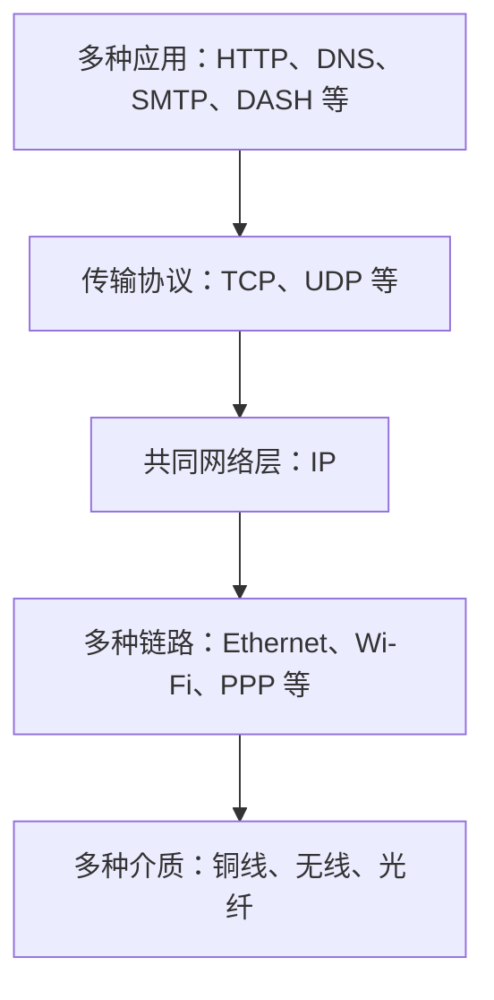

---
tags:
  - 计算机网络
  - 网络层
  - IP
  - SDN
  - 课程笔记
课程: 计算机网络
章节: 第4章 网络层：数据平面
教材: 计算机网络：自顶向下方法
---

> [!info] 本章定位
> [[Ch3 传输层]] 解释了端系统如何在不可靠网络上实现可靠传输，本章打开这个网络，追踪一个分组如何经过路由器。理解本章要抓住四条联系：
> 1. **控制平面决定规则，数据平面执行规则**。一次查表决定当前路由器的出口，多台设备的规则共同构成端到端路径。
> 2. **地址既用于标识接口，也承载可聚合的前缀结构**。分层分配减少转发表规模，最长前缀匹配允许保留更具体的例外。
> 3. **正确选择出口不等于立即发出**。交换结构、输出链路和缓存各有限制，排队、丢弃与调度由此产生。
> 4. **IP 提供连通性，但不包办端到端保证**。NAT、SDN 与中间盒扩展网络内部的能力，也让我们重新审视端到端原则。

## 目录

- [[#1. 从一次发送理解网络层的任务|1. 从一次发送理解网络层的任务]]
	- [[#1.1 报文段怎样跨越多条链路|1.1 报文段怎样跨越多条链路]]
	- [[#1.2 转发与路由选择解决不同尺度的问题|1.2 转发与路由选择解决不同尺度的问题]]
	- [[#1.3 数据平面与控制平面|1.3 数据平面与控制平面]]
	- [[#1.4 网络层究竟承诺什么|1.4 网络层究竟承诺什么]]
- [[#2. 路由器怎样决定并完成一次转发|2. 路由器怎样决定并完成一次转发]]
	- [[#2.1 四个部件与输入端口的工作|2.1 四个部件与输入端口的工作]]
	- [[#2.2 用前缀表示目的地址集合|2.2 用前缀表示目的地址集合]]
	- [[#2.3 最长前缀匹配的定义与手算|2.3 最长前缀匹配的定义与手算]]
	- [[#2.4 TCAM 为什么适合查表|2.4 TCAM 为什么适合查表]]
	- [[#2.5 三类交换结构与容量计算|2.5 三类交换结构与容量计算]]
- [[#3. 为什么排队，以及谁先发送|3. 为什么排队，以及谁先发送]]
	- [[#3.1 输入排队与 HOL 阻塞|3.1 输入排队与 HOL 阻塞]]
	- [[#3.2 输出排队与突发汇聚|3.2 输出排队与突发汇聚]]
	- [[#3.3 缓存大小与 bufferbloat|3.3 缓存大小与 bufferbloat]]
	- [[#3.4 缓存管理和调度各管什么|3.4 缓存管理和调度各管什么]]
	- [[#3.5 FCFS 与严格优先级|3.5 FCFS 与严格优先级]]
	- [[#3.6 RR 与 WFQ：公平到底按什么计量|3.6 RR 与 WFQ：公平到底按什么计量]]
- [[#4. IP 数据报怎样携带转发所需信息|4. IP 数据报怎样携带转发所需信息]]
	- [[#4.1 IP、ICMP 与转发表的分工|4.1 IP、ICMP 与转发表的分工]]
	- [[#4.2 IPv4 首部逐字段理解|4.2 IPv4 首部逐字段理解]]
	- [[#4.3 路由器处理后哪些字段变化|4.3 路由器处理后哪些字段变化]]
	- [[#4.4 分片字段的必要补充|4.4 分片字段的必要补充]]
- [[#5. 从接口地址到可扩展的分层寻址|5. 从接口地址到可扩展的分层寻址]]
	- [[#5.1 地址属于接口，子网由连接关系确定|5.1 地址属于接口，子网由连接关系确定]]
	- [[#5.2 CIDR、掩码与网络地址|5.2 CIDR、掩码与网络地址]]
	- [[#5.3 发给本地目标还是默认网关|5.3 发给本地目标还是默认网关]]
	- [[#5.4 DHCP：没有地址时如何获得配置|5.4 DHCP：没有地址时如何获得配置]]
	- [[#5.5 DHCP 的封装与广播边界|5.5 DHCP 的封装与广播边界]]
	- [[#5.6 地址块分配、路由聚合与更具体的例外|5.6 地址块分配、路由聚合与更具体的例外]]
	- [[#5.7 地址空间的分配层次与耗尽背景|5.7 地址空间的分配层次与耗尽背景]]
- [[#6. NAT：多个内部端点怎样共享一个外部地址|6. NAT：多个内部端点怎样共享一个外部地址]]
	- [[#6.1 共享地址为什么需要端口映射|6.1 共享地址为什么需要端口映射]]
	- [[#6.2 沿课件例子逐字段追踪一次往返|6.2 沿课件例子逐字段追踪一次往返]]
	- [[#6.3 NAT 的收益、状态限制与争议|6.3 NAT 的收益、状态限制与争议]]
- [[#7. IPv6：扩大地址空间与简化基本首部|7. IPv6：扩大地址空间与简化基本首部]]
	- [[#7.1 为什么不能只靠 NAT|7.1 为什么不能只靠 NAT]]
	- [[#7.2 固定 40 B 基本首部|7.2 固定 40 B 基本首部]]
	- [[#7.3 移除、后移与保留的功能|7.3 移除、后移与保留的功能]]
	- [[#7.4 隧道：IPv6 分组如何穿过 IPv4 网络|7.4 隧道：IPv6 分组如何穿过 IPv4 网络]]
	- [[#7.5 为什么网络层升级缓慢|7.5 为什么网络层升级缓慢]]
- [[#8. 通用转发：把目的地址查表扩展为匹配加动作|8. 通用转发：把目的地址查表扩展为匹配加动作]]
	- [[#8.1 为什么仅有目的地址不够|8.1 为什么仅有目的地址不够]]
	- [[#8.2 流表的一条规则包含什么|8.2 流表的一条规则包含什么]]
	- [[#8.3 OpenFlow 的字段、动作与设备统一视图|8.3 OpenFlow 的字段、动作与设备统一视图]]
	- [[#8.4 多台设备怎样共同实现一条指定路径|8.4 多台设备怎样共同实现一条指定路径]]
	- [[#8.5 可编程性扩展到了哪里|8.5 可编程性扩展到了哪里]]
- [[#9. 中间盒与端到端原则|9. 中间盒与端到端原则]]
	- [[#9.1 中间盒做了哪些额外工作|9.1 中间盒做了哪些额外工作]]
	- [[#9.2 白盒、SDN 与 NFV 的区别|9.2 白盒、SDN 与 NFV 的区别]]
	- [[#9.3 IP 沙漏为何有一个细腰|9.3 IP 沙漏为何有一个细腰]]
	- [[#9.4 端到端论点到底主张什么|9.4 端到端论点到底主张什么]]
	- [[#9.5 从电话网到可编程互联网|9.5 从电话网到可编程互联网]]
- [[#10. 例题|10. 例题]]
	- [[#10.1 重叠前缀、默认路由与聚合例外|10.1 重叠前缀、默认路由与聚合例外]]
	- [[#10.2 内存带宽、交换能力与输出瓶颈|10.2 内存带宽、交换能力与输出瓶颈]]
	- [[#10.3 一次突发怎样填满输出缓存|10.3 一次突发怎样填满输出缓存]]
	- [[#10.4 非抢占优先级调度的时间线|10.4 非抢占优先级调度的时间线]]
	- [[#10.5 RR 的分组公平与 WFQ 的带宽份额|10.5 RR 的分组公平与 WFQ 的带宽份额]]
	- [[#10.6 子网划分：容量、对齐与网关开销|10.6 子网划分：容量、对齐与网关开销]]
	- [[#10.7 DHCP 与远端发送的跨层衔接|10.7 DHCP 与远端发送的跨层衔接]]
	- [[#10.8 IPv4 分片、偏移单位与重组|10.8 IPv4 分片、偏移单位与重组]]
	- [[#10.9 NAT 的重复本地端口与无映射入站|10.9 NAT 的重复本地端口与无映射入站]]
	- [[#10.10 IPv6 隧道中的地址与长度|10.10 IPv6 隧道中的地址与长度]]
	- [[#10.11 流表冲突与完整路径|10.11 流表冲突与完整路径]]
	- [[#10.12 逐跳可靠是否足以替代端到端确认|10.12 逐跳可靠是否足以替代端到端确认]]
- [[#11. 易错点速查|11. 易错点速查]]
- [[#12. 知识点速查|12. 知识点速查]]
	- [[#12.1 全章结构总览|12.1 全章结构总览]]
	- [[#12.2 核心计算与适用条件|12.2 核心计算与适用条件]]
	- [[#12.3 五句话核心思想与章节衔接|12.3 五句话核心思想与章节衔接]]

---

## 1. 从一次发送理解网络层的任务

### 1.1 报文段怎样跨越多条链路

设笔记本要向远端 Web 服务器发送一个 TCP 报文段。TCP 知道目的端口和字节序号，却不能直接决定每一跳该走哪根链路。主机与服务器之间也通常没有一条直连线路。因此，下层需要一种能在不同网络之间转交报文段的机制。

**网络层为不同主机之间提供逻辑通信**：发送端将传输层报文段封装进 IP 数据报，网络中的路由器逐跳转发，接收端再把载荷交给对应的上层协议。这里的“主机到主机”描述服务范围；具体 IP 地址通常配置在主机或路由器的**接口**上。

普通 IP 转发的一跳可分解为：接收物理信号 → 识别链路层帧并取出 IP 数据报 → 检查和处理 IP 首部 → 根据转发表选出口 → 经交换结构送到输出侧 → 排队并封装成下一跳链路的帧。

这解释了两个不同的变化尺度：**链路层封装逐跳变化，IP 数据报承担跨网络传输的身份与控制信息**。在普通转发中源、目的 IP 地址保持不变，但 TTL 和首部检验和会变化；NAT 等机制还会改写地址，不能把“IP 首部完全不变”当作一般规律。

> [!warning] 与第三章的阅读衔接
> 第三章用“路由器只处理到网络层”描述传统分层模型。更准确地说，普通 IP 转发不要求路由器充当 TCP 连接端点；但本章的 NAT、防火墙和通用转发设备确实可能检查、甚至改写 TCP / UDP 首部。**检查传输层字段**与**作为端点执行 TCP 的可靠传输状态机**是两件事。

### 1.2 转发与路由选择解决不同尺度的问题

假设某路由器收到目的地址为 `200.23.24.170` 的分组。它面对的即时问题是“该从哪个接口发出去”，而不是每收到一个分组就从头计算整条互联网路径。

| 功能            | 需要回答的问题         | 作用范围     | 直接产物或动作        |
| ------------- | --------------- | -------- | -------------- |
| 转发 forwarding | 这个分组现在从哪个出口走？   | 单台设备、本地  | 查表、移动分组、执行动作   |
| 路由选择 routing  | 从源到目的地应采用怎样的路径？ | 全网或一个路由域 | 计算、选择并形成转发所需信息 |

> [!NOTE] **转发使用规则，路由选择产生或影响规则**
> 类似旅行中通过某个立交桥与规划整段行程的区别。路由器转发表通常给出目的前缀、下一跳和输出接口等信息；查表不意味着当前设备必须知道沿途每一跳的完整清单。

### 1.3 数据平面与控制平面

**数据平面 data plane** 
- **本地**设备对到达分组执行本地处理的部分
- 包括查表、转发、丢弃、改写等
**控制平面 control plane**
- **全网逻辑**
- 是计算、维护和下发这些规则的逻辑。课件用硬件纳秒级转发与软件毫秒级控制作典型对比，这是工作尺度的说明，不是所有设备都必须达到的固定时延。

控制平面有两种组织方式：

| 组织方式        | 谁计算规则         | 设备之间如何协作            | 分组到达时谁转发   |
| ----------- | ------------- | ------------------- | ---------- |
| 传统、每路由器控制   | 路由器内运行的路由算法组件 | 通过协议交换可达性、拓扑等信息     | 各设备自己的数据平面 |
| 软件定义网络（SDN） | 与转发设备分离的控制器逻辑 | 控制器与设备上的控制代理交互并下发规则 | 各设备自己的数据平面 |
![[Pasted image 20261021170733.png|399]]
![[Pasted image 20261021170749.png|475]]

SDN 的核心是控制与转发分离、控制逻辑可集中组织。**逻辑集中不要求物理上只有一台服务器**；也不意味着每个数据分组都先绕经控制器。已有规则匹配成功的分组通常直接由设备本地处理，特定规则才会把分组交给控制器

> [!NOTE] 控制平面与数据平面
> 控制平面计算并维护转发规则，数据平面在每台设备上执行本地动作。
> SDN 可以集中组织控制逻辑，但已匹配的分组通常仍由设备本地转发。

### 1.4 网络层究竟承诺什么

从应用需求出发，人们可能希望：单个分组必达、在 40 ms 内必达；
一串分组保持顺序、获得最低带宽、保持相邻分组间隔的稳定。
这些分别涉及可靠性、时延、顺序、带宽与时延变化，不能互相代替。

**服务模型**是网络层对上层可提供行为的约定。
互联网基本 IP 服务采用 **best effort，尽力而为**：

> [!IMPORTANT] **尽力而为服务的含义**
> IP 尽力交付分组，但不保证交付成功，也不保证端到端时延上界或分组顺序。
> 它同样不保证某条流的最小吞吐量。

![[Pasted image 20261021170709.png|493]]

为什么基本 IP 服务不提供这些保证，互联网仍然有用？
- 简单的核心易于部署
- 足够的容量让很多实时业务在多数时候工作良好
- CDN 与分布式服务缩短路径、减少瓶颈
- TCP 等弹性拥塞控制适应可用资源

**这些是获得较好实际性能的原因，并没有把“多数时候表现好”提升为服务保证。**

## 2. 路由器怎样决定并完成一次转发

### 2.1 四个部件与输入端口的工作

路由器的基本组成是输入端口、交换结构、输出端口与路由选择处理器
![[Pasted image 20261021171301.png|601]]

| 部件      | 主要职责                          | 可能遇到的限制        |
| ------- | ----------------------------- | -------------- |
| 输入端口    | 物理层：比特接收；链路层处理；查表、转发、等待进入交换结构 | 查表速度、交换仲裁、输入缓存 |
| 交换结构    | 把分组从输入侧搬运到所选输出侧               | 总交换能力、内部路径冲突   |
| 输出端口    | 缓存管理、调度、链路层封装、物理发送            | 输出链路线速、输出缓存    |
| 路由选择处理器 | 执行控制协议、计算和维护规则、管理设备           | 控制计算与更新速度      |

输入端口可以保有转发表的本地副本，自己根据首部字段查找出口，不必为每个分组询问中央处理器。这叫**分布式查找或交换处理**，其中“分布式”指设备内部的处理分散，不能直接据此判断全网控制平面是否采用 SDN

> [!IMPORTANT] **线速处理要求**
> 分组按输入链路允许的速度到达时，输入处理能持续跟上。
> 在相同链路比特率下，小分组带来更多次每秒查表；只看链路的 Gbit/s 数值，还不足以判断每秒可处理的分组数。

### 2.2 用前缀表示目的地址集合

为每个 IPv4 地址都设置一行规则，需要面对最多 $2^{32}$ 个地址。实际转发利用许多目的地址共享相同下一跳这一事实，用一个**前缀**描述一组地址。

> [!IMPORTANT] 前缀表示一组目的地址
> `/x` 固定 IPv4 地址的前 $x$ 位，剩余 $32-x$ 位可取不同值，因此覆盖 $2^{32-x}$ 个地址。

例如，前 24 位相同的一组地址可写作 `200.23.24.0/24`。`/24` 表示前 24 位固定，其余 8 位任取，故包含 $2^8=256$ 个地址。星号表示不关心的位，不是十进制数字的一部分。

课件的前缀表可写成：

| 固定的二进制前缀 | CIDR 表示 | 覆盖范围 | 输出接口 |
|---|---|---|---|
| `11001000 00010111 00010` | `200.23.16.0/21` | `200.23.16.0` 至 `200.23.23.255` | 0 |
| `11001000 00010111 00011000` | `200.23.24.0/24` | `200.23.24.0` 至 `200.23.24.255` | 1 |
| `11001000 00010111 00011` | `200.23.24.0/21` | `200.23.24.0` 至 `200.23.31.255` | 2 |
| 空前缀 | `0.0.0.0/0` | 所有 IPv4 地址 | 3 |

这里第三行也包含第二行的地址。范围表原来可以把接口 2 的范围写成 `200.23.25.0` 至 `200.23.31.255`；改成较短前缀后，多包含了 `24.*`，必须另有选择规则才能保持原来的行为。

### 2.3 最长前缀匹配的定义与手算

**最长前缀匹配 longest prefix match，LPM**：在所有与目的地址匹配的表项中，选择前缀长度最大的表项。长度越大，地址集合越小，规则越具体

先区分“匹配”与“胜出”：地址可以同时匹配多行，但最终采用其中最具体的一行。用 $d$ 表示目的地址，$p$ 表示规范化的网络前缀，$M_\ell$ 表示前 $\ell$ 位为 1 的掩码，则匹配条件为

$$
d\mathbin{\&}M_\ell=p.
$$

在满足条件的表项中取最大的 $\ell$。`/0` 没有固定地址位，是所有 IPv4 地址均匹配的后备规则。

> [!IMPORTANT] 最长前缀匹配的判据
> 先找出所有覆盖目的地址的路由，再选择前缀长度最大的那条。
> 短前缀提供一般路由，长前缀可以覆盖其中一段并形成例外。

沿用上表：

1. `200.23.24.170` 的第三字节为 `00011000`，既匹配 `/24`，又匹配 `00011` 对应的 `/21`。比较 $24>21$，采用接口 **1**。
2. `200.23.22.161` 的第三字节为 `00010110`，前 5 位是 `00010`，匹配第一行 `/21`，采用接口 **0**。
3. `200.23.25.1` 匹配第三行 `/21`，但不匹配第二行 `/24`，采用接口 **2**。
4. `201.1.1.1` 只匹配默认规则，采用接口 **3**。

为什么选最长前缀？因为网络希望“对整个大地址块采用一般规则，但对其中一个小地址块保留例外”。如果短前缀优先，更具体的例外就永远无法生效。第 5 节的 ISP 迁移会再次用到这个结构。

> [!warning] LPM 与流表优先级
> 传统目的地址转发的选择依据是前缀长度。通用流表还可能同时匹配源地址、协议、端口等字段，冲突通常由显式优先级解决；不能自动套用“文字最多的规则胜出”。

### 2.4 TCAM 为什么适合查表

三态内容可寻址存储器 **TCAM，Ternary Content Addressable Memory** 的每位可表示 `0`、`1` 或“不关心”
普通内存以地址取内容，内容可寻址存储器以给定内容搜索匹配项，因此适合对许多前缀并行匹配

课件以“一个时钟周期内检索，与表大小无关”概括硬件并行查找，并列举可存放百万级表项的设备。这里说的是给定硬件容量和实现条件下的查找抽象；匹配后仍需要选择最长前缀或最高优先级项，容量、功耗和更新成本也并非不存在。

### 2.5 三类交换结构与容量计算

输入端口通过查表已经知道分组应去哪个输出端口，接下来仍要解决一个实际问题：**怎样把分组的比特从输入侧搬到输出侧？**
交换结构 switching fabric 就是完成这种内部搬运的部件。查表解决“去哪里”，交换结构解决“怎样到那里”。

本节对应课件第 24–29 张幻灯片。先确定交换速率的含义，再分别讨论内存、总线与互联网络三种实现，最后解释多级结构和多交换平面怎样扩展能力。

#### 2.5.1 交换速率：要搬运多少数据

设路由器有 $N$ 个输入端口和 $N$ 个输出端口，每条输入、输出链路的线速均为 $R$ bit/s。
若所有输入同时满速接收，每秒到达路由器的分组数据总量就是 $NR$ bit。

因此，课件把交换速率描述为分组从输入侧传输到输出侧的速率，并常用它是链路线速的多少倍来表示。若要持续承受所有输入满载，交换结构的理想聚合搬运能力至少应达到 $NR$。

> [!IMPORTANT] 聚合能力与单个出口能力
> 交换结构达到 $NR$，表示它在适当的流量分布和调度条件下，可以跟上所有输入的合计到达量。
> 每个输出链路仍只有 $R$。若多个输入都指向同一输出，该输出的积压不会因交换结构足够快而消失。

例如，4 个输入各为 10 Gbit/s，合计到达速率为 40 Gbit/s。
如果分别送往 4 个不同输出，具有足够并行能力的交换结构可能同时搬运；如果全部送往输出 1，输出 1 仍只能以 10 Gbit/s 发走。
这里比较的是**设备内部总搬运能力**与**每条外部链路的发送能力**，二者要分别检查。

#### 2.5.2 经内存交换：先写入共享内存，再读到输出

课件将它放在第一代路由器的背景下：早期路由器可以由传统计算机实现，分组交换在 **CPU 的直接控制**下完成。
输入端口把收到的分组复制到处理器内存中，然后再把它从内存复制到所选输出端口。

![[Ch4-20261021-p07-经内存交换.png|650]]

*课件第 26 张幻灯片：输入端口、处理器内存和输出端口连接到同一系统总线。*

沿图中的数据通路看，一个分组经历两次主要的数据搬运：

1. **输入端口 → 系统总线 → 处理器内存**：把分组写入共享内存。
2. **处理器内存 → 系统总线 → 输出端口**：把分组读出并送往指定输出。

这里的共享内存承担中转存放作用，CPU 控制的是分组处理与搬运过程。
这不同于前文“输入端口各自查表”的现代高速处理思路：在课件所示的早期架构里，中央处理器及共享的数据通路参与逐包处理，容易成为性能限制。

**为什么课件强调每个分组两次穿越系统总线？**
因为一次写入、一次读出都占用共享通路和内存访问带宽。即使两个分组将去往不同输出，它们仍会争用同一套共享资源。
只增加输出端口数量，不能自动增加共享内存的访问能力。

> [!IMPORTANT] 经内存交换的瓶颈
> 在课件的共享内存、共享系统总线模型中，一个分组先写入内存，再从内存读出。
> 每份分组数据需要两次主要传送，交换吞吐受内存带宽以及相关共享通路限制。

**补充计算。** 设内存读写合计带宽为 $B$ bit/s，每个分组长度为 $L$ bit，忽略控制与其他开销。
搬运一个分组需承担 $2L$ bit 的内存读写流量，因此

$$
\text{每秒可交换的分组数}\leq\frac{B}{2L},\qquad
\text{分组数据吞吐率}\leq\frac B2.
$$

所以，如果要搬运 $NR$ bit/s 的合计分组流量，在这一模型下至少需要 $B\geq2NR$ 的内存读写带宽。
例如，4 个 10 Gbit/s 输入需要搬运 40 Gbit/s 的分组数据，相应内存读写合计需求为 80 Gbit/s。

这里的 $B$ 明确指**读与写合计**的可用带宽。若题目分别给出独立读通道、写通道带宽，应分别核对读、写负载，不能不看带宽口径就统一除以 2。

#### 2.5.3 经总线交换：输入内存直接送到输出内存

如果每个输入和输出端口各自带有存储，分组可以先停留在输入端口内存，再通过一条共享总线送入目标输出端口内存。
与上一种结构相比，分组不用先进入中央处理器内存，再从中央内存复制出来。

![[Ch4-20261021-p07-经总线交换.png]]

*课件第 27 张幻灯片：各输入、输出端口通过共享总线连接。*

其基本过程是：输入端口准备好分组与目标输出信息 → 申请使用共享总线 → 获得使用权后发送分组 → 目标输出端口接收并存储。
如果多个输入同时申请，总线必须仲裁，暂未获准的输入只能等待。

**共享的含义是什么？**
在图示的单总线模型中，所有分组都要使用同一条数据通路。
即使输入 1 要去输出 1、输入 2 要去输出 2，两者没有争用同一个输出，也仍然争用这条总线，不能各自独占它并同时完成两份独立传送。

> [!IMPORTANT] 经总线交换的瓶颈
> 分组从输入端口内存经共享总线到输出端口内存，总线竞争限制合计交换速率。
> 输出不同可以避免输出争用，但不能消除共享总线争用。

**补充计算。** 若总线有效数据带宽为 $B_{\mathrm{bus}}$ bit/s，一个长度为 $L$ bit 的分组占用总线的传送时间至少为

$$
t_{\mathrm{bus}}=\frac{L}{B_{\mathrm{bus}}}.
$$

在忽略仲裁等开销的简化模型下，合计分组吞吐上限为 $B_{\mathrm{bus}}$，而不是每个输入端口都各自获得这么多带宽。
这里没有经中央内存一写一读的两次中转，因此不能直接套用上一种结构的 $B/2$；具体端口内存访问仍须由实现条件另行检查。

课件举出 **Cisco 5600 的 32 Gbit/s 总线**，说明这种结构在相应接入网规模下可以够用。
这是一项课件设备案例：结构是否合适要比较所需合计流量与共享总线能力，不能仅因“采用总线”就断言所有场景都不可用，也不能把示例数字当作当前设备规格。

#### 2.5.4 经互联网络交换：允许不冲突的传送并行

共享总线的限制在于所有输入都争用同一条通路。进一步提高并行性的方法，是在输入与输出之间建立多条可同时使用的内部连接。
课件指出，这类互联网络早期源于多处理器计算机中连接多个处理器的网络结构，后来用于构造高速交换结构。

![[Ch4-20261021-p07-纵横与多级交换.png]]

*课件第 28 张幻灯片：右上为 3×3 纵横结构，右下为由多个较小交换单元组成的 8×8 多级结构。*

先看 **纵横交换 crossbar**。它可用 $N$ 条输入通路和 $N$ 条输出通路交叉构成，共 $2N$ 条通路，对应课件所说的 $2N$ 条总线。
每一条输入通路与每一条输出通路都有可选择的交叉位置，概念上共有 $N^2$ 个交叉点。
接通某个交叉点，就把指定输入连接到指定输出。

以图中的 3×3 结构为例，假设本轮请求为：

| 请求 | 需要接通的连接 | 是否争用同一输出 |
|---|---|---|
| 输入 1 → 输出 3 | 第 1 条输入与第 3 条输出的交叉点 | 否 |
| 输入 2 → 输出 1 | 第 2 条输入与第 1 条输出的交叉点 | 否 |
| 输入 3 → 输出 2 | 第 3 条输入与第 2 条输出的交叉点 | 否 |

三份请求使用不同输入、不同输出，可以在基本纵横模型中同时建立连接。
如果改成输入 1、2、3 都请求输出 1，那么这三份请求仍然冲突，需要由调度器选择本轮获准通过的分组，其余等待。

> [!IMPORTANT] 纵横结构的并行条件
> 在基本单播、每端口同一时刻只承担一份传送的模型下，使用不同输入和不同输出的连接可以并行。
> 多个输入争用同一输出时仍需仲裁，互联网络不会自动增加该输出的接收与发送能力。

这也解释了互联网络相对共享总线的改进：当目的输出不冲突时，可以同时使用不同内部通路，而不必把所有传送都串行放到一条总线上。

#### 2.5.5 多级交换：用小型交换单元构造大型结构

单个大型纵横结构需要大量交叉连接。若端口数增加，交叉位置按 $N^2$ 增长，直接做一个更大的单级结构会给互连和实现规模带来压力。
**多级交换**将多个较小规模的交换单元分层连接，用它们共同实现较大的输入、输出规模。

课件的 **8×8 多级交换**图就是这种组织：分组先进入第一层的某个小交换单元，再经中间层，最后由输出层到达目标端口。
这里的 8×8 表示整个结构有 8 个输入和 8 个输出，不表示每个小交换单元都必须是 8×8。

理解图时，应沿一条分组路径逐级看：

1. 入口单元把分组送入某条内部路径。
2. 中间单元选择后续连接，让分组朝目标输出一侧移动。
3. 出口单元把它交给最终选定的输出端口。

多个分组能否并行，不仅要看最终输出是否相同，还要看它们选择的内部路径是否争用同一资源。
**多级**说明如何把小交换单元组合起来；它本身不保证任意请求组合都能无冲突通过。具体是否发生内部阻塞，取决于拓扑和调度方式。

#### 2.5.6 多交换平面：切块、并行传送与输出重组

多级结构通过层次连接扩大端口规模；课件接着说明，还可**并行使用多个交换平面 fabric planes**，进一步增加内部搬运能力。
一个交换平面可以理解为一套承担输入到输出搬运的内部交换网络。多套这样的网络并行工作，便有多条可利用的搬运通道。

![[Ch4-20261021-p08-多交换平面.png]]

*课件第 29 张幻灯片：多个输入、输出连接到并行的交换平面，每个平面内部还可采用多级网络。*

课件第 28 张还介绍了利用这种并行性的**分组切块与喷射**过程：

1. 输入端口把一个分组分成 $K$ 个较小的块。
2. 将这些块分配到可用交换结构中的 $K$ 个，经不同内部通道并行传送，目标仍是同一个选定输出端口。
3. 输出端口收齐并按正确次序装配这些块，还原成原始分组。

为避免混淆，这里用 $P$ 表示可用交换平面数，$N$ 仍表示端口数；若每块使用一个不同平面，则需要 $K\leq P$。
课件在喷射描述中也使用了 $N$ 表示交换结构数量，应按该处上下文理解，不能直接认为端口数与交换平面数必然相等。

**补充例子。** 假设一个已收齐的 1200 B 分组被分成 4 个 300 B 小块，分配到 4 个内部平面去往同一输出。
这 4 块在内部可以并行搬运；输出侧仍要恢复出完整的 1200 B 分组，并受输出链路速率约束。
因此，并行平面提高的是内部交换能力，不能据此推断一条输出链路的线速自动变成原来的 4 倍。

> [!NOTE] 三种“分开”要区分
> 多级交换：把一套交换网络分成前后相连的多个层级。
> 多交换平面：让多套内部交换网络并行承担搬运任务。
> 设备内部切块：把分组拆成小块并行搬运后重组，不是生成多个需要跨网络传输的 IP 分片。

课件的 **Cisco CRS** 案例把上述两种扩展结合起来：基本组织采用 **8 个交换平面**，每个平面内部有 **3 级互联网络**，课件标注其交换能力可达 **100 Tbit/s**。
因此，8 说的是并行网络的数量，3 说的是每个网络内部的层级数，两者描述不同维度，不能相互替代。这些数字作为材料中的架构示例保留。

#### 2.5.7 回到同一组请求，比较三种结构

仍考虑输入 1 → 输出 3、输入 2 → 输出 1、输入 3 → 输出 2 这三份请求。
它们的目的输出互不相同，但能否同时搬运，取决于中间采用什么结构：

| 结构 | 分组实际经过哪里 | 三份请求为何仍可能等待 | 扩展能力的主要方向 |
|---|---|---|---|
| 经内存交换 | 输入 → 共享内存 → 输出 | 共享内存访问和系统通路要承担每包写入、读出 | 提高内存与相关通路带宽，改变存储组织 |
| 经总线交换 | 输入端口内存 → 共享总线 → 输出端口内存 | 目的不同仍要竞争同一条总线 | 提高总线有效带宽，但共享资源约束仍在 |
| 经互联网络交换 | 输入 → 可选择的内部连接或多级路径 → 输出 | 输出冲突或内部路径冲突时需等待；不冲突请求可并行 | 利用并行连接、多级网络和多个交换平面 |

这张表是在工作过程之后作比较。判断一道容量题时，先确定数据需要经过哪些共享资源、每份数据经过几次，再计算它们的负载。
对于内存模型，区分分组吞吐与读写合计流量；对于总线模型，区分单个分组传送速度与所有输入共享的合计能力；对于互联网络，检查本轮连接是否能同时成立。

最后仍要检查每个输出的负载：内部搬运能力再强，也不能让多个满速输入长期无损地挤进一条同速输出链路。
若分组暂时无法进入交换结构，就会在输入侧排队；若已送到输出侧但链路来不及发送，就在输出侧排队。这便引出了第 3 节的排队与 HOL 阻塞。

## 3. 为什么排队，以及谁先发送

### 3.1 输入排队与 HOL 阻塞

如果分组到达输入侧的速度超过它们进入交换结构的速度，分组先在输入端口等待。即使总交换容量足够，也可能因为争用同一输出或内部仲裁而暂时无法通过。输入缓存耗尽时同样会丢包。

**队首阻塞 Head-of-the-Line blocking，HOL** 的关键不是“队列里有人等待”，而是**队首分组无法前进，挡住了后面本来有机会前进的分组**。

> [!IMPORTANT] HOL 阻塞
> 队首分组因目标输出争用而无法前进时，FIFO 队列中的后续分组即使目标输出空闲，也不能越过队首。
> 后续分组因此等待，是输入队列顺序造成的阻塞。

考虑两个输出 A、B 和两个 FIFO 输入队列：

| 输入队列 | 队首 → 队尾 |
|---|---|
| 输入 1 | 红 1（去 A）、绿 1（去 B） |
| 输入 2 | 红 2（去 A） |

本轮 A 只能接收一个红色分组。若红 2 获准通过，红 1 留在输入 1 队首；绿 1 虽然要去空闲的 B，也因不能越过红 1 而等待。这就让一个输出的争用影响了另一个本可使用的输出。

![[Ch4-20261021-p08-HOL阻塞.png]]

*课件第 30 张幻灯片：两个输入的队首争用同一输出，后继绿色分组被挡住。*

### 3.2 输出排队与突发汇聚

输出队列面对的是另一种不平衡：**从交换结构到达某输出的瞬时速率，高于该输出链路的发送速率**。

假设 4 个输入各以 $R$ 发送到同一出口，交换结构足以同时搬运，总到达速率为 $4R$，输出却只能以 $R$ 发走。队列在持续汇聚时以 $3R$ bit/s 增长。让交换结构更快只能更及时地把拥塞送到输出侧，不能创造输出带宽。

若持续到达速率为 $\lambda_{\mathrm{bit}}$，输出速率为 $C$，且队列非空，则简化流体模型中

$$
\frac{dQ(t)}{dt}=\lambda_{\mathrm{bit}}-C.
$$

这里 $Q(t)$ 以 bit 计。若缓存容量为 $B$ bit，当前已有 $Q_0$ bit，且 $\lambda_{\mathrm{bit}}>C$ 持续不变，首次填满约需

$$
t_{\mathrm{full}}=\frac{B-Q_0}{\lambda_{\mathrm{bit}}-C}.
$$

离散分组的边界、正在发送的分组是否占用缓存，须按题目约定另行处理。公式用于看清“入速率减出速率”，不能替代分组级时间线。

### 3.3 缓存大小与 bufferbloat

缓存可以吸收短暂突发，却不能解决长期平均到达速率超过服务能力的问题。扩大缓存还会让分组等待更久：若前方有 $Q$ bit 等待、输出速率为 $C$ bit/s，且不考虑优先级插队，则排队等待约为 $Q/C$ 秒。

课件给出两种缓存配置参考：

$$
B\approx C\times RTT,\qquad
B\approx\frac{C\times RTT}{\sqrt{N}}.
$$

这里 $B$ 以 bit 计，$C$ 是瓶颈链路容量，$RTT$ 是典型往返时延，$N$ 是共享链路的流数。后一式利用多条流带来的统计平滑，**不是对任意流量模式、任意调度器的无条件定理**。

例如 $C=10$ Gbit/s、$RTT=0.25$ s，第一式给出 $2.5$ Gbit，即 $312.5$ MB 的缓存。若有 $N=100$ 条适用该估算的流，第二式给出 $0.25$ Gbit，即 $31.25$ MB。

**Bufferbloat，缓存膨胀**是过大队列长期积压带来的高时延现象。即便吞吐量较高，交互式语音、游戏等仍可能明显变慢；RTT 变大也让端系统获得拥塞反馈更迟。这与 [[Ch3 传输层#7.8 基于延迟的拥塞控制与 BBR|第三章基于延迟的拥塞控制]] 的目标一致：保持瓶颈忙碌，同时避免不必要的积压。

### 3.4 缓存管理和调度各管什么

| 机制   | 决策时机与问题                  | 典型策略              |
| ---- | ------------------------ | ----------------- |
| 缓存管理 | 到来的分组收不收？空间不足时丢谁？是否标记拥塞？ | 弃尾、按优先级丢弃、ECN 标记  |
| 分组调度 | 链路可以发送时，下一个发谁？           | FCFS、严格优先级、RR、WFQ |
**丢弃**：
- **弃尾 tail drop** 在缓存无空位时丢弃新到达的分组
- **优先级 priority** 可能拒收低优先级分组，或移除已经排队的低优先级分组，具体取决于规则
**标记**：
- **ECN** 可通过标记已具备 ECN 能力的分组发出拥塞信号，再由端系统响应。它没有增加物理缓存；缓冲区真正耗尽或遇到其他错误时，丢包仍然可能发生。更不能把 ECN 标记理解为“每次都要丢掉该分组”。

> [!NOTE] 缓存管理与调度
> 缓存管理决定新分组能否进入队列，以及满载时丢弃或标记哪些分组。
> 调度决定链路空闲时，从已有队列中选择哪个分组发送。

### 3.5 FCFS 与严格优先级

**FCFS / FIFO** 按到达顺序发送分组。它简单、保持该队列内部的服务顺序，但不会自动区分交互式流量与大文件流量。

**严格优先级排队** 先把分组分入不同类别，每次选择当前有积压的最高优先级类，同一类内部通常采用 FIFO

![[Pasted image 20261021175854.png|278]]
理解其行为必须说明发送是否可抢占。课件的分组级示意适合按**非抢占**方式理解：低优先级分组一旦开始发送，通常发完整个分组，再选择下一个。高优先级刚到达时仍可能等待这一小段剩余发送时间，但无需等待所有尚未开始发送的低优先级分组

若高优先级持续占满链路，低优先级可能长期得不到服务，即**饥饿**。因此“优先级高”不等于“所有类别都有最低带宽保证”。

### 3.6 RR 与 WFQ：公平到底按什么计量

**循环排队 Round Robin，RR** 周期性扫描类别队列，从每个非空队列发送一个完整分组，空队列跳过。它给予各类轮流发送的机会。

但“一轮一个分组”不等于“每类相同比特数”：若两类一直积压，一类分组为 1500 B，另一类为 500 B，则每轮发送字节数之比为 $3:1$，长期带宽份额也为 $3:1$。

**加权公平排队 Weighted Fair Queuing，WFQ** 用正权重 $w_i$ 分配类别 $i$ 的服务份额。设输出速率为 $R$，在理想加权公平模型中，所有类别均积压时

$$
r_i=R\frac{w_i}{\sum_jw_j}.
$$

> [!IMPORTANT] WFQ 按服务份额分配带宽
> 当所有类别都有积压时，类别 $i$ 的理想速率为 $R w_i/\sum_jw_j$。
> 这是按传输服务分配带宽，不是按权重比例机械地计算分组个数。

当某些类别无分组可发，工作保持的调度器可将空出的份额用于其他积压类别。课件所说的“至少获得 $Rw_i/\sum_jw_j$”应理解为该模型下的服务份额，实际分组化调度会有短时离散偏差。

> [!warning] 不要把 WFQ 简化成按权重数分组
> “权重为 2，所以一轮发两个分组”在分组长度不同的时候，未必实现 2 倍带宽。WFQ 所追求的是按权重分配传输服务，而不是无条件按分组个数分配。

## 4. IP 数据报怎样携带转发所需信息

### 4.1 IP、ICMP 与转发表的分工

网络层不只是一张转发表。
**IP** 规定数据报格式、寻址和处理约定；
**ICMP** 承担错误报告与部分网络控制信息；
**路由协议或 SDN** 控制器建立转发规则。

因此，OSPF、BGP 等名称出现在本章，是为了说明**转发表从哪里来**。它们的具体计算和协议交互属于后续控制平面内容。本章先在“规则已经给定”的条件下理解转发。

### 4.2 IPv4 首部逐字段理解

![[Ch4-20261021-p11-IPv4首部.png]]

*课件第 41 张幻灯片。图中首部长度旁的 bytes 是换算后长度，字段实际单位见下文*

| 字段 | 位数 | 解决的问题与计算方式 |
|---|---|---|
| Version | 4 | 表示 IP 版本，IPv4 中取 4 |
| IHL，首部长度 | 4 | 指明载荷从哪里开始；单位是 32 位字 |
| Type of Service | 8 | 课件按 DSCP 6 位与 ECN 2 位解释服务区分和拥塞信号 |
| Total Length | 16 | 整个 IPv4 数据报的字节数，含首部与数据 |
| Identification | 16 | 与相关地址和协议等信息一起用于关联分片 |
| Flags | 3 | 含禁止分片 DF、后续仍有分片 MF 等控制位 |
| Fragment Offset | 13 | 本片数据在原始数据部分中的位置，单位为 8 B |
| TTL | 8 | 限制数据报可继续经过的跳数，防止无限循环 |
| Protocol | 8 | 指明载荷交给哪个上层协议，如 TCP、UDP、ICMP |
| Header Checksum | 16 | 检查 IPv4 首部，不覆盖数据载荷 |
| Source / Destination Address | 各 32 | 源、目的接口的 IPv4 地址 |
| Options 与 Padding | 可变 | 支持可选信息并保持首部按 32 位对齐 |

IPv4 的首部长度是 $H=4\times IHL$ 字节。最小 IHL 为 5，对应 20 B；最大为 15，对应 60 B。总长度记为 $T$，则 IP 载荷长度为 $T-H$，而不是 $T-20$，除非确认没有选项

> [!IMPORTANT] 先用 IHL 求真实首部长度
> IHL 的单位是 32 位字，每单位为 4 B。
> 所以应先算 $H=4\times IHL$，再用总长度 $T$ 求载荷 $T-H$。

例如 IHL 为 7、总长度为 1000 B，首部长 $28$ B，IP 载荷为 $972$ B。若载荷是一个无选项、首部 20 B 的 TCP 报文段，TCP 应用数据为 $972-20=952$ B。

16 位总长度允许的普通 IPv4 数据报最大长度是 **65535 B**，课件用“64K”作近似说明。以太网上常见 MTU 为 1500 B，但这并非 IPv4 的协议最大长度。

**开销要说明比较基准。** 无选项 IPv4 加无选项 TCP 共 40 B 首部；若应用数据为 1000 B，则网络层总长为 1040 B，首部占总长 $40/1040\approx3.85\%$，首部与应用数据之比为 $40/1000=4\%$。链路层首尾部尚未计入。

### 4.3 路由器处理后哪些字段变化

普通转发时，路由器将 TTL 减 1。若该分组不能再继续转发，就丢弃，并通常按 ICMP 规则产生超时报文；这使错误配置产生的环路不会让一个分组永久占据网络。

TTL 改变了 IPv4 首部，因此首部检验和也要相应更新。**检验和更新可以通过增量方式完成，不要求每跳都从头扫描全部首部求和。**

注意两个不同的分解：IP 的 Protocol 字段决定把载荷交给 TCP、UDP 等哪个协议；TCP / UDP 的端口字段再参与选择进程或套接字。不能用 IP Protocol 直接代替目的端口。

### 4.4 分片字段的必要补充

课件展示了分片字段，但没有单独展开完整分片算法。以下补充使这些字段具有可计算的含义。

**MTU** 是一条链路可承载的最大网络层分组长度，不含该链路自己的帧首尾部。一个 IPv4 数据报大于下一跳 MTU 时，在允许分片的条件下可能被拆成多个分片；每片有自己的 IP 首部，最终由**目的端**重组，普通中间路由器不负责逐跳重组。

在同一首部长度 $H$、不考虑选项复制差异的简化模型下，非末片最大数据长度为

$$
D_{\max}=8\left\lfloor\frac{MTU-H}{8}\right\rfloor.
$$

必须向下取 8 B 的整数倍，因为后续分片的偏移量以 8 B 为单位。末片的数据长度无需是 8 B 的整数倍。MF 为 1 表示其后还有分片；末片 MF 为 0，并不表示“从来没有被分过片”。

如果设置 DF 禁止分片，又大于下一跳 MTU，则不能通过任意切分解决，需丢弃并按适用规则通知发送端。下一节 IPv6 的转发处理在这里作了不同取舍。

## 5. 从接口地址到可扩展的分层寻址

### 5.1 地址属于接口，子网由连接关系确定

**IP地址**：与每个主机或路由器接口关联的32位标识符
**接口**：主机或路由器与链路的连接边界
- 路由器通常有多个接口，分别连接不同网络；
- 主机也可能同时有有线和无线接口。IPv4 地址为 32 位，点分十进制把它分为 4 个 8 位字节，每个十进制数范围是 0 至 255

课件例子：

$$
223.1.1.1=11011111\ 00000001\ 00000001\ 00000001.
$$

**子网 subnet** 可先从拓扑理解：其中的接口不必经过中间路由器即可在链路层相互到达。交换机或接入点可以连接这些接口；“不经过路由器”不等于“只能用一根线直接相连”
- IP地址的子网部分：同一子网的设备有共同的高位
- IP地址的主机部分：剩余低位

课件的判断法：
- 把各接口从主机与路由器上拆离，保留接口之间的链路连接
- 每个孤立出来的连接区域就是一个子网。路由器间的点对点链路也形成子网，不能只数连接终端的局域网。

> [!IMPORTANT] 子网由接口的链路连接关系确定
> 不经过中间路由器即可相互到达的接口属于同一个子网。
> 数子网时也要计入路由器之间的链路。

![[Ch4-20261021-p12-六个子网.png|609]]

*课件第 46 张幻灯片：3 个终端局域网加 3 条路由器间链路，共 6 个子网。图中把某些路由器接口标成 `223.1.7.0`、`223.1.8.0`，同时又给相应子网标注 `/24`。按普通 `/24` 约定，主机位全 0 是网络地址，不能作为普通单播接口地址；这是示意图中的地址标注问题。子网数量由连接关系确定，不受这处笔误影响。*

### 5.2 CIDR、掩码与网络地址

**CIDR，无类别域间路由**用 `a.b.c.d/x` 表示一个前缀，$x$ 是高位网络部分长度，低 $32-x$ 位为主机部分。前缀长度不必限制为传统分类地址的 8、16、24 位。

与 `/x` 对应的子网掩码高 $x$ 位为 1，其余为 0。把接口地址与掩码逐位与，得到网络地址。

以 `200.23.18.37/23` 为例：前 16 位固定后，第三字节还固定 7 位，掩码为 `255.255.254.0`。第三字节按位与为 $18\mathbin{\&}254=18$，第四字节按位与为 0，故网络地址为 `200.23.18.0/23`，范围至 `200.23.19.255`。

| 问题 | 在普通 IPv4 子网中的求法 |
|---|---|
| 主机部分有几位？ | $h=32-x$ |
| 地址块中有几个地址？ | $2^h$ |
| 网络地址是什么？ | 接口地址与掩码逐位与，主机位全 0 |
| 定向广播地址是什么？ | 主机位全 1 |
| 普通可分配单播接口数？ | 通常 $2^h-2$，须满足采用普通网络 / 广播地址约定 |

> [!warning] 两个常见边界
> `a.b.c.d/x` 有时是在描述接口地址，有时是在描述网络前缀。接口地址可以有非零主机位；规范的网络前缀表示应把主机位清零。另一个边界是 `/31` 点对点链路和 `/32` 主机路由，它们不能套用普通子网的 $2^h-2$ 规则。

同一子网中的接口共享对应前缀；但两个独立链路上误配了相同前缀，并不会因此在物理上变成一个子网。寻址配置应当反映连接关系。

### 5.3 发给本地目标还是默认网关

主机先用自己的地址、掩码判断目标是否处在本地子网。在本章的普通单接口模型下，若与目标按位与得到相同网络前缀，就直接交给本链路上的目标；否则发给下一跳路由器，常见为默认网关。

关键是区分 **IP 目的地址**与**当前链路的交付目标**。发送到远端服务器时，普通主机仍把服务器 IP 写入数据报目的字段，而不是把目的 IP 改成默认网关。默认网关是当前这一跳要接收帧的设备，具体链路层地址解析留待链路层学习。

> [!IMPORTANT] 远端 IP 与下一跳是两个地址角色
> IP 首部的目的地址保持为最终服务器。
> 当前链路上的帧则交给下一跳路由器。

实际多接口主机也可能使用更具体的路由表；“本地子网或默认网关”是解释基础行为的简化模型。

### 5.4 DHCP：没有地址时如何获得配置

新主机尚未知道自己的可用 IP、网关与 DNS 服务器，却需要与配置服务器通信
**DHCP，动态主机配置协议**：通过已知端口与广播等机制完成引导，为客户端授予有期限的地址租约
- 可返回**子网掩码**、客户机第一跳的路由器地址、**DNS 服务器的名称和IP地址**等信息

DHCP 使用 UDP：**服务器端口 67，客户端端口 68**。下面沿用课件中新客户端、服务器 `223.1.2.5`、候选地址 `223.1.2.4` 的场景，采用广播回复的简化流程。

| 阶段 | 发送方 → 接收方 | 典型 IP 与端口 | 报文作用 |
|---|---|---|---|
| Discover | 客户端 → 本地服务器 | `0.0.0.0:68 → 255.255.255.255:67` | 寻找可提供配置的服务器 |
| Offer | 服务器 → 客户端 | `223.1.2.5:67 → 255.255.255.255:68` | 提议地址、租期及其他参数 |
| Request | 客户端 → 服务器 | `0.0.0.0:68 → 255.255.255.255:67` | 表明所选服务器和请求的地址 |
| ACK | 服务器 → 客户端 | `223.1.2.5:67 → 255.255.255.255:68` | 确认租约并交付配置 |

**Offer 是提议，ACK 才是该流程中的最终确认。** 广播 Request 也使其他服务器知道客户端选择了哪一个提议。报文中的事务标识帮助关联请求与响应；不应把课件图中的具体数字或每步变化当作协议规则。

> [!IMPORTANT] DHCP 初次获取的四步
> 客户端发现服务器并收到 Offer 后，选择一个提议发送 Request。
> 服务器以 ACK 确认租约，客户端再使用所获地址与网络参数。

协议状态可先理解为：未配置 → 发现服务器 → 收到候选配置 → 请求所选配置 → 收到 ACK 后使用租约。拒绝、超时与重试会使状态回退或重新开始，不能收到一个 Offer 就永远占有该地址。

DHCP 支持租约更新与地址复用。客户端若记得曾使用的地址，可以从请求重用的流程开始，因此 Discover、Offer 不是所有 DHCP 交互都必须包含；续租时的通信也不必始终广播。

### 5.5 DHCP 的封装与广播边界

请求发送时的封装顺序为

$$
\text{DHCP 报文}\subset\text{UDP 数据报}\subset\text{IP 数据报}\subset\text{链路层帧}.
$$

本地以太网广播帧的目的 MAC 地址为 `FF:FF:FF:FF:FF:FF`。服务器按相反方向进行分解，交给 UDP 67 对应的 DHCP 服务，随后返回配置；客户端再逐层分解并使用它。

课件把 DHCP 服务部署在路由器中，这是常见部署方式，并非协议要求。若服务器在另一子网，普通路由器不会直接转发本地受限广播，需要适当的 DHCP 中继机制。这个边界解释了为什么“广播寻找服务器”不能直接覆盖整个互联网。

### 5.6 地址块分配、路由聚合与更具体的例外

DHCP 回答“主机怎样获得本地地址”，仍留下“这个网络的前缀从哪里来”。课件的例子是 ISP 获得 `200.23.16.0/20`，再划给 8 个组织，每个组织一个 `/23`。

从 `/20` 到 `/23` 增加 3 个子网位，因此得到 $2^3=8$ 块；每块包含 $2^{32-23}=512$ 个地址。8 个连续块分别为：

| 组织 | 分配的前缀 | 第三个字节覆盖范围 |
|---|---|---|
| 0 | `200.23.16.0/23` | 16–17 |
| 1 | `200.23.18.0/23` | 18–19 |
| 2 | `200.23.20.0/23` | 20–21 |
| 3 | `200.23.22.0/23` | 22–23 |
| 4 | `200.23.24.0/23` | 24–25 |
| 5 | `200.23.26.0/23` | 26–27 |
| 6 | `200.23.28.0/23` | 28–29 |
| 7 | `200.23.30.0/23` | 30–31 |

**路由聚合**允许 ISP 对外仅发布 `200.23.16.0/20`，而不是要求全互联网分别记住这 8 条组织路由。远端先把分组送到这个 ISP，ISP 内部再细分出口。

> [!IMPORTANT] 路由聚合与具体例外
> ISP 发布较短的汇总前缀可以减少路由项。
> 某个子网迁走时，更长的前缀可覆盖这项例外，其余地址继续使用汇总路由。

但聚合要求前缀关系与可达性相容。若组织 1 保留 `200.23.18.0/23` 地址迁往另一 ISP，新 ISP 可额外发布该 `/23`；互联网中同时存在旧 ISP 的 `/20` 与新 ISP 的 `/23`。去往组织 1 的分组同时匹配两条路由，因为 $23>20$，采用新 ISP 的更具体路由。其余组织仍使用 `/20` 汇总路由。

这正是“分层分配 → 聚合减少规模 → 最长前缀保留例外”的闭环。不能随意把几个相邻十进制地址段合成一个前缀：它们必须在二进制上有适当的公共前缀、起始边界对齐，且不能把不可达的地址范围无条件一并宣告。

### 5.7 地址空间的分配层次与耗尽背景

课件把 ICANN、IANA 职能所在的全球协调层、区域互联网注册管理机构 RIR、NIR / LIR 与 ISP 组织起来说明地址资源的层次分配。5 个 RIR 为 ARIN、RIPE NCC、APNIC、LACNIC、AFRINIC；课件以 CNNIC 说明中国的 NIR 层次。这里讨论地址资源管理，不是每个分组实时查询这些机构后才能转发。

32 位 IPv4 地址空间在扣除各类保留用途、并考虑分配和路由约束后，可用资源有限。课件以 2011 年全球 IPv4 自由地址池耗尽为背景引入两条路线：NAT 让多个内部端点共享外部 IPv4 地址；IPv6 将地址长度扩展至 128 位。

## 6. NAT：多个内部端点怎样共享一个外部地址

### 6.1 共享地址为什么需要端口映射

课件讨论的 **NAT** 实际包含端口转换，常称 **NAPT / PAT**：
- 用外部地址与端口组合标识内部端点，并保存相应映射
- 因此“多台主机共享一个公网地址”仍能让不同连接相互区分
- 就外部世界而言，本地网络中的所有设备仅共享一个IPv4地址

内部网络常使用私有 IPv4 地址：

| 前缀 | 地址范围 |
|---|---|
| `10.0.0.0/8` | `10.0.0.0` 至 `10.255.255.255` |
| `172.16.0.0/12` | `172.16.0.0` 至 `172.31.255.255` |
| `192.168.0.0/16` | `192.168.0.0` 至 `192.168.255.255` |

这些地址可在不同私有网络重复使用，不能直接作为全球公网唯一可达地址。比如 `172.32.0.1` 并不属于 `172.16.0.0/12`，不能看到 172 开头就判为私有。
![[Pasted image 20261026092820.png|447]]
### 6.2 沿课件例子逐字段追踪一次往返

内部主机 `10.0.0.1:3345` 访问服务器 `128.119.40.186:80`。NAT 外部地址为 `138.76.29.7`，选用外部端口 5001。

| 位置 | 源地址与端口 | 目的地址与端口 | 所做操作 |
|---|---|---|---|
| 内部主机发出 | `10.0.0.1:3345` | `128.119.40.186:80` | 初始请求 |
| NAT 向外转发 | `138.76.29.7:5001` | `128.119.40.186:80` | 改写源并建立映射 |
| 服务器返回 | `128.119.40.186:80` | `138.76.29.7:5001` | 回到服务器看到的源端点 |
| NAT 向内转发 | `128.119.40.186:80` | `10.0.0.1:3345` | 查映射、还原目的端点 |

转换表记录：

$$
(\mathrm{TCP},138.76.29.7,5001)
\longleftrightarrow
(\mathrm{TCP},10.0.0.1,3345).
$$

上式是为解释课件模型给出的简化映射。实际设备可能把远端地址、远端端口等也纳入映射或过滤条件，并维护超时等状态。

如果另一台主机也以本地端口 3345 访问同一服务器，它可以获得外部端口 5002。**本地端口相同并不冲突，因为内部地址不同；外部区分则由 NAT 分配的端点完成。**

> [!warning] 字段变化与课件笔误
> 课件第 64 张幻灯片回程说明中的 `138.76.2.7` 与整图不一致，应按统一的 NAT 外部地址 `138.76.29.7` 理解。由于 IP 地址和 TCP / UDP 端口可能被改写，NAT 还需相应更新相关检验和；TCP / UDP 校验涉及伪首部中的 IP 地址，不能只改 IPv4 首部检验和。

### 6.3 NAT 的收益、状态限制与争议

**优点**：
- 减少内部设备对外部 IPv4 地址的需求，为所有设备提供一个IP地址
- 内部重新编号不必暴露给外部
- 切换 ISP 时也可保留内部编号
- 没有预先建立或配置的映射时，外部主机通常不能直接发起到某内部服务的连接，因此部署内部服务器或点对点应用时会遇到 NAT 穿越问题。

这同时说明 NAT 的边界：

- 它需要保存映射状态，回程分组必须能找到正确状态；状态丢失可能中断既有通信。
- 它触及传输层端口，超出了传统“只按 IP 目的地址转发”的模型。
- IP 地址不再直接表达外部可发起访问的内部端点，削弱直接端到端可达性。
- 16 位端口字段并不意味着一个外部地址无条件承载恰好 $2^{16}$ 台主机或连接；实际容量取决于协议、保留端口、映射规则、远端区分方式和设备资源。

NAT 带来的默认入站可达性限制可减少部分暴露面，但 **NAT 不能直接等同于防火墙、安全策略或加密**。需要接受的入站访问仍可通过端口映射等配置实现；应把地址转换与访问控制分别理解。

## 7. IPv6：扩大地址空间与简化基本首部

### 7.1 为什么不能只靠 NAT

NAT 缓解地址短缺，却需要状态和端口协调，也增加直接通信的困难。IPv6 以 128 位地址扩大可用编号空间，并用固定长度基本首部降低常规转发处理的复杂性，提供流标签等字段供流识别使用。

IPv6 不是“IPv4 地址多写几位，其他完全不变”。首部字段、长度含义及分片职责都有调整。

### 7.2 固定 40 B 基本首部

| 字段 | 位数 | 含义 |
|---|---|---|
| Version | 4 | 值为 6 |
| Traffic Class | 8 | 流量类别，可用于服务区分与 ECN |
| Flow Label | 20 | 协助识别同一流，不直接承诺 QoS |
| Payload Length | 16 | 基本首部之后的字节数，通常包含扩展首部和上层数据 |
| Next Header | 8 | 下一项是某扩展首部，或 TCP / UDP 等上层协议 |
| Hop Limit | 8 | 类似 TTL 的逐跳限制 |
| Source / Destination Address | 各 128 | 源、目的 IPv6 地址 |

长度相加为 $4+8+20+16+8+8+128+128=320$ bit，即 **40 B**。课件图用 `pri` 与 `flow label` 强调优先处理和流识别；严格字段划分按上表理解。

“流”可以对应需要关联处理的一组分组，但不能认为所有实现都按某一种应用类别来定义流，也不能因为填写了 Flow Label 就保证实时交付。

若 Payload Length 为 1000 B，普通 IPv6 数据报总长就是 $40+1000=1040$ B。与 IPv4 的 Total Length 相比，**一个含基本首部，一个不含**。若存在扩展首部，上层 TCP 数据长度还要再减去扩展首部和 TCP 首部长度。

> [!IMPORTANT] IPv6 的 Payload Length 不含基本首部
> IPv6 基本首部固定 40 B，Payload Length 统计其后的扩展首部与上层数据。
> 计算总长时再加上这 40 B。

### 7.3 移除、后移与保留的功能

| 与 IPv4 相比 | IPv6 的处理 | 为什么这样设计 |
|---|---|---|
| 首部检验和 | 基本首部不设置 | 避免每跳因 Hop Limit 改变而维护这一校验字段；其他层有各自校验 |
| 首部长度字段 | 基本首部固定 40 B，不需要 IHL | 常规解析结构更固定 |
| 普通选项 | 通过扩展首部链承载 | 基本首部保持固定，Next Header 指向后续结构 |
| 路由器分片 | 中间路由器不为 IPv6 分组执行分片 | 发送端控制长度，必要时使用源端分片机制 |

> [!warning] “IPv6 没有分片 / 重组”的适用范围
> 课件是在对比基本首部与路由器的常规转发操作。准确说法是：**路由器不对 IPv6 数据报进行分片，IPv6 基本首部没有 IPv4 的分片字段**；源端仍可使用 Fragment 扩展首部，目的端负责重组。不能据此说 IPv6 协议彻底不存在分片。

### 7.4 隧道：IPv6 分组如何穿过 IPv4 网络

IPv4 与 IPv6 设备无法在同一天全部升级。课件用隧道说明一种共存方法：**把完整 IPv6 数据报放进 IPv4 数据报的载荷**，让中间 IPv4 路由器仅处理外层 IPv4 首部。

设路径为 `A → B → C → D → E → F`。A、F 是 IPv6 端点；B、E 能处理两种协议，充当隧道入口、出口；C、D 仅处理 IPv4。

| 路段 | 当前封装 | 内层 IPv6 源 → 目的 | 外层 IPv4 源 → 目的 |
|---|---|---|---|
| A → B | IPv6 | A → F | 无 |
| B → C → D → E | IPv4 内封装 IPv6 | A → F | B → E |
| E → F | 解封装后的 IPv6 | A → F | 无 |

![[Ch4-20261021-p18-IPv6隧道.png]]

*课件第 71 张幻灯片：逻辑上的一段 IPv6 连接，物理上跨越多个 IPv4 跳。*

在 C、D 处，查表依据是**外层目的 E**，不是内层目的 F。到达 E 后去掉外层，再按 IPv6 目的 F 继续转发。隧道做的是封装，不是把内层 A、F 的 IPv6 地址翻译成 B、E 的 IPv4 地址。

> [!IMPORTANT] 隧道内外两层地址各有用途
> IPv4 隧道中的中间路由器按外层目的地址转发。
> 隧道出口移除外层后，再按保留的内层 IPv6 目的地址转发。

封装还消耗 MTU。若外层 IPv4 无选项、首部 20 B，隧道路径 MTU 为 1500 B，且要求外层不分片，则完整内层 IPv6 数据报最多为 $1500-20=1480$ B；若内层也无扩展首部，其上层载荷最多为 $1480-40=1440$ B。

### 7.5 为什么网络层升级缓慢

应用协议可由少数端点逐步采用；网络层升级则牵涉主机、路由器、管理工具和跨网络协同，旧设施还要继续工作。混合部署期必须考虑双栈、隧道等共存路径，因此很难设置统一的“切换日”。

> [!info]- 课件中的历史部署数据
> 材料列举 Google 服务 IPv6 客户端占比从 2015 年约 8% 升至 2020 年约 30%，并引用 NIST 2015 年约三分之一美国政府域名支持 IPv6 的数据。这些只作为课件中的历史观察，不代表 2026 年现状。课件“27 年”等措辞也沿用了旧时间基准，应理解为网络层迁移历时很长，不能按当前年份机械复述。

## 8. 通用转发：把目的地址查表扩展为匹配加动作

### 8.1 为什么仅有目的地址不够

传统转发可以回答“去往服务器的分组从哪个出口走”，但若希望“禁止 TCP 22”“来自某部门的流量先经过指定设备”“同一目的地址的不同业务分别处理”，只匹配目的 IP 就不够了。

**通用转发 generalized forwarding** 将规则抽象为：匹配一组分组首部字段及入口信息，再执行动作。字段可以跨越链路层、网络层与传输层。

> [!IMPORTANT] 通用转发的核心抽象
> 先按一个或多个首部字段匹配分组，再对匹配结果执行动作。
> 多条规则可能重叠，需依照流表优先级处理。

这里的**流 flow** 是由所选首部字段条件定义的一组分组。常见五元组是源 IP、目的 IP、协议、源端口、目的端口，但通用流表不要求只能使用五元组；带通配符的一条规则可能覆盖很多传统意义上的连接。

### 8.2 流表的一条规则包含什么

| 部分 | 作用 | 示例 |
|---|---|---|
| Match | 定义哪些分组属于此规则 | `IP Src=10.3.0.0/16` 且 `IP Dst=10.2.0.0/16` |
| Priority | 多条规则均匹配时消除歧义 | 数值较高者优先，须采用表中约定 |
| Action | 对匹配分组做什么 | 转发到接口、丢弃、改写、复制、发给控制器 |
| Counters / statistics | 观测规则的使用情况 | 匹配分组数、字节数、持续时间等 |

匹配条件中，同一条规则的不同字段一般是**同时成立**，即逻辑与；不同表项则是多个候选。通配符表示该字段不限制。

课件中的规则例子包括：

- 源 `10.1.2.3`、目的任意 → 发给控制器；
- 源 `1.2.*.*`、目的任意 → 丢弃；
- 源任意、目的 `3.4.*.*` → 从接口 2 转发。

这些条件可能重叠，因此完整执行语义还需要优先级。若没有规则匹配，也必须由配置决定丢弃、上送控制器或采用其他处理；不能凭“SDN”三个字推断唯一默认动作。

### 8.3 OpenFlow 的字段、动作与设备统一视图

OpenFlow 提供控制器与转发设备之间的接口，用于部署和管理流规则。它是 SDN 的一种具体实现路径，**SDN 不等于只能使用 OpenFlow**。

课件列出的匹配信息可分为：

| 层次或上下文 | 代表字段                              |
| ------ | --------------------------------- |
| 设备上下文  | 输入端口                              |
| 链路层    | 源 / 目的 MAC、以太网类型、VLAN ID、VLAN 优先级 |
| 网络层    | 源 / 目的 IP、IP 协议号、IP ToS           |
| 传输层    | TCP / UDP 源端口与目的端口                |

典型动作是转发到端口、丢弃、修改字段、封装后上送控制器。具体支持哪些字段与组合取决于设备、接口版本和解析能力，不能理解成任意设备能检查任意加密载荷。

课件的单设备规则可以表述为：

| 目的 | 匹配 | 动作 |
|---|---|---|
| IP 转发 | IPv4 目的地址 `51.6.0.8` | 输出端口 6 |
| 阻断 SSH | IP 协议为 TCP，TCP 目的端口 22 | 丢弃 |
| 阻断特定源 | IP 源地址 `128.119.1.1` | 丢弃 |
| 二层转发 | 目的 MAC `22:A7:23:11:E1:02` | 输出端口 3 |

阻断 TCP 22 时必须把协议条件说清；只写“目的端口 22”而不说明解析成 TCP 还是 UDP，不能准确表达该策略。

“匹配加动作”还统一了几类设备的观察方式：路由器匹配目的 IP 前缀后转发；二层交换机匹配目的 MAC 后转发或按规则洪泛；防火墙匹配地址、协议、端口后允许或拒绝；NAT 匹配端点与状态后重写地址、端口。统一抽象不意味着它们的状态管理、性能和全部功能完全相同。

### 8.4 多台设备怎样共同实现一条指定路径

课件要求：`h5、h6 → h3、h4` 的流量必须先经过 `s1` 再到 `s2`，即采用 `s3 → s1 → s2`，即使 `s3` 与 `s2` 之间还有直接链路。

![[Ch4-20261021-p21-OpenFlow路径.png]]

*课件第 83 张幻灯片。端口号按图中的本设备编号读取，不是全网统一编号。*

相关地址为：h5=`10.3.0.5`，h6=`10.3.0.6`；h3=`10.2.0.3`，h4=`10.2.0.4`。图中规则可整理成：

| 设备  | 匹配条件                              | 动作                 |
| --- | --------------------------------- | ------------------ |
| s3  | 源 `10.3.*.*`，目的 `10.2.*.*`        | `forward(3)`，送往 s1 |
| s1  | 输入端口 1，源 `10.3.*.*`，目的 `10.2.*.*` | `forward(4)`，送往 s2 |
| s2  | 输入端口 2，目的 `10.2.0.3`              | `forward(3)`，送往 h3 |
| s2  | 输入端口 2，目的 `10.2.0.4`              | `forward(4)`，送往 h4 |

逐跳跟踪 h5 → h3：

> [!NOTE] 逐跳核对规则
> s3 的规则把指定流送往 s1；s1 再送往 s2；s2 根据目的主机选择 h3 或 h4 对应端口。
> 整条路径由各设备的本地匹配动作共同组成。

1. 分组到达 s3，源和目的属于指定范围，s3 从本地端口 3 送到 s1。
2. 分组在 s1 的端口 1 到达，三个匹配条件都成立，从端口 4 送到 s2。
3. 分组在 s2 的端口 2 到达，目的精确为 h3，从端口 3 交付。

为什么还匹配输入端口？因为同一个目的地址从不同方向进入设备时，可以需要不同处理；入口条件表达路径状态，并可避免其他来向的流量误用该策略。

> [!warning] 一条方向策略不等于双向连接已经配好
> 上表只实现 h5 / h6 到 h3 / h4 的指定方向。回程是否能走、走哪条路径，需要另外的规则或已有转发机制；没有规则的其他分组如何处理也需要明确配置。

### 8.5 可编程性扩展到了哪里

控制器通过协调各设备的本地规则，可以实现网络范围的路径和策略。这是网络可编程性的一种形式，其历史可联系主动网络；课件还提到 P4，作为描述更一般分组解析、匹配与动作处理的方向。

应区分三个问题：**谁决定策略**属于控制逻辑；**设备支持解析和执行什么**属于数据平面能力；**某个分组此刻实际匹配哪条规则**属于具体运行结果。支持可编程不意味着所有功能都应移入网络核心。

## 9. 中间盒与端到端原则

### 9.1 中间盒做了哪些额外工作

**中间盒 middlebox** 是位于源、目的主机的数据路径上，执行普通 IP 路由器标准转发以外功能的设备或功能实体。它可以与路由器部署在同一硬件中，不能只按外壳名称判断。

| 类型 | 额外功能 | 课件中的典型部署位置 |
|---|---|---|
| NAT | 地址与端口转换 | 家庭网、机构网、蜂窝网络 |
| 防火墙 / IDS | 访问控制、入侵检测 | 企业、机构、服务提供商、ISP |
| 负载均衡器 | 选择后端服务实例 | 企业、数据中心、移动网络 |
| 缓存 | 从近端提供重复内容 | 服务提供商、CDN、移动场景 |
| 应用专用设备 | 特定应用处理 | 服务提供商、机构、CDN 应用 |

这些功能可能改善安全策略落实、容量利用与性能，但也引入状态依赖、可达性限制和协议演进约束。因此“中间盒是否符合互联网设计”需要分别讨论收益与代价，而非简单判为全部正确或全部错误。

### 9.2 白盒、SDN 与 NFV 的区别

课件描述从封闭专有硬件向开放接口、白盒平台与软件功能迁移的方向：

| 名称            | 关注的问题                         |
| ------------- | ----------------------------- |
| 白盒硬件 / 开放 API | 设备平台和管理接口是否开放、能否摆脱功能与专有硬件的强绑定 |
| SDN           | 控制逻辑怎样与转发分离，并协调配置规则           |
| NFV，网络功能虚拟化   | 网络功能怎样作为软件运行在通用计算、网络和存储资源上    |

三者可以协作：控制器配置规则，通用平台承载虚拟防火墙等服务，白盒设备执行数据平面操作；但它们不是同一个概念。把网络功能软件化，也不意味着必须把每个数据分组都送到一台远端云服务器处理。

### 9.3 IP 沙漏为何有一个细腰

上层有 HTTP、DNS、SMTP、流媒体等不同应用与 TCP、UDP 等传输方式；下层有以太网、Wi-Fi、蓝牙及不同物理介质。它们能互相组合，依赖的是共同的网络层接口 IP

**细腰**表示共同且相对简单的互操作基础：应用不需要分别适配每种物理介质，链路也不需要理解每种应用。它不意味着世界上只能有一个 IP 版本，或实际网络内部绝对不存在额外功能。

中间盒可能要求理解应用或传输细节，使新协议即使端点都支持，也可能受到路径内设备的限制。这解释了网络功能增加与协议演进之间的张力。

### 9.4 端到端论点到底主张什么

从“每条链路都做可靠传输”出发，是否就能推出应用收到的文件一定正确？不能。路由器缓存、主机内存、协议处理或最终存储中仍可能发生错误，端点必须根据自己掌握的完整语义检查最终结果

**端到端论点**指出：若某项功能的完整、正确实现必须依赖通信端点拥有的知识与协作，那么只把它放在较低层或网络内部不足以实现完整保证。网络内部的局部实现仍可能作为性能优化，但不能替代端到端的必要检查

> [!IMPORTANT] 端到端论点的结论
> 网络内部的逐跳功能可以改善性能，但不能单独保证依赖应用语义的完整正确性。
> 需要端点掌握的信息与协作时，端点仍须执行相应验证。

> [!important] 逐跳可靠与端到端可靠是两个层次
> 链路重传可以在局部更快修复误码，减少远距离重传成本；端到端序号、确认和必要的应用检查则验证跨越整条路径后的结果。局部优化与端点验证可以同时存在。

因此，端到端原则不是“网络核心禁止任何计算”，也不是“链路层可靠传输毫无价值”。课件强调的三个理念是：以连通性为目标，以 IP 为共同基础，把需要端点语义的智能与复杂性放在边缘。

### 9.5 从电话网到可编程互联网

课件用三个阶段说明智能位置的变化：传统电话网把许多智能集中在交换网络；早期互联网突出边缘智能；后来可编程设备和中间盒让内部功能增加，同时边缘继续承载大量应用逻辑。

材料以 2005 年前后作示意分段，并非所有网络在某一天统一改变。真正需要理解的是：**功能放在哪里是一项设计选择，需要同时衡量端点语义、性能、管理和互操作性。**

本章至此已经能解释“给定规则如何执行”，还没有回答“全网怎样获得正确且一致的规则”。这正是下一章控制平面的入口。

## 10. 例题

以下题目均为根据课件知识点编写的**补充例题**，不是课件末页教材题号的原题复现。

### 10.1 重叠前缀、默认路由与聚合例外

某设备有如下转发表：

| 前缀 | 输出 |
|---|---|
| `0.0.0.0/0` | A |
| `200.23.16.0/20` | B |
| `200.23.18.0/23` | C |
| `200.23.19.128/25` | D |

判断目的地址 `200.23.19.200`、`200.23.19.20`、`200.23.24.1`、`200.23.32.1` 的输出。若删除 `/23` 路由，哪些结果改变？能否删除 `/20` 并认为 `/23` 会覆盖原来的全部范围？

> [!example]- 解析
> `/20` 覆盖第三字节 16 至 31；`/23` 覆盖 18 至 19；`/25` 覆盖 `200.23.19.128` 至 `200.23.19.255`。
>
> - `200.23.19.200` 同时匹配 4 行，最长为 `/25`，选 D。
> - `200.23.19.20` 匹配默认、`/20` 和 `/23`，不在 `/25` 范围内，选 C。
> - `200.23.24.1` 只匹配默认与 `/20`，选 B。
> - `200.23.32.1` 不在上述具体范围内，只能选 A。
>
> 删除 `/23` 后，第一项仍由 `/25` 接管，第二项退回 `/20`，从 C 改为 B，其余不变。
>
> 不能用 `/23` 替代 `/20`：前者仅有 512 个地址，后者有 4096 个地址。更具体规则只覆盖自己的子集，不会自动继承父前缀的全部可达性。

### 10.2 内存带宽、交换能力与输出瓶颈

一个 4 输入、4 输出的路由器，每个端口为 10 Gbit/s。采用共享内存时，合计读写带宽为 60 Gbit/s，每个分组写一次、读一次，忽略所有其他开销。问能否承受所有输入持续满速？若换成 40 Gbit/s 的理想交换结构，是否保证不排队？

> [!example]- 解析
> 输入聚合速率为 $4\times10=40$ Gbit/s。共享内存对每 bit 分组数据承担一次写和一次读，承受所有输入需要 $2\times40=80$ Gbit/s 的合计读写带宽。实际只有 60 Gbit/s，因此分组吞吐理想上限为 $60/2=30$ Gbit/s，不能持续承受 40 Gbit/s 输入。
>
> 换成 40 Gbit/s 的理想交换结构，只满足聚合交换需求。若 4 个输入都发往同一输出，输出到达为 40 Gbit/s，输出能力只有 10 Gbit/s，净积压速率为 30 Gbit/s。若各输入分别去不同输出且无内部冲突，才可能无此汇聚瓶颈。
>
> 所以必须分别检查**总搬运能力、内部冲突、每个输出链路负载**，不能只比较一个总带宽数字。

### 10.3 一次突发怎样填满输出缓存

某输出链路为 100 Mbit/s，初始队列为空，等待区容量为 500 kB，约定 $1\text{ kB}=1000$ B。交换结构在连续 40 ms 内向该出口送来 300 Mbit/s 的流量，之后停止。采用流体近似，不计正在发送分组的独立存储。求首次溢出时间、丢弃数据量和停止到达后排空所需时间。

> [!example]- 解析
> 缓存为 $500000\times8=4\times10^6$ bit。积压增长率为 $300-100=200$ Mbit/s，因此填满时间为
>
> $$t_{\mathrm{full}}=\frac{4\times10^6}{200\times10^6}=0.02\text{ s}=20\text{ ms}.$$
>
> 剩下 20 ms 内缓存保持满，仍以 200 Mbit/s 超额到达，故丢弃 $200\times10^6\times0.02=4\times10^6$ bit，即 500 kB。
>
> 到达停止时队列仍有 4 Mbit，排空耗时 $4/100=0.04$ s，即 40 ms。
>
> 交叉核对：40 ms 中总到达 12 Mbit，链路发走 4 Mbit、队列保留 4 Mbit、丢弃 4 Mbit，三者相加正好等于到达量。若题目按离散分组计数，还需核查到达、服务完成和缓存计数的边界时刻。

### 10.4 非抢占优先级调度的时间线

输出速率为 8 Mbit/s，每个分组 1000 B，发送一个分组需 1 ms。低优先级 L1 在 $t=0$ 到达并立即开始发送；低优先级 L2 在 0.1 ms 到达；高优先级 H1、H2 分别在 0.2 ms、0.4 ms 到达。各类内部 FIFO，非抢占。列出发送顺序与排队等待时间，并与全局 FIFO 对比。

> [!example]- 解析
> L1 已经开始发送，H1 到达不能中断它。到 $t=1$ ms，两个高优先级分组均已排队，因此依次发送 H1、H2，最后发送 L2。
>
> | 分组 | 开始发送 / ms | 完成 / ms | 等待 / ms |
> |---|---|---|---|
> | L1 | 0 | 1 | 0 |
> | H1 | 1 | 2 | 0.8 |
> | H2 | 2 | 3 | 1.6 |
> | L2 | 3 | 4 | 2.9 |
>
> 等待时间是开始发送减到达时刻，不包含本分组的 1 ms 发送时间。
>
> 若使用全局 FIFO，则顺序为 L1、L2、H1、H2，H1、H2 分别从 2 ms、3 ms 开始，等待 1.8 ms、2.6 ms。优先级降低了高优先级等待，却增加低优先级等待，并没有改变链路总发送能力。

### 10.5 RR 的分组公平与 WFQ 的带宽份额

两个类别长期非空，链路为 12 Mbit/s。类别 1 的分组为 1500 B，类别 2 为 500 B。先用每类一轮一个完整分组的 RR，再改用权重 $w_1=1,w_2=2$ 的理想 WFQ，分别求长期速率。若类别 2 暂时为空会怎样？

> [!example]- 解析
> RR 每轮发 $1500+500=2000$ B，类别 1 占 $1500/2000=3/4$，速率为 9 Mbit/s；类别 2 占 $1/4$，速率为 3 Mbit/s。每轮机会相等，没有带来相同比特率。
>
> WFQ 按权重份额分配服务：类别 1 为 $12\times1/3=4$ Mbit/s，类别 2 为 $12\times2/3=8$ Mbit/s。因为分组长短不同，不能靠固定一轮各发 1、2 个分组来替代该带宽分配。
>
> 若类别 2 为空且调度器工作保持，类别 1 可使用空余服务，达到 12 Mbit/s；权重份额不是永久闲置的硬分区。实际分组化实现允许短时速率偏离理想份额。

### 10.6 子网划分：容量、对齐与网关开销

将 `192.168.10.0/24` 分配给三个普通广播子网，分别需要 100、50、20 个**终端接口**，每个子网还需要 1 个路由器网关接口。按从大到小顺序划分，给出前缀、可用地址区间、广播地址及剩余地址块。

> [!example]- 解析
> 含网关后，接口需求分别为 101、51、21。采用普通子网可用地址数 $2^h-2$：
>
> - 第一块需 $h=7$，可用 126 个接口，取 `/25`；
> - 第二块需 $h=6$，可用 62 个接口，取 `/26`；
> - 第三块需 $h=5$，可用 30 个接口，取 `/27`。
>
> | 子网 | 前缀 | 可用区间 | 广播 |
> |---|---|---|---|
> | 1 | `192.168.10.0/25` | `.1`–`.126` | `.127` |
> | 2 | `192.168.10.128/26` | `.129`–`.190` | `.191` |
> | 3 | `192.168.10.192/27` | `.193`–`.222` | `.223` |
>
> 剩下 `192.168.10.224/27`，范围 `.224`–`.255`。三块分别占 128、64、32 个地址，总计 224 个，剩余 32 个，恰好与 `/24` 的 256 个地址相符。
>
> 分配时不仅要数容量，也要检查边界：`/26` 起点必须按 64 个地址对齐，`/27` 起点按 32 个地址对齐。不能仅因某段空闲就任意从中间地址起写一个 CIDR 前缀。

### 10.7 DHCP 与远端发送的跨层衔接

客户端经 DHCP 获得 `200.23.18.37/23`，默认网关为 `200.23.18.1`，DNS 服务器为 `200.23.20.53`。问：DNS 服务器是否在本子网？请求 DNS 时 IP 目的地址写谁？以太网帧交给谁？为什么不能把 DNS IP 直接当默认网关？

> [!example]- 解析
> `/23` 掩码为 `255.255.254.0`。客户端网络为 `200.23.18.0/23`，覆盖第三字节 18、19；DNS 所属网络为 `200.23.20.0/23`，不在本地子网。
>
> 客户端发送 DNS 请求时，IP 目的地址仍写 `200.23.20.53`；在没有更具体路由的简化模型下，第一跳帧交给默认网关 `200.23.18.1` 对应的链路层地址。
>
> DNS 服务回答域名查询；默认网关承担向远端网络转发的第一跳职责。它们可以由同一设备提供，也可以是不同设备，不能仅凭“都是 DHCP 返回的地址”就相互替代。
>
> 新客户端初始发现配置时依靠 UDP 68 → 67 和广播；获得配置后的普通 DNS 查询则按正常路由发送，二者的目的地址和应用端口并不相同。

### 10.8 IPv4 分片、偏移单位与重组

一个 IPv4 数据报总长为 4000 B，IHL 为 5、DF 为 0，需通过 MTU 为 1500 B 的链路。忽略选项与再次分片，列出每片数据长度、总长度、片偏移和 MF。再问：总长度为 1500 B 的第一片中，应用数据一定有 1480 B 吗？

> [!example]- 解析
> 首部为 $5\times4=20$ B，原始数据为 $4000-20=3980$ B。非末片数据上限为 $8\lfloor(1500-20)/8\rfloor=1480$ B。
>
> | 分片 | 数据 / B | 总长 / B | 片偏移（8 B 单位） | MF |
> |---|---|---|---|---|
> | 1 | 1480 | 1500 | 0 | 1 |
> | 2 | 1480 | 1500 | $1480/8=185$ | 1 |
> | 3 | 1020 | 1040 | $2960/8=370$ | 0 |
>
> 三片数据和为 $1480+1480+1020=3980$ B，覆盖原数据的字节区间 `[0,1480)`、`[1480,2960)`、`[2960,3980)`。同一原始数据报的片保留关联标识，目的端按偏移重组；总传输字节数变成 4040 B，因为额外增加了两个 20 B 首部。
>
> 第一片的 1480 B 是 **IP 载荷**。若原来装的是 TCP 报文段，第一片还含 TCP 首部，不能把全部 1480 B 都算作应用数据。后续分片也不会各自重新添加一份 TCP 首部。

### 10.9 NAT 的重复本地端口与无映射入站

两台内部主机 A=`10.0.0.1`、B=`10.0.0.2` 都以 TCP 源端口 3345 访问同一服务器 `128.119.40.186:80`。NAT 外部地址为 `138.76.29.7`，分别分配外部端口 5001、5002。写出回程映射；若外部主机直接访问 `138.76.29.7:6000`，能否推知应转到 A？

> [!example]- 解析
> 两条内部 TCP 连接的四元组不同，因为内部源 IP 不同。NAT 建立：
>
> | 协议 | 外部端点 | 内部端点 |
> |---|---|---|
> | TCP | `138.76.29.7:5001` | `10.0.0.1:3345` |
> | TCP | `138.76.29.7:5002` | `10.0.0.2:3345` |
>
> 回程目的为 5001 的分组还原目的到 A:3345；目的为 5002 的还原到 B:3345。服务器始终以自己的地址和端口作为回程源，改变的是 NAT 两侧看到的客户端端点。
>
> 6000 既没有题设动态映射，也未给出静态端口转发规则，不能推断它属于 A。单凭“共享同一个外部 IP”无法确定内部目的地。若需对外提供内部服务，必须有相应可达性配置；这也是 NAT 穿越问题的起点。

### 10.10 IPv6 隧道中的地址与长度

IPv6 端点 A 向 F 发送，经过 B–E 的 IPv4 隧道。内层 IPv6 基本首部 40 B，无扩展首部，TCP 首部 20 B；外层 IPv4 无选项，路径 MTU 为 1500 B，要求不分片。问最大应用数据、IPv6 Payload Length、外层 Total Length；中间 IPv4 路由器按哪个目的地址查表？

> [!example]- 解析
> 从最外层向内扣除：应用数据上限为 $1500-20-40-20=1420$ B。
>
> IPv6 Payload Length 不含 40 B 基本首部，因此为 $20+1420=1440$ B。完整 IPv6 数据报为 1480 B，成为外层 IPv4 载荷，外层 Total Length 为 $20+1480=1500$ B。
>
> 内层源、目的仍为 A、F，外层源、目的为 B、E。中间 IPv4 路由器查外层目的 E。出口 E 去掉外层后再把内层分组发向 F。
>
> 若增加扩展首部或其他隧道开销，最大应用数据应继续减少，不能不看封装结构就固定使用 1460 B 或 1440 B。

### 10.11 流表冲突与完整路径

某交换机只有以下规则，约定优先级数值越高越先采用，未匹配时丢弃：

| 优先级 | 匹配条件 | 动作 |
|---|---|---|
| 100 | 源 `10.3.0.0/16`，目的 `10.2.0.0/16` | 输出 3 |
| 200 | IP 协议 TCP，TCP 目的端口 22 | 丢弃 |
| 50 | 目的 `10.2.0.3/32` | 输出 4 |

判断 h5=`10.3.0.5` 发往 h3=`10.2.0.3` 的 TCP 22 与 TCP 80 分组如何处理。若允许 TCP 80 从本设备发出，能否保证它必达 h3，并且响应一定返回？

> [!example]- 解析
> TCP 22 分组三条规则全部匹配，最高优先级为 200，执行丢弃。TCP 80 不匹配第二条，同时匹配第一、第三条，最高为 100，执行输出 3。
>
> 第三条虽然目的地址精确到 `/32`，仍不优先于 100：题设是显式流表优先级，而不是传统目的路由的 LPM。二者必须分清。
>
> 输出 3 只是一个本地动作。还须确认该端口连接谁、后续设备如何匹配、是否形成环路或被丢弃；反向规则也需要单独检查。即便路径规则正确，best effort 网络仍不因此保证每个分组必达。

### 10.12 逐跳可靠是否足以替代端到端确认

某网络所有链路均有检错和重传。设计者认为 TCP 不再需要端到端确认，应用保存文件后也无需校验。这个结论缺少什么？如果保留链路重传，还有价值吗？

> [!example]- 解析
> 链路机制只能验证它所覆盖的局部传输，不能证明路由器缓存处理、端系统协议栈、应用写入和持久存储的最终结果全部正确。比如分组到达某路由器后因缓存不足被丢弃，上一跳链路可能已经成功完成交付；局部“送到下一跳”不等于“送到最终应用”。
>
> 因而端到端确认、必要的端到端检验与应用语义检查仍有独立作用。仅有 TCP 确认也不等价于应用已经把文件持久保存，保证要明确到哪一层。
>
> 链路重传仍可快速修复局部误码，提高性能、降低长路径重传成本。端到端论点要求把完整正确性放在拥有足够语义的端点验证，并不否认局部优化。

## 11. 易错点速查

| 易错说法 | 应如何判断 |
|---|---|
| 收到每个分组都重新计算整条路 | 转发一般使用已有规则，路由选择负责规则形成 |
| SDN 让所有分组先经过控制器 | 规则匹配成功时通常在设备本地处理 |
| 逻辑集中等于一台物理服务器 | 是控制组织方式，不强制物理单点 |
| 交换速率达到 $NR$ 就不会排队 | 还受内部冲突和每个输出的线速限制 |
| HOL 就是任意队列等待 | 要体现队首挡住后面本可前进的分组 |
| 缓存越大总越好 | 大缓存可吸收突发，也可积累过长等待 |
| ECN 标记就是丢包 | 标记用于反馈拥塞，空间耗尽时仍可能丢包 |
| 高优先级到达立刻中断当前分组 | 非抢占调度须等待当前分组完成 |
| RR 轮流发一个分组就有相同带宽 | 分组长度不同，字节服务份额不同 |
| WFQ 权重固定决定分组个数比 | 目标是按权重分配传输服务 |
| 匹配表中第一行就结束 | LPM 须取所有匹配中最长前缀；通用流表须看优先级 |
| 星号最多的前缀最具体 | 固定位越多、前缀越长越具体 |
| `/23` 总有 $2^{23}$ 个地址 | 地址总数为 $2^{32-23}=512$ |
| IP 地址总是属于整台机器 | 基础寻址对象是接口，设备可有多个地址 |
| 同前三个十进制数就一定同子网 | 取决于前缀长度与链路拓扑 |
| 子网只能连接终端，路由器间不算 | 路由器间链路也形成子网 |
| 所有子网都无条件减 2 | 普通广播子网常如此，`/31`、`/32` 需另论 |
| 发往远端时把 IP 目的改成网关 | IP 目的仍是远端，当前链路交付给下一跳 |
| DHCP 每次一定完整经历四步 | 重用与续租可能采用不同起点和单播交互 |
| DHCP 服务器必须是路由器 | 这是部署选择，跨子网还需考虑中继 |
| Offer 等于地址最终分配完成 | 在标准初次获取流程中还要 Request 与 ACK |
| IPv4 IHL 单位是字节 | 实际为 32 位字，字节长度为 $4\times IHL$ |
| IPv4 总长度等于应用数据长度 | 还包括 IP 首部、传输层首部等 |
| IPv4 检验和覆盖全部数据报 | 只覆盖 IPv4 首部 |
| 片偏移直接填写字节数 | 字段单位是 8 B |
| 每个分片都有一份 TCP 首部 | 分片切的是原始 IP 载荷，不重新构造 TCP 段 |
| MF 为 0 一定表示未分片 | 也可能是最后一片 |
| NAT 对外源端口必须等于内部端口 | 可分配不同外部端口，并维护映射 |
| 两台内部主机不能用相同源端口 | 内部 IP 不同即可区分，再映射外部端点 |
| NAT 就是完整安全机制 | 地址转换与访问控制、加密应分别分析 |
| IPv6 40 B 总比 IPv4 首部短 | IPv4 无选项为 20 B；IPv6 强调固定结构，不是绝对更短 |
| IPv6 完全没有任何分片机制 | 不由中间路由器分片，源端可用 Fragment 扩展首部 |
| IPv6 Payload Length 包含基本首部 | 不含固定 40 B，通常含后续扩展首部 |
| 隧道把内层源目的地址改成隧道端点 | 内层保留原通信端点，外层使用隧道端点 |
| Flow Label 自动保证实时性 | 识别与资源保证是不同职责 |
| 通用流表永远按最长 IP 前缀选 | 还要遵循表的显式优先级与处理语义 |
| 配好前向规则就等于双向 TCP 能工作 | 回程规则、状态和可达性需另查 |
| 端到端原则禁止网络内任何智能 | 完整保证需端点参与，内部可做性能与策略优化 |

## 12. 知识点速查

### 12.1 全章结构总览

| 要解决的问题 | 核心机制 | 本章位置 |
|---|---|---|
| 上层能够依赖什么？ | 网络服务模型、best effort | 第 1 节 |
| 当前分组从哪里出去？ | 前缀、LPM、转发表与 TCAM | 第 2 节 |
| 分组怎样从输入移到输出？ | 内存、总线、互联网络 | 第 2 节 |
| 出口来不及发送怎么办？ | 输入 / 输出缓存、HOL、丢弃与 ECN | 第 3 节 |
| 多类流量谁先发？ | FIFO、严格优先级、RR、WFQ | 第 3 节 |
| 数据报携带哪些信息？ | IPv4 首部与逐跳处理 | 第 4 节 |
| 怎样给接口编号并缩小路由表？ | 子网、CIDR、DHCP、聚合 | 第 5 节 |
| 多设备怎样共享外部地址？ | NAT 映射与端口改写 | 第 6 节 |
| 怎样扩展地址并跨版本共存？ | IPv6、扩展首部、隧道 | 第 7 节 |
| 怎样表达跨字段策略？ | 匹配加动作、OpenFlow、SDN | 第 8 节 |
| 功能应放在核心还是边缘？ | 中间盒、IP 沙漏、端到端论点 | 第 9 节 |

### 12.2 核心计算与适用条件

| 计算 | 关系 | 条件 |
|---|---|---|
| 前缀匹配 | $d\mathbin{\&}M_\ell=p$ | $p$ 为已清零主机位的规范网络前缀 |
| 地址块大小 | $2^{32-x}$ | IPv4 `/x` |
| 普通可用地址数 | $2^{32-x}-2$ | 普通网络 / 广播地址约定，不直接套 `/31`、`/32` |
| IPv4 首部长度 | $4IHL$ B | IHL 单位为 32 位字 |
| IPv4 载荷长度 | $T-4IHL$ B | $T$ 为 Total Length |
| 非末片数据上限 | $8\lfloor(MTU-H)/8\rfloor$ | 同首部长度、忽略选项复制差异的分片模型 |
| 缓存净增长 | $\lambda_{\mathrm{bit}}-C$ | 队列非空、流体近似 |
| 队列等待近似 | $Q/C$ | 前方 $Q$ bit、无插队 |
| 经验缓存配置 | $C\cdot RTT$、$C\cdot RTT/\sqrt N$ | 需检查流量与模型假设 |
| WFQ 理想份额 | $Rw_i/\sum_jw_j$ | 对应积压类别集合，实际分组化有短时偏差 |
| 普通 IPv6 总长 | $40+\text{Payload Length}$ B | 不含特殊超大载荷情形 |

### 12.3 五句话核心思想与章节衔接

1. 路由选择建立规则，转发执行规则，不能混淆全网路径计算和本地分组处理。
2. CIDR 让地址按前缀组织，聚合压缩路由信息，LPM 让更具体的例外得到保留。
3. 缓存只缓解暂时的速率不匹配；调度分配发送机会，长期过载仍须控制负载或增加容量。
4. NAT、IPv6 与隧道分别改变端点可见性、协议格式与封装结构，分析时应逐层追踪地址、端口和长度。
5. 匹配加动作支持网络内部策略编排，但完整端到端保证仍须由拥有相应语义的端点参与验证。

与 [[Ch1 简介]] 相连：本章把“转发与路由”“排队时延与瓶颈链路”细化成路由器内部机制。与 [[Ch2 应用层]] 相连：DNS、CDN、应用端点依赖网络层提供连通性，DHCP 配置又为主机使用这些服务建立起点。与 [[Ch3 传输层]] 相连：路由器的队列、丢弃与 ECN 解释了 TCP 所观察的拥塞信号，NAT 也说明了传输端口如何参与实际网络处理。下一章进一步解释控制平面怎样计算和维护转发表、流表；当前尚无对应笔记，因此不创建空链接。

> [!info]- 材料范围、补充内容与课后作业
> 来源为 `D:\Documents\Prof_Curriculur\CN\Chapter_4.pdf`，共 24 个 PDF 页面，合排 96 张幻灯片。正文引用的“第 N 张”按合排阅读顺序编号；概念定义、解释和自拟题按学习依赖重新组织。
>
> | 原课件 PDF 页 | 内容 | 对应正文 |
> |---|---|---|
> | 1–3 | 网络层任务、转发与路由、两种控制平面、服务模型及比较 | 第 1 节 |
> | 4–6 | 路由器结构、输入处理、目的转发、LPM、TCAM | 第 2.1–2.4 节 |
> | 6–8 | 交换结构、并行扩展、输入与输出排队、HOL | 第 2.5、3.1–3.2 节 |
> | 9–10 | 缓存大小、丢弃与标记、FIFO / 优先级 / RR / WFQ、网络层组件 | 第 3.3–3.6、4.1 节 |
> | 11–12 | IPv4 格式、接口、子网、CIDR、地址获取 | 第 4、5.1–5.4 节 |
> | 13–14 | DHCP 流程、封装、配置参数、ISP 分配与聚合 | 第 5.4–5.6 节 |
> | 15–16 | 更具体路由、地址管理与耗尽、NAT 机制和实例 | 第 5.6–6 节 |
> | 17–19 | NAT 争议、IPv6 首部、隧道、历史部署与升级困难 | 第 6.3–7 节 |
> | 19–21 | 流表、OpenFlow 字段与规则、多设备路径编排、可编程性 | 第 8 节 |
> | 22–24 | 中间盒、白盒 / SDN / NFV、IP 沙漏、端到端论点、智能位置、总结 | 第 9、12 节 |
>
> IPv4 分片算法、详细子网容量计算、缓存流体模型、协议边界辨析和第 10 节例题是补充解释与推导；不冒充课件新增的独立章节或教材原题。
>
> 末页布置的教材题号保留如下：第 8 版为 **1、4、8、11、14、18、21、23、24**；第 7 版为 **1、4、6、8、11、16、19、21、22**。课件未附原题题干，因此本笔记不猜写这些题目的内容与答案。封面可识别教材书名，版本未从封面可靠确认，frontmatter 不擅自指定某一版。
