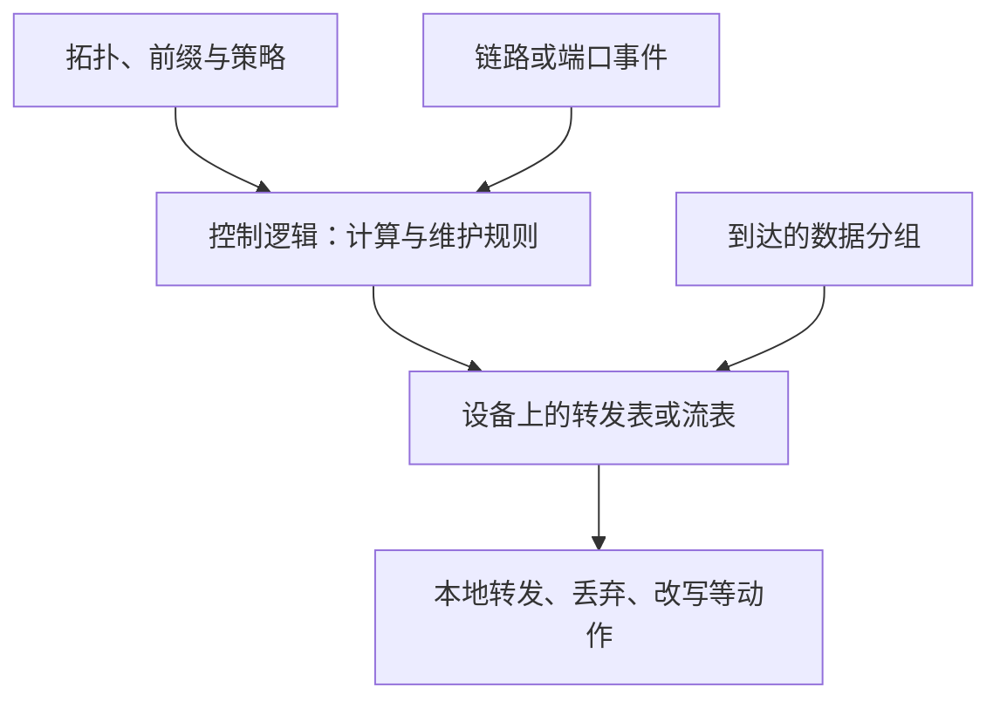
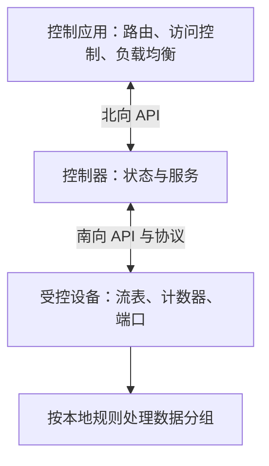

---
tags:
  - 计算机网络
  - 路由选择
  - OSPF
  - BGP
  - SDN
  - 课程笔记
课程: 计算机网络
章节: 第5章 网络层：控制平面
教材: 计算机网络：自顶向下方法
---

> [!info] 本章定位
> [[Ch4 网络层：数据平面]] 解释路由器怎样按表处理分组，本章追问：**表从哪里来，网络变化后怎样更新，管理员又怎样观察和改变网络？**
> 1. **最短路径取决于所掌握的信息**：LS 先获得拓扑再本地计算，DV 只和邻居交换距离估计，逐步传播知识。
> 2. **互联网路由有管理边界**：OSPF 解决一个管理域内的可达性与开销问题，BGP 还必须满足自治系统之间的策略。
> 3. **控制逻辑与转发动作可以分开组织**：SDN 把网络状态、控制应用和规则下发连接起来，数据分组仍由设备执行规则。
> 4. **能转发不等于能运维**：ICMP 反馈网络层事件，SNMP 读写管理对象，NETCONF/YANG 支撑有模型的配置管理。

> [!info]- 材料与记号
> 主要依据：`D:\Documents\Prof_Curriculur\CN\Chapter_5.pdf`，共 **28 个 PDF 物理页**。前 27 页每页 4 张幻灯片，末页 3 张，共 **111 张**；其中编号到 5-110，最后一张为未编号作业页。
> 本文以 **PDF 物理页 p.N** 定位；需要区分同页内容时补注幻灯片编号。p.24 的两张页脚误写为 4-94、4-95，仍按本章 ICMP 内容处理。
> 教材名称可由封面确认；末页同时列出第 7、8 版作业，不能据此确定本课唯一版本，因此不填具体版本。
> 正文机制与图例来自课件；标为“补充解释”“补充推导”“勘误”的内容为整理时增加。RFC 与 IANA 仅用于核对有歧义的协议细节，不扩大课件范围。
> 图中未特别说明时，链路为双向、开销非负；$\infty$ 表示当前不可达或未知，**不是实际的一条无限长链路**。路径开销是链路权重之和，除非明确给出单位，不直接解释成毫秒或跳数。

## 目录

- [[#1. 控制平面怎样形成转发规则|1. 控制平面怎样形成转发规则]]
	- [[#1.1 转发与路由选择的联系|1.1 转发与路由选择的联系]]
	- [[#1.2 每路由器控制与逻辑集中控制|1.2 每路由器控制与逻辑集中控制]]
- [[#2. 怎样把路由选择写成图上的问题|2. 怎样把路由选择写成图上的问题]]
	- [[#2.1 节点、边、开销与最短路径|2.1 节点、边、开销与最短路径]]
	- [[#2.2 全局与局部信息，静态与动态路由|2.2 全局与局部信息，静态与动态路由]]
- [[#3. 链路状态算法：先知道网络，再独立算路径|3. 链路状态算法：先知道网络，再独立算路径]]
	- [[#3.1 LS 的信息准备与 Dijkstra 状态|3.1 LS 的信息准备与 Dijkstra 状态]]
	- [[#3.2 初始化、选点与松弛|3.2 初始化、选点与松弛]]
	- [[#3.3 第一组算例：完整迭代表与转发表|3.3 第一组算例：完整迭代表与转发表]]
	- [[#3.4 第二组算例与前驱回溯|3.4 第二组算例与前驱回溯]]
	- [[#3.5 计算复杂度与消息传播开销|3.5 计算复杂度与消息传播开销]]
	- [[#3.6 负载敏感路由为什么振荡|3.6 负载敏感路由为什么振荡]]
- [[#4. 距离向量算法：从邻居的估计逐步学到全网|4. 距离向量算法：从邻居的估计逐步学到全网]]
	- [[#4.1 Bellman-Ford 方程到底表示什么|4.1 Bellman-Ford 方程到底表示什么]]
	- [[#4.2 本地状态、触发条件与异步迭代|4.2 本地状态、触发条件与异步迭代]]
	- [[#4.3 九节点网络：初始化与第一轮计算|4.3 九节点网络：初始化与第一轮计算]]
	- [[#4.4 信息扩散、轮次与最终距离|4.4 信息扩散、轮次与最终距离]]
	- [[#4.5 好消息与坏消息：无穷计数的来源|4.5 好消息与坏消息：无穷计数的来源]]
	- [[#4.6 LS 与 DV 的比较|4.6 LS 与 DV 的比较]]
- [[#5. 从抽象算法到自治系统与 OSPF|5. 从抽象算法到自治系统与 OSPF]]
	- [[#5.1 为什么需要自治系统|5.1 为什么需要自治系统]]
	- [[#5.2 IGP 家族及 OSPF 的基本流程|5.2 IGP 家族及 OSPF 的基本流程]]
	- [[#5.3 OSPF 的两级层次与四类角色|5.3 OSPF 的两级层次与四类角色]]
	- [[#5.4 域内与域间为什么采用不同协议|5.4 域内与域间为什么采用不同协议]]
- [[#6. BGP：传播前缀可达性，并按策略选路|6. BGP：传播前缀可达性，并按策略选路]]
	- [[#6.1 eBGP、iBGP 与路径向量|6.1 eBGP、iBGP 与路径向量]]
	- [[#6.2 一条外部路由如何进入 AS 内部|6.2 一条外部路由如何进入 AS 内部]]
	- [[#6.3 商业策略：为什么有路却不通告|6.3 商业策略：为什么有路却不通告]]
	- [[#6.4 从 BGP 下一跳到本机输出接口|6.4 从 BGP 下一跳到本机输出接口]]
	- [[#6.5 选路顺序与热土豆的适用条件|6.5 选路顺序与热土豆的适用条件]]
	- [[#6.6 BGP 报文与会话状态|6.6 BGP 报文与会话状态]]
- [[#7. 路由协议怎样封装与携带信息|7. 路由协议怎样封装与携带信息]]
	- [[#7.1 端口号和 IP 协议号不能混淆|7.1 端口号和 IP 协议号不能混淆]]
	- [[#7.2 RIPv2：4 B 首部与 20 B 路由项|7.2 RIPv2：4 B 首部与 20 B 路由项]]
	- [[#7.3 OSPFv2：24 B 公共首部与类型|7.3 OSPFv2：24 B 公共首部与类型]]
- [[#8. SDN：把网络状态、控制应用与流表连接起来|8. SDN：把网络状态、控制应用与流表连接起来]]
	- [[#8.1 为什么要分离控制与转发|8.1 为什么要分离控制与转发]]
	- [[#8.2 三类流量工程问题与传统模型的边界|8.2 三类流量工程问题与传统模型的边界]]
	- [[#8.3 SDN 的三个组成部分与四个特征|8.3 SDN 的三个组成部分与四个特征]]
	- [[#8.4 控制器内部的三层职责|8.4 控制器内部的三层职责]]
	- [[#8.5 OpenFlow 报文及未命中的处理|8.5 OpenFlow 报文及未命中的处理]]
	- [[#8.6 一次链路故障如何触发新规则|8.6 一次链路故障如何触发新规则]]
	- [[#8.7 ODL、ONOS 与 SDN 的可靠性边界|8.7 ODL、ONOS 与 SDN 的可靠性边界]]
- [[#9. ICMP：反馈差错与探测网络|9. ICMP：反馈差错与探测网络]]
	- [[#9.1 ICMP 的位置与公共字段|9.1 ICMP 的位置与公共字段]]
	- [[#9.2 类型与编码，ping 能说明什么|9.2 类型与编码，ping 能说明什么]]
	- [[#9.3 UDP traceroute 的完整探测流程|9.3 UDP traceroute 的完整探测流程]]
- [[#10. 网络管理：从监视对象到有模型的配置|10. 网络管理：从监视对象到有模型的配置]]
	- [[#10.1 管理对象、代理与三类方法|10.1 管理对象、代理与三类方法]]
	- [[#10.2 SNMP：请求响应与陷阱通知|10.2 SNMP：请求响应与陷阱通知]]
	- [[#10.3 MIB、SMI 与 SNMP 的报文结构|10.3 MIB、SMI 与 SNMP 的报文结构]]
	- [[#10.4 NETCONF：会话、RPC 与主要操作|10.4 NETCONF：会话、RPC 与主要操作]]
	- [[#10.5 修改接口 MTU：逐层读懂一条 RPC|10.5 修改接口 MTU：逐层读懂一条 RPC]]
	- [[#10.6 YANG：模型、数据与协议的区别|10.6 YANG：模型、数据与协议的区别]]
- [[#11. 例题|11. 例题]]
	- [[#11.1 最短路径树中失去一条边|11.1 最短路径树中失去一条边]]
	- [[#11.2 同步 DV 中什么时候才能使用新消息|11.2 同步 DV 中什么时候才能使用新消息]]
	- [[#11.3 无穷计数何时结束|11.3 无穷计数何时结束]]
	- [[#11.4 三节点 DV 的距离与下一跳|11.4 三节点 DV 的距离与下一跳]]
	- [[#11.5 OSPF 区域与 AS 的边界|11.5 OSPF 区域与 AS 的边界]]
	- [[#11.6 BGP 优选的三种比较结果|11.6 BGP 优选的三种比较结果]]
	- [[#11.7 控制平面选路与最长前缀匹配|11.7 控制平面选路与最长前缀匹配]]
	- [[#11.8 报文长度与各层开销|11.8 报文长度与各层开销]]
	- [[#11.9 SDN 怎样分别控制两类同目的流|11.9 SDN 怎样分别控制两类同目的流]]
	- [[#11.10 traceroute 的 RTT 与端口不可达|11.10 traceroute 的 RTT 与端口不可达]]
	- [[#11.11 SNMP 计数器回绕与速率|11.11 SNMP 计数器回绕与速率]]
	- [[#11.12 NETCONF 返回错误为什么不能证明全网已回滚|11.12 NETCONF 返回错误为什么不能证明全网已回滚]]
- [[#12. 易错点速查|12. 易错点速查]]
- [[#13. 知识点速查|13. 知识点速查]]
	- [[#13.1 全章结构总览|13.1 全章结构总览]]
	- [[#13.2 计算关系与适用条件|13.2 计算关系与适用条件]]
	- [[#13.3 五句话串起本章与相邻章节|13.3 五句话串起本章与相邻章节]]

---

## 1. 控制平面怎样形成转发规则

### 1.1 转发与路由选择的联系

一次分组转发只需决定当前出口，但要保证多台设备的出口选择共同通向目的地，必须协调全网或一个路由域中的规则。

| 功能 | 输入与范围 | 结果 |
|---|---|---|
| 转发 forwarding | 分组首部、当前设备的表项 | 移动到出口、丢弃或执行其他动作 |
| 路由选择 routing | 拓扑、链路开销、可达前缀、策略 | 选择路径或下一跳，形成转发信息 |

路径可视为分组从源到目的地所经过的路由器序列。“好路径”需要先有评价标准：成本最少、时延较低、避开拥塞是不同目标，不能把它们视为天然一致。（p.1～2）

### 1.2 每路由器控制与逻辑集中控制

**每路由器控制**：每台路由器有路由选择组件，组件之间交换控制报文，各自计算本机所需的转发表。
“分布式”描述计算与协议执行的位置，不表示每个算法都只使用局部信息。

**SDN 的逻辑集中控制**：控制器维护网络状态、计算规则，通过设备上的控制代理 CA 与设备交互，下发流表或转发表。（p.2）



> [!important] 两个独立维度
> **控制逻辑放在哪里**，与**算法需要什么信息**是两个问题。传统 OSPF 在每台路由器上运行，但各节点先取得本区域拓扑，再执行使用全局信息的 Dijkstra 算法；SDN 控制器也可以运行 Dijkstra。

控制器在逻辑上统一，并不要求只有一台物理服务器；已匹配规则的数据分组也不必逐个经过控制器。

## 2. 怎样把路由选择写成图上的问题

### 2.1 节点、边、开销与最短路径

把网络抽象为图 $G=(N,E)$：$N$ 是路由器集合，$E$ 是链路集合。
相邻节点 $a,b$ 间的直接开销记作 $c_{a,b}$；没有直接边时记作 $\infty$。（p.3）

对路径 $P=(v_0,v_1,\ldots,v_k)$，其加性开销为：

$$
C(P)=\sum_{i=0}^{k-1}c_{v_i,v_{i+1}}.
$$

从 $s$ 到 $t$ 的最短路径是在所有可行路径中令 $C(P)$ 最小的一条。
若所有边权均为 1，最小开销才等价于最少链路数；若权重由带宽的倒数构造，结果就不一定跳数最少。

![[Ch5-20261101-p03-s09-链路开销图.png|695]]

后文反复使用课件六节点网络，完整边集与权重为：

| 边 | 开销 | 边 | 开销 |
|---|---|---|---|
| $u-v$ | 2 | $v-w$ | 3 |
| $u-x$ | 1 | $x-w$ | 3 |
| $u-w$ | 5 | $x-y$ | 1 |
| $v-x$ | 2 | $w-y$ | 1 |
| $w-z$ | 5 | $y-z$ | 2 |

> [!warning] 课件勘误：边集漏项
> p.3 的图以及后续初始化表均有 $u-w$、开销 5，但该页文字边集漏写 $(u,w)$。本文按图与后续算例保留该边，不把文字列表当成另一张网络。

### 2.2 全局与局部信息，静态与动态路由

课件按两个维度分类，不应把它们混成一条轴。（p.3）

| 分类维度 | 一类 | 另一类 |
|---|---|---|
| 算法掌握的信息 | LS：先掌握完整拓扑与链路开销 | DV：初始只知邻居和直连开销，接收邻居的距离估计 |
| 路由变化方式 | 静态：长期较稳定，通常人工调整 | 动态：周期更新，或响应拓扑、开销变化 |

动态路由能适应变化，也可能发生路由环路或振荡。
“动态”不等于“每来一个数据分组就重新计算全网路径”。

## 3. 链路状态算法：先知道网络，再独立算路径

### 3.1 LS 的信息准备与 Dijkstra 状态

**链路状态 LS（Link State）**的基本过程是：路由器发布本机的链路状态，经洪泛使计算范围内的节点获得一致的拓扑视图；每个节点以自己为源，独立计算最低开销路径树。（p.3～4）

| 状态 | 含义 |
|---|---|
| $s$ | 本次计算的源节点 |
| $N'$ | 已确定从 $s$ 出发的最终最短距离的节点集合 |
| $D(v)$ | 当前已发现的从 $s$ 到 $v$ 的最小开销；未确定时是暂定值 |
| $p(v)$ | 当前所选路径上，紧接 $v$ 之前的节点 |
| $c_{w,v}$ | $w$ 到相邻节点 $v$ 的直接链路开销 |

必须区分 **$D(v)$ 的当前值**与**已经证明最终最优的值**：只有 $v$ 加入 $N'$，其距离才被确定。
前驱 $p(v)$ 也不是源路由器的下一跳；两者的转换见下文。

### 3.2 初始化、选点与松弛

**输入**：非负边权图、源节点 $s$。
**输出**：到所有可达目的地的最短距离、前驱树和本机下一跳。

1. 初始化 $N'=\{s\}$、$D(s)=0$。对其他节点 $v$，令 $D(v)=c_{s,v}$；直连时 $p(v)=s$，无直连时为 $\infty$ 且前驱为空。
2. 从 $N'$ 外选择 $D(w)$ 最小的节点 $w$。并列时可以任选，或按事先约定的规则选。
3. 将 $w$ 加入 $N'$。对尚未确定、且与 $w$ 相邻的节点 $v$ 执行松弛：

$$
D(v)\leftarrow\min\{D(v),D(w)+c_{w,v}\}.
$$

4. 若经 $w$ 的候选值严格更小，同时令 $p(v)=w$；若相等，可以保留原前驱，以得到一棵确定的树。
5. 重复，直到所有节点确定。**补充边界**：若剩余最小值已经是 $\infty$，剩余节点均不可达，可以停止；不能凭空为它们生成下一跳。

**补充推导：为什么最小的暂定值可以确定？**
假设当前选中 $w$，却存在一条更短的 $s\to w$ 路径。
沿这条路径找到第一个不在 $N'$ 中的节点 $x$，它的前一个节点在 $N'$ 中，因此相应边已经被松弛过，$D(x)$ 不大于这条路径到 $x$ 的前缀开销。
由于后续边权非负，这个前缀不会大于整条假想路径，于是会有 $D(x)<D(w)$，与选择 $w$ 为最小者矛盾。
这也说明**非负边权是这一确定规则的关键条件**。

### 3.3 第一组算例：完整迭代表与转发表

以第 2.1 节网络为例，从 $u$ 出发。为复现课件，并列值 2 时先选 $y$、再选 $v$；相等候选不替换前驱。（p.4）
表中单元格写“距离 / 前驱”，`—` 表示该节点已确定。

| 步 | $N'$ | $D(v),p(v)$ | $D(w),p(w)$ | $D(x),p(x)$ | $D(y),p(y)$ | $D(z),p(z)$ |
|---|---|---|---|---|---|---|
| 0 | $\{u\}$ | $2/u$ | $5/u$ | $1/u$ | $\infty$ | $\infty$ |
| 1：选 $x$ | $\{u,x\}$ | $2/u$ | $4/x$ | — | $2/x$ | $\infty$ |
| 2：选 $y$ | $\{u,x,y\}$ | $2/u$ | $3/y$ | — | — | $4/y$ |
| 3：选 $v$ | $\{u,x,y,v\}$ | — | $3/y$ | — | — | $4/y$ |
| 4：选 $w$ | $\{u,x,y,v,w\}$ | — | — | — | — | $4/y$ |
| 5：选 $z$ | 全部节点 | — | — | — | — | — |

关键更新可以直接复算：

- 选 $x$ 后：到 $w$ 的候选是 $1+3=4<5$；到 $y$ 的候选是 $1+1=2$。
- 选 $y$ 后：到 $w$ 的候选是 $2+1=3<4$；到 $z$ 的候选是 $2+2=4$。
- 选 $v$ 后：经 $v$ 到 $w$ 为 $2+3=5$，不替换已知的 3。
- 选 $w$ 后：经 $w$ 到 $z$ 为 $3+5=8$，不替换已知的 4。

![[Ch5-20261101-p04-s14-Dijkstra过程.png]]

**从前驱树提取下一跳**：沿目的节点的前驱不断向源回溯，直到找到源的直接后继。
例如 $p(z)=y$、$p(y)=x$、$p(x)=u$，因此 $u$ 去 $z$ 的下一跳是 $x$，不是 $y$。

| 目的地 | 最短路径 | 开销 | $u$ 的下一跳 / 出链路 |
|---|---|---|---|
| $v$ | $u-v$ | 2 | $v$ / $(u,v)$ |
| $x$ | $u-x$ | 1 | $x$ / $(u,x)$ |
| $y$ | $u-x-y$ | 2 | $x$ / $(u,x)$ |
| $w$ | $u-x-y-w$ | 3 | $x$ / $(u,x)$ |
| $z$ | $u-x-y-z$ | 4 | $x$ / $(u,x)$ |

这是一棵**从 $u$ 出发的最短路径树**，目标是分别最小化 $u$ 到各节点的距离，并非让整棵树的边权总和最小。

### 3.4 第二组算例与前驱回溯

p.4 幻灯片 5-16 的第二张图是另一组权重，不能沿用上一题。
其边为：$u-v:7$、$u-w:3$、$u-x:5$、$w-v:3$、$w-x:4$、$w-y:8$、$v-y:4$、$x-y:7$、$x-z:9$、$y-z:2$。

![[Ch5-20261101-p04-s16-Dijkstra第二例.png|673]]

| 步 | 本次确定节点 | 尚需关注的更新 |
|---|---|---|
| 0 | $u$ | $D(v)=7,D(w)=3,D(x)=5,D(y)=D(z)=\infty$ |
| 1 | $w$，距离 3 | $D(v)=6,p(v)=w$；$D(y)=11,p(y)=w$；经 $w$ 到 $x$ 为 7，不更新 |
| 2 | $x$，距离 5 | $D(z)=14,p(z)=x$；到 $y$ 为 12，不替换 11 |
| 3 | $v$，距离 6 | $D(y)=10,p(y)=v$ |
| 4 | $y$，距离 10 | $D(z)=12,p(z)=y$ |
| 5 | $z$，距离 12 | 完成 |

最终 $u$ 到 $(v,w,x,y,z)$ 的距离是 $(6,3,5,10,12)$。
其中去 $v,y,z$ 都先到 $w$，去 $w$ 也直接到 $w$，去 $x$ 则直接到 $x$。
例如到 $z$ 的路径为 $u-w-v-y-z$，开销 $3+3+4+2=12$。

### 3.5 计算复杂度与消息传播开销

设节点总数为 $n=|N|$、边数为 $m=|E|$。简单实现每次线性搜索剩余最小值，检查数量为：

$$
(n-1)+(n-2)+\cdots+1=\frac{n(n-1)}2=O(n^2).
$$

课件把“不含源的节点数”记作 $n$，因而写成 $n(n+1)/2$，只是计数口径不同。（p.5）

> [!note] 补充精化：使用堆不总是 $O(n\log n)$
> 邻接表配合二叉堆，常用上界为 $O((n+m)\log n)$。稀疏网络满足 $m=O(n)$ 时，才可简写为 $O(n\log n)$；不能对任意稠密图直接省略边数。

还要区分**一次本地最短路计算**与**让大家拿到拓扑的消息开销**。
课件以高效广播每个源的信息经过 $O(n)$ 条链路为模型，$n$ 个源合计 $O(n^2)$ 次链路传输。
若按一般图逐链路洪泛，一份通告可能经过 $O(m)$ 条链路，所有源则为 $O(nm)$；实际还受可靠传输、重复抑制和重传影响。
这些数量衡量的是信息分发，不等于收敛所花的实际秒数。

### 3.6 负载敏感路由为什么振荡

若用当前流量或拥塞时延作为链路开销，**选路本身会改变下一轮选路所依据的开销**。（p.5）

![[Ch5-20261101-p05-s18-路由振荡.png|662]]

课件四节点环中，目的地为 $a$，$d,c,b$ 分别注入速率 $1,\epsilon,1$，其中 $0<\epsilon<1$；有向边的开销等于其承载流量。

1. 初始状态中有些边已承载流量，另一些方向的边空闲。
2. 各节点根据同一时刻的测量一起改选较轻的方向，流量集中到顺时针一侧。
3. 顺时针边变贵、逆时针边变便宜；下一轮大家又切到逆时针。
4. 若继续同步测量、同步切换，路径与负载可能往复变化。

这不是 Dijkstra 在**固定权重图上**算错了，而是权重与流量构成了反馈回路。
课件给出两条思路：让开销不依赖瞬时负载，但会损失避开拥塞的能力；或随机化通告/运行时机，降低所有节点同时切换的机会。
后者是缓解思路，不能直接当作任意负载下不振荡的证明。

## 4. 距离向量算法：从邻居的估计逐步学到全网

### 4.1 Bellman-Ford 方程到底表示什么

LS 先拿到地图；DV 让节点询问邻居“你到各目的地要多大开销”。

> [!note] 距离向量 DV（Distance Vector）
> 节点 $x$ 的距离向量是整组估计 $\mathbf D_x=(D_x(y):y\in N)$。
> **$D_x(y)$ 是这组向量中的一个标量分量**，表示 $x$ 当前估计的到 $y$ 的最低路径开销。

任意非平凡路径必须先到某个邻居，因而真正的最短距离满足 Bellman-Ford 最优性方程：

$$
d_x(y)=\min_{v\in\Gamma(x)}\{c_{x,v}+d_v(y)\},\qquad d_x(x)=0.
$$

$\Gamma(x)$ 表示 $x$ 的邻居集合。运行中真实距离未知，算法用收到的估计代替：

$$
D_x(y)\leftarrow\min_{v\in\Gamma(x)}\{c_{x,v}+D_v(y)\}.
$$

达到最小值的邻居 $v$ 就是候选下一跳。方程里的“加”是先走直连边再走邻居后续路径，“取最小”是在不同第一跳之间选优。（p.5～6）

**六节点图的例子**：若邻居通告 $D_v(z)=5,D_x(z)=3,D_w(z)=3$，则

$$
D_u(z)=\min\{2+5,1+3,5+3\}=4,
$$

下一跳取 $x$。$u$ 不必通过这条报文得知 $x$ 后面每一条边，仍能形成距离估计。

### 4.2 本地状态、触发条件与异步迭代

节点 $x$ 保存：直连邻居开销、本机距离向量、最近一次收到的各邻居距离向量，以及各目的地的下一跳。

1. 初始化 $D_x(x)=0$；到邻居为直连开销，其他目的地为 $\infty$。把本机向量发送给邻居。
2. 等待事件：**直连开销变化**，或**收到邻居的新向量**。
3. 用最新本地开销和已缓存的邻居向量，重新计算到各目的地的 BF 最小值。
4. 若本机距离向量变化，通知邻居；若值不变，则不触发新的距离变化通告。

> [!important] 开销增加时必须允许估计变大
> 重新计算的是所有当前候选 $\min_v\{c_{x,v}+D_v(y)\}$，不能一味取“旧值和新值的较小者”。旧路径失效或变贵后，旧距离可能已经没有依据。

“异步”表示节点不必按同一个全局时钟同时执行；“分散式”表示只与邻居直接交换；“自停”表示没有变化时停止由变化触发的传播。（p.6）
实际协议还可以有周期性报文，例如 RIP 的周期更新，因此算法层的自停不等于所有控制报文永久消失。

**补充条件**：静态、有限的非负开销网络中，若有效更新持续送达、节点持续处理，DV 可收敛到最短距离；不能把这句话用于拓扑永远变化、消息永久丢失或节点恶意通告的情形。

### 4.3 九节点网络：初始化与第一轮计算

p.6～10 的连续动画使用以下网络。$c$ 只有邻居 $b$，没有 $c-f$ 边；$a-b$ 开销 8，其余画出的边均为 1。

![[Ch5-20261101-p06-s24-DV九节点拓扑.png]]

完整边集为：
$a-b,a-d,b-c,b-e,d-e,e-f,d-g,e-h,f-i,g-h,h-i$。
以下向量均按 $(a,b,c,d,e,f,g,h,i)$ 排列；为便于手算，使用**同步轮次**：第 $t+1$ 轮只读取第 $t$ 轮向量，不混用本轮已经更新的值。

**节点 $b$ 的第一轮**读取 $a,c,e$ 的初始向量：

| 目的地 | 经 $a$ | 经 $c$ | 经 $e$ | 新 $D_b$ |
|---|---|---|---|---|
| $a$ | $8+0=8$ | $\infty$ | $\infty$ | 8 |
| $c$ | $\infty$ | $1+0=1$ | $\infty$ | 1 |
| $d$ | $8+1=9$ | $\infty$ | $1+1=2$ | 2 |
| $e$ | $\infty$ | $\infty$ | $1+0=1$ | 1 |
| $f$ | $\infty$ | $\infty$ | $1+1=2$ | 2 |
| $g$ | $\infty$ | $\infty$ | $\infty$ | $\infty$ |
| $h$ | $\infty$ | $\infty$ | $1+1=2$ | 2 |
| $i$ | $\infty$ | $\infty$ | $\infty$ | $\infty$ |

再加 $D_b(b)=0$，得到 $(8,0,1,2,1,2,\infty,2,\infty)$。

![[Ch5-20261101-p09-s33-DV节点b计算.png]]

**节点 $c$ 的第一轮**只读取 $b$ 的初始向量，故

$$
D_c^{(1)}(a)=1+8=9,\qquad
D_c^{(1)}(e)=1+1=2,\qquad
D_c^{(1)}(d)=1+\infty=\infty.
$$

完整新向量为 $(9,1,0,\infty,2,\infty,\infty,\infty,\infty)$。
不能将 $b$ 本轮刚得到的 $D_b(d)=2$ 同时放入“同步第一轮”的计算。

![[Ch5-20261101-p09-s35-DV节点c勘误.png]]

> [!warning] 课件勘误：公式与结果表不一致
> p.9 的节点 $b$ 计算中，到 $d$ 的候选顺序应为 $\min\{9,\infty,2\}$，课件写成了 $\min\{9,2,\infty\}$；最小值仍为 2。
> 同页节点 $c$ 的公式已得出 $D_c(d)=\infty,D_c(e)=2$，但右侧结果表把两者错列成 $2,\infty$。本文使用按邻接关系复算的结果。节点 $d,f,h$ 向量处重复使用 $D_c$ 下标也属于标注错误，应各用本节点下标。

**课件设问的补充解析：节点 $e$ 第一轮的新向量。**
它读取 $b,d,f,h$ 的初始向量：

- 到 $a$：经 $d$ 为 $1+1=2$，优于经 $b$ 的 $1+8=9$。
- 到 $c$：经 $b$ 为 $1+1=2$。
- 到 $g$：经 $d$ 或 $h$ 均为 $1+1=2$。
- 到 $i$：经 $f$ 或 $h$ 均为 2。
- 到 $b,d,f,h$ 仍各为 1，到自己为 0。

因此 $\mathbf D_e^{(1)}=(2,1,2,1,0,1,2,1,2)$。
多条等价路径不会改变距离值；下一跳可以按既定规则选择其一。

### 4.4 信息扩散、轮次与最终距离

把同步更新写为：

$$
D_x^{(t+1)}(y)=\min_{v\in\Gamma(x)}\{c_{x,v}+D_v^{(t)}(y)\}.
$$

**补充推导**：初始化已经包含 1 条边的路径。若第 $t$ 轮涵盖至多 $t+1$ 条边的路径，第 $t+1$ 轮先走到邻居，再接上一条这样的路径，便涵盖至多 $t+2$ 条边的路径。
因此距离信息逐跳传播，不能靠一次邻居通信知道任意长的最短路径。

| 节点 | 轮次 | 向量，按 $(a,b,c,d,e,f,g,h,i)$ 排列 |
|---|---|---|
| $a$ | $t=0$ | $(0,8,\infty,1,\infty,\infty,\infty,\infty,\infty)$ |
| $a$ | $t=1$ | $(0,8,9,1,2,\infty,2,\infty,\infty)$ |
| $a$ | $t=2$ | $(0,3,9,1,2,3,2,3,\infty)$ |
| $a$ | $t=3$ | $(0,3,4,1,2,3,2,3,4)$ |
| $b$ | $t=0$ | $(8,0,1,\infty,1,\infty,\infty,\infty,\infty)$ |
| $b$ | $t=1$ | $(8,0,1,2,1,2,\infty,2,\infty)$ |
| $b$ | $t=2$ | $(3,0,1,2,1,2,3,2,3)$ |
| $b$ | $t=3$ | 与 $t=2$ 相同 |
| $c$ | $t=0$ | $(\infty,1,0,\infty,\infty,\infty,\infty,\infty,\infty)$ |
| $c$ | $t=1$ | $(9,1,0,\infty,2,\infty,\infty,\infty,\infty)$ |
| $c$ | $t=2$ | $(9,1,0,3,2,3,\infty,3,\infty)$ |
| $c$ | $t=3$ | $(4,1,0,3,2,3,4,3,4)$ |

例如 $a-b$ 的直连成本 8，到第二轮才被 $a-d-e-b$ 的成本 3 替代；$a$ 到 $c$ 第三轮才变为 $a-d-e-b-c$ 的成本 4。

p.10 的状态扩散图描述的是 **$c$ 初始信息的影响范围**：第 1 轮到 $b$，第 2 轮再到 $a,e$，第 3 轮再到 $d,f,h$，第 4 轮到 $g,i$。
这与某些最终距离在第三轮已经确定并不矛盾：一次新收到的信息不一定改写当前最小值。
课件第 4 轮文字仍写“3 跳”是笔误，应为 4 跳。

以下为对同一网络的**补充复算结果**，行是源节点，列是目的地，可用来核对手算：

| 源 / 目的 | $a$ | $b$ | $c$ | $d$ | $e$ | $f$ | $g$ | $h$ | $i$ |
|---|---|---|---|---|---|---|---|---|---|
| $a$ | 0 | 3 | 4 | 1 | 2 | 3 | 2 | 3 | 4 |
| $b$ | 3 | 0 | 1 | 2 | 1 | 2 | 3 | 2 | 3 |
| $c$ | 4 | 1 | 0 | 3 | 2 | 3 | 4 | 3 | 4 |
| $d$ | 1 | 2 | 3 | 0 | 1 | 2 | 1 | 2 | 3 |
| $e$ | 2 | 1 | 2 | 1 | 0 | 1 | 2 | 1 | 2 |
| $f$ | 3 | 2 | 3 | 2 | 1 | 0 | 3 | 2 | 1 |
| $g$ | 2 | 3 | 4 | 1 | 2 | 3 | 0 | 1 | 2 |
| $h$ | 3 | 2 | 3 | 2 | 1 | 2 | 1 | 0 | 1 |
| $i$ | 4 | 3 | 4 | 3 | 2 | 1 | 2 | 1 | 0 |

### 4.5 好消息与坏消息：无穷计数的来源

课件三节点网络中，$c_{x,y}=4,c_{y,z}=1,c_{x,z}=50$，初始 $D_y(x)=4,D_z(x)=5$。（p.10）

**开销下降：好消息传播较快。** 若 $x-y$ 从 4 降为 1：

1. $y$ 检测到变化，改为 $D_y(x)=1$ 并通知邻居。
2. $z$ 比较直达 50 与经 $y$ 的 $1+1=2$，改为 2。
3. $y$ 再收到 $z$ 的 2，发现经 $z$ 为 3，仍不如直达 1，不再触发更新。

**开销上升：坏消息可能被旧信息掩盖。** 若 $x-y$ 从 4 升为 60，而 $y$ 仍缓存 $z$ 的旧通告 5：

| 更新事件 | 重新估计 | 造成的认知 |
|---|---|---|
| $y$ 检测到 60 | $\min(60,1+5)=6$ | 以为 $z$ 有便宜路径，下一跳选 $z$ |
| $z$ 收到 6 | $\min(50,1+6)=7$ | 仍选 $y$ |
| $y$ 收到 7 | $\min(60,1+7)=8$ | 仍选 $z$ |
| $z$ 收到 8 | $\min(50,1+8)=9$ | 继续互相依赖 |

双方把**经由对方的旧路径**误当成独立可行的后路，数据分组可能在 $y,z$ 间循环，距离估计逐次上升，这就是无穷计数问题。

本例有成本 50 的备用直连边，所以并非真的永远增加。
按上述交替次序，$y$ 依次通告 $6,8,\ldots,50$；$z$ 的经 $y$ 候选达到 51 时改走直达 $x$、通告 50；最后 $y$ 改为 $1+50=51$，稳定为 $D_z(x)=50,D_y(x)=51$。
若没有可用备用路径，单纯 DV 可能一直增加到协议设定的“无穷大”。

> [!note] 补充解释：毒性逆转的作用边界
> 若 $z$ 到 $x$ 的下一跳就是 $y$，它向 $y$ 通告该目的地时报告 $\infty$，避免 $y$ 误把自己作为 $z$ 的后路。它能抑制这种两节点相互依赖，但不能保证消除任意长度的环路；本课件未展开其实现。

### 4.6 LS 与 DV 的比较

| 维度 | LS | DV |
|---|---|---|
| 交换什么 | 本机链路状态 | 到目的地的距离估计 |
| 信息到哪里 | 通过洪泛到相应拓扑范围 | 直接发给邻居，由迭代间接扩散 |
| 本地计算依据 | 拓扑与链路开销 | 直连开销、邻居的向量 |
| 主要计算 | Dijkstra 最短路径树 | Bellman-Ford 最小化 |
| 代价 | 拓扑存储、洪泛、重新计算 | 邻居消息与多轮收敛，不能统一给固定轮数 |
| 变化风险 | 负载敏感权重可能振荡；瞬态视图不一致仍需处理 | 可能环路、坏消息慢、无穷计数 |
| 错误传播 | 错误链路状态进入数据库，各节点各自计算 | 错误距离成为邻居输入，可逐级传播 |

p.11 强调：恶意 DV 节点若宣称“到所有地方成本都很低”，可能吸引流量形成黑洞；LS 也不能免疫虚假通告。
“各自计算”只是一种错误影响方式上的区别，**不表示 LS 天然安全**。

## 5. 从抽象算法到自治系统与 OSPF

### 5.1 为什么需要自治系统

把整个互联网看成一张所有路由器平等的图，会遇到两个问题：（p.11～12）

- **规模**：无法让每台设备都保存并交换全球每个内部细节。
- **管理自治**：不同运营者希望控制自己的路由策略，并隐藏内部组织。

> [!note] 自治系统 AS（Autonomous System）
> 在统一管理与路由策略下组织的一组网络与路由器，对外表现为一个路由管理单元，由 ASN 标识。AS 是管理与策略边界，不是一个 IP 子网，也不是 OSPF 的一个区域。

**域内路由 intra-AS**确定本 AS 内怎样走；**域间路由 inter-AS**学习外部前缀从哪里可达、采用哪个外部路径。
到外部目的地的转发表常由二者共同形成：先选出口/下一跳，再解析到达它的内部路径。

网关路由器处于 AS 边缘，连接其他 AS，通常同时参与域内与域间协议。
并非每一台内部路由器都必须直接建立与外部 AS 的会话。

> [!warning] 课件范围精化：协议分类与 ASN
> IGP / EGP 按 **AS 内 / AS 间**划分，不按“企业小网络 / 大网络”划分；大 ISP 内部同样需要 IGP。课件中“同一 AS 运行相同 IGP”是教学模型，不能理解为实际网络绝不允许多协议及重分发。
> p.12 的旧 ASN 范围也不能照搬：16 位私有范围为 **64512～65534**，65535 保留；64496～64511 用于文档示例，23456 为 AS_TRANS。32 位私有范围为 **4200000000～4294967294**。其余号段的分配与保留以 [IANA ASN 注册表](https://www.iana.org/assignments/as-numbers/) 为准。

### 5.2 IGP 家族及 OSPF 的基本流程

| 协议 | 课件中的定位 | 主要思想 |
|---|---|---|
| RIP | 域内路由 | 经典 DV，周期约 30 s 交换，适合解释距离向量 |
| EIGRP | 域内路由 | 基于距离向量的协议；课件介绍其由厂商专有走向公开描述的背景 |
| OSPF | 域内路由 | LS，洪泛链路状态后运行 Dijkstra |
| IS-IS | 域内路由 | 同属链路状态家族，协议细节不等于 OSPF |
| BGP | 域间路由 | 路径向量与策略 |

“开放最短路径优先”中的 open 指**规范公开**，不是任何未鉴别设备都能随意加入。（p.12～13）

OSPF 的主线：

1. 管理员为链路配置开销，例如依带宽确定，或统一置为 1。
2. 路由器发现并维护邻居关系，交换、同步相应范围的链路状态信息。
3. 链路变化时产生并洪泛通告；即使没有变化，也会刷新自生成的 LSA，课件用 30 min 说明刷新周期。
4. 每台路由器在本地链路状态数据库上，以自己为根执行 Dijkstra。
5. 将结果转换为路由/转发表供数据平面使用。

OSPF 直接由 IP 承载，IPv4 协议号为 **89**，所以需要自行提供链路状态通告的确认、重传等可靠交换机制，不能借用 TCP 的可靠字节流。
30 min 不是“每半小时才能发现断链”；变化触发与定期刷新解决的是不同问题。

课件提到简单口令和 MD5 鉴别，本文将其作为课件所述 OSPFv2 机制保留；**它们不是数据载荷加密，也不代表仅有这两种实现方式**。

> [!note] 课件表述精化
> p.12 称 IS-IS 是 ISO 标准，这一历史来源可以保留；但“不是 RFC 标准”若被理解成“没有 RFC 规范”就不成立。面向 IP 的集成 IS-IS 已由 [RFC 1195](https://www.rfc-editor.org/rfc/rfc1195.html) 描述。

### 5.3 OSPF 的两级层次与四类角色

当一个 AS 内部也很大时，可以进一步划分区域。**Area 0 是主干区域，其他区域通过主干组织区域间通信。**（p.13）

![[Ch5-20261101-p13-s50-OSPF层次结构.png]]

| 角色 | 职责与范围 |
|---|---|
| 内部路由器 IR | 接口均位于同一区域，维护该区域的详细拓扑 |
| 区域边界路由器 ABR | 连接多个区域，通常连接非主干区域与 Area 0，向其他区域发布可达网络与距离信息 |
| 主干路由器 | 至少有一个接口属于 Area 0，参与主干路由 |
| AS 边界路由器 ASBR | 向 OSPF 引入外部路由，连接域内与外部路由信息 |

**补充精化**：这些角色可以重叠。课件把主干路由器写成“仅在主干区域运行”过窄；ABR 也可以同时是主干路由器。角色定义见 [RFC 2328 §3.3](https://www.rfc-editor.org/rfc/rfc2328.html#section-3.3)。

分层后的信息具有不同粒度：

- 区域内：知道详细链路拓扑，在本区域计算路径。
- 区域间：通过 ABR 获知其他区域的前缀及距离，不必复制对方全部内部拓扑。
- AS 外部：由 ASBR 引入相应外部路由信息。

“区域内洪泛”主要指区域范围的拓扑 LSA；不能据此声称 **所有种类 LSA 都只能留在一个区域**。
同样，OSPF 区域划分并没有把一个 AS 分成多个 ASN；p.17 将两者混举时应分开理解。

### 5.4 域内与域间为什么采用不同协议

| 关注点 | 域内 | 域间 |
|---|---|---|
| 策略 | 同一管理主体，可统一度量与规则 | 多个自治主体，接收、选择、出口策略主导 |
| 规模 | 可用区域等层次组织内部细节 | 需在全球交换前缀与 AS 路径，扩展性关键 |
| 性能 | 通常更直接优化内部开销 | 满足策略后才比较路径属性，可能接受更长或内部成本更高的路线 |

课件的对比是关注重点，不表示域内完全没有策略、完全不用考虑规模。（p.17）

## 6. BGP：传播前缀可达性，并按策略选路

### 6.1 eBGP、iBGP 与路径向量

BGP（Border Gateway Protocol）让 AS 向其他 AS 通告某个 **CIDR 前缀**存在，以及如何到达它。
它交换的对象不是每台主机的完整逐跳路径，而是带属性的前缀路由。（p.13～14）

| 会话 | 两端关系 | 作用 |
|---|---|---|
| eBGP | 不同 AS 的 BGP 对等体 | 从外部学习、向外部发布前缀可达性 |
| iBGP | 同一 AS 内的 BGP 对等体 | 在内部传播 BGP 学到的外部可达性及属性 |

两者都是 BGP，会话一般使用长时间保持的 **TCP 连接，服务端口 179**。
iBGP 的“内部”表示对等体属于同一 AS，**不等于 OSPF，也不是按拓扑计算域内路径的替代品**。
图中的 iBGP 虚线是逻辑会话，数据可以穿过多条内部链路，不要求会话两端物理直连。

> [!note] BGP 路由 = 前缀 + 属性
> **AS-PATH** 记录路由通告所经过的 AS 序列；**NEXT-HOP** 给出到达该前缀时需要进一步解析的下一跳 IP 地址。
> AS-PATH 是路径向量的信息，不是所有经过的路由器 IP 列表。NEXT-HOP 是属性地址，也未必就是本机直接相连的下一台路由器。

通告经 eBGP 向外传播时，发布者通常在 AS-PATH 前面加入自己的 ASN。
若接收方看到自己的 ASN 已经在路径里，会拒绝这类循环通告，避免在 AS 层面绕圈。
这并不证明任何时刻、任何错误配置下的数据平面绝无环路。

### 6.2 一条外部路由如何进入 AS 内部

沿课件 p.14～15 的三 AS 例子，设前缀 $X$ 属于 AS3：

1. AS3 的网关 `3a` 向 AS2 的 `2c` 发送 eBGP 通告，路径可简写为 `AS3, X`。
2. AS2 按**入口策略 import policy**判断是否接收。例如禁止经过某 AS 的路径，可以直接拒绝，不进入后续优选。
3. AS2 的 `2c` 通过 iBGP 向本 AS 的其他 BGP 节点传播 `AS3, X`。**内部传播不因为每经过一个内部路由器就增加一次 AS2**。
4. 若出口策略允许，AS2 的 `2a` 向 AS1 的 `1c` 发送 eBGP 通告 `AS2, AS3, X`。
5. 如果 AS1 还从 AS3 直接收到 `AS3, X`，便有多条候选，按策略与属性选择，然后在内部传播所选路由。

![[Ch5-20261101-p14-s56-BGP通告.png]]

“我通告你能经我到达 $X$”也包含转发承诺：按所通告路由来的合法流量应能由本 AS 继续转交。
**能够转发某个目的地**与**是否向某个邻居通告这条路**仍是两个决策。

### 6.3 商业策略：为什么有路却不通告

课件的典型策略是：ISP 愿意为其客户接入的流量提供服务，但未必愿意免费替两个其他 ISP 承担中转。（p.15）

![[Ch5-20261101-p15-s58-BGP商业策略.png]]

- $A$ 的客户是 $w$，$A$ 向其他 ISP $B,C$ 通告到 $w$ 的路由。
- $B$ 即使已经知道可经 $A$ 到 $w$，也可能不向 $C$ 通告 `B,A,w`。否则 $C\to B\to A\to w$ 使 $B$ 承担并非来自/发往自身客户的中转。
- 因此 $C$ 不会仅凭物理连通性就自动使用 $B$；它可以使用自己从 $A$ 学到的路径。

另一个例子是**双宿主客户 $x$**同时连接 $B,C$：
如果 $x$ 只希望获得两条接入路径，不愿成为 $B,C$ 的中转，就不向 $B$ 通告“可以经我到达 $C$”的路由。
双宿主描述接入关系，不自动带来转运服务。

### 6.4 从 BGP 下一跳到本机输出接口

“知道选哪个出口”之后，还要知道本机怎样到达它。（p.16）

1. 内部节点通过 iBGP 学到：到前缀 $X$ 应经网关 `1c`（课件的简化表示）。
2. 使用 OSPF 等 IGP 查找通往 `1c` 或 BGP NEXT-HOP 地址的内部路径。
3. 将内部路径的第一跳解析成本机输出接口。
4. 为前缀 $X$ 安装可用于实际转发的表项。

课件给出的 `1d` 到 `1c` 用接口 1，所以去 $X$ 也用接口 1；`1a` 到 `1c` 用接口 2，所以去 $X$ 用接口 2。
**同一个外部前缀在不同内部路由器上的输出接口可以不同**。

> [!note] 补充精化：NEXT-HOP 需要可达
> iBGP 不一定自动把外部 NEXT-HOP 改成发布内部通告的网关自己；实际可以保持原值，或通过 `next-hop-self` 等配置修改。
> 无论怎样，路由最终都要能由本机的路由信息解析到可达下一跳；不能只看到 AS-PATH 合法就安装一个不可达出口。

### 6.5 选路顺序与热土豆的适用条件

课件给出的简化顺序是：（p.16）

1. **最高本地偏好 LOCAL_PREF**：体现本 AS 的策略。
2. 前一步仍并列时，选择**最短 AS-PATH**。
3. 仍并列时，选择到 NEXT-HOP 的 **IGP 内部成本最低**者，即热土豆路由。
4. 再用 BGP 标识符等规则打破平局。

实际实现还会考虑其他属性与规则；这里用于理解优先级，不能当成所有厂商的完整配置手册。

> [!important] 热土豆优化的是本 AS 的退出成本
> 在满足更高优先级条件的候选中，尽量以较低内部成本把分组交出本 AS。它不优化跨越所有 AS 的总时延，也不等于跨 AS 跳数最少。

p.16 的热土豆图里，`2d` 到 `2a` 的直接成本为 201，到 `2c` 为 263，`2a-2c` 为 112，因此内部成本会偏向 `2a`。
但图里两条外部路分别为 `AS1,AS3,X` 与 `AS3,X`：

![[Ch5-20261101-p16-s63-热土豆选路.png]]

> [!warning] 课件示例的适用条件
> 若本地偏好相同，且严格采用紧接着给出的“先比较 AS-PATH 长度”规则，两条路径长度 2 与 1 已在第二步分出胜负，应选 `2c`，不会轮到热土豆。
> 因此不能把图中“选 `2a`，即使多经过一个 AS”当作这套完整顺序的无条件结果；它单独说明的是**仅比较内部退出成本的热土豆目标**。若要展示完整选路中的热土豆，须让更早比较的属性均相同。关于先后过滤再比较 NEXT-HOP 内部成本，参见 [RFC 4271 §9.1.2.2](https://www.rfc-editor.org/rfc/rfc4271.html#section-9.1.2.2)。

同理，**控制平面选优**与**数据平面最长前缀匹配**不可混为一谈：前者为同一个前缀选择路由，后者在分组到达时，从所有已安装的匹配前缀中选最长者。

### 6.6 BGP 报文与会话状态

| 报文 | 触发与作用 |
|---|---|
| OPEN | TCP 建立后协商 BGP 会话参数；含版本、AS 号、Hold Time、BGP 标识符与可选参数 |
| UPDATE | 发布新可达前缀及属性，或撤销旧路由 |
| KEEPALIVE | 无 UPDATE 时也维持会话存活；还用于 OPEN 交换后的确认阶段 |
| NOTIFICATION | 报告协议错误或终止原因并关闭会话 |
| ROUTE-REFRESH | 协商支持后，请求对端重新通告相应路由信息 |

**勘误**：p.15 把 OPEN 写成“打开 TCP 连接”，因果顺序反了；应先有 TCP，才可在其字节流上传 OPEN。
OPEN 参数交换也不能直接等同于已经验证路由通告真实性。

![[Ch5-20261101-p18-s69-BGP报文与会话.png]]

通用 BGP 首部为 **19 B**：Marker 16 B、Length 2 B、Type 1 B。
KEEPALIVE 只有这 19 B；“有首部没有数据”指没有 BGP 消息体，外面仍要封装 TCP、IP、链路层首部。

课件正常建连图可展开为：

1. Idle：开始建立连接的流程。
2. Connect：尝试建立 TCP；失败重试还可能进入 Active（本图未画出这一分支）。
3. TCP 建立后发送 OPEN，进入 OpenSent。
4. 收到可接受的 OPEN，发送 KEEPALIVE，进入 OpenConfirm。
5. 收到对端 KEEPALIVE，进入 Established，才正常交换路由更新。
6. 错误、定时器超时或连接失败会导致会话退出并重建，不能理解成永久 Established。

以上是围绕课件图的补充解释；完整状态机具有更多事件与分支。

## 7. 路由协议怎样封装与携带信息

### 7.1 端口号和 IP 协议号不能混淆

路由选择属于网络层控制功能，但控制报文可以由不同层承载。（p.17～18）

| 协议 | 承载链 | 分用标识 |
|---|---|---|
| RIP | IP → UDP → RIP | UDP 端口 520 |
| OSPFv2 | IP → OSPF | IPv4 Protocol = 89，**无 TCP/UDP 端口** |
| BGP | IP → TCP → BGP | TCP 端口 179 |

p.17 一处写“OSPF 端口号 89”，同页下一张正确写了 IP 协议字段值 89，应按后者理解。
不能因为 BGP 使用 TCP，就说它提供了应用用户数据的传输层服务；协议职能与报文承载层是不同问题。

### 7.2 RIPv2：4 B 首部与 20 B 路由项

![[Ch5-20261101-p17-s67-RIPv2报文.png]]

课件图中 RIP 首部共 4 B：命令 1 B、版本 1 B、置零字段 2 B。
后面每个普通路由项 20 B：（p.17）

| 字段 | 长度 | 作用 |
|---|---|---|
| 地址族标识 AFI | 2 B | 标识网络层地址种类 |
| 路由标记 Route Tag | 2 B | 携带路由标记信息 |
| 网络地址 | 4 B | 目的网络 |
| 子网掩码 | 4 B | 指定目的前缀长度 |
| 下一跳地址 | 4 B | 给出转发下一跳信息 |
| 距离 Metric | 4 B | RIP 度量值 |

普通报文中至多 25 个这样的路由项。课件图标出距离 1～16；**补充解释**：16 表示不可达，有效有限距离最大为 15。
RIPv2 携带掩码，因而不能把它当作只按旧 A/B/C 类边界工作的格式。字段与限制可核对 [RFC 2453](https://www.rfc-editor.org/rfc/rfc2453.html)。

### 7.3 OSPFv2：24 B 公共首部与类型

![[Ch5-20261101-p17-s68-OSPF报文.png]]

| 字段 | 长度 | 含义 |
|---|---|---|
| Version | 1 B | OSPF 版本，此图为 v2 |
| Type | 1 B | OSPF 报文类别 |
| Packet Length | 2 B | OSPF 报文总长度，包含公共首部 |
| Router ID | 4 B | 发送路由器的标识符 |
| Area ID | 4 B | 所属区域标识 |
| Checksum | 2 B | 报文检验 |
| Authentication Type | 2 B | 鉴别类型 |
| Authentication | 8 B | 该格式中的鉴别字段 |

合计 $1+1+2+4+4+2+2+8=24$ B。
**补充释义**：图中的类型 1～5 分别为 Hello、Database Description、Link State Request、Link State Update、Link State Acknowledgment。
它们分别支持邻居发现、数据库摘要交换、缺失信息请求、状态更新和确认；**报文类型不是 LSA 类型**。

课件用“报文较短”说明控制流量考虑，但真实长度还随负载而变，不能认为每个 OSPF 报文都只有 24 B。

## 8. SDN：把网络状态、控制应用与流表连接起来

### 8.1 为什么要分离控制与转发

传统路由器把交换硬件、设备操作系统和控制协议较紧地整合在一起；防火墙、NAT、负载均衡等功能又可能由独立中间盒实现。
课件以约 2005 年前后的重新思考为历史背景，提出开放接口、解耦与可编程控制。（p.18～19）

逻辑集中控制希望：

- 简化配置与管理，减少跨设备配置不一致。
- 用网络级视图描述流量路径、接入控制与负载均衡。
- 让控制应用、控制器、转发设备可以通过开放接口组合。
- 不必为每个新策略重新设计所有设备协作运行的分布式协议。

课件用大型机的垂直整合与 PC 的开放分层作类比：接口开放后，硬件、系统、应用可以分别演进。
这解释的是架构动机，不能直接推导任何 SDN 实现都更便宜、更可靠。（p.19）

### 8.2 三类流量工程问题与传统模型的边界

沿六节点网络，课件提出：（p.19～20）

1. 希望 $u\to z$ 走 $u-v-w-z$，而非最低开销的 $u-x-y-z$。
2. 希望流量在这两条指定路径之间平均分担。
3. 两类到达 $w$ 的流量目的地相同，但红色直接走 $w-z$，蓝色走 $w-y-z$。

第一种可以尝试调整链路权重，但权重会影响很多源与目的地，控制较间接。
第三种超出了单一目的地址表的区分能力：若规则只匹配目的前缀，同一目的地的不同流无法被区别处理。

> [!warning] 补充边界：单路径模型不等于所有传统网络
> 课件对第二问写“传统算法无法做到”，其上下文是前面的**单路径、按目的地址转发**模型。
> 实际传统路由还可以支持等价多路径 ECMP；但它也不意味着能任意指定两条不等价路径并保证每时每刻恰好各占 50%。因此笔记保留该教学模型的局限，不将其扩大为所有非 SDN 网络的绝对限制。

通用转发可以匹配源/目的地址、端口、入端口等字段；SDN 应用依据策略计算不同流应经过的设备序列，再将每台设备的本地动作下发。
具体规则的匹配与优先级衔接 [[Ch4 网络层：数据平面]] 的 OpenFlow 流表部分。

### 8.3 SDN 的三个组成部分与四个特征

| 组成 | 职责 |
|---|---|
| 受控交换机 / 路由器 | 用快速硬件执行通用匹配与动作，暴露可控制的能力与状态 |
| SDN 控制器 / 网络操作系统 | 维护网络状态，经南向接口与设备通信，经北向接口向应用提供服务 |
| 网络控制应用 | 利用状态和 API 实现路由、接入控制、流量工程、负载均衡等策略 |

四个特征是：**基于流的通用转发、控制与数据平面分离、控制功能位于数据平面之外、可编程控制应用**。（p.20～21）



北向接口面向应用，可提供网络图、意图、REST 风格服务等抽象；南向接口面向设备，支持读取状态、增删改流表、发出分组等动作。
API 定义“可以请求什么”，协议定义“请求与响应怎样传输和编码”，两者相关但不相同。

控制应用可以来自第三方，不必和设备厂商或控制器供应商绑定。
控制器常由分布式服务器集合实现，以支撑故障容忍、可用性、扩展性和性能。

### 8.4 控制器内部的三层职责

![[Ch5-20261101-p21-s83-SDN控制器结构.png]]

| 层次 | 保存或提供什么 | 作用 |
|---|---|---|
| 与设备通信层 | OpenFlow、SNMP 等协议模块 | 接收事件、读取设备、下发指令 |
| 网络范围状态管理层 | 链路、交换机、主机、统计、流表等信息 | 维护可供多个控制模块使用的网络状态 |
| 应用接口与抽象层 | 网络图、意图、北向 API | 让应用按网络级对象表达控制需求 |

状态管理通常涉及分布式数据存储，不能把“控制器”理解成只运行一个最短路函数的进程。
应用的计算结果还须转换为每台交换机能执行的规则。（p.21）

### 8.5 OpenFlow 报文及未命中的处理

OpenFlow 是控制器与实现相应接口的交换机之间的应用层控制协议，课件给出 TCP 默认端口 **6653**，可选 TLS。（p.21～22）

| 类别 | 代表消息 / 操作 | 作用 |
|---|---|---|
| 控制器 → 交换机 | 读状态 | 收集流表、端口统计与计数器 |
| 控制器 → 交换机 | 配置 | 查询、设置交换机参数 |
| 控制器 → 交换机 | 修改状态 / Flow-Mod | 增加、删除、修改流项等 |
| 控制器 → 交换机 | 发送分组 / Packet-Out | 指定设备从相应端口发出分组 |
| 异步，交换机 → 控制器 | Packet-In | 将分组或其相关信息交控制器处理 |
| 异步，交换机 → 控制器 | Flow-Removed | 通知流项删除事件 |
| 异步，交换机 → 控制器 | Port-Status | 通知端口状态变化 |
| 对称报文 | 任意一方可发起的维护消息 | 维护控制连接等 |

> [!note] 补充精化：未命中不必一律上送
> 课件用“未匹配流表就发给控制器”描述常见处理模型；具体行为还取决于版本和 table-miss 规则，可以上送、进入其他表，或丢弃。
> 已匹配分组也可能因规则动作为“交控制器”而产生 Packet-In。反过来，有匹配并直接转发的分组通常完全在本地数据平面处理。

还应区分 **Packet-Out** 与 **Flow-Mod**：前者请求处理某个分组，后者安装或修改规则以影响后续分组；发出了当前分组，不等于已经创建长期流项。

运营者通常通过图形界面、策略或北向 API 表达需求，由控制器把高层意图翻译成设备命令，再编码成 OpenFlow / NETCONF 等报文，不必逐条手工构造协议消息。

### 8.6 一次链路故障如何触发新规则

![[Ch5-20261101-p22-s87-SDN故障处理.png]]

按课件 p.22 的六步过程：

1. 交换机 `s1` 检测链路故障，通过 OpenFlow Port-Status 告知控制器。
2. 控制器通信模块接收事件，更新链路状态。
3. 触发已注册监听链路变化的路由应用。
4. 应用读取更新后的网络图，运行 Dijkstra 得到新路径。
5. 路由应用与流表计算组件协作，把路径转换为每台受影响设备的流表项。
6. 控制器通过 OpenFlow 向需要更新的设备安装规则。

**补充解释**：检测、上报、计算、下发都耗时；多台设备也未必同一瞬间完成更新。
控制器算出正确新路径，不自动保证过渡期间零丢包或零环路，仍需考虑规则安装顺序和一致性。

### 8.7 ODL、ONOS 与 SDN 的可靠性边界

课件以两种控制器架构说明接口与状态如何组织，以下描述限于课件展示的设计，不作为当前版本功能清单。（p.23）

| 控制器 | 图中关键结构 | 理解重点 |
|---|---|---|
| OpenDaylight（ODL） | Java 模块化框架、服务抽象层 SAL、配置与运行数据、消息传递、拓扑/交换机/主机/统计等服务 | 应用、内部服务和多种南向协议通过抽象连接 |
| ONOS | 北向意图框架、设备/链路/主机/流等抽象、分布式核心、南向协议适配 | 高层请求与执行细节分离，通过多实例复制和协调提供服务 |

![[Ch5-20261101-p23-s89-ODL控制器.png]]
![[Ch5-20261101-p23-s90-ONOS控制器.png]]

ODL 图中南向支持 OpenFlow、NETCONF、SNMP、OVSDB 等，北向则面向业务应用。
ONOS 图强调代码模块化、特性可装卸、应用尽量不绑定具体协议；其意图框架允许应用请求高层服务。

SDN 为可靠性、安全性和规模扩展提供统一设计的机会，课件还提到跨 AS 扩展、5G 应用等方向；但**逻辑集中本身不构成可靠性或安全性证明**。
多实例需要处理状态复制、故障恢复与权限等问题，增加服务器也不会保证服务能力无条件线性增长。

p.23 最后把“集中控制与分布式协议”作为开放问题，并设想按网络拥塞反馈由控制器调节发送速率。
这是架构讨论与设想，不是说本课已经实现了一套替代 TCP 的集中拥塞控制系统。

## 9. ICMP：反馈差错与探测网络

### 9.1 ICMP 的位置与公共字段

主机或路由器需要告诉源端“端口不可达”“TTL 到期”，这些反馈本身也需要由报文承载。
ICMP（Internet Control Message Protocol）用于传递这类网络层控制信息，也提供回显请求/应答。（p.24）

ICMP 报文放在 IP 数据报载荷中。IPv4 的 Protocol 为 **1**；相同位置用 6 表示 TCP、17 表示 UDP。
这里讨论 ICMPv4，不能把数值 1 直接套到 IPv6 的 ICMPv6。

公共前 4 B：

| 字段 | 长度 | 含义 |
|---|---|---|
| Type | 8 bit | 根本类别 |
| Code | 8 bit | 类别内进一步细分 |
| Checksum | 16 bit | 检验 ICMP 首部与数据 |

后续字段随类型变化，不能把“公共部分 4 B”说成“整个 ICMP 首部和载荷一共 4 B”。
它报告问题而不替 IP 数据报提供自动重传，因此 IP 服务仍是尽力而为。

### 9.2 类型与编码，ping 能说明什么

| Type / Code | 课件所列含义 |
|---|---|
| 0 / 0 | Echo Reply，回显应答 |
| 8 / 0 | Echo Request，回显请求 |
| 3 / 0 | 目的网络不可达 |
| 3 / 1 | 目的主机不可达 |
| 3 / 2 | 目的协议不可达 |
| 3 / 3 | 目的端口不可达 |
| 3 / 6 | 目的网络未知 |
| 3 / 7 | 目的主机未知 |
| 4 / 0 | Source Quench，历史拥塞反馈，课件已注明不用 |
| 9 / 0 | 路由器通告 |
| 10 / 0 | 路由器请求，课件笼统写 router discovery |
| 11 / 0 | 转发中 TTL 到期 |
| 12 / 0 | IP 首部参数错误，课件简称 bad IP header |

ping 发送 Echo Request，并用收到 Echo Reply 的往返时间估计探测性能。
**补充边界**：能 ping 通并不说明某个 TCP 端口开放；ping 无应答也可能是 ICMP 被过滤或限制，而不是目标关机。

### 9.3 UDP traceroute 的完整探测流程

课件讲解的是 **UDP 探测 + ICMP 反馈**的 traceroute，不能直接套到所有系统的同名工具。（p.24）

![[Ch5-20261101-p24-s95-Traceroute.png]]

1. 源端向目标的一个通常无人监听的 UDP 端口发送探测数据报，第一组初始 TTL 为 1，并记录发送时间。
2. 第一台路由器递减 TTL 后到 0，丢弃原数据报，回送 ICMP Type 11 / Code 0。
3. 源端从应答源 IP 识别该次应答接口，并由接收时间减发送时间得到 RTT。
4. 下一组 TTL 设为 2，使探测到第二台路由器到期；依次增加 TTL。
5. 某组 TTL 足够大，探测到达目的主机。该主机发现 UDP 目的端口无人监听，通常回送 Type 3 / Code 3。
6. 源端据此识别到达目的地，结束探测；也可能因最大跳数或等待超时而结束。

相同 TTL 通常发送 3 个探测，因而一跳可以有 3 个 RTT，而不是三个数分别对应三条连续链路。

> [!warning] 课件表述精化：ICMP 不直接携带路由器名称
> 中途应答可提供发送者 IP，并引用触发差错的原数据报信息；主机名通常来自后续的反向 DNS 查询，而非 ICMP 自带“路由器名称”字段。ICMP 原始格式可核对 [RFC 792](https://www.rfc-editor.org/rfc/rfc792.html)。

**补充判断边界**：

- 第 $k$ 跳 RTT 包含探测正向传播、排队/处理与 ICMP 返回路径，不是单条链路传播时间。
- 第 $k+1$ 跳 RTT 减第 $k$ 跳 RTT，不能严格等同于两路由器之间的链路时延，因为两次探测和返回路径可能不同。
- `*` 表示该探测没有在等待时间内收到响应，可能因为过滤、限速或丢失，不能仅凭它断言后续路径不通。
- 负载均衡与路由变化可能让不同探测经过不同路径，不能保证输出拼起来就是一条始终存在的固定线路。

## 10. 网络管理：从监视对象到有模型的配置

### 10.1 管理对象、代理与三类方法

一个 AS 内可能有大量软硬件组件，单靠人工逐台登录难以持续监视、测试、配置、分析和控制。
网络管理将设备、软件和人的操作协调起来，在合理成本下满足运营性能和服务质量要求。（p.25）

| 组成 | 作用 |
|---|---|
| 管理服务器 / 管理应用 | 发起查询、配置和分析，通常有人参与 |
| 被管设备 | 路由器、交换机等具有可管理硬件与软件的对象 |
| 管理代理 agent | 在设备侧处理管理请求、暴露数据、发送事件 |
| 管理数据 | 配置、运行状态、统计计数等 |
| 管理协议 | 定义查询、修改、响应、通知怎样交换 |

| 方法 | 组织方式 | 理解重点 |
|---|---|---|
| CLI | 通过 SSH 等登录，逐设备发命令或脚本 | 直接操作设备命令 |
| SNMP / MIB | 按管理对象查询、设置、接收事件 | 对象标识与值 |
| NETCONF / YANG | 按数据模型检索和修改配置及状态 | 模型、RPC、配置数据存储与能力协商 |

三者可在同一网络共存，不是三代协议必然互相替代。

### 10.2 SNMP：请求响应与陷阱通知

SNMP（Simple Network Management Protocol）在管理器和代理之间交换管理操作。（p.25～26）

- **请求—响应**：管理器发起读取或设置，代理返回结果或错误。
- **陷阱 Trap**：设备发生异常等事件时，代理主动通知管理器，不必等管理器下一次轮询。

| 报文 | 方向 | 功能 |
|---|---|---|
| GetRequest | 管理器 → 代理 | 取得一个或多个对象实例值 |
| GetNextRequest | 管理器 → 代理 | 取得对象标识排序中的下一个对象实例，便于遍历 |
| GetBulkRequest | 管理器 → 代理 | 批量获取，适合大表，属于 v2 及以后机制 |
| SetRequest | 管理器 → 代理 | 设置一个或多个可写对象实例 |
| Response | 响应方向 | 返回读取/设置的结果或错误 |
| Trap | 代理 → 管理器 | 异步通知事件 |

“主动通知”不等于一定送达；普通 Trap 本身不是请求—响应式确认交换。
GetNext 的“下一个”也是对象标识符顺序，不是下一台设备或下一个物理端口。

### 10.3 MIB、SMI 与 SNMP 的报文结构

**MIB（Management Information Base）**是按对象标识符组织的管理信息集合，描述可访问的配置、状态和统计对象；**SMI（Structure of Management Information）**给出管理对象的定义规则与类型约定。
MIB 不是网络协议，SNMP 才是访问这些对象的协议。（p.26）

课件 UDP 管理对象示例：

| OID | 名称 | 类型 / 含义 |
|---|---|---|
| `1.3.6.1.2.1.7.1` | udpInDatagrams | 32 位计数器，已交付给 UDP 用户的数据报总数 |
| `1.3.6.1.2.1.7.2` | udpNoPorts | 32 位计数器，因无对应端口应用而未交付的数量 |
| `1.3.6.1.2.1.7.3` | udpInErrors | 32 位计数器，因其他错误未交付的数量 |
| `1.3.6.1.2.1.7.4` | udpOutDatagrams | 32 位计数器，发出数据报总数 |
| `1.3.6.1.2.1.7.5` | udpTable | 表，描述正在使用的 UDP 端点 |

课件表中 `UDInErrors` 等拼写不统一，本文按对象名统一。
其所述“约 400 个 RFC MIB 模块”是材料背景数字，不作为当前模块总量。

**报文结构**：外层 SNMP 消息信息 + PDU；PDU 包含操作与变量绑定。

![[Ch5-20261101-p26-s102-SNMP报文.png]]

课件 get/set 图中：

- PDU 类型：区分读取、写入、响应等。
- 请求 ID：关联响应与对应请求。
- 差错状态：说明是否出错以及错误类别。
- 差错索引：指出变量绑定列表中相应出错项。
- 变量绑定：若干“对象名字 / 值”对；名字使用 OID。

下方旧式 Trap 图则包括企业标识、代理地址、通用陷阱类型、特定代码、时间戳和变量绑定。

> [!warning] 课件混用了不同 SNMP 版本的展示
> p.26 的“PDU 类型 0～3、Trap 类型 4”是旧式 v1 图，不能套在同页列出的 GetBulkRequest 上。v2 的 GetBulk PDU 标签为 5，SNMPv2-Trap 为 7，结构也与旧式 Trap 不同。本文保留原图并注明版本边界，核对依据为 [RFC 3416](https://www.rfc-editor.org/rfc/rfc3416.html)。

### 10.4 NETCONF：会话、RPC 与主要操作

NETCONF（Network Configuration Protocol）在管理应用与设备之间交换配置操作，使用 **XML 编码的 RPC 与应答**，运行在安全、可靠的传输之上。（p.26～27）

![[Ch5-20261101-p27-s105-NETCONF会话.png]]

会话顺序：

1. 建立安全传输；双方交换 `<hello>`，声明支持的能力。
2. 管理端发送 `<rpc message-id="…">`，其中封装具体操作。
3. 设备返回对应 `<rpc-reply>`，成功可含 `<ok/>`，失败返回 `<rpc-error>`。
4. 支持并建立订阅后，设备可发送 `<notification>`。
5. 管理端用 `<close-session>` 请求正常结束会话。

| 操作 / 元素 | 作用 |
|---|---|
| `<get-config>` | 从指定配置数据存储中取出全部或部分配置 |
| `<get>` | 读取配置及运行状态数据 |
| `<edit-config>` | 修改指定配置数据存储中的配置 |
| `<lock>`、`<unlock>` | 锁定与解锁指定配置数据存储，协调并发修改 |
| `<create-subscription>` | 具备相应能力时订阅事件通知 |
| `<notification>` | 设备发送事件，属于通知消息，不是普通读取 RPC |

> [!warning] 补充精化：错误应答不自动等于回滚
> p.27 的 `<rpcerror>` 应写成 `<rpc-error>`。设备返回错误，并不必然撤销本次已执行部分；回滚需要相应能力与选项。课件所谓“多设备原子提交”也应理解为配置协调目标，基础 NETCONF 会话不直接提供任意多设备的全局事务保证。
> SSH 是基础规范要求支持的安全传输映射，TLS 也可用于相应映射；`candidate`、回滚等能力要经协商确认。参见 [RFC 6241](https://www.rfc-editor.org/rfc/rfc6241.html)。

### 10.5 修改接口 MTU：逐层读懂一条 RPC

课件 p.27 的消息要把接口 `Ethernet0/0` 的运行配置 MTU 改为 1500：

![[Ch5-20261101-p27-s107-NETCONF示例.png]]

下面按原意重排，保留课件的示例数据命名空间；这是**报文阅读例子，不是可直接套用到任意设备的配置**。

```xml
<rpc message-id="101"
     xmlns="urn:ietf:params:xml:ns:netconf:base:1.0">
  <edit-config>
    <target>
      <running/>
    </target>
    <config>
      <top xmlns="http://example.com/schema/1.2/config">
        <interface>
          <name>Ethernet0/0</name>
          <mtu>1500</mtu>
        </interface>
      </top>
    </config>
  </edit-config>
</rpc>
```

逐层含义：

1. `message-id="101"` 让客户端将应答与这次请求关联。
2. `<edit-config>` 指定本次修改配置。
3. `<target><running/></target>` 指定目标是正在运行的配置，而非候选配置。
4. `<config>` 装载具体配置数据；其中的命名空间标识数据模型。
5. `name` 定位接口，`mtu` 给出所需值。

设备必须支持相应目标的写入能力及数据模型，才能解释并执行该消息。
仅有 XML 语法正确，不能证明接口存在、字段可写或数值符合设备约束。

### 10.6 YANG：模型、数据与协议的区别

> [!note] YANG 的职责
> YANG 是用于描述配置、状态、RPC 与通知等管理数据的**建模语言**，定义结构、类型、语义及约束。
> NETCONF 负责交换操作与数据；XML 是这里采用的报文和数据编码。模型描述允许出现什么数据，实例才是某台设备上的具体值。

以 MTU 为例：模型定义接口如何标识、`mtu` 的类型与限制；数据实例是 `Ethernet0/0`、1500；NETCONF 的 `<edit-config>` 表达修改这个实例的动作。（p.27）

> [!warning] 课件表述精化：YANG 不等于 XML
> 课件将“使用 XML”与 YANG 混写。YANG 有自己的语句语法，另有等价的 XML 表示 YIN；NETCONF 的实例数据则可按模型编码为 XML。“发一套 YANG 报文控制所有厂商”也过于简化，兼容性仍取决于双方是否支持相同模型、版本、功能和约束。参见 [RFC 7950](https://www.rfc-editor.org/rfc/rfc7950.html)。

数据模型能提前发现结构、类型、引用等问题，但不能自动证明多设备的策略没有冲突、真实转发一定无环，或变更期间服务完全不中断。

## 11. 例题

以下均为**自拟例题**，其中若使用课件网络会明确说明；课件原有 Dijkstra 第二例、节点 $e$ 第一轮 DV 设问及三节点 DV 题已在正文展开。

### 11.1 最短路径树中失去一条边

沿第 2.1 节六节点网络，原来 $u$ 去 $w,z$ 都先到 $x$。现删除 $x-y$，其他开销不变。
请计算新的最短距离与下一跳，并判断是否只需删除去 $y$ 的表项。

> [!example]- 解析
> **目标**：区分“物理断哪条边”与“哪些最短路受到影响”。
>
> 初始化仍为 $D(v)=2,D(w)=5,D(x)=1,D(y)=D(z)=\infty$。
> 先选 $x$：可把 $D(w)$ 改为 $1+3=4$，但不能再直接到 $y$。再选 $v$：经它到 $w$ 为 5，无改进。
> 接着选 $w$：$D(y)=4+1=5,D(z)=4+5=9$。最后选 $y$：$D(z)=5+2=7$，优于 9。
>
> 因此到 $(v,w,x,y,z)$ 的新距离为 $(2,4,1,5,7)$；下一跳依次为 $(v,x,x,x,x)$。
> 到 $y$ 的路径变成 $u-x-w-y$，到 $z$ 变成 $u-x-w-y-z$，并未不可达。
>
> 断边会影响所有使用它的原最短路径；不能仅按边的端点删除路由。这个例子还说明：**下一跳相同不代表距离或后续路径没有变化**。

### 11.2 同步 DV 中什么时候才能使用新消息

沿九节点网络，问：$c$ 在第一轮能否用 $b$ 刚计算出的 $D_b(d)=2$，从而得到 $D_c(d)=3$？$c$ 到 $a$ 又何时从 9 变成 4？

> [!example]- 解析
> 同步轮次模型规定第 $t+1$ 轮只读第 $t$ 轮消息。初始 $D_b^{(0)}(d)=\infty$，所以 $D_c^{(1)}(d)=1+\infty=\infty$。
> 第一轮 $b$ 才从 $e$ 学到 $d$，第二轮 $c$ 可用这个结果，得到 $D_c^{(2)}(d)=1+2=3$。
>
> 到 $a$：第一轮 $c$ 读到 $b$ 的直连估计 8，得 9；第二轮 $b$ 才沿 $b-e-d-a$ 得 3；第三轮 $c$ 读取 3，得 $1+3=4$。
> 路径 $c-b-e-d-a$ 有 4 条边，初始化已含 1 条边，需再传播 3 轮，与结果一致。
>
> 异步实现可以在不同到达顺序下更早或更晚出现某个中间数值，但必须交代事件顺序，不能同时把它称为同一套“同步第一轮”。

### 11.3 无穷计数何时结束

沿第 4.5 节网络，$x-y$ 从 4 变为 60。假设 $y$ 先更新，之后双方交替处理对方的最新通告，不采用毒性逆转。求稳定结果，并说明为什么 $z$ 不一直增加到 60。

> [!example]- 解析
> 原状态是 $D_y(x)=4,D_z(x)=5$。
> $y$ 先读到旧值 5，得到 6；随后交替产生 $z:7,y:8,z:9,\ldots$。
>
> 对 $z$，每次比较的是 $\min\{50,1+D_y(x)\}$。当 $y$ 通告 48 时，$z$ 仍取 49；接下来 $y$ 取 50，再使 $z$ 的经 $y$ 候选变为 51。
> 此时 $z$ 改取直连 50，$y$ 再比较直连 60 与经 $z$ 的 51，选择 51。
>
> 稳定值为 $D_z(x)=50,D_y(x)=51$，路径分别为 $z-x$、$y-z-x$。
> 备用直连边限制了增长，起决定作用的是 50，而非变贵边的 60。这个有限例子展示无穷计数机制，不意味着数值一定真的趋于数学无穷。

### 11.4 三节点 DV 的距离与下一跳

以课件 p.10 的结构为基础：$A-B$ 成本 2、$A-C$ 成本 1，$B,C$ 无直连。写出一次同步更新后的距离和转发关系，并解释第二轮的意义。

> [!example]- 解析
> 初始化：$A:(0,2,1)$、$B:(2,0,\infty)$、$C:(1,\infty,0)$，向量按 $(A,B,C)$ 排列。
>
> $B$ 读到 $A$ 的向量，得到 $D_B(C)=2+1=3$；$C$ 得到 $D_C(B)=1+2=3$。$A$ 的两个直接距离都不变。
> 因而第一轮已得到最终向量：$A:(0,2,1)$、$B:(2,0,3)$、$C:(1,3,0)$。
>
> 转发关系是：$A$ 去 $B,C$ 分别直接发给它们；$B$ 去 $A,C$ 均发给 $A$；$C$ 去 $A,B$ 均发给 $A$。各节点到自己是本地交付。
> 再交换一轮向量没有改进，说明这些估计在该固定图上满足更新方程；不是第二轮又发现一条更短路。

### 11.5 OSPF 区域与 AS 的边界

一个 AS 使用 OSPF，包含 Area 0、Area 1、Area 2。路由器 $R$ 连接 Area 0 和 Area 1，并引入一条静态外部路由。
问：$R$ 可以同时具有哪些角色？Area 1 的普通内部路由器是否必须保存 Area 2 的详细链路图？划分区域后需要三个 ASN 吗？

> [!example]- 解析
> $R$ 连接多个区域，是 ABR；有 Area 0 接口，也是主干路由器；又把外部路由引入 OSPF，因此还是 ASBR。
> 角色依据不同职责判定，可以重叠。它不是所有接口均在一个区域内的内部路由器。
>
> Area 1 的内部节点需要本区域详细拓扑，并通过区域间信息获知 Area 2 的目的前缀及距离，不必复制 Area 2 的全部链路图。
> 三个区域仍属于同一个 AS，不因为划分区域就需要三个 ASN。
>
> 这检验了两种层次：**区域是 OSPF 在 AS 内的组织，AS 是域间管理与策略单元**。

### 11.6 BGP 优选的三种比较结果

某路由器收到同一前缀的三条合法、NEXT-HOP 可达的候选。仅按课件简化规则比较，其他属性均相同：

| 路由 | LOCAL_PREF | AS-PATH 长度 | 到 NEXT-HOP 的 IGP 成本 |
|---|---|---|---|
| $r_1$ | 200 | 4 | 30 |
| $r_2$ | 100 | 1 | 5 |
| $r_3$ | 200 | 2 | 80 |

先求最佳路由；再问：若 $r_1$ 的路径长度改为 2，选谁？若仍为原长度，但管理员把 $r_2$ 的本地偏好改为 300，选谁？

> [!example]- 解析
> 原情况：先按本地偏好剔除 $r_2$。$r_1,r_3$ 中路径长度 2 小于 4，选 $r_3$；即使内部成本 80 更高，也不继续拿成本 30 反转前面的结论。
>
> 第二种：$r_1,r_3$ 的偏好和 AS-PATH 长度都相同，才比较内部成本，$r_1$ 的 30 小于 80，选 $r_1$，体现热土豆。
>
> 第三种：$r_2$ 的本地偏好 300 最高，直接胜出；不能因为它来自不同 AS 或内部成本如何而忽略已经给定的策略优先级。
> 规则是逐层过滤，不是把三个数字相加或算一个混合分数。

### 11.7 控制平面选路与最长前缀匹配

以下为自拟地址例子。路由器对 `203.0.113.0/24` 选中的 BGP 出口，经 IGP 解析后对应接口 1；同时安装一条到 `203.0.113.128/25` 的更具体有效路由，出口接口 2。
问目的地址 `203.0.113.130` 从哪里发出？如果 `/24` 的本地偏好非常高，会改变答案吗？

> [!example]- 解析
> 先把地址匹配到前缀：`.130` 同时落在 `/24` 和后半段 `/25` 中。
> 数据平面比较匹配长度，选择 `/25`，从接口 2 发出。
>
> `/24` 的本地偏好只用于为这个 `/24` 比较候选路径，不能使它压过另一个已经安装的更长匹配前缀。
> 如果 `/25` 被撤销且无其他更具体路由，才回退到 `/24`、使用接口 1。
> 这道题的结果依赖“两个前缀都已成功安装”，不是在比较尚不可用的路由。

### 11.8 报文长度与各层开销

设无 IPv4 选项、无 TCP 选项、不计链路层。计算：①含 25 条普通路由项的 RIP 消息及其 IPv4 数据报长度；②一个 BGP KEEPALIVE 的 IPv4 数据报长度；③OSPF 24 B 是否已包含 IP 首部。

> [!example]- 解析
> ① RIP 自身长度为 $4+25\times20=504$ B。再加 UDP 首部 8 B、IPv4 首部 20 B，共 $504+8+20=532$ B。
> ② BGP KEEPALIVE 自身为 19 B；TCP 基本首部 20 B、IPv4 基本首部 20 B，共 $19+20+20=59$ B。
> ③ 24 B 是 OSPFv2 公共首部，不含 OSPF 消息体，也不含外层 IP 首部。实际 IP 数据报长度为 $20+24+\text{OSPF 消息体长度}$ B。
>
> 三者采用不同承载，不能给 OSPF 再加一个并不存在的 UDP/TCP 首部。若加入选项或其他封装，必须按新增条件重算。

### 11.9 SDN 怎样分别控制两类同目的流

课件六节点网络中，所有分组都去 $z$。希望来自红色业务的流在 $w$ 直接发给 $z$，蓝色业务则走 $w-y-z$。
设设备可匹配业务对应的 TCP 目的端口，红色端口为 443，蓝色端口为 8443，设计必要规则并说明局限。

> [!example]- 解析
> 目标是把业务区分条件加入匹配字段，而非仅匹配目的地址。示意规则为：
>
> - $w$：目的为 $z$ 且 TCP 目的端口 443，发向 $z$。
> - $w$：目的为 $z$ 且 TCP 目的端口 8443，发向 $y$。
> - $y$：相应蓝色流且目的为 $z$，发向 $z$。
>
> 控制器还须确保上游流能到达 $w$，并在规则冲突时让所需具体规则优先于通用规则；路径上每一跳都要能接续，不能只下发 $w$ 一处就宣称全程打通。
> 这些规则不能直接推出红蓝流量各占 50%，也不能用端口号保证业务真实身份；它们只检验按已知分类字段区分转发路径的能力。

### 11.10 traceroute 的 RTT 与端口不可达

UDP traceroute 在 TTL 1、2、3 的一组探测中分别收到 8 ms、25 ms、20 ms 的响应，前两者是 Type 11 / Code 0，最后一个是来自目标的 Type 3 / Code 3。
能否断言第二到第三跳的链路时延为 $20-25=-5$ ms？终点的 UDP 应用是否已经收到数据？

> [!example]- 解析
> 三个 RTT 属于三个独立探测，包含各自的返回路径、排队和响应处理。响应 RTT 减小不意味着链路有负时延，不能直接相减作为逐链路时延。
>
> 第三个响应来自目的主机，端口不可达说明探测已到该主机的 UDP 分用环节，但目标端口没有接收应用；它不能证明应用已接收数据。
> 对这种 UDP traceroute，该响应反而是识别到达终点的预期机制。
>
> 如果前面某组出现 `*`、后面又有响应，也不矛盾：中途设备可以转发探测，却不对探测源提供 ICMP 响应。

### 11.11 SNMP 计数器回绕与速率

自拟监控场景：某 32 位 UDP 数据报计数器，第一次读数为 $2^{32}-20$，10 s 后为 30。假定期间没有重启，且最多发生一次回绕，求平均数据报速率。若无法排除重启，结果还可靠吗？

> [!example]- 解析
> 计数器按模 $2^{32}$ 递增。跨一次回绕的增量是
> $$
> \Delta=30-(2^{32}-20)+2^{32}=50.
> $$
> 平均速率为 $50/10=5$ 个数据报每秒，不是 5 B/s 或 5 bit/s。
>
> 若设备重启导致计数器重置，则相同的两个读数未必代表回绕；若可能多次回绕，仅凭两个值也不能确定总增量。
> 因此计算依赖“同一连续运行计数器、最多一次回绕”的题设，实际监控应结合运行时间与采样周期判断。

### 11.12 NETCONF 返回错误为什么不能证明全网已回滚

管理器依次修改设备 $R_1,R_2$ 的运行配置。$R_1$ 返回 `<ok/>`，$R_2$ 返回 `<rpc-error>`。
有人认为“NETCONF 有 RPC，因此两台设备都会恢复到变更前”，指出问题并说明应确认的能力。

> [!example]- 解析
> 两次 RPC 分属两个设备上的操作；$R_1$ 已成功，不会因为另一个设备失败就天然撤销自身配置。
> $R_2$ 的错误应答也不保证它已执行的部分一定撤销，需看错误处理方式及设备能力。
>
> 管理器应先确认目标数据存储、写入能力、是否支持候选配置、校验、回滚、确认提交等机制，并设计跨设备的协调和失败恢复过程。
> 这些能力能帮助实现可控变更，但不能把独立设备会话直接等同于一个自动的全局原子事务。
> YANG 模型还能检查字段结构和约束，但不能替代跨设备事务协调。

## 12. 易错点速查

| 常见的错误说法 | 应当如何判断 |
|---|---|
| 控制平面按每个数据分组重新算完整路径 | 控制平面计算与维护规则；通常由本地数据平面逐分组查表 |
| OSPF 每台设备各自算，所以没有全局信息 | 区分执行位置与信息范围；区域内先同步拓扑，再各自算最短路 |
| 暂定 $D(v)$ 就是真实最短距离 | Dijkstra 中加入 $N'$ 后才确定；此前可能被松弛减小 |
| 前驱 $p(v)$ 就是源的下一跳 | 从目的地沿前驱回溯，找到源的直接后继 |
| 并列时选择不同，最短距离一定不同 | 最短距离可相同，前驱树或下一跳可能不同 |
| 最短路径树就是最小生成树 | 前者分别最小化源到各节点距离；后者最小化连通树总边权 |
| 用堆后任意图都是 $O(n\log n)$ | 常用二叉堆上界还包含边数 $m$；稀疏时才可如此简写 |
| LS 消息开销与本地计算复杂度是一回事 | 分别看信息传播次数和一台设备执行算法的运算量 |
| Dijkstra 正确就不会路由振荡 | 固定图求解正确不排除负载反馈改变权重后的反复切换 |
| $D_x(y)$ 是整个距离向量 | 它是到 $y$ 的标量分量，所有目的分量才组成向量 |
| DV 总能只保留旧值与新值的较小者 | 开销升高和失效时必须重新计算当前候选，允许距离增加 |
| 同步第一轮可读取邻居第一轮的新值 | 只能读上一轮；异步混合更新必须另列事件顺序 |
| 经过一轮，节点就知道任意远目的地 | 信息逐跳扩散；初始化含一条边，第 $t$ 轮最多涵盖 $t+1$ 条边 |
| DV 无穷计数是两台设备不知道加法 | 它们不知道邻居低估计实际依赖自己，形成循环依赖 |
| 有毒性逆转就消除一切环路 | 它针对邻居相互依赖，不能据此证明任意长度环路都被消除 |
| LS 无法传播错误，天然比 DV 安全 | 虚假链路状态也会被分发，安全需要额外机制 |
| AS 等于 IP 子网，OSPF 区域等于 AS | AS 是管理与策略单元；区域是一个 AS 内的 OSPF 层次 |
| IGP 专属小企业，EGP 专属大公司 | 按 AS 内/间判断，而非按组织或规模判断 |
| OSPF 每半小时才更新路由 | 变化触发更新与约 30 min 的 LSA 刷新是不同机制 |
| OSPF 所有路由器始终拥有全 AS 详细拓扑 | 分区域后主要维护本区域详细拓扑，跨区域使用汇总信息 |
| ABR、主干路由器、ASBR 必须是三台不同设备 | 按连接区域、主干参与和外部引入职责逐项判定，可重叠 |
| OSPF 使用端口 89 | 它直接由 IP 承载，89 是 IP 协议号 |
| iBGP 就是域内最短路协议 | 它传播 BGP 路由，内部可达性仍靠 IGP 等信息解析 |
| iBGP 会话虚线必须对应物理直连 | 它是同 AS 的逻辑 TCP 会话，可跨多跳 |
| AS-PATH 列出经过的所有路由器 | 它记录 AS 序列，不是 IP 逐跳清单 |
| BGP 永远选择 AS 数量最少的路径 | 先满足入口策略，再按本地偏好等优先级选路 |
| 热土豆无条件压过 AS-PATH 长度 | 在课件顺序中，须先通过更早比较，内部成本才参与决定 |
| 最近出口意味着端到端最快 | 它只反映本 AS 内的 IGP 成本，不给全程时延保证 |
| 有路由就必须向全部邻居发布 | 出口策略可拒绝承担中转；可转发与愿通告不同 |
| OPEN 负责 TCP 三次握手 | TCP 建立在先，OPEN 在既有连接上协商 BGP 会话 |
| KEEPALIVE 19 B 已含 TCP/IP 首部 | 19 B 只是 BGP 消息本身，外层封装另算 |
| 更高 LOCAL_PREF 可以压过更长匹配前缀 | 选优针对同一前缀；分组查表仍按已安装前缀的最长匹配 |
| SDN 控制器是一台必须转发所有分组的机器 | 逻辑集中可物理分布，常规匹配分组在设备本地转发 |
| OpenFlow 未命中一定送控制器 | 看版本和 table-miss 规则；也可丢弃或继续查表 |
| Packet-Out 就是创建流项 | 它处理具体分组；安装规则对应 Flow-Mod 等操作 |
| 控制器算出新路由就保证无缝切换 | 还要考虑检测、下发、安装顺序与过渡一致性 |
| 传统网络绝不支持多路径 | 课件前述为单路径模型；ECMP 等能力另有条件 |
| ICMP 使 IP 变为可靠传输 | ICMP 反馈控制信息，不为原数据报提供可靠重传 |
| 能 ping 通就说明应用端口可用 | 回显应答与 TCP/UDP 服务端口状态不是同一测试 |
| traceroute 全部只发 ICMP 请求 | 本课是 UDP 探测配合 ICMP 应答；实现可以有其他探测方式 |
| ICMP 报文内含路由器域名 | 应答可提供 IP，名称通常另经反向 DNS 得到 |
| 相邻两跳 RTT 差就是链路时延 | 不同探测及不同返回路径不能严格相减还原单链路时延 |
| MIB 是一种与 SNMP 并列的传输协议 | MIB 描述管理对象；SNMP 定义对对象的管理操作 |
| GetBulk 可直接套用 v1 的 PDU 类型 0～3 图 | 先区分 SNMP 版本、标签及 PDU 结构 |
| NETCONF 有错误应答就必然回滚 | 查看协商能力与错误处理选项；错误、撤销、全局原子性不同 |
| YANG 是 XML 协议，模型就是设备实时数据 | YANG 是建模语言；NETCONF 是协议；XML 可编码数据实例 |
| 模型相同就保证全网策略正确 | 模型约束与跨设备策略、事务、实际运行效果分别验证 |

## 13. 知识点速查

### 13.1 全章结构总览

| 要解决的问题 | 核心机制 | 本章位置 |
|---|---|---|
| 从分组出口提升到路径协调 | 控制平面形成数据平面规则 | 第 1 节 |
| 描述路径好坏 | 图、加性链路开销、信息与更新分类 | 第 2 节 |
| 已知拓扑时怎样算路径 | LS 洪泛 + 本地 Dijkstra | 第 3 节 |
| 只有邻居信息时怎样学习路径 | BF 方程、DV 事件驱动迭代 | 第 4 节 |
| 控制规模与自治 | AS、IGP/EGP、OSPF 区域层次 | 第 5 节 |
| 怎样跨 AS 学路与按策略选择 | eBGP/iBGP、AS-PATH、NEXT-HOP、出口策略 | 第 6 节 |
| 控制报文怎样传输 | RIP/UDP、OSPF/IP、BGP/TCP 及格式 | 第 7 节 |
| 按网络级策略编程转发 | SDN 应用、控制器、OpenFlow | 第 8 节 |
| 报告差错与探测路径 | ICMP、ping、UDP traceroute | 第 9 节 |
| 持续观察、配置与校验 | SNMP/MIB、NETCONF/YANG | 第 10 节 |

### 13.2 计算关系与适用条件

| 计算 / 机制 | 核心关系 | 条件与边界 |
|---|---|---|
| 路径开销 | $C(P)=\sum c_e$ | 使用加性度量，单位取决于边权定义 |
| Dijkstra 松弛 | $D(v)\leftarrow\min\{D(v),D(w)+c_{w,v}\}$ | $w$ 已确定，边权非负 |
| DV 更新 | $D_x(y)\leftarrow\min_v\{c_{x,v}+D_v(y)\}$ | 取邻居最新缓存估计，允许增大 |
| 同步 DV 第 $t$ 轮 | 覆盖至多 $t+1$ 条边的路径 | 初始化含直连边；轮内只读上一轮 |
| Dijkstra 简单实现 | $O(n^2)$ | $n$ 为总节点数 |
| Dijkstra 二叉堆实现 | $O((n+m)\log n)$ | 邻接表、$m$ 为边数；稀疏时可简写 |
| BGP 课件简化优选 | 高本地偏好 → 短 AS-PATH → 低 IGP 成本 | 先做合法性、策略与下一跳可达性过滤 |
| RIP 普通消息长度 | $4+20k$ B | $k\le25$；外层 UDP/IP 另加 |
| BGP 通用首部 | $16+2+1=19$ B | KEEPALIVE 无额外消息体 |
| OSPFv2 公共首部 | 24 B | 不含 OSPF 消息体和 IP 首部 |
| ICMPv4 公共部分 | $8+8+16=32$ bit | 后续字段与长度随类型而变 |
| RTT | $t_{\text{收到}}-t_{\text{发出}}$ | 同一探测的往返时间，不是单向链路时延 |
| 计数器平均速率 | $\Delta\text{计数}/\Delta t$ | 先处理重启与回绕，单位由对象含义决定 |

### 13.3 五句话串起本章与相邻章节

1. 转发规则将多台设备的本地动作连成路径；[[Ch4 网络层：数据平面]] 讲执行，本章讲规则怎样形成与维护。
2. LS 传播拓扑、DV 传播距离估计；两者的信息模型决定计算方法，也决定故障传播与收敛风险。
3. OSPF 关注域内开销与区域层次，BGP 在 AS 边界引入策略；内部路径和外部出口共同决定实际转发。
4. SDN 把状态与控制组织成可编程服务，设备仍执行本地流表；它可以使用本章算法，而不是自动取消最短路计算。
5. ICMP 与管理协议帮助观察、配置网络，但不会替代 [[Ch3 传输层]] 的端到端可靠性与拥塞控制，也不会把 IP 尽力而为服务变为无条件保证。

> [!info]- 材料范围、补充内容与作业覆盖
> **页码口径**：以下均为 PDF 物理页；每行不仅对应标题，也对应页内定义、算法步骤、表格、图与设问。重复路线图、动画中间帧、结课页合并组织，未逐张重复粘贴。
>
> | PDF 页 | 幻灯片 | 页内实质内容与落点 |
> |---|---|---|
> | p.1 | 5-1～5-4 | 章目标、教材封面、路线图、转发/路由、两种控制组织 → 定位、第 1 节 |
> | p.2 | 5-5～5-8 | 每路由器控制、SDN 控制代理、路径定义与好路径 → 第 1～2 节 |
> | p.3 | 5-9～5-12 | 六节点图与权重、分类两维、LS 条件与记号 → 第 2 节、第 3.1 节；注明漏边 |
> | p.4 | 5-13～5-16 | Dijkstra 全流程、第一例迭代表/树/转发表、第二例设问 → 第 3.2～3.4 节，逐步复算 |
> | p.5 | 5-17～5-20 | 计算/报文复杂度、流量反馈振荡及缓解、BF 方程 → 第 3.5～3.6 节、第 4.1 节 |
> | p.6 | 5-21～5-24 | BF 数值例子、DV 收敛/事件流程、九节点初始图 → 第 4.1～4.3 节 |
> | p.7 | 5-25～5-28 | 同步接收—计算—通告动画、第一/第二轮 → 第 4.3～4.4 节；同轮中间画面合并 |
> | p.8 | 5-29～5-32 | 第二轮动画与节点邻居初始向量 → 第 4.3～4.4 节，完整向量规则与轮次 |
> | p.9 | 5-33～5-36 | $b,c$ 逐目的计算、$e$ 设问与邻居向量 → 第 4.3 节，勘误并补解 $e$ |
> | p.10 | 5-37～5-40 | 状态扩散、三节点 DV 题、好消息、无穷计数 → 第 4.4～4.5 节、第 11.3～11.4 节 |
> | p.11 | 5-41～5-44 | LS/DV 复杂度/速度/健壮性、扁平图局限、AS 内/间 → 第 4.6 节、第 5.1 节 |
> | p.12 | 5-45～5-48 | 内外路由共同形成表、网关选择、IGP/EGP/ASN、IGP 家族 → 第 5.1～5.2 节 |
> | p.13 | 5-49～5-52 | OSPF 开放/洪泛/承载/鉴别、层次角色、BGP 功能 → 第 5.2～5.3 节、第 6.1 节 |
> | p.14 | 5-53～5-56 | 逻辑会话、TCP、前缀属性、AS 环路检测、通告传播 → 第 6.1～6.2 节 |
> | p.15 | 5-57～5-60 | 多候选、商业转运策略、双宿主、五类 BGP 报文 → 第 6.2～6.3 节、第 6.6 节 |
> | p.16 | 5-61～5-64 | BGP+OSPF 解析输出口、热土豆数值图、选路顺序 → 第 6.4～6.5 节；说明图与前置比较条件的冲突 |
> | p.17 | 5-65～5-68 | 域内/间对比、三种封装、RIPv2 与 OSPF 格式图 → 第 5.4 节、第 7 节 |
> | p.18 | 5-69～5-72 | BGP 首部/会话状态图、传统设备组织与 SDN 背景 → 第 6.6 节、第 8.1 节 |
> | p.19 | 5-73～5-76 | 集中控制动机、开放产业分层类比、指定路径问题 → 第 8.1～8.2 节 |
> | p.20 | 5-77～5-80 | 分流与分类转发难题、四特征、设备/API/协议 → 第 8.2～8.3 节 |
> | p.21 | 5-81～5-84 | 控制器/应用职责、三层组件、OpenFlow 承载及三类消息 → 第 8.3～8.5 节 |
> | p.22 | 5-85～5-88 | 控制器/设备报文、策略翻译、故障到下发表的六步 → 第 8.5～8.6 节 |
> | p.23 | 5-89～5-92 | ODL/ONOS 结构、分布式核、优势/挑战、未来讨论 → 第 8.7 节 |
> | p.24 | 5-93、误标 4-94/95、5-96 | ICMP 全部类型/编码与格式、UDP traceroute 流程/停止/三探测 → 第 9 节 |
> | p.25 | 5-97～5-100 | 管理目标与实体、三类方法、SNMP 请求响应/陷阱 → 第 10.1～10.2 节 |
> | p.26 | 5-101～5-104 | SNMP 报文、MIB/SMI/UDP 对象、NETCONF 操作目标 → 第 10.2～10.4 节；标明版本与事务边界 |
> | p.27 | 5-105～5-108 | NETCONF 会话/操作/RPC 示例、YANG → 第 10.4～10.6 节；区分错误与回滚、模型与 XML |
> | p.28 | 5-109～5-110 + 未编号作业页 | 两张重复结课页合并为第 13 节；作业题号如下 |
>
> **课件作业**：第 8 版与第 7 版均列出 **3、7、14、16、18、19**。本文件只给题号，未给教材题干；本文记录布置范围，**不猜写题意与答案**。未读取默认目录中其他习题册、答案或课件。
>
> **补充内容**：Dijkstra 非负性论证与复杂度精化、DV 轮次归纳及完整距离矩阵、无穷计数稳定过程、毒性逆转边界、协议术语/RFC 勘误、ICMP 测量限制，以及第 11 节 12 道自拟题。它们用于解释或核对本章，未冒充课件原题。
>
> **图像**：22 张新附件由本章相关幻灯片裁出；原始 PDF 与已有附件保持只读。图中保留原课件标注，错误在相邻正文解释，不修改原图来掩盖差异。
