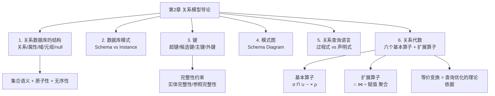
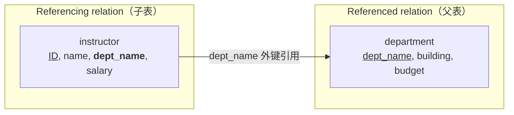
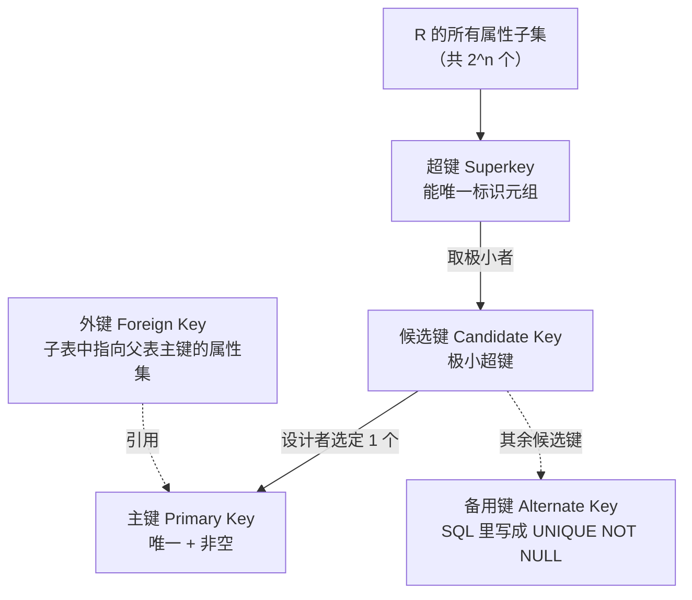
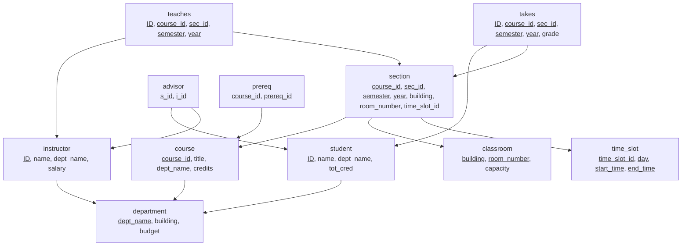

# Intro to Relational Model

> [!abstract] 一句话概括本章
> 本章回答三个问题：**关系数据库长什么样**（结构、模式、键）、**怎么画出来**（模式图）、**怎么问问题**（关系查询语言，重点是关系代数）。
> 它是整门课的地基：后面第 3～5 章讲的 SQL，本质上就是"用英语语法包装起来的关系代数"；教材"数据库设计"部分（ER 模型 → 关系模式 → 规范化）解决的是"关系模式该长什么样"；再后面的查询处理与查询优化，优化的对象就是关系代数表达式

> [!SUMMARY]+ Table of Contents
> - [[Ch2 关系模型导论#Intro to Relational Model|Intro to Relational Model]]
>     - [[Ch2 关系模型导论#导读：这一章在讲什么|导读：这一章在讲什么]]
>         - [[Ch2 关系模型导论#本章知识地图|本章知识地图]]
>         - [[Ch2 关系模型导论#关系模型的三根支柱|关系模型的三根支柱]]
>         - [[Ch2 关系模型导论#记号速查表|记号速查表]]
>         - [[Ch2 关系模型导论#目录|目录]]
>     - [[Ch2 关系模型导论#1 关系数据库的结构|1 关系数据库的结构]]
>         - [[Ch2 关系模型导论#1.1 关系就是一张表|1.1 关系就是一张表]]
>         - [[Ch2 关系模型导论#1.2 属性 attribute|1.2 属性 attribute]]
>         - [[Ch2 关系模型导论#1.3 域 domain|1.3 域 domain]]
>         - [[Ch2 关系模型导论#1.4 原子性 atomic|1.4 原子性 atomic]]
>         - [[Ch2 关系模型导论#1.5 元组 tuple 与关系实例|1.5 元组 tuple 与关系实例]]
>         - [[Ch2 关系模型导论#1.6 空值 null|1.6 空值 null]]
>         - [[Ch2 关系模型导论#1.7 关系的严谨数学定义|1.7 关系的严谨数学定义]]
>         - [[Ch2 关系模型导论#1.8 关系是无序的，且不含重复元组|1.8 关系是无序的，且不含重复元组]]
>         - [[Ch2 关系模型导论#1.9 数据库 database|1.9 数据库 database]]
>         - [[Ch2 关系模型导论#1.10 完整性约束总览|1.10 完整性约束总览]]
>         - [[Ch2 关系模型导论#1.11 本节易错点|1.11 本节易错点]]
>     - [[Ch2 关系模型导论#2 数据库模式|2 数据库模式]]
>         - [[Ch2 关系模型导论#2.1 模式 schema：数据库的逻辑结构|2.1 模式 schema：数据库的逻辑结构]]
>         - [[Ch2 关系模型导论#2.2 实例 instance：某一时刻的快照|2.2 实例 instance：某一时刻的快照]]
>         - [[Ch2 关系模型导论#2.3 模式与实例的对照|2.3 模式与实例的对照]]
>         - [[Ch2 关系模型导论#2.4 严谨表述|2.4 严谨表述]]
>         - [[Ch2 关系模型导论#2.5 本节易错点|2.5 本节易错点]]
>     - [[Ch2 关系模型导论#3 键 Keys|3 键 Keys]]
>         - [[Ch2 关系模型导论#3.1 超键 superkey|3.1 超键 superkey]]
>         - [[Ch2 关系模型导论#3.2 候选键 candidate key|3.2 候选键 candidate key]]
>         - [[Ch2 关系模型导论#3.3 主键 primary key|3.3 主键 primary key]]
>         - [[Ch2 关系模型导论#3.4 外键 foreign key|3.4 外键 foreign key]]
>         - [[Ch2 关系模型导论#3.5 四类键的关系图|3.5 四类键的关系图]]
>         - [[Ch2 关系模型导论#3.6 键的判定流程|3.6 键的判定流程]]
>         - [[Ch2 关系模型导论#3.7 本节易错点|3.7 本节易错点]]
>     - [[Ch2 关系模型导论#4 模式图 Schema Diagram|4 模式图 Schema Diagram]]
>         - [[Ch2 关系模型导论#4.1 图示约定|4.1 图示约定]]
>         - [[Ch2 关系模型导论#4.2 University 数据库模式图|4.2 University 数据库模式图]]
>         - [[Ch2 关系模型导论#4.3 关系模式清单|4.3 关系模式清单]]
>         - [[Ch2 关系模型导论#4.4 本节易错点|4.4 本节易错点]]
>     - [[Ch2 关系模型导论#5 关系查询语言|5 关系查询语言]]
>         - [[Ch2 关系模型导论#5.1 过程式与非过程式|5.1 过程式与非过程式]]
>         - [[Ch2 关系模型导论#5.2 三种纯语言|5.2 三种纯语言]]
>         - [[Ch2 关系模型导论#5.3 表达能力的等价性|5.3 表达能力的等价性]]
>         - [[Ch2 关系模型导论#5.4 本节易错点|5.4 本节易错点]]
>     - [[Ch2 关系模型导论#6 关系代数|6 关系代数]]
>         - [[Ch2 关系模型导论#6.1 总览：算子的分类|6.1 总览：算子的分类]]
>         - [[Ch2 关系模型导论#6.2 选择 Selection|6.2 选择 Selection]]
>         - [[Ch2 关系模型导论#6.3 投影 Projection|6.3 投影 Projection]]
>         - [[Ch2 关系模型导论#6.4 运算的复合 Composition|6.4 运算的复合 Composition]]
>         - [[Ch2 关系模型导论#6.5 笛卡儿积 Cartesian Product|6.5 笛卡儿积 Cartesian Product]]
>         - [[Ch2 关系模型导论#6.6 连接 Join|6.6 连接 Join]]
>         - [[Ch2 关系模型导论#6.7 并 Union|6.7 并 Union]]
>         - [[Ch2 关系模型导论#6.8 交 Set Intersection|6.8 交 Set Intersection]]
>         - [[Ch2 关系模型导论#6.9 差 Set Difference|6.9 差 Set Difference]]
>         - [[Ch2 关系模型导论#6.10 赋值 Assignment|6.10 赋值 Assignment]]
>         - [[Ch2 关系模型导论#6.11 重命名 Rename|6.11 重命名 Rename]]
>         - [[Ch2 关系模型导论#6.12 聚合与分组 Aggregate and Group By|6.12 聚合与分组 Aggregate and Group By]]
>         - [[Ch2 关系模型导论#6.13 除法 Division（教材补充）|6.13 除法 Division（教材补充）]]
>         - [[Ch2 关系模型导论#6.14 等价查询与代数定律|6.14 等价查询与代数定律]]
>         - [[Ch2 关系模型导论#6.15 关系代数的形式化定义|6.15 关系代数的形式化定义]]
>         - [[Ch2 关系模型导论#6.16 本节易错点汇总|6.16 本节易错点汇总]]
>     - [[Ch2 关系模型导论#7 综合例题（难度递进）|7 综合例题（难度递进）]]
>         - [[Ch2 关系模型导论#例题 1 ★ 超键与候选键的判定（概念级 vs 实例级）|例题 1 ★ 超键与候选键的判定（概念级 vs 实例级）]]
>         - [[Ch2 关系模型导论#例题 2 ★★ 求全部候选键（属性闭包法）|例题 2 ★★ 求全部候选键（属性闭包法）]]
>         - [[Ch2 关系模型导论#例题 3 ★★ 完整性约束的违反检测|例题 3 ★★ 完整性约束的违反检测]]
>         - [[Ch2 关系模型导论#例题 4 ★★ 笛卡儿积与连接的基数 / 元数推算|例题 4 ★★ 笛卡儿积与连接的基数 / 元数推算]]
>         - [[Ch2 关系模型导论#例题 5 ★ 选择 + 投影的复合求值|例题 5 ★ 选择 + 投影的复合求值]]
>         - [[Ch2 关系模型导论#例题 6 ★★ 谓词优先级与括号|例题 6 ★★ 谓词优先级与括号]]
>         - [[Ch2 关系模型导论#例题 7 ★★ $\sigma$-$\times$ 与 $\bowtie$ 的等价性|例题 7 ★★ $\sigma$-$\times$ 与 $\bowtie$ 的等价性]]
>         - [[Ch2 关系模型导论#例题 8 ★★ 集合运算的相容性判定|例题 8 ★★ 集合运算的相容性判定]]
>         - [[Ch2 关系模型导论#例题 9 ★★★ 集合运算的真实求值 + 对称差|例题 9 ★★★ 集合运算的真实求值 + 对称差]]
>         - [[Ch2 关系模型导论#例题 10 ★★ 排序无关性 + 元数/基数双核对|例题 10 ★★ 排序无关性 + 元数/基数双核对]]
>         - [[Ch2 关系模型导论#例题 11 ★★★ 自连接：找出"工资高于本系平均工资"的教师|例题 11 ★★★ 自连接：找出"工资高于本系平均工资"的教师]]
>         - [[Ch2 关系模型导论#例题 12 ★★ 反连接：找出没有讲授任何课程的教师|例题 12 ★★ 反连接：找出没有讲授任何课程的教师]]
>         - [[Ch2 关系模型导论#例题 13 ★★★ 自连接：讲授了至少两门不同课程的教师|例题 13 ★★★ 自连接：讲授了至少两门不同课程的教师]]
>         - [[Ch2 关系模型导论#例题 14 ★★★ 连接 + 差：Physics 系中没有讲授 Physics 系课程的教师|例题 14 ★★★ 连接 + 差：Physics 系中没有讲授 Physics 系课程的教师]]
>         - [[Ch2 关系模型导论#例题 15 ★★★ 除法：完整的手工推演|例题 15 ★★★ 除法：完整的手工推演]]
>         - [[Ch2 关系模型导论#例题 16 ★★ 聚合求值：count / count-distinct / 分组|例题 16 ★★ 聚合求值：count / count-distinct / 分组]]
>         - [[Ch2 关系模型导论#例题 17 ★★★ 多层聚合：平均工资最高的系|例题 17 ★★★ 多层聚合：平均工资最高的系]]
>         - [[Ch2 关系模型导论#例题 18 ★★★ "高于所有"：∀ 语义的差集表达|例题 18 ★★★ "高于所有"：∀ 语义的差集表达]]
>         - [[Ch2 关系模型导论#例题 19 ★★★ 等价性判断（判断 + 反例）|例题 19 ★★★ 等价性判断（判断 + 反例）]]
>         - [[Ch2 关系模型导论#例题 20 ★★ 表达式的结果模式推导|例题 20 ★★ 表达式的结果模式推导]]
>         - [[Ch2 关系模型导论#例题 21 ★★★ 空值（null）对关系代数的影响|例题 21 ★★★ 空值（null）对关系代数的影响]]
>         - [[Ch2 关系模型导论#例题 22 ★★★ 综合大题（多小问）|例题 22 ★★★ 综合大题（多小问）]]
>         - [[Ch2 关系模型导论#例题 23 ★★ 聚合 + 选择：教师人数不少于 2 的系|例题 23 ★★ 聚合 + 选择：教师人数不少于 2 的系]]
>     - [[Ch2 关系模型导论#8 易错点总清单|8 易错点总清单]]
>         - [[Ch2 关系模型导论#8.1 结构与模型层|8.1 结构与模型层]]
>         - [[Ch2 关系模型导论#8.2 键与约束层|8.2 键与约束层]]
>         - [[Ch2 关系模型导论#8.3 选择与投影层|8.3 选择与投影层]]
>         - [[Ch2 关系模型导论#8.4 笛卡儿积与连接层|8.4 笛卡儿积与连接层]]
>         - [[Ch2 关系模型导论#8.5 集合运算层|8.5 集合运算层]]
>         - [[Ch2 关系模型导论#8.6 赋值、重命名、聚合、除法则|8.6 赋值、重命名、聚合、除法则]]
>         - [[Ch2 关系模型导论#8.7 语义与理论层|8.7 语义与理论层]]
>     - [[Ch2 关系模型导论#9 自测题|9 自测题]]
>     - [[Ch2 关系模型导论#附录 A 本章示例数据|附录 A 本章示例数据]]
>         - [[Ch2 关系模型导论#A.1 `instructor`（12 行）|A.1 `instructor`（12 行）]]
>         - [[Ch2 关系模型导论#A.2 `teaches`（15 行）|A.2 `teaches`（15 行）]]
>         - [[Ch2 关系模型导论#A.3 `section`（15 行）|A.3 `section`（15 行）]]
>         - [[Ch2 关系模型导论#A.4 `department`（7 行，教材标准值）|A.4 `department`（7 行，教材标准值）]]
>         - [[Ch2 关系模型导论#A.5 `course`（12 行，教材标准值）|A.5 `course`（12 行，教材标准值）]]
>         - [[Ch2 关系模型导论#A.6 其他 University 库关系（本笔记未给数据、仅列出模式）|A.6 其他 University 库关系（本笔记未给数据、仅列出模式）]]
>     - [[Ch2 关系模型导论#附录 B 与后续章节的衔接|附录 B 与后续章节的衔接]]
>         - [[Ch2 关系模型导论#B.1 关系代数 → SQL 的逐项映射|B.1 关系代数 → SQL 的逐项映射]]
>         - [[Ch2 关系模型导论#B.2 三个必须带走的思维方式|B.2 三个必须带走的思维方式]]
---

## 导读：这一章在讲什么

### 本章知识地图



### 关系模型的三根支柱

关系模型（Relational Model）由 E. F. Codd 于 1970 年提出，它把数据组织成**数学意义上的"关系"（relation）**，其严谨性体现在三个方面：

| 支柱 | 内容 | 本章对应知识点 |
| --- | --- | --- |
| **结构（Structure）** | 数据以"关系/表"的形式存放，每个关系是若干元组的集合 | §1 关系数据库的结构 |
| **完整性（Integrity）** | 键约束、实体完整性、参照完整性、域完整性 | §3 键、§4 模式图 |
| **操作（Manipulation）** | 用关系代数 / 关系演算 / SQL 对关系做运算，结果仍然是关系 | §5、§6 |

> [!tip] 为什么要强调"结果仍然是关系"（closure property，封闭性）
> 因为**封闭性**才能带来**复合性**：一个运算的输出可以直接当作另一个运算的输入，于是可以像搭积木一样把简单查询拼成复杂查询，最终形成一棵**表达式树**。这正是关系代数能被称为"代数"的原因，也是后面查询优化器能对表达式做等价改写的前提。

### 记号速查表

| 名称                     | 符号            | LaTeX         | 元数  | 作用一句话                     |
| ---------------------- | ------------- | ------------- | --- | ------------------------- |
| 选择 Select              | $\sigma$      | `\sigma`      | 一元  | **横着挑行**：按条件筛元组           |
| 投影 Project             | $\Pi$         | `\Pi`         | 一元  | **竖着挑列**：按名字选属性，并去重       |
| 并 Union                | $\cup$        | `\cup`        | 二元  | 两个相容关系的"或"                |
| 差 Set Difference       | $-$           | `-`           | 二元  | 在左边不在右边                   |
| 笛卡儿积 Cartesian Product | $\times$      | `\times`      | 二元  | 所有配对，属性拼接                 |
| 重命名 Rename             | $\rho$        | `\rho`        | 一元  | 给结果/属性改名字                 |
| 交 Set Intersection     | $\cap$        | `\cap`        | 二元  | 两边都有的元组                   |
| 连接 Join                | $\bowtie$     | `\bowtie`     | 二元  | 选择 + 笛卡儿积的合并写法            |
| 赋值 Assignment          | $\leftarrow$  | `\leftarrow`  | —   | 把中间结果存进临时变量               |
| 聚合 Aggregate           | $\mathcal{G}$ | `\mathcal{G}` | 一元  | 分组求 avg/min/max/sum/count |

> [!warning] 教材符号注意
> - **投影**的正确符号是大写希腊字母 $\Pi$（Pi），有些 PPT 因字体问题显示成 $\tilde{O}$ 或 $Õ$，不要被误导。
> - **聚合**算子在 Silberschatz 教材里用的是花体 $\mathcal{G}$（"Generalized projection" 的首字母），部分讲义/中文教材写成 $\gamma$（gamma），二者指同一个东西。本笔记统一用 $\mathcal{G}$，见到 $\gamma$ 请自动对应。
> - **赋值**符号教材用 $\leftarrow$，也有教材写 $\coloneqq$ 或 $:=$。
> - 属性名中的下划线在 LaTeX 里必须转义：`dept\_name`。

### 目录

- [[#导读：这一章在讲什么|导读：这一章在讲什么]]
- [[#1 关系数据库的结构|1 关系数据库的结构]]
    - [[#1.1 关系就是一张表|1.1 关系就是一张表]]
    - [[#1.2 属性 attribute|1.2 属性 attribute]]
    - [[#1.3 域 domain|1.3 域 domain]]
    - [[#1.4 原子性 atomic|1.4 原子性 atomic]]
    - [[#1.5 元组 tuple 与关系实例|1.5 元组 tuple 与关系实例]]
    - [[#1.6 空值 null|1.6 空值 null]]
    - [[#1.7 关系的严谨数学定义|1.7 关系的严谨数学定义]]
    - [[#1.8 关系是无序的，且不含重复元组|1.8 关系是无序的，且不含重复元组]]
    - [[#1.9 数据库 database|1.9 数据库 database]]
    - [[#1.10 完整性约束总览|1.10 完整性约束总览]]
    - [[#1.11 本节易错点|1.11 本节易错点]]
- [[#2 数据库模式|2 数据库模式]]
    - [[#2.1 模式 schema：数据库的逻辑结构|2.1 模式 schema：数据库的逻辑结构]]
    - [[#2.2 实例 instance：某一时刻的快照|2.2 实例 instance：某一时刻的快照]]
    - [[#2.3 模式与实例的对照|2.3 模式与实例的对照]]
    - [[#2.4 严谨表述|2.4 严谨表述]]
    - [[#2.5 本节易错点|2.5 本节易错点]]
- [[#3 键 Keys|3 键 Keys]]
    - [[#3.1 超键 superkey|3.1 超键 superkey]]
    - [[#3.2 候选键 candidate key|3.2 候选键 candidate key]]
    - [[#3.3 主键 primary key|3.3 主键 primary key]]
    - [[#3.4 外键 foreign key|3.4 外键 foreign key]]
    - [[#3.5 四类键的关系图|3.5 四类键的关系图]]
    - [[#3.6 键的判定流程|3.6 键的判定流程]]
    - [[#3.7 本节易错点|3.7 本节易错点]]
- [[#4 模式图 Schema Diagram|4 模式图 Schema Diagram]]
    - [[#4.1 图示约定|4.1 图示约定]]
    - [[#4.2 University 数据库模式图|4.2 University 数据库模式图]]
    - [[#4.3 关系模式清单|4.3 关系模式清单]]
    - [[#4.4 本节易错点|4.4 本节易错点]]
- [[#5 关系查询语言|5 关系查询语言]]
    - [[#5.1 过程式与非过程式|5.1 过程式与非过程式]]
    - [[#5.2 三种纯语言|5.2 三种纯语言]]
    - [[#5.3 表达能力的等价性|5.3 表达能力的等价性]]
    - [[#5.4 本节易错点|5.4 本节易错点]]
- [[#6 关系代数|6 关系代数]]
    - [[#6.1 总览：算子的分类|6.1 总览：算子的分类]]
    - [[#6.2 选择 Selection|6.2 选择 Selection]]
    - [[#6.3 投影 Projection|6.3 投影 Projection]]
    - [[#6.4 运算的复合 Composition|6.4 运算的复合 Composition]]
    - [[#6.5 笛卡儿积 Cartesian Product|6.5 笛卡儿积 Cartesian Product]]
    - [[#6.6 连接 Join|6.6 连接 Join]]
    - [[#6.7 并 Union|6.7 并 Union]]
    - [[#6.8 交 Set Intersection|6.8 交 Set Intersection]]
    - [[#6.9 差 Set Difference|6.9 差 Set Difference]]
    - [[#6.10 赋值 Assignment|6.10 赋值 Assignment]]
    - [[#6.11 重命名 Rename|6.11 重命名 Rename]]
    - [[#6.12 聚合与分组 Aggregate and Group By|6.12 聚合与分组 Aggregate and Group By]]
    - [[#6.13 除法 Division（教材补充）|6.13 除法 Division（教材补充）]]
    - [[#6.14 等价查询与代数定律|6.14 等价查询与代数定律]]
    - [[#6.15 关系代数的形式化定义|6.15 关系代数的形式化定义]]
    - [[#6.16 本节易错点汇总|6.16 本节易错点汇总]]
- [[#7 综合例题（难度递进）|7 综合例题（难度递进）]]
- [[#8 易错点总清单|8 易错点总清单]]
- [[#9 自测题|9 自测题]]
- [[#附录 A 本章示例数据|附录 A 本章示例数据]]
- [[#附录 B 与后续章节的衔接|附录 B 与后续章节的衔接]]

---

## 1 关系数据库的结构

> [!quote] 教材原文（2.1 节·幻灯片 2.3 / 2.5）
> - The set of allowed values for each attribute is called the **domain** of the attribute.
> - Attribute values are (normally) required to be **atomic**; that is, indivisible.
> - The special value **null** is a member of every domain. It indicates that the value is "unknown".
> - The null value causes complications in the definition of many operations.
> - **Order of tuples is irrelevant** (tuples may be stored in an arbitrary order).

### 1.1 关系就是一张表

**通俗理解。** 打开 Excel，你看到的那个"有表头的二维表格"就是关系。列有列名（属性），有一行行数据（元组）。

**严谨定义。** 一个**关系（relation）** $r$ 定义在**关系模式（relation schema）** $R = \{A_1, A_2, \dots, A_n\}$ 之上，它是笛卡儿积 $\text{dom}(A_1) \times \text{dom}(A_2) \times \dots \times \text{dom}(A_n)$ 的一个**有限子集**。

> [!important] 请务必记住这个"二次抽象"过程
> 1. 先有一个个**域** $\text{dom}(A_i)$：即这一列允许出现的所有值的集合；
> 2. 把 $n$ 个域做**笛卡儿积**，得到所有"理论上可能出现的行"的集合（可能非常大，甚至是无穷的）；
> 3. 一个关系实例只是这个巨大集合里的**有限个子集**——也就是"当前实际存在的数据行"。
>
> 这个视角极其重要：**它解释了为什么"超键"是关于"所有可能实例"的性质，而不是"当前这张表"的性质**（见 §3.1）。

---

### 1.2 属性 attribute

**定义。** **属性（attribute）** 是关系的列，是给这一列数据起的**名字**。关系模式 $R$ 就是属性名字的有限集合，记作 $R = \{A_1, \dots, A_n\}$，$n$ 称为关系的**元数（arity）**或**度（degree）**。

**示例（幻灯片 2.3 的 instructor 关系）。**

| ID | name | dept_name | salary |
| --- | --- | --- | --- |
| 10101 | Srinivasan | Comp. Sci. | 65000 |
| 12121 | Wu | Finance | 90000 |
| 15151 | Mozart | Music | 40000 |
| 22222 | Einstein | Physics | 95000 |
| 32343 | El Said | History | 60000 |
| 33456 | Gold | Physics | 87000 |
| 45565 | Katz | Comp. Sci. | 75000 |
| 58583 | Califieri | History | 62000 |
| 76543 | Singh | Finance | 80000 |
| 76766 | Crick | Biology | 72000 |
| 83821 | Brandt | Comp. Sci. | 92000 |
| 98345 | Kim | Elec. Eng. | 80000 |

- 属性集合：$R = \{\textit{ID}, \textit{name}, \textit{dept\_name}, \textit{salary}\}$，元数 $n = 4$；
- 元组个数（**基数 cardinality**）$|r| = 12$。

> [!warning] 元数 vs 基数，千万不要混
> - **元数 / 度（arity / degree）** = 有**几列** = 属性个数 = $|R|$；
> - **基数（cardinality）** = 有**几行** = 元组个数 = $|r|$。
>
> 记忆法：**degree 是"维度"，说的是列；cardinality 是"多少张牌"，说的是行。**

---

### 1.3 域 domain

**通俗理解。** 域就是这一列的"合法取值清单"。就像填表格时"性别"这一栏只能填{男, 女}，"年龄"只能填非负整数。

**严谨定义。** 属性 $A$ 的**域**记作 $\text{dom}(A)$，是 $A$ 允许取的**所有原子值**的集合。关系中的每一个元组在第 $i$ 个属性上的取值必须属于 $\text{dom}(A_i) \cup \{\text{null}\}$。

**例子。**
- $\text{dom}(\textit{salary})$：可以定义为正整数集（或者教材意义上的"工资值集合"）；
- $\text{dom}(\textit{name})$：所有合法的姓名字符串的集合；
- $\text{dom}(\textit{semester})$：$\{\textit{Fall}, \textit{Winter}, \textit{Spring}, \textit{Summer}\}$——注意它是一个**枚举型的有限集合**。

> [!important] 域的重要推论：为什么"域"决定了集合运算能不能做
> 因为并、交、差要求"对应位置的属性必须是同一类值"。如果 $\text{dom}(A_1)$ 是工资、$\text{dom}(A_2)$ 是姓名，那么把它们逐行对齐去做"并"是无意义的（就像把电话号码和年龄相加）。
> 这就是 §6.7 中**相容性（compatibility）**条件的来源。

---

### 1.4 原子性 atomic

**教材原文。** *Attribute values are (normally) required to be atomic; that is, indivisible.*

**通俗理解。** 一个格子里只能装**一个不可再分的值**，不能装"一整个表格"或"一串用逗号分隔的列表"。

**严谨说法。** 若 $t$ 是关系 $r(R)$ 的一个元组，$A \in R$，则 $t[A]$ 必须是**单个原子值**（一个数、一个字符串、一个日期等），而不能是集合、列表、记录或另一个关系。

**反例（违反第一范式 1NF）。**

| ID | name | phones |
| --- | --- | --- |
| 10101 | Srinivasan | {555-1234, 555-5678} |
| 12121 | Wu | {555-9999} |

`phones` 这一格装了一个**集合**，不可再分性被破坏，因此**它不是合法的关系**。

**正确做法：把多值属性拆成独立的关系。**

| ID | phone |
| --- | --- |
| 10101 | 555-1234 |
| 10101 | 555-5678 |
| 12121 | 555-9999 |

> [!note] 术语衔接
> 满足"所有属性值都原子"的关系模式称为**第一范式（1NF）**。教材"关系数据库设计"一章会在此基础上讨论 2NF/3NF/BCNF 等更高范式。
> 本章默认**所有关系都是 1NF**。

---

### 1.5 元组 tuple 与关系实例

**定义。** **元组（tuple）** 是关系中的一行，是从属性名到属性值的一个映射 $t: R \to \bigcup_{A \in R}\text{dom}(A)$，满足 $t[A] \in \text{dom}(A) \cup \{\text{null}\}$ 对每个 $A \in R$ 成立。

**关系实例（relation instance）** 是某个时刻关系的具体取值，即元组的有限集合，记作 $r(R)$ 或简写 $r$。

- 元组的记法：$t = (10101, \text{Srinivasan}, \text{Comp. Sci.}, 65000)$；
- 取某个属性值的记法：$t[\textit{salary}] = 65000$，$t[\textit{name}] = \text{Srinivasan}$；
- 取属性子集 $K \subseteq R$ 上的分量：$t[K]$，例如 $t[\{\textit{ID}, \textit{salary}\}] = (10101, 65000)$。

> [!tip] 记法上的两个高频写法
> - $t \in r$ 表示"$t$ 是关系 $r$ 的一个元组"；
> - $r(R)$ 强调"关系 $r$ 的模式是 $R$"，在做集合运算时写成 $r(R) \cup s(S)$ 能一眼看出两边模式是否相容。

---

### 1.6 空值 null

**教材原文。** *The special value **null** is a member of every domain. Indicates that the value is "unknown". The null value causes complications in the definition of many operations.*

**通俗理解。** `null` 不等于 0，也不等于空字符串 `''`。它表示"**我不知道这里该填什么**"或"**这里没有适用值**"。

**严谨定义。** $\text{null} \in \text{dom}(A)$ 对**每一个**属性 $A$ 都成立。因此上面 1.3 节的定义必须写成
$$t[A] \in \text{dom}(A) \cup \{\text{null}\}$$
而不是 $t[A] \in \text{dom}(A)$。

**null 产生的三类语义。**
1. **未知（unknown）**：这位教师的电话号码我确实不知道；
2. **不适用（not applicable）**：这位教师还没有办公室，所以"办公室号"对他不适用；
3. **缺失（missing）**：数据录入时漏填了。

**null 带来的三个经典麻烦。**

**(a) 与 null 的任何比较结果都不是真/假，而是"未知"。**
采用**三值逻辑（three-valued logic）**：$\{\text{true}, \text{false}, \text{unknown}\}$。

| 表达式 | 结果 |
| --- | --- |
| $\text{null} = \text{null}$ | unknown（**不是** true！） |
| $\text{null} \neq \text{null}$ | unknown |
| $\text{null} > 5$ | unknown |
| $\neg\,\text{unknown}$ | unknown |
| $\text{unknown} \wedge \text{false}$ | false |
| $\text{unknown} \vee \text{true}$ | true |

**(b) 选择运算会"吞掉"含 null 的元组。**
设 $r$ 为：

| A |
| --- |
| 1 |
| 2 |
| null |

则 $\sigma_{A > 1}(r) = \{(2)\}$，$\sigma_{A \le 1}(r) = \{(1)\}$，于是
$$\sigma_{A>1}(r) \cup \sigma_{A\le 1}(r) = \{(1),(2)\} \neq r$$
**两个互补条件并起来居然没有覆盖全表**——这就是"null causes complications"的具体表现。

**(c) 聚合函数在遇到 null 时行为特殊。**
`count` 通常不计 null（`count(*)` 除外）；`sum`/`avg` 通常跳过 null（并且 `avg` 的分母是不含 null 的个数，而不是总行数）；空集合上 `count` 返回 0，其他函数返回 null。

> [!danger] 高频考点与陷阱
> 1. **`null = null` 的结果是 unknown，不是 true**。所以不能用 `=` 去查 null，必须用 `IS NULL`（SQL 语法）。
> 2. **在纯关系代数里，$\sigma_{\neg p}(r) = r - \sigma_p(r)$ 这条"看起来显然"的等式，在有 null 时不成立**（见上面 (b)）。教材在 2.5 节专门用一句话预警这一点。
> 3. **主键不能含 null**，但**外键可以含 null**（表示"暂时不知道指向谁"），这是实体完整性与参照完整性的关键差别。详见 §3.3、§3.4。
> 4. 本笔记**其余部分若无特别声明，均按无 null 的二值逻辑讨论**，这也是教材第 2 章的默认前提。

---

### 1.7 关系的严谨数学定义

把前面几节串起来，给出本章最完整的形式化定义：

> [!important] 定义 1.1（关系模式与关系实例）
> - **关系模式（relation schema）** $R$ 是属性名的有限集合 $R = \{A_1, A_2, \dots, A_n\}$。$n = |R|$ 称为 $R$ 的**元数（arity）**。
> - **关系实例（relation instance）** $r$ 是 $R$ 上的一个**有限**元组集合：
>   $$r(R) \subseteq \prod_{i=1}^{n}\Big(\text{dom}(A_i) \cup \{\text{null}\}\Big)$$
>   且 $r$ 中不存在两个完全相同的元组。
> - **数据库模式（database schema）** 是一个关系模式的集合 $\mathcal{R} = \{R_1, \dots, R_m\}$。
> - **数据库实例（database instance）** 是对应的关系实例的集合 $\{r_1(R_1), \dots, r_m(R_m)\}$。

**三个值得咀嚼的细节。**

1. **"有限子集"里的"有限"不可省。** 笛卡儿积可能是无穷集（比如 $\text{dom}(\textit{name})$ 是所有可能字符串），但关系必须只含有限个元组——因为现实中的表总是有限行。
2. **关系是子集，不是列表。** 子集天然满足"无序"和"无重复"，这两条性质就是我们下一节要讲的内容。
3. **数据库模式是"模式集合"，不是"表的集合"。** 严格地说，$R_1, R_2$ 是名字集合；只有给它们配上具体数据 $r_1, r_2$ 才构成数据库实例。

---

### 1.8 关系是无序的，且不含重复元组

幻灯片 2.6 的标题就是 *Relations are Unordered*，并给出同一个 instructor 关系打乱行序后的版本：

| ID | name | dept_name | salary |
| --- | --- | --- | --- |
| 22222 | Einstein | Physics | 95000 |
| 12121 | Wu | Finance | 90000 |
| 32343 | El Said | History | 60000 |
| 45565 | Katz | Comp. Sci. | 75000 |
| 98345 | Kim | Elec. Eng. | 80000 |
| 76766 | Crick | Biology | 72000 |
| 10101 | Srinivasan | Comp. Sci. | 65000 |
| 58583 | Califieri | History | 62000 |
| 83821 | Brandt | Comp. Sci. | 92000 |
| 15151 | Mozart | Music | 40000 |
| 33456 | Gold | Physics | 87000 |
| 76543 | Singh | Finance | 80000 |

这两张表**是同一个关系**。

> [!important] 两条"公理级"的性质
> **(P1) 元组无序（tuple order is irrelevant）。** 对任意元组的排列 $\pi$，$\pi(r) = r$。
> **(P2) 无重复元组（no duplicate tuples）。** 若 $t_1, t_2 \in r$ 且 $t_1 = t_2$，则它们是同一个元组；关系是**集合（set）**而不是**多重集（multiset/bag）**。
>
> **(P3) 属性名无序（属性顺序也不影响关系本身）。** 严格地说关系是从属性名到值的映射，所以 $\{(A{:}1, B{:}2)\}$ 与 $\{(B{:}2, A{:}1)\}$ 是同一个关系；但**书写时的列顺序会影响结果的展示**，且做题时通常按给定顺序写。

**这些性质常常"悄悄"影响结果：**

- **投影会自动去重**。$\Pi_{\textit{dept\_name}}(\textit{instructor})$ 的结果只有 7 行（Biology, Comp. Sci., Elec. Eng., Finance, History, Music, Physics），而不是 12 行。幻灯片 2.15 明确写着：*Duplicate rows removed from result, since relations are sets.*
- **并会自动去重**。$\{1,2\} \cup \{2,3\} = \{1,2,3\}$，基数是 3 而不是 4。
- **笛卡儿积的基数恰好是两边基数之积**（因为配对是单射）。见 §6.5。
- **"排序"不是关系代数的一部分**。关系代数表达式的结果是一个集合，**没有"ORDER BY"这种东西**（SQL 里的 ORDER BY 是对结果集的展示层排序，它把结果变成了有序的列表，已经超出了纯关系代数的范围）。

> [!warning] 与 SQL 的重要区别（复试/考研高频）
> **纯关系代数用"集合语义"，SQL 用"多重集（bag）语义"。**
> 例如在 SQL 中 `SELECT dept_name FROM instructor;` **会保留重复行**，输出 12 行；只有加 `DISTINCT` 才等价于关系代数的 $\Pi$。
> 教材在讲聚合函数时特意强调 *"These functions operate on the **multiset** (set with duplicates) of values of a column"*，就是在提醒这个裂缝。

---

### 1.9 数据库 database

**定义。** 一个**关系数据库**由一组关系模式 $\mathcal{R} = \{R_1, \dots, R_m\}$ 以及它们各自的实例 $\{r_1, \dots, r_m\}$ 组成；这些关系之间通过**外键**相互关联。

**通俗理解。** 单张表只是"一堆数据"，只有多张表用键连起来、能回答跨表的复杂问题，才叫"数据库"。

在本章的 University 示例库里，共有 11 张表：`classroom`、`department`、`course`、`instructor`、`section`、`teaches`、`student`、`takes`、`advisor`、`prereq`、`time_slot`（见 §4.2 模式图）。

---

### 1.10 完整性约束总览

教材在本章只点了"键"这一类约束，但完整的完整性约束体系如下（本课程第 4 章"Intermediate SQL"会展开）：

| 约束类型 | 含义 | 例子 |
| --- | --- | --- |
| **域完整性 / 原子性** | 每个属性值必须取自其域，且原子 | `salary` 必须是数值，不能是 $\{100, 200\}$ |
| **实体完整性 Entity Integrity** | 主键属性**非空且唯一** | `instructor.ID` 不能重复、不能为空 |
| **参照完整性 Referential Integrity** | 外键的取值必须出现在被引用关系的主键中（或为 null） | `instructor.dept_name` 必须是 `department` 中已存在的系名 |
| **用户自定义完整性** | 业务规则 | `salary > 0`、`budget ≥ 0` |

> [!tip] 为什么需要完整性约束
> 约束不是"限制自由"，而是**把数据库从"随机的数据集合"提升为"有语义的正确状态集合"**。
> 形式化地说：约束定义了**合法数据库实例的集合**（the set of legal database instances）。任何更新操作都必须把数据库从一个合法实例变到另一个合法实例。这也正是 §3.1 中"超键"定义里 **"each possible relation $r(R)$"** 这句话的含义——它谈的是约束，而不是某一次快照。

---

### 1.11 本节易错点

> [!danger] §1 易错点清单
> 1. **把元数（列数）和基数（行数）搞反。** arity/degree = 列，cardinality = 行。
> 2. **以为"表里有重复行"是允许的。** 在关系模型里**不允许**；SQL 里允许是因为 SQL 用 bag 语义，需要 `DISTINCT` 才是关系。
> 3. **以为"行的顺序"有意义。** 关系代数中没有任何"第 1 行""第 2 行"的概念，也没有排序算子。
> 4. **把 null 当成 0 或空串。** `null = null` 结果是 unknown；`sum` 会跳过 null；`count(*)` 与 `count(A)` 在含 null 时结果不同。
> 5. **把"域"理解成"某一列当前出现过的值的集合"。** 域是**允许值的全集**（模式级），当前列里出现过的值只是它的一个有限子集（实例级）。
> 6. **把多值属性塞进一个单元格。** 违反原子性，必须先拆表。
> 7. **认为关系的列顺序固定。** 关系是"属性名 → 值"的映射，列顺序只是书写/展示约定。

---

## 2 数据库模式

> [!quote] 教材原文（幻灯片 2.7）
> - **Database schema** — is the **logical structure** of the database.
> - **Database instance** — is a **snapshot of the data** in the database at a given instant in time.
> - Example:
>   - schema: `instructor(ID, name, dept_name, salary)`
>   - Instance: （一张具体的数据表）

### 2.1 模式 schema：数据库的逻辑结构

**通俗理解（简历 vs 简历模板）。** 模式就是**空表格的模板**：表名叫什么、有哪些列、每列是什么类型、哪个是主键。它**不包含任何数据**。

**严谨定义。** 数据库模式 $\mathcal{R} = \{R_1, R_2, \dots, R_m\}$ 是数据库中所有关系模式的集合。每个关系模式 $R_i$ 由**属性名**及其**域**（或类型）确定。若考虑完整性约束，则完整定义一个关系模式的四元组是
$$R = (\text{关系名},\ \text{属性名集合},\ \text{各属性的域},\ \text{完整性约束})$$

**教材示例。**
```
instructor(ID, name, dept_name, salary)
```

或用更完整一点的标准写法（下划线表示主键）：
```
instructor(<u>ID</u>, name, dept_name, salary)
```

**模式会随时间改变吗？** 会，但**极少**。加一个属性（`ALTER TABLE ADD COLUMN`）就是模式变更，通常需要数据库管理员谨慎评估，因为它影响所有应用程序。

---

### 2.2 实例 instance：某一时刻的快照

**通俗理解（照片）。** 实例就是**当前这一瞬间表里真实存在的数据**。你在上午 9:00 拍一张照，9:01 又拍一张，两张照片可能不同（有人插入/删除了数据），但它们对应的是**同一个模式**。

**严谨定义。** 关系模式 $R$ 的一个实例 $r$ 是满足 $R$ 上所有完整性约束的一个元组集合。数据库实例是 $\{r_1, r_2, \dots, r_m\}$。

**教材示例（幻灯片 2.7 的实例，与 §1.2 中同一张表，行序被重排过——再次印证"关系无序"）。**

---

### 2.3 模式与实例的对照

| 维度 | 模式 Schema | 实例 Instance |
| --- | --- | --- |
| 是什么 | 逻辑结构、模板、类型声明 | 某一时刻的数据快照 |
| 包含数据吗 | **不包含** | 包含 |
| 变化频率 | 极低（改结构 = 改程序） | 极高（每次增删改都变） |
| 类比 | 类定义 / 表头 / 蓝图 / 简历模板 | 对象 / 表格内容 / 建成的房子 / 填好的简历 |
| 编程类比 | `class Instructor {int ID; String name; ...}` 的类型声明 | `new Instructor(...)` 出来的具体对象 |
| 关系代数中的作用 | 决定算子的**合法性与结果模式**（arity、相容性） | 决定算子的**结果内容** |
| 键的判定依据 | **超键是模式级性质** | 唯一性只是实例级现象 |

> [!important] 一句话抓住本质区别
> **模式回答"能存什么"，实例回答"现在存了什么"。**
> 后面所有的"合法性检查"（arity 相等、域相容、外键有效）都是在**模式层**做的；所有的"求值"都是在**实例层**做的。

---

### 2.4 严谨表述

> [!important] 定义 2.1（模式、实例、合法实例）
> 设 $R = \{A_1, \dots, A_n\}$ 是关系模式，$\Sigma$ 是定义在 $R$ 上的完整性约束集合。
> - $\Sigma$ 决定了**合法实例的集合** $\mathcal{I}(R, \Sigma) = \{\, r \subseteq \prod_i(\text{dom}(A_i)\cup\{\text{null}\}) \mid r \text{ 有限且满足 } \Sigma \,\}$。
> - $r \in \mathcal{I}(R,\Sigma)$ 称为 $R$ 在约束 $\Sigma$ 下的一个**合法实例（legal instance）**。
> - **超键的定义量化于整个 $\mathcal{I}(R,\Sigma)$**，而不是某一个 $r$。这一点在下一章反复使用。

**一个具体对照（为 §3.1 埋下伏笔）。**

在 §1.2 的 instructor 实例里，12 位教师的 `name` 恰好互不相同。这是否意味着 `name` 是超键？

**不是。** 因为模式允许出现两个同名的教师（现实中也确实会），所以存在一个**合法实例** $r'$（其中有两个 `Wu`），使 `name` 无法唯一标识元组。而超键的定义要求"对**每一个可能的**关系 $r(R)$ 都能唯一标识"。于是 `name` 不是超键。

> [!tip] 由此得到一条极其实用的判据
> **判断 $K$ 是不是超键，问的不是"现在这张表里 $K$ 重不重复"，而是"模式有没有禁止 $K$ 重复"。**
> 唯一性约束（`UNIQUE` / `PRIMARY KEY`）写在模式里，才使 $K$ 成为超键。

---

### 2.5 本节易错点

> [!danger] §2 易错点清单
> 1. **用"当前表里没重复"来论证某属性是超键。** 错，必须从模式约束出发（见上面的对照）。
> 2. **把"实例"理解成"数据库"**。实例是快照，数据库 = 模式 + 当前实例。
> 3. **认为模式和实例可以随意互相推导。** 同一个模式可以有无数个实例；一个实例只对应一个模式。
> 4. **在关系代数里写出"排序""取前 N 行"**。这些不是关系代数算子（它们的结果不是集合语义下的关系）。

---

## 3 键 Keys

> [!quote] 教材原文（幻灯片 2.8）
> - Let $K \subseteq R$
> - $K$ is a **superkey** of $R$ if values for $K$ are sufficient to identify a **unique tuple of each possible relation** $r(R)$.
>   - Example: $\{ID\}$ and $\{ID, name\}$ are both superkeys of *instructor*.
> - Superkey $K$ is a **candidate key** if $K$ is **minimal**.
>   - Example: $\{ID\}$ is a candidate key for *instructor*.
> - One of the candidate keys is selected to be the **primary key**.
>   - Which one?
> - **Foreign key constraint**: value in one relation must appear in another.
>   - Referencing relation
>   - Referenced relation
>   - Example: `dept_name` in *instructor* is a foreign key from *instructor* referencing *department*.

### 3.1 超键 superkey

超键就是"**能当身份证用的一组属性**"。只要我告诉你这组属性的值，我就能在表里唯一确定是哪一行，一个不多一个不少

**严谨定义**
> [!important] 定义 3.1（超键 Superkey）
> 设 $R$ 是关系模式，$K \subseteq R$。若对**每一个可能的**合法关系实例 $r(R)$，以及 $r$ 中**任意两个不同的元组** $t_1 \neq t_2$，都有
> $$t_1[K] \neq t_2[K]$$
> 则称 $K$ 是 $R$ 的一个**超键（superkey）**。
>
> 等价表述：$\Pi_K(r)$ 与 $r$ 之间存在一一对应，即 $|\Pi_K(r)| = |r|$ 对**所有**合法 $r$ 恒成立。

**教材例子（instructor 关系）**
- $K_1 = \{\textit{ID}\}$ 是超键 ✓
- $K_2 = \{\textit{ID}, \textit{name}\}$ 也是超键 ✓（**超键不要求"最小"！**）
- $K_3 = \{\textit{ID}, \textit{name}, \textit{dept\_name}, \textit{salary}\} = R$ 也是超键 ✓（**整个模式永远是超键**）
- $K_4 = \{\textit{name}\}$ **不是**超键 ✗（可能存在同名教师）
- $K_5 = \{\textit{name}, \textit{dept\_name}\}$ **不是**超键 ✗（同一系里也可能有两个同名教师）

> [!important] 超键的三条必背性质
> **(1) 平凡性：$R$ 本身永远是超键。** 因为完整的元组当然唯一标识自己。
> **(2) 单调性（向上封闭）：若 $K$ 是超键，则任何 $K' \supseteq K$ 也是超键。** 因为知道的属性更多，只会更容易区分。
> **(3) 存在性：任何关系模式都至少有一个候选键。** 由 (1)，$R$ 是超键；对 $R$ 的所有超键取"基数最小者"，它必然极小，从而是候选键。（有限集合上的良序性保证最小元存在。）
>
> 性质 (2) 有一个**极其重要的推论**：**超键的个数通常是"组合爆炸"的**。若 $|R| = n$ 且 $\{\textit{ID}\}$ 是超键，那么任何包含 `ID` 的集合都是超键，共有 $2^{n-1}$ 个。所以**问"有几个超键"时答案是 2 的幂，而问"有几个候选键"时答案才可能是小数字**。

**为什么定义里要写 "each possible relation $r(R)$"？**

这是全章最容易读漏的一句话。它把超键从一个**统计现象**提升为一个**模式约束**：

| 说法 | 是否成立 |
| --- | --- |
| "在这张 instructor 表里 `name` 恰好不重复" | 真，但这是**实例级**的巧合 |
| "`name` 是 instructor 的超键" | **假**，因为存在同名教师的合法实例 |
| "`ID` 是 instructor 的超键" | **真**，因为模式规定 `ID` 唯一 |

> [!danger] 最常见的错误
> 拿**一张具体的表**去数重复值，然后断言"这列是超键"。
> 正确做法：问"**模式有没有禁止这列重复？**"——只有当答案是"禁止"时，它才是超键。
> 换句话说：**超键是一个"约束"，不是一个"观察"。**

---

### 3.2 候选键 candidate key

**通俗理解** 候选键 = **"最小号的身份证"**。它本身能唯一标识元组（是超键），而且**去掉任何一个属性就不行了**

**严谨定义**
> [!important] 定义 3.2（候选键 Candidate Key）
> $K \subseteq R$ 是 $R$ 的**候选键**，当且仅当：
> 1. $K$ 是 $R$ 的超键；
> 2. **极小性（minimality）**：不存在 $K$ 的真子集 $K' \subsetneq K$ 使得 $K'$ 也是 $R$ 的超键。

> [!warning] "Minimal" 到底是什么意思？——三个必须澄清的点
> 1. **minimal 说的是"集合的包含关系极小"，不是"属性个数最少"。**
>    如果 $\{A,B\}$ 是超键而 $\{A\}$、$\{B\}$ 都不是，那 $\{A,B\}$ 就是极小（候选键）。不需要去比较它和别的候选键谁的属性更少。
> 2. **极小的检查对象是"所有真子集"，不只是"去掉一个属性"。**
>    但由于超键具有**单调性**（性质 2），"每个真子集都不是超键" ⟺ "每个去掉一个属性的子集都不是超键"。所以**实务中只要逐个删掉一个属性试一下即可**，这个等价性让判定大大简化。
> 3. **所有候选键的属性个数可以不同。**
>    例如 $R=\{A,B,C\}$，约束为 $A \to BC$ 和 $BC \to A$，则 $\{A\}$ 和 $\{B,C\}$ 都是候选键，一个 1 个属性、一个 2 个属性。**"候选键"之间没有"谁更小"的说法。**

**教材例子。** *instructor* 的候选键是 $\{\textit{ID}\}$（幻灯片 2.8 原文：*Example: {ID} is a candidate key for Instructor*）。因为 $\{\textit{ID}, \textit{name}\}$ 虽然是超键，但它含真子集 $\{\textit{ID}\}$ 也是超键，所以它**不是**候选键。

**另一个例子（University 库的经典设定）。** `takes(ID, course_id, sec_id, semester, year, grade)` 的候选键是 $\{\textit{ID}, \textit{course\_id}, \textit{sec\_id}, \textit{semester}, \textit{year}\}$——即"一个学生在某个学期某门课的某个班次只能有一条选课记录"

---

### 3.3 主键 primary key

**教材原文。** *One of the candidate keys is selected to be the primary key.* 幻灯片紧接着问了一句 *Which one?*——这正是数据库设计者要做的决策
**通俗理解** 一个表可能有多个"最小身份证"（候选键），但**只能挂一个门牌号**，这个被正式选中的就是主键。

**严谨定义**
> [!important] 定义 3.3（主键 Primary Key）
> 从 $R$ 的候选键集合中由设计者**选定一个**作为 $R$ 的**主键**，记作 $\text{PK}(R)$。
>
> 主键必须满足：
> 1. **唯一性**（unique）：任何两个元组的主键值不同；
> 2. **非空性**（not null）：主键的**每一个**属性都不能为 null。
>
> 这两条合称**实体完整性（Entity Integrity）**。

**怎么选？（设计经验）**

| 准则 | 说明 |
| --- | --- |
| 永不变动 | 主键一旦确定就不应修改（因为外键会引用它，改一次要级联改多处） |
| 尽量短 | 主键会被复制到所有引用它的外键列，长主键浪费空间 |
| 尽量无业务含义 | 用代理键（surrogate key，如自增 ID）比用身份证号/手机号安全 |
| 单属性优先 | 复合主键会让所有引用方都要携带多个列 |

**教材 University 库的选择。**
- `instructor.ID`、`student.ID` 用学号/工号作主键；
- `department.dept_name` 用系名作主键（系名是自然键，且现实中不怎么改）；
- `takes` 用五元复合主键

> [!danger] 关于主键的三个致命误解
> 1. **"一个表可以有多个主键"——错。** 一个表**至多一个**主键（可以有多列组成一个复合主键，但那仍然是一个主键）。可以有多个**候选键**，其余的候选键在 SQL 中通常用 `UNIQUE NOT NULL` 声明（称为**备用键 alternate key**）。
> 2. **"主键可以为 null"——错，绝对不能。** 若主键含 null，两个 null 之间既不相等也不不等（unknown），唯一性根本无法判定。
> 3. **"主键必须是一列"——错。** 复合主键（composite primary key）很常见，如 `takes` 的五列主键。

---

### 3.4 外键 foreign key

外键就是"指针"**或**"引用"：A 表里的某个值，必须在 B 表里找得到。它的作用是"不许凭空捏造引用**"

**教材示例** `instructor` 中的 `dept_name` 是一个外键，**从 `instructor` 引用（referencing）`department`**

**严谨定义。**
> [!important] 定义 3.4（外键 Foreign Key）
> 设 $r(R)$ 与 $s(S)$ 是两个关系。若存在 $K \subseteq R$ 满足：
> 1. $K$ 是被引用关系 $s$ 的**主键**（即 $K = \text{PK}(S)$，注意这里隐含 $K \subseteq S$）；
> 2. 对 $r$ 的**每一个**元组 $t$，要么 $t[K]$ 含 null，要么存在 $s$ 中的元组 $t_s$ 使 $t_s[K] = t[K]$；
>
> 则称 $K$ 是 $R$ 中引用（referencing）$S$ 的**外键（foreign key）**。
>
> 术语：
> - **Referencing relation（引用关系 / 子表 / 从表）**：含有外键的那个关系，这里是 `instructor`；
> - **Referenced relation（被引用关系 / 父表 / 主表）**：被指向的那个关系，这里是 `department`。

**图示（幻灯片 2.8 的例子）。**



**参照完整性（Referential Integrity）的两种违反。**

| 操作 | 什么时候违反 | SQL 中的处理选项 |
| --- | --- | --- |
| 向子表 `instructor` 插入 `dept_name = 'Astrology'` | `department` 里没有这个系 | 直接拒绝（默认） |
| 从父表 `department` 删除 `'Physics'` | `instructor` 里还有物理系教师 | `RESTRICT` / `CASCADE` / `SET NULL` / `SET DEFAULT` |

> [!important] 外键 vs 主键的关键差别：**外键允许 null**
> 参照完整性的定义里有一句"要么 $t[K]$ 含 null"——这是**刻意**留的口子。
> 语义上，外键为 null 表示"**目前还不知道/不适用**这个引用"。例如一位新入职教师还没分配系，`dept_name = NULL` 是合法的。
> **例外**：如果外键的某些属性同时也是本表主键的一部分，则它不能为 null（因为主键非空）。这种情形称为"外键-主键重叠"，在弱实体集（weak entity set）建模中很常见。

> [!warning] 教材定义 vs SQL 标准的一个细节差异
> 教材定义要求外键**引用被引用关系的主键**。而 SQL 标准允许外键引用被引用关系的**任意候选键**（即任何 `UNIQUE NOT NULL` 的列组合）。
> 例如 `section.room_number` 可以引用 `classroom(room_number)` 只要后者加了 `UNIQUE`。
> 考试时按教材答"外键引用主键"，但如果题目提到 SQL 的 `REFERENCES` 子句，记得这个放宽。

---

### 3.5 四类键的关系图



用一句集合论的话概括：
$$\text{主键} \subsetneq \text{候选键} \subsetneq \text{超键} \subsetneq 2^{R}$$
（其中"$\subsetneq$"读作"是……中的一个/一部分"；严格说主键是候选键**集合中的一个元素**，不是子集。）

**层次口诀：**
> **超键**：够用就行 —— "能认出来就行"
> **候选键**：一个都不能少 —— "最小可用"
> **主键**：只能有一个 —— "官方指定"
> **外键**：指向别人的主键 —— "别人家的门牌号"

---

### 3.6 键的判定流程

> [!tip] 判定 $K$ 是否是超键 / 候选键的标准流程
> **Step 1.** 列出模式上所有已知的唯一性约束（下划线主键、`UNIQUE`、函数依赖 $X \to Y$）。
> **Step 2.** 用**属性闭包**（attribute closure）$K^+$ 计算 $K$ 能决定的全部属性。
> 　　- 若 $K^+ = R$，则 $K$ 是**超键**；否则不是。
> **Step 3.** 若 $K$ 是超键，再检查极小性：对每个 $A \in K$，计算 $(K - \{A\})^+$。
> 　　- 若**所有** $(K-\{A\})^+ \neq R$，则 $K$ 是**候选键**；
> 　　- 只要存在某个 $A$ 使 $(K-\{A\})^+ = R$，则 $K$ **不是**候选键（它可以"瘦身"，说明它有冗余属性）。
> **Step 4.** 把所有候选键都找出来后，设计者指定其中之一为主键。

**闭包计算的三条规则（Armstrong 公理的实用形式）：**
- **自反律**：$X \subseteq Y \Rightarrow Y \to X$（平凡依赖）
- **增广律**：$X \to Y \Rightarrow XZ \to YZ$
- **传递律**：$X \to Y, Y \to Z \Rightarrow X \to Z$

**示例。** 设 $R = \{A,B,C,D\}$，约束为 $A \to B$、$BC \to D$、$D \to A$。求所有候选键。

- $\{A\}^+ = \{A, B\}$ ≠ $R$（缺 C、D）→ 不是超键
- $\{A,C\}^+ = \{A,C,B\} \cup \{D\}$（由 $BC\to D$）= $\{A,B,C,D\}$ = $R$ ✓ 是超键
  - 检查极小性：$\{A\}^+ = \{A,B\} \neq R$ ✓，$\{C\}^+ = \{C\} \neq R$ ✓ → $\{A,C\}$ 是**候选键**
- $\{C,D\}^+ = \{C,D,A\} \cup \{B\}$（由 $A \to B$）= $R$ ✓
  - $\{C\}^+ = \{C\} \neq R$，$\{D\}^+ = \{D,A,B\} \neq R$ → $\{C,D\}$ 是**候选键**
- $\{B,C\}^+ = \{B,C,D,A\} = R$ ✓，但 $\{B\}^+=\{B\}$，$\{C\}^+=\{C\}$ → $\{B,C\}$ 是**候选键**
- $\{B,D\}^+ = \{B,D,A\} \cup \{C\}$? 由 $A\to B$ 得 B（已有），$BC \to D$ 需要 C 没有 → $\{A,B,D\} \neq R$ → 不是超键
- $\{A,D\}^+ = \{A,D,B\}$ ≠ $R$ → 不是超键

**结论：候选键为 $\{A,C\},\ \{B,C\},\ \{C,D\}$ 三个。** 每个都含 $C$，因此 $C$ 是**主属性（prime attribute）**；$A,B,D$ 是**非主属性**。

---

### 3.7 本节易错点

> [!danger] §3 易错点清单
> 1. **"当前表里这列不重复" ⇒ "这列是超键"** —— 错。超键是模式级约束，见 §3.1。
> 2. **把 "minimal" 理解成"属性个数最少"** —— 错，是"集合包含意义下极小"。
> 3. **认为超键/候选键是唯一的** —— 错。超键可以有 $2^{n-1}$ 个（若单属性超键存在），候选键也可以有多个。
> 4. **认为一个表能有多个主键** —— 错，主键至多一个，其余候选键叫备用键。
> 5. **忘记主键必须非空** —— 实体完整性 = 唯一 + 非空，两条缺一不可。
> 6. **以为外键也不能为 null** —— 错，外键**允许** null（除非它同时是主键的一部分）。
> 7. **搞混 referencing / referenced** —— 含外键的是 referencing（子表），被指向的是 referenced（父表）。记忆：**"我引用你，我在 referencing，你被 referenced"**。
> 8. **以为外键必须引用同名列** —— 不必。`section.room_number` 可以引用 `classroom.room_number`，名字相同只是习惯；SQL 里 `FOREIGN KEY (a) REFERENCES T(b)` 允许列名不同。
> 9. **忘记"外键也可以指向自己所在的表"** —— 自引用外键很常见（如 `employee.mgr_id` 引用 `employee.ID`）。
> 10. **把"候选键"和"主键"的选择当成纯技术问题** —— 选择主键是有业务后果的设计决策（稳定性、长度、引用成本）。

---

## 4 模式图 Schema Diagram

> [!quote] 幻灯片 2.9 标题：*Schema Diagram for University Database*

### 4.1 图示约定

模式图是**图论意义下的有向图**，其符号约定如下（教材贯穿全书）：

| 元素 | 表示 | 含义 |
| --- | --- | --- |
| **方框** | 一个矩形 | 一个**关系模式**，框内第一行是关系名，下面是属性名列表 |
| **下划线** | 属性名加下划线 | 该属性（组）是**主键** |
| **有向箭头** | 从子表的外键属性指向父表 | **外键约束**：箭头**起点**所在的框是 referencing（子表），箭头**终点**是 referenced（父表） |
| **无箭头连线** | —— | 一般不用；模式图里几乎所有连线都是外键箭头 |

> [!warning] 箭头方向别画反
> 请记住：**箭头的"尾巴"在写外键的那张表上，箭头的"头"插在被引用的主键上。**
> 即：`instructor --dept_name--> department`，而不是反过来。
> 直觉：**信息从"值"流向"定义"**——instructor 里的 `dept_name` 值要去 department 里查证，所以箭头指向 department。

> [!note] 模式图**不表示**什么
> - **不表示**数据本身（没有一行具体数据）；
> - **不表示**连接路径或查询方式（虽然我们常沿着箭头做连接）；
> - **不表示**基数/参与度（一对多、多对多的"鸦爪"符号是 ER 图的东西，不是模式图）。

---

### 4.2 University 数据库模式图

以下是幻灯片 2.9 的模式图（文字重绘，箭头 $\to$ 表示外键指向）：



**读图训练：以 `section` 为例。**
- `section` 的主键是 $(\textit{course\_id}, \textit{sec\_id}, \textit{semester}, \textit{year})$ 四列复合主键；
- 它有三条出箭头（三个外键）：
  - `course_id` → `course.course_id`（这个班次上的是哪门课）；
  - `(building, room_number)` → `classroom(building, room_number)`（在哪个教室）；
  - `time_slot_id` → `time_slot.time_slot_id`（什么时间上）。
- 它同时是 `teaches`、`takes` 的被引用方。

**读图训练：找出"哪个关系没有任何外键"。** `classroom`、`time_slot`、`department`——它们是"基础字典表"。

**读图训练：找出"多对多关系"。** `teaches`（教师 ↔ 班次）、`takes`（学生 ↔ 班次）、`advisor`（学生 ↔ 教师）、`prereq`（课程 ↔ 课程，自引用）。**这些表的主键都是"双方主键的并集"**，这是多对多关系转成关系模式的标志性特征。

---

### 4.3 关系模式清单

把模式图翻译成模式清单（下划线 = 主键，*斜体* = 外键）：

| 关系 | 属性 | 主键 | 外键（→ 指向） |
| --- | --- | --- | --- |
| `classroom` | building, room_number, capacity | (building, room_number) | 无 |
| `department` | dept_name, building, budget | dept_name | 无 |
| `course` | course_id, title, dept_name, credits | course_id | dept_name → department |
| `instructor` | ID, name, dept_name, salary | ID | dept_name → department |
| `section` | course_id, sec_id, semester, year, building, room_number, time_slot_id | (course_id, sec_id, semester, year) | course_id → course；(building, room_number) → classroom；time_slot_id → time_slot |
| `teaches` | ID, course_id, sec_id, semester, year | (ID, course_id, sec_id, semester, year) | ID → instructor；(course_id, sec_id, semester, year) → section |
| `student` | ID, name, dept_name, tot_cred | ID | dept_name → department |
| `takes` | ID, course_id, sec_id, semester, year, grade | (ID, course_id, sec_id, semester, year) | ID → student；(course_id, sec_id, semester, year) → section |
| `advisor` | s_id, i_id | (s_id, i_id) | s_id → student；i_id → instructor |
| `prereq` | course_id, prereq_id | (course_id, prereq_id) | course_id → course；prereq_id → course（**自引用**） |
| `time_slot` | time_slot_id, day, start_time, end_time | (time_slot_id, day, start_time, end_time) | 无 |

> [!tip] 一个能快速读懂任何模式图的技巧
> **先找主键（下划线），再找出箭头（外键）。**
> 一张表如果**没有出箭头**，它是"被依赖的字典表"（如 `department`、`classroom`、`time_slot`）；如果**有多个出箭头**，它是"事实表 / 联系表"（如 `section`、`teaches`、`takes`）。
> 事实表的复合主键几乎总是"各父表主键的并集 + 可能的区分属性"。

---

### 4.4 本节易错点

> [!danger] §4 易错点清单
> 1. **箭头方向画反**：起点（尾巴）= 含外键的子表，终点（头）= 被引用主键的父表。
> 2. **把模式图和 ER 图混为一谈**：ER 图有实体/属性/联系的区分，有基数（1:1、1:N、M:N）标注；模式图只有表、属性、主键、外键。
> 3. **在复合外键上只画一列**：如 `section` 的教室外键是 `(building, room_number)` **两列一起**，不能只画 `room_number`（因为不同楼里可能有 101 房间）。
> 4. **忘记复合主键要全部下划线**：`takes` 有五列主键，五列都要划。
> 5. **把 `advisor` 的主键误认成 `s_id`**：一个学生可以有多位导师，所以主键是 `(s_id, i_id)`；如果业务规定"一个学生只能有一位导师"，则是 `s_id`——**主键由业务规则决定，不是看图猜**。
> 6. **忽略 `prereq` 的自引用**：`prereq_id` 也指向 `course`，同一个关系可以有两条箭头指向同一张表。
> 7. **漏掉"外键引用的目标必须是被引用表的主键或候选键"** 这一合法性要求。

---

## 5 关系查询语言

> [!quote] 教材原文（幻灯片 2.10）
> - **Procedural versus non-procedural, or declarative**
> - "Pure" languages:
>   - Relational algebra（关系代数）
>   - Tuple relational calculus（元组关系演算）
>   - Domain relational calculus（域关系演算）
> - The above 3 pure languages are **equivalent in computing power**.
> - We will concentrate in this chapter on relational algebra.

### 5.1 过程式与非过程式

**通俗对比。**

| | 过程式（Procedural） | 非过程式 / 声明式（Declarative） |
| --- | --- | --- |
| 你告诉系统什么 | **怎么做**（how）：先干什么、再干什么 | **要什么**（what）：我只要结果 |
| 类比 | 给厨师写详细菜谱：先热油，再放葱…… | 在餐厅点菜："来一份宫保鸡丁" |
| 关系模型的代表 | **关系代数** | **关系演算**（元组演算 / 域演算）、SQL |
| 优化空间 | 用户已经定死了执行顺序，优化余地小 | 系统可以自由选择执行计划，优化余地大 |

**关系代数为什么是过程式的？** 因为一个关系代数表达式规定了明确的求值顺序——它是一棵**表达式树**，叶子是关系，内部结点是算子，自底向上一步步算。比如
$$\Pi_{\textit{name}}\big(\sigma_{\textit{dept\_name}="Physics"}(\textit{instructor})\big)$$
清楚地规定了"先选择、后投影"。

**关系演算为什么是声明式的？** 因为它写成**逻辑公式**的形式，只描述结果的"资格条件"。例如元组演算写"求所有满足 $t \in \textit{instructor} \wedge t[\textit{dept\_name}]="Physics"$ 的 $t[\textit{name}]$"，它并没有说先做什么。

> [!important] 为什么这门课要先学"过程式"的关系代数？
> 1. **它是 SQL 的语义基础**：SQL 的 `SELECT-FROM-WHERE` 结构几乎一对一地映射到 $\Pi$、$\times$、$\sigma$；
> 2. **它是查询优化的操作对象**：优化器把 SQL 翻译成关系代数表达式树，再对树做等价改写（见 §6.14），最后选物理执行计划；
> 3. **它是可计算的**：关系代数给了我们一个"能具体算出答案"的语言，方便做练习和证明。而演算需要额外的"安全性（safety）"限制才能保证结果是有限的（见 §5.3）。

---

### 5.2 三种纯语言

> [!important] 定义 5.1（三种"纯"关系查询语言）
> **1. 关系代数（Relational Algebra）** —— 过程式。由一组算子组成，每个算子以关系为输入、以关系为输出。
>
> **2. 元组关系演算（Tuple Relational Calculus, TRC）** —— 声明式。表达式形如
> $$\{\, t \mid P(t) \,\}$$
> 其中 $t$ 是**元组变量**（取值于某个关系的一个元组），$P$ 是一阶谓词公式。读作"所有使 $P(t)$ 为真的元组 $t$ 的集合"。
> 例：$\{\, t \mid t \in \textit{instructor} \wedge t[\textit{salary}] > 90000 \,\}$
>
> **3. 域关系演算（Domain Relational Calculus, DRC）** —— 声明式。表达式形如
> $$\{\, \langle x_1, x_2, \dots, x_n \rangle \mid P(x_1, \dots, x_n) \,\}$$
> 其中 $x_i$ 是**域变量**（取值于某个属性的域），而不是整个元组。
> 例：$\{\, \langle i, n, d, s \rangle \mid \langle i,n,d,s \rangle \in \textit{instructor} \wedge s > 90000 \,\}$

**两句话概括区别：** 元组演算"以整行为单位做变量"，域演算"以单个属性值为单位做变量"。**表达能力完全一样**，只是粒度和写法不同。

**它们与 SQL 的关系。**
- SQL 的 `SELECT ... FROM ... WHERE ...` 更接近**元组关系演算**（`SELECT` 里的东西像一个元组变量的分量）；
- QBE（Query By Example）和 Datalog 更接近**域关系演算**。

---

### 5.3 表达能力的等价性

> [!important] 定理 5.1（三种纯语言的等价性）
> 关系代数、元组关系演算、域关系演算三者的**表达能力相同**（在限制为"安全表达式"的前提下）。即：任何一个语言能表达的查询，都可以用另外两个语言表达。

**什么叫"计算能力等价"？** 不是语法相似，而是**可表达的查询集合完全相同**：给定任意一个数据库实例，三者能算出的结果集合族是一致的。这类语言被称为**关系完备（relationally complete）**的语言。

> [!warning] 为什么必须加"安全（safe）"这个限制？
> 不加限制的演算表达式会产生**无穷结果**甚至**不可计算的集合**。经典反例：
> $$\{\, t \mid \neg(t \in \textit{instructor}) \,\}$$
> 字面意思是"所有不在 instructor 里的元组"——可元组可以取任意属性组合、任意值，这个集合是**无穷的**，不是合法关系！
>
> **安全表达式（safe expression）** 的直观要求是：公式中出现的每个变量都必须被限制在**某个合法关系的域**内，从而保证结果有限。
> 关系代数由于每个算子的输入输出都是关系，**天然是安全的**——这也是教材先讲关系代数的原因之一。

**关系完备性的实用意义。** SQL 的核心（不含聚合、不含递归）是关系完备的；但 SQL 还额外提供了聚合、`GROUP BY`、`ORDER BY`、递归（`WITH RECURSIVE`）等能力，**超出了纯关系代数的表达能力**（例如"求传递闭包"纯关系代数做不到）。

---

### 5.4 本节易错点

> [!danger] §5 易错点清单
> 1. **把"关系演算"当成"关系代数的一种写法"** —— 二者语法完全不同，前者是逻辑公式，后者是表达式树。
> 2. **认为声明式语言"更弱"或"更慢"** —— 声明式语言表达能力等价，且因为给了优化器自由，实践中往往**更快**。
> 3. **忘记"安全表达式"限制**，直接写 $\{t \mid \neg(t \in r)\}$ 这种无穷结果。
> 4. **以为 SQL 完全等于关系代数** —— SQL 有 bag 语义、聚合、排序、递归，能力严格强于纯关系代数。
> 5. **把"过程式/声明式"和"低级/高级"混为一谈** —— 这是"描述方式"的差别，不是"能力高低"的差别。

---

## 6 关系代数

> [!quote] 教材原文（幻灯片 2.11）
> - An **algebraic language** consisting of a set of operations that take **one or two relations as input** and produce a **new relation as their result**.
> - **Six basic operators**
>   - select: $\sigma$
>   - project: $\Pi$
>   - union: $\cup$
>   - set difference: $-$
>   - Cartesian product: $\times$
>   - rename: $\rho$

### 6.1 总览：算子的分类

> [!important] 定义 6.1（关系代数）
> 关系代数是一个**代数系统** $(\mathcal{R}, \Omega)$，其中：
> - $\mathcal{R}$ 是所有可能的关系构成的集合（每个关系带自己的模式）；
> - $\Omega$ 是算子集合，每个算子 $\omega \in \Omega$ 是一个映射
> $$\omega: \underbrace{\mathcal{R} \times \dots \times \mathcal{R}}_{k \text{ 个}} \to \mathcal{R}, \quad k \in \{1, 2\}$$
>
> 关键性质是**封闭性（closure）**：**每个算子的输出仍然属于 $\mathcal{R}$**。因此算子可以任意嵌套，形成**关系代数表达式（relational-algebra expression）**/表达式树。

**算子分类表**

| 类别 | 算子 | 元数 | 是否基本算子 |
| --- | --- | --- | --- |
| **一元·行** | 选择 $\sigma$ | 1 | ✅ 基本 |
| **一元·列** | 投影 $\Pi$ | 1 | ✅ 基本 |
| **一元·改名** | 重命名 $\rho$ | 1 | ✅ 基本 |
| **二元·集合** | 并 $\cup$ | 2 | ✅ 基本 |
| **二元·集合** | 差 $-$ | 2 | ✅ 基本 |
| **二元·组合** | 笛卡儿积 $\times$ | 2 | ✅ 基本 |
| 派生·集合 | 交 $\cap$ | 2 | ❌ 可由 $-$ 派生 |
| 派生·组合 | 连接 $\bowtie$ | 2 | ❌ 可由 $\times,\sigma$ 派生 |
| 派生·组合 | 除法 $\div$ | 2 | ❌ 可由 $\Pi,-,\times$ 派生 |
| 附加 | 赋值 $\leftarrow$ | — | ❌ 语法糖 |
| 扩展 | 聚合 $\mathcal{G}$ | 1 | ❌ 扩展算子（**严格增强表达能力**） |

> [!warning] "基本算子"与"扩展算子"的本质区别
> **6 个基本算子 + 由它们派生的算子，表达能力完全相同。** 用 $\cap$ 还是用 $-$ 写，算出来的东西一样，只是简洁程度不同。
> **但聚合 $\mathcal{G}$ 不一样**：它**严格增强**了表达能力。纯关系代数（只有 6 个基本算子）**无法**表达"每个系有多少教师"这类查询——因为它的所有结果都是从输入元组"挑选/重组"出来的，无法"创造"出输入中不存在的新数值。
> 同理，聚合也**无法**用关系演算表达。所以 SQL 的能力严格强于关系代数。

---

### 6.2 选择 Selection

> [!quote] 教材原文
> - The **select** operation selects tuples that **satisfy a given predicate**.
> - Notation: $\sigma_p(r)$，$p$ is called the **selection predicate**.
> - Example: $\sigma_{\textit{dept\_name}="Physics"}(\textit{instructor})$
> - We allow comparisons using $=, \neq, >, \geq, <, \leq$ in the selection predicate.
> - We can combine several predicates into a larger predicate by using the connectives $\wedge$ (and), $\vee$ (or), $\neg$ (not).
> - The select predicate may include **comparisons between two attributes**. Example: $\sigma_{\textit{dept\_name}=\textit{building}}(\textit{department})$

**通俗理解。** 选择就是"**横着筛行**"——像 Excel 的自动筛选，保留满足条件的行，丢弃不满足的。

**严谨定义。**
> [!important] 定义 6.2（选择 Select）
> 设 $r(R)$ 是关系，$p$ 是定义在 $R$ 上的**谓词（predicate）**，即一个从元组到 $\{\text{true}, \text{false}\}$ 的函数。则
> $$\sigma_p(r) = \{\, t \mid t \in r \;\wedge\; p(t) = \text{true} \,\}$$
>
> - **结果模式**：与 $r$ 完全相同（$R$ 不变），**元数不变**；
> - **结果基数**：$0 \le |\sigma_p(r)| \le |r|$。

**谓词 $p$ 的语法（BNF 式）：**
```
p  ::=  p ∧ p  |  p ∨ p  |  ¬ p  |  ( p )  |  atom
atom ::=  A op A'   |   A op c   |   c op A
A, A' ∈ R （属性名，可带关系名前缀）
c     是常量
op  ∈ { =, ≠, >, ≥, <, ≤ }
```

**示例演算（用 §1.2 的 instructor 数据）。**

**(1) $\sigma_{\textit{dept\_name}="Physics"}(\textit{instructor})$** —— 幻灯片 2.12 原例

| ID | name | dept_name | salary |
| --- | --- | --- | --- |
| 22222 | Einstein | Physics | 95000 |
| 33456 | Gold | Physics | 87000 |

结果基数 = 2（原表 12 行）

**(2) $\sigma_{\textit{dept\_name}="Physics" \wedge \textit{salary} > 90000}(\textit{instructor})$** —— 幻灯片 2.13 原例

| ID | name | dept_name | salary |
| --- | --- | --- | --- |
| 22222 | Einstein | Physics | 95000 |

**(3) $\sigma_{\textit{dept\_name}=\textit{building}}(\textit{department})$** —— **属性与属性比较**。

已知 department 表（教材 University 库标准值）：

| dept_name | building | budget |
| --- | --- | --- |
| Biology | Watson | 90000 |
| Comp. Sci. | Taylor | 100000 |
| Elec. Eng. | Taylor | 85000 |
| Finance | Painter | 120000 |
| History | Painter | 50000 |
| Music | Packard | 80000 |
| Physics | Watson | 70000 |

逐行比较 `dept_name` 与 `building`：Biology≠Watson、Comp. Sci.≠Taylor、…、Physics≠Watson。**没有任何一行相等**，所以结果是**空关系** $\varnothing$（模式仍是 (dept_name, building, budget)，但基数为 0）。

> [!tip] 空关系 vs 空集
> $\sigma_p(r) = \varnothing$ 是**完全合法**的结果：它是一个"模式为 $R$、基数为 0"的关系。不要把"结果为空"当成"表达式非法"。

**(4) 复合谓词的括号与优先级。**
$$\sigma_{\textit{dept\_name}="Physics" \vee \textit{dept\_name}="Music" \wedge \textit{salary}>90000}(\textit{instructor})$$
按常规优先级 $\neg > \wedge > \vee$，等价于
$$\sigma_{\textit{dept\_name}="Physics" \;\vee\; (\textit{dept\_name}="Music" \wedge \textit{salary}>90000)}(\textit{instructor})$$
结果 = {Einstein, Gold} ∪ ∅ = **{Einstein, Gold}**（Music 系只有 Mozart，工资 40000，不满足）。
**考试陷阱**：这类"看起来像 A∨B∧C"的题，务必先加括号再算。

**选择运算的五条性质（重要，常考）：**

| 编号 | 性质 | 说明 |
| --- | --- | --- |
| S1 | $\sigma_{p \wedge q}(r) = \sigma_p(\sigma_q(r)) = \sigma_q(\sigma_p(r))$ | **合取可分解**，且**选择可交换** |
| S2 | $\sigma_p(\sigma_p(r)) = \sigma_p(r)$ | **幂等性** |
| S3 | $\sigma_p(r \cup s) = \sigma_p(r) \cup \sigma_p(s)$ | 对并可分配 |
| S4 | $\sigma_p(r \cap s) = \sigma_p(r) \cap \sigma_p(s)$ | 对交可分配 |
| S5 | $\sigma_p(r - s) = \sigma_p(r) - \sigma_p(s)$ | 对差可分配 |
| S6 | $\sigma_{p \vee q}(r) = \sigma_p(r) \cup \sigma_q(r)$ | **析取可展开**（注意：右边是并，不是 $\sigma_p(\sigma_q(r))$！） |

> [!danger] $\vee$ 与 $\wedge$ 的展开方式完全不同 —— 必须记牢
> - **$\wedge$ 对应"嵌套"**：$\sigma_{p \wedge q}(r) = \sigma_p(\sigma_q(r))$（**交集**语义，越筛越少）
> - **$\vee$ 对应"并"**：$\sigma_{p \vee q}(r) = \sigma_p(r) \cup \sigma_q(r)$（**并集**语义，越筛越多）
> - **$\neg$ 对应"差"**：**在无 null 的二值逻辑下** $\sigma_{\neg p}(r) = r - \sigma_p(r)$
>
> **有 null 时第三条会失效**！见 §1.6(b) 的反例。考试若未声明"无空值"，写这条等式是有风险的。

> [!warning] S1 的"选择可交换"为什么重要
> 它是**查询优化**最基础的规则之一：优化器会把"选择性最强（过滤掉最多元组）"的选择算子**尽量下推**到表达式树的下层，先做小结果集，再做连接、笛卡儿积这些昂贵运算。数据库性能的大头就在这里。

---

### 6.3 投影 Projection

> [!quote] 教材原文
> - A **unary** operation that returns its argument relation, with certain attributes **left out**.
> - Notation: $\Pi_{A_1, A_2, A_3, \dots, A_k}(r)$ where $A_1, A_2, \dots, A_k$ are attribute names and $r$ is a relation name.
> - The result is defined as the relation of $k$ columns obtained by **erasing the columns that are not listed**.
> - **Duplicate rows removed from result, since relations are sets.**

**通俗理解** 投影就是"**竖着挑列**"——像 Excel 里选中几列然后复制出来。**但有一个关键不同：它会自动去重**

**严谨定义**
> [!important] 定义 6.3（投影 Projection）
> 设 $r(R)$ 是关系，$L = \{A_1, A_2, \dots, A_k\} \subseteq R$ 是属性子集。则
> $$\Pi_{A_1,\dots,A_k}(r) = \{\, (t[A_1], t[A_2], \dots, t[A_k]) \mid t \in r \,\}$$
>
> - **结果模式**：$L = \{A_1, \dots, A_k\}$，元数为 $k$；
> - **结果基数**：$|\Pi_L(r)| \le |r|$，且
>   $$|\Pi_L(r)| = |r| \iff L \text{ 在 } r \text{ 上唯一标识元组}$$
> - **去重是自动的**，因为结果被定义为**集合**（教材原文：*Duplicate rows removed from result, since relations are sets.*）。

**示例（幻灯片 2.14 原例）。** $\Pi_{\textit{ID}, \textit{name}, \textit{salary}}(\textit{instructor})$ —— 去掉 `dept_name` 列：

| ID | name | salary |
| --- | --- | --- |
| 10101 | Srinivasan | 65000 |
| 12121 | Wu | 90000 |
| 15151 | Mozart | 40000 |
| 22222 | Einstein | 95000 |
| 32343 | El Said | 60000 |
| 33456 | Gold | 87000 |
| 45565 | Katz | 75000 |
| 58583 | Califieri | 62000 |
| 76543 | Singh | 80000 |
| 76766 | Crick | 72000 |
| 83821 | Brandt | 92000 |
| 98345 | Kim | 80000 |

这里没有重复，因为 `ID` 是主键，所以 $|\Pi_L(r)| = 12 = |r|$

**去重的经典例子。** $\Pi_{\textit{dept\_name}}(\textit{instructor})$：

| dept_name |
| --- |
| Comp. Sci. |
| Finance |
| Music |
| Physics |
| History |
| Biology |
| Elec. Eng. |

**只有 7 行**（原表 12 行）：Comp. Sci. 出现 3 次、Physics 2 次、History 2 次、Finance 2 次，全部被去重

> [!danger] 这是本章第一大"送命题"：投影会去重
> 很多同学算 $\Pi$ 的时候只是"擦掉一列"，忘记合并重复行，导致基数算错、后续并/交/差算错。
> **做题时请务必：先擦列，再去重，最后数行。**
> 记住这条也解释了为什么 $\Pi$ 的基数**只能变小或不变，绝不会变大**。

**投影的四条性质：**

| 编号 | 性质 | 备注 |
| --- | --- | --- |
| P1 | $\Pi_L(\Pi_M(r)) = \Pi_L(r)$ 当 $L \subseteq M$ | **投影可合并**（但不能"展开"） |
| P2 | $\Pi_L(r \cup s) = \Pi_L(r) \cup \Pi_L(s)$ | 对并可分配 ✓ |
| P3 | $\Pi_L(r \cap s) = \Pi_L(r) \cap \Pi_L(s)$ | 对交可分配 ✓ |
| P4 | $\Pi_L(r - s) \neq \Pi_L(r) - \Pi_L(s)$ | **对差不可分配！** 见下方反例 |

> [!danger] P4 反例（极易考）
> 设 $r(A,B) = \{(1, \text{'a'})\}$，$s(A,B) = \{(1, \text{'b'})\}$，$L = \{A\}$。
> - 左边：$r - s = \{(1,\text{'a'})\}$，故 $\Pi_A(r-s) = \{(1)\}$；
> - 右边：$\Pi_A(r) - \Pi_A(s) = \{(1)\} - \{(1)\} = \varnothing$。
> - **$\{(1)\} \neq \varnothing$，等式不成立。**
>
> **为什么？** 因为 $A$ 的投影把 $B$ 的信息抹掉了，抹掉后"看起来一样"的值可能来自原本不同的元组。**只有单向包含 $\Pi_L(r) - \Pi_L(s) \subseteq \Pi_L(r-s)$ 恒成立，反向不成立。**

> [!warning] 投影与选择的"顺序陷阱"
> $$\Pi_L(\sigma_p(r)) \quad \text{与} \quad \sigma_p(\Pi_L(r))$$
> **一般不等价，右边甚至可能非法！** 如果 $p$ 用到了**不在 $L$ 中的属性**，那么 $\sigma_p(\Pi_L(r))$ 根本没法计算（属性不存在）。
> 正例：$L = \{\textit{name}\}$，$p$ 是 $\textit{salary}>90000$：
> - $\Pi_{\textit{name}}(\sigma_{\textit{salary}>90000}(\textit{instructor})) = \{\text{Einstein}\}$ ✓ 合法
> - $\sigma_{\textit{salary}>90000}(\Pi_{\textit{name}}(\textit{instructor}))$ ✗ **非法**，因为投影后没有 `salary` 这一列。
>
> **结论：选择要"尽早"做，但**投影要谨慎**——投影会丢信息，丢了就找不回来。**

---

### 6.4 运算的复合 Composition

> [!quote] 教材原文（幻灯片 2.16）
> - The result of a relational-algebra operation is **relation**, and therefore relational-algebra operations can be **composed** together into a relational-algebra expression.
> - Consider the query — **Find the names of all instructors in the Physics department.**
>   $$\Pi_{\textit{name}}\big(\sigma_{\textit{dept\_name}="Physics"}(\textit{instructor})\big)$$
> - Instead of giving the name of a relation as the argument of the projection operation, we give an **expression** that evaluates to a relation.

**通俗理解。** 这就是"**积木**"：因为每个算子吐出来的还是关系，所以可以继续喂给下一个算子。

**求值过程（自底向上）。**

```
        Π name                    ← ③ 竖着挑列 → {Einstein, Gold}
           |
     σ dept_name="Physics"        ← ② 横着筛行 → {Einstein, Gold} 两行
           |
      instructor                  ← ① 叶子：12 行
```

**结果：$\{\text{Einstein}, \text{Gold}\}$**（2 行）。

**为什么要强调"复合"？** 因为这是关系代数能表达任意复杂查询的**唯一机制**：没有复合就没有"链式"查询。反过来，**复合也带来了"等价改写"的空间**——同一个查询可以画成许多棵不同的表达式树，它们的代价天差地别。这就是查询优化的全部问题。

**复合的语法规则（写表达式时容易忽略）：**
1. **括号必须明确**，因为算子优先级并无国际统一标准。教材通常约定：一元算子（$\sigma, \Pi, \rho$）优先级高于二元算子；若不确定，**一律加括号**。
2. **算子可以嵌套任意深**，只要每一步的模式合法（$L \subseteq R$、谓词只引用存在的属性、集合运算的相容性）。
3. **表达式树的叶子只能是关系名**，内部结点必须是算子。

---

### 6.5 笛卡儿积 Cartesian Product

> [!quote] 教材原文（幻灯片 2.17）
> - The **Cartesian-product** operation (denoted by $\times$) allows us to combine information from any two relations.
> - Example: $\textit{instructor} \times \textit{teaches}$
> - We construct a tuple of the result out of **each possible pair of tuples**: one from instructor, one from teaches.
> - Since the instructor ID appears in **both** relations we distinguish between these attributes by **attaching to the attribute the name of the relation** from which the attribute originally came:
>   - `instructor.ID`
>   - `teaches.ID`

**通俗理解** 笛卡儿积就是"**所有可能的组合**"——像把两张表做"叉乘"：A 表每一行都要和 B 表每一行配一次对

**严谨定义**
> [!important] 定义 6.4（笛卡儿积 Cartesian Product）
> 设 $r(R)$ 与 $s(S)$ 是关系。若 $R \cap S = \varnothing$，则
> $$r \times s = \{\, t_1 t_2 \mid t_1 \in r \;\wedge\; t_2 \in s \,\}$$
> 其中 $t_1 t_2$ 表示把 $t_2$ 的分量**拼接（concatenate）**在 $t_1$ 之后。
>
> - **结果模式**：$R \cup S$，元数 $= |R| + |S|$；
> - **结果基数**：$|r \times s| = |r| \times |s|$（**精确相等**，因为配对映射是单射）。

**$R \cap S \neq \varnothing$ 时的处理（重点）**

此时结果模式中会出现**重名属性**，必须用**限定名（qualified name）** 区分：

| 写法 | 含义 |
| --- | --- |
| `ID` | **歧义（ambiguous）**，非法，必须写全 |
| `instructor.ID` | instructor 关系带来的那个 ID 属性 |
| `teaches.ID` | teaches 关系带来的那个 ID 属性 |
| `instructor`（作为前缀） | 称为**关系别名限定符（correlation name / qualifier）** |

**示例（幻灯片 2.18，instructor × teaches）**
- `instructor` 有 12 个元组，`teaches` 有 15 个元组；
- $|\textit{instructor} \times \textit{teaches}| = 12 \times 15 = \mathbf{180}$；
- 结果元数 $= 4 + 5 = \mathbf{9}$：`(instructor.ID, name, dept_name, salary, teaches.ID, course_id, sec_id, semester, year)`。

结果的开头几行（对应 10101/Srinivasan 与 teaches 里前 6 条记录配对）：

| instructor.ID | name | dept_name | salary | teaches.ID | course_id | sec_id | semester | year |
| --- | --- | --- | --- | --- | --- | --- | --- | --- |
| 10101 | Srinivasan | Comp. Sci. | 65000 | 10101 | CS-101 | 1 | Fall | 2017 |
| 10101 | Srinivasan | Comp. Sci. | 65000 | 10101 | CS-315 | 1 | Spring | 2018 |
| 10101 | Srinivasan | Comp. Sci. | 65000 | 10101 | CS-347 | 1 | Fall | 2017 |
| 10101 | Srinivasan | Comp. Sci. | 65000 | 12121 | FIN-201 | 1 | Spring | 2018 |
| 10101 | Srinivasan | Comp. Sci. | 65000 | 15151 | MU-199 | 1 | Spring | 2018 |
| 10101 | Srinivasan | Comp. Sci. | 65000 | 22222 | PHY-101 | 1 | Fall | 2017 |
| … | … | … | … | … | … | … | … | … |

（这正是幻灯片 2.18 展示的前若干行：Srinivasan 一个人就与 teaches 的全部 15 条记录配对，产生 15 行）

> [!warning] 请仔细看上面第 4～6 行：它们是"无意义"的组合
> 第 4 行说"Srinivasan 讲授了 FIN-201"，可 `teaches.ID = 12121` 属于 **Wu**，不是 Srinivasan；第 5、6 行同理（分别是 Mozart 和 Einstein 的课）。
> 这些行没有任何现实含义——它们只是机械叉乘的产物。**这正是笛卡儿积单独使用几乎没有价值的原因**，也是"连接"算子存在的理由：
> 只有加上条件 `instructor.ID = teaches.ID`（把"教师"和"他实际教的课"对齐），才能把叉乘中 180 行里真正有意义的 15 行筛出来（见 §6.6）。

> [!important] 笛卡儿积的三条性质
> **(1) 基数相乘。** $|r \times s| = |r| \cdot |s|$。**注意：这里不会因为去重而变少**，因为拼接映射 $(t_1, t_2) \mapsto t_1 t_2$ 是单射（从结果的 $R$ 分量能恢复 $t_1$，从 $S$ 分量能恢复 $t_2$）。
> **(2) 元数相加。** $\text{arity}(r \times s) = \text{arity}(r) + \text{arity}(s)$。
> **(3) 交换律要小心。** 若 $R \cap S = \varnothing$，则 $r \times s$ 与 $s \times r$ 的**属性集合相同、元组集合相同**，只是**列的顺序不同**。按"关系是属性名到值的映射"这一严格定义，二者是**同一个关系**；但书写时列序不同，且带限定符时前缀会互换（`instructor.ID` ↔ `teaches.ID` 的顺序）。
> **实操结论：写表达式时不能随意交换 $r \times s$，因为后续谓词里的限定名要对得上。**

> [!danger] 笛卡儿积的规模爆炸（工程视角，务必记住）
> $|r \times s| = |r| \cdot |s|$ 意味着笛卡儿积是**平方级**的。
> - 两张 10 万行的表做笛卡儿积 = **100 亿行**，足以撑爆任何机器；
> - 三张 10 万行的表 = **$10^{15}$ 行**，完全不可计算。
>
> 所以**永远不要写"先笛卡儿积再筛选"这种"先爆炸再收敛"的写法**——虽然它在数学上等价于连接，但在工程上可能跑不完。
> 连接算子 $\bowtie$ 在语义上"就是"$\sigma_\theta(r \times s)$，但数据库实现时用的是索引嵌套循环、哈希连接、排序归并连接等算法，**根本不先生成乘积**。这就是"**声明式语言 + 优化器**"的威力。

> [!tip] 笛卡儿积的一个"隐藏"用处
> 当我们需要"**把两个关系的所有组合都配上**"时它才有用。例如：
> "找出所有（学生, 课程）对，使得该学生**没选**该课程"——就可以用 $\Pi_{\textit{ID}}(\textit{student}) \times \Pi_{\textit{course\_id}}(\textit{course})$ 减去实际选课集合（这类查询叫"**反连接 / 全集差**"）。见 §7 例题 16。

---

### 6.6 连接 Join

> [!quote] 教材原文（幻灯片 2.21）
> - The **join** operation allows us to combine a **select** operation and a **Cartesian-product** operation into a single operation.
> - Consider relations $r(R)$ and $s(S)$. Let "theta" be a predicate on attributes in the schema $R \cup S$. The join operation $r \bowtie_\theta s$ is defined as follows:
>   $$r \bowtie_\theta s = \sigma_\theta(r \times s)$$
> - Thus $\sigma_{\textit{instructor.id}=\textit{teaches.id}}(\textit{instructor} \times \textit{teaches})$ Can equivalently be written as
>   $$\textit{instructor} \bowtie_{\textit{instructor.id}=\textit{teaches.id}} \textit{teaches}$$

**通俗理解** 连接就是"**有意义的叉乘**"：先做笛卡儿积，再只保留"配对合理"的那些行

**严谨定义。**
> [!important] 定义 6.5（$\theta$-连接 Theta Join）
> 设 $r(R)$、$s(S)$ 是关系，$\theta$ 是定义在 $R \cup S$ 的属性上的谓词。则
> $$r \bowtie_\theta s \;\overset{\text{def}}{=}\; \sigma_\theta(r \times s)$$
> - **结果模式**：$R \cup S$（**两边的属性都保留**，包括重名的）；
> - **结果基数**：$0 \le |r \bowtie_\theta s| \le |r| \cdot |s|$。

> [!tip] 记住这条等式，一切连接题都能做
> $$r \bowtie_\theta s = \sigma_\theta(r \times s)$$
> **$\bowtie$ 不是新算子，只是 $\sigma$ 和 $\times$ 的"缩写"**（正因如此它才属于"派生算子"）。做题时如果搞不清 $\bowtie$ 的属性名怎么处理，就**先展开成 $\sigma_\theta(r \times s)$**，按笛卡儿积的规则处理重名，再套选择。

**示例演算（幻灯片 2.20 原例）。**
$$\sigma_{\textit{instructor.ID}=\textit{teaches.ID}}(\textit{instructor} \times \textit{teaches})$$
从 180 行里筛出两个 ID 相等的行，结果为 **15 行**（因为 teaches 的 15 个 `ID` 都能在 instructor 中找到）：

| instructor.ID | name | dept_name | salary | teaches.ID | course_id | sec_id | semester | year |
| --- | --- | --- | --- | --- | --- | --- | --- | --- |
| 10101 | Srinivasan | Comp. Sci. | 65000 | 10101 | CS-101 | 1 | Fall | 2017 |
| 10101 | Srinivasan | Comp. Sci. | 65000 | 10101 | CS-315 | 1 | Spring | 2018 |
| 10101 | Srinivasan | Comp. Sci. | 65000 | 10101 | CS-347 | 1 | Fall | 2017 |
| 12121 | Wu | Finance | 90000 | 12121 | FIN-201 | 1 | Spring | 2018 |
| 15151 | Mozart | Music | 40000 | 15151 | MU-199 | 1 | Spring | 2018 |
| 22222 | Einstein | Physics | 95000 | 22222 | PHY-101 | 1 | Fall | 2017 |
| 32343 | El Said | History | 60000 | 32343 | HIS-351 | 1 | Spring | 2018 |
| 45565 | Katz | Comp. Sci. | 75000 | 45565 | CS-101 | 1 | Spring | 2018 |
| 45565 | Katz | Comp. Sci. | 75000 | 45565 | CS-319 | 1 | Spring | 2018 |
| 76766 | Crick | Biology | 72000 | 76766 | BIO-101 | 1 | Summer | 2017 |
| 76766 | Crick | Biology | 72000 | 76766 | BIO-301 | 1 | Summer | 2018 |
| 83821 | Brandt | Comp. Sci. | 92000 | 83821 | CS-190 | 1 | Spring | 2017 |
| 83821 | Brandt | Comp. Sci. | 92000 | 83821 | CS-190 | 2 | Spring | 2017 |
| 83821 | Brandt | Comp. Sci. | 92000 | 83821 | CS-319 | 2 | Spring | 2018 |
| 98345 | Kim | Elec. Eng. | 80000 | 98345 | EE-181 | 1 | Spring | 2017 |

**注意两点：**
1. **两个 `ID` 列都保留**（结果元数 = 9）。这是 $\theta$-连接与自然连接的核心差别。
2. **注意"扇出"现象**：Brandt 一人有 3 条 teaches 记录，所以在结果里出现 3 次。**连接结果的基数不是"左表行数"，而是"匹配成功的配对数"**。

**术语与特例。**

| 名称                                  | 定义                                               | 备注                                  |
| ----------------------------------- | ------------------------------------------------ | ----------------------------------- |
| **$\theta$-连接**                     | $r \bowtie_\theta s = \sigma_\theta(r \times s)$ | $\theta$ 可以是任意谓词，含 $>,\ <,\ \neq$ 等 |
| **等值连接 Equi-join**                  | $\theta$ 中只含 $=$ 的连接                             | 最常用；结果中**存在两列值完全相同**                |
| **自然连接 Natural Join** $r \bowtie s$ | 按**所有同名属性**做等值连接，且**只保留一份同名属性**                  | 教材 2.6 节的扩展算子，见下                    |

> [!important] 自然连接 Natural Join（教材补充，考试常考）
> **定义。** 设 $r(R)$、$s(S)$，令 $C = R \cap S$ 为公共属性集。则
> $$r \bowtie s = \Pi_{R \cup S}\big(\sigma_{r.A_1 = s.A_1 \wedge \dots \wedge r.A_k = s.A_k}(r \times s)\big), \quad C = \{A_1, \dots, A_k\}$$
>
> 通俗地说：**自动找出两表所有同名列，要求它们两两相等，并且结果里同名列只留一份。**
>
> **三条必须记住的性质：**
> 1. **若 $R \cap S = \varnothing$（无公共属性），则 $r \bowtie s = r \times s$。** ——这是**最容易埋雷**的一条（见下方警告）。
> 2. **自然连接满足交换律和结合律**：$r \bowtie s = s \bowtie r$，$(r \bowtie s) \bowtie t = r \bowtie (s \bowtie t)$。
> 3. **自然连接的元数** $= |R \cup S| = |R| + |S| - |R \cap S|$。

**两种连接的对照（用 instructor 与 teaches）。**
- 公共属性：$R \cap S = \{\textit{ID}\}$
- $\theta$-连接（等值连接）：结果 **9 列**，同时有 `instructor.ID` 和 `teaches.ID`；
- 自然连接：结果 **8 列** `(ID, name, dept_name, salary, course_id, sec_id, semester, year)`，只有一份 `ID`。
- **两者的元组集合（把重复的 ID 列去掉后）在本题中完全一致**，都是那 15 行。

> [!danger] 自然连接的三大坑
> **坑 1：无公共属性时静默退化成笛卡儿积。**
> 如果有人后来给 `instructor` 加了一列 `building`，而 `department` 里也有 `building`，那么 `instructor ⋈ department` 会**莫名其妙地多出一个 `building` 相等的条件**，结果集可能瞬间变得面目全非。
> **这种"改了模式导致老查询语义悄悄变化"是自然连接最著名的缺陷。**
>
> **坑 2：同名列语义不同时会连错。**
> 比如 `student(ID, name, dept_name, tot_cred)` 与 `course(course_id, title, dept_name, credits)`，同名列是 `dept_name`，语义一致，正确。
> 但如果两张表都有叫 `name` 的列却含义不同（一个是课程名、一个是教师名），自然连接会强行要求它们相等，结果必然为空或错误。
> **工程建议：在 SQL 里尽量用 `JOIN ... ON` 显式写条件，慎用 `NATURAL JOIN`。**
>
> **坑 3：忘记自然连接也去重（在"列"这个维度上）。**
> 结果是 8 列而非 9 列，属性名只有一份。数元数时千万别数成 9。

**连接与选择的"下推"关系（优化核心）。**

| 编号 | 等价式 | 前提 |
| --- | --- | --- |
| J1 | $\sigma_\theta(r \bowtie_{\theta'} s) = \sigma_\theta(r) \bowtie_{\theta'} s$ | $\theta$ **只引用 $R$ 中的属性** |
| J2 | $\sigma_\theta(r \bowtie_{\theta'} s) = r \bowtie_{\theta'} \sigma_\theta(s)$ | $\theta$ 只引用 $S$ 中的属性 |
| J3 | $\sigma_{\theta_1 \wedge \theta_2}(r \bowtie_{\theta_3} s) = \sigma_{\theta_1}(r) \bowtie_{\theta_3} \sigma_{\theta_2}(s)$ | $\theta_1$ 只涉及 $R$，$\theta_2$ 只涉及 $S$ |

> [!warning] J1/J2 的前提条件不能省
> 若 $\theta$ 同时引用了两边的属性（例如 $\theta$ 是 $\textit{instructor.salary} > \textit{teaches.someCol}$），则**不能**把它单独下推到某一边。
> 记忆法：**"条件只讲一边的事，才能推到那一边去。"**

---

### 6.7 并 Union

> [!quote] 教材原文（幻灯片 2.22）
> - The **union** operation allows us to combine two relations.
> - Notation: $r \cup s$
> - For $r \cup s$ to be valid:
>   1. $r$, $s$ must have the **same arity** (same number of attributes)
>   2. The **attribute domains must be compatible** (example: 2nd column of $r$ deals with the same type of values as does the 2nd column of $s$)
> - Example: to find all courses taught in the Fall 2017 semester, or in the Spring 2018 semester, or in both
>   $$\Pi_{\textit{course\_id}}\big(\sigma_{\textit{semester}="Fall" \wedge \textit{year}=2017}(\textit{section})\big) \cup \Pi_{\textit{course\_id}}\big(\sigma_{\textit{semester}="Spring" \wedge \textit{year}=2018}(\textit{section})\big)$$

**通俗理解** 并就是"**两个集合合并，重复的只算一次**"
**严谨定义**
> [!important] 定义 6.6（并 Union）
> 设 $r(R)$、$s(S)$。$r \cup s$ **合法（valid）** 当且仅当：
> 1. **同元数**：$\text{arity}(r) = \text{arity}(s)$，即 $|R| = |S| = n$；
> 2. **对应位置域相容**：$\text{dom}(A_i) = \text{dom}(B_i)$（或至少类型相容），$i = 1, \dots, n$，其中 $R = (A_1, \dots, A_n)$、$S = (B_1, \dots, B_n)$。
>
> 在此前提下，
> $$r \cup s = \{\, t \mid t \in r \;\vee\; t \in s \,\}$$
> - **结果模式**：采用 $R$（**第一个关系的属性名**）；
> - **结果基数**：$\max(|r|, |s|) \le |r \cup s| \le |r| + |s|$。

**示例演算（幻灯片 2.23–2.24 原例）。** section 表（15 行）：

| course_id | sec_id | semester | year | building | room_number | time_slot_id |
| --- | --- | --- | --- | --- | --- | --- |
| BIO-101 | 1 | Summer | 2017 | Painter | 514 | B |
| BIO-301 | 1 | **Summer** | **2018** | Painter | 514 | A |
| CS-101 | 1 | Fall | 2017 | Packard | 101 | H |
| CS-101 | 1 | Spring | 2018 | Packard | 101 | F |
| CS-190 | 1 | Spring | 2017 | Taylor | 3128 | E |
| CS-190 | 2 | Spring | 2017 | Taylor | 3128 | A |
| CS-315 | 1 | Spring | 2018 | Watson | 120 | D |
| CS-319 | 1 | Spring | 2018 | Watson | 100 | B |
| CS-319 | 2 | Spring | 2018 | Taylor | 3128 | C |
| CS-347 | 1 | Fall | 2017 | Taylor | 3128 | A |
| EE-181 | 1 | Spring | 2017 | Taylor | 3128 | C |
| FIN-201 | 1 | Spring | 2018 | Packard | 101 | B |
| HIS-351 | 1 | Spring | 2018 | Painter | 514 | C |
| MU-199 | 1 | Spring | 2018 | Packard | 101 | D |
| PHY-101 | 1 | Fall | 2017 | Watson | 100 | A |
于是：
- $A = \Pi_{\textit{course\_id}}\big(\sigma_{\textit{semester}="Fall" \wedge \textit{year}=2017}(\textit{section})\big) = \{\text{CS-101}, \text{CS-347}, \text{PHY-101}\}$ —— **3 个**
- $B = \Pi_{\textit{course\_id}}\big(\sigma_{\textit{semester}="Spring" \wedge \textit{year}=2018}(\textit{section})\big) = \{\text{CS-101}, \text{CS-315}, \text{CS-319}, \text{FIN-201}, \text{HIS-351}, \text{MU-199}\}$ **6 个**
- $A \cup B = \{\text{CS-101}, \text{CS-315}, \text{CS-319}, \text{CS-347}, \text{FIN-201}, \text{HIS-351}, \text{MU-199}, \text{PHY-101}\}$ —— **8 个**

幻灯片 2.24 的三张图正好对应：左框（$A$，3 行）$\cup$ 中框（$B$，6 行）$=$ 右框（8 行）。**注意 $3 + 6 = 9 \neq 8$，少的那 1 个就是重复的 CS-101**——这正是"并自动去重"的体现，也再次提醒我们投影已经先去过一次重了。

**并的四条性质：**

| 编号 | 性质 |
| --- | --- |
| U1 | **交换律**：$r \cup s = s \cup r$ |
| U2 | **结合律**：$(r \cup s) \cup t = r \cup (s \cup t)$ |
| U3 | **幂等律**：$r \cup r = r$ |
| U4 | **与选择的分配律**：$\sigma_p(r \cup s) = \sigma_p(r) \cup \sigma_p(s)$；$\Pi_L(r \cup s) = \Pi_L(r) \cup \Pi_L(s)$ |

> [!danger] 并的三个高频陷阱
> **陷阱 1：属性名不要求相同！**
> $r(A, B)$ 与 $s(X, Y)$，只要 $|R|=|S|=2$ 且 $\text{dom}(A)$ 与 $\text{dom}(X)$ 相容、$\text{dom}(B)$ 与 $\text{dom}(Y)$ 相容，$r \cup s$ 就**合法**。
> **结果的属性名取自左边的 $r$**，即结果模式是 $(A, B)$。
> 教材幻灯片只说了"same arity"和"domains compatible"，**没说"属性名必须相同"**，这一点极易被误答。
>
> **陷阱 2："相容（compatible）"是按"位置"对齐，不是按"名字"对齐。**
> $r(A, B)$ 与 $s(B, A)$ 做并时，是 $r$ 的 $A$ 列与 $s$ 的 $B$ 列对齐，$r$ 的 $B$ 列与 $s$ 的 $A$ 列对齐。**位置 > 名字。**
>
> **陷阱 3：$r \cup s$ 与"SQL 的 UNION"的差别。**
> SQL 的 `UNION` 默认去重（等价于关系代数的 $\cup$），但 `UNION ALL` **不去重**（保留 bag 语义），二者结果基数可能不同。

---

### 6.8 交 Set Intersection

> [!quote] 教材原文（幻灯片 2.25）
> - The **set-intersection** operation allows us to find tuples that are **in both** the input relations.
> - Notation: $r \cap s$
> - Assume:
>   - $r$, $s$ have the same arity
>   - attributes of $r$ and $s$ are compatible
> - Example: Find the set of all courses taught in **both** the Fall 2017 and the Spring 2018 semesters.
>   $$\Pi_{\textit{course\_id}}\big(\sigma_{\textit{semester}="Fall" \wedge \textit{year}=2017}(\textit{section})\big) \cap \Pi_{\textit{course\_id}}\big(\sigma_{\textit{semester}="Spring" \wedge \textit{year}=2018}(\textit{section})\big)$$

**严谨定义。**
> [!important] 定义 6.7（交 Set Intersection）
> 在 $r$、$s$ 相容（同元数 + 对应域相容）的前提下，
> $$r \cap s = \{\, t \mid t \in r \;\wedge\; t \in s \,\} = r - (r - s)$$
> - **结果模式**：采用 $R$；
> - **结果基数**：$0 \le |r \cap s| \le \min(|r|, |s|)$。

**示例演算（沿用 §6.7 的 $A$ 与 $B$）。**
$$A \cap B = \{\text{CS-101}\} \quad \text{——只有 1 个！}$$
幻灯片 2.25 的结果框里确实只有一个 `CS-101`。

**交集可以由差集派生**（这是"$\cap$ 不是基本算子"的证明）：
$$r \cap s = r - (r - s)$$
**验证：** $r - (r-s)$ = "从 $r$ 中去掉那些'在 $r$ 里但不在 $s$ 里'的元组" = 留下的正是"既在 $r$ 里又在 $s$ 里"的元组 = $r \cap s$。∎

> [!tip] 另一条同样正确的派生式
> $r \cap s = r - (r - s) = s - (s - r)$。两条都对，**但绝对不能写成 $r - s$ 或 $s - r$**。

**交的性质：**

| 编号 | 性质 |
| --- | --- |
| I1 | **交换律**：$r \cap s = s \cap r$ |
| I2 | **结合律**：$(r \cap s) \cap t = r \cap (s \cap t)$ |
| I3 | **幂等律**：$r \cap r = r$ |
| I4 | **对并可分配**：$r \cap (s \cup t) = (r \cap s) \cup (r \cap t)$ |
| I5 | **对交可分配**：$r \cup (s \cap t) = (r \cup s) \cap (r \cup t)$ |
| I6 | **吸收律**：$r \cup (r \cap s) = r$，$r \cap (r \cup s) = r$ |

> [!note] 关系代数构成一个"分配格（distributive lattice）"
> 在给定关系模式下，$(\mathcal{P}(\text{所有元组}), \cup, \cap)$ 构成一个**分配格**，$\varnothing$ 是最小元、全集是最大元。所以上面那些格的定律全部成立。这也是"代数"一词名副其实的体现。
> **但注意：一旦加入"差"和"补"，就不再是布尔代数了**——因为在关系代数里**没有"全集"**（所有可能元组的集合可能是无穷的），所以"补集" $\bar{r}$ 一般**不存在**。这是理解"为什么 $\neg$ 要靠 $r - \sigma_p(r)$ 而不是 $\sigma_{\neg p}$ 的直觉，也是无穷集问题的根源"。

---

### 6.9 差 Set Difference

> [!quote] 教材原文（幻灯片 2.26）
> - The **set-difference** operation allows us to find tuples that are in one relation but are **not** in another.
> - Notation: $r - s$
> - Set differences must be taken between **compatible** relations.
>   - $r$ and $s$ must have the same arity
>   - attribute domains of $r$ and $s$ must be compatible
> - Example: to find all courses taught in the Fall 2017 semester, **but not** in the Spring 2018 semester
>   $$\Pi_{\textit{course\_id}}\big(\sigma_{\textit{semester}="Fall" \wedge \textit{year}=2017}(\textit{section})\big) - \Pi_{\textit{course\_id}}\big(\sigma_{\textit{semester}="Spring" \wedge \textit{year}=2018}(\textit{section})\big)$$

**严谨定义。**
> [!important] 定义 6.8（差 Set Difference）
> 在 $r$、$s$ 相容的前提下，
> $$r - s = \{\, t \mid t \in r \;\wedge\; t \notin s \,\}$$
> - **结果模式**：采用 $R$；
> - **结果基数**：$|r| - |r \cap s| \le |r|$。

**示例演算。** $A - B = \{\text{CS-347}, \text{PHY-101}\}$ —— **2 个**，与幻灯片 2.26 的结果框一致。

**反过来呢？** $B - A = \{\text{CS-315}, \text{CS-319}, \text{FIN-201}, \text{HIS-351}, \text{MU-199}\}$ —— **5 个**。
（因为 CS-101 被减掉了，其余 5 个保留。）

> [!danger] 差是本章"最不对称"的算子
> $$r - s \neq s - r \quad (\text{一般情形})$$
> 做题时**务必确认"谁减谁"**。中文题干里的"但**不**……"、"**没有**……"、"**除……之外**"，减号左边的永远是"较大的那个起点集合"。
> 记忆法：**"$A$ 减 $B$ = 我要 $A$ 里面的，但不要 $B$ 里出现过的。"** 所以"我要"的那个集合放左边。
>
> 在 SQL 里对应 `EXCEPT`（Oracle 里叫 `MINUS`），**注意 MySQL 直到 8.0.31 才支持 `EXCEPT`**，早期版本要用 `NOT EXISTS` 或 `LEFT JOIN ... IS NULL` 模拟。

**差的三条性质：**

| 编号 | 性质 | 备注 |
| --- | --- | --- |
| D1 | $r - r = \varnothing$ | 自己减自己得空 |
| D2 | $r - \varnothing = r$ | 减空集不变 |
| D3 | $r - s \neq s - r$ | **不对称**（除非 $r = s$） |
| D4 | $r \cap s = r - (r - s)$ | 交由差派生 |
| D5 | $r - s = r - (r \cap s)$ | 常用变形 |
| D6 | **选择对差可分配**：$\sigma_p(r - s) = \sigma_p(r) - \sigma_p(s)$ | ✓ 成立 |
| D7 | **投影对差不可分配**：$\Pi_L(r - s) \neq \Pi_L(r) - \Pi_L(s)$ | ✗ 见 §6.3 P4 反例 |

---

### 6.10 赋值 Assignment

> [!quote] 教材原文（幻灯片 2.27）
> - It is convenient at times to write a relational-algebra expression by **assigning parts of it to temporary relation variables**.
> - The **assignment** operation is denoted by $\leftarrow$ and works like assignment in a programming language.
> - Example: Find all instructors in the "Physics" and Music department.
>   $$\textit{Physics} \leftarrow \sigma_{\textit{dept\_name}="Physics"}(\textit{instructor})$$
>   $$\textit{Music} \leftarrow \sigma_{\textit{dept\_name}="Music"}(\textit{instructor})$$
>   $$\textit{Physics} \cup \textit{Music}$$
> - With the assignment operation, a query can be written as a **sequential program** consisting of a series of assignments followed by an expression whose value is displayed as the result of the query.

**严谨定义**
> [!important] 定义 6.9（赋值 Assignment）
> 若 $E$ 是一个关系代数表达式，则
> $$\textit{temp} \leftarrow E$$
> 表示把 $E$ 的求值结果绑定到**临时关系变量** $\textit{temp}$ 上。一个查询程序由**若干条赋值语句**后跟**一个最终表达式**组成。
>
> - 赋值语句**本身不产生输出**；
> - 只有**最后那条表达式**的值才是查询结果；
> - 赋值**不增加表达能力**（它是纯粹的语法糖，任何时候都能用表达式替换回去）。

**示例演算** 上面的例子：
- $\textit{Physics} = \sigma_{\textit{dept\_name}="Physics"}(\textit{instructor}) = \{\text{Einstein}, \text{Gold}\}$
- $\textit{Music} = \sigma_{\textit{dept\_name}="Music"}(\textit{instructor}) = \{\text{Mozart}\}$
- 结果 $= \{\text{Einstein}, \text{Gold}, \text{Mozart}\}$（3 行）

> [!tip] 赋值最大的价值：把"看不懂的一坨"变成"读得懂的流程"
> 对比一下同一个查询的两种写法：
>
> **写法一（嵌套，难读）：**
> $$\Pi_{\textit{name}}\Big(\big(\sigma_{\textit{dept\_name}="Physics"}(\textit{instructor})\big) \bowtie_{\textit{instructor.ID}=\textit{teaches.ID}} \textit{teaches}\Big)$$
>
> **写法二（赋值，清晰）：**
> $$\textit{P} \leftarrow \sigma_{\textit{dept\_name}="Physics"}(\textit{instructor})$$
> $$\textit{PT} \leftarrow \textit{P} \bowtie_{\textit{instructor.ID}=\textit{teaches.ID}} \textit{teaches}$$
> $$\Pi_{\textit{name}}(\textit{PT})$$
>
> 二者**完全等价**，但写法二把"谁是物理系教师"和"他们教了什么"分成了两步，可读性和可调试性都大幅提升。

> [!note] 赋值与 SQL 的对应
> - 关系代数赋值 ≈ SQL 的 **CTE（Common Table Expression）**，即 `WITH temp AS (SELECT ...)`；
> - 也 ≈ **视图（VIEW）** 或**临时表**；
> - 区别：赋值是**查询内部**的临时名字，不持久化；视图/临时表是数据库对象。

> [!danger] 赋值语句的三个易错点
> 1. **只写赋值不写最终表达式** → 查询没有任何输出。教材明确说"a series of assignments **followed by an expression whose value is displayed**"。
> 2. **同一个临时变量被重复赋值** → 编程里允许（覆盖），但在关系代数里通常要求每个临时变量只赋一次值，否则容易产生歧义。
> 3. **以为赋值能让关系代数表达更强的东西** → 不能，它只是"起名字"。

---

### 6.11 重命名 Rename

> [!quote] 教材原文（幻灯片 2.28）
> - The results of relational-algebra expressions **do not have a name** that we can use to refer to them. The **rename operator**, $\rho$, is provided for that purpose.
> - The expression $\rho_x(E)$ returns the result of expression $E$ under the name $x$.
> - Another form of the rename operation: $\rho_{x(A_1, A_2, \dots, A_n)}(E)$

**通俗理解。** 重命名有两个作用：**给关系起名字** 和 **给属性起名字**。前者是"方便引用"，后者是"避免混淆"。

**严谨定义。**
> [!important] 定义 6.10（重命名 Rename）
> 设 $E$ 是元数为 $n$、模式为 $(B_1, \dots, B_n)$ 的关系代数表达式。
> 1. **只改关系名**：
>    $$\rho_x(E)$$
>    返回一个关系，其**内容与模式都与 $E$ 相同**，但关系名变成 $x$（从而内部属性可以写作 $x.B_i$）。
> 2. **同时改关系名与属性名**：
>    $$\rho_{x(A_1, A_2, \dots, A_n)}(E)$$
>    返回一个关系，关系名为 $x$，第 $i$ 个属性被重命名为 $A_i$。
>    **合法性要求：$n$ 必须恰好等于 $E$ 的元数**，否则表达式非法。
> 3. **只改属性名（不改关系名）**也可用同一种记法省略关系名（视具体教材约定）。

**为什么必须要有 $\rho$？——三个不可替代的场景。**

**场景 1：自连接（Self-Join）必须重命名。**
要找"**工资比 Einstein 高的教师**"，需要把 instructor 和它自己做连接：

$$\textit{I}_1 \leftarrow \rho_{\textit{I}_1}(\textit{instructor}), \quad \textit{I}_2 \leftarrow \rho_{\textit{I}_2}(\textit{instructor})$$
$$\Pi_{\textit{I}_1.\textit{name}}\Big(\sigma_{\textit{I}_1.\textit{salary} > \textit{I}_2.\textit{salary} \;\wedge\; \textit{I}_2.\textit{name}="Einstein"}(\textit{I}_1 \times \textit{I}_2)\Big)$$

**如果不重命名**，两张 instructor 的属性名完全相同，谓词写成 `salary > salary` 就永远为假（同一个元组跟自己比），而且 `name = "Einstein"` 就无法区分是"要找的人"还是"参照的人"。**$\rho$ 在这里是逻辑必需，不是风格问题。**

**场景 2：给无名的中间结果命名，方便引用。**
$\Pi_{\textit{name}}\big(\sigma_{\dots}(\textit{instructor})\big)$ 的结果叫什么？没有名字。如果后面还要再引用它（比如与别的表做连接），就必须 $\rho$ 一下。

**场景 3：统一属性名，使集合运算合法。**
$$r(A, B) \cup \rho_{s(C, D)}(s) \quad\text{——让 } s \text{ 的属性名与 } r \text{ 对齐，提高可读性}$$
（注意：**严格来说**，集合运算的合法性只要求"对应位置域相容"，**不要求属性名相同**；$\rho$ 在这里只是为了让结果模式更好看、更符合语义。）

> [!tip] $\rho$ 与 SQL 的 `AS` 完全对应
> $$\rho_{\textit{I}_1}(\textit{instructor}) \quad\longleftrightarrow\quad \texttt{instructor AS I1}$$
> $$\rho_{x(A_1,A_2)}(E) \quad\longleftrightarrow\quad \texttt{(E) AS x(A1, A2)}$$
> 在 SQL 里，自连接**同样必须用别名**（`FROM instructor I1, instructor I2`），否则 `I1.salary` 这种限定名无从写起。

> [!danger] 重命名的三个易错点
> 1. **$\rho_{x(A_1,\dots,A_n)}(E)$ 中 $n \neq \text{arity}(E)$** → **表达式非法**。这是最常见的送分/送命题。
> 2. **忘了重命名就写自连接** → 属性名冲突，谓词无法表达。
> 3. **重命名会改变属性名，从而影响后续谓词的书写**。重命名之后，所有引用都**必须用新名字**，旧名字失效。

---

### 6.12 聚合与分组 Aggregate and Group By

> [!quote] 教材原文（幻灯片 2.29–2.31）
> - These functions operate on the **multiset (set with duplicates)** of values of a column of a relation, and return a value:
>   - `avg`: average value
>   - `min`: minimum value
>   - `max`: maximum value
>   - `sum`: sum of values
>   - `count`: number of values
> - Find the average salary of instructors: $\mathcal{G}_{\textit{avg}(\textit{salary})}(\textit{instructor})$
> - Find the total number of courses in 2018: $\mathcal{G}_{\textit{count}(\textit{course\_id})}\big(\sigma_{\textit{year}=2018}(\textit{section})\big)$
> - Find the average salary of instructors **in each department**: $_{\textit{dept\_name}}\mathcal{G}_{\textit{avg}(\textit{salary})}(\textit{instructor})$

**通俗理解。** 聚合就是"**把一堆数压成一个数**"：求平均、求和、数个数、找最大最小。加上"分组"以后，就是"**先按某列分组，再在每组内部各自压成一个数**"——这正是 Excel 数据透视表的本质。

**严谨定义。**
> [!important] 定义 6.11（聚合运算 Aggregate / Generalized Projection）
> 设 $E$ 是关系代数表达式，模式为 $R$。
> 若 $G_1, \dots, G_m \in R$ 是**分组属性**，$F_1, \dots, F_n$ 是聚合函数（$\textit{avg}, \textit{min}, \textit{max}, \textit{sum}, \textit{count}$），$B_j \in R$ 是被聚合的属性，则
> $$_{G_1,\dots,G_m}\mathcal{G}_{F_1(B_1),\dots,F_n(B_n)}(E)$$
> 是一个合法表达式，其语义为：
> 1. **分组**：把 $E$ 的元组按 $(G_1,\dots,G_m)$ 上的取值划分为若干**组**（组内所有元组在这 $m$ 个属性上取值相同）；
> 2. **聚合**：对每一组，分别计算 $F_j(B_j)$；
> 3. **输出**：每组产生**一个元组** $(g_1,\dots,g_m, v_1,\dots,v_n)$。
>
> - **结果模式**：$(G_1, \dots, G_m, F_1(B_1), \dots, F_n(B_n))$，元数 $= m + n$；
> - **结果基数**：等于**不同分组值的个数**（当无分组属性 $m=0$ 时，结果恰好 1 个元组——除非输入为空）。

> [!warning] 聚合函数作用在 **multiset（多重集）** 上，不是 set！
> 这是教材特意强调的一句话，也是与"关系是集合"这一基本假设的**唯一冲突点**。
> - 例如 $\mathcal{G}_{\textit{count}(\textit{course\_id})}\big(\sigma_{\textit{year}=2018}(\textit{section})\big)$：**同一个 `course_id` 出现多次要重复计数**。
> - 如果先对 `course_id` 投影去重，再 `count`，得到的是**完全不同的答案**。
>
> **做题时请始终问自己：这里要 count 的是"元组个数"还是"不同值个数"？** 关系代数里没有 `count(distinct ...)` 的独立符号，但教材允许在聚合函数前加 `distinct`，写作 $\mathcal{G}_{\textit{count-distinct}(\textit{course\_id})}(\dots)$。

**示例 1：不带分组的聚合。**

$$\mathcal{G}_{\textit{avg}(\textit{salary})}(\textit{instructor})$$

| avg(salary) |
| --- |
| 74833.33… |

（$(65000+90000+40000+95000+60000+87000+75000+62000+80000+72000+92000+80000)/12 = 898000/12 \approx 74833.33$，结果**只有 1 行**。）

**示例 2：带选择条件的聚合。**

$$\mathcal{G}_{\textit{count}(\textit{course\_id})}\big(\sigma_{\textit{year}=2018}(\textit{section})\big)$$

`year = 2018` 的 section 元组有 8 个（BIO-301/Summer2018、CS-101、CS-315、CS-319 两次、FIN-201、HIS-351、MU-199），故

| count(course_id) |
| --- |
| 8 |

**注意**：若求"2018 年开设了**多少门不同的课**"，应写 $\mathcal{G}_{\textit{count-distinct}(\textit{course\_id})}\big(\sigma_{\textit{year}=2018}(\textit{section})\big)$，答案是 **7**（CS-319 开了两个班次，去重后只算 1 门）。

**示例 3：带分组的聚合（幻灯片 2.31 原例）。**

$$_{\textit{dept\_name}}\mathcal{G}_{\textit{avg}(\textit{salary})}(\textit{instructor})$$

| dept_name | avg_salary |
| --- | --- |
| Biology | 72000 |
| Comp. Sci. | 77333 |
| Elec. Eng. | 80000 |
| Finance | 85000 |
| History | 61000 |
| Music | 40000 |
| Physics | 91000 |

**验算：**
- Biology: $\{72000\}$ → $72000/1 = 72000$ ✓
- Comp. Sci.: $\{65000, 75000, 92000\}$ → $232000/3 = 77333.\overline{3}$ ✓
- Elec. Eng.: $\{80000\}$ → $80000$ ✓
- Finance: $\{90000, 80000\}$ → $170000/2 = 85000$ ✓
- History: $\{60000, 62000\}$ → $122000/2 = 61000$ ✓
- Music: $\{40000\}$ → $40000$ ✓
- Physics: $\{95000, 87000\}$ → $182000/2 = 91000$ ✓
- **行数核对：$1+3+1+2+2+1+2 = 12$ ✓**（与原表元组数一致，说明分组是"划分"，不重不漏）
- **分组数 7** = $\Pi_{\textit{dept\_name}}(\textit{instructor})$ 的基数 ✓（这是一个很好的自检方法）

**示例 4：多个聚合函数同时使用。**

$$_{\textit{dept\_name}}\mathcal{G}_{\textit{min}(\textit{salary}),\textit{max}(\textit{salary}),\textit{count}(\textit{ID})}(\textit{instructor})$$

| dept_name | min(salary) | max(salary) | count(ID) |
| --- | --- | --- | --- |
| Biology | 72000 | 72000 | 1 |
| Comp. Sci. | 65000 | 92000 | 3 |
| Elec. Eng. | 80000 | 80000 | 1 |
| Finance | 80000 | 90000 | 2 |
| History | 60000 | 62000 | 2 |
| Music | 40000 | 40000 | 1 |
| Physics | 87000 | 95000 | 2 |

**聚合的语义陷阱（必须逐条记住）：**

> [!danger] 聚合的六个坑
> **坑 1：分组后只能出现"分组属性"和"聚合结果"。**
> $_{\textit{dept\_name}}\mathcal{G}_{\textit{avg}(\textit{salary})}(\textit{instructor})$ 的结果里**不能**出现 `name`——因为一个系里有多个 `name`，无法压成一个值。
> 写成 $_{\textit{dept\_name}}\mathcal{G}_{\textit{avg}(\textit{salary}),\textit{name}}(\dots)$ 是**非法**的（`name` 既没分组也没聚合）。
> 在 SQL 里这就是那句著名的报错："*Column 'name' is invalid in the select list because it is not contained in either an aggregate function or the GROUP BY clause*"。
>
> **坑 2：单元素组的 `sum` 和 `avg` 相等，别以为算错了。** 如 Biology、Music、Elec. Eng. 三组只有一个教师。
>
> **坑 3：`count(*)` vs `count(A)` 在含 null 时不同。**
> `count(*)` 数元组个数；`count(A)` 数 $A$ 上**非 null** 的值的个数。若某属性有 null，两者会差。
>
> **坑 4：`avg` 的分母不是元组个数，而是非 null 值的个数。**
> 若 Physics 系有一位教师 `salary` 为 null，则 `avg(salary)` 的分母是 1 而不是 2。
>
> **坑 5：没有分组属性时，空输入的输出是什么？**
> $m = 0$（无分组）且 $E = \varnothing$ 时：`count` 返回 $0$；`sum`、`avg`、`min`、`max` 通常返回 **null**（有的教材定义为未定义）。
> **这是一个非常容易考的小细节。**
>
> **坑 6：聚合不能"逆转"。**
> 知道每个系的平均工资，**推不出**全校平均工资（除非还知道每个系的人数）。所以聚合信息是有损的，这也解释了为什么"物化视图"里的聚合结果不能简单地用增量方式随便合并。

> [!note] 本节幻灯片未覆盖但教材有的内容
> 教材 2.6 节还提到把**聚合与普通投影、连接混用**的"广义投影（generalized projection）"，形如
> $$\Pi_{F_1(A_1), F_2(A_2), \dots}(E)$$
> 即在投影列表里直接算表达式（如 $\Pi_{\textit{ID}, \textit{salary}/12}(\textit{instructor})$ 求月薪）。教材第 6 章《形式化关系查询语言》会把关系代数与关系演算进一步形式化，并给出更多扩展算子。本笔记 §7 例题 18 也会用到这个思路。

---

### 6.13 除法 Division（教材补充）

> [!note] 说明
> **本章幻灯片（ch2.pdf）没有讲除法**，但它是 Silberschatz 教材 2.6 节"扩展关系代数运算"的标准内容，且是考试高频考点（尤其"求选修了全部课程的学生""求在所有系都任教的教师"这类"**包含全部（∀ / for all**）"语义的查询）。
> 由于缺少它会导致"∀ 类查询无法表达"，本笔记在此补齐，并明确标注为**教材补充内容**。

**通俗理解。** 除法回答的是"**全都**"这类问题：
- "哪些学生**选修了全部**课程？"
- "哪些教师**在所有这些学期都讲过课**？"
- "哪些供应商**供应了所有**零件？"

**严谨定义。**
> [!important] 定义 6.12（除法 Division）
> 设 $r(Z)$ 是关系，$s(X)$ 是关系，且 $X \subseteq Z$（**$s$ 的属性集必须是 $r$ 属性集的子集**）。令 $Y = Z - X$。则
> $$r \div s = \{\, t[Y] \mid t \in r \;\wedge\; \forall t_s \in s,\ \exists t_r \in r:\ t_r[Y] = t[Y] \;\wedge\; t_r[X] = t_s[X] \,\}$$
>
> **白话翻译**：结果包含所有这样的 $Y$ 值——它在 $r$ 中"**配齐**"了 $s$ 中出现的**每一个** $X$ 值。
>
> - **结果模式**：$Y = Z - X$，元数 $= |Z| - |X|$；
> - **前提**：$X \subseteq Z$，否则表达式非法。

**由基本算子派生（这是"除法可用基本算子表达"的证明）：**
$$r \div s = \Pi_Y(r) - \Pi_Y\big(\Pi_Y(r) \times s - r\big)$$

**证明思路（非常值得琢磨，是"用差集表达 ∀"的经典技巧）：**
1. $\Pi_Y(r)$ = 所有"有机会入选"的 $Y$ 值（候选集）；
2. $\Pi_Y(r) \times s$ = 把每个候选 $Y$ 值与 $s$ 中每个 $X$ 值都强行配对，即"**如果全都配齐，$r$ 里应该长什么样**"；
3. 减去 $r$：剩下的就是"**本该有、实际却没有**"的 $(Y, X)$ 组合，即**缺口**；
4. $\Pi_Y(\dots)$：找出**有缺口**的 $Y$ 值；
5. $\Pi_Y(r)$ 减掉这些有缺口的 $Y$ 值，剩下的就是"**一个缺口都没有**"的 $Y$ 值。∎

> [!tip] 记住这个模式：**"∀" 用 "差集 + 全集" 来表达**
> 这是关系代数里最重要的一个技巧。一切"对所有……都……"的查询，都可以这样想：
> **"先假设全都满足（构造理想全集），再减去实际满足的，剩下的就是'漏掉的'，最后把有漏项的那些剔掉。"**

**示例演算（用本章的真实数据）。**

> **查询：找出"在 CS-101 开设过的每一个年份都讲过课"的教师 ID。**

- 角色对应：$r = \Pi_{\textit{ID}, \textit{year}}(\textit{teaches})$，则 $Z = \{\textit{ID}, \textit{year}\}$；
- $s = \Pi_{\textit{year}}\big(\sigma_{\textit{course\_id}="CS\text{-}101"}(\textit{section})\big) = \{(2017), (2018)\}$，则 $X = \{\textit{year}\} \subseteq Z$ ✓；
- $Y = Z - X = \{\textit{ID}\}$。

**逐步计算：**

**(1) 计算 $r = \Pi_{\textit{ID}, \textit{year}}(\textit{teaches})$（去重后 12 行）：**

| ID | year |
| --- | --- |
| 10101 | 2017 |
| 10101 | 2018 |
| 12121 | 2018 |
| 15151 | 2018 |
| 22222 | 2017 |
| 32343 | 2018 |
| 45565 | 2018 |
| 76766 | 2017 |
| 76766 | 2018 |
| 83821 | 2017 |
| 83821 | 2018 |
| 98345 | 2017 |

**(2) $\Pi_Y(r) = \Pi_{\textit{ID}}(r) = \{10101, 12121, 15151, 22222, 32343, 45565, 76766, 83821, 98345\}$ —— 9 个。**

**(3) $\Pi_Y(r) \times s$ —— $9 \times 2 = 18$ 行**（把 9 个 ID 各自与 2017、2018 配对，"理想中应该教的年份"）：
 　`10101(2017), 10101(2018), 12121(2017), 12121(2018), 15151(2017), 15151(2018), 22222(2017), 22222(2018), 32343(2017), 32343(2018), 45565(2017), 45565(2018), 76766(2017), 76766(2018), 83821(2017), 83821(2018), 98345(2017), 98345(2018)`

**(4) $\Pi_Y(r) \times s - r$ —— 缺口（6 行）：**

| ID | year | 说明 |
| --- | --- | --- |
| 12121 | 2017 | Wu 只在 2018 讲过 |
| 15151 | 2017 | Mozart 只在 2018 讲过 |
| 22222 | 2018 | Einstein 只在 2017 讲过 |
| 32343 | 2017 | El Said 只在 2018 讲过 |
| 45565 | 2017 | Katz 只在 2018 讲过 |
| 98345 | 2018 | Kim 只在 2017 讲过 |

**(5) $\Pi_Y(\dots) = \{12121, 15151, 22222, 32343, 45565, 98345\}$ —— 6 个"有缺口"的人。**

**(6) 最终结果 $= \{10101, 12121, 15151, 22222, 32343, 45565, 76766, 83821, 98345\} - \{12121, 15151, 22222, 32343, 45565, 98345\} = \boxed{\{10101, 76766, 83821\}}$**

**人工验算：**
- 10101（Srinivasan）：2017 有 CS-101、CS-347；2018 有 CS-315 → **两年都有** ✓
- 76766（Crick）：2017 有 BIO-101；2018 有 BIO-301 → **两年都有** ✓
- 83821（Brandt）：2017 有 CS-190；2018 有 CS-319 → **两年都有** ✓
- 其余各人只出现过一年 ✗

**完全吻合。** ✓

> [!warning] 除法的四个易错点
> 1. **前提 $X \subseteq Z$ 必须成立。** 若 $s$ 有 $r$ 里没有的属性，**表达式非法**（不是"结果为空"！）。
> 2. **$s = \varnothing$ 时，$r \div s = \Pi_Y(r)$**（"对所有 0 个条件都满足"是平凡真）。这是一个反直觉的边界情况。
> 3. **$Y = \varnothing$（即 $X = Z$）时**，$r \div s$ 要么是包含一个空元组的关系（若 $s \subseteq r$），要么是空关系。这也是常考的边界。
> 4. **除法与"计数比较"不等价。** 用 $\mathcal{G}_{\textit{count}}$ 求"选了课数 $\geq$ 总课数"**只有在没有重复计数问题时**才与除法等价。若 $r$ 有重复元组（bag 语义）则会出错——**这是"用聚合近似除法"的经典陷阱**。

---

### 6.14 等价查询与代数定律

> [!quote] 教材原文（幻灯片 2.32–2.33）
> - There is **more than one way** to write a query in relational algebra.
> - Example: Find information about courses taught by instructors in the Physics department with salary greater than 90,000
>   - **Query 1:** $\sigma_{\textit{dept\_name}="Physics" \wedge \textit{salary}>90000}(\textit{instructor})$
>   - **Query 2:** $\sigma_{\textit{dept\_name}="Physics"}\big(\sigma_{\textit{salary}>90000}(\textit{instructor})\big)$
>   - The two queries are **not identical**; they are, however, **equivalent** — they give the same result on any database.
> - Example: Find information about courses taught by instructors in the Physics department
>   - **Query 1:** $\sigma_{\textit{dept\_name}="Physics"}(\textit{instructor} \bowtie_{\textit{instructor.ID}=\textit{teaches.ID}} \textit{teaches})$
>   - **Query 2:** $\big(\sigma_{\textit{dept\_name}="Physics"}(\textit{instructor})\big) \bowtie_{\textit{instructor.ID}=\textit{teaches.ID}} \textit{teaches}$
>   - The two queries are **not identical**; they are, however, **equivalent**.

**"等价"的严谨定义。**
> [!important] 定义 6.13（表达式的等价 Equivalence）
> 设 $E_1$、$E_2$ 是两个关系代数表达式。若对**任意**数据库实例 $D$，都有 $E_1(D) = E_2(D)$，则称 $E_1$ 与 $E_2$ **等价**，记作 $E_1 \equiv E_2$。
>
> **两个要点：**
> - "任意数据库实例"——**不能只看一个实例碰巧结果相同**；
> - "相同"指的是**结果关系相同**（元组集合相同）。**严格地说，结果模式（属性名、列顺序）也应当一致**，但在查询优化的语境中通常更关心"元组集合"。

**为什么等价性如此重要？** 因为**查询优化器**的全部工作就是：在保持等价的前提下，把表达式改写成**执行代价更低**的形式。例如上面第二个例子：Query 2 先把 instructor 缩小到物理系，再做连接，**参与连接的数据量小得多**——这就是"选择下推（selection pushdown）"。

**关系代数等价定律总表（务必背下打 ★ 的几条）。**

**A 类：选择相关**

| # | 定律 | 条件 |
| --- | --- | --- |
| ★A1 | $\sigma_{p \wedge q}(E) = \sigma_p(\sigma_q(E))$ | 无 |
| ★A2 | $\sigma_p(\sigma_q(E)) = \sigma_q(\sigma_p(E))$ | 无（**选择可交换**） |
| A3 | $\sigma_p(\sigma_p(E)) = \sigma_p(E)$ | 幂等 |
| ★A4 | $\sigma_p(E_1 \cup E_2) = \sigma_p(E_1) \cup \sigma_p(E_2)$ | 对并可分配 |
| A5 | $\sigma_p(E_1 \cap E_2) = \sigma_p(E_1) \cap \sigma_p(E_2)$ | 对交可分配 |
| A6 | $\sigma_p(E_1 - E_2) = \sigma_p(E_1) - \sigma_p(E_2)$ | 对差可分配 |
| ★A7 | $\sigma_{p \vee q}(E) = \sigma_p(E) \cup \sigma_q(E)$ | 无 |
| A8 | $\sigma_{\neg p}(E) = E - \sigma_p(E)$ | **仅当无 null** |

**B 类：投影相关**

| # | 定律 | 条件 |
| --- | --- | --- |
| ★B1 | $\Pi_L(\Pi_M(E)) = \Pi_L(E)$ | $L \subseteq M$ |
| ★B2 | $\Pi_L(E_1 \cup E_2) = \Pi_L(E_1) \cup \Pi_L(E_2)$ | 对并可分配 |
| B3 | $\Pi_L(E_1 \cap E_2) = \Pi_L(E_1) \cap \Pi_L(E_2)$ | 对交可分配 |
| ⚠B4 | $\Pi_L(E_1 - E_2) \neq \Pi_L(E_1) - \Pi_L(E_2)$ | **不成立！**（见 §6.3 P4） |
| ⚠B5 | $\Pi_L(\sigma_p(E)) \neq \sigma_p(\Pi_L(E))$ | **一般不成立**；右边可能非法 |

**C 类：连接 / 笛卡儿积相关**

| # | 定律 | 条件 |
| --- | --- | --- |
| ★C1 | $E_1 \bowtie_\theta E_2 = E_2 \bowtie_\theta E_1$ | 换序后 $\theta$ 中的限定名要对调 |
| ★C2 | $(E_1 \bowtie_{\theta_1} E_2) \bowtie_{\theta_2 \wedge \theta_3} E_3 = E_1 \bowtie_{\theta_1 \wedge \theta_3} (E_2 \bowtie_{\theta_2} E_3)$ | $\theta_2$ 只涉及 $E_2, E_3$；$\theta_1$ 只涉及 $E_1,E_2$；$\theta_3$ 只涉及 $E_1,E_3$ |
| ★C3 | $\sigma_\theta(E_1 \times E_2) = \sigma_\theta(E_1) \times E_2$ | $\theta$ **只引用 $E_1$ 的属性** |
| ★C4 | $\sigma_\theta(E_1 \bowtie_{\theta'} E_2) = \sigma_\theta(E_1) \bowtie_{\theta'} E_2$ | $\theta$ 只引用 $E_1$ 的属性 |
| C5 | $E_1 \bowtie E_2 = E_2 \bowtie E_1$ | 自然连接的交换律 |
| C6 | $(E_1 \bowtie E_2) \bowtie E_3 = E_1 \bowtie (E_2 \bowtie E_3)$ | 自然连接的结合律 |
| C7 | $r \bowtie s = \Pi_{R \cup S}\big(\sigma_{\text{公共属性相等}}(r \times s)\big)$ | 自然连接的定义式 |

**D 类：集合运算相关**

| # | 定律 | 条件 |
| --- | --- | --- |
| D1 | $E_1 \cup E_2 = E_2 \cup E_1$ | 交换 |
| D2 | $(E_1 \cup E_2) \cup E_3 = E_1 \cup (E_2 \cup E_3)$ | 结合 |
| D3 | $E_1 \cap E_2 = E_2 \cap E_1$ | 交换 |
| D4 | $(E_1 \cap E_2) \cap E_3 = E_1 \cap (E_2 \cap E_3)$ | 结合 |
| ★D5 | $E_1 \cap E_2 = E_1 - (E_1 - E_2)$ | **交的派生式** |
| D6 | $E_1 \cap (E_2 \cup E_3) = (E_1 \cap E_2) \cup (E_1 \cap E_3)$ | 分配 |
| D7 | $E_1 \cup (E_2 \cap E_3) = (E_1 \cup E_2) \cap (E_1 \cup E_3)$ | 分配 |

**E 类：聚合相关**

| # | 定律 | 备注 |
| --- | --- | --- |
| E1 | $\mathcal{G}_F(\sigma_p(E)) = \mathcal{G}_F(\sigma_p(\dots))$ | 聚合**不能**随意与选择交换——除非 $p$ 只涉及分组属性 |
| E2 | $_{G}\mathcal{G}_F(E) = _{G}\mathcal{G}_F\big(_{G}\mathcal{G}_F(E)\big)$ | 对已是分组聚合结果幂等（但要注意聚合函数不能重复套用） |

> [!danger] 三条"看起来对、其实错"的伪定律（考试最爱考）
> **伪定律 1**：$\Pi_L(E_1 - E_2) = \Pi_L(E_1) - \Pi_L(E_2)$ ❌
> **反例**：$E_1 = \{(1,a)\}$，$E_2 = \{(1,b)\}$，$L = \{A\}$。
> 左 $= \Pi_A(\{(1,a)\}) = \{(1)\}$；右 $= \{(1)\} - \{(1)\} = \varnothing$。**不等！**
>
> **伪定律 2**：$\sigma_{p \vee q}(E) = \sigma_p(\sigma_q(E))$ ❌
> **反例**：$E = \{(1),(2)\}$（单属性 $A$），$p: A=1$，$q: A=2$。
> 左 $= \{1,2\}$；右 $= \sigma_{A=1}(\sigma_{A=2}(E)) = \sigma_{A=1}(\varnothing) = \varnothing$。**不等！**
> **正确写法**：$\sigma_{p \vee q}(E) = \sigma_p(E) \cup \sigma_q(E)$。
>
> **伪定律 3**：$\sigma_{\neg p}(E) = E - \sigma_p(E)$ 在有 null 时 ❌
> **反例**见 §1.6(b)。在有 null 的数据库中，$E - \sigma_p(E)$ **会漏掉**那些 $p$ 求值为 unknown 的元组。

**再给两个"必须会推"的等价式（常作为证明题）。**

**证明 D5：$E_1 \cap E_2 = E_1 - (E_1 - E_2)$**

设 $t$ 为任意元组。
$$
\begin{aligned}
t \in E_1 - (E_1 - E_2)
&\iff t \in E_1 \wedge t \notin (E_1 - E_2) \\
&\iff t \in E_1 \wedge \neg(t \in E_1 \wedge t \notin E_2) \\
&\iff t \in E_1 \wedge (t \notin E_1 \vee t \in E_2) \\
&\iff (t \in E_1 \wedge t \notin E_1) \vee (t \in E_1 \wedge t \in E_2) \\
&\iff \text{false} \vee (t \in E_1 \wedge t \in E_2) \\
&\iff t \in E_1 \cap E_2
\end{aligned}
$$
由于 $t$ 任意，两边元组集合相同。∎

**证明 A4：$\sigma_p(E_1 \cup E_2) = \sigma_p(E_1) \cup \sigma_p(E_2)$**
$$
\begin{aligned}
t \in \sigma_p(E_1 \cup E_2)
&\iff t \in E_1 \cup E_2 \wedge p(t) \\
&\iff (t \in E_1 \vee t \in E_2) \wedge p(t) \\
&\iff (t \in E_1 \wedge p(t)) \vee (t \in E_2 \wedge p(t)) \\
&\iff t \in \sigma_p(E_1) \vee t \in \sigma_p(E_2) \\
&\iff t \in \sigma_p(E_1) \cup \sigma_p(E_2) \qquad \blacksquare
\end{aligned}
$$

> [!tip] 证明关系代数等价式的通用套路
> 1. 取**任意元组** $t$；
> 2. 把 "$t \in \text{左边}$" 逐步展开成**命题逻辑公式**（把 $\cup,\cap,-,\sigma,\Pi$ 分别翻译成 $\vee,\wedge,\neg$、"限定+谓词"）；
> 3. 用命题逻辑的定律（**分配律、德摩根律、吸收律**）化简；
> 4. 得到 "$t \in \text{右边}$"，由 $t$ 的任意性得证。
>
> **核心心法：关系代数 ≈ 带"元组"原子的命题逻辑。** 这条心法能秒杀大部分证明题。

---

### 6.15 关系代数的形式化定义

把 §6.1 到 §6.14 收束为一个严格定义，方便建立全局图景。

> [!important] 定义 6.14（关系代数表达式的语法与语义）
> **语法（Syntax）**：给定关系模式集合 $\mathcal{R}$ 和关系名集合 $\mathcal{N}$，关系代数表达式的集合 $\mathcal{E}$ 是满足以下条件的最小集合：
> 1. **原子**：若 $r \in \mathcal{N}$，则 $r \in \mathcal{E}$；
> 2. **一元算子**：若 $E \in \mathcal{E}$，$p$ 是 $E$ 模式上的谓词，$L$ 是 $E$ 模式上的属性列表，$x$ 是名字，则
>    $$\sigma_p(E),\ \Pi_L(E),\ \rho_x(E),\ \rho_{x(A_1,\dots,A_n)}(E),\ \mathcal{G}_F(E) \in \mathcal{E}$$
> 3. **二元算子**：若 $E_1, E_2 \in \mathcal{E}$，则
>    $$E_1 \cup E_2,\ E_1 \cap E_2,\ E_1 - E_2,\ E_1 \times E_2,\ E_1 \bowtie_\theta E_2 \in \mathcal{E}$$
>    （其中集合算子与 $\bowtie$ 需满足相应的相容性/模式条件）
> 4. **赋值**：若 $E \in \mathcal{E}$，则 $x \leftarrow E$ 是查询程序中的一条语句。
>
> **语义（Semantics）**：每个表达式 $E$ 在数据库实例 $D$ 上求值得到一个关系 $E(D)$；每个算子的语义由 §6.2–§6.13 的定义给出。
>
> **封闭性（Closure）**：$\mathcal{E}$ 中的每个元素在任意 $D$ 上都求值为一个关系。**这是复合与等价改写能够成立的根本。**

**表达式树（Expression Tree）视角。**
- **叶子** = 关系名（输入关系）；
- **内部结点** = 算子；
- **根** = 最终结果。
- 求值是**自底向上**的；等价的表达式对应**不同的树**；优化就是**把树改写成代价更低的等价树**。

**算子的"结果模式"速查（做题必须能一眼说出结果有几列、列名是什么）：**

| 表达式 | 结果模式 | 结果元数 |
| --- | --- | --- |
| $\sigma_p(r(R))$ | $R$ | $\text{arity}(r)$ |
| $\Pi_L(r(R))$，$L \subseteq R$ | $L$ | $\lvert L \rvert$ |
| $r(R) \cup s(S)$ / $\cap$ / $-$ | $R$ | $\lvert R \rvert = \lvert S \rvert$ |
| $r(R) \times s(S)$ | $R \cup S$ | $\lvert R \rvert + \lvert S \rvert$ |
| $r(R) \bowtie_\theta s(S)$ | $R \cup S$ | $\lvert R \rvert + \lvert S \rvert$ |
| $r(R) \bowtie s(S)$（自然连接） | $R \cup S$ | $\lvert R \rvert + \lvert S \rvert - \lvert R \cap S \rvert$ |
| $\rho_x(E)$ | $E$ 的模式（关系名变 $x$） | $\text{arity}(E)$ |
| $\rho_{x(A_1,\dots,A_n)}(E)$ | $(A_1,\dots,A_n)$ | $n = \text{arity}(E)$ |
| $\mathcal{G}_{F(B)}(E)$ | $(F(B))$ | $1$ |
| $_{G}\mathcal{G}_{F(B)}(E)$ | $(G, F(B))$ | $1 + 1 = 2$ |
| $r(Z) \div s(X)$，$X \subseteq Z$ | $Z - X$ | $\lvert Z \rvert - \lvert X \rvert$ |

---

### 6.16 本节易错点汇总

> [!danger] §6 关系代数易错点（按算子排列，考前必扫）
>
> **选择 $\sigma$**
> 1. $\sigma$ **不改变元数**，只减少元组；
> 2. $\sigma_{p\vee q}(r) \neq \sigma_p(\sigma_q(r))$，正确是 $\sigma_p(r) \cup \sigma_q(r)$；
> 3. $\sigma_{\neg p}(r) = r - \sigma_p(r)$ **仅当无 null**；
> 4. 属性间比较（如 `dept_name = building`）**合法**，别忘了这种题型；
> 5. 空结果是**合法结果**，不是错误。
>
> **投影 $\Pi$**
> 6. **一定去重！** 去重后基数可能大幅减少；
> 7. $\Pi$ **不能凭空添加属性**，$L$ 必须是原模式的子集（广义投影除外）；
> 8. $\Pi_L(r-s) \neq \Pi_L(r) - \Pi_L(s)$；
> 9. $\Pi_L(\sigma_p(r)) \neq \sigma_p(\Pi_L(r))$，且右边常常**非法**。
>
> **笛卡儿积 $\times$**
> 10. 元数**相加**，基数**相乘**；
> 11. $R \cap S \neq \varnothing$ 时必须用**限定名** $r.A$ / $s.A$；
> 12. 单独用 $\times$ 产生大量无意义配对，**工程上不可接受**。
>
> **连接 $\bowtie$**
> 13. $r \bowtie_\theta s = \sigma_\theta(r \times s)$，**两边属性都保留**；
> 14. 自然连接**只保留一份**公共属性；
> 15. 自然连接在**无公共属性**时退化为笛卡儿积（经典 bug 来源）；
> 16. 连接结果的基数**不是**左边行数，而是**匹配配对数**（可能因扇出而变多）。
>
> **并 / 交 / 差**
> 17. 合法性条件是"**同元数 + 对应位置域相容**"，**不要求属性名相同**；
> 18. 结果的属性名取自**左边的第一个关系**；
> 19. 相容是**按位置**对齐，不是按属性名对齐；
> 20. **差不对称**：$r - s \neq s - r$，做题先确认方向；
> 21. 交可由差派生：$r \cap s = r - (r-s)$。
>
> **赋值 $\leftarrow$**
> 22. 赋值**不输出**，只输出最后那条表达式；
> 23. 赋值**不增强表达能力**。
>
> **重命名 $\rho$**
> 24. $\rho_{x(A_1,\dots,A_n)}(E)$ 中 $n$ 必须 $=$ 元数，否则**非法**；
> 25. 自连接**必须**重命名。
>
> **聚合 $\mathcal{G}$**
> 26. 分组后**只能**出现"分组属性 + 聚合结果"；
> 27. 聚合作用于 **multiset**，重复值要重复计数；
> 28. `count(*)` ≠ `count(A)`（含 null 时）；
> 29. 空输入 + 无分组时 `count=0`，其余多为 null。
>
> **除法 $\div$**
> 30. 前提 $X \subseteq Z$ 必须成立，否则**非法**；
> 31. $s = \varnothing$ 时结果为 $\Pi_Y(r)$（不是空集！）。
>
> **总体**
> 32. **"等价"要求对所有数据库实例都相同**，不能拿一个例子下结论；
> 33. 纯关系代数是**集合语义**，SQL 是 **bag 语义**，`SELECT` 不加 `DISTINCT` 时二者**不等价**。

---

## 7 综合例题（难度递进）

> [!info] 使用说明
> 以下例题全部基于 **附录 A** 的 University 数据库实例数据，答案**都可以手工验证**。题目难度从"概念辨析"推进到"多步复合 + 等价证明"，标注了 ★（基础）、★★（进阶）、★★★（难点）。
> **建议做法：先遮住解答自己算一遍，再对照。**

---

### 例题 1 ★ 超键与候选键的判定（概念级 vs 实例级）

**题目。** 已知 instructor 关系模式 $R = \{\textit{ID}, \textit{name}, \textit{dept\_name}, \textit{salary}\}$，其中 `ID` 是主键。判断下列各集合是否为**超键**、是否为**候选键**，并求超键的总个数与候选键的总个数：

$$K_1 = \{\textit{ID}\},\quad K_2 = \{\textit{name}\},\quad K_3 = \{\textit{ID}, \textit{name}\},\quad K_4 = \{\textit{ID}, \textit{dept\_name}\}$$
$$K_5 = \{\textit{name}, \textit{dept\_name}\},\quad K_6 = \{\textit{name}, \textit{salary}\},\quad K_7 = R$$

> [!success] 解答
> | 集合 | 是超键？ | 理由 | 是候选键？ |
> | --- | --- | --- | --- |
> | $K_1=\{\textit{ID}\}$ | ✅ 是 | `ID` 是主键，模式规定其唯一 | ✅ **是**（任何真子集为 $\varnothing$，$\varnothing$ 不是超键） |
> | $K_2=\{\textit{name}\}$ | ❌ 否 | 存在"两位教师同名"的合法实例 | ❌ 否 |
> | $K_3=\{\textit{ID},\textit{name}\}$ | ✅ 是 | 含 $K_1$，由单调性 | ❌ 否（真子集 $\{\textit{ID}\}$ 已是超键） |
> | $K_4=\{\textit{ID},\textit{dept\_name}\}$ | ✅ 是 | 含 $K_1$ | ❌ 否（真子集 $\{\textit{ID}\}$ 已是超键） |
> | $K_5=\{\textit{name},\textit{dept\_name}\}$ | ❌ 否 | 同一系内可能有两位同名教师 | ❌ 否 |
> | $K_6=\{\textit{name},\textit{salary}\}$ | ❌ 否 | 同名且同薪完全可能 | ❌ 否 |
> | $K_7=R$ | ✅ 是 | 整个模式永远是超键 | ❌ 否（真子集 $\{\textit{ID}\}$ 已是超键） |
>
> **超键总个数：** 凡包含 `ID` 的属性子集都是超键，共有
> $$2^{|R|-1} = 2^{4-1} = \mathbf{8} \text{ 个}$$
> （$\{ID\},\{ID,n\},\{ID,d\},\{ID,s\},\{ID,n,d\},\{ID,n,s\},\{ID,d,s\},\{ID,n,d,s\}$）
> 不包含 `ID` 的子集共 7 个，逐个检验（$\{n,d,s\}$ 呢？——`name+dept_name` 都不唯一，加上 `salary` 也不保证唯一，故不是）。所以超键总数恰为 **8**。
>
> **候选键总个数：1 个**，即 $\{\textit{ID}\}$。

> [!danger] 本题的核心考点
> **注意 $K_2 = \{name\}$。** 在附录 A 的**具体要求实例**里，12 位教师的 `name` 恰好两两不同，$|\Pi_{\textit{name}}(\textit{instructor})| = 12 = |\textit{instructor}|$。
> **但不能因此说 `name` 是超键！** 因为超键的定义要求"对**每一个可能的**关系实例 $r(R)$"都成立，而模式并**没有禁止**同名教师。
> **判据一句话：超键看的是"模式有没有禁止重复"，不是"这张表现在有没有重复"。**

---

### 例题 2 ★★ 求全部候选键（属性闭包法）

**题目。** 设关系模式 $R = \{A, B, C, D, E\}$，函数依赖集为
$$A \to BC,\qquad CD \to E,\qquad B \to D,\qquad E \to A$$
求 $R$ 的**所有候选键**，并指出主属性与非主属性。

> [!success] 解答
> **第一步：找出"从没出现在任何依赖右部"的属性。**
> 右部出现的有 $B, C, E, D, A$ —— 全部属性都出现过。这种情况下没有"必含属性"，必须逐个枚举。
>
> **第二步：对每个属性单独求闭包。**
> $$
> \begin{aligned}
> A^+ &= \{A\} \xrightarrow{A \to BC} \{A,B,C\} \xrightarrow{B \to D} \{A,B,C,D\} \xrightarrow{CD \to E} \{A,B,C,D,E\} = R \quad ✅ \\
> E^+ &= \{E\} \xrightarrow{E \to A} \{E,A\} \xrightarrow{A \to BC} \{E,A,B,C\} \xrightarrow{B \to D} R \quad ✅ \\
> B^+ &= \{B\} \xrightarrow{B \to D} \{B,D\} \neq R \quad ❌ \\
> C^+ &= \{C\} \neq R \quad ❌ \\
> D^+ &= \{D\} \neq R \quad ❌
> \end{aligned}
> $$
>
> **第三步：$A$ 与 $E$ 各自单独就是候选键。** 因此任何**包含 $A$ 或包含 $E$** 的其他集合都不是候选键（非极小）。
>
> **第四步：只在不含 $A$、不含 $E$ 的属性 $\{B, C, D\}$ 中寻找。**
> $$
> \begin{aligned}
> (BC)^+ &= \{B,C\} \xrightarrow{B \to D} \{B,C,D\} \xrightarrow{CD \to E} \{B,C,D,E\} \xrightarrow{E \to A} R \quad ✅ \\
> (CD)^+ &= \{C,D\} \xrightarrow{CD \to E} \{C,D,E\} \xrightarrow{E \to A} \{C,D,E,A\} \xrightarrow{A \to BC} R \quad ✅ \\
> (BD)^+ &= \{B,D\} \quad \text{（无可用依赖）} \neq R \quad ❌
> \end{aligned}
> $$
> - $\{B,C\}$：检查极小性 —— $B^+=\{B,D\}\neq R$，$C^+=\{C\}\neq R$ → **是候选键** ✅
> - $\{C,D\}$：检查极小性 —— $C^+=\{C\}\neq R$，$D^+=\{D\}\neq R$ → **是候选键** ✅
> - $\{B,D\}$：$\{B,D\}^+ = \{B,D\}\neq R$ → 不是超键 ❌
> - $\{B,C,D\}$ 等三元组虽可能是超键，但含候选键 $\{B,C\}$，非极小 ❌
>
> **结论：候选键共 4 个**
> $$\boxed{\{A\},\quad \{E\},\quad \{B,C\},\quad \{C,D\}}$$
>
> **主属性**（出现在任一候选键中的属性）：$A, B, C, D, E$ —— **全部都是主属性**，非主属性集合为空。

> [!warning] 本题的四个易错点
> 1. **只找"单属性键"就收工。** $\{B,C\}$ 和 $\{C,D\}$ 是**复合候选键**，必须枚举到。
> 2. **忘记检查极小性。** 例如 $\{B,C,E\}$ 也是超键，但 $E$ 单独就是键，所以它不极小。**任何含候选键的超集都不是候选键。**
> 3. **闭包计算漏步。** $A^+$ 必须**反复迭代直到不动点**：$A\to BC$ 得到 $C$，而 $C$ 又是 $CD\to E$ 的一部分——但还需要 $D$，$D$ 由 $B\to D$ 得到。**一轮不够，要循环到不再增长。**
> 4. **误以为"候选键属性个数必须相同"。** 本题有 1 个属性的键，也有 2 个属性的键，它们**都是候选键**。

---

### 例题 3 ★★ 完整性约束的违反检测

**题目。** 设 University 数据库的模式为
```
department(<u>dept_name</u>, building, budget)
instructor(<u>ID</u>, name, dept_name, salary)      -- dept_name 外键 → department.dept_name
```
现有状态：`department` 含 7 个系（含 `'Physics'`），`instructor` 含 12 位教师（含 2 位 Physics 系教师）。

判断下列各操作是否会被**拒绝**，并说明违反了什么约束、涉及哪个关系是 referencing / referenced：

**(a)** `INSERT INTO instructor VALUES (99999, 'Newman', 'Astrology', 50000);`
**(b)** `DELETE FROM department WHERE dept_name = 'Physics';`
**(c)** `INSERT INTO instructor VALUES (NULL, 'Nameless', 'Physics', 60000);`
**(d)** `INSERT INTO instructor VALUES (10101, 'Clone', 'Music', 40000);`
**(e)** `UPDATE instructor SET dept_name = NULL WHERE ID = 10101;`
**(f)** `UPDATE department SET dept_name = 'Phys' WHERE dept_name = 'Physics';`

> [!success] 解答
> **(a) 被拒绝。** 违反**参照完整性**。
> `instructor` 是 **referencing relation**（子表），`department` 是 **referenced relation**（父表）。`'Astrology'` 不是 `department.dept_name` 中任何元组的值，故外键约束不满足。
>
> **(b) 被拒绝（在默认 `RESTRICT` 语义下）。** 违反**参照完整性**。
> `department` 里删除 `'Physics'` 后，`instructor` 中两位 Physics 教师的 `dept_name` 将变成**悬空引用（dangling reference）**。
> 若声明为 `ON DELETE CASCADE`，则两位教师会被**级联删除**（不报错，但后果严重）；若 `ON DELETE SET NULL`，两位教师的 `dept_name` 被置为 NULL。
>
> **(c) 被拒绝。** 违反**实体完整性**。
> 主键 `ID` 不能为 NULL。**注意区分**：这里是**主键**含 NULL 被拒，而**外键** `dept_name` 为 NULL 是允许的——本题的 `'Physics'` 本身合法，问题出在 `ID` 上。**同一行里，主键的 NULL 违规、外键的 NULL 不违规**，这是考点。
>
> **(d) 被拒绝。** 违反**实体完整性**（主键唯一性）。
> `ID = 10101` 已存在（Srinivasan），主键重复。
>
> **(e) 允许。** 外键**可以**为 NULL。
> 参照完整性的定义明确留了"$t[K]$ 含 null"这个口子，语义是"暂时不知道/不适用"。**唯一例外**：若 `dept_name` 同时是本表主键的一部分，则不可为 NULL——但本题主键是 `ID`，所以允许。
>
> **(f) 允许，但会级联影响（或按声明被拒）。** 这是一个**更微妙**的情形：
> - 若 `instructor.dept_name` 的外键声明为 `ON UPDATE CASCADE`，则 `instructor` 中那两行的 `dept_name` 会被自动改成 `'Phys'`；
> - 若为 `ON UPDATE RESTRICT`（默认），则**拒绝**该更新；
> - 无论哪种，**都要保证更新后没有悬空引用**。
> **考点**：参照完整性不只约束 `INSERT`（子表）和 `DELETE`（父表），也约束**父表主键的 `UPDATE`**。

> [!tip] 把四种情况编成口诀
> **"子表插入要查父，父表删除要查子；主键不能空，外键可以空。"**

---

### 例题 4 ★★ 笛卡儿积与连接的基数 / 元数推算

**题目。** 已知 $r(A, B)$ 有 100 个元组，$s(B, C)$ 有 50 个元组，$t(C, D)$ 有 20 个元组。回答下列问题：

**(a)** $|r \times s| = ?$　结果元数 $= ?$
**(b)** $|r \times s \times t| = ?$　结果元数 $= ?$
**(c)** $|r \bowtie_{r.B = s.B} s|$ 的取值范围？（给出上下界，并说明能否取到）
**(d)** $|r \bowtie s|$（自然连接）的取值范围？
**(e)** $|\Pi_A(r \times s)|$ 的最大可能值？
**(f)** 若把 (a) 写成 $s \times r$，结果是否相同？

> [!success] 解答
> **(a)** 元数 $= 2 + 2 = \mathbf{4}$，属性集为 $\{A, B, C\}$ 但 $B$ 出现两次（需限定名 $r.B$、$s.B$）。
> 基数 $= 100 \times 50 = \mathbf{5000}$。
> （注意：**属性集合只有 3 个不同的名字，但结果的元数是 4**——重名属性各占一列！这是本题第一个考点。）
>
> **(b)** $\times$ 满足结合律（在属性拼接的意义下）：
> 基数 $= 100 \times 50 \times 20 = \mathbf{100000}$，元数 $= 2+2+2 = \mathbf{6}$。
>
> **(c)** 上下界为
> $$0 \le |r \bowtie_{r.B=s.B} s| \le 5000$$
> - **下界 0 可以取到**：令 $r.B$ 与 $s.B$ 的取值集合完全不相交（例如 $r.B$ 全是正整数、$s.B$ 全是负整数）。
> - **上界 5000 可以取到**：令 $B$ 在所有元组上取同一个常量（比如都是 1），则每一对都匹配，$100 \times 50 = 5000$。
>
> **(d)** 公共属性为 $B$，因此 $r \bowtie s = \Pi_{A,B,C}\big(\sigma_{r.B=s.B}(r \times s)\big)$，
> $$0 \le |r \bowtie s| \le 5000$$
> **取值范围与 (c) 相同**，但**结果的元数是 3 而不是 4**（公共属性 $B$ 只保留一份）。
>
> **(e)** $\Pi_A(r \times s)$：先做 5000 行的乘积，再投影到 $A$。
> $A$ 是 $r$ 的属性，$r$ 只有 100 个元组，所以不同的 $A$ 值**最多 100 个**。
> $$|\Pi_A(r \times s)| \le 100$$
> **能取到 100 吗？** 可以，只要 $r$ 中 $A$ 的 100 个值互不相同（$s$ 非空即可）。
> **考点**：$\times$ 虽然把行数放大了 50 倍，但**投影会把放大又压回去**——这正是查询优化中"**先投影后连接**"（projection pushdown）的依据。
>
> **(f)** **严格来说：属性集合相同、元组集合相同，但列的顺序不同**（$s \times r$ 的前两列是 $B, C$，$r \times s$ 的前两列是 $A, B$），且限定名需对调。
> 按"关系是属性名到值的映射"这一严格定义，若忽略列序，二者是**同一个关系**；但**书写时不能任意交换**，因为后续谓词里的限定名（$r.B$ vs $s.B$）会失效。
> **考试作答建议**：先说"元组集合相同"，再补一句"但属性顺序不同，故表达式不恒等"。

---

### 例题 5 ★ 选择 + 投影的复合求值

**题目。** 基于附录 A 的 instructor 数据，求
$$E = \Pi_{\textit{name}, \textit{salary}}\big(\sigma_{\textit{salary} > 75000}(\textit{instructor})\big)$$
给出结果表，并指出 $|E|$ 与 $\text{arity}(E)$。

> [!success] 解答
> **第一步：$\sigma_{\textit{salary}>75000}$** —— 逐行筛选（严格大于，`= 75000` 的 Katz **不要**）：
>
> | ID | name | dept_name | salary |
> | --- | --- | --- | --- |
> | 12121 | Wu | Finance | 90000 |
> | 22222 | Einstein | Physics | 95000 |
> | 33456 | Gold | Physics | 87000 |
> | 76543 | Singh | Finance | 80000 |
> | 83821 | Brandt | Comp. Sci. | 92000 |
> | 98345 | Kim | Elec. Eng. | 80000 |
>
> 共 6 行。
>
> **第二步：$\Pi_{\textit{name}, \textit{salary}}$** —— 只留两列并去重：
>
> | name | salary |
> | --- | --- |
> | Wu | 90000 |
> | Einstein | 95000 |
> | Gold | 87000 |
> | Singh | 80000 |
> | Brandt | 92000 |
> | Kim | 80000 |
>
> **结果：$|E| = 6$，$\text{arity}(E) = 2$。**
>
> **注意去重检查**：`(Singh, 80000)` 与 `(Kim, 80000)` 的 **salary 相同但 name 不同**，所以是两个不同的元组，**不能合并**。去重是整行比较，不是单列比较。

> [!danger] 本题的三个陷阱
> 1. **`>` 与 `≥`**：`salary > 75000` **不包含** Katz（75000）。若误用 $\geq$，结果会多一行。
> 2. **去重的粒度**：整行相同才去重；只有部分列相同**不能**去重。
> 3. **投影列序**：结果列序是 `(name, salary)`，与原表的 `(ID, name, dept_name, salary)` 顺序无关，只看 $\Pi$ 的下标怎么写。

---

### 例题 6 ★★ 谓词优先级与括号

**题目。** 求 $E_1$ 与 $E_2$ 的结果，并说明二者是否等价：
$$E_1 = \sigma_{\textit{dept\_name}="Music" \;\vee\; \textit{dept\_name}="Finance" \;\wedge\; \textit{salary} > 85000}(\textit{instructor})$$
$$E_2 = \sigma_{(\textit{dept\_name}="Music" \;\vee\; \textit{dept\_name}="Finance") \;\wedge\; \textit{salary} > 85000}(\textit{instructor})$$

> [!success] 解答
> 按标准优先级 $\neg > \wedge > \vee$，$E_1$ 等价于
> $$\sigma_{\textit{dept\_name}="Music" \;\vee\; (\textit{dept\_name}="Finance" \wedge \textit{salary}>85000)}(\textit{instructor})$$
> 即"**Music 系全部教师** 或 **Finance 系且工资 > 85000 的教师**"。
>
> **$E_1$ 的分步计算：**
> - $P_1 = \sigma_{\textit{dept\_name}="Music"}(\textit{instructor})$：Mozart（40000）→ 1 行
> - $P_2 = \sigma_{\textit{dept\_name}="Finance" \wedge \textit{salary}>85000}(\textit{instructor})$：Wu（90000）✓，Singh（80000）✗ → 1 行
> - $E_1 = P_1 \cup P_2 = \{\text{Mozart}, \text{Wu}\}$ → **2 行**
>
> **$E_2$ 的计算：** "先在 {Music, Finance} 中找，再要求工资 > 85000"
> - 候选：Mozart（Music, 40000）、Wu（Finance, 90000）、Singh（Finance, 80000）
> - 满足 > 85000 的：只有 Wu → **1 行**
>
> **$E_1$ 有 2 行，$E_2$ 有 1 行，二者不等价。**
> $$E_1 = \{\text{Mozart}, \text{Wu}\} \neq \{\text{Wu}\} = E_2$$

> [!danger] 这道题的杀伤力在于"看起来差不多"
> 用分配律看得很清楚：
> $$E_1 = \sigma_{p}(r) \cup \sigma_{q \wedge s}(r), \qquad E_2 = \sigma_{(p \vee q) \wedge s}(r)$$
> 而由 $\wedge$ 对 $\vee$ 的分配律：
> $$E_2 = \sigma_{(p \wedge s) \vee (q \wedge s)}(r) = \sigma_{p \wedge s}(r) \cup \sigma_{q \wedge s}(r)$$
> 对比 $E_1 = \sigma_p(r) \cup \sigma_{q\wedge s}(r)$，差别就在**第一项**：$E_1$ 是 $\sigma_p$（**没有 $s$ 条件**），$E_2$ 是 $\sigma_{p \wedge s}$（**带 $s$ 条件**）。
> **做题铁律：凡看到 $\vee$ 和 $\wedge$ 混写，第一件事就是补括号。**

---

### 例题 7 ★★ $\sigma$-$\times$ 与 $\bowtie$ 的等价性

**题目。** 已知 `instructor(ID, name, dept_name, salary)`（12 行）、`department(dept_name, building, budget)`（7 行）。求
$$E = \sigma_{\textit{instructor.dept\_name} = \textit{department.dept\_name}}(\textit{instructor} \times \textit{department})$$
的元数与基数，并写出它的 $\bowtie$ 等价形式。

> [!success] 解答
> **等价形式：**
> $$E = \textit{instructor} \bowtie_{\textit{instructor.dept\_name} = \textit{department.dept\_name}} \textit{department}$$
> 这是 $\theta$-连接的**定义式反用**：$r \bowtie_\theta s \overset{\text{def}}{=} \sigma_\theta(r \times s)$。
>
> **元数：** $4 + 3 = \mathbf{7}$，结果模式为
> `(ID, name, dept_name, salary, dept_name, building, budget)`
> ——**`dept_name` 出现两次！** 后续若要用它，必须写 `instructor.dept_name` 或 `department.dept_name`。
>
> **基数：** 需要数匹配对数。
> - 每位教师的 `dept_name` 都能在 `department` 中找到（外键保证），且 `dept_name` 是 `department` 的主键，**每个系只有 1 行**；
> - 因此**每位教师恰好匹配 1 行**；
> - $$|E| = 12 \times 1 = \mathbf{12}$$
>
> **对比自然连接：** $\textit{instructor} \bowtie \textit{department}$ 的公共属性是 `dept_name`，结果**只有 6 列** `(ID, name, dept_name, salary, building, budget)`，基数同样是 12。
> **注意：** 因为 `instructor` 和 `department` 的公共属性**只有 `dept_name`**，所以此处的 $\theta$-连接与自然连接在"去重后"是**同一个元组集合**，只是列数不同（7 vs 6）。

> [!warning] 两个高频失分点
> 1. **把结果元数写成 6。** $\theta$-连接保留两边的全部属性 → **7**；自然连接才去重 → **6**。
> 2. **以为基数是 $12 \times 7 = 84$。** 那是笛卡儿积的基数；**连接后的基数是"匹配配对数"**，本题每位教师只匹配 1 个系，所以是 12。
> 　　**一般公式**：若 $r$ 的 $B$ 值在 $s$ 中平均匹配 $k$ 行，则 $|r \bowtie s| \approx |r| \cdot k$。**连接可能把行数放大**（扇出），也可能缩小。

---

### 例题 8 ★★ 集合运算的相容性判定

**题目。** 判断下列各对关系能否做 $\cup$（并），并说明理由：

| 编号 | $r$ 的模式（域） | $s$ 的模式（域） |
| --- | --- | --- |
| (a) | $(A\!:\!\text{int},\ B\!:\!\text{string},\ C\!:\!\text{date})$ | $(X\!:\!\text{int},\ Y\!:\!\text{string},\ Z\!:\!\text{date})$ |
| (b) | $(A\!:\!\text{int},\ B\!:\!\text{string})$ | $(X\!:\!\text{int},\ Y\!:\!\text{string},\ Z\!:\!\text{date})$ |
| (c) | $(A\!:\!\text{int},\ B\!:\!\text{string},\ C\!:\!\text{date})$ | $(X\!:\!\text{string},\ Y\!:\!\text{int},\ Z\!:\!\text{date})$ |
| (d) | $(A\!:\!\text{int},\ B\!:\!\text{string})$ | $(A\!:\!\text{string},\ B\!:\!\text{int})$ |
| (e) | $(A\!:\!\text{int},\ B\!:\!\text{int})$ | $(X\!:\!\text{int},\ Y\!:\!\text{int})$ |

> [!success] 解答
> | 编号 | 能否 $\cup$ | 理由 |
> | --- | --- | --- |
> | (a) | ✅ **能** | 同元数（3=3），且位置对应域相容：int↔int、string↔string、date↔date。**属性名不同不影响合法性！** 结果属性名为 $(A, B, C)$（取自左边的 $r$） |
> | (b) | ❌ **不能** | 元数不同：2 ≠ 3。**这是最硬性的条件** |
> | (c) | ❌ **不能** | 元数相同，但**位置 1** 是 int vs string、**位置 2** 是 string vs int，**域不相容** |
> | (d) | ❌ **不能** | 元数相同，但位置 1 是 int vs string、位置 2 是 string vs int。**名字完全相同反而是陷阱**——它让人以为"同名列当然能并"，但相容性是**按位置**判断的 |
> | (e) | ✅ **能** | 同元数、同域。结果属性名 $(A,B)$ |

> [!danger] 三句话记住相容性
> 1. **同元数**——不是"同属性名"；
> 2. **按位置对齐**——第 $i$ 列与第 $i$ 列比，**不看名字**；
> 3. **结果模式取自左边的第一个关系**——$r \cup s$ 的属性名是 $r$ 的，$s \cup r$ 的是 $s$ 的。

---

### 例题 9 ★★★ 集合运算的真实求值 + 对称差

**题目。** 基于附录 A 的 section 数据，令
$$A = \Pi_{\textit{course\_id}}\big(\sigma_{\textit{semester}="Fall" \wedge \textit{year}=2017}(\textit{section})\big), \qquad B = \Pi_{\textit{course\_id}}\big(\sigma_{\textit{semester}="Spring" \wedge \textit{year}=2018}(\textit{section})\big)$$
求：(a) $A$；(b) $B$；(c) $A \cup B$；(d) $A \cap B$；(e) $A - B$；(f) $B - A$；(g) 用关系代数表达"**只在其中一个学期开设、没有在两个学期都开设**的课程"，并求其结果。

> [!success] 解答
> **先逐行核对 section（15 行），这一步绝不能靠"规律外推"：**
>
> | # | course_id | sec_id | semester | year |
> | --- | --- | --- | --- | --- |
> | 1 | BIO-101 | 1 | Summer | 2017 |
> | 2 | BIO-301 | 1 | **Summer** | **2018** |
> | 3 | CS-101 | 1 | **Fall** | **2017** |
> | 4 | CS-101 | 1 | **Spring** | **2018** |
> | 5 | CS-190 | 1 | Spring | 2017 |
> | 6 | CS-190 | 2 | Spring | 2017 |
> | 7 | CS-315 | 1 | **Spring** | **2018** |
> | 8 | CS-319 | 1 | **Spring** | **2018** |
> | 9 | CS-319 | 2 | **Spring** | **2018** |
> | 10 | CS-347 | 1 | **Fall** | **2017** |
> | 11 | EE-181 | 1 | Spring | 2017 |
> | 12 | FIN-201 | 1 | **Spring** | **2018** |
> | 13 | HIS-351 | 1 | **Spring** | **2018** |
> | 14 | MU-199 | 1 | **Spring** | **2018** |
> | 15 | PHY-101 | 1 | **Fall** | **2017** |
>
> **(a) $A$（Fall 2017）：** 第 3、10、15 行 → $\{\text{CS-101}, \text{CS-347}, \text{PHY-101}\}$，**3 个**
> （第 3 行 CS-101 与第 4 行 CS-101 在投影后重复，这里第 4 行属于 $B$ 不属于 $A$。）
>
> **(b) $B$（Spring 2018）：** 第 4、7、8、9、12、13、14 行 → 投影后
> $\{\text{CS-101}, \text{CS-315}, \text{CS-319}, \text{FIN-201}, \text{HIS-351}, \text{MU-199}\}$，**6 个**
> （第 8、9 行都是 CS-319，**投影去重后只算一个**；第 2 行 BIO-301 是 **Summer 2018**，**不属于 $B$**！）
>
> **(c) $A \cup B$**（合并去重）：
> $$\boxed{\{\text{CS-101}, \text{CS-315}, \text{CS-319}, \text{CS-347}, \text{FIN-201}, \text{HIS-351}, \text{MU-199}, \text{PHY-101}\}}$$
> **8 个**。验证：$3 + 6 = 9$，重复了 1 个（CS-101），故 $9 - 1 = 8$ ✓
>
> **(d) $A \cap B$：** $\boxed{\{\text{CS-101}\}}$，**1 个**
>
> **(e) $A - B$：** $\boxed{\{\text{CS-347}, \text{PHY-101}\}}$，**2 个**
>
> **(f) $B - A$：** $\boxed{\{\text{CS-315}, \text{CS-319}, \text{FIN-201}, \text{HIS-351}, \text{MU-199}\}}$，**5 个**
>
> **(g) 对称差（symmetric difference）。** "只在一边出现"= 两边的差之并：
> $$(A - B) \cup (B - A)$$
> 结果 $= \{\text{CS-315}, \text{CS-319}, \text{CS-347}, \text{FIN-201}, \text{HIS-351}, \text{MU-199}, \text{PHY-101}\}$，**7 个**。
>
> **另一种等价写法**（用并和交）：
> $$(A \cup B) - (A \cap B)$$
> 结果同样是 7 个 ✓（$8 - 1 = 7$）。
>
> **注意：关系代数没有内置的"对称差"算子**，必须用上面两种写法之一表达。

> [!warning] 本题埋了三个"细节雷"
> 1. **BIO-301 是 Summer 2018**，不是 Spring 2018。凡题目里带 `semester` 条件，必须逐行核对。（本题若误把 BIO-301 算进 $B$，$|B|$ 会变成 7，后面全错。）
> 2. **CS-319 出现了两次**（sec_id = 1 和 2），投影后**去重成一个**。若忘记投影去重，$|B|$ 会变成 7。
> 3. **CS-101 同时出现在 $A$ 和 $B$ 里**，这既影响 $|A\cup B|$（要减 1），也决定 $A\cap B$ 非空。
>
> **检查方法**：$|A \cup B| + |A \cap B| = |A| + |B|$，即 $8 + 1 = 3 + 6$ ✓ ——这是一个非常好用的自检恒等式（容斥原理）。

---

### 例题 10 ★★ 排序无关性 + 元数/基数双核对

**题目。** 设 $r$ 是如下关系：

| A | B |
| --- | --- |
| 1 | x |
| 2 | y |
| 3 | z |

对以下每个表达式，给出**名称、元数、基数、结果元组**，并指出表达式是否**合法**（不合法请说明原因）：

**(a)** $\Pi_{B, A}(r)$
**(b)** $\Pi_{A, A}(r)$
**(c)** $\Pi_{A}(r) \cup \Pi_{B}(r)$
**(d)** $r \cup \Pi_{A, A}(r)$
**(e)** $\rho_{s(B,A)}(r)$
**(f)** $\rho_{s(A,B,C)}(r)$
**(g)** $\sigma_{A > B}(r)$

> [!success] 解答
>
> **(a)** 合法。名称"投影"，元数 **2**，基数 **3**（每个 `A` 值唯一，无重复），结果 $\{(x,1), (y,2), (z,3)\}$。
> **注意列序变成了 $(B, A)$**——投影可以重排列序，这是合法的。
>
> **(b)** $\Pi_{A,A}(r)$：**在标准关系代数中是退化的写法**（重复列出同一属性）。
> - 若按"结果模式是属性**列表**"理解，结果元数为 2，两列值相同，基数 **3**，结果 $\{(1,1),(2,2),(3,3)\}$；
> - 若按"结果模式是属性**集合**"理解，$\{A, A\} = \{A\}$，退化为 $\Pi_A(r)$，元数 **1**，基数 3。
> **多数教材（含 Silberschatz）把投影的 $A_1,\dots,A_k$ 视为列表，故按前者理解。**
> **但考试中遇到这种写法应主动指出它的歧义**——这正是"考察细节"的题眼。
>
> **(c)** $\Pi_A(r) = \{(1),(2),(3)\}$，$\Pi_B(r) = \{(x),(y),(z)\}$。
> **合法性：两者元数都是 1，但域不相容**（$\text{dom}(A)$ 是整数，$\text{dom}(B)$ 是字符串）。
> **因此该表达式非法（ill-formed）。** ❌
> **考题陷阱**：如果题目把 $B$ 列也改成整数，比如 $r' = \{(1,4),(2,5),(3,6)\}$，则 $\Pi_A(r') \cup \Pi_B(r') = \{1,2,3,4,5,6\}$，基数 **6**——**并会自动去重**（此处无重复，故为 6）。
>
> **(d)** $r \cup \Pi_{A,A}(r)$：
> - 左边元数 2，右边元数 2（按 (b) 的列表理解），**元数相同**；
> - 位置 1：$A$ 是整数 vs $A$ 是整数 ✓；位置 2：$B$ 是字符串 vs $A$ 是整数 ✗ → **域不相容**；
> - 若按 (b) 的集合理解，右边元数为 1，则**元数不同**，同样非法。
>
> **无论哪种理解，(d) 都是非法的。** ❌ 这是一个很好的"双重陷阱"题。
>
> **(e)** $\rho_{s(B,A)}(r)$：合法。关系名改为 $s$，属性改名为 $(B, A)$。结果元数 **2**，基数 **3**，元组为 $\{(x,1),(y,2),(z,3)\}$（第一列现在叫 $B$、第二列叫 $A$）。
> **注意与 (a) 的区别**：(a) 是"**投影**重排列"（$\Pi_{B,A}$），(e) 是"**重命名**"（$\rho_{s(B,A)}$）。**两者结果长得一样，但语义不同**：(a) 的结果**没有关系名**，(e) 的结果叫 $s$。而实际上——$\Pi_{B,A}(r)$ 与 $\rho_{s(B,A)}(r)$ 的**元组集合恰好相同**，这是一个容易混淆的巧合（重命名不改变值，只改名字；投影重排列也不改变值）。
>
> **(f)** $\rho_{s(A,B,C)}(r)$：**非法。** ❌
> $r$ 的元数是 **2**，而 `(A,B,C)` 给出了 **3** 个属性名，$n = 3 \neq 2$。重命名**不会增加或减少属性**。
>
> **(g)** $\sigma_{A > B}(r)$：**语义上非法（类型错误）。** ❌
> 虽然 $A$ 和 $B$ 都是属性（"属性间比较"在语法上被允许），但 $\text{dom}(A)$ 是整数、$\text{dom}(B)$ 是字符串，**整数与字符串不可比较大小**。
> **要点**：教材说"选择谓词**可以**包含属性之间的比较"，但**前提是这两个属性的域可比较**。$\sigma_{\textit{dept\_name} = \textit{building}}(\textit{department})$ 之所以合法，是因为两者都是字符串。

> [!tip] 本题浓缩了"合法性检查"的全部要点
> 拿到任何一个关系代数表达式，先做**三项合法性检查**：
> 1. **元数检查**：$\Pi$ 的下标必须是原模式的**子集**；$\rho$ 的属性列表长度必须**等于**元数；$\cup/\cap/-$ 两边元数必须**相等**；$\div$ 的 $X$ 必须是 $Z$ 的子集。
> 2. **域检查**：集合运算的对应位置域必须**相容**；比较运算的两边域必须**可比较**。
> 3. **属性存在性检查**：谓词中引用的每个属性必须**在输入模式中存在**（否则形如 $\sigma_{\textit{salary}>90000}(\Pi_{\textit{name}}(\dots))$ 就会非法）。

---

### 例题 11 ★★★ 自连接：找出"工资高于本系平均工资"的教师

**题目。** 基于附录 A 的 instructor 数据，用关系代数表达并求出"**工资严格高于其所在系平均工资**"的教师。

> [!success] 解答
> **思路分解（三步）：**
> 1. 先算出**每个系的平均工资**（聚合 + 分组）；
> 2. 把"教师"与"本系平均工资"**连接**起来（连接条件：系名相同）；
> 3. 用**选择**筛出 `salary > avg_sal`，再投影出需要的列。
>
> **关系代数表达式（赋值写法，清晰版）：**
> ```
> AvgSal  ←  ρ_{A(dept_name, avg_sal)}( _{dept_name}𝒢_{avg(salary)}(instructor) )
> Joined  ←  instructor ⋈_{instructor.dept_name = A.dept_name} AvgSal
> Result  ←  Π_{ID, name, dept_name, salary}( σ_{salary > avg_sal}(Joined) )
> ```
>
> **说明：** 第二步的 $\rho_{A(\textit{dept\_name}, \textit{avg\_sal})}$ 有两个作用——给聚合结果起关系名 $A$（便于写限定名），并把聚合产生的属性 `avg(salary)` 重命名为 `avg_sal`（便于写谓词）。**这正是 $\rho$ 不可替代的地方。**
>
> **第一步的结果（各系平均工资）：**
>
> | dept_name | avg_sal |
> | --- | --- |
> | Biology | 72000 |
> | Comp. Sci. | 77333.33 |
> | Elec. Eng. | 80000 |
> | Finance | 85000 |
> | History | 61000 |
> | Music | 40000 |
> | Physics | 91000 |
>
> **第二步 + 第三步：逐行比较（12 行全部列出，方便核对）**
>
> | ID | name | dept_name | salary | avg_sal | salary > avg_sal ? |
> | --- | --- | --- | --- | --- | --- |
> | 10101 | Srinivasan | Comp. Sci. | 65000 | 77333.33 | ❌ |
> | 12121 | Wu | Finance | 90000 | 85000 | ✅ |
> | 15151 | Mozart | Music | 40000 | 40000 | ❌（**等于不算**） |
> | 22222 | Einstein | Physics | 95000 | 91000 | ✅ |
> | 32343 | El Said | History | 60000 | 61000 | ❌ |
> | 33456 | Gold | Physics | 87000 | 91000 | ❌ |
> | 45565 | Katz | Comp. Sci. | 75000 | 77333.33 | ❌ |
> | 58583 | Califieri | History | 62000 | 61000 | ✅ |
> | 76543 | Singh | Finance | 80000 | 85000 | ❌ |
> | 76766 | Crick | Biology | 72000 | 72000 | ❌（**等于不算**） |
> | 83821 | Brandt | Comp. Sci. | 92000 | 77333.33 | ✅ |
> | 98345 | Kim | Elec. Eng. | 80000 | 80000 | ❌（**等于不算**） |
>
> **最终结果：4 位教师**
> $$\boxed{\{\text{Wu}(90000),\ \text{Einstein}(95000),\ \text{Califieri}(62000),\ \text{Brandt}(92000)\}}$$

> [!danger] 本题五个层次的高阶考点
> 1. **聚合结果不能直接当普通属性用**：$_{dept\_name}\mathcal{G}_{avg(salary)}$ 的结果模式是 `(dept_name, avg(salary))`，属性名带括号，**必须用 $\rho$ 改名**才能干净地写进谓词。
> 2. **聚合 + 连接的组合是"分析型查询"的核心模式**：这就是 SQL 里 `SELECT ... FROM t JOIN (SELECT dept, AVG(...) FROM ... GROUP BY dept) ...` 的原型。
> 3. **`>` 与 `≥` 的边界**：Mozart、Crick、Kim 三人**恰好等于**本系平均工资，**都不入选**。题目说"严格高于"就必须排除。**若把 `>` 写成 `≥`，答案会变成 7 人**——这是本题最直接的失分点。
> 4. **Comp. Sci. 的平均值是 $77333.\overline{3}$（循环小数）**：不能把它当成"77333"来比较。Srinivasan（65000）和 Katz（75000）无论如何都不满足；但如果有一位教师工资恰好是 77334，他就**满足**（因为 $77334 > 77333.33$）。**保留分数精度很重要。**
> 5. **$\rho$ 的属性个数必须匹配聚合结果的元数**：聚合结果有 **2** 个属性（`dept_name` 和 `avg(salary)`），所以 $\rho_{A(\textit{dept\_name}, \textit{avg\_sal})}$ **必须恰好写 2 个名字**，写成 3 个就非法。
>
> **附加思考**：如果题目改成"工资高于**所有**系的平均工资"（而不是本系），表达式就要改成先求全体平均值的最大值，再与所有教师比较：
> ```
> AvgSal ←  ρ_{A(dept_name, avg_sal)}( _{dept_name}𝒢_{avg(salary)}(instructor) )
> M      ←  ρ_{M(max_avg)}( 𝒢_{max(avg_sal)}(AvgSal) )
> Res    ←  Π_{ID, name}( σ_{salary > max_avg}(instructor × M) )
> ```
> 答案是 **Einstein（95000）** 一人（因为各系平均工资的最大值是 Physics 的 $91000$，只有 $95000 > 91000$）。
> **注意**：这里必须用 $\rho$ 把 `max(avg_sal)` 重命名为 `max_avg`，否则谓词里没法干净地引用它——**再次说明 $\rho$ 在组合聚合与普通运算时是不可或缺的**。

---

### 例题 12 ★★ 反连接：找出没有讲授任何课程的教师

**题目。** 用关系代数表达并求出"**没有讲授任何课程**"的教师（给出 ID 与姓名）。

> [!success] 解答
> **思路：** "有课的教师集合" = 把 `instructor` 和 `teaches` 连起来后投影出 ID。用**全体教师集合减去它**，剩下的就是"没课的人"。这是最典型的**反连接（anti-join）**模式。
>
> **表达式：**
> ```
> Result ← Π_{ID, name}(instructor) − Π_{ID, name}( instructor ⋈_{instructor.ID = teaches.ID} teaches )
> ```
> **这里有一个必须注意的坑**：$\cup/\cap/-$ 要求**两边元数相同**。$\Pi_{\textit{ID},\textit{name}}(\textit{instructor})$ 是 2 列，而 $\Pi_{\textit{ID}}(\textit{teaches})$ 只有 1 列，**不能直接相减**！所以右侧必须通过连接把 `name` 一并带出来，凑成 2 列。
>
> **逐步计算：**
> **① $\Pi_{\textit{ID}}(\textit{teaches})$（去重）：**
> $$\{10101,\ 12121,\ 15151,\ 22222,\ 32343,\ 45565,\ 76766,\ 83821,\ 98345\} \quad \text{——9 个}$$
> **② $\Pi_{\textit{ID}}(\textit{instructor})$：**
> $$\{10101, 12121, 15151, 22222, 32343, 33456, 45565, 58583, 76543, 76766, 83821, 98345\} \quad \text{——12 个}$$
> **③ 相减：**
> $$\{33456,\ 58583\}$$
>
> **最终结果：**
> | ID | name |
> | --- | --- |
> | 33456 | Gold |
> | 58583 | Califieri |
>
> **2 位教师**：**Gold** 与 **Califieri** 没有出现在 teaches 表中。
>
> **人工核对 teaches 的 15 行：** 出现的 ID 只有 10101、12121、15151、22222、32343、45565、76766、83821、98345 共 **9** 个，而 instructor 有 **12** 个 ID。差集 = $\{33456, 58583\}$ ✓

> [!danger] 本题最大的坑：**元数不匹配**
> 很多同学写
> $$\Pi_{\textit{ID},\textit{name}}(\textit{instructor}) - \Pi_{\textit{ID}}(\textit{teaches})$$
> **这是非法的**——左边 2 列、右边 1 列，元数不同，$\cup/\cap/-$ 都不允许。
> **正确做法有两种：**
> 1. 把右边"补齐"到 2 列（如上，通过连接把 `name` 带出来）；
> 2. 把左边"削薄"到 1 列：$\Pi_{\textit{ID}}(\textit{instructor}) - \Pi_{\textit{ID}}(\textit{teaches})$，得到 $\{33456, 58583\}$，**再与 instructor 连接**把姓名取回来：
>    $$ \Pi_{\textit{name}}\big(\textit{instructor} \bowtie_{} (\Pi_{\textit{ID}}(\textit{instructor}) - \Pi_{\textit{ID}}(\textit{teaches}))\big) $$
>    这里用**自然连接**（公共属性只有 `ID`）即可。
>
> **两种写法等价，选一种写清楚即可。** 但**绝不能写出元数不等的差**。

---

### 例题 13 ★★★ 自连接：讲授了至少两门不同课程的教师

**题目。** 用关系代数表达并求出"**讲授了至少两门不同课程**"的教师 ID。

> [!success] 解答
> **思路：** 把 `teaches` **和自己做自连接**，要求 `ID` 相同但 `course_id` 不同。必须用 $\rho$ 起两个别名，否则无法区分"同一门课"和"不同课程"。
>
> **表达式：**
> ```
> T      ← Π_{ID, course_id}(teaches)               -- ① 先去重，得到"教师-课程"对
> T1     ← ρ_{t1}(T)
> T2     ← ρ_{t2}(T)
> Pairs  ← σ_{t1.ID = t2.ID ∧ t1.course_id ≠ t2.course_id}(T1 × T2)
> Result ← Π_{t1.ID}(Pairs)
> ```
>
> **逐步计算：**
> **① $\Pi_{\textit{ID}, \textit{course\_id}}(\textit{teaches})$（去重后 14 行，原表 15 行中有 1 行重复）：**
>
> | ID | course_id |
> | --- | --- |
> | 10101 | CS-101 |
> | 10101 | CS-315 |
> | 10101 | CS-347 |
> | 12121 | FIN-201 |
> | 15151 | MU-199 |
> | 22222 | PHY-101 |
> | 32343 | HIS-351 |
> | 45565 | CS-101 |
> | 45565 | CS-319 |
> | 76766 | BIO-101 |
> | 76766 | BIO-301 |
> | 83821 | CS-190 |
> | 83821 | CS-319 |
> | 98345 | EE-181 |
>
> **② 筛选"同 ID、不同课程"的配对，统计每个 ID 的课程数：**
>
> | ID | 姓名 | 不同课程数 | 是否 ≥ 2 |
> | --- | --- | --- | --- |
> | 10101 | Srinivasan | CS-101, CS-315, CS-347 → **3** | ✅ |
> | 12121 | Wu | FIN-201 → 1 | ❌ |
> | 15151 | Mozart | MU-199 → 1 | ❌ |
> | 22222 | Einstein | PHY-101 → 1 | ❌ |
> | 32343 | El Said | HIS-351 → 1 | ❌ |
> | 45565 | Katz | CS-101, CS-319 → **2** | ✅ |
> | 76766 | Crick | BIO-101, BIO-301 → **2** | ✅ |
> | 83821 | Brandt | CS-190, CS-319 → **2** | ✅ |
> | 98345 | Kim | EE-181 → 1 | ❌ |
>
> **最终结果：**
> $$\boxed{\{10101,\ 45565,\ 76766,\ 83821\}} \quad \text{——4 位教师}$$
>
> **人工核对（讲师 - 课程）：**
> - 10101：CS-101、CS-315、CS-347 → 3 门 ✓
> - 45565：CS-101、CS-319 → 2 门 ✓
> - 76766：BIO-101、BIO-301 → 2 门 ✓
> - 83821：CS-190、CS-319 → 2 门 ✓（`CS-190` 出现在 sec_id = 1 和 2，但**是同一门课**，只算一门）

> [!danger] 本题五个层次的坑
> 1. **忘记在自连接前先做 $\Pi$ 去重。**
>    如果不先投影，`teaches` 里 83821 有三行（CS-190 sec1、CS-190 sec2、CS-319 sec2）。此时 `t1` 取 CS-190 sec1、`t2` 取 CS-190 sec2，`t1.course_id = t2.course_id` 都是 `CS-190`，条件 `≠` 会把它们排除——**结果碰巧正确**。
>    但如果题目改成"**讲授了至少两个班次**"，那"先投影"就会把 sec1/sec2 合并成一个，答案就**错**了。
>    **结论：投影的时机由题目问的是"不同课程"还是"不同班次"决定。这是本题最精妙的考点。**
> 2. **忘记用 $\rho$ 起别名。** 两张同名表 `teaches × teaches` 的属性全部重名，谓词 `ID = ID` 恒真、`course_id ≠ course_id` 恒假，**结果必然为空**。
> 3. **用 `≠` 还是 `>` 排除自我配对？**
>    - 用 `t1.course_id ≠ t2.course_id`：正确，且是**对称**的（$(a,b)$ 和 $(b,a)$ 都出现），所以最后的 $\Pi_{t1.ID}$ 需要去重；
>    - 若想减少中间结果，可用 `t1.course_id < t2.course_id`（**反对称化**），这样每个无序对只出现一次。**两种写法结果相同，但后者的中间结果减半**——这是查询优化的一个实用技巧。
> 4. **用聚合"近似"这个查询会出错。**
>    有人会写 $\sigma_{\textit{count}(\textit{course\_id}) \geq 2}\big(_{\textit{ID}}\mathcal{G}_{\textit{count}(\textit{course\_id})}(\textit{teaches})\big)$。这在**本例**恰好正确，但原理上**必须用 `count-distinct`**：
>    $$\sigma_{\textit{cnt} \geq 2}\Big(\rho_{A(ID, cnt)}\big(_{\textit{ID}}\mathcal{G}_{\textit{count-distinct}(\textit{course\_id})}(\textit{teaches})\big)\Big)$$
>    因为 $\mathcal{G}$ 作用在 **multiset** 上，直接 `count(course_id)` 会把 83821 的 CS-190 数两次，得到 3 而不是 2。
>    **本例中 83821 恰好仍然满足 ≥ 2，所以两种写法结果相同；但如果某位教师只讲授了同一门课的两个班次（比如只有 CS-190 sec1 和 sec2），错误写法会把他算成"2 门课"，而正确答案是"1 门课"。**
> 5. **元数对不上。** $\sigma$ 不能直接作用于聚合结果里的 `count(...)` 属性名——**必须先用 $\rho$ 改名**（见上面表达式）。

---

### 例题 14 ★★★ 连接 + 差：Physics 系中没有讲授 Physics 系课程的教师

**题目。** 用关系代数表达并求出："**属于 Physics 系，但没有讲授过任何一门 Physics 系开设的课程**"的教师（给出 ID）。

> [!success] 解答
> **思路分解（四步）：**
> ```
> Inst_Phy   ← Π_{ID}( σ_{dept_name="Physics"}(instructor) )              -- ① Physics 系的教师
> Course_Phy ← σ_{dept_name="Physics"}(course)                            -- ② Physics 系的课程
> Taught_Phy ← Π_{teaches.ID}( teaches ⋈_{teaches.course_id = course.course_id} Course_Phy )   -- ③ 讲过物理课的人
> Result     ← Inst_Phy − Taught_Phy                                       -- ④ 差集
> ```
>
> **逐步计算：**
> **① Physics 系教师：** Einstein（22222）、Gold（33456）→ $\{22222, 33456\}$
>
> **② Physics 系课程（查 course 表）：**
>
> | course_id | title | dept_name | credits |
> | --- | --- | --- | --- |
> | PHY-101 | Physical Principles | Physics | 4 |
>
> → 只有一门 **PHY-101**
>
> **③ 讲授过 PHY-101 的教师（查 teaches）：**
>
> | ID | course_id | sec_id | semester | year |
> | --- | --- | --- | --- | --- |
> | 22222 | PHY-101 | 1 | Fall | 2017 |
>
> → $\{22222\}$（Einstein）
>
> **④ 差集：** $\{22222, 33456\} - \{22222\} = \boxed{\{33456\}}$
>
> **结果：ID = 33456，即 Gold。**

> [!danger] 本题的三个关键点
> 1. **"教师所属系"和"课程所属系"是两个不同的 `dept_name`，必须来自不同的关系。**
>    在 `instructor ⋈ teaches ⋈ course` 中，`dept_name` 会出现两次（一次来自 instructor、一次来自 course），**必须用限定名区分**：
>    - `instructor.dept_name` = 教师所在系
>    - `course.dept_name` = 课程所属系
>    如果混用，查询语义完全改变（本题若把两者混为一谈，答案就变成"物理系教师中没教过任何课的" = Gold，恰好一样；但如果题目改成"**讲授过所有物理系课程的外系教师**"，差别就会显现）。**这是本章最容易被忽视的细节之一。**
> 2. **必须先 $\Pi_{\textit{ID}}$ 去掉 `name` 等多余属性，才能与 `Inst_Phy` 做差。** 否则元数不匹配。
> 3. **反连接的两种等价形式。**
>    - **差集写法（本例）**：先算"满足条件的集合"，再从全集里减掉；
>    - **$\theta$-连接写法**：$\Pi_{\textit{ID}}(\textit{Inst\_Phy}) - \Pi_{\textit{ID}}\big(\textit{Inst\_Phy} \bowtie_{\dots} \textit{teaches}\big)$。
>    两者结果相同，但差集写法在 SQL 中对应 `NOT IN` / `EXCEPT`，**在含 null 时 `NOT IN` 会意外返回空集**（三值逻辑陷阱）——工程上推荐 `NOT EXISTS`。

---

### 例题 15 ★★★ 除法：完整的手工推演

**题目。** 设两个小关系：
```
enrolled(student, course)          required(course)
   Alice   DB                          DB
   Alice   OS                          OS
   Alice   NET
   Bob     DB
   Bob     OS
   Carol   DB
```
求 $r \div s$（其中 $r = \textit{enrolled}$，$s = \textit{required}$），即"**选修了全部必修课的学生**"。要求**按除法的派生公式逐步计算**，不许直接"看出来"。

> [!success] 解答
> **参数识别：**
> - $r = \textit{enrolled}$，$Z = \{\textit{student}, \textit{course}\}$
> - $s = \textit{required}$，$X = \{\textit{course}\}$
> - 检查前提：$X \subseteq Z$？$\{\textit{course}\} \subseteq \{\textit{student},\textit{course}\}$ ✓ **合法**
> - $Y = Z - X = \{\textit{student}\}$
>
> **套用公式：**
> $$r \div s = \Pi_Y(r) - \Pi_Y\big(\Pi_Y(r) \times s - r\big)$$
>
> **第一步：$\Pi_Y(r) = \Pi_{\textit{student}}(\textit{enrolled})$ —— 所有选修过课的学生（候选集）**
> $$\{\text{Alice},\ \text{Bob},\ \text{Carol}\} \quad \text{——3 个}$$
>
> **第二步：$\Pi_Y(r) \times s$ —— "理想中应该出现的全部选课记录"（$3 \times 2 = 6$ 行）**
>
> | student | course |
> | --- | --- |
> | Alice | DB |
> | Alice | OS |
> | Bob | DB |
> | Bob | OS |
> | Carol | DB |
> | Carol | OS |
>
> **语义解释**：假设每个人都把两门必修课都选了，那么应该有这 6 条记录。
>
> **第三步：$\Pi_Y(r) \times s - r$ —— "缺口"，即理想中有、实际没有的记录**
>
> | student | course | 说明 |
> | --- | --- | --- |
> | Carol | OS | Carol 没选 OS |
>
> （其余 5 行都在 $r$ 中：Alice-DB ✓、Alice-OS ✓、Bob-DB ✓、Bob-OS ✓、Carol-DB ✓）
>
> → 缺口是 **1 行**：`(Carol, OS)`
>
> **第四步：$\Pi_Y(\dots)$ —— 有缺口的学生**
> $$\{\text{Carol}\}$$
>
> **第五步：做差**
> $$\{\text{Alice}, \text{Bob}, \text{Carol}\} - \{\text{Carol}\} = \boxed{\{\text{Alice},\ \text{Bob}\}}$$
>
> **验证：** Alice 的课程集 $\{DB, OS, NET\} \supseteq \{DB, OS\}$ ✓；Bob 的课程集 $\{DB, OS\} \supseteq \{DB, OS\}$ ✓；Carol 的 $\{DB\} \not\supseteq \{DB,OS\}$ ✗。**完全吻合。** ✓

> [!tip] 除法公式的"白话记忆法"
> $$\underbrace{\Pi_Y(r)}_{\text{候选集}} \;-\; \underbrace{\Pi_Y\Big(\underbrace{\Pi_Y(r) \times s}_{\text{理想全集}} - \underbrace{r}_{\text{实际集}}\Big)}_{\text{有缺口的人}}$$
> **"先把所有候选人捧成理想状态（每个人配齐所有条件），再拿实际情况去比，找出谁有缺口，最后把有缺口的踢掉。"**
> 这就是用**差集**表达 **∀（对所有）** 的通用套路。

> [!danger] 除法的四个易错点（再强调一遍，因为太好考了）
> 1. **$X \subseteq Z$ 是合法性前提。** 若 $s$ 里出现 $r$ 没有的属性（比如 $s$ 还包含 `semester`），则**表达式非法**，不是"结果为空"。
> 2. **$s = \varnothing$ 时结果是 $\Pi_Y(r)$，不是 $\varnothing$。** 逻辑上"对所有 0 个条件都满足"是平凡真（vacuous truth）。
> 3. **$r$ 必须先去重（当集合看）。** 若 $r$ 有重复元组，第三步"$- r$"会受影响。**纯关系代数里 $r$ 天然无重复，所以没问题；但在 SQL 里 $r$ 可能是 bag，必须加 `DISTINCT`。**
> 4. **除法 ≠ 计数比较。** $\mathcal{G}_{\textit{count}}$ 求"选课数 = 总课数"只在**无重复**时才等价于除法。工程上遇到"包含全部"语义，优先用除法或 `NOT EXISTS` 双否定。

---

### 例题 16 ★★ 聚合求值：count / count-distinct / 分组

**题目。** 基于附录 A 的数据，填空并说明每个结果的含义：

**(a)** $\mathcal{G}_{\textit{avg}(\textit{salary})}(\textit{instructor}) = ?$
**(b)** $\mathcal{G}_{\textit{count}(\textit{course\_id})}\big(\sigma_{\textit{year}=2018}(\textit{section})\big) = ?$　$\mathcal{G}_{\textit{count-distinct}(\textit{course\_id})}\big(\sigma_{\textit{year}=2018}(\textit{section})\big) = ?$
**(c)** $_{\textit{semester}}\mathcal{G}_{\textit{count}(\textit{course\_id})}(\textit{section}) = ?$　$_{\textit{semester}}\mathcal{G}_{\textit{count-distinct}(\textit{course\_id})}(\textit{section}) = ?$
**(d)** $_{\textit{dept\_name}}\mathcal{G}_{\textit{count}(\textit{ID})}(\textit{instructor}) = ?$

> [!success] 解答
> **(a)** 全部 12 位教师（假设无 null）：
> $$\frac{65000+90000+40000+95000+60000+87000+75000+62000+80000+72000+92000+80000}{12} = \frac{898000}{12} = \mathbf{74833.33}$$
> 结果**只有 1 行 1 列**（无分组属性 $\Rightarrow$ 整个关系作为一组）。
>
> **(b)** `year = 2018` 的 section 元组：BIO-301(Summer)、CS-101、CS-315、CS-319(sec1)、CS-319(sec2)、FIN-201、HIS-351、MU-199 → **8 个元组**。
> - $\mathcal{G}_{\textit{count}(\textit{course\_id})} = \mathbf{8}$　（**元组个数**，CS-319 计两次）
> - $\mathcal{G}_{\textit{count-distinct}(\textit{course\_id})} = \mathbf{7}$　（**不同课程数**，CS-319 只算一次）
>
> **这两个数字差 1，差的正是 CS-319 的两个班次。** 工程上"2018 年开了多少门课"应该用后者，"2018 年开了多少个班"用前者。
>
> **(c)** 按 `semester` 分组：
>
> | semester | 元组列表 | `count(course_id)` | `count-distinct(course_id)` |
> | --- | --- | --- | --- |
> | Summer | BIO-101, BIO-301 | **2** | **2** |
> | Fall | CS-101, CS-347, PHY-101 | **3** | **3** |
> | Spring | CS-101, CS-190, CS-190, CS-315, CS-319, CS-319, EE-181, FIN-201, HIS-351, MU-199 | **10** | **8** |
>
> **自检：** $2 + 3 + 10 = 15$ = section 的元组总数 ✓（分组是**划分**，不重不漏）
> 而 $2 + 3 + 8 = 13 \neq 12$（全表不同课程数）——**这不是错误**，因为 CS-101 在 Fall 和 Spring 都开了，所以按学期分组时被各算一次。**这就是"分组聚合的结果不能简单相加回全表"的例子。**
>
> **(d)**
>
> | dept_name | count(ID) |
> | --- | --- |
> | Biology | 1 |
> | Comp. Sci. | 3 |
> | Elec. Eng. | 1 |
> | Finance | 2 |
> | History | 2 |
> | Music | 1 |
> | Physics | 2 |
>
> **自检：** $1+3+1+2+2+1+2 = 12$ ✓，行数 $= 7 = |\Pi_{\textit{dept\_name}}(\textit{instructor})|$ ✓

> [!danger] 聚合的三个"数字陷阱"
> 1. **`count` 数的是元组，不是不同值。** (b) 中 8 vs 7 的差别就是考点。
> 2. **分组聚合结果求和 ≠ 全局聚合结果**（(c) 中 $13 \neq 12$）。只有当"每个值只落入一个组"时才相等——`course_id` 跨学期重复，所以不相等。
> 3. **`avg` 的精度**：74833.33 是四舍五入的显示值，真值是 $\frac{898000}{12} = 74833.\overline{3}$。**比较大小时不要用四舍五入后的值。**
>    （自检：各系工资之和 $232000+170000+40000+182000+122000+72000+80000 = 898000$ ✓ 与直接求和一致。）

---

### 例题 17 ★★★ 多层聚合：平均工资最高的系

**题目。** 用关系代数表达并求出"**平均工资最高**"的系。

> [!success] 解答
> **思路：** 这需要"**聚合之上再聚合**"（把"平均工资"这个聚合结果当数据再看一次）。
> ```
> AvgSal  ←  ρ_{A(dept_name, avg_sal)}( _{dept_name}𝒢_{avg(salary)}(instructor) )
> MaxAvg  ←  ρ_{M(max_avg)}( 𝒢_{max(avg_sal)}(AvgSal) )
> Best    ←  Π_{dept_name}( AvgSal ⋈_{A.avg_sal = M.max_avg} MaxAvg )
> ```
>
> **逐步计算：**
> **① AvgSal（各系平均工资，7 行）**
>
> | dept_name | avg_sal |
> | --- | --- |
> | Biology | 72000 |
> | Comp. Sci. | 77333.33 |
> | Elec. Eng. | 80000 |
> | Finance | 85000 |
> | History | 61000 |
> | Music | 40000 |
> | Physics | 91000 |
>
> **② MaxAvg：** $\mathcal{G}_{\textit{max}(\textit{avg\_sal})}(\textit{AvgSal}) = \{(91000)\}$ —— **1 行**（无分组属性）
>
> **③ 连接 + 投影：** 把 `avg_sal = 91000` 的那一行挑出来 → `dept_name = Physics`
>
> **最终结果：$\boxed{\text{Physics}}$（平均工资 91000）**

> [!warning] 这道题的三个层次
> 1. **"最高"不能用 $\sigma_{\textit{avg\_sal} = \max(\dots)}$ 一步写出。**
>    因为 $\sigma$ 的谓词里**不能嵌套聚合函数**——聚合的结果必须先"物化"成一个关系，才能参与比较。**必须分两步（聚合 → 再聚合取 max → 连接回原聚合结果）。**
> 2. **为什么不能只取 $\max$ 就完事？**
>    因为题目问的是"**哪个系**"，而不是"最高平均值是多少"。$\mathcal{G}_{\textit{max}(\textit{avg\_sal})}$ 只给出 $91000$，**丢掉了 `dept_name` 信息**。必须连接回去才能恢复。
>    （用 SQL 就是 `SELECT dept_name FROM (SELECT dept_name, AVG(salary) AS a FROM instructor GROUP BY dept_name) t WHERE a = (SELECT MAX(a) FROM ...)`；MySQL 里常见的"直接 `SELECT dept_name, MAX(AVG(salary))`"是**非标准 SQL**，在 `ONLY_FULL_GROUP_BY` 模式下会报错。）
> 3. **并列怎么办？**
>    若有两个系的平均工资相同且都是最高，本例的连接写法会**同时返回两个系**——这通常是想要的行为。而"只返回一个"（如 SQL 里 `LIMIT 1`）就引入了不确定性。**考试中若提到"如果有并列"，一定要指出这一点。**

---

### 例题 18 ★★★ "高于所有"：∀ 语义的差集表达

**题目。** 用关系代数表达并求出"**工资高于 Comp. Sci. 系所有教师**"的教师 ID。

> [!success] 解答
> **核心难点：** "高于**所有**"是 ∀ 语义，不能直接写成一个 $\sigma$。**用"补集 + 差集"转化：**
> $$\text{工资} > \text{所有 } C \text{ 系教师工资} \iff \text{不存在 } C \text{ 系教师工资} \geq \text{他的工资}$$
> 所以：
> $$\text{答案} = \text{全体教师} - \{\text{存在某位 } C \text{ 系教师工资} \geq \text{他的教师}\}$$
>
> **表达式（赋值写法）：**
> ```
> T1     ← ρ_{I}(instructor)                            -- 全体教师（改名 I）
> T2     ← ρ_{C}( σ_{dept_name="Comp. Sci."}(instructor) )  -- Comp. Sci. 系教师（改名 C）
> Worse  ← Π_{I.ID}( σ_{I.salary ≤ C.salary}( T1 × T2 ) )    -- "至少不高于某位 C 系教师"的人
> Result ← Π_{ID}(instructor) − Worse
> ```
>
> **逐步计算：**
> **① Comp. Sci. 系教师（3 位）：** Srinivasan 65000、Katz 75000、Brandt 92000
>
> **② $\sigma_{I.\textit{salary} \leq C.\textit{salary}}(T1 \times T2)$：** 对每位教师 $I$，只要存在一位 $C$ 系教师的工资 $\geq$ 他的工资，他就被选中：
>
> | I.ID | I.name | I.salary | 是否存在 $C$ 系教师工资 $\geq$ I.salary？ | 是否落入 Worse |
> | --- | --- | --- | --- | --- |
> | 10101 | Srinivasan | 65000 | 是（65000） | ✅ |
> | 12121 | Wu | 90000 | 是（92000） | ✅ |
> | 15151 | Mozart | 40000 | 是 | ✅ |
> | 22222 | Einstein | **95000** | **否（最高只有 92000）** | ❌ |
> | 32343 | El Said | 60000 | 是 | ✅ |
> | 33456 | Gold | 87000 | 是（92000） | ✅ |
> | 45565 | Katz | 75000 | 是 | ✅ |
> | 58583 | Califieri | 62000 | 是 | ✅ |
> | 76543 | Singh | 80000 | 是（92000） | ✅ |
> | 76766 | Crick | 72000 | 是 | ✅ |
> | 83821 | Brandt | 92000 | 是（92000，等于也算） | ✅ |
> | 98345 | Kim | 80000 | 是（92000） | ✅ |
>
> $\Pi_{I.ID}(\textit{Worse}) = \{10101, 12121, 15151, 32343, 33456, 45565, 58583, 76543, 76766, 83821, 98345\}$ —— **11 个**
>
> **③ 做差：** $\{$全部 12 个 ID$\} - \{11 个\} = \boxed{\{22222\}}$
>
> **结果：ID = 22222，即 Einstein（95000）。**
>
> **验证：** Comp. Sci. 系最高工资是 Brandt 的 92000；$95000 > 92000$ ✓，而其他所有教师的工资都 $\leq 92000$ ✓

> [!danger] 本题是"∀ 语义"的经典模板，务必掌握
> **通用套路（"高于所有" / "包含全部" / "满足每一个"）：**
> 1. **把 ∀ 改写成 ¬∃¬**：
>    $$\forall y \in S:\ P(x, y) \iff \neg \exists y \in S:\ \neg P(x, y)$$
> 2. **用笛卡儿积 + 选择找出"存在反例"的对象**（本题：$x$ 的工资 $\leq$ 某个 $C$ 系教师）；
> 3. **用差集把"有反例的"从全集里剔掉。**
>
> **换成除法也完全可行**（本例其实更简洁）——但要注意除法要求属性集包含关系：
> ```
> -- 想用除法表达"高于所有 C 系教师"需要先把"高于"变成"属于"，一般情况下
> -- 用上面的差集模板更直接
> ```
> **本题之所以用差集而不用除法**，是因为比较谓词是 $\leq$ 而不是"取值相等"，除法只处理"值匹配"型包含关系。**这一区分很重要：除法处理"配齐了所有的值"，差集处理"满足了所有的性质"。**
>
> **另外两个易错点：**
> - **`≤` 与 `<` 的选择**：本题要排除"**存在 C 系教师工资 $\geq$ 我**"的人，所以"反例条件"是 $\textit{salary} \leq C.\textit{salary}$，**等号必须包含在内**（Brandt 自己工资相等，也必须被排除）。若误写成 $<$，Brandt（92000）就不会进入 Worse，答案会错误地变成 $\{83821, 22222\}$。
> - **必须用两张不同别名。** 同一个 `instructor` 出现在笛卡儿积两侧，必须 $\rho_{I}$、$\rho_{C}$ 区分，否则无法写 `I.salary ≤ C.salary`。

---

### 例题 19 ★★★ 等价性判断（判断 + 反例）

**题目。** 判断下列各式是否**恒等**（对任意数据库实例都成立）。**成立的请说明理由，不成立的请给出反例。**

| # | 等式 |
| --- | --- |
| 1 | $\sigma_{p \wedge q}(r) = \sigma_p(\sigma_q(r))$ |
| 2 | $\sigma_{p \vee q}(r) = \sigma_p(\sigma_q(r))$ |
| 3 | $\sigma_{p \vee q}(r) = \sigma_p(r) \cup \sigma_q(r)$ |
| 4 | $\sigma_p(r \cup s) = \sigma_p(r) \cup \sigma_p(s)$ |
| 5 | $\Pi_L(r \cup s) = \Pi_L(r) \cup \Pi_L(s)$ |
| 6 | $\Pi_L(r - s) = \Pi_L(r) - \Pi_L(s)$ |
| 7 | $r \cap s = r - (r - s)$ |
| 8 | $(r \cup s) - s = r$ |
| 9 | $r - (r \cap s) = r - s$ |
| 10 | $\sigma_\theta(r \times s) = \sigma_\theta(r) \times s$（$\theta$ 任意） |
| 11 | $r \bowtie_\theta s = \sigma_\theta(r \times s)$ |
| 12 | 若 $R \cap S = \varnothing$，则 $r \bowtie s = r \times s$（$r(R)$、$s(S)$） |
| 13 | 若 $p$ 只引用 $L$ 中的属性，则 $\Pi_L(\sigma_p(r)) = \sigma_p(\Pi_L(r))$ |
| 14 | 在**无 null** 的前提下，$\sigma_{\neg p}(r) = r - \sigma_p(r)$ |

> [!success] 解答
>
> **1. ✅ 成立。** 合取天然可分解：$t$ 同时满足 $p$ 和 $q$ $\iff$ 先满足 $q$ 再满足 $p$。形式上：
> $$t \in \sigma_{p\wedge q}(r) \iff t \in r \wedge p(t) \wedge q(t) \iff t \in \sigma_q(r) \wedge p(t) \iff t \in \sigma_p(\sigma_q(r))$$
> **推论：两个选择可以交换顺序**（这是查询优化的基本规则）。∎
>
> **2. ❌ 不成立。反例：** 令 $r$ 为单属性关系 $\{(1), (2)\}$，$p: A = 1$，$q: A = 2$。
> - 左边：$\sigma_{p \vee q}(r) = \{1, 2\}$（两个元组满足其一即可）
> - 右边：$\sigma_p(\sigma_q(r)) = \sigma_p(\varnothing) = \varnothing$
> **$\{1,2\} \neq \varnothing$。** ∎
> **这里的关键：$\vee$ 对应"并"，不是"嵌套"。** 嵌套 $\sigma_p(\sigma_q(\cdot))$ 的语义是 $\wedge$，不是 $\vee$。**这是本章最经典的错误。**
>
> **3. ✅ 成立。** 对任意 $t$：
> $$t \in \sigma_{p\vee q}(r) \iff t \in r \wedge (p(t) \vee q(t)) \iff (t \in r \wedge p(t)) \vee (t \in r \wedge q(t)) \iff t \in \sigma_p(r) \cup \sigma_q(r)$$
> 用的是**命题逻辑的分配律** $A \wedge (B \vee C) \equiv (A \wedge B) \vee (A \wedge C)$。∎
>
> **4. ✅ 成立。** 证明与 3 类似（把 $r$ 换成 $r \cup s$）：
> $$t \in \sigma_p(r \cup s) \iff (t \in r \vee t \in s) \wedge p(t) \iff (t \in r \wedge p(t)) \vee (t \in s \wedge p(t)) \iff t \in \sigma_p(r) \cup \sigma_p(s) \;\blacksquare$$
> **这就是"选择可以下推到并的各个分支"**，是查询优化的关键规则。
>
> **5. ✅ 成立。** 证明：
> - $(\subseteq)$：若 $u \in \Pi_L(r \cup s)$，则存在 $t \in r \cup s$ 使 $t[L] = u$。若 $t \in r$ 则 $u \in \Pi_L(r)$；否则 $u \in \Pi_L(s)$。故 $u \in \Pi_L(r) \cup \Pi_L(s)$。
> - $(\supseteq)$：$\Pi_L(r) \subseteq \Pi_L(r \cup s)$（因为 $r \subseteq r\cup s$，投影单调），同理 $\Pi_L(s) \subseteq \Pi_L(r\cup s)$，故并也包含于。
> 两边互相包含，得证。∎
> **注意：投影对"并"可分配，但对"差"不可分配（见下）。**
>
> **6. ❌ 不成立。反例：** $r = \{(1, a)\}$，$s = \{(1, b)\}$，$L = \{A\}$。
> - 左边：$r - s = \{(1,a)\}$，$\Pi_A(\cdots) = \{(1)\}$
> - 右边：$\Pi_A(r) = \{(1)\}$，$\Pi_A(s) = \{(1)\}$，相减得 $\varnothing$
> **$\{(1)\} \neq \varnothing$。** ∎
> **正确的方向只有单向包含：**
> $$\Pi_L(r) - \Pi_L(s) \subseteq \Pi_L(r - s)$$
> **直觉：投影会"抹掉" $B$ 列的差异，抹掉之后两个原本不同的元组可能变得一样，于是"看起来被减掉了"，但它们在 $r - s$ 里其实还在。投影是"有损"的，有损运算一般不能和安全地交换。**
>
> **7. ✅ 成立。** 见 §6.14 的完整证明。直观上：$r - (r - s)$ = "从 $r$ 里去掉'只在 $r$ 不在 $s$ 的'元素" = "$r$ 与 $s$ 的公共部分"。
> **这条式子极其重要——它证明了交可以由差表达，是关系代数"最小算子集"的依据。** ∎
>
> **8. ❌ 不成立。反例：** $r = \{1, 2\}$，$s = \{2, 3\}$。
> - 左边：$(r \cup s) - s = \{1,2,3\} - \{2,3\} = \{1\}$
> - 右边：$r = \{1, 2\}$
> **$\{1\} \neq \{1,2\}$。** ∎
> **直觉：并会引入 $s$ 中原本不在 $r$ 的元素，做差时又会误删 $r$ 中与 $s$ 重合的元素。**
> **正确的"差"的还原式应该是** $r = (r - s) \cup (r \cap s)$（把 $r$ 分成"不在 $s$ 的"和"在 $s$ 的"两部分）。
>
> **9. ✅ 成立。** 证明：
> $$t \in r - (r \cap s) \iff t \in r \wedge \neg(t \in r \wedge t \in s) \iff t \in r \wedge (t \notin r \vee t \notin s)$$
> 由于 $t \in r$，$t \notin r$ 为假，故等价于 $t \in r \wedge t \notin s \iff t \in r - s$。∎
>
> **10. ❌ 不成立。反例：** 令 $r(A) = \{(1)\}$，$s(B) = \{(1)\}$，$\theta$ 为 $A = B$。
> - $r \times s = \{(1,1)\}$，$\sigma_\theta(r \times s) = \{(1,1)\}$（1 行）
> - 但 $\sigma_\theta(r)$：谓词 $A = B$ 中的 $B$ **不在 $r$ 的模式中**，**$\sigma_\theta(r)$ 本身非法**！
> **更强的反例**（让两边都合法）：令 $r(A, C) = \{(1, 5)\}$，$s(B, C) = \{(1, 9)\}$，$\theta$ 为 $r.A = s.B$。
> - $r \times s = \{(1,5,1,9)\}$，$\sigma_\theta = \{(1,5,1,9)\}$（1 行）
> - $\sigma_\theta(r)$ 非法（$r$ 中没有 $B$）
> **结论：只有当 $\theta$ 只引用 $r$ 的属性时**，$\sigma_\theta(r \times s) = \sigma_\theta(r) \times s$ 才成立。∎
> **这就是"选择下推"的前提条件，绝不能省。**
>
> **11. ✅ 成立——这是 $\theta$-连接的定义。** $r \bowtie_\theta s \overset{\text{def}}{=} \sigma_\theta(r \times s)$。∎
>
> **12. ✅ 成立。** 由自然连接的定义：公共属性集 $C = R \cap S = \varnothing$，于是"所有公共属性相等"的条件是**空合取**（恒真），且没有属性需要去重。
> $$r \bowtie s = \Pi_{R \cup S}\big(\sigma_{\text{空条件}}(r \times s)\big) = \Pi_{R\cup S}(r \times s) = r \times s$$
> **但请记住这既是定理也是陷阱**：正因为无公共属性时自然连接**静默退化为笛卡儿积**，模式变更（新增一个同名列）会让老查询的语义悄悄改变。∎
>
> **13. ✅ 成立（但前提必须完整）。**
> - $(\text{左} \subseteq \text{右})$：若 $u \in \Pi_L(\sigma_p(r))$，则存在 $t \in r$ 且 $p(t)$ 真，使 $t[L] = u$。由于 $p$ 只依赖 $L$ 中的属性，$p(u) = p(t[L]) = p(t) = $ 真，且 $u \in \Pi_L(r)$，故 $u \in \sigma_p(\Pi_L(r))$。
> - $(\text{右} \subseteq \text{左})$：若 $u \in \sigma_p(\Pi_L(r))$，则 $u \in \Pi_L(r)$，存在 $t \in r$ 使 $t[L] = u$；又 $p(u)$ 真，故 $p(t) = p(t[L]) = p(u)$ 真，于是 $t \in \sigma_p(r)$，$u = t[L] \in \Pi_L(\sigma_p(r))$。
> 得证。∎
> **⚠️ 如果 $p$ 引用了 $L$ 之外的属性**，右边 $\sigma_p(\Pi_L(r))$ 会**直接非法**（属性不存在），左边则合法——**此时等式无意义（一个是合法表达式，一个是非法表达式）**。
> **考试作答要点：一定要写出"$p$ 只引用 $L$ 中属性"这个前提。**
>
> **14. ✅ 成立（无 null 时）；❌ 有 null 时不成立。**
> - **无 null 时**：$t \in r - \sigma_p(r) \iff t \in r \wedge \neg p(t) \iff t \in \sigma_{\neg p}(r)$ ✓（二值逻辑下 $\neg$ 就是补）
> - **有 null 时**：见 §1.6(b) 与例题 21 的反例——$r - \sigma_p(r)$ **会保留**那些 $p$ 求值为 unknown 的元组，而 $\sigma_{\neg p}(r)$ **会把它们排除**。
> **教材在 2.5 节说"null causes complications"，指的就是这类等式失效。** ∎
>
> **汇总表：**
> | # | 1 | 2 | 3 | 4 | 5 | 6 | 7 | 8 | 9 | 10 | 11 | 12 | 13 | 14 |
> | --- | --- | --- | --- | --- | --- | --- | --- | --- | --- | --- | --- | --- | --- | --- |
> | 结论 | ✅ | ❌ | ✅ | ✅ | ✅ | ❌ | ✅ | ❌ | ✅ | ❌ | ✅ | ✅ | ✅* | ✅* |
>
> （✅\* 表示"在附加前提下成立"）

---

### 例题 20 ★★ 表达式的结果模式推导

**题目。** 给定
$$E = \Pi_{\textit{name},\ \textit{course\_id}}\Big(\sigma_{\textit{dept\_name}="Physics"}(\textit{instructor}) \;\bowtie_{\textit{instructor.ID}=\textit{teaches.ID}}\; \textit{teaches}\Big)$$
**(a)** 逐步写出每一步的**结果模式**与**元数**；
**(b)** 求 $|E|$ 与具体结果；
**(c)** 若把外层的投影改成 $\Pi_{\textit{dept\_name}, \textit{course\_id}}$，结果如何变化？

> [!success] 解答
> **(a) 逐步推导：**
>
> | 步骤 | 表达式 | 结果模式 | 元数 | 基数 |
> | --- | --- | --- | --- | --- |
> | 0 | `instructor` | (ID, name, dept_name, salary) | 4 | 12 |
> | 1 | $\sigma_{\textit{dept\_name}="Physics"}(\textit{instructor})$ | (ID, name, dept_name, salary) | **4**（$\sigma$ 不改模式） | 2 |
> | 2 | `teaches` | (ID, course_id, sec_id, semester, year) | 5 | 15 |
> | 3 | 第 1 步 $\bowtie$ 第 2 步 | (instructor.ID, name, dept_name, salary, teaches.ID, course_id, sec_id, semester, year) | **9**（两边的属性全保留） | 1 |
> | 4 | $\Pi_{\textit{name},\textit{course\_id}}(\cdot)$ | (name, course_id) | **2** | 1 |
>
> **关键点：**
> - **$\sigma$ 不改变元数**（第 0→1 步，仍为 4 列）；
> - **$\theta$-连接保留两边全部属性**，本题公共属性是 `ID`（两边都有），所以结果是 $4+5=9$ 列而不是 8 列；
> - **投影后元数由下标决定**，与输入元数无关。
>
> **(b) 计算：**
> **第 1 步：** Physics 系教师 = Einstein（22222）、Gold（33456）→ 2 行。
> **第 3 步：** 检查 teaches 中这两个 ID：
> - 22222 → `(22222, PHY-101, 1, Fall, 2017)` ✓ 匹配 1 行
> - 33456 → teaches 中**没有** 33456 的记录 ✗ 匹配 0 行
> 故第 3 步结果 **1 行**。
> **第 4 步：** 投影出 `name` 与 `course_id`：
>
> | name | course_id |
> | --- | --- |
> | Einstein | PHY-101 |
>
> $$|E| = 1,\qquad \text{arity}(E) = 2$$
>
> **(c) 改成 $\Pi_{\textit{dept\_name}, \textit{course\_id}}$：**
> **注意 `dept_name` 在第 3 步的模式里来自 `instructor`（因为 `teaches` 没有这个属性），所以没有歧义，合法。**
> 结果：
>
> | dept_name | course_id |
> | --- | --- |
> | Physics | PHY-101 |
>
> **元数仍然是 2，基数仍然是 1，但属性名与含义不同。**
> **对比 (b)：`name` 是"教师姓名"（Einstein），`dept_name` 是"系名"（Physics）——在本题中后者是常量**（因为已按 Physics 筛选），所以 (c) 的信息量**更少**（失去了"是哪位教师"这一信息）。
> **这是一个很好的"投影选择什么属性体现查询意图"的例子。**

> [!tip] 模式推导的通用方法
> 从叶子开始，**逐层应用"结果模式速查表"**（§6.15）：
> - $\sigma$：模式不变
> - $\Pi_L$：模式 $= L$
> - $\cup/\cap/-$：模式 $=$ 左边的模式（两边元数必须相等）
> - $\times$ / $\bowtie_\theta$：模式 $= R \cup S$（**可能重名**）
> - 自然连接 $\bowtie$：模式 $= R \cup S$，**公共属性只留一份**
> - $\rho_{x(A_1,\dots,A_n)}$：模式 $= (A_1,\dots,A_n)$
> - 聚合：模式 $=$ 分组属性 $+$ 聚合结果
>
> **只要能把模式一步步写出来，"元数是几"这类题就不可能错。**

---

### 例题 21 ★★★ 空值（null）对关系代数的影响

**题目。** 设关系 `emp(ID, name, salary)`：

| ID | name | salary |
| --- | --- | --- |
| 1 | A | 100 |
| 2 | B | 200 |
| 3 | C | **NULL** |

令谓词 $p$ 为 `salary > 150`。回答：

**(a)** $\sigma_{p}(\textit{emp}) = ?$
**(b)** $\textit{emp} - \sigma_p(\textit{emp}) = ?$
**(c)** $\sigma_{\neg p}(\textit{emp}) = ?$
**(d)** (b) 与 (c) 相等吗？为什么？
**(e)** 求 $\mathcal{G}_{\textit{avg}(\textit{salary})}(\textit{emp})$、$\mathcal{G}_{\textit{count}(\textit{salary})}(\textit{emp})$、$\mathcal{G}_{\textit{sum}(\textit{salary})}(\textit{emp})$。
**(f)** 在 SQL 中，`WHERE salary = NULL` 能查出 ID = 3 那一行吗？

> [!success] 解答
> **(a)** 逐行求 $p$：
> - ID=1：$100 > 150$ = **false** → 排除
> - ID=2：$200 > 150$ = **true** → **保留**
> - ID=3：$\text{NULL} > 150$ = **unknown** → 排除（选择只保留 $p(t) = \text{true}$ 的元组，unknown **不算 true**）
>
> $$\sigma_{p}(\textit{emp}) = \{(2, B, 200)\}$$
>
> **(b)** 集合差：
> $$\textit{emp} - \sigma_p(\textit{emp}) = \{(1,A,100),\ (2,B,200),\ (3,C,\text{NULL})\} - \{(2,B,200)\} = \boxed{\{(1,A,100),\ (3,C,\text{NULL})\}}$$
>
> **(c)** 逐行求 $\neg p = \neg(\textit{salary} > 150)$：
> - ID=1：$\neg(\text{false})$ = **true** → **保留**
> - ID=2：$\neg(\text{true})$ = false → 排除
> - ID=3：$\neg(\text{unknown})$ = **unknown**（**三值逻辑下 $\neg\text{unknown} = \text{unknown}$，不是 true**）→ 排除
>
> $$\sigma_{\neg p}(\textit{emp}) = \boxed{\{(1, A, 100)\}}$$
>
> **(d) ❌ 不相等。**
> $$(b) = \{(1,A,100),\ (3,C,\text{NULL})\} \neq \{(1,A,100)\} = (c)$$
> **差了一个 ID = 3 的元组。**
>
> **原因：** $r - \sigma_p(r)$ 是**集合差**，它只关心"元组是否在 $\sigma_p(r)$ 里"，而 ID=3 **确实不在** $\sigma_p(r)$ 里（因为它被 unknown 排除了），所以它被**保留**下来。
> 而 $\sigma_{\neg p}(r)$ 要求 $\neg p$ 为 **true**，ID=3 的 $\neg p$ 是 **unknown**，也被排除。
> **两者对"unknown"的处理不同：差集"顺手留下"，选择"拒之门外"。**
>
> **结论（务必记住）：**
> $$\boxed{\text{有 null 时，}\ \sigma_{\neg p}(r) \neq r - \sigma_p(r)}$$
> **这也直接说明了为什么教材在 2.5 节警告"null causes complications in the definition of many operations"。**
>
> **(e) 聚合（`sum`/`avg` 跳过 NULL）：**
> - $\mathcal{G}_{\textit{sum}(\textit{salary})}(\textit{emp}) = 100 + 200 = \mathbf{300}$（**跳过 NULL**）
> - $\mathcal{G}_{\textit{count}(\textit{salary})}(\textit{emp}) = \mathbf{2}$（只数非 NULL 值；$\text{count}(*) = 3$）
> - $\mathcal{G}_{\textit{avg}(\textit{salary})}(\textit{emp}) = 300 / 2 = \mathbf{150}$（**分母是 2 而不是 3！**）
>
> **⚠️ 常见错误：** 算成 $300 / 3 = 100$。**`avg` 的分母是"非 null 值的个数"，不是元组个数。**
> 若题目要的是"把 null 当 0 的平均"，那就得先做 $\mathcal{G}$ 之外的显式替换，关系代数本身没有这种默认行为。
>
> **(f) ❌ 不能。** 在 SQL 中 `salary = NULL` 的比较结果是 **UNKNOWN**，因此该行**不会**被 `WHERE` 保留。
> **正确写法是 `WHERE salary IS NULL`。**
> **同样的道理适用于** `<>`、`>`、`<`：任何与 null 的比较都不为真。
> **特别注意 `NOT IN` 与 NULL 的组合**：若子查询结果含 NULL，`x NOT IN (..., NULL)` 恒为 UNKNOWN，整个条件恒假 → **返回空集**。这是生产环境里非常著名的 bug。

> [!danger] 关于 null 的三条"铁律"
> 1. **null 是"未知"，不是"某个特殊值"。** 两个未知之间既不相等也不不等。
> 2. **选择只保留谓词为 true 的元组**，unknown 与 false 一样被排除——**但这导致"互补谓词不覆盖全集"**：
>    $$\sigma_p(r) \cup \sigma_{\neg p}(r) \subseteq r,\quad \text{可能} \subsetneq$$
> 3. **聚合函数对 null 的处理各不相同**（`count(*)` 例外），**必须逐题确认**：
>    - `count(A)`：不计 null
>    - `sum(A)` / `avg(A)` / `min(A)` / `max(A)`：跳过 null；若全为 null 则结果为 null
>    - `avg(A)` 的**分母是非 null 个数**

---

### 例题 22 ★★★ 综合大题（多小问）

**题目。** 基于附录 A 的 University 数据库，用关系代数写出下列查询的表达式，**并给出结果**（结果用自然语言或表格列出）。

**(a)** 找出 2018 年春季开设的课程的课程号、上课楼名与房间号。
**(b)** 找出在 `Watson` 楼上课的所有课程号（不重复）。
**(c)** 找出讲授了 `CS-101` 或 `CS-319` 的教师姓名。
**(d)** 找出同时讲授了 Fall 2017 和 Spring 2018 课程的教师姓名。
**(e)** 找出既没有在 Fall 2017、也没有在 Spring 2018 开设过的课程号。

> [!success] 解答
>
> ---
> **（a）**
> $$\Pi_{\textit{course\_id},\ \textit{building},\ \textit{room\_number}}\Big(\sigma_{\textit{semester}="Spring" \wedge \textit{year}=2018}(\textit{section})\Big)$$
> **逐行筛选 Spring 2018 的 section（共 7 行）：**
>
> | course_id | building | room_number |
> | --- | --- | --- |
> | CS-101 | Packard | 101 |
> | CS-315 | Watson | 120 |
> | CS-319 | Watson | 100 |
> | CS-319 | Taylor | 3128 |
> | FIN-201 | Packard | 101 |
> | HIS-351 | Painter | 514 |
> | MU-199 | Packard | 101 |
>
> **7 行。注意 `CS-319` 出现了两次（两个班次在不同教室），投影后 (course_id, building, room_number) 三元组不同，所以都保留。**
> **⚠️ 不要去重错**：如果题目问"有哪些课程在 2018 春季开"，才需要 $\Pi_{\textit{course\_id}}$ 单独投影去重（得到 6 门课）。
>
> ---
> **（b）**
> $$\Pi_{\textit{course\_id}}\Big(\sigma_{\textit{building}="Watson"}(\textit{section})\Big)$$
> **`Watson` 楼的 section：**
> - CS-315 / 1 / Spring 2018 / Watson / 120
> - CS-319 / 1 / Spring 2018 / Watson / 100
> - PHY-101 / 1 / Fall 2017 / Watson / 100
>
> 投影去重后：$$\boxed{\{\text{CS-315},\ \text{CS-319},\ \text{PHY-101}\}} \quad \text{——3 门}$$
> **注意 `CS-319` 的第二个班次在 `Taylor` 楼，不属于本题范围。**
>
> ---
> **（c）**
> $$\Pi_{\textit{name}}\Big(\textit{instructor} \bowtie_{\textit{instructor.ID}=\textit{teaches.ID}} \sigma_{\textit{course\_id}="CS\text{-}101" \vee \textit{course\_id}="CS\text{-}319"}(\textit{teaches})\Big)$$
> **筛选 teaches：**
> - `CS-101`：10101（Fall 2017）、45565（Spring 2018）
> - `CS-319`：45565（sec 1, Spring 2018）、83821（sec 2, Spring 2018）
>
> **ID 集合（去重）：** $\{10101, 45565, 83821\}$
> **连接 instructor 取姓名：**
> $$\boxed{\{\text{Srinivasan},\ \text{Katz},\ \text{Brandt}\}} \quad \text{——3 位}$$
> **注意：** Katz 同时讲了 CS-101 和 CS-319，但只输出**一次**（因为最后一步 $\Pi_{\textit{name}}$ 会去重）。
> **若想"每位教师只出现一次"就必须依赖投影去重**——如果写成 $\Pi_{\textit{name},\textit{course\_id}}$，Katz 会出现两次。
>
> ---
> **（d）**
> **思路：** 先分别求出两个学期的授课教师集合，再取**交**。
> ```
> F ← Π_{ID}( σ_{semester="Fall" ∧ year=2017}(teaches) )
> S ← Π_{ID}( σ_{semester="Spring" ∧ year=2018}(teaches) )
> Result ← Π_{name}( instructor ⋈_{instructor.ID = teaches.ID} ... )
> ```
> 更干净地写（避免元数问题）：
> ```
> F      ← Π_{ID}( σ_{semester="Fall"   ∧ year=2017}(teaches) )
> S      ← Π_{ID}( σ_{semester="Spring" ∧ year=2018}(teaches) )
> Both   ← F ∩ S
> Result ← Π_{name}( instructor ⋈ Both )      -- 自然连接，公共属性只有 ID
> ```
> **逐步计算：**
> - Fall 2017 的 teaches：10101（CS-101）、10101（CS-347）、22222（PHY-101）→ $F = \{10101, 22222\}$
> - Spring 2018 的 teaches：10101（CS-315）、12121（FIN-201）、15151（MU-199）、32343（HIS-351）、45565（CS-101）、45565（CS-319）、83821（CS-319）→ $S = \{10101, 12121, 15151, 32343, 45565, 83821\}$
> - $F \cap S = \{10101\}$
>
> $$\boxed{\text{Srinivasan（ID 10101）}} \quad \text{——1 位}$$
>
> **人工核对：** Srinivasan 在 Fall 2017 教 CS-101 和 CS-347，在 Spring 2018 教 CS-315 ✓
> 其他人在 Fall 2017 有课的只有 Einstein（PHY-101），而他 Spring 2018 没有课 ✗
>
> ---
> **（e）**
> **思路：** 从"全部课程"里减去"在 Fall 2017 或 Spring 2018 出现过的课程"。
> ```
> AllCourses ← Π_{course_id}(course)
> A          ← Π_{course_id}( σ_{semester="Fall"   ∧ year=2017}(section) )
> B          ← Π_{course_id}( σ_{semester="Spring" ∧ year=2018}(section) )
> Result     ← AllCourses − (A ∪ B)
> ```
> **逐步计算：**
> - $\textit{AllCourses}$（12 门）：BIO-101, BIO-301, CS-101, CS-190, CS-315, CS-319, CS-347, EE-181, FIN-201, HIS-351, MU-199, PHY-101
> - $A = \{\text{CS-101}, \text{CS-347}, \text{PHY-101}\}$（3 个，见例题 9）
> - $B = \{\text{CS-101}, \text{CS-315}, \text{CS-319}, \text{FIN-201}, \text{HIS-351}, \text{MU-199}\}$（6 个）
> - $A \cup B = \{\text{CS-101}, \text{CS-315}, \text{CS-319}, \text{CS-347}, \text{FIN-201}, \text{HIS-351}, \text{MU-199}, \text{PHY-101}\}$（8 个）
> - 差集：
>
> $$\boxed{\{\text{BIO-101},\ \text{BIO-301},\ \text{CS-190},\ \text{EE-181}\}} \quad \text{——4 门}$$
>
> **人工核对 section 表：**
> - BIO-101 → Summer 2017 ✓（既非 Fall 2017 也非 Spring 2018）
> - BIO-301 → **Summer** 2018 ✓（**注意不是 Spring！**）
> - CS-190 → Spring **2017** ✓（年份不对）
> - EE-181 → Spring **2017** ✓（年份不对）
> **完全吻合（4 门）。**
>
> **⚠️ 本题若只减去 $A$ 和 $B$ 而不先并起来**，写成 $\textit{AllCourses} - A - B$，结果**是一样的**（因为差运算满足 $(X - A) - B = X - (A \cup B)$）。**但绝不能写成 $\textit{AllCourses} - (A - B)$ 或 $\textit{AllCourses} - (A \cap B)$——那会得到完全不同的答案。**

> [!tip] 综合大题的通用解题流程
> 1. **读题，圈出"实体"和"条件"**：条件里出现的每个属性属于哪张表？
> 2. **确定"起点关系"**：结果里要输出的属性在哪张表里？
> 3. **确定"连接路径"**：从起点表出发，沿着外键箭头（§4.2 模式图）找需要连接的表。**模式图就是你的"导航地图"。**
> 4. **逐条翻译条件**：$\sigma$ 处理"筛行"，$\Pi$ 处理"选列"，$\bowtie$ 处理"跨表"，$\cup/\cap/-$ 处理"或/且/非"的集合语义，$\mathcal{G}$ 处理"统计"。
> 5. **检查合法性**：元数、域、属性存在性（§6.15 速查表）。
> 6. **手算验证**：用小规模数据（如本题的 12/15/15 行）**逐行核对**，不要凭印象。

---

### 例题 23 ★★ 聚合 + 选择：教师人数不少于 2 的系

**题目。** 用关系代数表达并求出"**教师人数 ≥ 2**"的系名及人数。

> [!success] 解答
> **表达式：**
> ```
> Cnt    ← ρ_{C(dept_name, cnt)}( _{dept_name}𝒢_{count(ID)}(instructor) )
> Result ← Π_{dept_name, cnt}( σ_{cnt ≥ 2}(Cnt) )
> ```
> **关键点：**
> 1. 先**聚合分组**得到 $(dept\_name, count(ID))$；
> 2. **必须用 $\rho$ 把 `count(ID)` 重命名为 `cnt`**，否则谓词里没法干净地引用（写成 `σ_{count(ID) ≥ 2}` 在很多教材的语法里不合法，因为 `count(ID)` 不是属性名）；
> 3. 再用 $\sigma$ 在**聚合结果上**筛选——**这是"HAVING 子句"的关系代数对应物**。
> 4. 最后投影出需要的列（可省略 `cnt` 只留 `dept_name`，看题目要求）。
>
> **逐步计算：**
> **① 分组聚合：**
>
> | dept_name | cnt |
> | --- | --- |
> | Biology | 1 |
> | Comp. Sci. | 3 |
> | Elec. Eng. | 1 |
> | Finance | 2 |
> | History | 2 |
> | Music | 1 |
> | Physics | 2 |
>
> **② 筛选 `cnt ≥ 2`：**
>
> | dept_name | cnt |
> | --- | --- |
> | Comp. Sci. | 3 |
> | Finance | 2 |
> | History | 2 |
> | Physics | 2 |
>
> **最终结果：4 个系** —— **Comp. Sci.（3 人）、Finance（2 人）、History（2 人）、Physics（2 人）**

> [!danger] 本题的核心考点：**$\sigma$ 不能直接作用在未命名的聚合结果上**
> 常见错解：
> $$_{dept\_name}\mathcal{G}_{\textit{count}(\textit{ID})}\Big(\sigma_{\textit{count}(\textit{ID}) \geq 2}(\textit{instructor})\Big)$$
> **这是错的，而且错了两层：**
> 1. **对 `instructor` 做 $\sigma_{\textit{count}(\textit{ID}) \geq 2}$ 非法**——`count(ID)` 不是 `instructor` 的属性，聚合函数**不能出现在选择谓词里**（谓词只能引用属性名和常量）；
> 2. **即使写对了属性名，位置也错了**——筛选"每组的人数"必须发生在**分组之后**。
>
> **正确顺序永远是：先分组聚合 $\to$ 再对聚合结果做选择。**
> 这正是 SQL 里 `GROUP BY` 和 `HAVING` 必须分开的根本原因：
> - `WHERE` 作用于**分组前的元组**（对应关系代数里的 $\sigma$ 作用在原关系上）；
> - `HAVING` 作用于**分组后的聚合结果**（对应关系代数里的 $\sigma$ 作用在 $\mathcal{G}$ 的结果上）。
>
> **顺带一提**：$\mathcal{G}$ 结果的属性名在不同教材里写法不同，有的写 `count(ID)`、有的写 `count_ID`、有的允许用位置序号引用。**答题时用 $\rho$ 显式改名是最稳妥、最不会扣分的写法。**

---

## 8 易错点总清单

> [!danger] 考前 10 分钟速扫版
> 下面按主题汇总全章易错点，每条都标注了对应的详解章节。

### 8.1 结构与模型层

| # | 易错点 | 详见 |
| --- | --- | --- |
| 1 | 把**元数 arity**（列数）与**基数 cardinality**（行数）搞反 | §1.2 |
| 2 | 以为表里允许出现完全相同的两行（关系是**集合**，不允许） | §1.8 |
| 3 | 以为行的顺序有意义（**无序**），或写出"排序""取前 N 行" | §1.8 |
| 4 | 把 `null` 当成 0 或空串；以为 `null = null` 为真 | §1.6 |
| 5 | 把"域"理解成"当前列出现过的值的集合"（域是**允许值的全集**） | §1.3 |
| 6 | 把多值属性塞进一格（违反**原子性**，必须先拆表） | §1.4 |
| 7 | 拿"当前实例恰好不重复"去论证某属性是超键 | §2.3、§3.1 |

### 8.2 键与约束层

| # | 易错点 | 详见 |
| --- | --- | --- |
| 8 | 把 "minimal" 理解成"属性个数最少"（应为**集合包含意义下极小**） | §3.2 |
| 9 | 认为超键/候选键唯一（超键可有 $2^{n-1}$ 个，候选键可有多个） | §3.1 |
| 10 | 认为一个表能有多个**主键**（至多一个，其余是备用键） | §3.3 |
| 11 | 忘记主键**必须非空**（实体完整性 = 唯一 + 非空） | §3.3 |
| 12 | 以为外键也不能为 null（**可以**，除非它同时是主键的一部分） | §3.4 |
| 13 | 搞混 **referencing**（含外键的子表）与 **referenced**（被指向的父表） | §3.4 |
| 14 | 以为外键必须引用同名列（不必，`FK(a) REFERENCES T(b)` 合法） | §3.4 |
| 15 | 忘记参照完整性也约束**父表主键的 UPDATE** | 例题 3 |
| 16 | 模式图上**箭头方向画反**（尾巴在子表，头插在父表主键上） | §4.1 |
| 17 | 把模式图与 ER 图混淆（模式图没有基数标注） | §4.1 |
| 18 | 复合主键/复合外键漏划、漏写其中一个属性 | §4.4 |

### 8.3 选择与投影层

| # | 易错点 | 详见 |
| --- | --- | --- |
| 19 | **忘记投影会自动去重**（最常见的送分题失分点） | §6.3 |
| 20 | 以为投影能增加属性（$L$ 必须是原模式的子集） | §6.3 |
| 21 | $\sigma_{p\vee q}(r) \neq \sigma_p(\sigma_q(r))$——$\vee$ 对应**并**，$\wedge$ 才对应嵌套 | §6.2、例题 19 |
| 22 | 谓词优先级 $\neg > \wedge > \vee$ 不熟，不补括号 | 例题 6 |
| 23 | 忘记"**属性间比较**"是合法的（如 `dept_name = building`） | §6.2 |
| 24 | 把"结果为空"当成"表达式非法" | §6.2 |
| 25 | $\sigma_{\neg p}(r) = r - \sigma_p(r)$ **在有 null 时失效** | §1.6、例题 21 |
| 26 | $\Pi_L(r - s) \neq \Pi_L(r) - \Pi_L(s)$（投影对差**不可**分配） | §6.3、例题 19 |
| 27 | $\Pi_L(\sigma_p(r)) \neq \sigma_p(\Pi_L(r))$，且右边常**非法** | §6.3 |

### 8.4 笛卡儿积与连接层

| # | 易错点 | 详见 |
| --- | --- | --- |
| 28 | 元数**相加**、基数**相乘**记反 | §6.5 |
| 29 | 两边有同名属性时忘记用**限定名** $r.A$ / $s.A$ | §6.5 |
| 30 | 以为 $\theta$-连接会去掉重复的属性列（**不会**，只有自然连接会） | §6.6 |
| 31 | 以为连接结果的基数等于左表行数（应是**匹配配对数**，可能因扇出变多） | §6.6 |
| 32 | 忘记**自然连接在无公共属性时退化为笛卡儿积**（经典 bug） | §6.6 |
| 33 | 把"选择下推"用在**跨两边的谓词**上（前提是 $\theta$ 只引用一边的属性） | §6.6、例题 19 |

### 8.5 集合运算层

| # | 易错点 | 详见 |
| --- | --- | --- |
| 34 | 以为 $\cup$ 要求属性名相同（只要求**同元数 + 对应位置域相容**） | §6.7、例题 8 |
| 35 | 忘记"相容是**按位置**对齐"，不是按属性名对齐 | 例题 8 |
| 36 | 忘记结果的属性名**取自左边第一个关系** | §6.7 |
| 37 | **差不对称**：$r - s \neq s - r$，题干方向看错 | §6.9 |
| 38 | 以为 $(r \cup s) - s = r$（**不成立**） | 例题 19 |
| 39 | 计算集合运算前**忘记先投影去重**，导致基数算错 | §6.7、例题 9 |
| 40 | 忘记交可由差派生：$r \cap s = r - (r-s)$ | §6.8 |

### 8.6 赋值、重命名、聚合、除法则

| # | 易错点 | 详见 |
| --- | --- | --- |
| 41 | 只写赋值不写最终表达式（查询**没有输出**） | §6.10 |
| 42 | 以为赋值能增强表达能力（不能，是语法糖） | §6.10 |
| 43 | $\rho_{x(A_1,\dots,A_n)}(E)$ 中 $n \neq \text{arity}(E)$（**非法**） | §6.11、例题 10 |
| 44 | 自连接忘记重命名（属性全重名，谓词失效） | §6.11、例题 13 |
| 45 | 聚合后结果里出现"既没分组也没聚合"的属性（**非法**） | §6.12 |
| 46 | 忘记聚合作用于 **multiset**（重复值要重复计数） | §6.12、例题 16 |
| 47 | 混淆 `count(*)` 与 `count(A)`（含 null 时不同） | §6.12、例题 21 |
| 48 | `avg` 的分母算成元组个数（应是**非 null 值个数**） | 例题 21 |
| 49 | 直接在 $\sigma$ 的谓词里写聚合函数（**非法**，必须先聚合再筛选） | 例题 23 |
| 50 | 把聚合结果当普通属性用而不用 $\rho$ 改名 | 例题 11、23 |
| 51 | 除法的前提 $X \subseteq Z$ 不检查（不满足是**非法**，不是空集） | §6.13 |
| 52 | 忘记 $s = \varnothing$ 时 $r \div s = \Pi_Y(r)$ | §6.13 |
| 53 | 以为"计数比较"等价于除法（有重复时会出错） | 例题 13 |
| 54 | **元数不匹配**就做 $\cup/\cap/-$（缺列/多列） | 例题 12 |

### 8.7 语义与理论层

| # | 易错点 | 详见 |
| --- | --- | --- |
| 55 | 用**一个实例**的结果相同论证两个表达式"等价" | §6.14 |
| 56 | 把纯关系代数的**集合语义**与 SQL 的 **bag 语义**混为一谈 | §1.8、附录 B |
| 57 | 以为 $\bowtie$、$\cap$、$\div$ 是"基本算子" | §6.1 |
| 58 | 以为聚合 $\mathcal{G}$ 也能用基本算子表达（**不能**） | §6.1 |
| 59 | 认为关系演算比关系代数"更强"或"更弱"（**表达能力等价**） | §5.3 |
| 60 | 忘记关系演算必须限制为**安全表达式**才有意义 | §5.3 |

---

## 9 自测题

> [!question] 1. 关系到底是不是"表"？
> 请说明"关系"与"二维表格"的三点关键差异。

> [!success]- 答案
> 1. **关系是集合**，不允许出现完全相同的两行；普通表格允许（SQL 里也允许，因为它用 bag 语义）。
> 2. **关系是无序的**，行没有"第一行/第二行"的概念；表格通常有隐含顺序。
> 3. **关系的每个属性值必须原子**（不可再分）；表格的一格可以塞下任意东西（列表、图片、甚至嵌套表格）。
> 补充：关系还要求每个属性有一个明确的**域**。

> [!question] 2. 设 $R = \{A, B, C\}$，约束为 $A \to B$、$B \to C$。求所有候选键与超键的个数。

> [!success]- 答案
> - $A^+ = \{A, B, C\} = R$ → $\{A\}$ 是超键，且极小 → **候选键**。
> - $B^+ = \{B, C\} \neq R$，$C^+ = \{C\} \neq R$ → 都不是超键。
> - 含 $A$ 的其他集合都是超键但非极小。
>
> **候选键：1 个，即 $\{A\}$。**
> **超键个数：$2^{3-1} = 4$ 个**（$\{A\}, \{A,B\}, \{A,C\}, \{A,B,C\}$）。

> [!question] 3. 判断：若关系 $r$ 中属性列 $K$ 的取值互不相同，则 $K$ 是 $r$ 的超键。

> [!success]- 答案
> **错误。**
> 超键是**模式级**约束，要求"对**每一个可能的**关系实例 $r(R)$"都唯一标识元组。
> 当前实例恰好不重复只是**巧合**，模式并未禁止重复。
> **正确判据：模式是否声明了唯一性约束（主键 / UNIQUE）。**

> [!question] 4. $r(A, B)$ 有 $m$ 行，$s(B, C)$ 有 $n$ 行。$|r \times s|$、$\text{arity}(r \times s)$、$|r \bowtie s|$ 的上下界分别是多少？

> [!success]- 答案
> - $|r \times s| = m \cdot n$（**精确相等**，配对是单射）
> - $\text{arity}(r \times s) = 2 + 2 = 4$（属性名只有 $A,B,C$ 三个，但 $B$ 出现两次）
> - $0 \le |r \bowtie s| \le m \cdot n$（自然连接在 $B$ 上匹配；公共属性 $B$ 只保留一份，故 $\text{arity}(r \bowtie s) = 3$）

> [!question] 5. 为什么 $\Pi_L(r - s) \neq \Pi_L(r) - \Pi_L(s)$？给出反例，并说明哪个方向恒成立。

> [!success]- 答案
> **反例：** $r = \{(1, a)\}$，$s = \{(1, b)\}$，$L = \{A\}$。
> - 左：$r - s = \{(1,a)\}$，$\Pi_A = \{(1)\}$
> - 右：$\{(1)\} - \{(1)\} = \varnothing$
> **不等。**
>
> **恒成立的方向只有一个：**
> $$\Pi_L(r) - \Pi_L(s) \;\subseteq\; \Pi_L(r - s)$$
> **原因：** 投影抹掉了 $L$ 之外的属性，抹掉后原本不同的元组可能变得相同，"看起来被减掉了"，但它们在 $r-s$ 里其实还在。**投影是有损运算。**

> [!question] 6. 已知 `section` 表（附录 A）。用关系代数写"讲授了 CS-101 的教师姓名"，并给出结果。

> [!success]- 答案
> $$\Pi_{\textit{name}}\Big(\textit{instructor} \bowtie_{\textit{instructor.ID} = \textit{teaches.ID}} \sigma_{\textit{course\_id}="CS\text{-}101"}(\textit{teaches})\Big)$$
> teaches 中 `CS-101` 的记录属于 ID = **10101**（Fall 2017）与 **45565**（Spring 2018）。
> 结果：$\boxed{\{\text{Srinivasan},\ \text{Katz}\}}$ —— **2 位**。

> [!question] 7. 判断题：$\sigma_{p \vee q}(r) = \sigma_p(r) \cup \sigma_q(r)$。若成立请证明，不成立请反驳。

> [!success]- 答案
> **成立。**
> 对任意元组 $t$：
> $$t \in \sigma_{p\vee q}(r) \iff t \in r \wedge (p(t) \vee q(t)) \iff (t \in r \wedge p(t)) \vee (t \in r \wedge q(t)) \iff t \in \sigma_p(r) \cup \sigma_q(r)$$
> 用到了命题逻辑的分配律 $A \wedge (B \vee C) \equiv (A\wedge B) \vee (A \wedge C)$。∎
> **注意：** 绝不能写成 $\sigma_p(\sigma_q(r))$——那是 $\wedge$ 的语义。

> [!question] 8. 用关系代数表达"每个系工资最高的教师姓名"，并求出结果（用附录 A 数据）。

> [!success]- 答案
> ```
> M      ← ρ_{M(dept_name, mx)}( _{dept_name}𝒢_{max(salary)}(instructor) )
> J      ← instructor ⋈_{instructor.dept_name = M.dept_name ∧ instructor.salary = M.mx} M
> Result ← Π_{name}(J)
> ```
> **各系最高工资：** Biology 72000、Comp. Sci. 92000、Elec. Eng. 80000、Finance 90000、History 62000、Music 40000、Physics 95000
>
> **结果：**
> | name | dept_name | salary |
> | --- | --- | --- |
> | Wu | Finance | 90000 |
> | Einstein | Physics | 95000 |
> | Califieri | History | 62000 |
> | Crick | Biology | 72000 |
> | Mozart | Music | 40000 |
> | Brandt | Comp. Sci. | 92000 |
> | Kim | Elec. Eng. | 80000 |
>
> **7 位**（每系恰好 1 位，因为本数据中无并列最高）。
> **若题目只要 `name`，就是 7 个名字。**
> **注意：** 连接条件必须**同时**匹配 `dept_name` 和 `salary` 两个属性——只匹配 `dept_name` 会退化为"每个系的所有教师"。

> [!question] 9. 什么是"关系完备（relationally complete）"？

> [!success]- 答案
> 若一个查询语言的表达能力**不低于**关系代数（即它能表达关系代数能表达的每一个查询），则称它是**关系完备**的。
> 关系代数、元组关系演算、域关系演算三者关系完备且**互相等价**（在安全表达式限制下）。
> SQL 的核心（不含聚合/递归）是关系完备的；加了聚合、`GROUP BY`、递归后**超出了**纯关系代数的能力。

> [!question] 10. 判断题：$\mathcal{G}_{\textit{count}(\textit{course\_id})}(\sigma_{\textit{year}=2018}(\textit{section}))$ 与 $|\Pi_{\textit{course\_id}}(\sigma_{\textit{year}=2018}(\textit{section}))|$ 相等吗？

> [!success]- 答案
> **不相等。**
> - 前者数的是**元组个数** $= 8$
> - 后者数的是**不同课程数** $= 7$
> 差别来源：`CS-319` 在 2018 年开设了 **2 个班次**（sec_id = 1 和 2），聚合在 **multiset** 上工作会重复计数，而投影会去重。
> **要得到后者，必须写 $\mathcal{G}_{\textit{count-distinct}(\textit{course\_id})}(\dots)$。**

> [!question] 11. 用关系代数表达"没有开设任何班次的课程"，并说明结果是否为空。

> [!success]- 答案
> ```
> Result ← Π_{course_id}(course) − Π_{course_id}(section)
> ```
> **用附录 A 数据计算：** course 的 12 门课全部在 section 中出现过 → **结果为空关系 $\varnothing$**（模式为 `(course_id)`，基数为 0）。
> **考点：** "结果为空"是完全合法的答案。**不要因为算出来是空集就以为自己做错了。**

> [!question] 12. 说明为什么聚合算子 $\mathcal{G}$ 不能用六个基本算子表达。

> [!success]- 答案
> 六个基本算子（$\sigma, \Pi, \cup, -, \times, \rho$）的语义都是"**从输入的元组中挑选、重排、拼接**"——**输出的每一个属性值都必然来自某个输入元组的某个属性值**。
> 而聚合会产生**输入中不存在的新值**（如平均工资 74833.33 这个数在任何一条 instructor 元组里都找不到）。因此聚合**严格增强了表达能力**，超出了关系代数的范围。
> （同理，聚合也无法用关系演算表达。）

> [!question] 13. 设 $r(A,B) = \{(1,x),(2,y)\}$，$s(B,A) = \{(x,1),(x,2)\}$。$r \cup s$ 合法吗？

> [!success]- 答案
> **不合法。**
> - 元数相同（都是 2）✓
> - 但**位置 1**：$r$ 的 $A$ 是整数，$s$ 的 $B$ 是字符串 → **域不相容** ✗
> - **位置 2**：$r$ 的 $B$ 是字符串，$s$ 的 $A$ 是整数 → 同样不相容 ✗
>
> **注意：** 即使把 $s$ 的属性名改成 $(A, B)$（与 $r$ 同名），**仍然不合法**——相容性判断是**按位置**看域，**不看属性名**。
> 若把 $s$ 改成 $\{(1,x),(2,y)\}$（数值在前、字符串在后），则合法，且 $r \cup s = r$（因为 $s \subseteq r$）。

> [!question] 14. 关于 null：设 `emp(ID, salary)` 中有一行 `salary = NULL`（见例题 21）。求 $|\sigma_{\textit{salary} > 150}(\textit{emp})| + |\sigma_{\neg(\textit{salary}>150)}(\textit{emp})|$，并与 $|\textit{emp}|$ 比较。

> [!success]- 答案
> 数据：`(1,100), (2,200), (3,NULL)`。
> - $\sigma_{\textit{salary}>150} = \{(2,200)\}$ → $1$ 行
> - $\sigma_{\neg(\textit{salary}>150)} = \{(1,100)\}$ → $1$ 行（ID=3 的 $\neg\text{unknown}$ 仍是 unknown，被排除）
>
> $$1 + 1 = 2 \neq 3 = |\textit{emp}|$$
> **互补的两个选择之并并没有覆盖全表**——这就是"null causes complications"的具体体现，也说明了**三值逻辑下排中律失效**。

> [!question] 15. 综合：用附录 A 数据，求"讲授了至少一门 Physics 系课程、且不属于 Physics 系"的教师姓名。

> [!success]- 答案
> Physics 系课程只有 **PHY-101**。讲授 PHY-101 的是 **Einstein（22222）**，而他**本身就是** Physics 系教师。
> 因此满足条件的教师集合为 **空集**。
> ```
> PhysCourse  ← Π_{course_id}( σ_{dept_name="Physics"}(course) )
> Teachers    ← Π_{ID}( teaches ⋈_{teaches.course_id = course.course_id} PhysCourse )
> NotPhy      ← Π_{ID}( instructor ) − Π_{ID}( σ_{dept_name="Physics"}(instructor) )
> Result      ← Π_{name}( instructor ⋈ (Teachers ∩ NotPhy) )
> ```
> **结果：$\varnothing$。**
> **考点：** 又一次强调"**结果为空是合法答案**"，并且要能从数据上验证（而不是怀疑自己表达式写错了）。

---

## 附录 A 本章示例数据

> [!info] 数据来源说明
> - **`instructor`、`teaches`、`section`** 三张表的数据**直接来自 ch2.pdf 的幻灯片**（2.14 / 2.18 / 2.20 / 2.23 页），可逐行对照。
> - **`department`、`course`** 两张表**未在 ch2.pdf 的幻灯片上展示**，此处按 Silberschatz《Database System Concepts》第 7 版 University 数据库的**标准取值**给出，仅用于本笔记的例题（教材 2.13 页出现过 `department` 关系，2.25 页涉及 `course` 语义）。
> - 所有例题的答案都可以用下面这些表**手工验证**。

### A.1 `instructor`（12 行）

模式：`instructor(ID, name, dept_name, salary)`，主键 `ID`，外键 `dept_name → department`。

| ID | name | dept_name | salary |
| --- | --- | --- | --- |
| 10101 | Srinivasan | Comp. Sci. | 65000 |
| 12121 | Wu | Finance | 90000 |
| 15151 | Mozart | Music | 40000 |
| 22222 | Einstein | Physics | 95000 |
| 32343 | El Said | History | 60000 |
| 33456 | Gold | Physics | 87000 |
| 45565 | Katz | Comp. Sci. | 75000 |
| 58583 | Califieri | History | 62000 |
| 76543 | Singh | Finance | 80000 |
| 76766 | Crick | Biology | 72000 |
| 83821 | Brandt | Comp. Sci. | 92000 |
| 98345 | Kim | Elec. Eng. | 80000 |

**辅助统计（例题常用）：**

| 统计项 | 值 |
| --- | --- |
| 元组数 | 12 |
| 不同 `ID` / `name` | 12 / 12 |
| 不同 `dept_name` | 7 |
| 工资总和 | 898000 |
| 平均工资 | $898000/12 = 74833.\overline{3}$ |
| 最高 / 最低工资 | 95000（Einstein）/ 40000（Mozart） |
| 各系人数 | Comp. Sci. 3、Physics 2、History 2、Finance 2、Biology 1、Music 1、Elec. Eng. 1 |

### A.2 `teaches`（15 行）

模式：`teaches(ID, course_id, sec_id, semester, year)`，主键为全部五列，外键 `ID → instructor`、`(course_id, sec_id, semester, year) → section`。

| ID | course_id | sec_id | semester | year |
| --- | --- | --- | --- | --- |
| 10101 | CS-101 | 1 | Fall | 2017 |
| 10101 | CS-315 | 1 | Spring | 2018 |
| 10101 | CS-347 | 1 | Fall | 2017 |
| 12121 | FIN-201 | 1 | Spring | 2018 |
| 15151 | MU-199 | 1 | Spring | 2018 |
| 22222 | PHY-101 | 1 | Fall | 2017 |
| 32343 | HIS-351 | 1 | Spring | 2018 |
| 45565 | CS-101 | 1 | Spring | 2018 |
| 45565 | CS-319 | 1 | Spring | 2018 |
| 76766 | BIO-101 | 1 | Summer | 2017 |
| 76766 | BIO-301 | 1 | Summer | 2018 |
| 83821 | CS-190 | 1 | Spring | 2017 |
| 83821 | CS-190 | 2 | Spring | 2017 |
| 83821 | CS-319 | 2 | Spring | 2018 |
| 98345 | EE-181 | 1 | Spring | 2017 |

**辅助统计：**

| 统计项 | 值 |
| --- | --- |
| 元组数 | 15 |
| 不同 `ID` | 9（10101, 12121, 15151, 22222, 32343, 45565, 76766, 83821, 98345） |
| **未出现在 teaches 中的教师** | **33456（Gold）、58583（Califieri）** |
| 不同 `course_id` | 12（覆盖 course 表全部课程） |
| `Π_{ID,course_id}` 去重后行数 | 14（83821 的 CS-190 两个班次合为一行） |
| 涉及年份 | 2017、2018 |

### A.3 `section`（15 行）

模式：`section(course_id, sec_id, semester, year, building, room_number, time_slot_id)`，主键为前四列。

| course_id | sec_id | semester | year | building | room_number | time_slot_id |
| --- | --- | --- | --- | --- | --- | --- |
| BIO-101 | 1 | Summer | 2017 | Painter | 514 | B |
| BIO-301 | 1 | **Summer** | **2018** | Painter | 514 | A |
| CS-101 | 1 | Fall | 2017 | Packard | 101 | H |
| CS-101 | 1 | Spring | 2018 | Packard | 101 | F |
| CS-190 | 1 | Spring | 2017 | Taylor | 3128 | E |
| CS-190 | 2 | Spring | 2017 | Taylor | 3128 | A |
| CS-315 | 1 | Spring | 2018 | Watson | 120 | D |
| CS-319 | 1 | Spring | 2018 | Watson | 100 | B |
| CS-319 | 2 | Spring | 2018 | Taylor | 3128 | C |
| CS-347 | 1 | Fall | 2017 | Taylor | 3128 | A |
| EE-181 | 1 | Spring | 2017 | Taylor | 3128 | C |
| FIN-201 | 1 | Spring | 2018 | Packard | 101 | B |
| HIS-351 | 1 | Spring | 2018 | Painter | 514 | C |
| MU-199 | 1 | Spring | 2018 | Packard | 101 | D |
| PHY-101 | 1 | Fall | 2017 | Watson | 100 | A |

> [!danger] 三个"细节雷区"（复习时请重点看这张表）
> 1. **BIO-301 是 `Summer 2018`**，**不是** Spring 2018！凡涉及 `semester="Spring" ∧ year=2018` 的题，都不要把它算进去。
> 2. **CS-101 同时出现在 Fall 2017 和 Spring 2018**，是唯一横跨两个目标学期的课程。
> 3. **CS-319 有两个班次**（sec_id 1 在 Watson、sec_id 2 在 Taylor），"课程数"与"班次数"必须区分。

**各分组的统计（例题 16 用）：**

| semester | 元组数 `count(course_id)` | 不同课程数 `count-distinct(course_id)` |
| --- | --- | --- |
| Summer | 2 | 2 |
| Fall | 3 | 3 |
| Spring | 10 | 8 |
| **合计** | **15** | **12**（全表不同课程数） |

### A.4 `department`（7 行，教材标准值）

模式：`department(dept_name, building, budget)`，主键 `dept_name`。

| dept_name | building | budget |
| --- | --- | --- |
| Biology | Watson | 90000 |
| Comp. Sci. | Taylor | 100000 |
| Elec. Eng. | Taylor | 85000 |
| Finance | Painter | 120000 |
| History | Painter | 50000 |
| Music | Packard | 80000 |
| Physics | Watson | 70000 |

> [!note] 教材 2.13 页的例子
> $\sigma_{\textit{dept\_name}=\textit{building}}(\textit{department})$ —— 逐行比较 `dept_name` 和 `building`，
> **没有任何一个系的系名等于它所在的楼名**，故结果为**空关系**。

### A.5 `course`（12 行，教材标准值）

模式：`course(course_id, title, dept_name, credits)`，主键 `course_id`，外键 `dept_name → department`。

| course_id | title | dept_name | credits |
| --- | --- | --- | --- |
| BIO-101 | Intro to Biology | Biology | 4 |
| BIO-301 | Molecular Biology | Biology | 4 |
| CS-101 | Intro to Computer Science | Comp. Sci. | 4 |
| CS-190 | Game Design | Comp. Sci. | 4 |
| CS-315 | Robotics | Comp. Sci. | 3 |
| CS-319 | Image Processing | Comp. Sci. | 3 |
| CS-347 | Database System Concepts | Comp. Sci. | 3 |
| EE-181 | Intro. to Digital Systems | Elec. Eng. | 3 |
| FIN-201 | Investment Banking | Finance | 3 |
| HIS-351 | World History | History | 3 |
| MU-199 | Music Video Production | Music | 3 |
| PHY-101 | Physical Principles | Physics | 4 |

**各系课程数：** Biology 2、Comp. Sci. 5、Elec. Eng. 1、Finance 1、History 1、Music 1、Physics 1（合计 12）。

### A.6 其他 University 库关系（本笔记未给数据、仅列出模式）

```
student(<u>ID</u>, name, dept_name, tot_cred)
takes(<u>ID</u>, <u>course_id</u>, <u>sec_id</u>, <u>semester</u>, <u>year</u>, grade)
advisor(<u>s_id</u>, <u>i_id</u>)
prereq(<u>course_id</u>, <u>prereq_id</u>)
classroom(<u>building</u>, <u>room_number</u>, capacity)
time_slot(<u>time_slot_id</u>, <u>day</u>, <u>start_time</u>, <u>end_time</u>)
```

---

## 附录 B 与后续章节的衔接

> [!info] 本课程后续章节（据工作目录中的课件）
> | 文件 | 章节 | 内容 | 与本章的关系 |
> | --- | --- | --- | --- |
> | `ch1.pdf` | Chapter 1: Introduction | 数据库系统总览、数据抽象层次、数据模型 | 本章是其"关系模型"部分的具体展开 |
> | **`ch2.pdf`** | **Chapter 2: Intro to Relational Model** | **本章** | — |
> | `ch3.pdf` | Chapter 3: Introduction to SQL | SQL 概述、数据定义、基本查询结构、集合运算、空值、聚合函数、嵌套子查询、数据库修改 | **SQL = 关系代数的"人类可读版 + bag 语义"**；§6.2–§6.9、§6.12 的全部算子在 C3 有直接对应 |
> | `ch4.pdf` | Chapter 4: Intermediate SQL | 连接表达式（Join Expressions）、视图、事务、完整性约束、SQL 数据类型与模式、索引、授权 | §3 的键约束在这里落地为 `PRIMARY KEY` / `FOREIGN KEY` / `CHECK`；§6.6 的 $\bowtie$ 在这里细化为 `INNER/LEFT/RIGHT/FULL OUTER JOIN` |
> | `ch5.pdf` | Chapter 5: Advanced SQL | 从编程语言访问 SQL、函数与过程、触发器、递归查询、高级聚合特性 | §6.12 的聚合在这里延伸为窗口函数、排名、`PIVOT` 等；§6.14 的等价改写思想在这里体现为视图与递归 CTE |

### B.1 关系代数 → SQL 的逐项映射

| 关系代数 | SQL 对应 | 关键差异 |
| --- | --- | --- |
| $r$（关系名） | `FROM r` | — |
| $\sigma_p(r)$ | `WHERE p` | SQL 用**三值逻辑**；`=` 不能比较 `NULL`（须用 `IS NULL`） |
| $\Pi_L(r)$ | `SELECT DISTINCT L` | **`SELECT` 默认保留重复行**（bag 语义），必须加 `DISTINCT` 才等价 |
| $r \times s$ | `FROM r, s`（无连接条件） | 很少用（性能灾难） |
| $r \bowtie_\theta s$ | `FROM r JOIN s ON θ` 或 `WHERE θ` | 相同 |
| $r \bowtie s$（自然连接） | `NATURAL JOIN` | 相同，但要小心"无公共属性退化为笛卡儿积" |
| $r \cup s$ | `UNION` | `UNION ALL` **不去重**，不等价于 $\cup$ |
| $r \cap s$ | `INTERSECT` | MySQL 长期不支持，需用 `JOIN` / `IN` 模拟 |
| $r - s$ | `EXCEPT`（Oracle：`MINUS`） | MySQL 8.0.31 起才支持 |
| $\rho_x(E)$ | `(E) AS x` | 相同 |
| $\rho_{x(A_1,\dots)}(E)$ | `(E) AS x(A1, ...)` | 相同 |
| $\mathcal{G}_{F(B)}(E)$ | `SELECT F(B) FROM E` | 相同 |
| $_{G}\mathcal{G}_{F(B)}(E)$ | `SELECT G, F(B) FROM E GROUP BY G` | 相同；对聚合后结果筛选用 `HAVING`（对应 $\sigma$ 作用在 $\mathcal{G}$ 结果上） |
| $r \div s$ | 无直接对应 | 需用 `NOT EXISTS` 双否定或计数比较模拟 |
| 赋值 $x \leftarrow E$ | `WITH x AS (E)` | CTE，语义相同 |

### B.2 三个必须带走的思维方式

> [!tip] 1. **"关系是集合"是一切严谨性的根基**
> 去重、无序、封闭性、等价改写，全部源于这一个定义。当你对某个运算行为感到困惑时，**回到集合的定义**去推，几乎总能得到答案。

> [!tip] 2. **"结果还是关系"（封闭性）是复合与优化的全部前提**
> 正因为每个算子的输出都是关系，我们才能把查询写成表达式树，才有"等价表达式"和"查询优化"这回事。
> 第 6 章之后的**查询处理与查询优化**章节，研究的正是"如何在这棵树上做保持等价的改写，使代价最低"——而 §6.14 的**代数定律表就是优化器的规则库**。

> [!tip] 3. **"∀ 用差集表达，∃ 用连接表达"是关系代数的核心技巧**
> - **存在（$\exists$）** → 连接 + 投影（"找到那个匹配的元组"）
> - **全部（$\forall$）** → 差集（"剔除有反例的"）或除法（"配齐所有的值"）
> - **否定（$\neg$）** → 差集（"全集减去满足的"）
>
> 掌握这三条，本章任何查询题都能拆解成基本算子的组合。

---

> [!quote] 本章一句话总结
> **关系模型把数据组织成"集合意义上的表"；键保证了数据的可引用性与一致性；关系代数提供了六个基本算子，并凭借"输出仍是关系"的封闭性，把简单查询组合成任意复杂的表达式——而它在等价改写下的灵活性，正是现代数据库查询优化器的理论基石。**

---

*本笔记依据 `ch2.pdf`（Database System Concepts, 7th Ed., Chapter 2: Intro to Relational Model, 32 页）整理，并对幻灯片中仅以图示给出的数据表（instructor / teaches / section）逐页核对还原；`department` 与 `course` 采用教材 University 库标准取值。除法、自然连接等教材 2.6 节内容已标注为"教材补充"。*
