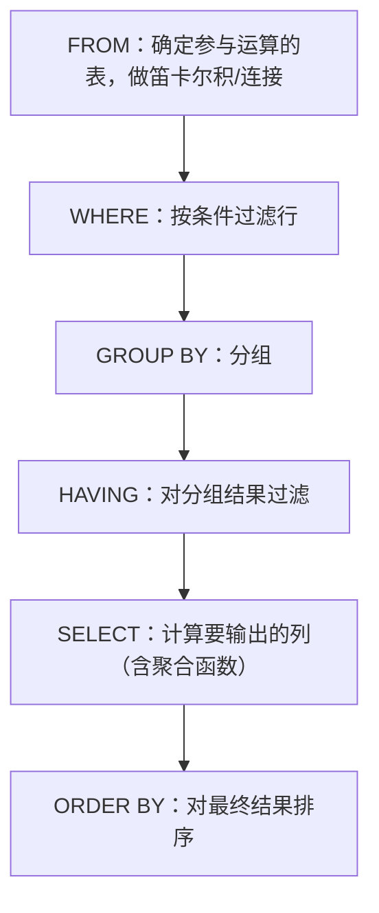

> [!SUMMARY]+ Table of Contents

  - [[Ch3 Intro to Sql#1 SQL 概述与历史|1 SQL 概述与历史]]
  - [[Ch3 Intro to Sql#2 数据定义语言（DDL）|2 数据定义语言（DDL）]]
    - [[Ch3 Intro to Sql#2.1 SQL 的组成部分|2.1 SQL 的组成部分]]
    - [[Ch3 Intro to Sql#2.2 域类型（Domain Types）|2.2 域类型（Domain Types）]]
    - [[Ch3 Intro to Sql#2.3 CREATE TABLE 语句|2.3 CREATE TABLE 语句]]
    - [[Ch3 Intro to Sql#2.4 完整性约束 Integrity Constraints|2.4 完整性约束 Integrity Constraints]]
    - [[Ch3 Intro to Sql#2.5 表的修改与删除（ALTER / DROP / INSERT / DELETE 概览）|2.5 表的修改与删除（ALTER / DROP / INSERT / DELETE 概览）]]
  - [[Ch3 Intro to Sql#3 基本查询结构（SELECT-FROM-WHERE）|3 基本查询结构（SELECT-FROM-WHERE）]]
    - [[Ch3 Intro to Sql#3.1 SQL 查询的骨架|3.1 SQL 查询的骨架]]
    - [[Ch3 Intro to Sql#3.2 SELECT 子句详解|3.2 SELECT 子句详解]]
    - [[Ch3 Intro to Sql#3.3 WHERE 子句详解|3.3 WHERE 子句详解]]
    - [[Ch3 Intro to Sql#3.4 FROM 子句与笛卡尔积|3.4 FROM 子句与笛卡尔积]]
    - [[Ch3 Intro to Sql#3.5 重命名操作 AS 与自连接|3.5 重命名操作 AS 与自连接]]
    - [[Ch3 Intro to Sql#3.6 字符串匹配 LIKE|3.6 字符串匹配 LIKE]]
    - [[Ch3 Intro to Sql#3.7 结果排序 ORDER BY|3.7 结果排序 ORDER BY]]
    - [[Ch3 Intro to Sql#3.8 BETWEEN 与元组比较|3.8 BETWEEN 与元组比较]]
  - [[Ch3 Intro to Sql#4 集合运算（UNION INTERSECT EXCEPT）|4 集合运算（UNION INTERSECT EXCEPT）]]
  - [[Ch3 Intro to Sql#5 空值 NULL 与三值逻辑|5 空值 NULL 与三值逻辑]]
  - [[Ch3 Intro to Sql#6 聚合函数与分组（GROUP BY HAVING）|6 聚合函数与分组（GROUP BY HAVING）]]
    - [[Ch3 Intro to Sql#聚合函数|聚合函数]]
    - [[Ch3 Intro to Sql#GROUP BY 分组|GROUP BY 分组]]
    - [[Ch3 Intro to Sql#HAVING 子句|HAVING 子句]]
  - [[Ch3 Intro to Sql#7 嵌套子查询|7 嵌套子查询]]
    - [[Ch3 Intro to Sql#7.1 集合成员关系 IN / NOT IN|7.1 集合成员关系 IN / NOT IN]]
    - [[Ch3 Intro to Sql#7.2 集合比较 SOME / ALL|7.2 集合比较 SOME / ALL]]
    - [[Ch3 Intro to Sql#7.3 空关系测试 EXISTS / NOT EXISTS|7.3 空关系测试 EXISTS / NOT EXISTS]]
    - [[Ch3 Intro to Sql#7.4 重复元组测试 UNIQUE|7.4 重复元组测试 UNIQUE]]
    - [[Ch3 Intro to Sql#7.5 FROM 子句中的子查询|7.5 FROM 子句中的子查询]]
    - [[Ch3 Intro to Sql#7.6 WITH 子句（公共表表达式）|7.6 WITH 子句（公共表表达式）]]
    - [[Ch3 Intro to Sql#7.7 标量子查询|7.7 标量子查询]]
  - [[Ch3 Intro to Sql#8 数据库修改（INSERT DELETE UPDATE）|8 数据库修改（INSERT DELETE UPDATE）]]
    - [[Ch3 Intro to Sql#删除（DELETE）|删除（DELETE）]]
    - [[Ch3 Intro to Sql#插入（INSERT）|插入（INSERT）]]
    - [[Ch3 Intro to Sql#修改（UPDATE）|修改（UPDATE）]]
  - [[Ch3 Intro to Sql#9 本章重难点与易错点汇总|9 本章重难点与易错点汇总]]
  - [[Ch3 Intro to Sql#10 综合例题（难度偏高）|10 综合例题（难度偏高）]]

## 1 SQL 概述与历史

**通俗理解**：SQL（Structured Query Language，结构化查询语言）是我们和关系数据库“对话”的标准语言——不管底层是 MySQL、PostgreSQL 还是 Oracle，写法基本相同。它最早由 IBM 在 System R 项目中提出（原名 Sequel），后来经 ANSI/ISO 标准化，形成了 SQL-86、SQL-89、SQL-92、SQL:1999、SQL:2003 等一系列标准版本。

**严谨说明**：SQL 并不是一个单一功能的语言，而是一组语言的集合，通常包含以下几个部分：

|组成部分|作用|
|---|---|
|**DML**（Data Manipulation Language，数据操纵语言）|查询（query）以及对元组的插入（insert）、删除（delete）、修改（update）|
|**DDL**（Data Definition Language，数据定义语言）|定义关系模式（schema）、完整性约束（integrity constraints）、视图（view）|
|**事务控制（Transaction control）**|定义事务的开始与结束（commit / rollback）|
|**嵌入式 SQL 与动态 SQL**|定义如何把 SQL 语句嵌入通用编程语言（如 C、Java）中|
|**授权（Authorization）**|定义对关系和视图的访问权限|

> [!tip] 易错点 很多初学者把 SQL 等同于“查询语言”，只记住了 DML 里的 `SELECT`。但完整性约束、视图定义、权限控制也是 SQL 标准的一部分，考试中常常会单独考查 DDL 的语法细节（例如外键约束怎么写）。

---

## 2 数据定义语言（DDL）

### 2.1 SQL 的组成部分

DDL 主要负责描述一张关系表（table）的“骨架”信息，包括：

- 每个关系的模式（schema，即列名和类型）
- 每个属性对应值的数据类型（domain type）
- 完整性约束（integrity constraints）
- 需要维护的索引集合（index）
- 每个关系的安全性和权限信息
- 每个关系在磁盘上的物理存储结构

**通俗理解**：可以把 DDL 想象成“盖房子的图纸”——它规定了房间（表）叫什么名字、每个房间能放什么类型的东西（数据类型）、哪些房间之间有门相连（外键），但还没有往里面放家具（数据）。真正“放家具”的操作属于 DML。

### 2.2 域类型（Domain Types）

|类型|含义|
|---|---|
|`char(n)`|定长字符串，长度固定为 n，不足会用空格补齐|
|`varchar(n)`|变长字符串，最大长度为 n|
|`int`|整数（机器相关的有限整数子集）|
|`smallint`|小整数|
|`numeric(p,d)`|定点数，共 p 位有效数字，其中小数点后有 d 位。例如 `numeric(3,1)` 可以精确存储 44.5，但不能存 444.5（超过总位数）或 0.32（小数位超过 1 位）|
|`real, double precision`|浮点数与双精度浮点数（机器相关精度）|
|`float(n)`|浮点数，精度至少为 n 位|

> [!warning] 易错点：char 与 varchar 的区别 `char(n)` 是**定长**的，如果实际字符串比 n 短，会自动用空格填充到长度 n；比较时某些系统会忽略末尾空格差异。`varchar(n)` 是**变长**的，只占用实际字符串所需的空间，n 只是上限。这个区别在做字符串比较、`LIKE` 匹配、拼接（`||`）时容易踩坑（比如 `char` 字段拼接时会带着多余的空格）。

> [!warning] 易错点：numeric(p, d) 的含义 p 是**总有效数字位数**，d 是**小数点后位数**，整数部分位数 = p − d。`numeric(3,1)` 表示总共 3 位数字、小数点后 1 位，即整数部分最多 2 位。这是选择题、填空题的常考点。

### 2.3 CREATE TABLE 语句

**语法骨架**：

```sql
create table r
    (A1 D1, A2 D2, ..., An Dn,
     (integrity-constraint1),
     ...,
     (integrity-constraintk));
```

- `r`：关系（表）的名字
- 每个 `Ai`：关系 r 模式中的一个属性名
- 每个 `Di`：属性 `Ai` 对应的数据类型（domain）

**例子**：

```sql
create table instructor (
    ID          char(5),
    name        varchar(20),
    dept_name   varchar(20),
    salary      numeric(8,2));
```

### 2.4 完整性约束 Integrity Constraints

SQL 会阻止任何违反完整性约束的更新操作。`create table` 中常见的完整性约束有三类：

1. **primary key (A1, ..., An)**：主键约束。被声明为主键的属性组合**自动具有 NOT NULL 属性**，且必须唯一标识每一行
2. **foreign key (Am, ..., An) references r**：外键约束，要求这些属性的取值必须存在于关系 r 的主键（或候选键）中，用来维护参照完整性（referential integrity）
3. **not null**：非空约束，禁止该属性取空值

**完整例子**：

```sql
create table instructor (
    ID          char(5),
    name        varchar(20) not null,
    dept_name   varchar(20),
    salary      numeric(8,2),
    primary key (ID),
    foreign key (dept_name) references department);

create table student (
    ID          varchar(5),
    name        varchar(20) not null,
    dept_name   varchar(20),
    tot_cred    numeric(3,0),
    primary key (ID),
    foreign key (dept_name) references department);

create table takes (
    ID          varchar(5),
    course_id   varchar(8),
    sec_id      varchar(8),
    semester    varchar(6),
    year        numeric(4,0),
    grade       varchar(2),
    primary key (ID, course_id, sec_id, semester, year),
    foreign key (ID) references student,
    foreign key (course_id, sec_id, semester, year) references section);

create table course (
    course_id   varchar(8),
    title       varchar(50),
    dept_name   varchar(20),
    credits     numeric(2,0),
    primary key (course_id),
    foreign key (dept_name) references department);
```

> [!danger] 重难点：外键与参照完整性 `foreign key (dept_name) references department` 的含义是：`instructor.dept_name` 中出现的每一个值，都必须能在 `department` 表的主键（或候选键）列中找到对应值（或者取 NULL，除非同时加了 `not null`）。这意味着：
> 
> - **先建被引用的表，再建引用它的表**（比如必须先有 `department` 才能建 `instructor`）。
> - 删除被引用表中的行、或修改主键值时，如果有其他表在引用它，操作会被拒绝（除非定义了级联操作 `on delete cascade` 等，本章 PPT 未展开）。
> - 复合外键（多列联合外键，如 `takes` 表引用 `section`）要求几列**作为一个整体**去匹配，而不是逐列单独匹配。

### 2.5 表的修改与删除（ALTER / DROP / INSERT / DELETE 概览）

|操作|语法|说明|
|---|---|---|
|插入|`insert into instructor values ('10211', 'Smith', 'Biology', 66000);`|按列顺序插入一整行|
|删除全部元组|`delete from student`|**只删数据，不删表结构**，表还在|
|删除表|`drop table r`|**连表结构一起删除**，之后这张表完全不存在|
|增加列|`alter table r add A D`|给关系 r 增加属性 A，类型为 D；已有的所有元组该列自动填为 `null`|
|删除列|`alter table r drop A`|删除属性 A；**很多数据库系统并不支持**此操作|

> [!warning] 易错点：`delete from student` vs `drop table student` 这是非常经典的混淆点：
> 
> - `delete from student`：表结构（schema、约束、索引）**保留**，只是把所有行清空，之后还能继续 `insert`。
> - `drop table student`：**表本身消失**，包括结构和约束，之后如果想用必须重新 `create table`。

---

## 3 基本查询结构（SELECT-FROM-WHERE）

### 3.1 SQL 查询的骨架

一个典型 SQL 查询的形式是：

```sql
select A1, A2, ..., An
from   r1, r2, ..., rm
where  P;
```

- `Ai`：属性（可以是表达式、常量、聚合函数等）
- `ri`：关系（表），可以是基本表、也可以是另一个子查询
- `P`：谓词（条件表达式）

**与关系代数的对应关系（重要！）**：

- `select` 子句 ↔ 关系代数的 **投影（π，Projection）**
- `where` 子句 ↔ 关系代数的 **选择（σ，Selection）**
- `from` 子句 ↔ 关系代数的 **笛卡尔积（×，Cartesian Product）**

**SQL 查询逻辑执行顺序（极其重要的易错点）**：SQL 语句是**先写 SELECT，后写 FROM/WHERE**，但**真正的逻辑执行顺序恰恰相反**——数据库不是从上往下按书写顺序执行的！逻辑执行顺序为：



> [!danger] 重难点：为什么执行顺序很重要？
> 
> 1. `where` 子句中**不能直接使用聚合函数**的别名（因为执行 `where` 时还没有计算 `select` 中的聚合），必须用 `having`。
> 2. `where` 子句在分组之前生效，用来过滤原始行；`having` 子句在分组之后生效，用来过滤分组结果——这是本章后面 [[#6 聚合函数与分组（GROUP BY HAVING）]] 部分的核心区别。
> 3. `select` 子句里定义的列别名（如 `salary/12 as monthly_salary`），理论上在 `where` 中不能直接使用（虽然某些数据库做了扩展支持），因为 `where` 执行时该别名还没有被计算出来。

### 3.2 SELECT 子句详解

**投影功能**：

```sql
select name
from instructor;
```

**去重 DISTINCT / 保留重复 ALL**：SQL 默认**允许结果中出现重复行**（这一点与关系代数中“关系是集合”的假设不同！）

```sql
-- 去重
select distinct dept_name
from instructor;

-- 显式保留重复（这是默认行为，ALL 可以省略）
select all dept_name
from instructor;
```

> [!warning] 易错点：SQL 关系允许重复元组 数学意义上的“关系（relation）”是集合，不允许重复元素；但 SQL 表中的行**默认允许重复**，`select` 的结果也默认不去重。这是 SQL 与关系代数理论的一个重要差异，写查询时必须显式加 `distinct` 才能得到严格集合语义的结果，否则统计个数（`count`）等聚合运算很容易被重复行误导。

**常量列**：

```sql
select '437';              -- 结果：1 列 1 行，值为 "437"
select '437' as FOO;       -- 给这一列取名 FOO

select 'A'
from instructor;           -- 结果：1 列 N 行（N = instructor 表行数），每行值都是 "A"
```

**算术表达式**：`select` 子句可以包含涉及 `+`、`-`、`*`、`/` 的算术表达式，作用在常量或元组属性上：

```sql
select ID, name, salary/12 as monthly_salary
from instructor;
```

### 3.3 WHERE 子句详解

**选择功能**：对应关系代数的选择运算 σ。

```sql
select name
from instructor
where dept_name = 'Comp. Sci.';
```

SQL 支持逻辑连接词 `and`、`or`、`not`，操作数可以是使用比较运算符 `<, <=, >, >=, =, <>` 的表达式，比较对象也可以是算术表达式的结果：

```sql
select name
from instructor
where dept_name = 'Comp. Sci.' and salary > 80000;
```

### 3.4 FROM 子句与笛卡尔积

`from` 子句列出查询涉及的关系，对应关系代数的**笛卡尔积**：

```sql
select *
from instructor, teaches;
```

这会生成 `instructor` 和 `teaches` 之间**所有可能的行对组合**（笛卡尔积），行数 = |instructor| × |teaches|。对于两表中**同名**的属性（如 `ID`），结果表中会用“关系名.属性名”的方式区分（如 `instructor.ID`、`teaches.ID`）。

> [!danger] 重难点：笛卡尔积单独使用意义不大，必须配合 WHERE 笛卡尔积本身会产生大量**无意义的行组合**（比如把不相关的老师和课程记录强行配对）。真正有用的做法是配合 `where` 条件做"等值连接"，把两表中意义相关的行匹配起来：

```sql
-- 找出所有教过课的老师姓名及其对应课程号
select name, course_id
from instructor, teaches
where instructor.ID = teaches.ID;

-- 加上部门限制
select name, course_id
from instructor, teaches
where instructor.ID = teaches.ID and instructor.dept_name = 'Art';
```

> [!warning] 易错点：忘记写连接条件 初学者最容易犯的错误就是 `from t1, t2` 之后忘了在 `where` 里写 `t1.key = t2.key`，导致结果是笛卡尔积（行数暴增且大部分无意义），而不是预期的连接结果。**每次写多表 FROM 子句，都要问自己：连接条件写了吗？**

### 3.5 重命名操作 AS 与自连接

SQL 允许使用 `as` 子句给关系和属性重命名：`旧名 as 新名`，且 `as` 关键字**可以省略**（`instructor as T` ≡ `instructor T`）

```sql
-- 找出工资比某个 Comp. Sci. 系老师工资高的所有老师姓名
select distinct T.name
from instructor as T, instructor as S
where T.salary > S.salary and S.dept_name = 'Comp. Sci.';
```

> [!danger] 重难点：自连接（Self Join） 当需要在**同一张表内部**比较不同行的数据时（例如“比某人工资高的其他人”“某人的上级”），必须给同一张表取**两个不同的别名**，把它当成两张逻辑上独立的表来处理。示例关系 `emp-super(person, supervisor)`：
> 
> |person|supervisor|
> |---|---|
> |Bob|Alice|
> |Mary|Susan|
> |Alice|David|
> |David|Mary|
> 
> 找 Bob 的上级：`select supervisor from emp_super where person = 'Bob'` → Alice 找 Bob 上级的上级：需要自连接一次：
> 
> ```sql
> select S2.supervisor
> from emp_super as S1, emp_super as S2
> where S1.person = 'Bob' and S1.supervisor = S2.person;
> ```
> 
> **但是**——如果要找出 Bob **所有**（直接 + 间接）的上级，固定层数的自连接是做不到的，因为上级链条的长度是不确定的（可能是任意长度）。这需要**递归查询**（SQL:1999 引入的 `with recursive`），普通的有限次自连接无法表达"传递闭包"这种问题，这是本章需要特别注意的能力边界。

### 3.6 字符串匹配 LIKE

SQL 使用 `like` 运算符做模式匹配，两个特殊字符：

- `%`：匹配**任意长度**（包括 0 个字符）的子串
- `_`：匹配**恰好一个**字符

```sql
-- 找名字中包含子串 "dar" 的老师
select name
from instructor
where name like '%dar%';
```

匹配示例（务必记牢）：

|模式|含义|
|---|---|
|`'Intro%'`|以 "Intro" 开头的任意字符串|
|`'%Comp%'`|包含 "Comp" 子串的任意字符串|
|`'___'`（3 个下划线）|**恰好** 3 个字符的字符串|
|`'___%'`|**至少** 3 个字符的字符串|

如果要匹配的字符串本身包含 `%` 或 `_`，需要用 `escape` 声明转义字符：

```sql
-- 匹配字符串 "100%"
like '100 \%' escape '\';
```

> [!warning] 易错点
> 
> 1. 模式匹配**区分大小写**（case sensitive）。
> 2. `_` 是匹配"恰好一个字符"，很多人误以为和 `%` 一样可以匹配任意长度——这是选择题常考的陷阱。
> 3. 别忘了 SQL 还支持字符串拼接 `||`、大小写转换、求长度、取子串等操作，但匹配运算符本身只有 `like`（以及部分数据库支持的正则）。

### 3.7 结果排序 ORDER BY

```sql
select distinct name
from instructor
order by name;                    -- 默认升序 asc

select distinct name
from instructor
order by name desc;               -- 降序

select distinct name
from instructor
order by dept_name, name;         -- 先按 dept_name 排，dept_name 相同再按 name 排
```

> [!tip] `order by` 是整个查询逻辑执行顺序中的**最后一步**（在 select 计算完毕之后），因此可以对 select 子句中定义的别名进行排序。

### 3.8 BETWEEN 与元组比较

```sql
-- between 是闭区间：>= 90000 且 <= 100000
select name
from instructor
where salary between 90000 and 100000;

-- 元组比较：把多个属性打包成一个元组一起比较
select name, course_id
from instructor, teaches
where (instructor.ID, dept_name) = (teaches.ID, 'Biology');
```

> [!tip] 易错点 `between A and B` 是**闭区间**（包含两端点），等价于 `>= A and <= B`，不要误记成开区间。元组比较 `(a, b) = (c, d)` 要求**所有分量同时相等**，等价于 `a = c and b = d`，但写法更紧凑，是"行值表达式（row value expression）"的用法。

---

## 4 集合运算（UNION INTERSECT EXCEPT）

SQL 提供 `union`（并集）、`intersect`（交集）、`except`（差集，等价于关系代数中的 −）三种集合运算，作用在**两个子查询的结果**之间

```sql
-- 2017 秋季 或 2018 春季 开设过的课程
(select course_id from section where sem = 'Fall'   and year = 2017)
union
(select course_id from section where sem = 'Spring' and year = 2018);

-- 2017 秋季 和 2018 春季 都开设过的课程
(select course_id from section where sem = 'Fall'   and year = 2017)
intersect
(select course_id from section where sem = 'Spring' and year = 2018);

-- 2017 秋季开设过，但 2018 春季没开设的课程
(select course_id from section where sem = 'Fall'   and year = 2017)
except
(select course_id from section where sem = 'Spring' and year = 2018);
```

> [!danger] 重难点：默认自动去重 vs `... all` 保留重复 `union`、`intersect`、`except` **默认都会自动消除结果中的重复元组**——这一点和 `select` 默认**不**去重恰恰相反，非常容易搞混！如果想保留重复（按重数运算），要显式加 `all`：
> 
> |运算|语义（对多重集 bag）|
> |---|---|
> |`union all`|两边重数**相加**|
> |`intersect all`|两边重数取**较小值**|
> |`except all`|左边重数减去右边重数，**结果不小于 0**|
> 
> 举例：若 A 中某元素出现 3 次，B 中出现 2 次，则 `A intersect all B` 中该元素出现 `min(3,2)=2` 次，`A except all B` 中出现 `3-2=1` 次，而 `A union all B` 中出现 `3+2=5` 次。

---

## 5 空值 NULL 与三值逻辑

**通俗理解**：`null` 表示"未知"或者"该值不存在"，它既不是 0，也不是空字符串，而是一种特殊的标记。任何和 `null` 相关的运算，几乎都会"传染"成 `null` 或 `unknown`

**严谨定义与规则**：

1. **算术运算**：任何算术表达式中只要有一个操作数是 `null`，结果就是 `null`。例：`5 + null = null`。
2. **比较运算**：`null` 参与的比较（`=`、`<>`、`<` 等）结果既不是 `true` 也不是 `false`，而是第三种值 **`unknown`**。例：`5 < null`、`null = null`、`null <> null` 结果都是 `unknown`（**注意：`null = null` 的结果是 `unknown`，不是 `true`！**）。
3. **专用谓词**：判断是否为空必须使用 `is null` / `is not null`，不能用 `= null`：

```sql
select name
from instructor
where salary is null;
```

**三值逻辑真值表（重难点，务必记住）**：

|AND|true|false|unknown|
|---|---|---|---|
|**true**|true|false|unknown|
|**false**|false|false|false|
|**unknown**|unknown|false|unknown|

|OR|true|false|unknown|
|---|---|---|---|
|**true**|true|true|true|
|**false**|true|false|unknown|
|**unknown**|true|unknown|unknown|

**最终规则**：`where` 子句的谓词如果计算结果是 `unknown`，该行会被**当作 false 处理**（即被过滤掉，不出现在结果中）。

> [!danger] 重难点 & 易错点：NOT IN 与 NULL 的"隐形地雷" 这是 SQL 中最经典的陷阱之一：
> 
> ```sql
> select name from instructor where dept_name not in ('Biology', null);
> ```
> 
> 由于子查询/列表里出现了 `null`，`dept_name not in (...)` 会被展开为 `dept_name <> 'Biology' and dept_name <> null and ...`， 而 `dept_name <> null` 的结果永远是 `unknown`，根据上面的 AND 真值表，只要有一项是 `unknown` 且没有 `false`，整个表达式就是 `unknown`（会被当 false）。 **后果：只要 IN 列表（或子查询结果）里混入了一个 NULL，整个 `not in` 查询会返回空结果集！** 这是笔试、面试中极高频的考点，一定要留意子查询是否可能产生 NULL 值。 相对地，`in` 运算不受此影响：`(= some)` 语义下 NULL 只是让某一项判断变成 unknown，不会波及其它 true 的判断。

---

## 6 聚合函数与分组（GROUP BY HAVING）

### 聚合函数

聚合函数作用于关系某一列的**多重集**（multiset，即允许重复的集合），返回单个值：

|函数|含义|
|---|---|
|`avg`|平均值（**默认忽略 NULL**）|
|`min`|最小值|
|`max`|最大值|
|`sum`|求和|
|`count`|计数|

```sql
-- 计算机系老师平均工资
select avg (salary)
from instructor
where dept_name = 'Comp. Sci.';

-- 2018 春季学期教课的老师人数（去重）
select count (distinct ID)
from teaches
where semester = 'Spring' and year = 2018;

-- course 表的总行数
select count (*)
from course;
```

> [!warning] 易错点：`count(*)` vs `count(列名)` vs `count(distinct 列名)`
> 
> - `count(*)`：统计**所有行数**，包含 NULL 行，也不去重。
> - `count(列名)`：只统计该列**非 NULL** 的行数。
> - `count(distinct 列名)`：先对该列去重，再统计非 NULL 的不同取值个数。 三者结果往往不同，做统计题时要看清楚题目问的到底是"总行数"还是"某列不同取值数"。

### GROUP BY 分组

```sql
-- 按系统计每个系的平均工资
select dept_name, avg (salary) as avg_salary
from instructor
group by dept_name;
```

**分组的执行逻辑**：先按 `group by` 后面的属性把行划分为若干个组（同一组内该属性取值相同），然后对**每个组分别**计算聚合函数

> [!danger] 重难点：SELECT 列表必须遵守"分组约束" `select` 子句中，凡是**没有被聚合函数包裹**的属性，必须出现在 `group by` 列表中，否则是错误查询：
> 
> ```sql
> /* 错误查询！ID 既没被聚合，也没出现在 group by 里 */
> select dept_name, ID, avg (salary)
> from instructor
> group by dept_name;
> ```
> 
> **原因**：分组之后，每一组对应结果表中的**一行**，但一个组里可能有多个不同的 `ID`（比如某系有多个老师），"一行对应多个 ID 值"是没有良定义（well-defined）的，所以数据库直接拒绝这种写法。

### HAVING 子句

```sql
-- 找出平均工资 > 42000 的系
select dept_name, avg (salary) as avg_salary
from instructor
group by dept_name
having avg (salary) > 42000;
```

> [!danger] 重难点：WHERE 与 HAVING 的本质区别（超高频考点）
> 
> ||作用对象|执行时机|能否使用聚合函数|
> |---|---|---|---|
> |`where`|单个原始行|**分组之前**|❌ 不能（此时聚合值还没算出来）|
> |`having`|一个分组（组内所有行的聚合结果）|**分组之后**|✅ 可以（也是 having 的主要用途）|
> 
> 简单口诀：**"where 挑行，having 挑组"**。如果一个条件涉及聚合函数（如 `avg(salary) > 42000`），必须写在 `having` 里；如果只是对单行原始数据做过滤（如 `dept_name = 'Comp. Sci.'`），既可以（也应该优先）写在 `where` 里——放在 where 里可以在分组之前就把无关行过滤掉，效率更高。

---

## 7 嵌套子查询

**通俗理解**：子查询（subquery）就是"查询里面套查询"——一个 `select-from-where` 表达式可以出现在另一个查询的 `from`、`where` 甚至 `select` 子句中，用于表达"先算出一个中间结果，再基于它继续查"这种逻辑

### 7.1 集合成员关系 IN / NOT IN

```sql
-- 2017 秋季 且 2018 春季 也开设过的课程（用 IN 改写交集查询）
select distinct course_id
from section
where semester = 'Fall' and year = 2017 and
      course_id in (select course_id
                     from section
                     where semester = 'Spring' and year = 2018);

-- 2017 秋季开过、2018 春季没开过的课程（用 NOT IN 改写差集查询）
select distinct course_id
from section
where semester = 'Fall' and year = 2017 and
      course_id not in (select course_id
                         from section
                         where semester = 'Spring' and year = 2018);

-- 姓名既不是 Mozart 也不是 Einstein 的老师
select distinct name
from instructor
where name not in ('Mozart', 'Einstein');
```

> [!warning] 再次强调：`not in` 遇到子查询结果含 NULL 时会"全军覆没"，务必回看 [[#5 空值 NULL 与三值逻辑]] 中的重难点说明。

### 7.2 集合比较 SOME / ALL

**`some`（存在语义）**：`F <comp> some r` 当且仅当 r 中**存在**某个元组 t，使得 `F <comp> t` 成立。

```sql
-- 工资比 Biology 系"至少一名"老师高
select name
from instructor
where salary > some (select salary
                      from instructor
                      where dept_name = 'Biology');
```

`some` 比较真值表举例（设集合为 {0, 5, 6}）：

|表达式|结果|说明|
|---|---|---|
|`5 < some {0,5,6}`|true|因为 5 < 6|
|`5 < some {0,5}`|false|集合中没有比 5 大的元素|
|`5 = some {0,5}`|true|集合中有 5|
|`5 <> some {0,5}`|true|因为 5 ≠ 0|

**重要恒等式**：`(= some) ≡ in`，但 **`(<> some) ≢ not in`**（千万不要混淆！）。

**`all`（全称语义）**：`F <comp> all r` 当且仅当对 r 中**所有**元组 t，`F <comp> t` 都成立。

```sql
-- 工资比 Biology 系"所有"老师都高
select name
from instructor
where salary > all (select salary
                     from instructor
                     where dept_name = 'Biology');
```

`all` 比较真值表举例（设集合为 {0, 5, 6}）：

|表达式|结果|说明|
|---|---|---|
|`5 < all {0,5,6}`|false|5 不小于 0、5|
|`5 < all {6,10}`|true|5 比集合中所有元素都小|
|`5 = all {4,5}`|false|5 ≠ 4|
|`5 <> all {4,6}`|true|5 与所有元素都不相等|

**重要恒等式**：`(<> all) ≡ not in`，但 **`(= all) ≢ in`**（同样是易混淆点，与上面 some 的情形正好"对称反过来"）

> [!danger] 重难点：four 对易混淆恒等式（考试高频陷阱）
> 
> |写法|是否等价于|
> |---|---|
> |`= some`|**等价于** `in`|
> |`<> some`|**不等价于** `not in`|
> |`= all`|**不等价于** `in`|
> |`<> all`|**等价于** `not in`|
> |记忆技巧：`some` 是"存在"，`all` 是"任意"；`in` 本质是"存在一个相等"，所以只跟 `= some` 等价；`not in` 本质是"对所有都不相等"，所以只跟 `<> all` 等价。另外两个组合（`<> some`、`= all`）语义完全不同，不能划等号。||

### 7.3 空关系测试 EXISTS / NOT EXISTS

`exists r ⇔ r ≠ ∅`（子查询非空则为真），`not exists r ⇔ r = ∅`（子查询为空则为真）。

```sql
-- 用相关子查询（correlated subquery）改写"2017秋 且 2018春"都开的课程
select course_id
from section as S
where semester = 'Fall' and year = 2017 and
      exists (select *
              from section as T
              where semester = 'Spring' and year = 2018
                    and S.course_id = T.course_id);
```

> [!info] 概念辨析：相关子查询（correlated subquery） 上面例子中，内层子查询的 `where` 条件里出现了外层的变量 `S.course_id`——内层查询"依赖"外层查询当前正在处理的那一行，这种子查询叫**相关子查询**，外层用来提供上下文的变量（这里是 `S`）叫**关联名（correlation name）**。相关子查询的直觉执行方式是：**对外层的每一行，都重新执行一次内层查询**（虽然真实数据库引擎会做优化，但逻辑语义就是这样理解）。这与之前的"非相关子查询"（子查询可以独立执行，不依赖外层）形成对比。

**用 NOT EXISTS 实现"全称量词"/集合包含关系（重要技巧）**：

```sql
-- 找出选修了 Biology 系"所有"课程的学生
select distinct S.ID, S.name
from student as S
where not exists ( (select course_id
                     from course
                     where dept_name = 'Biology')
                    except
                    (select T.course_id
                     from takes as T
                     where S.ID = T.ID));
```

> [!danger] 重难点：为什么这道题不能用 `= all` 系列改写？ 这里问的是"集合包含"关系：{Biology 系全部课程} ⊆ {该学生选修的课程}，数学上等价于 `X - Y = ∅ ⇔ X ⊆ Y`（X 是 Biology 课程集合，Y 是该学生选课集合）。这是**集合层面**的包含关系，而不是"某个值和一堆值逐一比较"的问题，`= all` / `some` 只能处理**单个标量值**与一个集合的比较，**无法**表达"一个集合是另一个集合的子集"。所以这种"选修了所有课程/满足所有条件"的题型，标准解法就是：**`except` 求差集 + `not exists` 判断差集是否为空**，这是一个必须记住的固定套路（模板）。

### 7.4 重复元组测试 UNIQUE

`unique` 判断子查询结果中**是否不存在重复元组**，为真表示无重复：

```sql
-- 找出 2017 年最多开设过一次（0 次或 1 次）的课程
select T.course_id
from course as T
where unique ( select R.course_id
               from section as R
               where T.course_id = R.course_id
                     and R.year = 2017);
```

> [!tip] `unique` 用得相对较少，但要理解它测试的是"结果集内部有没有重复行"，而不是"结果集是否非空"（那是 `exists` 的职责），二者不要混淆。

### 7.5 FROM 子句中的子查询

SQL 允许把子查询的结果当作一张"临时表"放到 `from` 子句中使用：

```sql
-- 找出平均工资 > 42000 的系（用 FROM 子查询改写，无需 having）
select dept_name, avg_salary
from ( select dept_name, avg (salary) as avg_salary
       from instructor
       group by dept_name)
where avg_salary > 42000;

-- 也可以在子查询外面统一给结果表和列取别名
select dept_name, avg_salary
from ( select dept_name, avg (salary)
       from instructor
       group by dept_name)
     as dept_avg (dept_name, avg_salary)
where avg_salary > 42000;
```

> [!tip] 与 HAVING 的关系 这个例子说明：`having avg(salary) > 42000` 的效果，完全可以用"先在子查询里分组聚合，再在外层 where 里过滤"来等价实现。二者是解决同一类问题（对聚合结果做条件过滤）的两种不同写法，FROM 子查询写法更灵活（比如可以对聚合结果再做多次连接），而 HAVING 写法更简洁。

### 7.6 WITH 子句（公共表表达式）

`with` 子句用来定义一个**临时命名的关系**，其定义只在当前这条 SQL 语句范围内有效（类似给复杂查询"起草稿变量"）：

```sql
-- 找出预算最高的系
with max_budget (value) as
    (select max(budget) from department)
select department.name
from department, max_budget
where department.budget = max_budget.value;
```

**多个 WITH 定义可以级联使用**：

```sql
-- 找出总工资高于"各系总工资平均值"的系
with dept_total (dept_name, value) as
        (select dept_name, sum(salary)
         from instructor
         group by dept_name),
     dept_total_avg(value) as
        (select avg(value)
         from dept_total)
select dept_name
from dept_total, dept_total_avg
where dept_total.value > dept_total_avg.value;
```

> [!tip] WITH 子句 vs FROM 子查询 `with` 的优势在于：（1）可读性更好，把复杂查询拆成有名字的"步骤"；（2）同一个临时关系可以在后续多处**重复引用**（如上例 `dept_total` 被用了两次），而 `from` 子查询如果要复用同一个子查询，往往需要把子查询文本复制多份。

### 7.7 标量子查询

**概念**：标量子查询（scalar subquery）指的是用在**需要单个值**的地方（如 select 列表中）的子查询，只允许返回**恰好一行一列**。

```sql
select dept_name,
       ( select count(*)
         from instructor
         where department.dept_name = instructor.dept_name)
       as num_instructors
from department;
```

> [!danger] 易错点：标量子查询的行数没有静态保证 编译期数据库并不能保证子查询一定只返回一行——**如果运行时该子查询返回了多于一行的结果，会直接产生运行时错误（runtime error）**。写标量子查询时，必须从逻辑上确保子查询的结果天然是"单值"的（比如用了聚合函数、或者按主键精确过滤），否则程序运行到某些数据时才会报错，这种 bug 很隐蔽。

---

## 8 数据库修改modification

SQL 对数据库的修改分为三类：删除元组（delete）、插入新元组（insert）、修改已有元组的值（update）

### 删除（DELETE）

```sql
-- 删除某系所有老师的元组
delete from instructor
where dept_name = 'Finance';

-- 用嵌套子查询：删除位于 Watson 楼的系的所有老师
delete from instructor
where dept_name in (select dept_name
                     from department
                     where building = 'Watson');
```

> [!danger] 重难点：DELETE 语句中带聚合子查询时的"两阶段语义"
> 
> ```sql
> -- 删除所有工资低于平均工资的老师
> delete from instructor
> where salary < (select avg (salary) from instructor);
> ```
> 
> 这里有一个隐藏的陷阱：**随着老师被删除，`avg(salary)` 这个平均值本身也在不断变化**——如果按"边算边删、动态刷新平均值"的方式理解，结果会变得不确定（比如删掉最低工资的人后，平均值上升，原本"合格"没被删的人现在又低于新平均值了，是否要继续删？）。 **SQL 采用的标准语义是"两阶段"**：
> 
> 1. **第一阶段**：先用**修改之前**的 `instructor` 表完整计算出 `avg(salary)`，并一次性确定所有满足条件（待删除）的元组；
> 2. **第二阶段**：再统一删除这些元组（不会重新计算 avg，也不会重新检验条件）。 这条规则同样适用于 UPDATE 语句中带聚合子查询的情形，是理解"批量修改语义"的关键，也是笔试中常考的概念题。

### 插入（INSERT）

```sql
insert into course
values ('CS-437', 'Database Systems', 'Comp. Sci.', 4);

-- 等价写法：显式列出列名（更安全，不依赖列的物理顺序）
insert into course (course_id, title, dept_name, credits)
values ('CS-437', 'Database Systems', 'Comp. Sci.', 4);

-- 某列显式插入 NULL
insert into student
values ('3003', 'Green', 'Finance', null);

-- 用 select 子查询批量插入
insert into instructor
select ID, name, dept_name, 18000
from student
where dept_name = 'Music' and total_cred > 144;
```

> [!danger] 重难点：`insert ... select` 的"先查完再插"语义
> 
> ```sql
> insert into table1 select * from table1;   -- 危险写法示例
> ```
> 
> 如果数据库"边查边插"，`table1` 会被不断读取到刚插入的新行，导致**无限循环插入**！所以 SQL 规定：`select-from-where` 子句必须**完全求值完毕**（在一个快照上算出全部结果集）之后，才会把结果**一次性**插入目标表，插入过程不会影响到还在进行中的查询过程。这与上面 DELETE 的"两阶段语义"是同一个设计思想的延伸：**先固定好"要处理哪些数据"，再执行修改动作**，避免修改过程和数据读取过程互相干扰。

### 修改（UPDATE）

```sql
-- 给所有老师涨薪 5%
update instructor
set salary = salary * 1.05;

-- 只给工资低于 70000 的老师涨薪 5%
update instructor
set salary = salary * 1.05
where salary < 70000;

-- 给工资低于平均值的老师涨薪 5%（同样遵循"两阶段"语义）
update instructor
set salary = salary * 1.05
where salary < (select avg (salary) from instructor);
```

**条件更新的两种写法**：给工资 > 100000 的涨 3%，其余涨 5%。

```sql
-- 写法一：两条 update 语句——顺序很重要！
update instructor
set salary = salary * 1.03
where salary > 100000;

update instructor
set salary = salary * 1.05
where salary <= 100000;
```

> [!warning] 易错点：两条 UPDATE 语句的执行顺序陷阱 上面写法一如果**顺序颠倒**（先执行涨 5% 那条），会导致有些原本 95000~100000/1.05 之间的工资涨到 100000 以上后，**又被第一条语句在“下一次批量操作”中重复处理**吗？——不会，因为这是两条**独立的语句**，第二条执行时基于的是第一条执行完之后的最新数据，如果顺序反了：先给 ≤100000 的涨 5%，本来 98000 的涨到 102900，此时它已经超过 100000，但因为**第一条 update 语句只在自己那一次运行时判断一次 where 条件**，所以不会被"追加"处理到第一条语句的 3% 规则里——但这依然容易造成边界值判断混乱（例如题目想表达的临界点语义可能与你两条语句的相对顺序产生的实际效果不一致）。**更安全、语义更清晰的写法是用 CASE 语句一次性完成**：

```sql
-- 写法二：CASE 语句，逻辑更清晰，避免顺序陷阱
update instructor
set salary = case
                when salary <= 100000 then salary * 1.05
                else salary * 1.03
             end;
```

**用标量子查询批量更新（含 NULL 处理技巧）**：

```sql
-- 重新计算并更新所有学生的 tot_cred（不及格或未评分的课程不计学分）
update student S
set tot_cred = (select sum(credits)
                 from takes, course
                 where takes.course_id = course.course_id and
                       S.ID = takes.ID and
                       takes.grade <> 'F' and
                       takes.grade is not null);
```

> [!warning] 易错点：`sum` 遇到"空结果集"会返回 NULL 而不是 0 如果某个学生一门课都没选（子查询结果为空集），`sum(credits)` 的结果是 `null`，而**不是** 0——这会把该学生原本可能已有的学分意外地更新成 `null`！如果希望"没选课的学生学分记为 0"，需要用 `case` 显式处理：
> 
> ```sql
> case
>     when sum(credits) is not null then sum(credits)
>     else 0
> end
> ```
> 
> 这体现了聚合函数在"空分组/空集合"上的通用规则：**除了 `count(*)` 恒返回 0 之外，`sum/avg/max/min` 在空集合上都返回 NULL**，务必牢记，这是聚合函数在边界情况下最容易出错的地方。

---

## 9 本章重难点与易错点汇总

| #   | 易错点                                                | 一句话记忆                                                       |
| --- | -------------------------------------------------- | ----------------------------------------------------------- |
| 1   | SQL 逻辑执行顺序                                         | FROM → WHERE → GROUP BY → HAVING → SELECT → ORDER BY，不是书写顺序 |
| 2   | `select` 默认不去重，`union/intersect/except` 默认自动去重     | 方向正好相反，用 `distinct`/`all` 显式控制                              |
| 3   | `char(n)` 定长补空格，`varchar(n)` 变长                    | 影响字符串比较与拼接结果                                                |
| 4   | `not in` 遇到 NULL 全盘失效                              | 子查询结果里混入 NULL，`not in` 直接返回空集                               |
| 5   | `null = null` 结果是 `unknown`，不是 `true`              | 判空只能用 `is null`                                             |
| 6   | `where` 挑行，`having` 挑组                             | where 不能用聚合函数，having 可以                                     |
| 7   | select 列表中非聚合列必须出现在 group by 中                     | 否则"一行对应多值"无良定义                                              |
| 8   | `(=some)≡in`，`(<>all)≡not in`，但反过来的两个组合不成立         | 死记这四条等价/不等价关系                                               |
| 9   | "选修了所有课程"类问题 → `except` + `not exists` 模板          | `all`/`some` 处理不了"集合包含"关系                                   |
| 10  | DELETE/UPDATE 若带聚合子查询，是"先算完整体再统一修改"的两阶段语义          | 不会用"修改中"的数据反复重算                                             |
| 11  | `insert into t select * from t` 不会死循环              | select 结果先完全求值，再一次性插入                                       |
| 12  | `sum/avg/max/min` 在空集合上返回 NULL（`count(*)` 除外，返回 0） | 用 `case` 处理"无数据"的默认值                                        |
| 13  | 固定次数自连接无法求"传递闭包"（如全部上级链）                           | 需要递归查询 `with recursive`                                     |
| 14  | 标量子查询运行时可能因返回多行而报错                                 | 需从逻辑上确保结果唯一                                                 |

---

## 10 综合例题（难度偏高）

> 以下例题基于本章出现过的关系模式： `instructor(ID, name, dept_name, salary)` `department(dept_name, building, budget)` `course(course_id, title, dept_name, credits)` `section(course_id, sec_id, semester, year, building, room_number, time_slot_id)` `teaches(ID, course_id, sec_id, semester, year)` `student(ID, name, dept_name, tot_cred)` `takes(ID, course_id, sec_id, semester, year, grade)`

**例题 1（考察 HAVING + 子查询嵌套）** 找出"该系老师人数超过 3 人"且"该系平均工资高于全校平均工资"的系名。

<details> <summary>参考解答</summary>

```sql
select dept_name
from instructor
group by dept_name
having count(*) > 3
   and avg(salary) > (select avg(salary) from instructor);
```

**易错提醒**：子查询 `(select avg(salary) from instructor)` 是对**全表**求平均，**没有** `group by`，因此它是一个**非相关的标量子查询**，在整个外层查询中只会被计算一次，不会随外层的分组变化而变化——不要误以为它会"对每个分组分别计算全校平均"。

</details>

**例题 2（考察 NOT IN 陷阱 + 正确改写）** 找出"没有教过 2018 年春季学期任何课程"的老师姓名。假设 `teaches.ID` 字段可能存在因历史脏数据导致的 `NULL`。

<details> <summary>参考解答</summary>

```sql
-- 错误写法（存在 NULL 陷阱）：
select name
from instructor
where ID not in (select ID
                  from teaches
                  where semester = 'Spring' and year = 2018);
-- 如果 teaches.ID 中存在 NULL，上面这条语句会返回空结果集！

-- 正确写法一：用 NOT EXISTS 规避 NULL 问题
select name
from instructor as I
where not exists (select *
                   from teaches as T
                   where T.ID = I.ID
                         and T.semester = 'Spring' and T.year = 2018);

-- 正确写法二：先过滤掉子查询里的 NULL 再用 NOT IN
select name
from instructor
where ID not in (select ID
                  from teaches
                  where semester = 'Spring' and year = 2018
                        and ID is not null);
```

**关键点**：`not exists` 天然不受 NULL 干扰（因为它判断的是"是否存在匹配行"，而不是"逐一做不等比较"），因此在不确定子查询结果是否含 NULL 时，**优先使用 `not exists` 而不是 `not in`** 是更稳妥的工程实践。

</details>

**例题 3（考察 ALL/SOME 语义 + 集合包含问题的正确建模）** 分别写出以下两个语义不同的查询，并说明区别： (a) 找出工资比"Biology 系每一位老师"都高的老师姓名； (b) 找出"教过 Biology 系开设的每一门课程"的老师 ID。

<details> <summary>参考解答</summary>

(a) 属于"标量值 vs 集合"的比较，用 `> all` 即可：

```sql
select name
from instructor
where salary > all (select salary
                     from instructor
                     where dept_name = 'Biology');
```

(b) 属于"集合包含"问题（{Biology 系全部课程} ⊆ {该老师教过的课程}），`all`/`some` 处理不了，必须用 `except + not exists` 模板：

```sql
select distinct T.ID
from teaches as T
where not exists (
    (select course_id from course where dept_name = 'Biology')
    except
    (select course_id from teaches as T2 where T2.ID = T.ID)
);
```

**辨析**：(a) 比较的对象是**一个具体数值**（某老师的工资）和**一组数值**；(b) 比较的对象是**两个集合**之间的包含关系。这正是本章"重难点 9"反复强调的能力边界——识别题目问的到底是"标量 vs 集合"还是"集合 vs 集合"，决定了该用 `some/all` 还是 `except + not exists`。

</details>

**例题 4（考察 DELETE 的两阶段语义 + WITH 子句）** 用 `with` 子句改写：删除所有"所在系的预算低于全校系预算平均值"的系里的老师记录，并说明为什么这个删除操作是安全的（不会出现"删除过程中标准不断变化"的问题）。

 <summary>参考解答</summary>

```sql
with dept_avg_budget (value) as
    (select avg(budget) from department)
delete from instructor
where dept_name in (
    select dept_name
    from department, dept_avg_budget
    where department.budget < dept_avg_budget.value);
```

**安全性说明**：根据 [[#8 数据库修改（INSERT DELETE UPDATE）]] 中讲到的"两阶段语义"，`delete` 语句会**先在修改开始之前，一次性计算好** `dept_avg_budget` 以及所有满足条件、待删除的老师元组集合，然后才统一执行删除。由于本例中 `dept_avg_budget` 依赖的是 `department` 表（预算数据），而删除动作发生在 `instructor` 表上，两者本身就是独立的表，即便不考虑"两阶段语义"，删除 `instructor` 的行为也不会影响 `department.budget`，所以这个删除天然是"标准不会因删除过程而变化"的，逻辑上是安全、确定的。


**例题 5（考察 UPDATE 中聚合函数对 NULL 的处理，细节题）** 以下语句执行后，哪些学生的 `tot_cred` 会被设为 `0`？哪些会被设为 `null`？请说明原因。

```sql
update student S
set tot_cred = (select sum(credits)
                 from takes, course
                 where takes.course_id = course.course_id
                       and S.ID = takes.ID
                       and takes.grade <> 'F'
                       and takes.grade is not null);
```

 <summary>参考解答</summary>

- 情形一：学生**从未选修过任何课程**（`takes` 中没有该学生的任何记录）——子查询的 `from takes, course where ...` 直接**没有匹配的行**参与聚合，`sum(credits)` 在**空输入集合**上的结果是 `null`，因此该学生的 `tot_cred` 会被更新为 `null`。
- 情形二：学生选修过课程，但**全部**都是 `'F'`（挂科）或者 `grade is null`（未评分）——这些记录会被 `where` 条件 `takes.grade <> 'F' and takes.grade is not null` 全部过滤掉，子查询结果同样是**空集合**，`sum` 依旧返回 `null`，**不是** 0。
- **只有当学生至少有一门课程满足"非 F 且已评分"时**，`sum(credits)` 才会返回一个**具体的数值**（大于 0 的数）。

**结论**：本例中不存在任何一种情况会让 `tot_cred` 被自然地设为 `0`——因为 `sum` 在空集合上只会返回 `null`，不会返回 `0`。如果业务上希望"没有有效选课记录的学生学分记为 0"，必须显式加 `case when sum(credits) is not null then sum(credits) else 0 end`，这正是 [[#8 数据库修改（INSERT DELETE UPDATE）]] 一节中提到的易错点 12 的实际应用。


> [!success] 学习建议
> 
> 1. 反复练习"逻辑执行顺序图"（第 3.1 节的 mermaid 图），凡是遇到 SQL 报错或结果不对，先按这个顺序在脑内"模拟执行"一遍。
> 2. 遇到"某属性 IN/NOT IN 一个子查询"的题目，第一反应先检查子查询结果是否可能包含 NULL。
> 3. 遇到"选修/满足所有/全部……"类描述，第一反应判断这是"标量 vs 集合"还是"集合 vs 集合"问题，后者优先想到 `except + not exists` 模板。
> 4. DELETE/UPDATE 只要看到 where 条件里嵌了聚合子查询，就要立刻想到"两阶段语义"，避免把它当成"逐行动态重算"来理解。