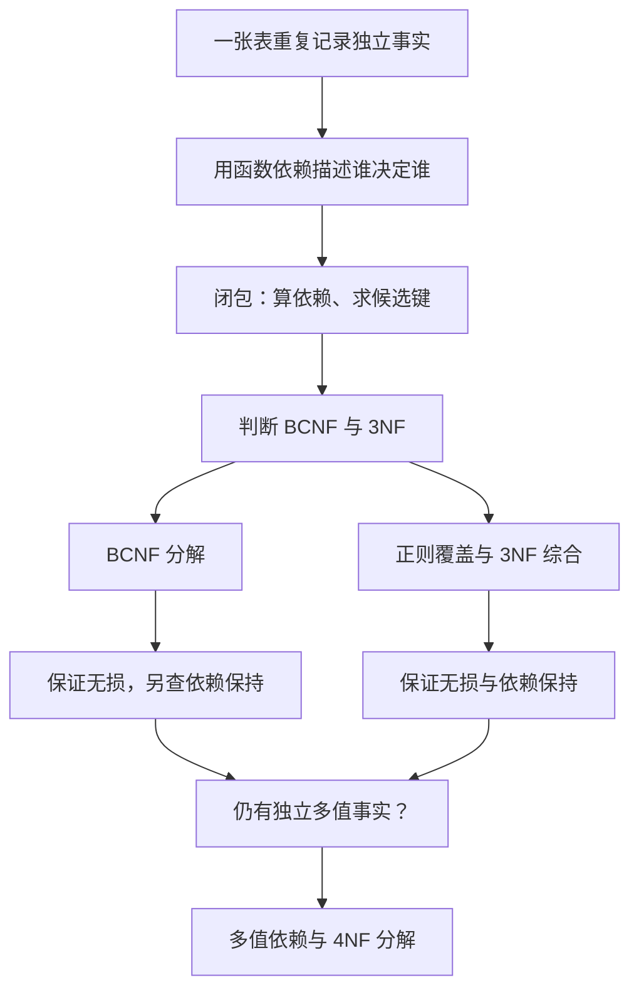

---
tags:
  - 数据库原理
  - 规范化
  - 函数依赖
  - 课程笔记
课程: 数据库原理
章节: 第 7 章 规范化（Normalization）
教材:
---

> [!info] 本章定位
> 第 6 章回答“怎样把现实业务画成 E-R 图并转换为表”，本章接着问：**这些表会不会反复记录同一事实？如果拆开，怎样保证既能拼回去，又不丢掉业务规则？** 全章抓住四条主线：① 用函数依赖描述“谁决定谁”；② 用闭包计算键与隐含依赖；③ 用无损连接、依赖保持检查分解是否正确，再用 BCNF、3NF 选择分解目标；④ 若冗余来自独立的多值事实，就进一步使用多值依赖和 4NF。

> [!info]- 材料与记号
> 来源为 `ch7.pptx` 全部 101 页，页码按幻灯片顺序计。课件例子与补充解释分别注明；正文重排为“问题 → 依赖与闭包 → 分解性质 → 范式 → 算法 → 设计实践”。理论默认集合语义、不含 NULL，$\pi$ 表示去重投影，$\bowtie$ 表示自然连接；$AB$ 表示属性集 $\{A,B\}$，不是属性值相乘。课件 P95–P99 的证明及 P100–P101 的 1NF 均包含在内。

## 目录

- [[#1. 为什么要规范化：先看一张坏表|1. 为什么要规范化：先看一张坏表]]
	- [[#1.1 同一张表里，混进了两种事实|1.1 同一张表里，混进了两种事实]]
	- [[#1.2 冗余为什么会带来更新、插入和删除异常|1.2 冗余为什么会带来更新、插入和删除异常]]
	- [[#1.3 合并不一定坏，分解也不一定好|1.3 合并不一定坏，分解也不一定好]]
- [[#2. 函数依赖：把业务规则写成确定关系|2. 函数依赖：把业务规则写成确定关系]]
	- [[#2.1 先读懂箭头：左边相同，右边必须相同|2.1 先读懂箭头：左边相同，右边必须相同]]
	- [[#2.2 数据碰巧满足，不等于业务规定必须满足|2.2 数据碰巧满足，不等于业务规定必须满足]]
	- [[#2.3 平凡依赖：哪些箭头没有新增信息|2.3 平凡依赖：哪些箭头没有新增信息]]
	- [[#2.4 超键、候选键、主键与主属性|2.4 超键、候选键、主键与主属性]]
- [[#3. 依赖推理与属性闭包：怎样把箭头算清楚|3. 依赖推理与属性闭包：怎样把箭头算清楚]]
	- [[#3.1 Armstrong 公理及推导规则|3.1 Armstrong 公理及推导规则]]
	- [[#3.2 属性闭包算法及候选键求法|3.2 属性闭包算法及候选键求法]]
- [[#4. 分解是否正确：无损连接与依赖保持|4. 分解是否正确：无损连接与依赖保持]]
	- [[#4.1 无损连接与伪元组|4.1 无损连接与伪元组]]
	- [[#4.2 二元分解的无损判据|4.2 二元分解的无损判据]]
	- [[#4.3 依赖保持的定义与反例|4.3 依赖保持的定义与反例]]
- [[#5. BCNF 与 3NF：什么样的表才算规范|5. BCNF 与 3NF：什么样的表才算规范]]
	- [[#5.1 BCNF 的定义与分解规则|5.1 BCNF 的定义与分解规则]]
	- [[#5.2 3NF 的放宽条件|5.2 3NF 的放宽条件]]
	- [[#5.3 两种范式的取舍与局限|5.3 两种范式的取舍与局限]]
- [[#6. 正则覆盖：分解前先精简依赖|6. 正则覆盖：分解前先精简依赖]]
	- [[#6.1 为什么需要一组等价而精简的规则|6.1 为什么需要一组等价而精简的规则]]
	- [[#6.2 无关属性：左侧少条件，右侧少结论|6.2 无关属性：左侧少条件，右侧少结论]]
	- [[#6.3 正则覆盖的完整计算|6.3 正则覆盖的完整计算]]
- [[#7. 检验算法：把定义变成可执行的步骤|7. 检验算法：把定义变成可执行的步骤]]
	- [[#7.1 依赖保持的多项式检验|7.1 依赖保持的多项式检验]]
	- [[#7.2 原模式与子模式的 BCNF 检验|7.2 原模式与子模式的 BCNF 检验]]
	- [[#7.3 3NF 检验的条件与复杂性|7.3 3NF 检验的条件与复杂性]]
- [[#8. BCNF 分解：找到违例，拆出独立事实|8. BCNF 分解：找到违例，拆出独立事实]]
	- [[#8.1 算法、终止性与保证|8.1 算法、终止性与保证]]
	- [[#8.2 class 模式的完整分解|8.2 class 模式的完整分解]]
- [[#9. 3NF 综合：同时保住无损与依赖|9. 3NF 综合：同时保住无损与依赖]]
	- [[#9.1 综合算法与补键步骤|9.1 综合算法与补键步骤]]
	- [[#9.2 银行客户模式的完整分解|9.2 银行客户模式的完整分解]]
	- [[#9.3 依赖保持与无损性的证明|9.3 依赖保持与无损性的证明]]
	- [[#9.4 每个子模式满足 3NF 的证明|9.4 每个子模式满足 3NF 的证明]]
- [[#10. 多值依赖与 4NF：BCNF 为什么还不够|10. 多值依赖与 4NF：BCNF 为什么还不够]]
	- [[#10.1 独立多值事实与元组交换|10.1 独立多值事实与元组交换]]
	- [[#10.2 多值依赖的性质、闭包与限制|10.2 多值依赖的性质、闭包与限制]]
	- [[#10.3 4NF 定义及分解算法|10.3 4NF 定义及分解算法]]
	- [[#10.4 六属性模式的 4NF 分解|10.4 六属性模式的 4NF 分解]]
- [[#11. 更高范式与设计实践|11. 更高范式与设计实践]]
	- [[#11.1 第一范式：一个单元格到底算一个什么值|11.1 第一范式：一个单元格到底算一个什么值]]
	- [[#11.2 更高范式与整体设计流程|11.2 更高范式与整体设计流程]]
	- [[#11.3 反规范化及范式未覆盖的问题|11.3 反规范化及范式未覆盖的问题]]
	- [[#11.4 时态数据与快照约束|11.4 时态数据与快照约束]]
- [[#12. 例题|12. 例题]]
	- [[#12.1 当前实例能证明什么|12.1 当前实例能证明什么]]
	- [[#12.2 无损与依赖保持分别判断|12.2 无损与依赖保持分别判断]]
	- [[#12.3 候选键、主属性与 3NF|12.3 候选键、主属性与 3NF]]
	- [[#12.4 闭包与正则覆盖的计算|12.4 闭包与正则覆盖的计算]]
	- [[#12.5 子模式中隐藏的依赖|12.5 子模式中隐藏的依赖]]
	- [[#12.6 为什么 3NF 综合需要补键|12.6 为什么 3NF 综合需要补键]]
	- [[#12.7 多值依赖的合法性与 4NF|12.7 多值依赖的合法性与 4NF]]
	- [[#12.8 时态版本与外键语义|12.8 时态版本与外键语义]]
	- [[#12.9 候选键为什么不一定一样长|12.9 候选键为什么不一定一样长]]
	- [[#12.10 局部检查可以跨子表接力|12.10 局部检查可以跨子表接力]]
	- [[#12.11 属性已全部覆盖，为什么仍然要补键|12.11 属性已全部覆盖，为什么仍然要补键]]
	- [[#12.12 多值依赖的右侧为什么不能随意拆分|12.12 多值依赖的右侧为什么不能随意拆分]]
- [[#13. 易错点速查|13. 易错点速查]]
- [[#14. 知识点速查|14. 知识点速查]]

---

## 1. 为什么要规范化：先看一张坏表

### 1.1 同一张表里，混进了两种事实

**通俗理解**：如果把“教师是谁”和“院系在哪里、预算多少”全记在一张表里，每增加一位教师，就得把他的院系信息抄一遍。麻烦不在于两个单元格碰巧相等，而在于**同一个院系事实被迫跟着每位教师重复存储**。

**课件例子**（P4，以下选取其中两行）：

| ID | name | salary | dept_name | building | budget |
|---|---|---|---|---|---|
| 22222 | Einstein | 95000 | Physics | Watson | 70000 |
| 33456 | Gold | 87000 | Physics | Watson | 70000 |

这两行实际上同时表达：

1. 教师 22222 叫 Einstein，工资 95000，属于 Physics。
2. 教师 33456 叫 Gold，工资 87000，也属于 Physics。
3. **Physics 的楼宇是 Watson，预算是 70000。**

前两个是两位教师各自的事实；第三个却是同一个院系事实，只是因为院系有两位教师，被重复写了两次。若有 100 位教师，就要写 100 次。

**严谨说明**：课件把这种合并模式记为：

```text
in_dep(ID, name, salary, dept_name, building, budget)
```

其中存在两类确定关系：`ID` 决定教师信息，而 `dept_name` 决定院系信息。后面将把这种“由哪些属性能确定哪些属性”的规则形式化为**函数依赖**。本章就是从这种规则出发，判断哪些事实应该分开保存。

### 1.2 冗余为什么会带来更新、插入和删除异常

**通俗理解**：重复抄写最直接的问题，是同一件事有了多份副本；更深的问题，是本来应该能独立保存的院系信息，非得依附在某个教师身上才能出现。

**三种异常**（根据课件 P4 的冗余与空值问题补充分类）：

| 异常 | 对上表做什么操作 | 为什么出问题 |
|---|---|---|
| 更新异常 | Physics 的预算从 70000 改为 80000 | 必须修改全部 Physics 行；只改一行就出现同院系两个预算 |
| 插入异常 | 新建一个还没有教师的院系 | 院系事实已经确定，却找不到一个教师 ID 来组成完整行 |
| 删除异常 | 删除 Physics 最后一位教师 | 教师信息被删除的同时，唯一剩下的院系楼宇和预算也消失了 |

把表分开后，教师表保存每位教师，院系表保存每个院系：

```text
instructor(ID, name, salary, dept_name)
department(dept_name, building, budget)
```

Physics 的预算只在 `department` 中保存一次；院系没有教师时也能存在。需要教师和院系的完整信息时，再按 `dept_name` 连接。

> [!important] 本章的起点
> **分开保存不同层次的事实，让每种事实有合适的归属。** 不是看到相同值就拆表，也不是表越多越好；要根据业务约束判断哪些重复来自结构本身。

### 1.3 合并不一定坏，分解也不一定好

**通俗理解**：把两张表合起来，未必会增加重复；把一张表拆开，也未必能拼回去。规范化不能只凭“这张表看着太大”，而需要能验证的标准。

课件 P5 给出合并 `sec_class(sec_id, building, room_number)` 与 `section(course_id, sec_id, semester, year)` 的例子：在该例设定下，合并没有引出前述重复信息，用来说明**并非所有合并都有问题**。该例的标识符和约束按课件设定理解；不能仅凭属性名称，就推断实际开课系统中的 `sec_id` 在所有课程、学期中唯一。

反过来，P6–P7 把员工表按姓名拆开，遇到同名员工就会重组出错误配对。第 4 节会用具体表格解释这个问题。

**规范化的三项目标**（P10、P32）：

| 目标 | 要回答的问题 | 后面如何处理 |
|---|---|---|
| 子表具有良好形式 | 哪种依赖造成不应有的冗余？ | 用 BCNF、3NF、4NF 判定 |
| 无损连接 | 拆开的事实能否准确还原？ | 检查公共属性与无损判据 |
| 尽量保持依赖 | 原业务规则能否在子表中检查？ | 检查依赖投影与局部推导 |

**阅读顺序**：先学会描述和计算依赖，再研究分解，最后讨论范式。这样“为什么这个决定因素必须是超键”“为什么还要保留候选键”等要求才有来由。

---

## 2. 函数依赖：把业务规则写成确定关系

### 2.1 先读懂箭头：左边相同，右边必须相同

**通俗理解**：`dept_name → building` 的意思是：只要告诉我院系名称，就应该能确定它的楼宇。同一个院系不能一会儿在 Watson、一会儿在 Taylor。不同院系却完全可以在同一栋楼，所以箭头不能倒着读。

**严谨定义**（P11–P13）：设 $R$ 是关系模式，$X,Y\subseteq R$。若每个合法实例 $r(R)$ 中，任意两个元组 $t_1,t_2$ 只要在 $X$ 上取值相同，就必在 $Y$ 上取值相同，则称 **$X$ 函数决定 $Y$**，记为 $X\to Y$：

$$
t_1[X]=t_2[X]\quad\Longrightarrow\quad t_1[Y]=t_2[Y].
$$

| 符号 | 含义 | 对应教师例子 |
|---|---|---|
| $R$ | 全部属性组成的关系模式 | `in_dep` 的六个属性 |
| $r(R)$ | 某一时刻的关系实例 | 当前保存的教师数据 |
| $X$ | 决定因素，可以是一组属性 | `dept_name` |
| $Y$ | 被决定的属性，也可以是一组 | `building, budget` |
| $t[X]$ | 一行在 $X$ 这些列上的取值 | 某行的 Physics |

“合法实例”就是满足业务约束的实例。大学场景中，课件假定 ID 唯一标识教师或学生，每个 ID 对应一个姓名和主要院系，每个院系对应一个楼宇和预算。这些约束决定哪些实例允许出现。

**回到同一张教师表**：

| 依赖 | 是否应当成立 | 原因 |
|---|---|---|
| `ID → name, salary, dept_name` | 是 | ID 标识某位教师 |
| `dept_name → building, budget` | 是 | 这是院系本身的属性 |
| `ID → building` | 是 | 先由 ID 找到院系，再找到楼宇 |
| `dept_name → salary` | 否 | 同院系可以有不同工资的教师 |
| `name → ID` | 不能一般假定 | 教师可能同名 |

> [!warning] 函数决定不等于一一对应
> $X\to Y$ 只禁止“同一个 $X$ 对应不同 $Y$”，不禁止“不同 $X$ 对应同一个 $Y$”。多位教师可以属于同一院系，因此 `ID → dept_name` 不意味着 `dept_name → ID`。

### 2.2 数据碰巧满足，不等于业务规定必须满足

**通俗理解**：今天全班没有重名，不等于学校从此禁止重名。看一张表，只能说当前有没有冲突；设计模式时要问的是，今后每个合法状态都必须遵守什么。

**严格区分**（P12、P16）：

| 判断 | 检查范围 | 能说明什么 |
|---|---|---|
| 当前实例 $r$ 满足 $X\to Y$ | 当前数据中的任意两行 | 现在没有反例 |
| $X\to Y$ 在模式 $R$ 上成立 | 所有合法实例 | 这是必须维护的规则 |

**判断实例的方法**：按左侧属性分组，查看每组的右侧是否只有一种取值（不考虑重复元组，因为这里是集合语义）。

| A | B |
|---|---|
| 1 | 4 |
| 1 | 5 |
| 3 | 7 |

同一个 $A=1$ 对应 $B=4,5$，故该实例不满足 $A\to B$；三个 $B$ 各有唯一的 $A$，故当前满足 $B\to A$。但若业务允许以后出现 $(2,4)$，就不能把 $B\to A$ 当成模式约束。

**关键区别**：找到一个合法反例，可以否定某条模式依赖；只看到有限数据没有反例，不能证明模式依赖。后面的范式判定以给定业务依赖及其逻辑后果为依据。

### 2.3 平凡依赖：哪些箭头没有新增信息

**通俗理解**：知道“学号和姓名”，当然知道“学号”。这种箭头没有表达新的业务规律，任何表都自动满足，所以检查冗余时不应该把它当成问题。

**严谨定义**（P17）：$X\to Y$ 为**平凡依赖**，当且仅当 $Y\subseteq X$；否则非平凡。

| 依赖 | 判断 | 真正新增的属性 |
|---|---|---|
| $AB\to A$ | 平凡 | 无 |
| $A\to A$ | 平凡 | 无 |
| $AB\to BC$ | 非平凡 | 只有 $C$；$B$ 本来就在左边 |
| $A\to BC$ | 非平凡 | $B,C$ |

以后看到“非平凡右侧”，具体就是 $Y-X$。为了讨论方便，常把右侧已有的左侧属性先去掉。

### 2.4 超键、候选键、主键与主属性

**通俗理解**：函数依赖只需要确定“某些列”；键要更强，必须确定**整行**。给一个键再加无关列，仍能找到同一行，但这些多余列不能让它成为新的候选键。

**严谨定义**（P15；主属性术语用于后面的 3NF）：

| 概念 | 定义 | 要抓住的词 |
|---|---|---|
| 超键 $K$ | $K\to R$ | 能确定整行 |
| 候选键 $K$ | 是超键，且任何真子集都不是超键 | **最小**超键 |
| 主键 | 从候选键中选择的一个 | 设计者选定 |
| 主属性 | 属于至少一个候选键的属性 | 看**所有**候选键 |
| 非主属性 | 不属于任何候选键的属性 | 不是只看主键 |

**教师例子**：假定只有 ID 唯一标识教师，则 `ID` 是候选键；`ID, name`、`ID, dept_name` 仍是超键，却不是候选键，因为删掉附加属性仍能确定整行。`dept_name` 能确定院系楼宇和预算，但无法区分同院系教师，所以不是整张 `in_dep` 的超键。

> [!warning] “最小”不是“属性数量最少”
> 候选键要求自身不能再删属性。一个模式可以同时有单属性候选键和双属性候选键；只要双属性键删掉任一属性都不再是超键，它仍是候选键。第 12 节例题会具体计算。

**接下来的问题**：如果依赖很多，怎样知道某组属性到底能推出哪些列？不能每次只靠目测。下一节的闭包就是统一计算工具。

---

## 3. 依赖推理与属性闭包：怎样把箭头算清楚

### 3.1 Armstrong 公理及推导规则

**通俗理解**：题目给出的箭头只是起点。知道“ID 能确定院系”“院系能确定楼宇”，就算没有另外写一条，也已经隐含“ID 能确定楼宇”。**闭包就是把这些隐含规则一起算进去。**

**严谨定义**（P14、P38）：$F$ 是给定的函数依赖集，$F^+$ 是被 $F$ 逻辑蕴含的全部函数依赖，即每个满足 $F$ 的关系也一定满足的依赖。它包括原来的依赖、平凡依赖，以及多步推导得到的依赖。

**为什么需要公理**：不能把看起来顺眼的箭头都算进去。例如 $A\to C$ 和 $B\to C$ 并不能推出 $A\to B$。Armstrong 公理（P39）规定哪些推理合法，且具有：

- **可靠性（soundness）**：按规则推出的依赖，一定由 $F$ 蕴含。
- **完备性（completeness）**：由 $F$ 蕴含的每条 FD，都能通过这些规则推导。

三条基本公理与三条常用派生规则如下：

| 规则 | 形式 | 含义 |
|---|---|---|
| 自反律 | $Y\subseteq X\Rightarrow X\to Y$ | 已有信息可确定其一部分 |
| 增广律 | $X\to Y\Rightarrow XZ\to YZ$ | 两边同时加入同一组属性 |
| 传递律 | $X\to Y,Y\to Z\Rightarrow X\to Z$ | 沿确定关系继续推导 |
| 合并律（派生） | $X\to Y,X\to Z\Rightarrow X\to YZ$ | 相同决定因素可合并右侧 |
| 分解律（派生） | $X\to YZ\Rightarrow X\to Y,X\to Z$ | 右侧可拆开 |
| 伪传递律（派生） | $X\to Y,YZ\to W\Rightarrow XZ\to W$ | 补足下一条依赖的决定因素 |

> [!example]- 补充推导：三条派生规则如何来自公理
> 合并律：由 $X\to Y$ 增广得 $X\to XY$；由 $X\to Z$ 增广 $Y$ 得 $XY\to YZ$；再传递得 $X\to YZ$。
>
> 分解律：$YZ\to Y$ 与 $YZ\to Z$ 均由自反律成立，分别与 $X\to YZ$ 传递。
>
> 伪传递律：对 $X\to Y$ 增广 $Z$ 得 $XZ\to YZ$，再与 $YZ\to W$ 传递。

**课件例子**（P40）：

$$
R=(A,B,C,G,H,I),\qquad
F=\{A\to B,\ A\to C,\ CG\to H,\ CG\to I,\ B\to H\}.
$$

> [!example]- 逐步推导三条隐含依赖
> **① $A\to H$**：由 $A\to B$ 与 $B\to H$，直接用传递律。
>
> **② $AG\to I$**：$CG\to I$ 的左边需要 $C,G$。现在已有 $G$，但只有 $A$ 而没有 $C$。先由 $A\to C$ 增广 $G$ 得 $AG\to CG$，再与 $CG\to I$ 传递。
>
> **③ $CG\to HI$**：分别已知 $CG\to H$ 和 $CG\to I$，用合并律即可。
>
> 第二个推导也说明：$A\to C$ 不意味着 $A\to I$，因为推出 $I$ 还缺少 $G$。

直接求 $F^+$ 可以反复应用公理直到不再增加依赖，但依赖数量可能指数增长，实际判定通常用属性闭包。

### 3.2 属性闭包算法及候选键求法

**通俗理解**：把已经知道的属性放进一个集合；每当某条规则的左侧都已知道，就把它右侧也加入。一直做到无法再扩充，得到的就是这组属性能“顺着箭头找到”的全部属性。

**严谨定义**（P43–P45）：属性集 $X$ 在 $F$ 下的**属性闭包**是：

$$
X_F^+=\{A\in R\mid X\to A\in F^+\}.
$$

| 闭包 | 输入 | 输出 | 适合回答的问题 |
|---|---|---|---|
| $F^+$ | 一组依赖 $F$ | 全部可推出的依赖 | 哪些业务规则已被隐含？ |
| $X_F^+$ | 属性集 $X$ 与依赖集 $F$ | 一组可确定的属性 | 这组属性能确定哪些列？ |

**计算算法**：

```text
result := X
重复：
    对 F 中每条 U → V：
        若 U ⊆ result，则 result := result ∪ V
直到一轮后 result 不再变化
返回 result
```

**课件手算**（P44）：继续用上面的六属性例子，计算 $(AG)^+$。

> [!example]- 从初始集合到稳定集合，一步也不省
> | 步骤 | 当前已有属性 | 使用的依赖 | 新增属性 |
> |---|---|---|---|
> | 初始 | $AG$ | 一开始只知道输入属性 | 无 |
> | 1 | $ABG$ | $A\to B$ | $B$ |
> | 2 | $ABCG$ | $A\to C$ | $C$ |
> | 3 | $ABCGH$ | $CG\to H$，左侧的 $C,G$ 已齐 | $H$ |
> | 4 | $ABCGHI$ | $CG\to I$ | $I$ |
> | 5 | $ABCGHI$ | $B\to H$，但 $H$ 已经有了 | 无 |
>
> 再完整检查一轮，没有新属性，所以 $(AG)^+=ABCGHI=R$，$AG$ 是超键。检查最小性：$A^+=ABCH$，缺少 $G,I$；$G^+=G$，缺少其他属性。因此 $A,G$ 都不能删，$AG$ 是候选键。
>
> 进一步，因为 $A,G$ 都没有出现在原依赖右侧，任何不含它们的集合都不可能把它们推出来。因此每个候选键必须含 $AG$，而 $AG$ 已经够用，故它还是**唯一候选键**。

> [!tip] 为什么必须“重复直到稳定”
> 如果依赖按 $B\to C$、$A\to B$ 的顺序扫描，从 $A$ 出发，第一轮先跳过 $B\to C$，随后才得到 $B$；第二轮才能得到 $C$。只扫一遍会受依赖排列影响，漏掉能推出的属性。P44 超键检验的正确包含方向为 $R\subseteq X_F^+$。

三项用途：

1. 判断 $X\to Y\in F^+$：检验 $Y\subseteq X_F^+$。
2. 判断超键：检验 $R\subseteq X_F^+$；判断候选键再检查最小性。
3. 枚举 $F^+$：遍历 $X\subseteq R$，对每个 $Y\subseteq X_F^+$ 输出 $X\to Y$，但总量可能指数大。

**补充求键方法**：不出现在任何非平凡依赖右侧的属性必须包含在每个候选键中。从这些必含属性出发，增加所需属性直到闭包覆盖 $R$，再逐个尝试删除属性。找一个候选键可通过从 $R$ 开始贪心删除完成；若要找全体候选键，需考虑不同组合，不能把一次贪心得到的键当成全部。

检验某个 $K$ 是否最小，只需对每个 $A\in K$ 检查 $(K-\{A\})^+\ne R$。若某个更小真子集是超键，必有一个删一属性的集合包含它，也会是超键。

## 4. 分解是否正确：无损连接与依赖保持

### 4.1 无损连接与伪元组

**通俗理解**：拆表时只保留若干列，操作本身并不难；难的是拆完后还能知道“原来哪些值属于同一行”。如果把两个同名员工的信息交叉配错，列虽然一列没少，原来的事实却已经丢了。

**先看操作**：把模式 $R$ 拆成属性子集 $R_1,\ldots,R_n$，要求所有子集并起来覆盖 $R$。原实例 $r$ 在每个子模式上的数据，用投影 $\pi_{R_i}(r)$ 得到；想还原时，再对这些投影做自然连接。

**严谨定义**（P6–P9）：若对每个合法实例都有下式，分解称为**无损连接分解**：

$$
r=\mathop{\bowtie}_{i=1}^{n}\pi_{R_i}(r).
$$

直观地说，拆开保存后必须能恰好拼回原来那些事实。投影再自然连接不会丢掉原元组，所以总有 $r\subseteq\bowtie_i\pi_{R_i}(r)$；有损分解的常见表现反而是连接后**多出伪元组（spurious tuples）**。丢掉的是“哪些属性值原本属于同一行”的关联信息。

**课件反例**（P7）：两位员工都叫 Kim，却有不同的 ID、地址与工资。以下缩短展示地址列，配对问题相同。

| ID | name | street | city | salary |
|---|---|---|---|---|
| 57766 | Kim | Main | Perryridge | 75000 |
| 98776 | Kim | North | Hampton | 67000 |

拆成 `employee1(ID, name)` 和 `employee2(name, street, city, salary)` 后：

| employee1.ID | employee1.name |
|---|---|
| 57766 | Kim |
| 98776 | Kim |

| employee2.name | street | city | salary |
|---|---|---|---|
| Kim | Main | Perryridge | 75000 |
| Kim | North | Hampton | 67000 |

> [!example]- 自然连接为何从两行变成四行
> 自然连接只知道公共列 `name`，并不知道哪个 Kim 才是同一个人。
>
> | ID | name | street | city | salary | 是否原事实 |
> |---|---|---|---|---|---|
> | 57766 | Kim | Main | Perryridge | 75000 | 是 |
> | 57766 | Kim | North | Hampton | 67000 | 否，伪元组 |
> | 98776 | Kim | Main | Perryridge | 75000 | 否，伪元组 |
> | 98776 | Kim | North | Hampton | 67000 | 是 |
>
> 丢失的信息是“57766 原来对应 Main，98776 原来对应 North”。公共属性并不能唯一决定任一侧，所以任意交叉配对都能通过连接条件。

P9 的正例中，$r(A,B,C)=\{(\alpha,1,A),(\beta,2,B)\}$ 的 $AB$ 与 $BC$ 投影能精确重连。不过这只能验证该实例；要证明模式分解无损，还需说明相应约束。

> [!warning] 课件公式校正
> P8 有损分解公式尾部误留了“$=r$”。正确关系是 $r\subsetneq\pi_{R_1}(r)\bowtie\pi_{R_2}(r)$，表示对某个合法实例严格多出元组。

### 4.2 二元分解的无损判据

**通俗理解**：两表连接时，公共属性就是配对依据。若公共属性能够唯一确定其中一张表的内容，就不会在这一侧出现两种可以随意替换的取值。教师与院系按院系名连接是安全的，关键就在于院系名能够确定那张院系表。

**严谨判据**（P18–P19）：令 $R=R_1\cup R_2$，$F$ 为原模式上的函数依赖集。若以下至少一条属于 $F^+$，则二元分解无损：

$$
(R_1\cap R_2)\to R_1
\quad\text{或}\quad
(R_1\cap R_2)\to R_2.
$$

直观地说，公共属性必须能唯一确定至少一侧的内容，才能阻止两边随意交叉配对。**仅有公共属性不够**。当所有约束都只是函数依赖时，这也是二元分解无损的必要条件；存在多值依赖等其他约束时，不能机械地当成必要条件。

> [!example]- 补充证明：为什么公共属性决定一侧就足够
> 设 $I=R_1\cap R_2$，并且 $I\to R_1$。任取连接产生的元组 $t$，有原表中的元组 $u,v$，使 $t[R_1]=u[R_1]$、$t[R_2]=v[R_2]$，且 $u[I]=v[I]$。由依赖可得 $u[R_1]=v[R_1]$，因此拼接结果其实就是 $v$ 在全部 $R$ 上的取值，$t=v\in r$。连接不会产生伪元组，而原元组又都能重建，所以相等。

例：$R(A,B,C)$，$F=\{A\to B,B\to C\}$。分解为 $AB,BC$ 时，公共属性 $B$ 决定 $BC$；分解为 $AB,AC$ 时，公共属性 $A$ 决定 $AB$。两种都无损，但它们的依赖保持情况不同。

### 4.3 依赖保持的定义与反例

**通俗理解**：无损性只说明“原来合法的数据拆开后能正确拼回”。但数据库还要不断插入和修改：如果更新后的各张子表看起来都没问题，能否保证拼在一起也遵守原规则？这才是**依赖保持**的问题。

仍用 $R(A,B,C)$、$F=\{A\to B,B\to C\}$：$AB,AC$ 已经知道是无损分解。可是 $B\to C$ 的左、右侧被分开了，更新时只看 $AB$ 不知道 $C$，只看 $AC$ 又不知道 $B$，它就可能成为必须跨表检查的规则。

**严谨定义**（P20–P21、P55–P57）：把原依赖能推出、且只涉及某个子模式属性的依赖收集起来，得到该子模式可局部检查的全部规则。若所有局部规则联合起来仍能推出全部原规则，就称分解保持依赖。

令 $F_i$ 为 $F^+$ 在 $R_i$ 上的 **限制（restriction，也称依赖投影）**：

$$
F_i=\{X\to Y\in F^+\mid X\cup Y\subseteq R_i\}.
$$

若 $(\bigcup_iF_i)^+=F^+$，则分解 **保持依赖（dependency preserving）**。这里必须使用 $F^+$，不能只筛选写在原始 $F$ 中的依赖。也不要求每条原依赖原封不动地落在某张表中：只要能由局部依赖联合推导出来即可。

对上例 $F=\{A\to B,B\to C\}$：

| 分解 | 无损 | 依赖保持 | 原因 |
|---|---|---|---|
| $AB,BC$ | 是 | 是 | 两条依赖都可在子表检查 |
| $AB,AC$ | 是 | 否 | 局部约束只有 $A\to B$、$A\to C$ 等，不能推出 $B\to C$ |

> [!example]- 为什么“无损”与“不保持依赖”可以同时成立
> 假设两张子表更新成以下状态：
>
> | AB.A | AB.B |
> |---|---|
> | $a_1$ | $b$ |
> | $a_2$ | $b$ |
>
> | AC.A | AC.C |
> |---|---|
> | $a_1$ | $c_1$ |
> | $a_2$ | $c_2$ |
>
> 第一张表满足 $A\to B$，第二张表满足 $A\to C$，局部检查都通过。但连接得到 $(a_1,b,c_1)$ 与 $(a_2,b,c_2)$，同一个 $b$ 对应不同的 $C$，违反原约束 $B\to C$。
>
> **没有矛盾**：无损性针对“满足原约束的原表，投影后能否重建”；依赖保持针对“只检查局部约束，能否阻止非法的新状态”。以上子表状态说明后者失败，并不是一个合法原表的反例。

课件另一核心例为 `dept_advisor(s_ID, i_ID, dept_name)`。记学生、教师、院系为 $S,I,D$，依赖为 $I\to D$、$SD\to I$。分解为 $ID,SI$ 后，$I\to D$ 可局部检查；$SD\to I$ 不能由两张表的局部依赖推出。P21、P27 的“任何分解”应理解为这里为了消除 BCNF 违例而进行的适当分解；不拆或保留原表当然仍能检查原依赖。

## 5. BCNF 与 3NF：什么样的表才算规范

### 5.1 BCNF 的定义与分解规则

**通俗理解**：回看教师大表，院系名能决定楼宇和预算，却不能决定哪位教师。于是同一个“院系 → 楼宇、预算”的事实，会随着不同教师反复出现。BCNF 就针对这一结构：**能决定新信息的属性集，应该足以确定整行。**

**严谨定义**（P23–P27）：对每条 $X\to Y\in F^+$，其中 $X,Y\subseteq R$，若至少满足以下一个条件，则 $R$ 满足 **Boyce–Codd 范式（BCNF）**：

1. $Y\subseteq X$，依赖平凡。
2. $X\to R\in F^+$，即 $X$ 是超键。

也就是：**每条非平凡 FD 的左侧都是超键。** 定义针对原依赖及其全部逻辑后果，不只针对题面上显式列出的箭头。

**教师例子的逐条判断**：

| 依赖 | 是否非平凡 | 左侧是否超键 | BCNF 判定 |
|---|---|---|---|
| `ID → name, salary, dept_name` | 是 | 是，可继续推出楼宇和预算 | 通过 |
| `dept_name → building, budget` | 是 | 否，不能确定教师 ID 等属性 | 违例 |

因此原表不满足 BCNF。按第二条依赖，把院系事实移到 `department(dept_name, building, budget)`，原表留下 `instructor(ID, name, salary, dept_name)`。在给定依赖下，前者的 `dept_name` 是键，后者的 `ID` 是键，都不再有非键决定其他属性的 FD 违例。

若 $X\to Y$ 违反 BCNF，通用分解规则为：

$$
R_1=X\cup Y,\qquad R_2=R-(Y-X).
$$

先把右侧与左侧重叠的属性去掉，令 $Y'=Y-X$，也可写成 $R_1=X\cup Y'$、$R_2=R-Y'$。二者公共部分为 $X$，而 $X\to X\cup Y'$，所以该步无损。只拆一步不一定让所有子模式都达到 BCNF，还需继续检验。

### 5.2 3NF 的放宽条件

**先提出问题**：如果把所有非超键依赖都拆掉，能否同时保留原约束的局部检查能力？导师例告诉我们不一定。为了在这一冲突中保住依赖保持，3NF 对 BCNF 作了有限放宽。

**通俗理解**：BCNF 只接受“左边是超键”。3NF 额外允许一种情形：即使左边不是超键，**它确定的新属性若本身属于某个候选键，也可以保留这个依赖**。这种放宽仍可能有冗余，但能支持总是无损且保持依赖的综合算法。

**严谨定义**（P28–P29）：**第三范式（3NF）** 对每条 $X\to Y\in F^+$，要求至少满足以下之一：

1. $Y\subseteq X$，依赖平凡
2. $X$ 是 $R$ 的超键
3. $Y-X$ 中的**每个属性**都是 $R$ 的主属性，即各自属于某个候选键

第三条允许右侧的不同属性属于不同候选键，不要求整个 $Y-X$ 同时属于一个候选键。直观上，这是为保留一些重要的局部约束而接受的有限冗余。

**课件核心例子：一个学生在一个院系选择一位导师**（P21、P27、P29）。

```text
dept_advisor(s_ID, i_ID, dept_name)
```

为方便计算，记 $S=s\_ID$、$I=i\_ID$、$D=dept\_name$。两条规则分别是：

| 依赖 | 业务意思 | 不表示什么 |
|---|---|---|
| $I\to D$ | 每位导师只属于一个院系 | 一个院系只允许一位导师 |
| $SD\to I$ | 每个学生在同一院系至多有一位导师 | 一个学生在所有院系只能有一位导师 |

> [!example]- 从业务规则算到候选键
> $S^+=S$，无法确定导师；$I^+=ID$，无法确定学生；$D^+=D$，无法确定导师和学生。
>
> 从 $SI$ 出发，先用 $I\to D$ 得到 $SID$，所以 $SI$ 是超键，且删掉任何一个属性都不够，故是候选键。
>
> 从 $SD$ 出发，先用 $SD\to I$ 得到 $SID$，同理 $SD$ 也是候选键。
>
> $S$ 不出现在依赖右侧，每个键都必须含 $S$；在它基础上加 $I$ 或 $D$ 就够了。因此全部候选键恰好是 $SI,SD$。三个属性都属于某个候选键，全部为主属性。

$I\to D$ 的左侧不是超键，但 $D$ 是主属性；$SD\to I$ 的左侧是候选键。所以该模式满足 3NF，却不满足 BCNF。不能因为已经选择 $SI$ 为主键，就误认为 $D$ 不是主属性。

**为什么不直接拆成 BCNF 就结束？** 按 $I\to D$ 分成 $ID,SI$ 的确无损，两个子模式也都达到 BCNF；但代价是另一条规则 $SD\to I$ 不能再靠局部约束维护。

> [!example]- 把“不能局部维护”翻译回真实业务
> 导师表 `ID` 保存 $(i_1,Physics)$、$(i_2,Physics)$，满足每位导师只有一个院系；师生表 `SI` 保存 $(s_1,i_1)$、$(s_1,i_2)$，也不违反它自身的投影 FD。
>
> 但两表连接后，同一学生 $s_1$ 在 Physics 同时对应 $i_1,i_2$，违反了“每个学生在一个院系至多选一位导师”。只有跨表查出两个导师同属 Physics，才能发现这次更新违规。
>
> 所以这里的选择是：拆成 BCNF，接受额外的跨表约束检查；或保留 3NF 关系，接受重复院系信息，换取在同一张表里检查 $SD\to I$。3NF 的放宽正是为了让后一种方案成为可能。

### 5.3 两种范式的取舍与局限

课件 P30–P35、P72–P73：

| 性质 | BCNF 分解 | 3NF 综合 |
|---|---|---|
| 总能得到目标范式 | 是 | 是 |
| 总能保证无损连接 | 是 | 是 |
| 总能同时保持全部函数依赖 | 不一定 | 是 |
| 消除非超键决定的函数依赖冗余 | 是 | 可保留主属性相关的冗余 |
| 消除独立多值事实引起的冗余 | 不保证 | 不保证 |

课件的 $R(J,K,L)$、$F=\{JK\to L,L\to K\}$ 满足 3NF，候选键为 $JK,JL$，但多个 $J$ 关联同一个 $L$ 时，会重复记录 $L$ 对应的 $K$；若只想记录 $l_2$ 对应 $k_2$ 而没有 $J$，原表又难以独立表达。

更进一步，`inst_info(ID, child_name, phone)` 可没有任何非平凡函数依赖，因而满足 BCNF。但一个教师有两个孩子、两个电话，且孩子与电话彼此独立时，必须记录四种组合。增加一个电话还需为每个孩子增行。这种冗余需要 4NF 处理。

> [!info] SQL 实现边界
> P73 强调：理论上局部可检查，不等于 SQL 自动提供相应约束声明。`PRIMARY KEY`、`UNIQUE` 适合表达超键；非键决定的函数依赖常需额外设计或检查机制。具体约束语法和断言支持随系统而异，实现时要查对应数据库的说明。

## 6. 正则覆盖：分解前先精简依赖

### 6.1 为什么需要一组等价而精简的规则

**通俗理解**：有些规则已经被其他规则包含，有些箭头左边带了不需要的条件、右边带了能从别处推出的结论。正则覆盖就是把这些多余部分去掉，**让规则更精简，但允许和禁止的数据完全不变**。

例如 $A\to B,B\to C,A\to C$ 中，第三条已经由前两条推出。维护前两条就够了，不必再单独保存一份规则。

**严谨定义**（P46–P54）：$F$ 的**正则覆盖（canonical cover）** $F_c$ 满足：

1. $F_c^+=F^+$，二者逻辑等价。
2. 每条依赖都没有无关属性。
3. 相同左侧合并为一条依赖，左侧不重复。

结果不要求唯一。它减少的是规则表达的冗余，**本身并不分解关系表**；后面 3NF 综合才会依据这些规则生成子表。

### 6.2 无关属性：左侧少条件，右侧少结论

**通俗理解**：$AB\to C$ 说“知道 $A,B$ 才能确定 $C$”。若删掉左侧 $B$，变成“只知道 $A$ 就够”，这是更强的要求，不能随便删。$AB\to CD$ 若删掉右侧 $C$，则少约束了一部分内容，变成更弱的要求；必须确认别的规则还会把这部分补回来。

所谓 **无关属性（extraneous attribute）**，就是从某条依赖的一侧删去后，整个依赖集的闭包仍不改变的属性。左侧删属性会加强依赖，右侧删属性会减弱依赖，两种检查不能混用：

| 位置 | 对 $X\to Y$ 删除属性 $A$ 的测试 |
|---|---|
| $A\in X$ | 在当前 $F$ 下算 $(X-\{A\})^+$，若包含 $Y$，则 $A$ 左侧无关 |
| $A\in Y$ | 先构造 $F'=(F-\{X\to Y\})\cup\{X\to(Y-\{A\})\}$，若 $A\in X_{F'}^+$，则 $A$ 右侧无关 |

右侧测试若仍使用未经修改的原依赖，就会用待删除的结论证明自身，造成循环论证。左侧则可使用当前完整依赖集，因为要检查它是否已蕴含更强的缩短左侧依赖。

课件例子：

- $F=\{AB\to C,A\to D,D\to C\}$：$A^+$ 包含 $C$，故 $AB\to C$ 中 $B$ 左侧无关。
- $F=\{AB\to CD,A\to C\}$：替换为 $AB\to D$ 后，仍由 $A\to C$ 推出 $AB\to C$，故右侧 $C$ 无关。
- $F=\{AB\to CD,A\to E,E\to C\}$：在 $F'=\{AB\to D,A\to E,E\to C\}$ 下，$(AB)^+=ABCDE$，同样说明右侧 $C$ 无关。

> [!warning] 单独看箭头和放回依赖集，答案可能不同
> 只有 $AB\to C$ 时，不能删左侧 $B$。例如 $(a,b_1,c_1)$ 与 $(a,b_2,c_2)$ 可以满足 $AB\to C$，却违反 $A\to C$。
>
> 但如果依赖集还含有 $A\to D,D\to C$，那么只知道 $A$ 已经能间接推出 $C$，这时 $B$ 才真是多余的。“无关”是相对于整个当前依赖集，不是看单条箭头的字面。

### 6.3 正则覆盖的完整计算

计算时反复合并同左侧依赖、删除无关属性，直到稳定；每一步都基于**当前**依赖集重新计算，不能一次性独立标记后全部删除。若右侧变空，删掉该平凡依赖。

**课件完整计算**（P54）：$F=\{A\to BC,B\to C,A\to B,AB\to C\}$。

> [!example]- 正则覆盖：每次删除都说明依据
> **第一步：合并同左侧。** $A\to BC$ 已包含 $A\to B$，保留合并后的 $A\to BC$。当前集合为 $F_1=\{A\to BC,B\to C,AB\to C\}$。
>
> **第二步：删左侧无关属性。** 检查 $AB\to C$ 中 $A$ 是否多余。从 $B$ 出发，在当前集合下，由 $B\to C$ 得 $B^+=BC$，包含右侧 $C$。所以即使没有 $A$，也能确定 $C$；可将 $AB\to C$ 缩成 $B\to C$，与已有依赖合并。当前为 $F_2=\{A\to BC,B\to C\}$。
>
> **第三步：删右侧无关属性。** 检查 $A\to BC$ 中 $C$ 是否多余。先把它临时替换为 $A\to B$，得到 $F'=\{A\to B,B\to C\}$；在这个集合下，$A^+=ABC$ 仍包含 $C$，所以可以删除。
>
> **第四步：复查。** $F_c=\{A\to B,B\to C\}$。再去掉其中任一右侧结论，都会失去原约束；单属性左侧也不能删为空。没有可继续化简的部分。
>
> 最后双向核对：$F$ 能推出 $F_c$；$F_c$ 能推出 $A\to BC$ 和 $AB\to C$，故也能推出原来的全部 $F$。

**补充说明**：一些资料把“右侧均为单属性、左侧无关属性与冗余依赖已删”的集合称为最小覆盖；本课件的正则覆盖还会合并同左侧，术语不宜仅凭名称混用。

## 7. 检验算法：把定义变成可执行的步骤

### 7.1 依赖保持的多项式检验

**通俗理解**：想知道原规则还能不能靠子表维护，可以模拟信息在各张子表之间传递。从依赖左侧出发，每次只加入“某张子表内部能够推出来”的属性；如果最后到不了右侧，说明局部规则不够。

**严谨算法**（P57）：无需显式列举 $F^+$ 和全部 $F_i$。对原集合 $F$ 中每条 $X\to Y$ 分别做下列计算；每条都通过，才是保持依赖。

```text
result := X
重复：
    对每个子模式 Ri：
        local := closure_F(result ∩ Ri) ∩ Ri
        result := result ∪ local
直到一轮后 result 不变
若 Y ⊆ result，则这条依赖被保持
```

其中闭包始终使用原依赖集 $F$，但输入、输出都限制在该子模式内。直观上，这是把当前已知属性交给每张子表，让它通过本地可表达的依赖补充信息，再反复传递。遍历原始 $F$ 的全部依赖都通过，就保持依赖：局部依赖原本都属于 $F^+$，只需反向证明它们能蕴含 $F$。

**把公式拆开看**：$t=(result\cap R_i)_F^+\cap R_i$ 有三步。

| 操作 | 为什么需要 |
|---|---|
| 先取 $result\cap R_i$ | 只把当前已知、且这张子表中有的属性交给它 |
| 再用原 $F$ 求闭包 | 找出这些输入隐含的全部确定关系，包括多步推导 |
| 最后再与 $R_i$ 取交 | 只带走这张子表能局部表达的结果，不能顺便捎走跨表属性 |

> [!example]- 成功例子：局部依赖可以接力，不必全在一张表
> $F=\{A\to B,B\to C\}$，分解为 $AB,BC$。用隐含依赖 $A\to C$ 演示计算：
>
> | 访问的子模式 | 进入前 result | 子表内已知 | 闭包截回子表 | 进入后 result |
> |---|---|---|---|---|
> | $AB$ | $A$ | $A$ | $AB$ | $AB$ |
> | $BC$ | $AB$ | $B$ | $BC$ | $ABC$ |
>
> 最后包含 $C$，所以这条依赖也被保持。$A,C$ 没有同处一张子表，但可用局部 $A\to B$、$B\to C$ 接力推出。这也解释了依赖保持的定义为什么用局部规则的**并集闭包**。

**失败例子**：$AB,AC$ 检查 $B\to C$：从 $B$ 开始，$AB$ 中闭包截回后仍只有 $B$；$AC$ 中输入为空，在本例无空决定因素依赖时也得不到新属性。稳定于 $\{B\}$，不含 $C$，所以失败。不要把 $B_F^+=BC$ 直接整批加入，否则会错误地使用跨表约束。

### 7.2 原模式与子模式的 BCNF 检验

**通俗理解**：检查范式时，不能只看“原题写了哪些箭头”，还得问这些箭头在当前子表上隐含了什么。尤其拆表之后，某条依赖虽然在纸面上不再完整出现，推导后的依赖仍可能留在子表里。

**原模式的简化检验**（P60–P61）：对完整 $R$，若 $F$ 是所考虑依赖的基，只需检查 $F$ 中每条非平凡依赖的左侧是否为超键；全部通过，则 $F^+$ 不会有 BCNF 违例。

但对分解出来的 $R_i$，不能只看“原始 $F$ 中恰好完全落在 $R_i$ 的依赖”，因为推导过程中可能借助已经不在该子模式里的属性。

课件反例：$R(A,B,C,D,E)$，$F=\{A\to B,BC\to D\}$，分解包含 $R_2(A,C,D,E)$。虽然两条原依赖都不完全位于 $R_2$，但由 $A\to B$ 和 $BC\to D$ 可得 $AC\to D$。$(AC)^+\cap R_2=ACD$，缺少 $E$，所以 $AC$ 不是 $R_2$ 的超键，$R_2$ 不满足 BCNF。

可行检验方法：对每个 $X\subseteq R_i$ 计算 $Z=X_F^+\cap R_i$。若 $Z-X$ 为空，则没有新增本地属性；若 $Z=R_i$，则 $X$ 是本地超键；否则 $X\to Z-X$ 就是违例。枚举所有 $X$ 可能指数耗时，但定义正确；也可以先求依赖投影的等价基再检查。

### 7.3 3NF 检验的条件与复杂性

**通俗理解**：BCNF 只需要问“左边能否确定整行”；3NF 在答案为否时，还要继续问“右边新增的每个属性，是否在某个候选键里”。所以 3NF 比较难的部分往往是找全候选键，而不是算一次闭包。

**检验顺序**（P67，完整原模式及给定依赖基 $F$）：

1. 求出候选键，并列出全部主属性。
2. 对每条 $X\to Y\in F$，去掉平凡右侧 $Y\cap X$。
3. 若没有剩余属性，这条通过。
4. 否则计算 $X^+$；若覆盖 $R$，这条通过。
5. 若左侧不是超键，检查 $Y-X$ 的每个属性是否为主属性；只要有一个不是，就违反 3NF。

闭包计算本身不难，难点在确认属性是否属于某个候选键。课件指出一般 3NF 判定为 NP-hard；但构造一个满足 3NF、无损且保持依赖的分解可以在多项式时间内完成，因为综合算法不需要枚举全部候选键。对子模式仍应基于正确的依赖投影，而非忽略隐藏依赖。

## 8. BCNF 分解：找到违例，拆出独立事实

### 8.1 算法、终止性与保证

**通俗理解**：每找到一条“非键属性决定了别的属性”的违例，就把它决定的事实单独拿出来；原表留下决定因素，用作以后连接的接口。若还有违例，再拆，而不是一次把每个属性都拆成独立表。

**课件算法**（P62）：

```text
result := {R}
当 result 中存在不满足 BCNF 的模式 S 时：
    选择 S 上的非平凡依赖 X → Y，使 X 不是 S 的超键
    Y := Y - X
    用 X ∪ Y 与 S - Y 替换 S
返回 result
```

**怎样读分解式**：若当前违例为 $X\to Y$，先让 $X,Y$ 不重叠。

| 子模式 | 为什么保留这些属性 |
|---|---|
| $X\cup Y$ | 把“由 $X$ 决定 $Y$”这一事实集中保存 |
| $S-Y$ | 原表移走被决定的 $Y$，但保留 $X$，以便重连 |

例如 `dept_name → building, budget`，不是把 `dept_name` 从原表删掉；它要在教师表、院系表中共同出现，作为连接接口。两侧的 `dept_name` 重复是必要的关联信息，不是要消灭的院系楼宇和预算冗余。

每次选择依赖必须依据 $F^+$ 在当前 $S$ 上的限制。由于 $Y\ne\varnothing$，$S-Y$ 真正变小；又因 $X$ 不是超键，$X\cup Y$ 不会等于 $S$，两支都更小，所以递归终止。

每一步公共部分为 $X$，且 $X$ 决定 $X\cup Y$，因此每一步无损。对某张子表继续做无损分解，不改变全部子表连接的结果；最终整体无损，所有子模式满足 BCNF。**依赖保持不在保证范围内**；不同违例选择还可能产生不同结果。

### 8.2 class 模式的完整分解

课件 P63–P64 的模式为：

```text
class(course_id, title, dept_name, credits,
      sec_id, semester, year, building, room_number, capacity, time_slot_id)
```

给定依赖：

1. `course_id → title, dept_name, credits`。
2. `building, room_number → capacity`。
3. `course_id, sec_id, semester, year → building, room_number, time_slot_id`。

候选键为 $K=\{course\_id,sec\_id,semester,year\}$：它能推出开课位置和时间，进而由课程编号推出课程属性、由教室位置推出容量；这四个属性不出现在给定依赖右侧，因此不能省略。

**先找违例，而不是先写答案**：

| 当前关系 | 待检查依赖 | 左侧闭包缺什么 | 结论 |
|---|---|---|---|
| `class` | `course_id → title, dept_name, credits` | 不能确定具体开课班次、学期等 | 违反 BCNF，拆出课程 |
| `class_1` | `building, room_number → capacity` | 不能确定哪门课在哪次开课中用这个教室 | 违反 BCNF，拆出教室 |
| `section` | 依赖 3 | 能确定本表全部属性 | 左侧是键，通过 |

> [!example]- 把两次分解代入公式
> **第一次**：$X=\{course\_id\}$，$Y=\{title,dept\_name,credits\}$。第一张子表为 $X\cup Y$，第二张从 `class` 中仅去掉 $Y$，保留课程编号和全部开课信息。
>
> **第二次**：$X=\{building,room\_number\}$，$Y=\{capacity\}$。第一张子表记录教室容量，第二张只去掉容量，仍保留教室位置。
>
> 两次公共属性都能决定被拆出的那张表，所以每一步均无损。

**第一步的结果**：

```text
course(course_id, title, dept_name, credits)
class_1(course_id, sec_id, semester, year,
        building, room_number, capacity, time_slot_id)
```

`course_id` 是 `course` 的键，前者满足 BCNF。`class_1` 仍有非键依赖 `building, room_number → capacity`，继续得到：

```text
classroom(building, room_number, capacity)
section(course_id, sec_id, semester, year,
        building, room_number, time_slot_id)
```

在给定依赖下，`classroom` 的决定因素是其键；`section` 中第三条依赖的左侧就是其键，两个子模式均满足 BCNF。两次公共部分分别为课程编号和教室位置，均决定被分出的关系，所以无损；本例的三条原依赖也分别保留在三个子模式中，因此恰好还保持依赖。

## 9. 3NF 综合：同时保住无损与依赖

### 9.1 综合算法与补键步骤

**通俗理解**：BCNF 是从一张大表出发，遇到违例就拆；3NF 综合换一个思路：**先给每条必须维护的规则安排一张能检查它的表，再补好这些表之间的关联。** 这样一开始就把依赖保持放进了构造过程。

**算法前提**（P68–P69）：先求正确的正则覆盖 $F_c$。如果直接拿一组还有无关属性的依赖造表，生成的关系不一定有后面证明所需要的良好性质。

```text
计算 F 的正则覆盖 Fc
result := 空集合
对 Fc 中每条 X → Y：
    若现有模式没有任何一个包含 X ∪ Y：
        加入模式 X ∪ Y
若现有模式没有任何一个包含原模式 R 的某个候选键：
    加入一个候选键组成的模式 K
删除完全包含在其他模式中的冗余模式
返回 result
```

此处“包含候选键”允许模式比键更大。删包含关系时只删较小的模式；相等的保留一份，不能两份都删掉。一个模式包含其他模式的全部属性，已经足以承载后者的依赖。

> [!important] 三项保证来自三个环节
> 正则覆盖避免多余约束导致不必要的模式；每条依赖有局部承载者，使依赖保持；某张表包含原候选键，再结合全部覆盖依赖的承载关系，保证无损。不能脱离其余步骤，仅凭“某张表包含键”就断言任意分解无损。

### 9.2 银行客户模式的完整分解

课件 P70–P71：用 $C,E,B,T$ 分别记客户、员工、支行、类型，$R(C,E,B,T)$，依赖为：

$$
CE\to BT,\qquad E\to B,\qquad CB\to E.
$$

第一条右侧 $B$ 可由 $E\to B$ 推出，所以正则覆盖为 $F_c=\{CE\to T,E\to B,CB\to E\}$。$CE$ 的闭包为 $CEBT$；删掉 $C$ 或 $E$ 后都不再覆盖全部属性，故 $CE$ 是候选键。另一个候选键是 $CB$。

> [!example]- 银行例子的四个步骤
> **① 求覆盖。** 对 $CE\to BT$，先暂删右侧 $B$。其余 $E\to B$ 仍在，从 $CE$ 出发仍能得到 $B$，所以这次删除不损失规则。覆盖为 $CE\to T,E\to B,CB\to E$。
>
> **② 每条规则造表。**
>
> | 覆盖中的依赖 | 生成的属性集 | 保存的事实 |
> |---|---|---|
> | $CE\to T$ | $CET$ | 某客户与某员工的服务类型 |
> | $E\to B$ | $EB$ | 员工所属支行 |
> | $CB\to E$ | $CBE$ | 客户在某支行对应的员工 |
>
> **③ 检查是否补键。** 原候选键 $CE$ 已完整包含在 $CET$ 中，因此不需要再建 $CE$ 表；不是要求 $CET$ 恰好等于键。
>
> **④ 删除被包含的子模式。** $EB\subseteq CBE$，后者已经能检查 $E\to B$，所以删掉 $EB$ 不会丢掉这条约束。

**最终结果**：

```text
(customer_id, employee_id, type)
(customer_id, branch_name, employee_id)
```

依赖 $CE\to T$ 位于第一张表；$E\to B$ 与 $CB\to E$ 位于第二张表，因此保持依赖。公共属性 $CE$ 决定第一张表，故此例还可直接用二元判据确认无损。

第一张表在给定约束下满足 BCNF；第二张表与导师例同构，满足 3NF，但由于 $E\to B$ 的左侧不是超键，不满足 BCNF。综合算法并不承诺输出全部达到 BCNF。

### 9.3 依赖保持与无损性的证明

**先想清三项保证分别要证明什么**（P95–P99）：

| 结论 | 证明要抓住什么 | 不能只说什么 |
|---|---|---|
| 依赖保持 | 每条覆盖依赖的左右属性都在某张表中 | “它叫 3NF 算法，所以保持” |
| 无损 | 从被保留的原候选键开始，沿覆盖规则确定完整元组 | “有主键就不会出错” |
| 子模式为 3NF | 覆盖中没有无关属性；右侧属性导致的违例会产生矛盾 | “生成依赖的左侧是键，所以全部依赖都没问题” |

前两个证明如下，第三个在下一小节展开。具体归纳与反证过程是对课件证明的补充说明。

> [!example]- 证明一：依赖保持
> 对每条 $X\to Y\in F_c$，综合结果至少有一个模式包含 $X\cup Y$。即使某个小模式被删除，也有更大的保留模式承载相同依赖。因此所有 $F_c$ 都能局部检查，局部依赖并集蕴含 $F_c$，进而蕴含 $F$。另一方面，所有局部依赖本来都取自 $F^+$，不可能产生超出 $F^+$ 的逻辑约束，所以两侧闭包相等。

> [!example]- 证明二：沿候选键闭包证明无损
> 取任意合法原实例 $r$，令 $J=\bowtie_i\pi_{R_i}(r)$。原元组都能重建，因此只需证明 $J\subseteq r$。任取 $t\in J$，因为某个子模式包含原候选键 $K$，存在 $u\in r$，使 $u[K]=t[K]$。
>
> 从 $K$ 开始按 $F_c$ 计算闭包。归纳假设 $u$ 与 $t$ 在当前闭包的属性上相同。若下一步用 $X\to Y$，则 $X$ 已在闭包中。由于有子模式包含 $XY$，$t[XY]$ 来自某个 $v\in r$。于是 $u[X]=t[X]=v[X]$，由原表满足 $X\to Y$ 得 $u[Y]=v[Y]=t[Y]$，归纳可扩展到新属性。
>
> 最后 $K_{F_c}^+=R$，因此 $u=t$，即 $t\in r$。所以连接不产生伪元组，分解无损。这个证明依赖“键存在”和“覆盖依赖都有承载模式”共同成立。

### 9.4 每个子模式满足 3NF 的证明

课件 P97–P99 按非平凡依赖右侧属性落在生成依赖的左侧还是右侧分类。以下补全其中的闭包理由。设生成关系 $S=X\cup Y$，来自正则覆盖中的 $X\to Y$；可先删去平凡右侧，使 $X\cap Y=\varnothing$。

> [!example]- 补充证明：生成关系为什么满足 3NF
> **先证 $X$ 是 $S$ 的候选键。** 显然 $X\to S$。若有真子集 $X'\subsetneq X$ 能决定 $S$，取 $A\in X-X'$，则 $X-\{A\}$ 也能决定 $Y$，这说明生成依赖左侧 $A$ 无关，与正则覆盖矛盾。因此 $X$ 最小。
>
> 任取 $S$ 上的非平凡单属性依赖 $Z\to A$，只需证明：$Z$ 是超键，或 $A$ 是主属性。
>
> **情况一：$A\in X$。** $X$ 已是 $S$ 的候选键，故 $A$ 是主属性，满足 3NF 第三条件。
>
> **情况二：$A\in Y$。** 反设 $Z$ 不是 $S$ 的超键。用 $F_c$ 从 $Z$ 算闭包时，不可能用到生成依赖 $X\to Y$：若能用，必已得到全部 $X$，从而能得到全部 $S$，与反设矛盾。因此 $Z\to A$ 可由删去该生成依赖后的其他依赖推出。
>
> 将生成依赖暂换为 $X\to Y-\{A\}$。从 $X$ 出发可得到 $X\cup(Y-\{A\})=S-\{A\}$。又因 $Z\subseteq S$ 且 $A\notin Z$，现已得到全部 $Z$，可沿前述不使用生成依赖的推导得到 $A$。这说明生成依赖右侧 $A$ 无关，与正则覆盖矛盾。故该情况的 $Z$ 必是超键。
>
> 两种情况都满足 3NF。若额外加入候选键模式 $K$，它也满足 BCNF：若某个真子集能在投影中决定 $K$ 的新属性，则可从 $K$ 中删去该被决定属性而仍确定全部 $K$，进而确定全部 $R$，违背原候选键的最小性。删除被包含的模式不会改变保留模式本身的范式，故最终结果全部满足 3NF。

## 10. 多值依赖与 4NF：BCNF 为什么还不够

### 10.1 独立多值事实与元组交换

**先看 BCNF 漏掉了什么**（P33–P35、P75）：一位教师有两个孩子 David、William，也有两个电话号码。若两种信息都放进 `inst_info(ID, child_name, phone_number)`，我们不是在记录“哪个孩子使用哪个电话”，而是在同时记录两组**互相独立**的事实。因此每个孩子都要与每个电话号码组合：

| ID | child_name | phone_number |
|---|---|---|
| 99999 | David | 512-555-1234 |
| 99999 | David | 512-555-4321 |
| 99999 | William | 512-555-1234 |
| 99999 | William | 512-555-4321 |

**为什么它可以满足 BCNF，却仍然很冗余？** 按本例约束，ID 不能唯一决定孩子，也不能唯一决定电话；孩子名或电话也不作为全局唯一标识。模式没有非平凡 FD，BCNF 的检查自然没有违例。但若再增加一个电话号码，就要为 David、William 各补一行；增加一个孩子，也要与全部电话配对。冗余来自**两组集合的组合**，并非某条单值 FD。

**通俗理解**：固定一个 ID 后，我可以先单独列出他的孩子，再单独列出他的电话。这两张清单之间没有配对限制，所以原表必须包含它们的全部组合。

**严谨描述**（P76–P79）：这里 `ID → child_name` 和 `ID → phone_number` 都不成立，但有 **多值依赖（multivalued dependency，MVD）** $ID\twoheadrightarrow child\_name$ 及 $ID\twoheadrightarrow phone\_number$。

直观含义是：固定左侧后，右侧可以有多个值，但这些值与剩余属性的取值独立。它不是“一个 ID 对应多个孩子”这么弱的描述；独立性要求合法实例包含完整的组合。

严格定义：设 $X,Y\subseteq R$，令 $Z=R-(X\cup Y)$，将右侧重叠于 $X$ 的部分去掉。若对任意合法实例、任意满足 $t_1[X]=t_2[X]$ 的两个元组，总能找到交换 $Y$ 与 $Z$ 组合的元组，则 $X\twoheadrightarrow Y$ 成立：

| 元组 | $X$ | $Y-X$ | $Z$ |
|---|---|---|---|
| $t_1$ | $x$ | $y_1$ | $z_1$ |
| $t_2$ | $x$ | $y_2$ | $z_2$ |
| 必须存在的 $t_3$ | $x$ | $y_1$ | $z_2$ |
| 必须存在的 $t_4$ | $x$ | $y_2$ | $z_1$ |

某些取值相等时，$t_3,t_4$ 可与已有元组重合，不要求一定出现四个不同元组。若只保存上表的第一行与第四行，就不满足该多值依赖。

**补充等价表述**：固定 $X=x$ 的切片必须是右侧取值集与剩余取值集的笛卡尔积。由此可得 $X\twoheadrightarrow Y$ 等价于对全部合法实例，$r=\pi_{X\cup Y}(r)\bowtie\pi_{X\cup Z}(r)$。这正是 4NF 分解无损的依据。

### 10.2 多值依赖的性质、闭包与限制

**通俗理解**：FD 要求同一决定因素的右侧值“不能分歧”；MVD 允许多个值，却要求这些值与剩余列“可以自由组合”。一个主要禁止冲突，另一个还要求某些元组存在。

**常用性质**（P78–P83）：

1. **互补性**：$X\twoheadrightarrow Y$ 蕴含 $X\twoheadrightarrow R-(X\cup Y)$，因为两组独立取值角色对称。
2. **复制规则**：$X\to Y$ 蕴含 $X\twoheadrightarrow Y$。证明时，同一 $X$ 对应的 $Y$ 已唯一，要求交换的元组可由原有两行充当。
3. **逆命题不成立**：有多个孩子、多个电话的例子满足 MVD，却不满足对应 FD。
4. 若实例不满足一个 MVD，可通过补充所缺的组合满足它；这说明 MVD 要求元组存在，不只是禁止某类冲突。若还存在其他约束，补充元组可能与其他约束冲突，不能当成通用修复方案。

令 $D$ 含函数依赖与多值依赖，**$D^+$** 包含它们逻辑蕴含的全部 FD 和 MVD。简单情形可直接从交换定义推理，复杂情况需要专门推理规则；不能把 Armstrong 的 FD 规则机械地全部替换为双箭头。

限制到子模式 $R_i$ 的 $D_i$，课件规定包括：① $D^+$ 中仅涉及 $R_i$ 属性的函数依赖；② 对 $D^+$ 中 $X\twoheadrightarrow Y$ 且 $X\subseteq R_i$，取 $X\twoheadrightarrow(Y\cap R_i)$。MVD 的含义依赖“剩余属性是谁”，所以投影时必须结合当前模式理解。

> [!warning] MVD 右侧不能随意拆分
> FD 的 $X\to YZ$ 可拆为 $X\to Y$ 与 $X\to Z$；MVD 的 $X\twoheadrightarrow YZ$ 一般不能在原模式上直接拆成两条 MVD，因为 $Y,Z$ 内部可能相关。但投影到去掉 $Y$ 的子模式后，可能得到 $X\twoheadrightarrow Z$，这用的是限制规则。

### 10.3 4NF 定义及分解算法

**通俗理解**：BCNF 限制“非键决定单值事实”，4NF 把要求扩大为“非键也不能决定一组与其他事实独立的多值事实”。遇到孩子和电话，就把两组事实分开保存。

**先区分平凡 MVD**（P82–P84）：$X\twoheadrightarrow Y$ **平凡**，是指 $Y\subseteq X$ 或 $X\cup Y=R$。第二种情况不可漏掉：若没有剩余的第三组属性，交换条件不会施加新约束。

关系模式 $R$ 满足 **第四范式（4NF）**，是指对 $D^+$ 中每条定义在 $R$ 上的 MVD $X\twoheadrightarrow Y$，它要么平凡，要么 $X$ 是 $R$ 的超键。这里“超键”仍由 **函数依赖 $X\to R$** 定义，不能因 $X\twoheadrightarrow R$ 就说 $X$ 是超键；后者对任何 $X$ 都是平凡 MVD。

> [!example]- 为什么 4NF 一定蕴含 BCNF
> 任取一条非平凡 FD $X\to Y$。由复制规则，对应 MVD $X\twoheadrightarrow Y$ 也成立。
>
> 若 $X\cup Y=R$，则 $X$ 已通过这条 FD 确定全表，是超键；若 $X\cup Y\ne R$，由于 $Y\nsubseteq X$，该 MVD 是非平凡的，4NF 同样要求 $X$ 为超键。因此每条非平凡 FD 的左侧均为超键，即满足 BCNF。

分解算法与 BCNF 相似：对当前不满足 4NF 的模式 $S$，找到非平凡 MVD $X\twoheadrightarrow Y$，其中 $X$ 不是超键，先令 $Y:=Y-X$，再分为 $X\cup Y$ 与 $S-Y$，继续处理子模式。每次依据当前限制后的依赖集判断。每一步由 MVD 的交换性质无损，最终子模式均达 4NF；算法不保证保持全部依赖。

**教师例子的结果**：

| inst_child.ID | child_name |
|---|---|
| 99999 | David |
| 99999 | William |

| inst_phone.ID | phone_number |
|---|---|
| 99999 | 512-555-1234 |
| 99999 | 512-555-4321 |

增加电话，只向 `inst_phone` 增加一行；不必为每个孩子重复插入。两表按 ID 自然连接，仍能还原原来四行。一般地，$m$ 个孩子、$n$ 个电话在合并表中有 $mn$ 行，拆开后分别用 $m,n$ 行表达两组事实。

在本例给定约束下，两张表满足 4NF。原来的 $ID\twoheadrightarrow child\_name$ 在双属性子模式中变为平凡 MVD，因为左右属性的并集已经覆盖整张子表；因此即使 ID 不是子表超键，也不会构成 4NF 违例。

### 10.4 六属性模式的 4NF 分解

课件 P85：$R(A,B,C,G,H,I)$，给定 $A\twoheadrightarrow B$、$B\twoheadrightarrow HI$、$CG\twoheadrightarrow H$，并且没有给出使这些决定因素成为超键的 FD。

> [!example]- 六属性例子：每一步处理的是哪张表
> | 当前待分模式 | 采用的 MVD | 拆出的独立事实 | 剩余模式 |
> |---|---|---|---|
> | $ABCGHI$ | $A\twoheadrightarrow B$ | $AB$ | $ACGHI$ |
> | $ACGHI$ | $CG\twoheadrightarrow H$ | $CGH$ | $ACGI$ |
> | $ACGI$ | $A\twoheadrightarrow I$ | $AI$ | $ACG$ |
>
> 第一步中 $A$ 不是原表超键，且 $AB$ 没覆盖原表，所以 MVD 非平凡，构成 4NF 违例。第二步同理，但要在当前 $ACGHI$ 上解释 $CG\twoheadrightarrow H$。
>
> 第三步的 $A\twoheadrightarrow I$ 并不是凭空加入：先由原依赖推出 $A\twoheadrightarrow HI$，再限制到不含 $H$ 的当前模式 $ACGI$，才得到 $A\twoheadrightarrow I$。
>
> 每次两个子模式的交集都是该步决定因素。MVD 保证固定这组属性后的两部分可以自由组合，故该步投影再连接不会补出原表本来没有的组合。

最终为 $AB,CGH,AI,ACG$。每步由相应 MVD 保证无损；在给定依赖闭包下，最终各模式满足 4NF。

**补充解释传递步骤**：一般 MVD 传递得到的是 $X\twoheadrightarrow Z-Y$，不能无条件写成 FD 式传递。本例由 $A\twoheadrightarrow B$ 和 $B\twoheadrightarrow HI$ 推得 $A\twoheadrightarrow HI-B$，而 $B\cap HI=\varnothing$，才可写成 $A\twoheadrightarrow HI$。随后得到单独的 $I$ 用的是子模式限制，不是在原模式拆分右侧。

## 11. 更高范式与设计实践

### 11.1 第一范式：一个单元格到底算一个什么值

**通俗理解**：关系模型希望每格是当前业务中作为一个整体使用的值，而不是把一组需要独立查询、关联的对象塞在一格里。比如“一个客户有哪些账户”适合用多行关系表达，而不是把账户集合存成客户的一列，再在账户表中重复保存客户集合

**严谨定义**（P100–P101）：如果域中的元素在当前使用方式下被视为不可分的单元，该域是**原子域（atomic domain）**。关系模式每个属性的域都是原子的，就满足**第一范式（1NF）**

| 情况 | 为什么需要注意 | 对应处理 |
|---|---|---|
| 一格保存多个名字的集合 | 集合成员需要独立参与查询和约束 | 用相关表的多行表达 |
| 复合属性 | 它的组成成分在模型中要独立使用 | 转换关系模式时把成分打平 |
| 编号 `CS0012`，程序截取前两位当院系 | 院系事实藏在编号编码中 | 把院系显式建为属性或关联 |
| 普通姓名字符串 | 即使由多个字符构成，也可整体使用 | 不因字符多就判定非原子 |

> [!warning] 原子性取决于使用方式
> “不可分”不是从物理上再也拆不开。字符串当然能切成字符，但如果业务把整个字符串当一个值使用，它仍可以是原子的。课件强调学号前缀例子，是为避免业务信息只编码在应用程序的截取规则中。

本章 FD、BCNF、3NF、4NF 的关系理论均在普通 1NF 关系语境下讨论。孩子与电话例子的每格本来就已经是单值，所以它满足 1NF，仍可能违反 4NF。**一格一个值，不意味着整张表就没有冗余**

### 11.2 更高范式与整体设计流程

**通俗理解**：MVD 说明某张表可被两张投影精确重建；若需要三张或更多投影共同表达这种重建要求，就要用更一般的连接依赖。范式还能继续加强，但约束越一般，推理也越困难。

**课件概念**（P87–P89）：**连接依赖（join dependency）**把 MVD 的两张投影无损连接推广到多张投影，引出 **投影连接范式（PJNF）**，也称 **第五范式（5NF）**。更一般的约束还引出 **域键范式（domain-key normal form）**。这些内容本课件只作方向介绍，没有展开定义与算法；不应套用 FD 的推理系统处理全部一般约束。

课件还指出，一般化约束的推理及推理体系存在困难，因此这些更高范式不像基于 FD 的范式那样常用。这里的讨论针对一般约束，不将这一限制扩展到所有受限依赖系统。

规范化的输入模式可能来自三条路径：① 从 E-R 图转换而来；② 先构造包含全部关注属性的 **全域关系（universal relation）**，再分解；③ 先有经验设计，再检测与修正。

完善的 E-R 设计通常已把独立实体分开，但真实建模可能漏掉依赖。例如把 `department_name` 与 `building` 一同作为员工属性，而存在 `department_name → building`，就遗漏了独立的院系实体。非键属性间依赖也可能出现在关系集生成的表中，仍需检查。两种工具互相补充，不能把 E-R 图画好当成无条件证明。

### 11.3 反规范化及范式未覆盖的问题

**通俗理解**：规范化把事实分开保存，查询时可能要再连接；如果某个高频读取确实被连接成本拖慢，也可能有意保存预先合并的数据。但省下的是读取工作，增加的则是空间和更新维护工作。

**课件场景**（P90）：显示课程编号、标题与先修课程，需要连接 `course` 和 `prereq`。假如把标题复制到每条先修关系中，查询可能更直接；但课程改名时，就要维护所有副本。可比较两种方案：

| 方案 | 可能收益 | 代价与条件 |
|---|---|---|
| 存储反规范化的合并关系 | 减少读取时的连接工作 | 增加空间与更新维护，需保证多处副本一致 |
| 使用物化视图 | 预先保存连接结果，由系统机制维护或刷新 | 同样消耗空间与更新资源，具体一致性取决于刷新机制 |

**补充解释**：课件把物化视图描述为减轻程序维护工作，但不能由此假定所有产品都自动即时刷新；是否可用、如何刷新，应按实际系统另行确认。规范化保证逻辑性质，性能取舍需要工作负载依据。

P91 说明范式也不是全部设计质量的判据。保存收入应优先考虑 `earnings(company_id, year, amount)`，而不是每年一张 `earnings_2004`、`earnings_2005`，也不是把年份展开为 `earnings_2004`、`earnings_2005` 等多列。后两者即使满足 BCNF，仍会让跨年查询和新增年份变得麻烦。把一个属性的取值变成列名称为交叉表（crosstab）式设计，在分析展示中有用，但不等于适合基础事实存储。

### 11.4 时态数据与快照约束

**通俗理解**：前面默认一个教师 ID 对应一个当前地址；一旦保存历史，同一 ID 就可以在不同年份住在不同地方。这不是数据冲突，而是“什么时候有效”成了事实的一部分。

**严谨概念**（P92–P93）：**时态数据（temporal data）** 附有事实的有效时间区间；在某一时刻取出所有生效事实，得到该时刻的**快照（snapshot）**。时间可以附加到不同建模对象：

| 对象 | 课件例子 | 时间回答什么 |
|---|---|---|
| 属性 | 教师的地址 | 哪段时间住在这里？ |
| 实体 | 学生实体 | 哪段时间这个学生实体存在？ |
| 联系 | 导师与学生的指导关系 | 哪段时间由这位导师指导？ |

直观上，历史记录允许“同一个对象在不同时间有不同状态”。因此原来的 `ID → street, city` 在整张历史表中可能不成立，但在每个时刻的快照中仍成立

**时态函数依赖** $X\to Y$ 成立，是指对每个合法时态实例的每个快照，普通依赖 $X\to Y$ 都成立。不能直接把它当成对全部历史行的普通 FD。

课件实践方案把 `course(course_id, course_title)` 扩为 `course(course_id, course_title, start, end)`。同一课程不同版本的有效时间不能重叠；仅加一个由编号和开始时间组成的键，仍不足以禁止区间重叠。

**补充区间约定**：可采用左闭右开 $[start,end)$，使一个版本在 2026-09-01 结束、下个版本同日开始时不重叠。该边界约定是本笔记补充，不是课件指定标准。

外键还要明确引用语义：引用当前版本，还是引用某个历史时刻的版本？成绩单通常应关联修课当时的课程信息，不能因课程后来改名就让历史记录失去原义。时态建模不仅要给表增加时间列，还要明确版本不重叠、快照约束以及历史引用的含义。

## 12. 例题

### 12.1 当前实例能证明什么

**题目（依据 P13、P16 的问题自拟）**：$r(A,B)=\{(1,4),(1,5),(3,7)\}$。该实例是否满足 $A\to B$、$B\to A$？能否因此断定 $B$ 是模式的候选键？

> [!example]- 解析
> 第一、二行的 $A$ 都为 1，而 $B$ 分别为 4、5，所以实例不满足 $A\to B$。每个出现的 $B$ 只有一个对应的 $A$，故当前实例满足 $B\to A$。但仅靠实例不能确认它是模式约束，更不能确认模式候选键；还需业务规则或给定依赖。若另一个合法实例允许 $(1,4),(2,4)$，就否定了模式上的 $B\to A$。

### 12.2 无损与依赖保持分别判断

**题目（课件 P19、P26 展开）**：$R(A,B,C)$，$F=\{A\to B,B\to C\}$，分别分析 $D_1=\{AB,BC\}$ 与 $D_2=\{AB,AC\}$ 的无损性、依赖保持和子模式 BCNF。

> [!example]- 解析
> $D_1$ 的交集为 $B$，$B\to BC$，所以无损。两条原依赖分别位于两表，所以保持依赖。$AB$ 中 $A$ 是键，$BC$ 中 $B$ 是键，均满足 BCNF。
>
> $D_2$ 的交集为 $A$，$A\to AB$，所以也无损。$AB$ 中 $A$ 是键；由传递律 $A\to C$，所以 $AC$ 中 $A$ 也是键，两表均满足 BCNF。但局部依赖 $A\to B,A\to C$ 推不出 $B\to C$，故不保持依赖。第 4.3 节的两张局部表给出反例。结论是：子表均 BCNF 且分解无损，仍不意味着保持依赖。

### 12.3 候选键、主属性与 3NF

**题目（课件 P27–P30 展开）**：$R(J,K,L)$，$F=\{JK\to L,L\to K\}$。求全部候选键，判断范式，并分析分解 $LK,JL$。

> [!example]- 解析
> $J$ 不出现在右侧，故每个键必须含 $J$。$J^+=J$；$(JK)^+=JKL$；$(JL)^+=JLK$。所以全部候选键为 $JK,JL$，三个属性都是主属性。
>
> $JK\to L$ 左侧为超键，$L\to K$ 右侧为主属性，所以满足 3NF。但 $L^+=LK$ 缺 $J$，因此 $L$ 不是超键，违反 BCNF。
>
> 按 $L\to K$ 分成 $LK,JL$，公共属性 $L$ 决定 $LK$，故无损。两表都满足 BCNF，但 $JK\to L$ 不能由局部依赖推出；例如 $LK=\{(l_1,k),(l_2,k)\}$、$JL=\{(j,l_1),(j,l_2)\}$ 局部合法，连接却让 $(j,k)$ 对应两个 $L$。所以分解不保持依赖。

### 12.4 闭包与正则覆盖的计算

**题目（课件 P44、P51 展开）**：① 在 $R(A,B,C,G,H,I)$ 与第 3.1 节的 $F$ 下，求全部候选键；② 对 $G=\{AB\to CD,A\to E,E\to C\}$，化简依赖并解释左右无关属性测试。

> [!example]- 解析
> ① $A,G$ 均未出现在原依赖右侧，所以每个候选键必须含 $AG$；而 $(AG)^+=R$。于是唯一候选键为 $AG$，不是只证明它“是某个候选键”。
>
> ② 去掉第一条右侧 $C$ 后，$G'=\{AB\to D,A\to E,E\to C\}$ 中仍能由 $A\to E\to C$ 推出 $AB\to C$，所以可删。随后检查 $AB\to D$ 的左侧：$A^+=AEC$ 缺 $D$，$B^+=B$ 也缺 $D$，故两属性均不可删。其余两条不能由另外两条推出，也没有无关属性。可得正则覆盖 $\{AB\to D,A\to E,E\to C\}$。若用未修改的 $G$ 算 $AB$ 闭包来测试右侧 $C$，虽然本题结论碰巧相同，但论证方法错误，因为原依赖会直接提供待删的 $C$。

### 12.5 子模式中隐藏的依赖

**题目（课件 P60 展开）**：$R(A,B,C,D,E)$，$F=\{A\to B,BC\to D\}$，已有子模式 $ACDE$。检验它的 BCNF，并继续分解。

> [!example]- 解析
> $(AC)^+=ABCD$，限制到子模式为 $ACD$，因此本地依赖 $AC\to D$ 成立，而 $AC$ 缺少 $E$，不是超键。子模式不满足 BCNF。
>
> 按该依赖分为 $ACD$ 与 $ACE$。公共属性 $AC$ 决定 $ACD$，所以这一步无损。在 $ACD$ 中 $AC$ 是键；在 $ACE$ 中没有由给定依赖导出的非平凡本地 FD，所以均满足 BCNF。这里仅分析对子模式的继续分解，不凭此断言其他原始分解步骤的性质。

### 12.6 为什么 3NF 综合需要补键

**题目（自拟）**：$R(A,B,C)$，$F=\{A\to B\}$。只按依赖建表会得到什么？如何完成综合？

> [!example]- 解析
> 正则覆盖就是 $F$，只按依赖生成 $AB$，但属性 $C$ 没有被覆盖。原模式唯一候选键为 $AC$：闭包为 $ABC$，而 $A^+=AB$、$C^+=C$。现有 $AB$ 不包含该键，故加入 $AC$，得到 $AB,AC$。公共属性 $A$ 决定 $AB$，因此无损；原依赖位于 $AB$，因此保持依赖；两表都满足 BCNF，当然也满足 3NF。
>
> 补键还承担更一般的无损性作用，不能只理解成补上漏掉的属性。没有任何给定依赖时，原模式整体 $R$ 就是候选键，算法会直接保留 $R$。

### 12.7 多值依赖的合法性与 4NF

**题目（课件教师例改编）**：`info(ID, child, phone)` 中有 $(9,David,p_1)$、$(9,William,p_2)$，已知孩子与电话相互独立。该实例是否合法？是否存在 FD 违例？如何分解？

> [!example]- 解析
> 若要求 $ID\twoheadrightarrow child$，交换条件还要求 $(9,David,p_2)$、$(9,William,p_1)$，现有实例缺少这两行，因此不合法。若给定没有非平凡 FD，它并没有违反 FD；MVD 的约束不能由“无 FD 反例”替代。
>
> 模式在此约束背景下可满足 BCNF，但 $ID$ 不是超键，且 $ID\twoheadrightarrow child$ 非平凡，所以不满足 4NF。分为 `child(ID, child)`、`phone(ID, phone)`，原合法关系应恰好等于两投影的自然连接。若孩子与电话实际存在配对含义，就不能假定这个 MVD，也不能无条件采用该分解。

### 12.8 时态版本与外键语义

**题目（自拟）**：课程表保存 $(C1,数据库基础,[2025,2026))$ 与 $(C1,数据库原理,[2026,2027))$。`course_id → course_title` 是否成立？能否只用课程编号外键确定 2025 年成绩单对应的名称？

> [!example]- 解析
> 在整张历史关系中，同一编号有两个名称，因此普通 FD 不成立；但每个时刻至多一个版本生效，所以每个快照中该依赖成立，符合时态 FD。仅保存编号，无法在两个历史版本间作出选择。应明确引用的是修课时刻有效的版本，或者保存可唯一标识该历史版本的引用，并维护时间匹配约束。若新增 $[2025.5,2026.5)$ 的同编号版本，虽然开始时间不同，仍与已有版本重叠；普通唯一键不足以维护快照上的唯一状态。

### 12.9 候选键为什么不一定一样长

**题目（自拟）**：$R(A,B,C)$，$F=\{A\to BC,BC\to A\}$。求全部候选键与主属性。若选择 $A$ 为主键，能否说 $B,C$ 是非主属性？

> [!example]- 解析
> **第一步：检查单属性。** $A^+=ABC$，所以 $A$ 是候选键；$B^+=B$、$C^+=C$，都不是超键。
>
> **第二步：检查不包含既有候选键的组合。** $AB$、$AC$ 都包含候选键 $A$，因此不可能是最小超键。$BC$ 可由 $BC\to A$ 得到全部属性，且 $B,C$ 单独都不够，所以 $BC$ 是另一个候选键。
>
> **第三步：排除更多键。** $ABC$ 包含已有候选键，不最小。故全部候选键为 $A$、$BC$。三个属性均为主属性；选择 $A$ 为主键不会改变 $B,C$ 各自属于候选键 $BC$ 的事实。
>
> **考点**：一个键长 1，另一个长 2，并不矛盾。最小性检查是“能否从自己身上删去属性”，不是比较所有键的长度。

### 12.10 局部检查可以跨子表接力

**题目（自拟）**：$R(A,B,C)$，$F=\{A\to B,B\to A,A\to C\}$，分解为 $AB,BC$。原依赖 $A\to C$ 的属性不完全位于任何子表，是否因此不保持依赖？

> [!example]- 解析
> **先投影，不能只筛原始依赖。** $AB$ 上保留 $A\to B,B\to A$。虽然 $BC$ 中没有 $A$，但原集合可由 $B\to A\to C$ 推出 $B\to C$，所以这条依赖也在 $BC$ 的投影中。
>
> **再推回原规则。** 局部 $A\to B$ 与局部 $B\to C$ 联合可推出 $A\to C$，其余两条已在 $AB$ 内，所以分解保持依赖。
>
> **算法复核。** 检查 $A\to C$ 时，从 result=$A$ 出发，访问 $AB$ 后变为 $AB$；访问 $BC$ 时已知 $B$，其闭包截回为 $BC$，最终得 $ABC$，包含 $C$。
>
> **无损性另验。** 交集为 $B$；由 $B\to A$ 得 $B\to AB$，故也无损。依赖保持与无损要分别论证，不能用一个替代另一个。

### 12.11 属性已全部覆盖，为什么仍然要补键

**题目（自拟）**：$R(A,B,C,D)$，$F=\{A\to B,C\to D\}$。按正则覆盖生成 $AB,CD$ 后，所有属性都出现了，能否直接结束 3NF 综合？

> [!example]- 解析
> **第一步：求原候选键。** $A,C$ 都不在依赖右侧，任何键都必须包含它们；$(AC)^+=ABCD$，所以唯一候选键是 $AC$。现有两表都不包含它，算法要求补键。
>
> **第二步：看不补会丢什么。** 取合法原表 $r=\{(a_1,b_1,c_1,d_1),(a_2,b_2,c_2,d_2)\}$，其中各下标表示不同取值。它满足两条 FD。
>
> 投影后 $AB=\{(a_1,b_1),(a_2,b_2)\}$，$CD=\{(c_1,d_1),(c_2,d_2)\}$。两表没有公共属性，连接就是笛卡尔积，除了原来两行，还产生 $(a_1,b_1,c_2,d_2)$ 和 $(a_2,b_2,c_1,d_1)$。丢掉的是 $A,C$ 原来的配对。
>
> **第三步：补键并重建。** 加入 $AC=\{(a_1,c_1),(a_2,c_2)\}$。它把配对信息保存下来，$AB\bowtie AC\bowtie CD$ 恰好回到两条原记录。
>
> 最终分解 $AB,CD,AC$ 无损且保持依赖；每张表在给定依赖下都满足 BCNF。此题说明**补键不只是补上缺失列，而是保存把事实连成同一行所需的关联**。

### 12.12 多值依赖的右侧为什么不能随意拆分

**题目（自拟）**：$R(A,B,C,D)$ 的实例为 $\{(a,b_1,c_1,d_1),(a,b_1,c_1,d_2),(a,b_2,c_2,d_1),(a,b_2,c_2,d_2)\}$。它是否满足 $A\twoheadrightarrow BC$？是否满足 $A\twoheadrightarrow B$？

> [!example]- 解析
> **先看联合属性 $BC$。** 固定 $A=a$ 后，$BC$ 的两种取值是 $(b_1,c_1)$、$(b_2,c_2)$；$D$ 的取值是 $d_1,d_2$。实例已经包含这两组取值的全部 $2\times2$ 组合，所以满足 $A\twoheadrightarrow BC$。
>
> **再看单独属性 $B$。** 若有 $A\twoheadrightarrow B$，则固定 $A$ 后，$B$ 应与剩余的 $CD$ 独立。取第一行与第三行，交换要求存在 $(a,b_1,c_2,d_1)$ 和 $(a,b_2,c_1,d_1)$，但这两行都不存在，所以不满足 $A\twoheadrightarrow B$。
>
> 原因是 $B,C$ 本身是配对的，只有整组 $BC$ 与 $D$ 独立。FD 的右侧分解律不适用于一般 MVD。
>
> **再与限制规则对比。** 若投影到 $ABD$，$C$ 已不在模式中，得到的确是 $B$ 与 $D$ 的全部组合，所以此投影满足 $A\twoheadrightarrow B$。这是换到子模式后的限制，不是原模式中任意拆右侧。

## 13. 易错点速查

| 易错说法 | 正确理解 |
|---|---|
| 当前数据没有冲突，所以模式上 FD 成立 | FD 对所有合法实例量化；数据只能给出实例满足或反例 |
| 有损就是连接后少了原行 | 投影再连接包含原行；典型问题是多出伪元组，丢失配对信息 |
| 两表有公共属性就无损 | 在纯 FD 背景下，公共属性须决定至少一侧 |
| 无损就一定保持依赖 | 无损管重建，依赖保持管局部约束检查 |
| 每条原依赖必须直接位于某张表才算保持 | 能由局部依赖联合推出也可以 |
| 子模式没有原始依赖落入，所以它是 BCNF | 必须考虑 $F^+$ 的投影，可能有隐藏依赖 |
| 3NF 看右侧是否属于主键 | 看非平凡右侧每个属性是否属于某个候选键 |
| 候选键是属性数最少的超键 | 是按包含关系最小，可能存在不同大小的候选键 |
| $X^+$ 与 $F^+$ 是同一类对象 | 前者是属性集，后者是依赖集 |
| 删右侧属性仍用原 FD 算闭包 | 必须先替换该 FD，再计算，避免自证 |
| 正则覆盖唯一，或者只删一次即可 | 结果可不同；每次变更后重新合并、检查 |
| BCNF 分解总保持依赖 | 只保证 BCNF 与无损，依赖保持须另验 |
| 任意分解只要某张表有原键就无损 | 3NF 综合还依赖全部覆盖依赖有承载关系 |
| MVD 只是一个值对应多个值 | 还要求与剩余属性独立、交换组合存在 |
| MVD 右侧可像 FD 一样拆分 | 一般不行，需区分联合取值与投影限制 |
| $X\twoheadrightarrow R$ 表示 $X$ 为超键 | 这是平凡 MVD；超键要求 $X\to R$ |
| 4NF 等于没有任何多值属性或 MVD | 允许平凡 MVD，也允许超键决定的非平凡 MVD |
| 满足 BCNF 就没有设计问题 | 跨年表、交叉表、时态语义等仍可能不合理 |
| 历史表里的 FD 直接沿用当前状态表 | 要区分整个历史关系、快照及时间版本键 |
| 满足范式就意味着查询最快 | 范式管逻辑结构；性能需结合查询与更新负载 |

## 14. 知识点速查



| 概念或操作 | 核心判据 | 使用边界 |
|---|---|---|
| 1NF | 所有属性域原子 | 原子性与使用方式有关 |
| FD | 同 $X$ 必同 $Y$ | 对全部合法实例量化 |
| 超键 | $X_F^+\supseteq R$ | 候选键还需最小性 |
| FD 蕴含 | $Y\subseteq X_F^+$ | 不必枚举 $F^+$ |
| 二元无损 | 交集决定至少一侧 | 纯 FD 时为充要条件 |
| 依赖保持 | $(\bigcup_iF_i)^+=F^+$ | $F_i$ 来自闭包投影 |
| BCNF | 每条非平凡 FD 左侧为超键 | 不能解决独立多值冗余 |
| 3NF | 左侧超键，或非平凡右侧每个属性为主属性 | 可接受部分冗余以保持依赖 |
| 正则覆盖 | 闭包不变、无无关属性、同左侧合并 | 不要求结果唯一 |
| MVD | 固定左侧，另两组属性可交换组合 | 不等于普通的一对多 |
| 4NF | 非平凡 MVD 左侧为超键 | 超键由 FD 定义 |
| 时态 FD | 每个合法快照满足 FD | 整张历史表可能不满足普通 FD |

**做题流程**：先写清属性与约束 → 用闭包求键并找主属性 → 检查范式 → 选 BCNF 分解或 3NF 综合 → 对每步确认无损 → 独立验证依赖保持 → 若有独立多值事实，再检查 4NF。

**五句话核心思想**：

1. 函数依赖描述业务必须遵守的确定关系，而不是当前样本的巧合。
2. 分解必须保存原有配对信息；连接多出伪元组也是信息损失。
3. 无损连接与依赖保持分别回答能否重建、能否局部维护约束。
4. BCNF 更严格，3NF 综合则能始终兼顾无损与函数依赖保持。
5. 独立多值事实和时间变化提醒我们：仅靠 FD 与普通键还不足以描述所有约束。

**章节连接**：[[Ch2 关系模型导论]] 提供关系、键、投影与连接基础；[[Ch4 Intermediate SQL]] 讨论 SQL 中的键、参照完整性和视图；[[Ch6 数据库设计与E-R模型（E-R Model）]] 提供从业务到模式的建模方法。本章进一步检查这些模式的冗余与分解正确性。后续存储与查询优化将进一步讨论连接与物化的代价。
