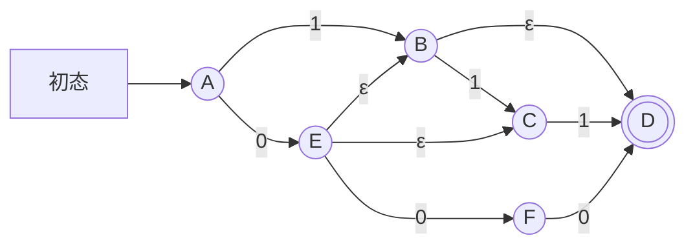
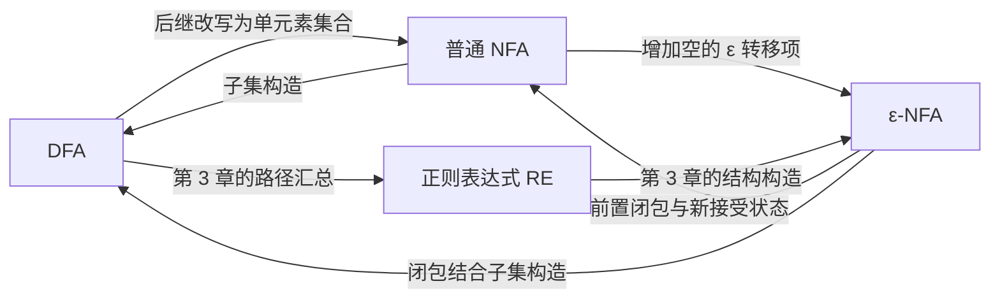

---
tags:
  - 形式语言与自动机
  - NFA
  - ε-NFA
  - 子集构造
  - 课程笔记
课程: 形式语言与自动机
章节: 第2章 非确定性有限自动机
教材:
---

> [!info] 本章定位
> 第 1 章的 DFA 每一步只有一个确定状态；本章允许同一输入对应多条候选路径，再把“所有可能的当前状态”编码成一个 DFA 状态。理解本章的钥匙有四点：
> 1. NFA 的接受条件是“存在一条路径完整读完输入并停在接受状态”，因此后继要取并集；
> 2. 子集构造把一个 NFA 状态集合当作 DFA 的一个状态，增加的是表示规模，并未扩大可识别的语言类；
> 3. ε 转移不消费字符，ε-闭包必须包括零步可达的自身，并覆盖任意多步 ε 路径；
> 4. 消除 ε 转移时，转移规则与接受状态必须配套；课件采用“只合并字符前的 ε 路径”的方法。
>
> **来源**：`lec2-nfa.ppt`，共 38 页。正文标注来源页码，补充解释与自拟题另作说明。前置知识见 [[Ch1 DFA]]，后续连接 [[Ch3 正则表达式（Regular Expressions）]]。未指定教材，教材字段留空。

## 目录

- [[#1. 非确定性的直觉与接受语义|1. 非确定性的直觉与接受语义]]
	- [[#1.1 从一条运行路径到多条候选路径|1.1 从一条运行路径到多条候选路径]]
	- [[#1.2 存在接受路径与完整读入|1.2 存在接受路径与完整读入]]
- [[#2. NFA 的形式定义与运行|2. NFA 的形式定义与运行]]
	- [[#2.1 五元组与转移函数|2.1 五元组与转移函数]]
	- [[#2.2 扩展转移函数|2.2 扩展转移函数]]
	- [[#2.3 NFA 接受的语言|2.3 NFA 接受的语言]]
- [[#3. 课件棋盘 NFA|3. 课件棋盘 NFA]]
	- [[#3.1 状态、输入与完整转移表|3.1 状态、输入与完整转移表]]
	- [[#3.2 输入 rbb 的运行过程|3.2 输入 rbb 的运行过程]]
	- [[#3.3 只含 b 的输入与含 r 的输入|3.3 只含 b 的输入与含 r 的输入]]
- [[#4. NFA 转 DFA：子集构造|4. NFA 转 DFA：子集构造]]
	- [[#4.1 DFA 是特殊的 NFA|4.1 DFA 是特殊的 NFA]]
	- [[#4.2 五个组成部分的构造|4.2 五个组成部分的构造]]
	- [[#4.3 按需构造与空集状态|4.3 按需构造与空集状态]]
	- [[#4.4 棋盘例子的完整子集构造|4.4 棋盘例子的完整子集构造]]
- [[#5. 子集构造的正确性证明|5. 子集构造的正确性证明]]
	- [[#5.1 核心不变式|5.1 核心不变式]]
	- [[#5.2 对输入长度归纳|5.2 对输入长度归纳]]
	- [[#5.3 从状态不变式到语言相等|5.3 从状态不变式到语言相等]]
- [[#6. ε-NFA 与 ε-闭包|6. ε-NFA 与 ε-闭包]]
	- [[#6.1 ε 转移与形式定义|6.1 ε 转移与形式定义]]
	- [[#6.2 单状态和状态集合的 ε-闭包|6.2 单状态和状态集合的 ε-闭包]]
	- [[#6.3 课件六状态 ε-NFA|6.3 课件六状态 ε-NFA]]
- [[#7. ε-NFA 的扩展转移与接受|7. ε-NFA 的扩展转移与接受]]
	- [[#7.1 初始闭包与逐字符闭包|7.1 初始闭包与逐字符闭包]]
	- [[#7.2 单步转移与扩展转移的区别|7.2 单步转移与扩展转移的区别]]
	- [[#7.3 课件输入示例与语言|7.3 课件输入示例与语言]]
- [[#8. 消除 ε 转移：课件方法|8. 消除 ε 转移：课件方法]]
	- [[#8.1 只合并字符前的 ε 路径|8.1 只合并字符前的 ε 路径]]
	- [[#8.2 为什么必须修改接受状态|8.2 为什么必须修改接受状态]]
	- [[#8.3 课件转换后的完整 NFA|8.3 课件转换后的完整 NFA]]
	- [[#8.4 消除 ε 转移的正确性证明|8.4 消除 ε 转移的正确性证明]]
- [[#9. 两条确定化路线与实现含义|9. 两条确定化路线与实现含义]]
	- [[#9.1 先消除 ε 再做子集构造|9.1 先消除 ε 再做子集构造]]
	- [[#9.2 直接确定化 ε-NFA|9.2 直接确定化 ε-NFA]]
	- [[#9.3 表达能力、状态规模与实现|9.3 表达能力、状态规模与实现]]
- [[#10. 例题|10. 例题]]
	- [[#10.1 存在路径与全部路径的区别|10.1 存在路径与全部路径的区别]]
	- [[#10.2 倒数第三位为 1 的 NFA|10.2 倒数第三位为 1 的 NFA]]
	- [[#10.3 完成一个含空集状态的子集构造|10.3 完成一个含空集状态的子集构造]]
	- [[#10.4 计算 ε-闭包并处理 ε 环|10.4 计算 ε-闭包并处理 ε 环]]
	- [[#10.5 对比两种 ε 消除转移|10.5 对比两种 ε 消除转移]]
	- [[#10.6 ε 消除后为什么要改接受状态|10.6 ε 消除后为什么要改接受状态]]
	- [[#10.7 棋盘语言的完整刻画|10.7 棋盘语言的完整刻画]]
	- [[#10.8 为什么不能直接翻转 NFA 的接受状态求补|10.8 为什么不能直接翻转 NFA 的接受状态求补]]
	- [[#10.9 用不变式检查错误的 ε-NFA 模拟|10.9 用不变式检查错误的 ε-NFA 模拟]]
	- [[#10.10 指数级状态差异的理由|10.10 指数级状态差异的理由]]
- [[#11. 易错点速查|11. 易错点速查]]
- [[#12. 知识点速查|12. 知识点速查]]
	- [[#12.1 三种自动机对比|12.1 三种自动机对比]]
	- [[#12.2 核心公式总表|12.2 核心公式总表]]
	- [[#12.3 转换关系|12.3 转换关系]]
	- [[#12.4 五句话核心思想|12.4 五句话核心思想]]
	- [[#12.5 章节衔接与课件覆盖|12.5 章节衔接与课件覆盖]]

---

## 1. 非确定性的直觉与接受语义

对应课件第 1～4 页。

### 1.1 从一条运行路径到多条候选路径

**通俗理解**：DFA 像只有一个当前位置的棋子；NFA 则保留所有合法走法，每读一个字符，就从每个当前位置继续扩展候选路径。

“同时处在多个状态”是一种理解方式。严格地说：**一条运行路径每一步仍只有一个状态，而同一个输入前缀可以对应多条运行路径，其终点组成可达状态集合。**

从 $q$ 读字符 $a$ 时若能到 $p$ 或 $r$，就写作

$$
\delta_N(q,a)=\{p,r\}.
$$

也允许没有合法转移：

$$
\delta_N(q,a)=\varnothing.
$$

这意味着这一条候选路径无法继续；其他候选路径可能仍能处理输入。

课件第 4 页用一条链与一棵分支树比较两种运行：

- DFA 对固定输入只有一条运行路径；
- NFA 对固定输入可能有多条路径，树上只要有一条成功分支就接受；
- 多条路径若在同一输入位置到达同一状态，就可以合并，因为它们今后的可选转移完全相同。

### 1.2 存在接受路径与完整读入

NFA 的接受采用**存在量词**：

> 只要存在一条合法路径，读完整个输入后到达接受状态，就接受该输入。

课件形象地说 NFA 总能“猜对”。这不是预知未来的实现机制；程序可以显式维护全部候选状态。

> [!warning] 三个条件必须一起成立
> 1. 路径上的每一步转移合法；
> 2. 输入被完整消费；
> 3. 读完时所在状态属于接受状态集合。
>
> 途中到过接受状态、但仍有未读输入，不能直接接受。某条分支拒绝，也不能据此判定整个 NFA 拒绝。

课件把运行树的叶子标为接受或拒绝，是针对一个输入的**运行过程**。一般自动机的接受状态可以有出边；非接受状态也可以经后续输入到达接受状态。“非接受状态”不等于“以后永远拒绝的死状态”。

---

## 2. NFA 的形式定义与运行

对应课件第 7～9 页。本节的普通 NFA **不带 ε 转移**；带 ε 的版本将在第 6 节单独定义。

### 2.1 五元组与转移函数

NFA 定义为

$$
N=(Q,\Sigma,\delta_N,q_0,F).
$$

| 部分 | 类型或要求 | 含义 |
| --- | --- | --- |
| $Q$ | 有限非空状态集合 | 所有内部状态 |
| $\Sigma$ | 有限输入字母表 | 每一步消费的符号 |
| $\delta_N$ | $Q\times\Sigma\to 2^Q$ | 一个状态读一个字符后的所有可能后继 |
| $q_0$ | $q_0\in Q$ | 唯一初态 |
| $F$ | $F\subseteq Q$ | 接受状态集合，允许为空 |

$2^Q$ 是 $Q$ 的幂集，即所有子集组成的集合。若 $|Q|=n$，则 $|2^Q|=2^n$。

对比 DFA：

$$
\delta_D:Q\times\Sigma\to Q,\qquad
\delta_N:Q\times\Sigma\to 2^Q.
$$

$p$ 是一个状态，$\{p\}$ 是仅含该状态的集合，两者类型不同。

### 2.2 扩展转移函数

**直觉**：单步转移处理一个字符；扩展转移处理整个字符串，并汇总所有可能终点。

定义

$$
\hat{\delta}_N:Q\times\Sigma^*\to 2^Q.
$$

基础情形：

$$
\boxed{\hat{\delta}_N(q,\varepsilon)=\{q\}}.
$$

归纳情形：对 $w\in\Sigma^*$、$a\in\Sigma$，

$$
\boxed{
\hat{\delta}_N(q,wa)
=\bigcup_{p\in\hat{\delta}_N(q,w)}\delta_N(p,a)
}.
$$

课件前半部分有时省略小帽子，用上下文区分单步与扩展转移。本笔记统一以 $\hat{\delta}$ 表示字符串转移。

为简化写法，定义

$$
\operatorname{move}_N(S,a)
=\bigcup_{q\in S}\delta_N(q,a).
$$

逐字符运行就是

$$
S_0=\{q_0\},\qquad
S_{i+1}=\operatorname{move}_N(S_i,a_{i+1}).
$$

若 $S_i=\varnothing$，则以后所有集合仍为空，因为

$$
\operatorname{move}_N(\varnothing,a)=\varnothing.
$$

> [!tip] 为什么是并集
> 每个当前状态都代表一种仍有可能成功的历史。只要某个状态能到达后继 $r$，就要保留 $r$，不要求其他状态也能到达它，因此取并集而非交集。

### 2.3 NFA 接受的语言

$$
\boxed{
L(N)=\{w\in\Sigma^*\mid
\hat{\delta}_N(q_0,w)\cap F\ne\varnothing\}
}.
$$

普通 NFA 接受空串的充要条件：

$$
\varepsilon\in L(N)\iff q_0\in F.
$$

接受只需最终可达集合中**至少一个**元素属于 $F$，不要求整个集合包含于 $F$。

---

## 3. 课件棋盘 NFA

对应课件第 5～6、10 页；第 16～22 页再对它完成子集构造。

### 3.1 状态、输入与完整转移表

棋盘格子按行编号：

| | 左列 | 中列 | 右列 |
| --- | --- | --- | --- |
| 上行 | $1$，黑 | $2$，红 | $3$，黑 |
| 中行 | $4$，红 | $5$，黑 | $6$，红 |
| 下行 | $7$，黑 | $8$，红 | $9$，黑 |

- 状态集合：$Q=\{1,2,\ldots,9\}$；
- 字母表：$\Sigma=\{r,b\}$；
- 初态：$1$，即左上角；
- 唯一接受状态：$9$，即右下角；
- 输入 `r`：移动到相邻红格；
- 输入 `b`：移动到相邻黑格。

**相邻包含水平、竖直和对角方向，但不允许留在原格**。这由课件转移表确认，例如 $1$ 读 `b` 能到对角的 $5$；$5$ 读 `b` 能到四个黑色角格，但不能留在自身。

| 状态 | 输入 `r` | 输入 `b` |
| --- | --- | --- |
| $\to1$ | $\{2,4\}$ | $\{5\}$ |
| $2$ | $\{4,6\}$ | $\{1,3,5\}$ |
| $3$ | $\{2,6\}$ | $\{5\}$ |
| $4$ | $\{2,8\}$ | $\{1,5,7\}$ |
| $5$ | $\{2,4,6,8\}$ | $\{1,3,7,9\}$ |
| $6$ | $\{2,8\}$ | $\{3,5,9\}$ |
| $7$ | $\{4,8\}$ | $\{5\}$ |
| $8$ | $\{4,6\}$ | $\{5,7,9\}$ |
| $*9$ | $\{6,8\}$ | $\{5\}$ |

其中 $\to$ 标初态，$*$ 标接受状态。

### 3.2 输入 rbb 的运行过程

课件用 `rbb` 展示存在接受路径：

$$
\begin{aligned}
S_0&=\{1\},\\
S_1&=\delta_N(1,r)=\{2,4\},\\
S_2&=\delta_N(2,b)\cup\delta_N(4,b)\\
&=\{1,3,5\}\cup\{1,5,7\}\\
&=\{1,3,5,7\},\\
S_3&=\{5\}\cup\{5\}\cup\{1,3,7,9\}\cup\{5\}\\
&=\{1,3,5,7,9\}.
\end{aligned}
$$

因为 $9\in S_3$，所以接受。成功路径之一是

$$
1\xrightarrow{r}2\xrightarrow{b}5\xrightarrow{b}9.
$$

最终集合里还有非接受状态，不影响接受结果。

### 3.3 只含 b 的输入与含 r 的输入

只读 `b` 时，可达集合依次为

$$
\{1\}\xrightarrow{b}\{5\}
\xrightarrow{b}\{1,3,7,9\}
\xrightarrow{b}\{5\}\xrightarrow{b}\cdots.
$$

因此只含 `b` 的输入被接受，当且仅当长度为**正偶数**：

$$
\{b^{2k}\mid k\ge1\}.
$$

空串虽然长度为偶数，但初态 $1$ 不是接受状态，所以必须排除。

课件第 10 页提问“包含至少一个 `r` 的串呢？”借助完整子集构造可以回答：这类串被接受，当且仅当**长度至少为 $3$，并且以 `b` 结尾**。这是对课件问题的补充解答，证明见 [[#10.7 棋盘语言的完整刻画|例题 7]]。

---

## 4. NFA 转 DFA：子集构造

对应课件第 11～22 页

### 4.1 DFA 是特殊的 NFA

给定 DFA，若

$$
\delta_D(q,a)=p,
$$

就令对应 NFA 的转移为

$$
\delta_N(q,a)=\{p\}.
$$

状态集合、字母表、初态和接受状态均保持。每次可达集合都是单元素集合，所得 NFA 与原 DFA 接受相同语言。

这证明了一个方向：**DFA 可识别的语言都能被 NFA 识别**。

反方向使用子集构造：以一个 DFA 状态编码 NFA 的一整个可达集合。

### 4.2 五个组成部分的构造

给定

$$
N=(Q,\Sigma,\delta_N,q_0,F),
$$

构造

$$
D=(2^Q,\Sigma,\delta_D,\{q_0\},F_D),
$$

其中

$$
\boxed{
\delta_D(S,a)=\bigcup_{q\in S}\delta_N(q,a)
=\operatorname{move}_N(S,a)
}
$$

以及

$$
\boxed{
F_D=\{S\subseteq Q\mid S\cap F\ne\varnothing\}
}.
$$

| DFA 的部分 | 构造方法 | 为什么这样构造 |
| --- | --- | --- |
| 状态集合 | $2^Q$ | 所有可能的 NFA 状态集合 |
| 字母表 | $\Sigma$ | 不改变输入内容 |
| 初态 | $\{q_0\}$ | 尚未读字符时只有初态可达 |
| 转移函数 | 当前集合中各状态后继的并 | 汇总所有候选路径 |
| 接受状态集合 | 所有与 $F$ 有交集的子集 | 对应“存在一条接受路径” |

> [!important] 一个集合名，对应一个 DFA 状态
> $\{p,q\}$ 在 NFA 侧表示两个可能的当前状态；在构造后的 DFA 侧，它是**一个状态的名字**。DFA 仍然始终处在唯一状态。
>
> 可以把它重命名为 $A$，只需记住 $A\leftrightarrow\{p,q\}$。

### 4.3 按需构造与空集状态

完整状态空间为 $2^Q$，但很多子集可能永远无法从初态到达。课件称只生成可达子集的做法为 **lazy construction（按需构造）**。

1. 把 $\{q_0\}$ 放入待处理队列；
2. 取出一个尚未处理的集合 $S$；
3. 对每个 $a\in\Sigma$ 计算 $\delta_D(S,a)$；
4. 若结果集合此前没有出现，就登记为新状态并入队；
5. 直到没有待处理状态，最后标出所有与 $F$ 相交的状态。

若计算出了 $\varnothing$，它就是 DFA 的合法状态，表示“没有任何候选路径存活”。它是非接受死状态，且

$$
\delta_D(\varnothing,a)=\varnothing
\quad(a\in\Sigma).
$$

完整 DFA 要求每个状态对每个输入符号都有唯一后继，因此不能遗漏可达的空集状态。

### 4.4 棋盘例子的完整子集构造

将可达子集重命名为 $S_0,\ldots,S_6$：

| DFA 状态 | 对应 NFA 子集 | 输入 `r` | 输入 `b` |
| --- | --- | --- | --- |
| $\to S_0$ | $\{1\}$ | $S_1$ | $S_2$ |
| $S_1$ | $\{2,4\}$ | $S_3$ | $S_4$ |
| $S_2$ | $\{5\}$ | $S_3$ | $S_5$ |
| $S_3$ | $\{2,4,6,8\}$ | $S_3$ | $S_6$ |
| $S_4$ | $\{1,3,5,7\}$ | $S_3$ | $S_6$ |
| $*S_5$ | $\{1,3,7,9\}$ | $S_3$ | $S_2$ |
| $*S_6$ | $\{1,3,5,7,9\}$ | $S_3$ | $S_6$ |

接受状态为 $S_5,S_6$，因为它们且只有它们包含原接受状态 $9$。

两个关键并集计算：

$$
\begin{aligned}
\delta_D(\{2,4\},r)
&=\{4,6\}\cup\{2,8\}\\
&=\{2,4,6,8\},\\
\delta_D(\{2,4,6,8\},b)
&=\{1,3,5\}\cup\{1,5,7\}\\
&\quad\cup\{3,5,9\}\cup\{5,7,9\}\\
&=\{1,3,5,7,9\}.
\end{aligned}
$$

> [!tip] 规模与最小化要区分
> 原棋盘 NFA 有 $9$ 个状态，幂集有 $2^9=512$ 个子集，按需构造只出现 $7$ 个可达子集。子集构造的任务是得到等价 DFA，并不保证它已经最小化。

---

## 5. 子集构造的正确性证明

对应课件第 23～24 页，以下补足证明细节。

### 5.1 核心不变式

对任意输入串 $w\in\Sigma^*$，

$$
\boxed{
\hat{\delta}_D(\{q_0\},w)
=\hat{\delta}_N(q_0,w)
}.
$$

- 左边是 DFA 读完 $w$ 后的**一个状态**，其名字是 NFA 状态的一个子集；
- 右边是 NFA 读完 $w$ 后的**所有可能状态的集合**。

课件称这个证明近似“一语双关”，正是因为同一个集合在两侧承担不同角色。

### 5.2 对输入长度归纳

> [!important]- 归纳证明
> **基础情况**：$w=\varepsilon$。
>
> NFA 未读字符时有
>
> $$
> \hat{\delta}_N(q_0,\varepsilon)=\{q_0\}.
> $$
>
> DFA 未读字符时留在初态，初态恰好命名为 $\{q_0\}$，所以
>
> $$
> \hat{\delta}_D(\{q_0\},\varepsilon)=\{q_0\}.
> $$
>
> **归纳假设**：结论对长度为 $m$ 的字符串 $x$ 成立，记共同结果为 $S$。
>
> **归纳步**：取 $w=xa$，其中 $a\in\Sigma$。
>
> NFA 的扩展转移定义给出
>
> $$
> \hat{\delta}_N(q_0,xa)
> =\bigcup_{p\in S}\delta_N(p,a).
> $$
>
> DFA 的扩展转移定义与子集转移规则给出
>
> $$
> \begin{aligned}
> \hat{\delta}_D(\{q_0\},xa)
> &=\delta_D\bigl(\hat{\delta}_D(\{q_0\},x),a\bigr)\\
> &=\delta_D(S,a)\\
> &=\bigcup_{p\in S}\delta_N(p,a).
> \end{aligned}
> $$
>
> 因而两侧相等，归纳完成。

### 5.3 从状态不变式到语言相等

对任意 $w$，

$$
\begin{aligned}
w\in L(D)
&\iff \hat{\delta}_D(\{q_0\},w)\in F_D\\
&\iff \hat{\delta}_D(\{q_0\},w)\cap F\ne\varnothing\\
&\iff \hat{\delta}_N(q_0,w)\cap F\ne\varnothing\\
&\iff w\in L(N).
\end{aligned}
$$

这串双向等价同时证明了 $L(D)\subseteq L(N)$ 和 $L(N)\subseteq L(D)$。

结合 DFA 可转成 NFA，得到：

$$
\boxed{\text{DFA 与 NFA 恰好识别同一类语言：正则语言。}}
$$

---

## 6. ε-NFA 与 ε-闭包

对应课件第 25～27 页。

### 6.1 ε 转移与形式定义

**通俗理解**：ε 边允许机器改变状态，而输入指针不前进。它像一条无需读字符的内部通道，便于拼装自动机。

ε-NFA 仍写成五元组

$$
E=(Q,\Sigma,\delta_E,q_0,F_E),
$$

但转移函数变为

$$
\boxed{
\delta_E:Q\times(\Sigma\cup\{\varepsilon\})\to 2^Q
}.
$$

这里 $\varepsilon$ 表示空串，不是字母表里一个需要实际输入的字符

允许 ε 转移并不意味着必须走某条 ε 边。接受仍由**某条有限的成功运行路径**决定；存在 ε 环也不会使其他成功路径失效

### 6.2 单状态和状态集合的 ε-闭包

**直觉**：站在 $q$，不读任何字符，沿 ε 边能到达的所有状态，就是 $q$ 的 ε-闭包。

严谨定义：

$$
\boxed{
\operatorname{CL}(q)
=\{p\in Q\mid q\xrightarrow{\varepsilon^*}p\}
}.
$$

这里 $\varepsilon^*$ 表示走零条或多条 ε 边，因此

$$
q\in\operatorname{CL}(q).
$$

对状态集合 $S\subseteq Q$：

$$
\boxed{
\operatorname{CL}(S)
=\bigcup_{q\in S}\operatorname{CL}(q)
}.
$$

约定 $\operatorname{CL}(q)$ 是 $\operatorname{CL}(\{q\})$ 的简写。特别地，

$$
\operatorname{CL}(\varnothing)=\varnothing.
$$

闭包还满足

$$
S\subseteq\operatorname{CL}(S),
\qquad
\operatorname{CL}(\operatorname{CL}(S))=\operatorname{CL}(S).
$$

即闭包包含原集合，再做闭包不会新增状态。

**补充：计算方法。** 从 $S$ 初始化已发现集合，用栈或队列反复访问 ε 后继；只把未见过的状态入队。状态数有限，至多发现 $|Q|$ 个状态，即使存在 ε 环也会终止。

### 6.3 课件六状态 ε-NFA

课件示例为

$$
Q=\{A,B,C,D,E,F\},\quad
\Sigma=\{0,1\},\quad
q_0=A,\quad F_E=\{D\}.
$$

此处大写 $F$ 是一个状态名，$F_E$ 才是接受状态集合。

| 状态 | 输入 `0` | 输入 `1` | ε 转移 |
| --- | --- | --- | --- |
| $\to A$ | $\{E\}$ | $\{B\}$ | $\varnothing$ |
| $B$ | $\varnothing$ | $\{C\}$ | $\{D\}$ |
| $C$ | $\varnothing$ | $\{D\}$ | $\varnothing$ |
| $*D$ | $\varnothing$ | $\varnothing$ | $\varnothing$ |
| $E$ | $\{F\}$ | $\varnothing$ | $\{B,C\}$ |
| $F$ | $\{D\}$ | $\varnothing$ | $\varnothing$ |



所有单状态闭包为：

| 状态 | ε-闭包 | 原因 |
| --- | --- | --- |
| $A$ | $\{A\}$ | 无 ε 出边 |
| $B$ | $\{B,D\}$ | 可沿 ε 边到 $D$ |
| $C$ | $\{C\}$ | 无 ε 出边 |
| $D$ | $\{D\}$ | 零步留在自身 |
| $E$ | $\{B,C,D,E\}$ | 先到 $B,C$，还可从 $B$ 沿 ε 边到 $D$ |
| $F$ | $\{F\}$ | 无 ε 出边 |

> [!warning] ε-闭包只沿 ε 边
> $A$ 读 `0` 可以到 $E$，但这不能让 $E$ 进入 $\operatorname{CL}(A)$；$B$ 读 `1` 可以到 $C$，也不能让 $C$ 进入 $\operatorname{CL}(B)$。

---

## 7. ε-NFA 的扩展转移与接受

对应课件第 28～29 页。

### 7.1 初始闭包与逐字符闭包

ε-NFA 的扩展转移

$$
\hat{\delta}_E:Q\times\Sigma^*\to 2^Q
$$

要允许读字符之前、字符之间以及全部字符之后的 ε 路径

- 基础情形：$\boxed{\hat{\delta}_E(q,\varepsilon)=\operatorname{CL}(q)}.$

- 归纳情形：设 $x\in\Sigma^*$、$a\in\Sigma$，则$\boxed{\hat{\delta}_E(q,xa)=\operatorname{CL}\left(\bigcup_{p\in\hat{\delta}_E(q,x)}\delta_E(p,a)\right)}.$，先把每个当前候选状态的 $a$ 后继取并，再对结果做 ε-闭包


初始集合已经闭合，每读完一个字符又再次闭合，所以每个前缀对应的集合始终为 ε-闭合集合。字符前的 ε 路径已经包含在当前集合中，无需重复写出。

若记 $\operatorname{move}_E(S,a)=\bigcup_{p\in S}\delta_E(p,a)$，则运行公式为

$$
S_0=\operatorname{CL}(q_0),\qquad
S_{i+1}=\operatorname{CL}(\operatorname{move}_E(S_i,a_{i+1})).
$$

### 7.2 单步转移与扩展转移的区别

在 ε-NFA 中，即使输入只是一个字符 $a$，也不一定有

$$
\delta_E(q,a)=\hat{\delta}_E(q,a).
$$

完整的单字符可达集合实际上是

$$
\boxed{
\hat{\delta}_E(q,a)
=\operatorname{CL}\left(
\operatorname{move}_E(\operatorname{CL}(q),a)
\right)
}.
$$

例如课件中

$$
\delta_E(A,0)=\{E\},
\qquad
\hat{\delta}_E(A,0)=\{B,C,D,E\}.
$$

更明显地，

$$
\delta_E(E,1)=\varnothing,
\qquad
\hat{\delta}_E(E,1)=\{C,D\}.
$$

后者可先走 $E\xrightarrow{\varepsilon}B$ 或 $E\xrightarrow{\varepsilon}C$，再消费 `1`。

### 7.3 课件输入示例与语言

逐步计算：

$$
\begin{aligned}
\hat{\delta}_E(A,\varepsilon)
&=\operatorname{CL}(A)=\{A\},\\
\hat{\delta}_E(A,0)
&=\operatorname{CL}(\{E\})=\{B,C,D,E\},\\
\hat{\delta}_E(A,01)
&=\operatorname{CL}(\{C,D\})=\{C,D\}.
\end{aligned}
$$

最后一步的 $\{C,D\}$ 来自 $B$、$C$ 读 `1` 的后继；$D,E$ 读 `1` 没有真实字符后继。

接受语言定义为

$$
\boxed{
L(E)=\{w\in\Sigma^*\mid
\hat{\delta}_E(q_0,w)\cap F_E\ne\varnothing\}
}.
$$

因此 `0`、`01` 都接受。空串接受条件为

$$
\boxed{
\varepsilon\in L(E)
\iff \operatorname{CL}(q_0)\cap F_E\ne\varnothing
}.
$$

这已经不同于普通 NFA 的“初态本身必须接受”。

**补充核对：课件示例的完整语言。** 图中没有环，所有从 $A$ 到 $D$ 的路径标签恰好给出

$$
\boxed{L(E)=\{0,1,01,011,111,000\}}.
$$

例如 `1` 经 $A\xrightarrow{1}B\xrightarrow{\varepsilon}D$ 接受，但 `11` 只能完整读到 $C$，所以拒绝。接受状态不能使未读的后缀自动消失。

---

## 8. 消除 ε 转移：课件方法

对应课件第 30～37 页。这里先转换为普通 NFA，暂时不做子集构造。

### 8.1 只合并字符前的 ε 路径

课件把一段路径拆成

$$
\text{若干 ε 边}\quad\to\quad
\text{一条真实字符 }a\text{ 边}\quad\to\quad
\text{若干 ε 边}.
$$

其方法只把**字符之前**的 ε 路径合并到新转移中。

给定

$$
E=(Q,\Sigma,\delta_E,q_0,F_E),
$$

构造

$$
N=(Q,\Sigma,\delta_N,q_0,F_N),
$$

并令

$$
\boxed{
\delta_N(q,a)=
\bigcup_{p\in\operatorname{CL}(q)}\delta_E(p,a)
=\operatorname{move}_E(\operatorname{CL}(q),a)
}.
$$

右边**没有最后一层闭包**。新 NFA 的某个状态 $q$ 可以理解为“尚未展开从这里出发的 ε 路径”；下次读字符前，再用 $\operatorname{CL}(q)$ 展开它们。

### 8.2 为什么必须修改接受状态

输入读完时，没有下一个字符来触发前置闭包。原 ε-NFA 最后可能还要走若干 ε 边才能接受，因此新 NFA 必须把这些状态也标为接受状态：

$$
\boxed{
F_N=\{q\in Q\mid
\operatorname{CL}(q)\cap F_E\ne\varnothing\}
}.
$$

状态集合、字母表和初态保持；变化的是**真实字符转移**与**接受状态集合**。

这也自动处理空串：原初始闭包若含接受状态，新 NFA 的初态 $q_0$ 就被加入 $F_N$。

> [!important] 转移与接受条件必须成套使用
> “只合并字符前的 ε 路径”配合“闭包中含原接受状态就成为新接受状态”。只删除 ε 边、只改转移或只沿用原接受状态，都不能保证语言保持。

### 8.3 课件转换后的完整 NFA

原接受状态仅有 $D$。因为

$$
\operatorname{CL}(B)=\{B,D\},
\qquad
\operatorname{CL}(E)=\{B,C,D,E\},
$$

所以新接受状态集合为

$$
\boxed{F_N=\{B,D,E\}}.
$$

新转移表：

| 状态 | 输入 `0` | 输入 `1` |
| --- | --- | --- |
| $\to A$ | $\{E\}$ | $\{B\}$ |
| $*B$ | $\varnothing$ | $\{C\}$ |
| $C$ | $\varnothing$ | $\{D\}$ |
| $*D$ | $\varnothing$ | $\varnothing$ |
| $*E$ | $\{F\}$ | $\{C,D\}$ |
| $F$ | $\{D\}$ | $\varnothing$ |

只有 $E$ 的真实字符转移新增了分支：

$$
\begin{aligned}
\delta_N(E,1)
&=\delta_E(B,1)\cup\delta_E(C,1)
\cup\delta_E(D,1)\cup\delta_E(E,1)\\
&=\{C\}\cup\{D\}\cup\varnothing\cup\varnothing\\
&=\{C,D\}.
\end{aligned}
$$

输入 `0` 时，新 NFA 只到达 $\{E\}$，原 ε-NFA 的完整可达集合为 $\{B,C,D,E\}$。两者集合不相等，但 $E$ 已成为新 NFA 的接受状态，所以都接受 `0`。

### 8.4 消除 ε 转移的正确性证明

这一构造的正确不变式不是“可达集合直接相等”，而是

$$
\boxed{
\operatorname{CL}\bigl(\hat{\delta}_N(q_0,w)\bigr)
=\hat{\delta}_E(q_0,w)
}.
$$

> [!important]- 对输入长度归纳
> **基础情况**：$w=\varepsilon$。
>
> $$
> \operatorname{CL}\bigl(\hat{\delta}_N(q_0,\varepsilon)\bigr)
> =\operatorname{CL}(\{q_0\})
> =\hat{\delta}_E(q_0,\varepsilon).
> $$
>
> **归纳假设**：对前缀 $x$，令 $T=\hat{\delta}_N(q_0,x)$，假设
>
> $$
> \operatorname{CL}(T)=\hat{\delta}_E(q_0,x).
> $$
>
> **归纳步**：对 $a\in\Sigma$，
>
> $$
> \begin{aligned}
> \hat{\delta}_N(q_0,xa)
> &=\bigcup_{q\in T}\delta_N(q,a)\\
> &=\bigcup_{q\in T}
>   \operatorname{move}_E(\operatorname{CL}(q),a)\\
> &=\operatorname{move}_E(\operatorname{CL}(T),a)\\
> &=\operatorname{move}_E(\hat{\delta}_E(q_0,x),a).
> \end{aligned}
> $$
>
> 对两侧取闭包：
>
> $$
> \begin{aligned}
> \operatorname{CL}\bigl(\hat{\delta}_N(q_0,xa)\bigr)
> &=\operatorname{CL}\left(
> \operatorname{move}_E(\hat{\delta}_E(q_0,x),a)
> \right)\\
> &=\hat{\delta}_E(q_0,xa).
> \end{aligned}
> $$
>
> 不变式得证。

再根据 $F_N$ 的定义：

$$
\begin{aligned}
w\in L(N)
&\iff\hat{\delta}_N(q_0,w)\cap F_N\ne\varnothing\\
&\iff\operatorname{CL}(\hat{\delta}_N(q_0,w))\cap F_E\ne\varnothing\\
&\iff\hat{\delta}_E(q_0,w)\cap F_E\ne\varnothing\\
&\iff w\in L(E).
\end{aligned}
$$

因此普通 NFA 与 ε-NFA 能力相同；结合子集构造，三者都恰好识别正则语言。

---

## 9. 两条确定化路线与实现含义

对应课件第 31～33 页的图示比较和第 38 页总结。本节补充比较公式及实现解释。

### 9.1 先消除 ε 再做子集构造

课件正文采取

$$
\text{ε-NFA}\xrightarrow{\text{前置闭包并调整接受状态}}
\text{NFA}\xrightarrow{\text{子集构造}}\text{DFA}.
$$

中间 NFA 的状态仍是原来的 $Q$；到子集构造时，才把状态集合当作 DFA 状态。

### 9.2 直接确定化 ε-NFA

课件第 32 页示意另一条路线：每读一个字符后把后继做 ε-闭包，并直接执行子集构造。

对 ε-NFA 直接构造 DFA 时：

$$
S_0=\operatorname{CL}(q_0),
$$

$$
\boxed{
\delta_D(S,a)
=\operatorname{CL}(\operatorname{move}_E(S,a))
},
$$

$$
F_D=\{S\mid S\cap F_E\ne\varnothing\}.
$$

这里所有可达的 DFA 状态都是 ε-闭合集合。该方法直接把第 7 节的运行集合固化成 DFA 状态。

| 比较项 | 课件 ε 消除后的 NFA | 直接确定化的 DFA |
| --- | --- | --- |
| 状态 | 原状态 $q\in Q$ | ε-闭合的状态集合 $S\subseteq Q$ |
| 初态 | $q_0$ | $\operatorname{CL}(q_0)$ |
| 转移 | $\operatorname{move}_E(\operatorname{CL}(q),a)$ | $\operatorname{CL}(\operatorname{move}_E(S,a))$ |
| 接受条件 | $\operatorname{CL}(q)\cap F_E\ne\varnothing$ | $S\cap F_E\ne\varnothing$ |
| 关键解释 | 每条字符边前处理 ε 路径 | 当前集合已闭合，字符后再闭合 |

> [!warning] 不同构造的表格可能不同
> 一种方法得到 $\delta_N(A,0)=\{E\}$，另一方法得到 $\delta_D(\{A\},0)=\{B,C,D,E\}$，并不矛盾。先看状态代表什么、闭包放在哪里，以及接受状态是否配套。

### 9.3 表达能力、状态规模与实现

三种模型识别的语言类相同：

$$
\boxed{\text{DFA}\equiv\text{NFA}\equiv\text{ε-NFA}
\quad\text{（按可识别语言类）}}.
$$

但它们在表示上各有特点：

- NFA / ε-NFA 往往更容易从“猜测一个位置”“在多种模式中选择”“拼接已有自动机”等思路构造；
- $n$ 状态 NFA 的幂集构造至多产生 $2^n$ 个 DFA 状态；实际只需生成可达子集；
- 最坏情况下确实存在指数级状态差异，见例题 10；
- 对固定输入，DFA 只需维护一个当前状态，NFA 模拟则可维护一个当前状态集合。

> [!info] 对课件实现说法的补充澄清
> 第 38 页有“只有 DFA 能实现”的表述。严格来说，NFA 和 ε-NFA 都能由普通程序模拟：显式维护可达状态集合，ε-NFA 再计算闭包即可。DFA 的优势是能直接按“当前状态 + 一个字符 → 唯一后继”执行；不能据此推断 NFA 无法编程实现。

**补充：ε-NFA 的集合模拟。** 真实字符边由 `delta[(q, a)]` 给出，ε 边单独放在 `epsilon_edges[q]` 中，未登记的转移视为空集。

```python
def epsilon_closure(states, epsilon_edges):
    reached = set(states)
    pending = list(reached)
    while pending:
        q = pending.pop()
        for p in epsilon_edges.get(q, ()):
            if p not in reached:
                reached.add(p)
                pending.append(p)
    return reached


def accepts_epsilon_nfa(delta, epsilon_edges, q0, finals, word):
    current = epsilon_closure({q0}, epsilon_edges)
    for symbol in word:
        following = set()
        for q in current:
            following.update(delta.get((q, symbol), ()))
        current = epsilon_closure(following, epsilon_edges)
    return bool(current & set(finals))
```

状态集合自动去重；同一输入位置到达同一状态的多条路径无须重复保留。输入为空时仍先计算初始闭包，因此也能正确判断空串。

---

## 10. 例题

本节均为围绕课件知识点编写的**自拟练习与补充解析**；涉及课件自动机时沿用其转移表。

### 10.1 存在路径与全部路径的区别

设普通 NFA 的字母表为 $\{a\}$，初态 $s$，接受状态集合为 $\{f\}$，且

$$
\delta(s,a)=\{p,f\},
$$

其中 $p,f$ 均无真实字符出边。判断 $\varepsilon$、`a`、`aa` 是否被接受。

> [!example]- 例题 1 解析
> - 空串：可达集合为 $\{s\}$，不含 $f$，拒绝；
> - `a`：可达集合为 $\{p,f\}$，与 $\{f\}$ 有交集，接受；
> - `aa`：读第一个 `a` 后虽有分支到 $f$，但第二个 `a` 无法继续，最终集合为空，拒绝。
>
> 因此语言是 $\{a\}$。另一分支到非接受状态 $p$，不影响存在一条成功分支的事实。

### 10.2 倒数第三位为 1 的 NFA

构造普通 NFA，识别

$$
L=\{w\in\{0,1\}^*\mid |w|\ge3,\ w\text{ 的倒数第 }3\text{ 位为 }1\}.
$$

> [!example]- 例题 2 解析
> **设计思路**：扫描任意前缀；读到 `1` 时猜测它就是倒数第三位，然后要求后面恰好再有两个字符。
>
> 取 $Q=\{q_0,q_1,q_2,q_3\}$，初态 $q_0$，唯一接受状态 $q_3$，字母表为 $\{0,1\}$。
>
> | 状态 | 含义 | `0` | `1` |
> | --- | --- | --- | --- |
> | $\to q_0$ | 扫描前缀，尚未选择目标位置 | $\{q_0\}$ | $\{q_0,q_1\}$ |
> | $q_1$ | 已选中 `1`，还需两个字符 | $\{q_2\}$ | $\{q_2\}$ |
> | $q_2$ | 还需一个字符 | $\{q_3\}$ | $\{q_3\}$ |
> | $*q_3$ | 已恰好读完目标后缀 | $\varnothing$ | $\varnothing$ |
>
> **充分性**：接受路径必在某个 `1` 上从 $q_0$ 进入 $q_1$，再恰好读两字符进入 $q_3$ 并结束。因此该 `1` 恰是倒数第三位。
>
> **必要性**：若倒数第三位是 `1`，就选取始终在 $q_0$ 扫描前缀、恰在该 `1` 上进入 $q_1$ 的分支。再读两字符即可到达 $q_3$ 并完整结束。
>
> 例如 `0101` 的成功路径为
>
> $$
> q_0\xrightarrow{0}q_0\xrightarrow{1}q_1
> \xrightarrow{0}q_2\xrightarrow{1}q_3.
> $$

### 10.3 完成一个含空集状态的子集构造

设 $Q=\{p,q\}$，$\Sigma=\{0,1\}$，初态 $p$，接受状态集合为 $\{q\}$，转移为：

| 状态 | `0` | `1` |
| --- | --- | --- |
| $\to p$ | $\{p,q\}$ | $\varnothing$ |
| $*q$ | $\varnothing$ | $\{q\}$ |

> [!example]- 例题 3 解析
> 初态子集为 $\{p\}$。
>
> - 从 $\{p\}$ 读 `0` 到 $\{p,q\}$，读 `1` 到 $\varnothing$；
> - 从 $\{p,q\}$ 读 `0`，后继为 $\{p,q\}\cup\varnothing=\{p,q\}$；
> - 从 $\{p,q\}$ 读 `1`，后继为 $\varnothing\cup\{q\}=\{q\}$；
> - 从 $\{q\}$ 读 `0` 到 $\varnothing$，读 `1` 回到 $\{q\}$；
> - 空集对两个字符都转到自身。
>
> 完整 DFA 为：
>
> | 状态 | `0` | `1` |
> | --- | --- | --- |
> | $\to\{p\}$ | $\{p,q\}$ | $\varnothing$ |
> | $*\{p,q\}$ | $\{p,q\}$ | $\{q\}$ |
> | $*\{q\}$ | $\varnothing$ | $\{q\}$ |
> | $\varnothing$ | $\varnothing$ | $\varnothing$ |
>
> 两个接受状态都含原接受状态 $q$。语言是至少一个 `0` 后接任意多个 `1`，即 $\{0^k1^\ell\mid k\ge1,\ell\ge0\}$。

### 10.4 计算 ε-闭包并处理 ε 环

设 ε 边为

$$
q_0\xrightarrow{\varepsilon}q_1,\quad
q_1\xrightarrow{\varepsilon}q_2,\quad
q_2\xrightarrow{\varepsilon}q_1,
$$

另有 $q_2\xrightarrow{a}q_3$。计算 $\operatorname{CL}(q_0)$ 和 $\operatorname{CL}(q_3)$。

> [!example]- 例题 4 解析
> 从 $q_0$ 可沿 ε 边到 $q_1,q_2$；之后虽然可以循环，但不再新增状态：
>
> $$
> \operatorname{CL}(q_0)=\{q_0,q_1,q_2\}.
> $$
>
> $q_3$ 无 ε 出边，但零步可以留在自身：
>
> $$
> \operatorname{CL}(q_3)=\{q_3\}.
> $$
>
> 不能沿真实字符边 $a$ 把 $q_3$ 加入 $\operatorname{CL}(q_0)$。用已访问集合去重，闭包搜索不会因 ε 环无限循环。

### 10.5 对比两种 ε 消除转移

有路径

$$
q_0\xrightarrow{\varepsilon}q_1
\xrightarrow{a}q_2\xrightarrow{\varepsilon}q_3,
$$

无其他边，初态 $q_0$，唯一接受状态 $q_3$。

> [!example]- 例题 5 解析
> 闭包为
>
> $$
> \operatorname{CL}(q_0)=\{q_0,q_1\},
> \qquad
> \operatorname{CL}(q_2)=\{q_2,q_3\}.
> $$
>
> **课件方法**只合并字符前的 ε 路径：
>
> $$
> \delta_N(q_0,a)=\{q_2\}.
> $$
>
> 因 $\operatorname{CL}(q_2)$ 含 $q_3$，必须把 $q_2$ 也标为接受状态；这样 `a` 被接受。
>
> **直接确定化**的初态为 $\{q_0,q_1\}$，其 `a` 转移为
>
> $$
> \delta_D(\{q_0,q_1\},a)
> =\operatorname{CL}(\{q_2\})
> =\{q_2,q_3\}.
> $$
>
> 这个 DFA 状态含 $q_3$，因此也接受。两种方法的状态名字不同，但配套各自接受规则后均识别 $\{a\}$。

### 10.6 ε 消除后为什么要改接受状态

设初态 $s$，唯一接受状态 $f$，唯一边为 $s\xrightarrow{\varepsilon}f$，字母表为 $\{a\}$。

> [!example]- 例题 6 解析
> 原 ε-NFA 接受空串，因为 $\operatorname{CL}(s)=\{s,f\}$。所有真实字符转移为空，所以语言恰为 $\{\varepsilon\}$。
>
> 若消除 ε 后仍只令 $f$ 接受，新 NFA 从 $s$ 出发既无边可走，也无法接受空串，语言错变成 $\varnothing$。
>
> 正确做法为
>
> $$
> F_N=\{s,f\}.
> $$
>
> 新初态 $s$ 自身接受，空串得以保留；任何非空输入仍无法读完。

### 10.7 棋盘语言的完整刻画

补全课件第 10 页的问题：给出棋盘 NFA 的完整语言，并说明至少含一个 `r` 的可接受串为什么长度至少为 $3$。

> [!example]- 例题 7 解析
> **第一类：不含 `r`。**
>
> 可达集合在 $\{5\}$ 和 $\{1,3,7,9\}$ 间交替，所以恰好接受正偶数个 `b`。
>
> **第二类：至少含一个 `r`。**
>
> 以 `r` 结尾只能停在红格，而接受状态 $9$ 是黑格，因此必须以 `b` 结尾。
>
> 长度为 $1$ 时，`r` 不接受；长度为 $2$ 时，唯一既含 `r` 又以 `b` 结尾的串为 `rb`，对应 $S_4=\{1,3,5,7\}$，仍不接受。
>
> 再证明长度至少为 $3$、含 `r` 且以 `b` 结尾一定接受：
>
> - 若第一次 `r` 不是首字符，其前缀只含至少一个 `b`，处在 $S_2$ 或 $S_5$。读该 `r` 后进入 $S_3$；此后只在 $S_3,S_6$ 间运行，最后读 `b` 必到 $S_6$；
> - 若第一次 `r` 就在首字符，则进入 $S_1$。第二字符为 `r` 时到 $S_3$，为 `b` 时到 $S_4$。从 $S_4$ 再读 `r` 到 $S_3$，读 `b` 到 $S_6$。从第三字符起也进入 $\{S_3,S_6\}$，最后为 `b` 时到 $S_6$。
>
> 所以完整语言为
>
> $$
> \boxed{
> L=\{b^{2k}\mid k\ge1\}
> \cup
> \{w\in\{r,b\}^*\mid |w|\ge3,\ w\text{ 含 }r,\ w\text{ 以 }b\text{ 结尾}\}
> }.
> $$
>
> 例如 `bb`、`rbb`、`rrb`、`brb` 接受；$\varepsilon$、`b`、`rb`、`bbr` 拒绝。

### 10.8 为什么不能直接翻转 NFA 的接受状态求补

设 $Q=\{s,f\}$，$\Sigma=\{a\}$，初态 $s$，接受状态集合为 $\{f\}$，且

$$
\delta(s,a)=\{s,f\},\qquad
\delta(f,a)=\varnothing.
$$

把接受状态改成 $\{s\}$，是否得到补语言？

> [!example]- 例题 8 解析
> 原 NFA 读 `a` 后可达 $\{s,f\}$，因为含 $f$，所以接受。
>
> 翻转后读 `a` 仍可达 $\{s,f\}$，因为含新接受状态 $s$，也接受。两者都接受 `a`，显然不是互补。
>
> 原条件是“存在一条接受路径”，其否定是“所有路径都不接受”；翻转接受状态只得到“存在一条原来不接受的路径”，两者不同。
>
> 正确路线是先用子集构造得到**转移完整的 DFA**，再翻转它的接受状态。完整性保证任意输入都有唯一最终状态，翻转后才恰好改变每个串的接受结果。

### 10.9 用不变式检查错误的 ε-NFA 模拟

有人从课件六状态示例的 $\{A\}$ 开始，每个字符只执行真实字符转移，等输入全部读完才做一次 ε-闭包。这个算法是否正确？

> [!example]- 例题 9 解析
> 不正确，反例为 `01`。
>
> 错误算法先读 `0` 到 $\{E\}$，再直接读 `1`，因 $\delta_E(E,1)=\varnothing$ 而得到空集。最后闭包仍为空集，于是错误拒绝。
>
> 正确算法读 `0` 后立即闭合：
>
> $$
> \{A\}\xrightarrow{0}\operatorname{CL}(\{E\})
> =\{B,C,D,E\}.
> $$
>
> 再读 `1` 得到
>
> $$
> \operatorname{CL}(\{C,D\})=\{C,D\},
> $$
>
> 其中含 $D$，应当接受。错误根源是没有维护“当前集合对 ε 转移闭合”的不变式，遗漏了两个真实字符之间的 ε 路径。

### 10.10 指数级状态差异的理由

推广例题 2：识别二进制串中“倒数第 $n$ 位是 `1`”的语言，其中 $n\ge1$ 固定。解释为何 $n+1$ 状态的 NFA 可以完成，但等价 DFA 至少需要 $2^n$ 个状态。

> [!example]- 例题 10 解析
> **NFA 上界。** 取 $q_0,q_1,\ldots,q_n$。$q_0$ 扫描任意前缀，读 `1` 时可额外进入 $q_1$；从 $q_1$ 起再读恰好 $n-1$ 个任意字符，依次到达唯一接受状态 $q_n$，其后无出边。总计 $n+1$ 个状态。
>
> **DFA 下界。** 考虑全部 $2^n$ 个长度为 $n$ 的二进制串。任取不同的 $x,y$，它们必在某个从左数第 $i$ 位不同，$1\le i\le n$。
>
> 同时追加 $i-1$ 个 `0`，得到
>
> $$
> x0^{i-1},\qquad y0^{i-1}.
> $$
>
> 新串的倒数第 $n$ 位恰为原串从左数第 $i$ 位，故两个新串中恰好一个属于语言。
>
> 若 DFA 读完 $x,y$ 后处在同一状态，再读相同后缀 $0^{i-1}$ 就必然得到相同接受结果，矛盾。因此全部 $2^n$ 个长度为 $n$ 的串必须导向不同状态。
>
> DFA 至少需要 $2^n$ 个状态。另一方面，记录最近 $n$ 位、初始用 `0` 补足的 $n$ 位移位寄存器就能用 $2^n$ 状态识别该语言，故下界可以达到。
>
> 语言识别能力相同，并不意味着表示所需状态数相近。

---

## 11. 易错点速查

| 易错点 | 正确结论 |
| --- | --- |
| 把 NFA 理解成每次随机选一条路 | 语义上保留所有可能路径，只需一条完整接受 |
| 某条分支失败就拒绝 | 只有所有分支都不能接受时才拒绝 |
| 中途经过接受状态就接受 | 必须读完整个输入后处在接受状态 |
| 把非接受状态当成死状态 | 非接受状态仍可能通过后续输入走向接受状态 |
| 把运行树叶子等同于自动机无出边状态 | 运行树针对输入展开，自动机接受状态可以有出边 |
| 漏掉后继的花括号 | DFA 后继是一个状态，NFA 后继是状态集合 |
| 将多个后继取交集 | 使用并集，保留任一可能后继 |
| 普通 NFA 的空串转移写成 $\varnothing$ | $\hat{\delta}_N(q,\varepsilon)=\{q\}$ |
| 把 $\{p,q\}$ 视为 DFA 的两个当前状态 | 它在子集构造后是一个 DFA 状态的名字 |
| 子集接受条件写成 $S\subseteq F$ | 应为 $S\cap F\ne\varnothing$ |
| 忽略可达空集状态 | 它是合法 DFA 死状态，对全部字符自环 |
| 认为必须列出所有 $2^n$ 个状态 | 按需构造只生成可达子集 |
| 子集构造等于最小化 | 它保证等价，不保证最小 |
| 棋盘只允许上下左右 | 课件棋盘允许对角相邻，不允许原地停留 |
| 纯 `b` 的偶数长度包括空串 | 棋盘只接受正偶数个 `b` |
| 把 ε 当作实际输入字符 | ε 边不消费输入，$\varepsilon\notin\Sigma$ |
| ε-闭包不含自身 | 零步可达自身，故闭包必含自身 |
| ε-闭包只查一层 | 必须包括任意多条 ε 边可达的状态 |
| ε-闭包跨越真实字符边 | 只能沿 ε 边 |
| ε 环使闭包无法计算 | 用已访问集合去重，有限状态搜索会终止 |
| 认为 $\delta_E(q,a)=\hat{\delta}_E(q,a)$ | 扩展转移还允许字符前后的 ε 路径 |
| ε-NFA 只在最后做闭包 | 初始和每个真实字符后都应闭合 |
| ε 消除只需删 ε 边 | 还要重建字符转移并调整接受状态 |
| 课件 ε 消除后可达集合直接相等 | 正确式为 $\operatorname{CL}(\hat{\delta}_N(q_0,w))=\hat{\delta}_E(q_0,w)$ |
| 混用转换方法的初态和接受条件 | 闭包位置、状态含义和接受规则必须配套 |
| 翻转 NFA 接受状态即可求补 | 先转为完整 DFA，再翻转接受状态 |
| 认为 NFA 不能编程模拟 | 可以维护候选状态集合，ε-NFA 再处理闭包 |

---

## 12. 知识点速查

### 12.1 三种自动机对比

| 项目 | DFA | 普通 NFA | ε-NFA |
| --- | --- | --- | --- |
| 单步函数 | $Q\times\Sigma\to Q$ | $Q\times\Sigma\to2^Q$ | $Q\times(\Sigma\cup\{\varepsilon\})\to2^Q$ |
| ε 边 | 无 | 无 | 允许 |
| 空输入后的结果 | 初态本身 | 初态的单元素集合 | 初态的 ε-闭包 |
| 接受条件 | 唯一最终状态属于 $F$ | 最终可达集合与 $F$ 相交 | 闭合后的可达集合与 $F$ 相交 |
| 构造优势 | 逐字符运行直接 | 猜测位置、保留多个候选 | 连接与组合子自动机 |
| 语言类 | 正则语言 | 正则语言 | 正则语言 |

### 12.2 核心公式总表

| 用途 | 公式 |
| --- | --- |
| 普通 NFA 初始扩展转移 | $\hat{\delta}_N(q,\varepsilon)=\{q\}$ |
| 普通 NFA 更新 | $\hat{\delta}_N(q,wa)=\bigcup_{p\in\hat{\delta}_N(q,w)}\delta_N(p,a)$ |
| NFA 接受 | $\hat{\delta}_N(q_0,w)\cap F\ne\varnothing$ |
| 子集构造初态 | $\{q_0\}$ |
| 子集构造转移 | $\delta_D(S,a)=\bigcup_{q\in S}\delta_N(q,a)$ |
| 子集接受状态 | $F_D=\{S\subseteq Q\mid S\cap F\ne\varnothing\}$ |
| 集合闭包 | $\operatorname{CL}(S)=\bigcup_{q\in S}\operatorname{CL}(q)$ |
| ε-NFA 初始扩展转移 | $\hat{\delta}_E(q,\varepsilon)=\operatorname{CL}(q)$ |
| ε-NFA 更新 | $\hat{\delta}_E(q,wa)=\operatorname{CL}(\operatorname{move}_E(\hat{\delta}_E(q,w),a))$ |
| 课件 ε 消除转移 | $\delta_N(q,a)=\operatorname{move}_E(\operatorname{CL}(q),a)$ |
| 课件 ε 消除接受状态 | $F_N=\{q\mid\operatorname{CL}(q)\cap F_E\ne\varnothing\}$ |
| ε 消除不变式 | $\operatorname{CL}(\hat{\delta}_N(q_0,w))=\hat{\delta}_E(q_0,w)$ |
| 直接确定化初态 | $\operatorname{CL}(q_0)$ |
| 直接确定化转移 | $\delta_D(S,a)=\operatorname{CL}(\operatorname{move}_E(S,a))$ |

### 12.3 转换关系



### 12.4 五句话核心思想

1. 非确定性把“一个当前状态”扩展为“一组候选路径的终点”，接受条件使用存在量词。
2. 子集构造把 NFA 的整个可达状态集合编码成 DFA 的一个状态，确定性来自集合更新规则唯一。
3. ε-闭包表示不消费输入的零步或多步可达关系，ε-NFA 运行必须维护闭包不变式。
4. 课件消除 ε 时只合并字符前的 ε 路径，末尾 ε 路径通过调整接受状态补偿。
5. DFA、NFA、ε-NFA 识别的语言类相同，设计便利性、表示规模与运行方式可以不同。

### 12.5 章节衔接与课件覆盖

- **向前**：[[Ch1 DFA]] 提供字母表、字符串、语言、五元组、扩展转移函数和语言相等证明的基础。
- **向后**：[[Ch3 正则表达式（Regular Expressions）]] 用 ε-NFA 拼装 RE，再用本章的等价转换连接 DFA、NFA、ε-NFA 和 RE。

| 课件页码 | 内容 | 本笔记位置 |
| --- | --- | --- |
| 1～4 | 非确定性、分支运行与接受语义 | 第 1 节 |
| 5～6、10 | 棋盘、`rbb`、纯 `b` 及含 `r` 问题 | 第 3 节、例题 7 |
| 7～9 | NFA 五元组、扩展转移与语言 | 第 2 节 |
| 11～15 | DFA / NFA 等价与子集构造定义 | 第 4 节 |
| 16～22 | 棋盘的按需子集构造全过程 | 第 4.3～4.4 节 |
| 23～24 | 子集构造正确性的归纳证明 | 第 5 节 |
| 25～27 | ε 转移、六状态示例与闭包 | 第 6 节 |
| 28～29 | ε-NFA 扩展转移与语言 | 第 7 节 |
| 30～33 | ε 消除路径图与两种路线 | 第 8.1、9.1～9.2 节 |
| 34～37 | 前置闭包构造、接受状态、证明与转换表 | 第 8 节 |
| 38 | 能力等价、状态规模与实现 | 第 9.3 节、例题 10 |
