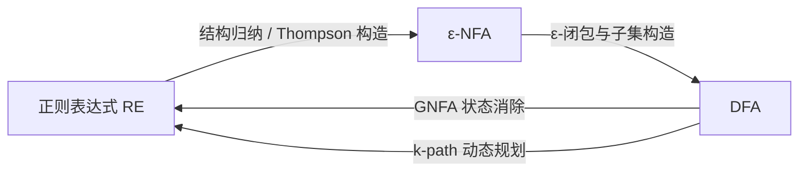
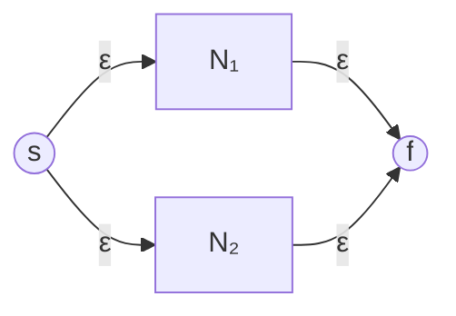
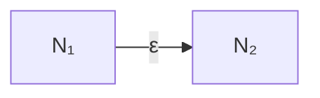
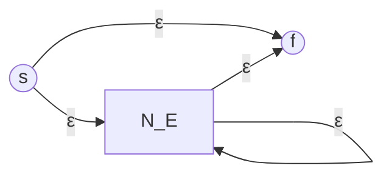
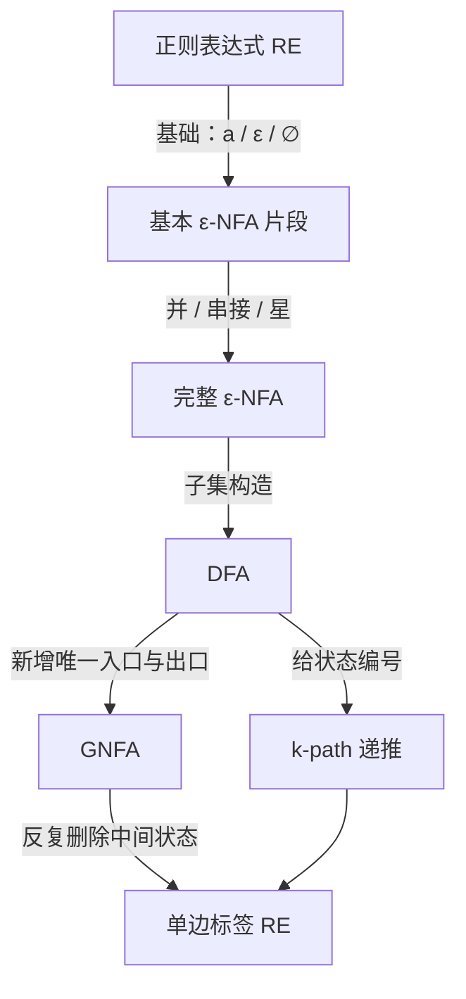

---
tags:
  - 形式语言与自动机
  - 正则表达式
  - 正则语言
  - GNFA
  - 课程笔记
课程: 形式语言与自动机
章节: 第3章 正则表达式
教材:
---

> [!info] 本章定位
> 本章把“画自动机识别语言”改写为“用代数式描述语言”，并证明两种描述能力完全相同。理解本章的钥匙有四把：
> 1. 正则表达式不是字符串模式的随意缩写，而是由三个基础对象和三种运算递归生成的形式系统；
> 2. 每个表达式 $E$ 都通过 $L(E)$ 指向一个语言，必须区分表达式、字符串和语言三个层次；
> 3. RE $	o$ ε-NFA 使用结构归纳，DFA $	o$ RE 使用 GNFA 状态消除或 $k$-path 动态规划；
> 4. DFA、NFA、ε-NFA 与 RE 描述的恰好都是正则语言，只是解题视角不同。
>
> 来源：`lec3-re1.ppt`，共 42 页。前置知识见 [[Ch1 DFA]]。

## 目录

- [[#1. 正则表达式与正则语言|1. 正则表达式与正则语言]]
	- [[#1.1 三个层次：表达式、字符串与语言|1.1 三个层次：表达式、字符串与语言]]
	- [[#1.2 递归定义的基础情形|1.2 递归定义的基础情形]]
	- [[#1.3 递归定义的归纳情形|1.3 递归定义的归纳情形]]
- [[#2. 三种核心运算的语义|2. 三种核心运算的语义]]
	- [[#2.1 并：二选一|2.1 并：二选一]]
	- [[#2.2 串接：前后拼接|2.2 串接：前后拼接]]
	- [[#2.3 Kleene 星：重复零次或多次|2.3 Kleene 星：重复零次或多次]]
- [[#3. 语法、优先级与括号|3. 语法、优先级与括号]]
- [[#4. 如何为语言写正则表达式|4. 如何为语言写正则表达式]]
	- [[#4.1 常见语言模式|4.1 常见语言模式]]
	- [[#4.2 RE 与 DFA 的不同设计视角|4.2 RE 与 DFA 的不同设计视角]]
- [[#5. RE 与有限自动机的等价性|5. RE 与有限自动机的等价性]]
	- [[#5.1 等价定理|5.1 等价定理]]
	- [[#5.2 证明路线|5.2 证明路线]]
- [[#6. RE 转换为 ε-NFA|6. RE 转换为 ε-NFA]]
	- [[#6.1 构造不变式|6.1 构造不变式]]
	- [[#6.2 三个基础构造|6.2 三个基础构造]]
	- [[#6.3 三个归纳构造|6.3 三个归纳构造]]
	- [[#6.4 为什么构造正确|6.4 为什么构造正确]]
- [[#7. 广义转移与 GNFA|7. 广义转移与 GNFA]]
	- [[#7.1 广义转移的含义|7.1 广义转移的含义]]
	- [[#7.2 DFA 转换为 GNFA|7.2 DFA 转换为 GNFA]]
- [[#8. GNFA 状态消除法|8. GNFA 状态消除法]]
	- [[#8.1 删除状态的更新公式|8.1 删除状态的更新公式]]
	- [[#8.2 完整转换流程|8.2 完整转换流程]]
	- [[#8.3 课件示例：三状态 DFA 转 RE|8.3 课件示例：三状态 DFA 转 RE]]
- [[#9. k-path 动态规划法|9. k-path 动态规划法]]
	- [[#9.1 k-path 的定义|9.1 k-path 的定义]]
	- [[#9.2 基础情形|9.2 基础情形]]
	- [[#9.3 递推公式|9.3 递推公式]]
	- [[#9.4 最终答案与课件示例|9.4 最终答案与课件示例]]
- [[#10. 正则表达式的代数法则|10. 正则表达式的代数法则]]
- [[#11. 例题|11. 例题]]
- [[#12. 易错点速查|12. 易错点速查]]
- [[#13. 知识点速查|13. 知识点速查]]

---

## 1. 正则表达式与正则语言

### 1.1 三个层次：表达式、字符串与语言

**通俗理解**：正则表达式（Regular Expression, RE）像一张“生成说明书”。说明书本身不是某个输入串，也不是字符串集合；它通过若干规则描述哪些字符串属于目标语言。

**严谨表述**：若 $E$ 是一个正则表达式，则 $L(E)$ 表示 $E$ 所定义的语言。三者的类型不同：

| 对象 | 示例 | 含义 |
| --- | --- | --- |
| 正则表达式 | $0^*1$ | 一段形式语法 |
| 字符串 | `0001` | $Sigma^*$ 中的一个元素 |
| 语言 | $\{1,01,001,\ldots\}$ | 字符串的集合 |

因此：

$$
L(0^*1)=\{0^n1\mid n\ge 0\}.
$$

> [!important] 核心映射
> $$
> E\quad\xmapsto{\ L\ }\quad L(E)\subseteq\Sigma^*.
> $$
> 判断两个 RE 是否等价，不是看它们长得是否相同，而是看它们定义的语言是否相同。

### 1.2 递归定义的基础情形

给定字母表 $\Sigma$，正则表达式首先包含三个基础对象。

1. 对每个符号 $a\in\Sigma$，$a$ 是 RE，且

   $$
   L(a)=\{a\}.
   $$

2. $\varepsilon$ 是 RE，且

   $$
   L(\varepsilon)=\{\varepsilon\}.
   $$

3. $\varnothing$ 是 RE，且

   $$
   L(\varnothing)=\varnothing.
   $$

> [!warning] $\varepsilon$ 与 $\varnothing$ 不可混淆
> - $\varepsilon$ 是长度为 $0$ 的字符串；
> - $\{\varepsilon\}$ 是含有一个元素的语言；
> - $\varnothing$ 是一个元素也没有的语言；
> - 因而 $\{\varepsilon\}\ne\varnothing$。

### 1.3 递归定义的归纳情形

若 $E_1,E_2$ 已经是 RE，则下列式子仍是 RE：

1. **并**：$E_1+E_2$；
2. **串接**：$E_1E_2$；
3. **Kleene 星**：$E_1^*$。

这里的 $+$ 表示“或”，有些教材写作 $\cup$ 或 `|`。本章主要沿用课件记号 $+$。

递归定义还隐含一句话：**只有通过上述基础对象和构造规则有限次生成的式子才是正则表达式。**

---

## 2. 三种核心运算的语义

### 2.1 并：二选一

$$
L(E_1+E_2)=L(E_1)\cup L(E_2).
$$

一个字符串属于 $L(E_1+E_2)$，当且仅当它属于 $L(E_1)$ 或属于 $L(E_2)$。

例如：

$$
L(01+0)=\{01,0\}.
$$

### 2.2 串接：前后拼接

$$
L(E_1E_2)=L(E_1)L(E_2)
=\{xy\mid x\in L(E_1),\ y\in L(E_2)\}.
$$

串接没有专门的运算符，两个表达式直接并排书写。它强调**顺序**：先生成 $E_1$ 的字符串，再生成 $E_2$ 的字符串。

例如：

$$
L\bigl(0(1+0)\bigr)=\{01,00\}.
$$

一般地，语言串接不满足交换律：

$$
L(E_1E_2)\ne L(E_2E_1)
$$

通常成立。例如 $L(01)=\{01\}$，而 $L(10)=\{10\}$。

### 2.3 Kleene 星：重复零次或多次

$$
L(E^*)=(L(E))^*=\bigcup_{n\ge 0}L(E)^n.
$$

若每个 $w_i\in L(E)$，则 $E^*$ 可以生成：

$$
w_1w_2\cdots w_n\qquad(n\ge 0).
$$

当 $n=0$ 时，结果是空串 $\varepsilon$。因此无论 $E$ 是什么，只要 $E^*$ 合法，就一定有

$$
\varepsilon\in L(E^*).
$$

例如：

$$
L(0^*)=\{\varepsilon,0,00,000,\ldots\}.
$$

两个容易被忽略的结论是：

$$
L(\varnothing^*)=\{\varepsilon\},\qquad
L(\varepsilon^*)=\{\varepsilon\}.
$$

前者的原因是：从空语言里选一个字符串做一次重复不可能，但“重复零次”仍然可以得到 $\varepsilon$。

---

## 3. 语法、优先级与括号

三个运算的默认优先级从高到低为：

$$
*\quad>\quad\text{串接}\quad>\quad+.
$$

因此：

- $01^*+0$ 解析为 $(0(1^*))+0$；
- $0(1+0)$ 中的括号强制先做并；
- $(0+10)^*(\varepsilon+1)$ 先处理括号内的并，再做星与串接。

> [!tip] 读式子的顺序
> 先圈出所有星号作用的最小对象，再识别连续串接的块，最后处理最外层的 $+$。

课件中的表达式

$$
(0+10)^*(\varepsilon+1)
$$

描述所有**不含连续两个 `1`** 的二进制串。原因是：每个非末尾的 `1` 都被绑定在块 `10` 中，只有最后一个 `1` 可以通过 $(\varepsilon+1)$ 单独出现。

---

## 4. 如何为语言写正则表达式

写 RE 的核心不是机械翻译自然语言，而是找到字符串可以被怎样**分块**。

### 4.1 常见语言模式

以下均令 $\Sigma=\{0,1\}$。

| 语言要求 | 正则表达式 | 设计理由 |
| --- | --- | --- |
| 恰好含一个 `1` | $0^*10^*$ | `1` 左右只能出现任意多个 `0` |
| 至少含一个 `1` | $(0+1)^*1(0+1)^*$ | 在任意上下文中强制放入一个 `1` |
| 首尾符号相同 | $0(0+1)^*0+1(0+1)^*1+0+1$ | 长度至少 $2$ 时分首尾为 `0` 或 `1`；另补长度 $1$ |
| `1` 的个数为偶数 | $(0^*10^*1)^*0^*$ | 每轮引入两个 `1`，其间可有任意多个 `0` |
| 至少出现一次 `00` | $(0+1)^*00(0+1)^*$ | 在任意上下文中强制出现子串 `00` |
| 倒数第 $4$ 位是 `1` | $(0+1)^*1(0+1)(0+1)(0+1)$ | 末尾固定保留三个任意符号 |
| 不含 `00` | $(1+01)^*(\varepsilon+0)$ | 每个非末尾 `0` 后必须跟 `1` |
| 不以 `01` 结尾 | $(0+1)^*(00+10+11)+0+1+\varepsilon$ | 长度至少 $2$ 时末两位不能是 `01`，另补短串 |

> [!warning] 边界串必须单独检查
> “首尾相同”“不以某串结尾”等描述经常遗漏 $\varepsilon$ 或长度为 $1$ 的字符串。先明确自然语言是否允许这些串，再决定是否补上 $\varepsilon$、`0`、`1`。

对 $\Sigma=\{a,b,c\}$，要求每个符号至少出现一次时，可以枚举三种符号出现的六种相对次序。记 $S=(a+b+c)^*$，则

$$
SaSbScS+SaScSbS+SbSaScS+SbScSaS+ScSaSbS+ScSbSaS.
$$

这正是 $3!=6$ 种排列。任意同时含 $a,b,c$ 的字符串，总能从中挑出一组按某种次序出现的 $a,b,c$。

### 4.2 RE 与 DFA 的不同设计视角

对“$\{a,b,c\}$ 上每种符号都至少出现一次”的语言：

- 设计 DFA 时，最自然的做法是记录“已经见过哪些符号”，状态对应集合 $S\subseteq\{a,b,c\}$，共有 $2^3=8$ 种；
- 设计 RE 时，最自然的做法是枚举 $a,b,c$ 的六种相对顺序。

> [!important] 同一种语言，不同表示法可能要求不同视角
> DFA 擅长表达“读到目前为止需要记住什么”；RE 擅长表达“一个合法字符串可以怎样分块或按什么次序组成”。两者能力等价，不代表构造过程同样简短。

---

## 5. RE 与有限自动机的等价性

### 5.1 等价定理

> [!important] 正则语言的四种等价表示
> DFA、NFA、ε-NFA 与正则表达式定义的语言类完全相同，都是**正则语言**。

形式化地说：

1. 对每个 RE $E$，存在一个 ε-NFA $N_E$，满足

   $$
   L(N_E)=L(E).
   $$

2. 对每个 DFA $D$，存在一个 RE $E_D$，满足

   $$
   L(E_D)=L(D).
   $$

### 5.2 证明路线

选择两端最方便的模型：



- **RE $	o$ ε-NFA**：ε-NFA 最灵活，ε 边可以直接拼装子自动机；
- **DFA $	o$ RE**：DFA 结构最受限，便于系统地枚举所有路径标签；
- 结合已知的 DFA、NFA、ε-NFA 等价性，便得到四种表示的整体等价性。

---

## 6. RE 转换为 ε-NFA

该证明按 RE 中运算符 $+$、串接和 $*$ 的数量做结构归纳，也常称为 **Thompson 构造**。

### 6.1 构造不变式

对每个子表达式都构造一个只有一个入口 $s$ 和一个出口 $f$ 的 ε-NFA，并保持：

- $s$ 是唯一允许从外部进入该子自动机的状态；
- $f$ 是唯一允许向外部离开该子自动机的状态；
- $s$ 没有来自子自动机内部的入边；
- $f$ 没有指向子自动机内部的出边。

这个统一接口使并、串接和星运算都能像“搭积木”一样组合。

### 6.2 三个基础构造

| RE | 构造 | 接受的语言 |
| --- | --- | --- |
| $a$ | $s\xrightarrow{a}f$ | $\{a\}$ |
| $\varepsilon$ | $s\xrightarrow{\varepsilon}f$ | $\{\varepsilon\}$ |
| $\varnothing$ | $s$ 与 $f$ 之间无路径 | $\varnothing$ |

注意，$\varnothing$ 的构造中并不是没有状态，而是入口无法到达出口。

### 6.3 三个归纳构造

假设已经有 $E_1,E_2$ 对应的子自动机 $N_1,N_2$。

#### 并 $E_1+E_2$

新增入口 $s$ 与出口 $f$：

- $s$ 通过两条 ε 边分别进入 $N_1,N_2$；
- $N_1,N_2$ 的出口再分别通过 ε 边到达 $f$。



机器非确定地选择一条分支，因此接受语言是并集。

#### 串接 $E_1E_2$

用一条 ε 边把 $N_1$ 的出口连接到 $N_2$ 的入口：



一条接受路径必须先完整匹配 $E_1$，再完整匹配 $E_2$。

#### 星 $E^*$

对 $E$ 的子自动机新增入口 $s$ 与出口 $f$，加入四类 ε 边：

1. $s\to f$：允许重复零次；
2. $s\to s_E$：开始第一次匹配；
3. $f_E\to s_E$：完成一次后重新开始；
4. $f_E\to f$：停止重复并接受。



> [!warning] 星构造最常漏的边
> 若没有 $s\to f$，就不能接受 $\varepsilon$；若没有从子自动机出口返回入口的 ε 边，就只能重复至多一次。

### 6.4 为什么构造正确

证明对表达式结构做归纳。

- **基础情形**：三种基本自动机显然分别接受 $\{a\}$、$\{\varepsilon\}$、$\varnothing$；
- **归纳假设**：$N_1,N_2$ 分别正确接受 $L(E_1),L(E_2)$；
- **归纳步**：
  - 分支结构对应语言并集；
  - 前后连接对应语言串接；
  - 零次直达、循环若干次、最后退出对应 Kleene 星。

因此对任意 RE $E$，构造所得 $N_E$ 都满足 $L(N_E)=L(E)$。

---

## 7. 广义转移与 GNFA

### 7.1 广义转移的含义

DFA 的一条边只标记单个字母。**广义转移**允许一条边标记整个正则表达式。

若有

$$
p\xrightarrow{ab^*+bc^*}q,
$$

则机器位于 $p$ 时，只要剩余输入的某个前缀属于 $L(ab^*+bc^*)$，就可以一次消费该前缀并转到 $q$。

> [!warning] 广义转移不是扩展转移函数
> - DFA 的扩展转移函数 $\hat\delta(q,w)$ 是把单字符转移扩展到整个字符串；
> - GNFA 的广义转移是直接把一条边的标签从单字符提升为正则表达式。

带有广义转移的 NFA 称为 **GNFA（Generalized Nondeterministic Finite Automaton）**。普通 DFA 的单字符边只是广义转移的特例。

课件还给出一个两状态例子：$q_0$ 为开始状态，$q_1$ 为接受状态；读 `0` 保持原状态，读 `1` 在 $q_0,q_1$ 之间切换。把所有从 $q_0$ 到 $q_1$ 的路径压缩成一条广义转移，可标记为

$$
\boxed{0^*1(0+10^*1)^*}.
$$

其中 $0^*1$ 负责第一次从 $q_0$ 到 $q_1$；到达 $q_1$ 后，每一轮要么读一个 `0` 留在 $q_1$，要么读 `1` 回到 $q_0$、读若干 `0`、再读 `1` 返回 $q_1$。因此整个式子恰好描述含奇数个 `1` 的二进制串。

### 7.2 DFA 转换为 GNFA

对 DFA $D=(Q,\Sigma,\delta,q_0,F)$，执行以下标准化步骤：

1. 新增唯一开始状态 $s$，加入 $s\xrightarrow{\varepsilon}q_0$；$s$ 无入边；
2. 新增唯一接受状态 $f$；对每个原接受状态 $q\in F$，加入 $q\xrightarrow{\varepsilon}f$；$f$ 无出边；
3. 原开始状态不再承担“唯一入口”的特殊角色，原接受状态也不再作为 GNFA 的最终出口；
4. 同一对状态间若有多条边，用 $+$ 合并标签；
5. 若某对状态间没有边，可把标签视为 $\varnothing$。

最后得到“一个入口、一个出口、边标记 RE”的统一结构。

---

## 8. GNFA 状态消除法

### 8.1 删除状态的更新公式

设准备删除状态 $q_k$，$q_i,q_j$ 是任意两个保留状态，允许 $i=j$。删除前相关标签为：

- $q_i\to q_j$：$R_{ij}$；
- $q_i\to q_k$：$R_{ik}$；
- $q_k\to q_k$：$R_{kk}$；
- $q_k\to q_j$：$R_{kj}$。

从 $q_i$ 到 $q_j$ 的路径分为两类：

1. 不经过 $q_k$，标签属于 $R_{ij}$；
2. 先进入 $q_k$，在 $q_k$ 自环零次或多次，再离开，标签属于 $R_{ik}(R_{kk})^*R_{kj}$。

所以删除 $q_k$ 后应更新为：

$$
\boxed{R'_{ij}=R_{ij}+R_{ik}(R_{kk})^*R_{kj}}.
$$

> [!important] 公式的阅读顺序
> “原来的直达路线” $+$ “进入 $k$” $\cdot$ “在 $k$ 处循环任意次” $\cdot$ “离开 $k$”。

若某条边不存在，就用 $\varnothing$ 代入；再利用 $\varnothing R=R\varnothing=\varnothing$ 化简。

### 8.2 完整转换流程

1. 把 DFA 标准化为只有一个新开始状态和一个新接受状态的 GNFA；
2. 任选一个既非新开始状态也非新接受状态的状态 $q_k$；
3. 对每一对保留状态 $q_i,q_j$ 使用更新公式；
4. 删除 $q_k$ 及其关联边；
5. 重复，直到只剩开始状态 $s$ 和接受状态 $f$；
6. 唯一边 $s\to f$ 的标签就是所求 RE。

不同删除顺序可能得到外形差异很大的 RE，但这些 RE 定义的语言相同。删除顺序会影响式子的长度，不影响正确性。

### 8.3 课件示例：三状态 DFA 转 RE

课件中的 DFA 以 $q_0$ 为开始且唯一接受状态，转移为：

| 状态 | 读 `0` | 读 `1` |
| --- | --- | --- |
| $q_0$ | $q_0$ | $q_1$ |
| $q_1$ | $q_2$ | $q_0$ |
| $q_2$ | $q_1$ | $q_2$ |

标准化后增加 $s\xrightarrow{\varepsilon}q_0$ 与 $q_0\xrightarrow{\varepsilon}f$。

**第一步：删除 $q_2$。**

$q_1\xrightarrow{0}q_2$，$q_2$ 上有 `1` 自环，$q_2\xrightarrow{0}q_1$，因此给 $q_1$ 增加自环：

$$
0\,1^*\,0.
$$

**第二步：删除 $q_1$。**

从 $q_0$ 经 $q_1$ 回到 $q_0$ 的路径标签为：

$$
1(01^*0)^*1.
$$

$q_0$ 原本还有标签为 `0` 的自环，所以合并后为：

$$
0+1(01^*0)^*1.
$$

**第三步：删除 $q_0$。**

从 $s$ 经 $q_0$ 的自环任意次到 $f$：

$$
\varepsilon\bigl(0+1(01^*0)^*1\bigr)^*\varepsilon.
$$

由 $\varepsilon$ 是串接单位元，最终得到：

$$
\boxed{\bigl(0+1(01^*0)^*1\bigr)^*}.
$$

这与课件写法 $\bigl(1(01^*0)^*1+0\bigr)^*$ 完全相同，只是并的两项交换了位置。

---

## 9. k-path 动态规划法

另一种 DFA $	o$ RE 的证明不显式删除状态，而是按“允许作为中间点的状态编号”逐步放宽路径集合。它与 Floyd 动态规划的思想非常相似。

### 9.1 k-path 的定义

将 DFA 的 $n$ 个状态编号为 $1,2,\ldots,n$。

一条 **$k$-path** 是指：路径的所有**内部状态**编号都不超过 $k$。起点和终点不受该限制，即使其编号大于 $k$ 也允许。

记

$$
R_{ij}^{(k)}
$$

为所有从状态 $i$ 到状态 $j$ 的 $k$-path 的标签串所组成语言的正则表达式。

> [!warning] “内部状态”要掐头去尾
> $k$-path 限制的是起点与终点之间经过的状态，不限制端点。把端点也限制为编号不超过 $k$ 会破坏递推定义。

### 9.2 基础情形

当 $k=0$ 时，不允许经过任何内部状态，因此只有一条直接边，或长度为 $0$ 的路径。

$$
R_{ij}^{(0)}=
\begin{cases}
\text{所有从 }i\text{ 到 }j\text{ 的直接边标签之并}, & i\ne j,\\
\text{所有从 }i\text{ 到 }i\text{ 的自环标签之并}+\varepsilon, & i=j.
\end{cases}
$$

若没有相应直接边，其标签并为 $\varnothing$。

例如，课件图中 $1\xrightarrow{0}2$ 且状态 $1$ 没有自环，所以：

$$
R_{12}^{(0)}=0,qquad R_{11}^{(0)}=\varnothing+\varepsilon=\varepsilon.
$$

### 9.3 递推公式

从 $i$ 到 $j$ 的 $k$-path 分为两类：

1. 完全不经过状态 $k$，已经包含在 $R_{ij}^{(k-1)}$ 中；
2. 经过状态 $k$ 至少一次，可以分解为：
   - 第一次到达 $k$：$R_{ik}^{(k-1)}$；
   - 从 $k$ 回到 $k$ 零次或多次：$\bigl(R_{kk}^{(k-1)}\bigr)^*$；
   - 最后从 $k$ 到达 $j$：$R_{kj}^{(k-1)}$。

因此：

$$
\boxed{
R_{ij}^{(k)}
=R_{ij}^{(k-1)}
+R_{ik}^{(k-1)}
\bigl(R_{kk}^{(k-1)}\bigr)^*
R_{kj}^{(k-1)}
}.
$$

它和 GNFA 删除状态公式本质相同：两者都在汇总“不使用某状态”与“通过某状态”的全部路径。

### 9.4 最终答案与课件示例

当 $k=n$ 时，所有状态都可作为内部状态，路径已不受限制。若开始状态为 $s$，接受状态集合为 $F$，则 DFA 的语言由

$$
\boxed{\sum_{f\in F}R_{sf}^{(n)}}
$$

描述。这里的求和表示正则表达式的并。

课件的三状态示例中，每个状态编号均大于 $0$，并给出从状态 $2$ 到状态 $3$ 的逐步结果：

$$
R_{23}^{(0)}=0,
$$

$$
R_{23}^{(1)}=0+11,
$$

$$
R_{23}^{(2)}=(10)^*0+1(01)^*1.
$$

进一步有：

$$
R_{33}^{(2)}=0(01)^*(1+00)+1(10)^*(0+11).
$$

套用 $k=3$ 的递推式：

$$
\begin{aligned}
R_{23}^{(3)}
&=R_{23}^{(2)}+R_{23}^{(2)}\bigl(R_{33}^{(2)}\bigr)^*R_{33}^{(2)}\\
&=R_{23}^{(2)}\bigl(R_{33}^{(2)}\bigr)^*.
\end{aligned}
$$

代入即可得到课件中的完整表达式：

$$
\boxed{
\bigl[(10)^*0+1(01)^*1\bigr]
\bigl[0(01)^*(1+00)+1(10)^*(0+11)\bigr]^*
}.
$$

第二行化简利用了 $A+AB^*B=AB^*$，因为 $B^*=\varepsilon+B^*B$。

---

## 10. 正则表达式的代数法则

这些等式表示左右两边定义同一个语言，而不是字符串层面的文本替换。

| 法则 | 等式 | 说明 |
| --- | --- | --- |
| 并的交换律 | $R+S=S+R$ | 二选一的顺序无关 |
| 并的结合律 | $(R+S)+T=R+(S+T)$ | 可省略并的多余括号 |
| 串接结合律 | $(RS)T=R(ST)$ | 串接次序仍是从左到右 |
| 左分配律 | $R(S+T)=RS+RT$ | 串接对并分配 |
| 右分配律 | $(R+S)T=RT+ST$ | 两侧都可分配 |
| 并的单位元 | $R+\varnothing=R$ | 空语言不增加任何串 |
| 串接单位元 | $\varepsilon R=R\varepsilon=R$ | 空串不改变拼接结果 |
| 串接零化元 | $\varnothing R=R\varnothing=\varnothing$ | 无串可选就无法完成拼接 |

串接一般**不满足交换律**：

$$
RS\ne SR.
$$

以下是便于化简的补充结论：

$$
R+R=R,
$$

$$
R^*=\varepsilon+RR^*=\varepsilon+R^*R,
$$

$$
\varnothing^*=\varepsilon^*=\varepsilon,
$$

$$
(R^*)^*=R^*.
$$

> [!warning] “像加法、乘法”只是类比
> $+$ 类似加法、串接类似乘法，但不能把普通代数的全部法则照搬过来。最明显的反例是串接不交换；此外也不存在一般意义上的减法或除法。

---

## 11. 例题

> [!example]- 例题 1：写出所有“不以 `01` 结尾”的二进制串的 RE
> 令 $\Sigma=\{0,1\}$。
>
> **解析**：长度至少为 $2$ 的字符串，其末两位只能是 `00`、`01`、`10`、`11`。排除 `01` 后保留三种：
>
> $$
> (0+1)^*(00+10+11).
> $$
>
> 但这个式子不能生成长度小于 $2$ 的串。由于 $\varepsilon$、`0`、`1` 都不以 `01` 结尾，必须补上：
>
> $$
> \boxed{(0+1)^*(00+10+11)+\varepsilon+0+1}.
> $$
>
> 检验：`101` 被排除，因为末两位是 `01`；`110` 被包含，因为末两位是 `10`。

> [!example]- 例题 2：构造“恰好两个 `1`”与“偶数个 `1`”的 RE
> **恰好两个 `1`**：
>
> $$
> \boxed{0^*10^*10^*}.
> $$
>
> 三段 $0^*$ 分别容纳两个 `1` 之前、之间、之后的所有 `0`，且式中只有两个固定的 `1`。
>
> **偶数个 `1`**：
>
> $$
> \boxed{(0^*10^*1)^*0^*}.
> $$
>
> 星号每重复一次就贡献两个 `1`；重复零次时只剩末尾 $0^*$，包括 $\varepsilon$。因此 `1` 的数量必为偶数。反过来，任何含偶数个 `1` 的串都能按相邻两枚 `1` 分组，夹在其中的 `0` 由各段 $0^*$ 吸收。

> [!example]- 例题 3：写出 $\{a,b,c\}$ 上每种符号至少出现一次的 RE
> 记 $S=(a+b+c)^*$。枚举三种符号在所选位置上的先后次序：
>
> $$
> \boxed{
> SaSbScS+SaScSbS+SbSaScS+SbScSaS+ScSaSbS+ScSbSaS
> }.
> $$
>
> **充分性**：每一项都显式包含 $a,b,c$ 各一次。
>
> **必要性**：任取同时含三种符号的字符串，从中各选一个 $a,b,c$；这三个位置必然形成六种相对次序之一，因此该串至少匹配六项中的一项。

> [!example]- 例题 4：将 $(0+1)^*01$ 转换为 ε-NFA，并说明每个状态的含义
> 按 Thompson 构造可先分别构造 `0`、`1`，再完成并、星和两次串接。化简 ε 链后，可得到等价的 ε-NFA：
>
> ```mermaid
> flowchart LR
>     s((s)) -->|ε| q0((q₀))
>     q0 -->|0,1| q0
>     q0 -->|0| q1((q₁))
>     q1 -->|1| f(((f)))
> ```
>
> - 字母表：$\Sigma=\{0,1\}$；
> - 初态：$s$；
> - 接受状态：$f$；
> - $q_0$：仍处于任意前缀部分；
> - $q_1$：已经猜测当前 `0` 是倒数第二个字符，等待最后的 `1`；
> - 接受条件：存在一条路径恰好读完整个输入并到达 $f$。
>
> 该自动机的非确定性体现在：读到 `0` 时既可留在 $q_0$，也可猜测后缀 `01` 从这里开始。

> [!example]- 例题 5：使用状态消除公式更新一条 GNFA 边
> 已知：
>
> $$
> R_{ij}=a,quad R_{ik}=b,quad R_{kk}=c+d,quad R_{kj}=e.
> $$
>
> 删除状态 $q_k$ 后：
>
> $$
> \begin{aligned}
> R'_{ij}
> &=R_{ij}+R_{ik}(R_{kk})^*R_{kj}\\
> &=a+b(c+d)^*e.
> \end{aligned}
> $$
>
> 第一项保留原直达路径；第二项表示先用 `b` 进入 $q_k$，在 `c` 或 `d` 自环上重复任意次，再用 `e` 离开。

> [!example]- 例题 6：为什么 $R_{ii}^{(0)}$ 必须包含 $\varepsilon$？
> $0$-path 不允许内部状态，但允许长度为 $0$ 的路径。长度为 $0$ 的路径从状态 $i$ 出发后仍位于 $i$，标签就是 $\varepsilon$。
>
> 因此即使 $i$ 没有自环，也有：
>
> $$
> R_{ii}^{(0)}=\varepsilon.
> $$
>
> 若 $i$ 还有标签为 $a,b$ 的自环，则：
>
> $$
> R_{ii}^{(0)}=a+b+\varepsilon.
> $$
>
> 漏掉 $\varepsilon$ 会使后续递推丢失“不移动”的合法路径。

> [!example]- 例题 7：判断代数等式是否成立
> 判断：
>
> 1. $R+RS=R(\varepsilon+S)$；
> 2. $RS=SR$；
> 3. $R^*R^*=R^*$。
>
> **解析**：
>
> 1. 成立。右分配得到 $R\varepsilon+RS=R+RS$。
> 2. 一般不成立。取 $R=0,S=1$，则 $RS=01$，$SR=10$。
> 3. 成立。两个由 $R$ 中若干字符串串接成的串再拼接，仍是 $R$ 中字符串的有限次串接；反向包含可令第二段取 $\varepsilon$。

> [!example]- 例题 8：证明 RE 与 DFA 描述能力相同需要证明哪两个方向？
> 需要证明两个存在性命题：
>
> 1. 对任意 RE $E$，构造 ε-NFA $N_E$ 使 $L(N_E)=L(E)$，再利用 ε-NFA 与 DFA 的等价性得到 DFA；
> 2. 对任意 DFA $D$，通过 GNFA 状态消除或 $k$-path 递推构造 RE $E_D$，使 $L(E_D)=L(D)$。
>
> 只证明 RE 能转成自动机，只能说明 RE 的能力不超过自动机；只有再证明自动机能转回 RE，才能得到语言类相等。

---

## 12. 易错点速查

| 易错点 | 错误认识 | 正确结论 |
| --- | --- | --- |
| $\varepsilon$ 与 $\varnothing$ | 都表示“没有” | $\varepsilon$ 是空串，$\varnothing$ 是空语言 |
| $L(\varepsilon)$ | 等于 $\varepsilon$ | $L(\varepsilon)=\{\varepsilon\}$ |
| 星操作 | 重复一次或多次 | 重复零次或多次，所以总含 $\varepsilon$ |
| 星作用范围 | $01^*$ 等于 $(01)^*$ | $01^*=0(1^*)$ |
| 运算优先级 | $+$ 比串接更紧 | $*$ 最高，串接其次，$+$ 最低 |
| 串接 | 可以交换顺序 | 一般 $RS\ne SR$ |
| “至少出现” | 忘记左右任意上下文 | 常用 $\Sigma^*x\Sigma^*$ |
| 后缀限制 | 忽略短于后缀的字符串 | 按题意单独补 $\varepsilon$ 和短串 |
| RE 与 DFA 设计 | 必须使用相同思路 | DFA 记忆历史，RE 分块或枚举模式 |
| Thompson 星构造 | 只画回边 | 还要有入口直达出口的 ε 边以接受 $\varepsilon$ |
| GNFA 广义转移 | 等同于 $\hat\delta$ | 前者是 RE 标签边，后者是 DFA 的字符串转移函数 |
| DFA 转 GNFA | 直接删原开始/接受状态 | 应新增唯一入口 $s$ 与唯一出口 $f$ |
| 状态消除公式 | 忘记原直达边 | 必须保留 $R_{ij}$ 并与绕行项取并 |
| 状态消除自环 | 自环走一次 | 自环可走零次或多次，因此是 $(R_{kk})^*$ |
| $k$-path 限制 | 限制起点和终点编号 | 只限制内部状态编号 |
| $R_{ii}^{(0)}$ | 只有自环标签 | 还必须加入 $\varepsilon$ |
| 等价性证明 | 只证明一个转换方向 | 必须证明 RE $	o$ FA 与 DFA $	o$ RE 两个方向 |

---

## 13. 知识点速查

### 核心公式

| 内容 | 公式 |
| --- | --- |
| 并 | $L(E_1+E_2)=L(E_1)\cup L(E_2)$ |
| 串接 | $L(E_1E_2)=\{xy\mid x\in L(E_1),y\in L(E_2)\}$ |
| 星 | $L(E^*)=\bigcup_{n\ge0}L(E)^n$ |
| 状态消除 | $R'_{ij}=R_{ij}+R_{ik}(R_{kk})^*R_{kj}$ |
| $k$-path 基础 | $R_{ij}^{(0)}=$ 直接边标签之并，且 $i=j$ 时加 $\varepsilon$ |
| $k$-path 递推 | $R_{ij}^{(k)}=R_{ij}^{(k-1)}+R_{ik}^{(k-1)}(R_{kk}^{(k-1)})^*R_{kj}^{(k-1)}$ |
| DFA 最终 RE | $\sum_{f\in F}R_{sf}^{(n)}$ |

### 转换总图



### 三种构造方法对比

| 方法 | 输入 | 输出 | 核心思想 |
| --- | --- | --- | --- |
| Thompson 构造 | RE | ε-NFA | 对表达式结构归纳，拼装子自动机 |
| GNFA 状态消除 | DFA / GNFA | RE | 删除状态时把所有绕行路径压缩到边标签 |
| $k$-path 动态规划 | DFA | RE | 逐步允许更高编号的内部状态 |

### 五句话核心思想

1. 正则表达式通过 $L(E)$ 定义语言，表达式本身不等于语言。
2. RE 只需符号、$\varepsilon$、$\varnothing$ 三个基础对象，以及并、串接、星三种构造。
3. Thompson 构造说明每个 RE 都能由 ε-NFA 识别。
4. GNFA 状态消除与 $k$-path 递推说明每个 DFA 的语言都能写成 RE。
5. 因而 DFA、NFA、ε-NFA 与 RE 恰好刻画正则语言；它们能力相同，但解题视角不同。

### 与前后章节的连接

- **向前**：本章依赖 [[Ch1 DFA]] 中的 DFA、扩展转移函数、接受语言和正则语言概念；NFA / ε-NFA 的非确定性与 ε-闭包是 Thompson 构造的操作基础。
- **向后**：RE 与自动机的双向转换为后续研究正则语言的闭包性质、判定问题以及非正则语言证明提供统一表示工具。
