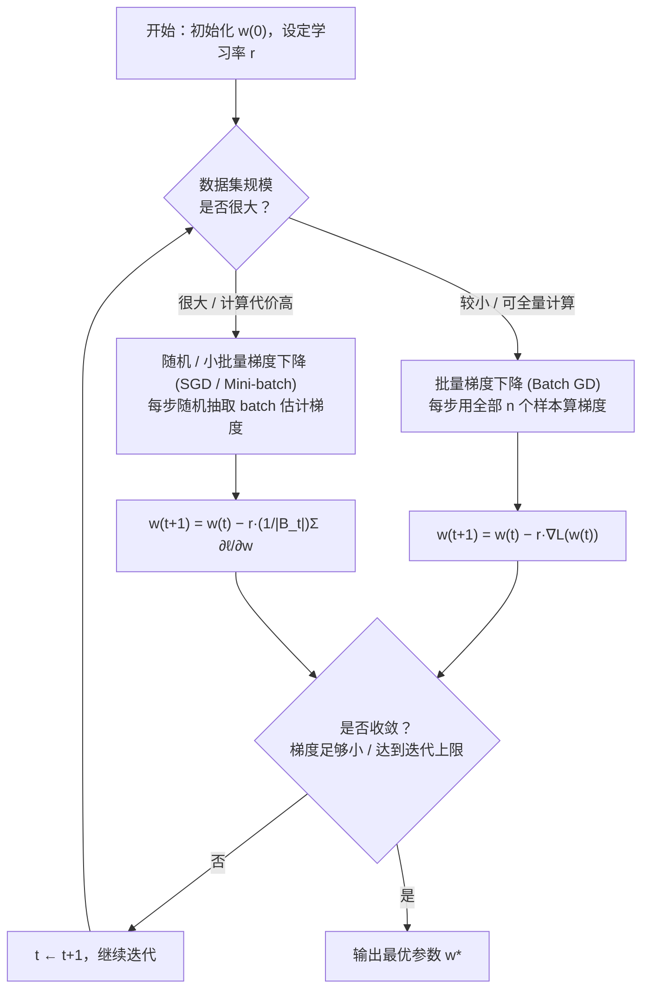
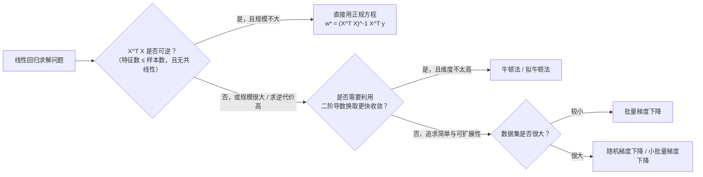

# 线性回归 (Linear Regression)

> [!info] 本讲导读
> 线性回归是**有监督学习**中最基础、也是理解一切回归/分类模型的"地基"。本讲从"什么是回归"出发，依次讲解**单特征**、**多特征**两种情形下模型的建立、代价函数的构造、**解析解（正规方程）**的推导，最后介绍**数值优化方法**（梯度下降、随机梯度下降、牛顿法等），用于在解析解不可行时求解模型参数。

## 目录

- [[#1. 引言：什么是回归|1. 引言：什么是回归]]
- [[#2. 单特征线性回归|2. 单特征线性回归]]
  - [[#2.1 模型|2.1 模型]]
  - [[#2.2 代价（损失）函数|2.2 代价（损失）函数]]
  - [[#2.3 代价函数的几何形态：为什么是"碗形"|2.3 代价函数的几何形态：为什么是"碗形"]]
  - [[#2.4 解析解的推导（最小二乘法）|2.4 解析解的推导（最小二乘法）]]
  - [[#2.5 例题（单特征）|2.5 例题（单特征）]]
- [[#3. 多特征线性回归|3. 多特征线性回归]]
  - [[#3.1 从标量形式到矩阵形式|3.1 从标量形式到矩阵形式]]
  - [[#3.2 矩阵形式的代价函数|3.2 矩阵形式的代价函数]]
  - [[#3.3 补充知识：矩阵/向量求导|3.3 补充知识：矩阵/向量求导]]
  - [[#3.4 正规方程（Normal Equation）的推导|3.4 正规方程（Normal Equation）的推导]]
  - [[#3.5 几何解释：投影|3.5 几何解释：投影]]
  - [[#3.6 例题（多特征）|3.6 例题（多特征）]]
- [[#4. 数值优化|4. 数值优化]]
  - [[#4.1 为什么需要数值优化|4.1 为什么需要数值优化]]
  - [[#4.2 梯度下降（Gradient Descent）|4.2 梯度下降（Gradient Descent）]]
  - [[#4.3 学习率的选择|4.3 学习率的选择]]
  - [[#4.4 随机梯度下降与小批量（SGD / Mini-batch）|4.4 随机梯度下降与小批量（SGD / Mini-batch）]]
  - [[#4.5 其他优化方法：牛顿法等|4.5 其他优化方法：牛顿法等]]
  - [[#4.6 例题（优化）|4.6 例题（优化）]]
- [[#5. 重点·难点·易错点汇总|5. 重点·难点·易错点汇总]]
- [[#6. 简洁代码实现|6. 简洁代码实现]]
- [[#7. 本讲小结|7. 本讲小结]]

---

## 1. 引言：什么是回归

**通俗理解**：回归（Regression）要解决的问题是——给你一些"特征"（描述事物的数字信息），让你去**预测**一个我们关心的连续数值。比如给你一套房子的面积、卧室数、楼层数、房龄，你要预测它的价格。这和"分类"不同：分类预测的是"是猫还是狗"这种**离散类别**，而回归预测的是像"这套房子卖 46 万"这种**连续数值**。

**严谨定义**：设特征向量 $\boldsymbol{x} = (x_1, x_2, \dots, x_m) \in \mathbb{R}^m$，感兴趣变量（标签/目标）$y \in \mathbb{R}$。回归问题的目标是学习一个函数

$$
\hat y = f(x_1, x_2, \dots, x_m)
$$

使得对任意给定的特征输入，函数输出 $\hat y$ 尽可能接近真实值 $y$。这里 $f(\cdot)$ 来自某个**假设空间（hypothesis space）**——它决定了模型的表达能力。

**线性回归**就是把假设空间 $f(\cdot)$ **限制为线性函数族**：

$$
f(x_1, x_2, \dots, x_m) = w_0 + w_1 x_1 + w_2 x_2 + \cdots + w_m x_m
$$

其中：
- $w_k$（$k=0,1,\dots,m$）：**模型参数**，是我们要学习（求解）的对象；$w_0$ 通常称为**偏置项（bias/intercept）**，$w_1,\dots,w_m$ 称为**权重（weight）**。
- $m$：特征数量。

> [!tip] 为什么要"限制"为线性？
> 线性模型的假设空间小，表达能力有限，但换来的是：① 参数可解释性强（$w_k$ 直接代表"$x_k$ 每增加一个单位，$y$ 大约变化多少"）；② 存在**解析解**（下文会推导），不需要迭代就能一步求出最优参数；③ 是后续所有复杂模型（逻辑回归、神经网络的单层）的构建基础。理解线性回归是理解整个机器学习课程的第一块基石。

---

## 2. 单特征线性回归

> [!info] 为什么先讲单特征？
> 单特征情形（$m=1$）是多特征情形的特例，数学结构简单、几何图像直观（一条直线拟合一堆散点），非常适合建立直觉。之后再推广到多特征，会发现无非是把标量运算全部"升级"为矩阵/向量运算，思路完全一致。

### 2.1 模型

单特征下，预测函数简化为：

$$
f(x) = w_0 + w_1 x
$$

**直观理解**：这就是初中学过的一次函数 $y = kx+b$，只是把 $k,b$ 换成了 $w_1, w_0$。对于不同的 $(w_0, w_1)$，$f(x)$ 代表平面上不同的直线：$w_0$ 决定截距（直线与 $y$ 轴的交点），$w_1$ 决定斜率（直线的倾斜程度）。

我们的目标：找到一组"最合适"的 $(w_0, w_1)$，使得这条直线**尽可能地拟合**所有训练样本 $(x^{(i)}, y^{(i)})$，$i=1,\dots,n$（$n$ 为样本数）。

> [!warning] 易错点：上标 $(i)$ 不是指数！
> $x^{(i)}$ 表示**第 $i$ 个训练样本**的特征值，而不是 $x$ 的 $i$ 次方。这是机器学习教材中非常通用但极易和数学中的幂运算混淆的记号，请特别留意括号。

### 2.2 代价（损失）函数

**"尽可能拟合"如何变成一个可以计算、可以优化的数学目标？** 答案是：定义一个衡量"预测值与真实值差距"的函数——**代价函数（Cost Function）**，也叫**损失函数（Loss Function）**，然后去**最小化**它。

对单个样本 $i$，预测误差为 $f(x^{(i)}) - y^{(i)}$。我们采用**均方误差（Mean Squared Error, MSE）**来衡量整体误差：

$$
L(w_0, w_1) = \frac{1}{n}\sum_{i=1}^{n}\left(f(x^{(i)}) - y^{(i)}\right)^2
$$

**为什么要平方，而不是直接用误差或绝对值？**
1. 平方保证了误差项非负，正负误差不会相互抵消（如果直接求和，一个 $+10$ 和一个 $-10$ 的误差会被错误地"抵消"为 0）。
2. 平方函数处处**可导**，便于用微积分方法（求导置零、梯度下降）求解；而绝对值函数在 0 点不可导，优化起来更麻烦。
3. 平方误差对**较大的误差**惩罚更重（误差翻倍，惩罚变为 4 倍），这会让模型更"重视"离群较远的点——这既是优点（快速纠正大偏差）也是缺点（对异常值敏感），是后续学习"鲁棒回归""正则化"等内容的伏笔。

将 $f(x^{(i)}) = w_0 + w_1 x^{(i)}$ 代入，代价函数展开为：

$$
L(w_0, w_1) = \frac{1}{n}\sum_{i=1}^{n}\left(w_0 + w_1 x^{(i)} - y^{(i)}\right)^2
$$

> [!example] 备注：简化理解代价函数的形状
> 为了先建立直觉，课件中先令 $w_0=0$，此时代价函数只是关于 $w_1$ 的一元函数：
> $$
> L(w_1) = \overline{x^2}\, w_1^2 - 2\,\overline{xy}\, w_1 + \overline{y^2}
> $$
> 其中记号采用"平均"意义下的横线（**注意与"平均值的平方"区分**）：
> $$
> \overline{x^2} = \frac{1}{n}\sum_{i=1}^n \left(x^{(i)}\right)^2,\qquad
> \overline{xy} = \frac{1}{n}\sum_{i=1}^n x^{(i)}y^{(i)},\qquad
> \overline{y^2} = \frac{1}{n}\sum_{i=1}^n \left(y^{(i)}\right)^2
> $$

### 2.3 代价函数的几何形态：为什么是"碗形"

把 $L(w_1)$ 看成关于 $w_1$ 的函数，它是一个**开口向上的二次函数**（因为 $\overline{x^2}\ge 0$ 恒成立，抛物线系数非负）——图像是一条"U"形曲线。

若同时考虑 $w_0$，代价函数 $L(w_0,w_1)$ 变成关于两个变量的二次函数，图像是三维空间中的一个**碗形曲面**（параболоид），从上往下看，其等高线是一族**同心椭圆**。

> [!tip] 这个"碗形"意味着什么？——凸函数
> 二次型系数矩阵半正定 $\Rightarrow$ $L(w_0,w_1)$ 是**凸函数（convex function）**。凸函数最重要的性质：**任何局部最小值都是全局最小值**，且这个最小值点唯一存在（在系数矩阵正定、非退化的情况下）。这保证了我们后面"令导数为零求解"或"梯度下降"，找到的都是全局最优解，不会陷入"局部最优陷阱"——这是线性回归比很多非凸模型（如神经网络）"友好"得多的关键原因。

### 2.4 解析解的推导（最小二乘法）

既然 $L(w_0,w_1)$ 是凸函数，其唯一最小值点满足**一阶必要条件**：两个偏导数同时为零。

$$
\frac{\partial L}{\partial w_0} = \frac{2}{n}\sum_{i=1}^{n}\left(w_0+w_1x^{(i)}-y^{(i)}\right) = 0
$$

$$
\frac{\partial L}{\partial w_1} = \frac{2}{n}\sum_{i=1}^{n}\left(w_0+w_1x^{(i)}-y^{(i)}\right)x^{(i)} = 0
$$

> [!warning] 易错点：求导链式法则不要漏乘 $x^{(i)}$
> 对 $w_1$ 求导时，括号内是复合函数 $g(w_1)=w_0+w_1x^{(i)}-y^{(i)}$，对 $w_1$ 求导要乘上 $g$ 对 $w_1$ 的导数，也就是 $x^{(i)}$（把 $x^{(i)}$ 看成常数系数）。很多同学容易漏掉这个 $x^{(i)}$ 因子。

这是一个关于 $(w_0,w_1)$ 的**线性方程组**（两个方程，两个未知数），求解可得（闭式解 / 解析解）：

$$
w_1 = \frac{\overline{xy} - \bar{x}\,\bar{y}}{\overline{x^2} - \bar{x}^2}, \qquad
w_0 = \bar{y} - w_1 \bar{x}
$$

其中 $\bar{x} = \frac{1}{n}\sum x^{(i)}$，$\bar{y} = \frac{1}{n}\sum y^{(i)}$ 是样本均值。

> [!info] 与课件符号的对照
> 课件给出的形式是
> $$w_0=\frac{\overline{xy}\,\bar x-\overline{x^2}\,\bar y}{\bar x^2-\overline{x^2}},\qquad w_1=\frac{\bar x\bar y-\overline{xy}}{\bar x^2-\overline{x^2}}$$
> 把分子分母同时乘以 $-1$，就与上面更直观的形式完全等价。之所以推荐 $w_0=\bar y - w_1\bar x$ 这个写法，是因为它有一个漂亮的几何意义：**最优拟合直线必过样本均值点 $(\bar x,\bar y)$**——这是一个非常重要、也常在考试中被考察的结论。
>
> $w_1$ 的分子 $\overline{xy}-\bar x\bar y$ 正是 $x,y$ 的**样本协方差**，分母 $\overline{x^2}-\bar x^2$ 正是 $x$ 的**样本方差**，所以 $w_1 = \dfrac{\text{Cov}(x,y)}{\text{Var}(x)}$——这与统计学中"简单线性回归"的结论完全一致。

> [!warning] 易错点：分母为零怎么办？
> 若 $\overline{x^2} = \bar x^2$，即 $\mathrm{Var}(x)=0$，意味着所有样本的 $x$ 值都相同（特征没有区分度）。此时分母为零，解析解不存在——这对应的正是多特征情形下 $\boldsymbol{X}^T\boldsymbol{X}$ **不可逆**的退化情形（见 3.4 节）。

### 2.5 例题（单特征）

> [!example]- 例 2.1：手动求解最小二乘直线
> 已知训练集 $(x^{(i)}, y^{(i)})$ 共 4 个样本：$(1,2), (2,3), (3,5), (4,6)$。
> 1. 求 $\bar x, \bar y, \overline{x^2}, \overline{xy}$；
> 2. 求最优参数 $w_0^*, w_1^*$；
> 3. 计算该模型在训练集上的均方误差 $L(w_0^*, w_1^*)$。
>
> **解答：**
> 1. $\bar x = \frac{1+2+3+4}{4}=2.5$，$\bar y=\frac{2+3+5+6}{4}=4$
>    $\overline{x^2}=\frac{1+4+9+16}{4}=7.5$，$\overline{xy}=\frac{1\cdot2+2\cdot3+3\cdot5+4\cdot6}{4}=\frac{2+6+15+24}{4}=11.75$
> 2. $w_1^*=\dfrac{\overline{xy}-\bar x\bar y}{\overline{x^2}-\bar x^2}=\dfrac{11.75-2.5\times4}{7.5-2.5^2}=\dfrac{11.75-10}{7.5-6.25}=\dfrac{1.75}{1.25}=1.4$
>    $w_0^*=\bar y-w_1^*\bar x=4-1.4\times2.5=4-3.5=0.5$
>    因此拟合直线为 $f(x)=0.5+1.4x$。
> 3. 代入四个样本：$f(1)=1.9,f(2)=3.3,f(3)=4.7,f(4)=6.1$。误差平方分别为 $(1.9-2)^2=0.01,(3.3-3)^2=0.09,(4.7-5)^2=0.09,(6.1-6)^2=0.01$，
>    $L=\frac{0.01+0.09+0.09+0.01}{4}=\frac{0.2}{4}=0.05$。

> [!example]- 例 2.2：概念辨析（易错点考察）
> 判断下列说法是否正确，并说明理由：
> 1. 最小二乘拟合直线一定经过所有训练样本点。
> 2. 若把训练集中所有 $y^{(i)}$ 同时加上常数 $c$，则 $w_1^*$ 不变，$w_0^*$ 增加 $c$。
> 3. 均方误差代价函数 $L(w_0,w_1)$ 一定存在唯一的全局最小值点。
>
> **解答：**
> 1. **错误**。最小二乘直线只是使**总体**误差平方和最小，一般不会精确穿过每个点（除非数据本身严格线性，或样本数 $\le 2$）；但它一定经过样本均值点 $(\bar x,\bar y)$。
> 2. **正确**。因为 $\bar y \to \bar y + c$，而 $\overline{xy}\to\overline{xy}+c\bar x$（每一项 $x^{(i)}y^{(i)}\to x^{(i)}(y^{(i)}+c)=x^{(i)}y^{(i)}+cx^{(i)}$，取平均后加上 $c\bar x$），代入 $w_1$ 公式：分子变为 $(\overline{xy}+c\bar x)-\bar x(\bar y+c)=\overline{xy}-\bar x\bar y$，不变；而 $w_0=\bar y-w_1\bar x$ 中 $\bar y$ 增加了 $c$，所以 $w_0$ 也增加 $c$，$w_1$ 不变。
> 3. **不一定**。若所有样本 $x^{(i)}$ 相同（$\mathrm{Var}(x)=0$），则代价函数关于 $w_1$ 方向退化（沿 $w_1$ 方向是一条直线而非严格凸的抛物线），此时最小值点不唯一（存在无穷多组解），这正对应 2.4 节的易错点。

---

## 3. 多特征线性回归

### 3.1 从标量形式到矩阵形式

一般（多特征）线性回归的预测函数：

$$
f(x_1,x_2,\dots,x_m) = w_0+w_1x_1+w_2x_2+\cdots+w_mx_m
$$

**直觉困境**：当 $m$ 较大时，逐项写标量表达式非常繁琐，求和号、下标满天飞，既难写也难推导。**解决方式：把它写成矩阵/向量乘法的形式**，这是本讲最重要的"降维打击"技巧，也是后续几乎所有机器学习模型（线性模型、神经网络）通用的写法。

引入：
- **增广特征行向量** $\boldsymbol{x} = [1, x_1, x_2, \dots, x_m]$ —— 注意第一个分量恒为 $1$；
- **参数列向量** $\boldsymbol{w} = [w_0, w_1, w_2, \dots, w_m]^T$。

则预测函数可以写成极为简洁的内积形式：

$$
f(\boldsymbol{x}) = \boldsymbol{x}\boldsymbol{w}
$$

> [!warning] 易错点：为什么要给 $x$ 补一个 $1$？
> 这是这一节**最容易被忽略、但极其重要**的技巧：通过人为地把特征向量的第一个分量设为常数 $1$，就可以把截距项 $w_0$ **和其他参数 $w_1,\dots,w_m$ 一视同仁地放进同一个向量 $\boldsymbol w$ 里**，写成统一的矩阵乘法 $\boldsymbol{x}\boldsymbol{w}$，而不需要单独处理 $w_0$。这个技巧叫**齐次化（homogeneous coordinates）**，编程实现线性回归时几乎必须这样处理（给特征矩阵加一列全 1）。

### 3.2 矩阵形式的代价函数

对第 $i$ 个样本，预测值 $f(\boldsymbol{x}^{(i)})=\boldsymbol{x}^{(i)}\boldsymbol{w}$，目标是让它接近真实值 $y^{(i)}$。代价函数（依然是 MSE）：

$$
L(\boldsymbol w) = \frac{1}{n}\sum_{i=1}^n \left(\boldsymbol{x}^{(i)}\boldsymbol{w} - y^{(i)}\right)^2
$$

进一步，把 $n$ 个样本"叠"成一个矩阵：定义**特征矩阵** $\boldsymbol X \in \mathbb R^{n\times(m+1)}$（每一行是一个样本的增广特征向量）与**标签向量** $\boldsymbol y\in\mathbb R^n$：

$$
\boldsymbol X \triangleq \begin{bmatrix}\boldsymbol x^{(1)}\\ \vdots \\ \boldsymbol x^{(n)}\end{bmatrix},\qquad
\boldsymbol y = \begin{bmatrix}y^{(1)}\\\vdots\\y^{(n)}\end{bmatrix}
$$

则代价函数可以写成极其紧凑的**向量范数**形式：

$$
L(\boldsymbol w) = \frac{1}{n}\lVert \boldsymbol{Xw}-\boldsymbol y\rVert^2
$$

> [!tip] 直观理解
> $\boldsymbol{Xw}$ 是"用当前参数 $\boldsymbol w$ 对所有 $n$ 个样本一次性做出的预测"，是一个 $n$ 维向量；$\boldsymbol{Xw}-\boldsymbol y$ 就是"每个样本的预测误差"组成的向量；对这个误差向量取**模长的平方**再除以 $n$，正是均方误差——和标量形式 $\frac1n\sum(\cdot)^2$ 是完全一样的东西，只是写法从"逐项求和"变成了"向量范数"。

### 3.3 补充知识：矩阵/向量求导

要推导多特征情形的解析解，需要对**向量**求导，这是很多同学的知识盲区，这里详细展开。

**核心思想（严谨定义）**：一个标量函数 $L(\cdot)$ 对向量 $\boldsymbol w=[w_1,\dots,w_m]^T$ 求导，定义为把 $L$ 对每个分量 $w_k$ 的偏导数按原向量的形状排列起来的**紧凑记法**：

$$
\frac{\partial L(\boldsymbol w)}{\partial \boldsymbol w} \triangleq \begin{bmatrix}\dfrac{\partial L(\boldsymbol w)}{\partial w_1}\\ \vdots \\ \dfrac{\partial L(\boldsymbol w)}{\partial w_m}\end{bmatrix}
$$

同理，标量函数对矩阵 $\boldsymbol X$（$m\times m$）求导，就是把对每个元素 $x_{ij}$ 的偏导数按矩阵原来的位置排列：

$$
\frac{\partial L(\boldsymbol X)}{\partial \boldsymbol X} \triangleq \begin{bmatrix}\dfrac{\partial L(\boldsymbol X)}{\partial x_{11}} & \cdots & \dfrac{\partial L(\boldsymbol X)}{\partial x_{1m}}\\ \vdots & \ddots & \vdots \\ \dfrac{\partial L(\boldsymbol X)}{\partial x_{m1}} & \cdots & \dfrac{\partial L(\boldsymbol X)}{\partial x_{mm}}\end{bmatrix}
$$

> [!tip] 记忆要点
> 不管形式多复杂，矩阵/向量求导**归根结底就是逐元素求偏导**，只是把结果排成了跟原变量一样的形状，方便书写和计算，本质上并没有引入新的数学概念。

两个直接会用到的结论（可以逐元素展开验证）：

$$
\frac{\partial \lVert\boldsymbol w\rVert^2}{\partial \boldsymbol w}=2\boldsymbol w,\qquad
\frac{\partial \lVert\boldsymbol{Xw}-\boldsymbol y\rVert^2}{\partial(\boldsymbol{Xw}-\boldsymbol y)}=2(\boldsymbol{Xw}-\boldsymbol y)
$$

**链式法则（向量版本）**：当 $L(\cdot)=[L_1(\boldsymbol w),\dots,L_p(\boldsymbol w)]$ 是行向量函数时，

$$
\frac{\partial \boldsymbol L(\boldsymbol w)}{\partial \boldsymbol w}\triangleq\begin{bmatrix}\dfrac{\partial L_1}{\partial \boldsymbol w}&\cdots&\dfrac{\partial L_p}{\partial \boldsymbol w}\end{bmatrix}
$$

于是，要求 $\lVert\boldsymbol{Xw}-\boldsymbol y\rVert^2$ 对 $\boldsymbol w$ 的导数，把它看成"内层函数 $\boldsymbol{Xw}-\boldsymbol y$（关于 $\boldsymbol w$）"与"外层函数 $\lVert\cdot\rVert^2$（关于内层结果）"的复合，链式法则给出：

$$
\frac{\partial\lVert\boldsymbol{Xw}-\boldsymbol y\rVert^2}{\partial\boldsymbol w}=\underbrace{\frac{\partial(\boldsymbol{Xw}-\boldsymbol y)^T}{\partial\boldsymbol w}}_{=\;\boldsymbol X^T}\;\underbrace{\frac{\partial\lVert\boldsymbol{Xw}-\boldsymbol y\rVert^2}{\partial(\boldsymbol{Xw}-\boldsymbol y)}}_{=\;2(\boldsymbol{Xw}-\boldsymbol y)}=2\boldsymbol X^T(\boldsymbol{Xw}-\boldsymbol y)
$$

> [!warning] 全课最容易出错的一个细节：为什么内层要写成"转置"？
> 这里 $\dfrac{\partial(\boldsymbol{Xw}-\boldsymbol y)^T}{\partial \boldsymbol w}=\boldsymbol X^T$ 中，**"转置"不是随便加的**，而是**维度匹配的硬性要求**：$\boldsymbol{Xw}-\boldsymbol y$ 是 $n\times1$ 的列向量，$\boldsymbol w$ 是 $m\times1$ 的列向量，它对 $\boldsymbol w$ 的"导数"（雅可比矩阵）本应是 $n\times m$ 的矩阵 $\boldsymbol X$；但链式法则要求把它写成"外层梯度左乘内层导数"的矩阵乘法形式，为了让矩阵乘法的维度能够对上（$(m\times n)\cdot(n\times1)=m\times1$，结果要跟 $\boldsymbol w$ 同形状），就必须把 $\boldsymbol X$（$n\times m$）转置成 $\boldsymbol X^T$（$m\times n$）放在前面。**一句话记忆（课件原话）："对矩阵求导，写在前面要加转置，才等价，这是矩阵乘法维度匹配的需要。"** 这一点几乎是本讲最容易在考试中失分的地方，请务必通过维度检查来复核每一步矩阵求导。

### 3.4 正规方程（Normal Equation）的推导

由 3.3 节的结论，代价函数 $L(\boldsymbol w)=\frac1n\lVert\boldsymbol{Xw}-\boldsymbol y\rVert^2$ 关于 $\boldsymbol w$ 的梯度为：

$$
\frac{\partial L(\boldsymbol w)}{\partial \boldsymbol w}=\frac{2}{n}\boldsymbol X^T(\boldsymbol{Xw}-\boldsymbol y)
$$

由于 $L(\boldsymbol w)$ 是**凸函数**（与单特征情形同理，二次型的系数矩阵 $\boldsymbol X^T\boldsymbol X$ 半正定），其最优解可以通过令梯度为零来找到：

$$
\frac{\partial L(\boldsymbol w)}{\partial \boldsymbol w}=\frac{2}{n}\boldsymbol X^T(\boldsymbol{Xw}-\boldsymbol y)=\boldsymbol 0
\;\Longrightarrow\;
\boldsymbol X^T\boldsymbol{Xw}=\boldsymbol X^T\boldsymbol y
$$

这组方程称为**正规方程（Normal Equation）**。当 $\boldsymbol X^T\boldsymbol X$ 可逆时，两边左乘 $(\boldsymbol X^T\boldsymbol X)^{-1}$，得到**解析解（闭式解）**：

$$
\boxed{\boldsymbol w^* = (\boldsymbol X^T\boldsymbol X)^{-1}\boldsymbol X^T\boldsymbol y}
$$

可以验证：当特征数量 $m=1$ 时，把该结果按分量展开，恰好化简为 2.4 节给出的单特征闭式解 $w_0,w_1$（读者可作为练习验证，见例题 3.1）。

> [!warning] 易错点：$\boldsymbol X^T\boldsymbol X$ 何时不可逆？
> - **特征数多于样本数**（$m+1 > n$，即"欠定"情形），此时 $\boldsymbol X^T\boldsymbol X$ 必然奇异（秩最多为 $n < m+1$）；
> - **特征之间存在线性相关**（多重共线性），例如某一特征是另一特征的线性组合（甚至是常数倍/单位换算），会导致 $\boldsymbol X$ 的列不满秩，从而 $\boldsymbol X^T\boldsymbol X$ 不可逆。
>
> 这两种情况下解析解不存在（或不唯一），必须依赖 4 节介绍的**数值优化方法**，或引入**正则化**（如岭回归，超出本讲范围）来获得唯一稳定解。

### 3.5 几何解释：投影

正规方程 $\boldsymbol X^T(\boldsymbol{Xw}^*-\boldsymbol y)=\boldsymbol 0$ 还有一个非常优美的几何含义。它说明向量 $\boldsymbol y-\boldsymbol{Xw}^*$（真实值与预测值之差，即残差向量）与 $\boldsymbol X$ 的**列空间** $\mathrm{span}(\boldsymbol X)$ **正交**：

$$
\boldsymbol y-\boldsymbol{Xw}^*\;\perp\;\mathrm{span}(\boldsymbol X)
$$

这意味着：$\boldsymbol{Xw}^*$ 正是 $\boldsymbol y$ 在由 $\boldsymbol X$ 的所有列向量张成的子空间 $\mathrm{span}(\boldsymbol X)$ 上的**正交投影（orthogonal projection）**。

> [!tip] 直观理解
> 想象 $\boldsymbol y$ 是三维空间中的一个点，而所有可能的预测值 $\boldsymbol{Xw}$（随 $\boldsymbol w$ 变化）都被限制在一个由 $\boldsymbol X$ 的列张成的"平面"（子空间）内——因为线性模型的表达能力有限，不能任意逼近 $\boldsymbol y$。在这个平面内，离 $\boldsymbol y$ **欧氏距离最近**的点，就是从 $\boldsymbol y$ 向平面作垂线的垂足，也就是投影点。这与"最小化 $\lVert\boldsymbol{Xw}-\boldsymbol y\rVert^2$"（即最小化欧氏距离的平方）完全等价——这就是"最小二乘"名称的几何来源，也解释了为什么残差一定与预测子空间正交。

### 3.6 例题（多特征）

> [!example]- 例 3.1：验证多特征公式退化为单特征公式
> 当 $m=1$ 时，$\boldsymbol X=\begin{bmatrix}1&x^{(1)}\\\vdots&\vdots\\1&x^{(n)}\end{bmatrix}$，$\boldsymbol w=\begin{bmatrix}w_0\\w_1\end{bmatrix}$。试写出 $\boldsymbol X^T\boldsymbol X$ 和 $\boldsymbol X^T\boldsymbol y$ 的具体表达式，并说明正规方程 $\boldsymbol X^T\boldsymbol{Xw}=\boldsymbol X^T\boldsymbol y$ 与 2.4 节的两个偏导数方程本质相同。
>
> **解答：**
> $$
> \boldsymbol X^T\boldsymbol X=\begin{bmatrix}n & \sum x^{(i)}\\ \sum x^{(i)} & \sum (x^{(i)})^2\end{bmatrix},\qquad
> \boldsymbol X^T\boldsymbol y=\begin{bmatrix}\sum y^{(i)}\\ \sum x^{(i)}y^{(i)}\end{bmatrix}
> $$
> 正规方程 $\boldsymbol X^T\boldsymbol{Xw}=\boldsymbol X^T\boldsymbol y$ 展开为
> $$
> n w_0+\Big(\textstyle\sum x^{(i)}\Big)w_1=\textstyle\sum y^{(i)},\qquad
> \Big(\textstyle\sum x^{(i)}\Big)w_0+\Big(\textstyle\sum (x^{(i)})^2\Big)w_1=\textstyle\sum x^{(i)}y^{(i)}
> $$
> 两边同除以 $n$，恰好就是 2.4 节中 $\partial L/\partial w_0=0$ 与 $\partial L/\partial w_1=0$（去掉公因子 $2$）两个方程——说明"标量逐项求导置零"和"矩阵求导置零"在数学上是完全一致的，只是记号简洁程度不同。

> [!example]- 例 3.2：秩亏情形分析（细节考察）
> 某数据集有 $n=3$ 个样本，特征为"房屋面积（平方米）"和"房屋面积（平方英尺）"两列（$1\text{ m}^2\approx10.76\text{ ft}^2$），再加上截距列，构成 $\boldsymbol X\in\mathbb R^{3\times3}$。
> 1. 判断 $\boldsymbol X^T\boldsymbol X$ 是否可逆，说明理由。
> 2. 若坚持使用正规方程求解，会出现什么现象？在实践中应如何避免这一问题？
>
> **解答：**
> 1. **不可逆**。因为"平方英尺"这一列 $=10.76\times$"平方米"这一列，两个特征列线性相关（严格成比例），导致 $\boldsymbol X$ 的三列中只有两列线性无关（秩为 2 < 3），从而 $\boldsymbol X^T\boldsymbol X$ 奇异，不存在逆矩阵。
> 2. 强行用 $(\boldsymbol X^T\boldsymbol X)^{-1}$ 会报错或得到数值不稳定的"伪逆"结果（不同软件可能给出不同解，且这些解对应的模型虽然在训练集上误差相同，但泛化能力可能很差）。实践中应当：① 做特征选择/去重，剔除线性相关（或近似相关）的冗余特征；② 使用**岭回归**等正则化方法，给 $\boldsymbol X^T\boldsymbol X$ 加上 $\lambda \boldsymbol I$ 使其变为可逆矩阵；③ 直接使用数值优化方法（梯度下降）求一个近似最优解，避免显式求逆。

---

## 4. 数值优化

### 4.1 为什么需要数值优化

正规方程虽然理论上给出了精确解，但存在两个现实问题：

1. **解析解并非总是存在**：例如 3.4 节讨论的 $\boldsymbol X^T\boldsymbol X$ 不可逆的情形，或者更复杂的模型（如逻辑回归、神经网络）的代价函数本身就没有闭式解。
2. **计算解析式的成本过于高昂**：矩阵求逆 $(\boldsymbol X^T\boldsymbol X)^{-1}$ 的计算复杂度约为 $O(m^3)$（$m$ 为特征数），当特征维度很高时（比如 $m$ 达到万级），求逆几乎不可行。

在这种情况下，我们求助于**数值方法（迭代优化算法）**，例如**梯度下降（Gradient Descent, GD）**：不直接求出精确解，而是从一个初始点出发，沿着"让代价函数下降最快"的方向一步步迭代逼近最优解。

### 4.2 梯度下降（Gradient Descent）

**核心思想（直觉）**：想象你站在 2.3 节描述的"碗形"曲面上的某一点，被蒙着眼睛，只能感知脚下坡度。要走到碗底（最小值），最直接的策略就是：每一步都沿着"当前最陡的下坡方向"迈一小步，重复多次，最终会走到（或非常接近）碗底。

**严谨定义（更新公式）**：

$$
\boldsymbol w^{(t+1)} = \boldsymbol w^{(t)} - r\cdot\left.\frac{\partial L(\boldsymbol w)}{\partial \boldsymbol w}\right|_{\boldsymbol w=\boldsymbol w^{(t)}}
$$

其中：
- $\boldsymbol w^{(t)}$：第 $t$ 次迭代时的参数值；
- $\dfrac{\partial L(\boldsymbol w)}{\partial\boldsymbol w}\Big|_{\boldsymbol w=\boldsymbol w^{(t)}}$：代价函数在当前点 $\boldsymbol w^{(t)}$ 处的梯度（一个向量，指向函数**上升最快**的方向）；
- $r$：**学习率（learning rate）**，控制每一步走多远的正数超参数；
- 公式中的**负号**至关重要：因为梯度指向上升方向，要"下降"就必须沿梯度的**反方向**走。

> [!warning] 易错点：符号方向搞反
> 梯度下降的更新公式**必须是"减去"** $r$ 倍梯度，而不是"加上"。如果写成 $\boldsymbol w^{(t+1)}=\boldsymbol w^{(t)}+r\cdot\nabla L$，模型会沿着代价函数**上升**的方向移动，导致损失不断变大甚至发散。请务必记牢符号，做题/写代码时先对着最简单的一元二次函数手动验证方向是否正确。

**为什么梯度方向能保证收敛？（以单特征、$w_0=0$ 为例直观说明）**

$$
L(w_1)=\frac1n\sum_{i=1}^n\left(w_1x^{(i)}-y^{(i)}\right)^2,\qquad
\frac{\partial L(w_1)}{\partial w_1}=\frac2n\sum_{i=1}^n\left(w_1x^{(i)}-y^{(i)}\right)x^{(i)}
$$

在碗形抛物线的**右侧**（$w_1$ 大于最优值），切线斜率为正（函数递增），梯度下降让 $w_1$ 减小，朝最优值移动；在**左侧**（$w_1$ 小于最优值），切线斜率为负，梯度下降让 $w_1$ 增大，同样朝最优值移动。无论从哪一侧出发，梯度下降总是朝着最小值移动——这正是"减去梯度"这一设计的精妙之处。

> [!tip] 收敛速度会自动"减速"
> 通过合适的学习率，模型参数会迭代更新并最终收敛到最优解。一个重要现象是：**当逼近最优解时，梯度会变得越来越小**（因为越靠近碗底，切线越平缓）。因此，**即使学习率固定不变**，只要设置得当，随着迭代推进，每一步参数更新的"步长"（$r\times$梯度）也会自动趋近于 $0$，这天然地实现了一种"越接近目标走得越慢、越精细调整"的效果，不需要手动衰减学习率也能收敛。

### 4.3 学习率的选择

学习率 $r$ 是梯度下降中最关键的超参数，其选择直接决定算法能否收敛、收敛得多快：

- **学习率过小**：每一步移动的距离很短，收敛速度会**非常慢**，需要迭代很多次才能到达最优点附近，浪费大量计算资源。
- **学习率过大**：每一步迈得太大，可能会"跨过"最优点，甚至越走越远，导致迭代**发散**（损失不降反升）。

> [!warning] 易错点：学习率不是越大越好，也不是越小越"稳妥"
> 很多初学者会误以为"学习率小一点总归安全"，但实际上学习率过小会导致训练时间过长（工程上不可接受），并不是"更优"的选择。合理的做法是通过实验（如网格搜索、学习率衰减策略、观察损失曲线）找到一个合适的区间；在实践中常见技巧是从较大学习率开始，训练中逐渐衰减（learning rate decay）。

### 4.4 随机梯度下降与小批量（SGD / Mini-batch）

**问题的来源**：标准梯度下降（也称**批量梯度下降, Batch GD**）每一次迭代都需要在**全部** $n$ 个训练样本上计算梯度：

$$
\frac{\partial L(\boldsymbol w)}{\partial \boldsymbol w}=\frac1n\sum_{i=1}^n\frac{\partial \ell(\boldsymbol w,\boldsymbol x^{(i)},y^{(i)})}{\partial \boldsymbol w}
$$

（这里 $\ell(\boldsymbol w,\boldsymbol x^{(i)},y^{(i)})$ 表示单个样本的损失，比如 $(\boldsymbol x^{(i)}\boldsymbol w-y^{(i)})^2$。）**对于大型数据集（$n$ 可能是百万、千万级），每次迭代都要遍历全部样本，其计算复杂度会极高**，训练一次可能就要花费很长时间。

**解决思路**：既然我们只是想要一个"大致正确"的下降方向，不妨每次只用数据集的一小部分（**小批量, mini-batch**）来**估计**梯度，而不是精确计算全部样本的梯度

**如何获取小批量数据？** 常见做法：
1. **乱序（shuffle）**：先把整个训练集的样本顺序随机打乱
2. **分段（partition）**：把打乱后的序列按固定的 `batchSize` 依次切成若干段，每一段作为一个 mini-batch；如果样本总数不能被 `batchSize` 整除，最后剩下的"零头"（leftovers）通常单独作为最后一个（较小的）batch，或丢弃。

小批量梯度下降的更新公式：

$$
\boldsymbol w^{(t+1)} = \boldsymbol w^{(t)} - r\cdot\frac{1}{|\mathcal B_t|}\sum_{i\in\mathcal B_t}\frac{\partial \ell(\boldsymbol w,\boldsymbol x^{(i)},y^{(i)})}{\partial \boldsymbol w}
$$

其中 $\mathcal B_t$ 是第 $t$ 次迭代时从训练集中抽取的一个小批量（索引集合），$|\mathcal B_t|$ 是这个小批量的样本数。当 $|\mathcal B_t|=1$ 时，就是经典的**随机梯度下降（SGD）**；当 $|\mathcal B_t|=n$ 时，退化为批量梯度下降

> [!warning] 易错点：更新公式的符号
> 请注意上式依然应当是**减去** $r$ 乘以（小批量）梯度估计，如果在笔记或代码中把它误写成"加上"，会犯与 4.2 节相同的方向性错误——这是抄写课件公式时极易出现的手误，务必对照 4.2 节的标准形式仔细核对符号。

**为什么小批量估计是"合理"的？——无偏性**

小批量估计的梯度 $\dfrac{1}{|\mathcal B_t|}\sum_{i\in\mathcal B_t}\dfrac{\partial \ell(\boldsymbol w,\boldsymbol x^{(i)},y^{(i)})}{\partial \boldsymbol w}$ 是对真实（全量）梯度 $\dfrac{\partial L(\boldsymbol w)}{\partial \boldsymbol w}$ 的**无偏估计（unbiased estimator）**，即：

$$
\mathbb E_{\mathcal B_t}\left[\frac{1}{|\mathcal B_t|}\sum_{i\in\mathcal B_t}\frac{\partial \ell(\boldsymbol w,\boldsymbol x^{(i)},y^{(i)})}{\partial \boldsymbol w}\right]=\frac{\partial L(\boldsymbol w)}{\partial \boldsymbol w}
$$

**直观理解**：如果每次抽取 mini-batch 都是从全体样本中**均匀随机**抽取（不放回或独立抽样，期望意义下等价），那么"随机抽出一部分样本求平均梯度"这件事，从概率期望的角度看，跟"用全部样本求平均梯度"给出的结果是一样的——只是**具体某一次抽样**会有随机的偏差（噪声），所以小批量梯度常被描述为"**对真实梯度的带噪声估计**"：它平均意义下是准的，但单次估计有方差，这也是为什么小批量/随机梯度下降的收敛轨迹通常比批量梯度下降"抖动"更明显的原因。



### 4.5 其他优化方法：牛顿法等

除了梯度下降及其变体，还有许多其他数值优化方法，课件中提到的包括：

**1) 牛顿法（Newton's Method）**

- 与梯度下降只利用**一阶导数**（梯度）不同，牛顿法还要利用**二阶导数**（Hessian 矩阵），用二次函数（抛物线）去局部逼近代价函数，直接跳到这条抛物线的最小值点
- **优点**：不需要手动选择学习率（每一步的"步长"由二阶导数自动确定）；由于利用了曲率信息，收敛速度通常比梯度下降**更快**（尤其在接近最优点附近，可以达到二次收敛速度）
- **缺点**：每一步都需要计算并（近似）求逆 Hessian 矩阵，**计算成本更高**（对于 $m$ 维参数，Hessian 是 $m\times m$ 矩阵，求逆复杂度约 $O(m^3)$），当参数维度很高时代价难以承受

**2–4) 拟牛顿法、共轭梯度法、坐标下降法**

课件中还提到了拟牛顿法（Quasi-Newton，如 BFGS，用近似矩阵代替真实 Hessian 以降低计算量）、共轭梯度法（Conjugate Gradient）、坐标下降法（Coordinate Descent，每次只优化一个坐标方向的参数，其余固定）。这些方法**通常比梯度下降法收敛得更快，但计算成本更高**——这是数值优化中普遍存在的"收敛速度 vs. 每步计算代价"的权衡（trade-off），没有一种方法能同时在所有场景下都最优，需要根据问题规模、精度要求灵活选择。

> [!tip] 一图记忆各方法的核心权衡
> | 方法 | 使用信息 | 每步计算成本 | 收敛速度 | 是否需手调学习率 |
> |---|---|---|---|---|
> | 批量梯度下降 | 一阶导数（全量） | 中（正比于 $n$） | 较慢 | 需要 |
> | 随机/小批量梯度下降 | 一阶导数（采样） | 低 | 较慢，路径有噪声 | 需要 |
> | 牛顿法 | 一/二阶导数 | 高（含矩阵求逆） | 快 | 不需要 |
> | 拟牛顿法/共轭梯度/坐标下降 | 一阶导数为主，结构更精细 | 中至高 | 较快 | 视方法而定 |

### 4.6 例题（优化）

> [!example]- 例 4.1：手动执行两步梯度下降（单特征，$w_0=0$）
> 设训练集只有两个样本：$(x^{(1)},y^{(1)})=(1,2)$，$(x^{(2)},y^{(2)})=(2,3)$，令 $w_0=0$，损失函数为
> $$L(w_1)=\frac12\left[(w_1\cdot1-2)^2+(w_1\cdot2-3)^2\right]$$
> （此处用样本数 $n=2$）。初始值 $w_1^{(0)}=0$，学习率 $r=0.1$。
> 1. 写出 $\dfrac{\partial L}{\partial w_1}$ 的表达式；
> 2. 计算 $w_1^{(1)}$（第一次迭代后的值）；
> 3. 计算 $w_1^{(2)}$（第二次迭代后的值），并说明相邻两步的更新幅度大小关系，解释原因。
>
> **解答：**
> 1. $\dfrac{\partial L}{\partial w_1}=(w_1-2)\cdot1+(2w_1-3)\cdot2=w_1-2+4w_1-6=5w_1-8$
> 2. 在 $w_1^{(0)}=0$ 处，梯度 $=5\times0-8=-8$。
>    $w_1^{(1)}=w_1^{(0)}-r\times(-8)=0-0.1\times(-8)=0.8$
> 3. 在 $w_1^{(1)}=0.8$ 处，梯度 $=5\times0.8-8=4-8=-4$。
>    $w_1^{(2)}=0.8-0.1\times(-4)=0.8+0.4=1.2$
>    第一步更新幅度为 $0.8$，第二步为 $0.4$，**更新幅度变小了**。原因：该损失函数是关于 $w_1$ 的二次函数，最优点为 $w_1^*=8/5=1.6$（令 $5w_1-8=0$）；随着 $w_1^{(t)}$ 越来越接近 $w_1^*=1.6$，梯度的绝对值 $|5w_1-8|$ 越来越小（梯度与"当前点到最优点的距离"成正比，这是二次函数的特性），因此即使学习率固定，每步的实际移动距离也会自动减小——这正好印证了 4.2 节"逼近最优解时更新步长自动趋于 0"的结论。

> [!example]- 例 4.2：学习率发散的临界条件（较高难度）
> 仍以例 4.1 的损失函数 $L(w_1)=\frac12[(w_1-2)^2+(2w_1-3)^2]$ 为例，其梯度为 $\nabla L(w_1)=5w_1-8$（是关于 $w_1$ 的线性函数，斜率为 $5$）。
> 1. 写出梯度下降更新公式，并化简为 $w_1^{(t+1)}$ 关于 $w_1^{(t)}$ 的线性递推式；
> 2. 求使得该递推序列收敛（即 $w_1^{(t)}\to w_1^*$）所需的学习率 $r$ 的取值范围；
> 3. 若 $r=0.5$，序列会如何变化？
>
> **解答：**
> 1. $w_1^{(t+1)}=w_1^{(t)}-r(5w_1^{(t)}-8)=(1-5r)w_1^{(t)}+8r$
>    这是一个一阶线性递推，令 $w_1^*=1.6$（不动点，满足 $w_1^*=(1-5r)w_1^*+8r$，与 $r$ 无关），可以改写为
>    $$w_1^{(t+1)}-w_1^*=(1-5r)\left(w_1^{(t)}-w_1^*\right)$$
> 2. 要让"误差" $w_1^{(t)}-w_1^*$ 随迭代逐渐收敛到 $0$，需要公比 $|1-5r|<1$，解得 $0<r<0.4$。这就是保证该问题收敛的学习率范围——**学习率不能超过 $0.4$**，否则误差会被放大（发散）。
> 3. 当 $r=0.5$ 时，$1-5r=1-2.5=-1.5$，$|{-1.5}|>1$，误差每次迭代被放大 $1.5$ 倍且正负号交替翻转，序列会**振荡发散**，代价函数不降反升——这正是 4.3 节"学习率过大导致发散"的具体数学体现。

> [!example]- 例 4.3：小批量梯度的无偏性证明（较高难度，考察细节）
> 设训练集共 $n$ 个样本，每次从中**无放回均匀随机**抽取大小为 $b$ 的小批量 $\mathcal B_t$（即每个大小为 $b$ 的子集被抽中的概率相同）。请证明：
> $$\mathbb E_{\mathcal B_t}\left[\frac1b\sum_{i\in\mathcal B_t}g_i\right]=\frac1n\sum_{i=1}^ng_i$$
> 其中 $g_i \triangleq \dfrac{\partial \ell(\boldsymbol w,\boldsymbol x^{(i)},y^{(i)})}{\partial\boldsymbol w}$ 是第 $i$ 个样本的单样本梯度。
>
> **解答：** 利用期望的线性性，把对"批量"的期望转化为对"单个样本是否被抽中"的期望：
> $$
> \mathbb E_{\mathcal B_t}\left[\frac1b\sum_{i\in\mathcal B_t}g_i\right]=\frac1b\sum_{i=1}^n g_i\cdot \Pr(i\in\mathcal B_t)
> $$
> 这一步的关键是把"对随机子集求和"改写为"对全部 $n$ 个样本加权求和，权重是该样本被抽入批量的概率"——因为 $\sum_{i\in\mathcal B_t}g_i=\sum_{i=1}^n \mathbb 1[i\in\mathcal B_t]\, g_i$，再对随机性取期望，指示函数的期望就是概率。
> 由于是无放回均匀抽样，每个样本被抽入大小为 $b$ 的批量的概率相同，由对称性可得 $\Pr(i\in\mathcal B_t)=\dfrac{b}{n}$（也可以用组合数直接计算：$\Pr(i\in\mathcal B_t)=\dfrac{\binom{n-1}{b-1}}{\binom{n}{b}}=\dfrac bn$）。代入：
> $$
> \frac1b\sum_{i=1}^n g_i\cdot\frac bn=\frac1n\sum_{i=1}^ng_i
> $$
> 得证。这正是课件中"$\mathbb E_{\mathcal B_t}\left[\frac1{|\mathcal B_t|}\sum_{i\in\mathcal B_t}\partial\ell/\partial\boldsymbol w\right]=\partial L(\boldsymbol w)/\partial\boldsymbol w$"这一结论的严格证明，说明无论批量大小 $b$ 取多少（只要是均匀随机抽样），小批量梯度在**期望意义下**都精确等于真实的全量梯度，只是**方差**会随 $b$ 减小而增大（$b$ 越小，单次估计的噪声越大）。

---

## 5. 重点·难点·易错点汇总

> [!warning]+ 汇总：本讲最容易失分/混淆的 8 个点
> 1. **上标 $x^{(i)}$ 表示第 $i$ 个样本，不是幂运算**——与 $x^i$（$x$ 的 $i$ 次方）严格区分。
> 2. **代价函数为什么用平方而非绝对值**：可导性 + 避免正负抵消 + 对大误差敏感，是理解后续"为何选 MSE"的根本原因。
> 3. **最优拟合直线必过样本均值点 $(\bar x,\bar y)$**，且 $w_1^*=\mathrm{Cov}(x,y)/\mathrm{Var}(x)$——这是单特征解析解最值得记忆的几何/统计意义。
> 4. **齐次化技巧**：把特征向量补一个分量 $1$，才能把截距 $w_0$ 和权重 $w_1,\dots,w_m$ 统一写成矩阵乘法 $\boldsymbol{xw}$，编程实现时切勿忘记给特征矩阵加"全 1 列"。
> 5. **矩阵求导链式法则中的转置**：$\dfrac{\partial(\boldsymbol{Xw}-\boldsymbol y)^T}{\partial\boldsymbol w}=\boldsymbol X^T$，转置是为了让矩阵乘法维度匹配，不是随意添加的记号——这是全课最容易在推导正规方程时出错的一步，务必用维度检查复核。
> 6. **$\boldsymbol X^T\boldsymbol X$ 不可逆的两种典型场景**：特征数大于样本数（欠定）、特征间线性相关（多重共线性）——遇到这两种情况时正规方程失效，需转向数值优化或正则化。
> 7. **梯度下降更新公式的符号方向**：必须是"减去" $r$ 倍梯度（$\boldsymbol w^{(t+1)}=\boldsymbol w^{(t)}-r\nabla L$），无论是批量、随机还是小批量版本都是如此；写反符号会导致损失不降反升。
> 8. **小批量梯度是真实梯度的无偏估计，但存在方差（噪声）**：期望上准确，单次估计有随机波动，这解释了 SGD/Mini-batch 训练曲线"震荡下降"的现象，也是"批大小"这一超参数需要权衡的根本原因（越小方差越大、越大计算成本越高）。



---

## 6. 简洁代码实现

> [!info] 代码说明
> 下面用 NumPy 实现两种求解方式：① 正规方程精确解；② 批量梯度下降迭代解。代码保持结构清晰、注释通俗，不引入额外无关功能，便于直接对照公式理解。

```python
import numpy as np

def add_bias(X):
    """给特征矩阵左侧拼接一列全 1，对应截距项 w0（齐次化技巧）"""
    n = X.shape[0]
    return np.hstack([np.ones((n, 1)), X])

def normal_equation(X, y):
    """正规方程法：w* = (X^T X)^-1 X^T y，直接求闭式解"""
    X_b = add_bias(X)                        # (n, m+1)
    return np.linalg.inv(X_b.T @ X_b) @ X_b.T @ y

def gradient_descent(X, y, lr=0.01, n_iters=1000):
    """批量梯度下降：每步用全部样本计算梯度并更新 w"""
    X_b = add_bias(X)                         # (n, m+1)
    n, m1 = X_b.shape
    w = np.zeros(m1)                          # 初始化参数为 0
    for _ in range(n_iters):
        grad = (2 / n) * X_b.T @ (X_b @ w - y)  # 对应 ∂L/∂w = (2/n) X^T(Xw - y)
        w -= lr * grad                          # 沿负梯度方向更新（注意是减号！）
    return w
```

---

## 7. 本讲小结

- 回归问题的本质是学习特征到目标变量的映射函数；线性回归把这个函数限制为**线性形式**。
- **单特征**情形下，代价函数是关于 $(w_0,w_1)$ 的凸二次函数（碗形），可以通过令偏导数为零直接求出闭式解，且最优直线必过样本均值点。
- **多特征**情形下，借助齐次化技巧和矩阵表示，代价函数写成 $L(\boldsymbol w)=\frac1n\lVert\boldsymbol{Xw}-\boldsymbol y\rVert^2$，通过矩阵求导得到**正规方程** $\boldsymbol w^*=(\boldsymbol X^T\boldsymbol X)^{-1}\boldsymbol X^T\boldsymbol y$，其几何意义是把 $\boldsymbol y$ 投影到 $\boldsymbol X$ 的列空间上。
- 当解析解不存在或计算代价过高时，采用**数值优化**方法：梯度下降沿负梯度方向迭代逼近最优解，学习率需要精心选择；面对大规模数据时可用随机/小批量梯度下降以降低每步计算成本，其代价是引入了梯度估计的方差（噪声）；此外还有牛顿法等利用二阶信息、收敛更快但计算更贵的方法。
- 下一讲预告（承接课程大纲）：这些"单特征 → 多特征 → 数值优化"的思路框架，将在后续讲授逻辑回归、正则化等内容时反复复用，是整门课程的方法论主线。
