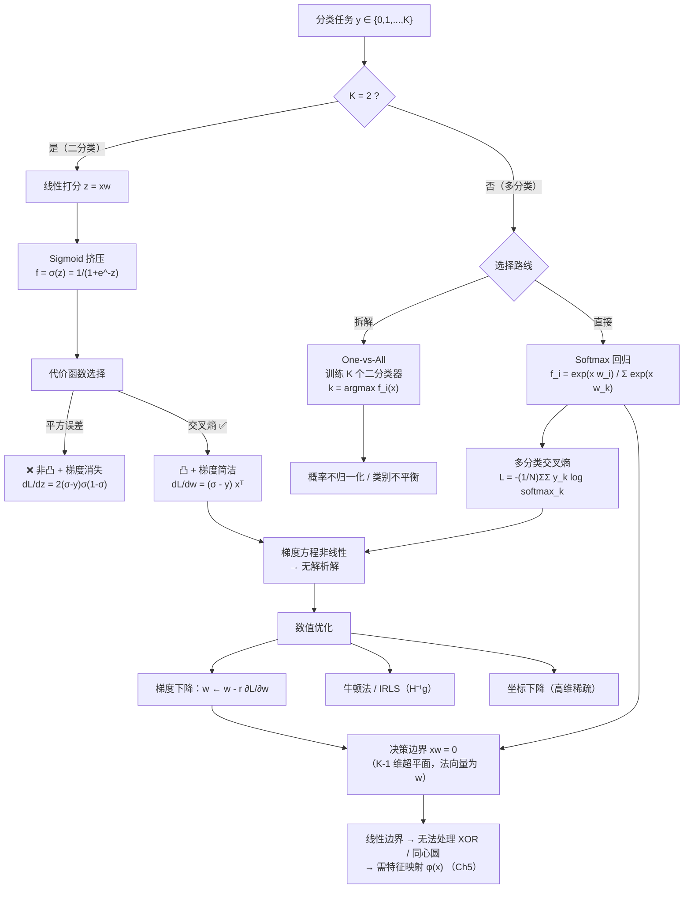

# 线性分类器 (Linear Classifiers)

> [!info] 本讲导读
> 上一讲我们解决了**回归**问题：预测一个连续值。本讲转向监督学习的另一大核心任务——**分类**：预测一个**离散类别**。
>
> 本讲的主线非常清晰：
> 1. **为什么不能用线性回归直接做分类**（输出值域不匹配）；
> 2. **二分类**：用 **Sigmoid 函数**把 $(-\infty,+\infty)$ 的线性输出"压"到 $[0,1]$，得到**逻辑回归（Logistic Regression）**；
> 3. **代价函数之争**：平方误差是**非凸**的、且会**梯度消失**；**交叉熵损失**是**凸**的、梯度形式极其简洁——这是本讲最重要的结论之一；
> 4. **没有解析解**：交叉熵的梯度方程是超越方程，只能靠**梯度下降**等数值方法；
> 5. **决策边界**：逻辑回归的决策边界是一个**超平面**，这正是它被称为"**线性**分类器"的原因；
> 6. **多分类**：**One-vs-All** 与 **Softmax** 两条路线，并证明 $K=2$ 时 Softmax 精确退化为逻辑回归。
>
> **一句话总结本讲**：线性分类器 = 线性打分 $z=\boldsymbol{xw}$ + 非线性"挤压"（Sigmoid/Softmax）+ 交叉熵损失 + 梯度下降。

## 目录

- [[#一、分类问题：从回归到分类|一、分类问题：从回归到分类]]
  - [[#1.1 什么是分类|1.1 什么是分类]]
  - [[#1.2 典型应用|1.2 典型应用]]
  - [[#1.3 为什么线性回归不能直接做分类|1.3 为什么线性回归不能直接做分类]]
- [[#二、逻辑回归（Logistic Regression）|二、逻辑回归（Logistic Regression）]]
  - [[#2.1 Sigmoid / Logistic 函数|2.1 Sigmoid / Logistic 函数]]
  - [[#2.2 逻辑回归模型与 Logit（对数几率）视角|2.2 逻辑回归模型与 Logit（对数几率）视角]]
  - [[#2.3 代价函数（一）：平方误差|2.3 代价函数（一）：平方误差]]
  - [[#2.4 代价函数（二）：交叉熵损失|2.4 代价函数（二）：交叉熵损失]]
  - [[#2.5 平方误差 vs 交叉熵：究竟哪个更好|2.5 平方误差 vs 交叉熵：究竟哪个更好]]
  - [[#2.6 凸性证明：交叉熵的海森矩阵|2.6 凸性证明：交叉熵的海森矩阵]]
  - [[#2.7 例题（逻辑回归基础）|2.7 例题（逻辑回归基础）]]
- [[#三、优化：解析解的缺失与梯度下降|三、优化：解析解的缺失与梯度下降]]
  - [[#3.1 为什么没有解析解|3.1 为什么没有解析解]]
  - [[#3.2 梯度下降法|3.2 梯度下降法]]
  - [[#3.3 梯度的直观理解|3.3 梯度的直观理解]]
  - [[#3.4 其他数值优化方法|3.4 其他数值优化方法]]
  - [[#3.5 例题（优化）|3.5 例题（优化）]]
- [[#四、决策边界|四、决策边界]]
  - [[#4.1 从概率到类别|4.1 从概率到类别]]
  - [[#4.2 超平面与正交性|4.2 超平面与正交性]]
  - [[#4.3 为什么逻辑回归是"线性分类器"|4.3 为什么逻辑回归是"线性分类器"]]
  - [[#4.4 例题（决策边界）|4.4 例题（决策边界）]]
- [[#五、多分类|五、多分类]]
  - [[#5.1 多分类问题与两种思路|5.1 多分类问题与两种思路]]
  - [[#5.2 方法一：One-vs-All|5.2 方法一：One-vs-All]]
  - [[#5.3 方法二：Softmax 函数|5.3 方法二：Softmax 函数]]
  - [[#5.4 Softmax 回归模型|5.4 Softmax 回归模型]]
  - [[#5.5 K = 2 时 Softmax 退化为逻辑回归|5.5 K = 2 时 Softmax 退化为逻辑回归]]
  - [[#5.6 交叉熵损失与 one-hot 编码|5.6 交叉熵损失与 one-hot 编码]]
  - [[#5.7 梯度下降与矩阵形式|5.7 梯度下降与矩阵形式]]
  - [[#5.8 例题（多分类）|5.8 例题（多分类）]]
- [[#六、重点·难点·易错点汇总|六、重点·难点·易错点汇总]]
- [[#七、简洁代码实现|七、简洁代码实现]]
- [[#八、知识点速查|八、知识点速查]]
- [[#九、本讲小结|九、本讲小结]]

---

## 一、分类问题：从回归到分类

### 1.1 什么是分类

**通俗理解**：分类就是"**贴标签**"。给你一张图片、一封邮件、一笔交易记录，让你判断它属于**哪一个类别**。与回归最大的区别在于：回归的答案是"**多少**"（46 万、23.5 ℃），分类的答案是"**是哪一个**"（猫/狗、垃圾邮件/正常邮件）。

**严谨定义**：

- **输入**：特征向量 $\boldsymbol{x} = (x_1,x_2,\dots,x_m) \in \mathbb{R}^m$（同样采用[[Ch2 线性回归|上一讲]]的**齐次化技巧**，可记 $\boldsymbol{x} = (1,x_1,\dots,x_m)$，把偏置吸收进来）；
- **输出**：类别标签 $y \in \{1,2,\dots,K\}$，$K$ 为类别数；
- **目标**：学习一个**分类器（classifier）** $f:\mathbb{R}^m \to \{1,\dots,K\}$，把输入特征映射到**预定义的离散类别**。

| | 回归 (Regression) | 分类 (Classification) |
|---|---|---|
| 目标变量 $y$ | 连续值，$y\in\mathbb{R}$ | 离散类别，$y\in\{1,\dots,K\}$ |
| 例子 | 房价、温度、销量 | 猫/狗、垃圾邮件、欺诈/正常 |
| 输出形式 | 一个数值 $\hat y$ | 一个类别，或各类别的概率 |
| 典型损失 | 平方误差 | 交叉熵 |
| 本讲/上一讲 | [[Ch2 线性回归]] | **本讲** |

> [!tip] 二分类的标签约定
> 本讲（以及本课程）统一采用 $y\in\{0,1\}$ 的约定（而不是 $\{-1,+1\}$）。这一点很重要：交叉熵损失的写法 $L=-y\log\sigma-(1-y)\log(1-\sigma)$ **只有在 $y\in\{0,1\}$ 时才成立**（因为它用 $y$ 和 $1-y$ 当"选择开关"）。换成 $\{-1,+1\}$ 会得到形式上不同但等价的表达式。

### 1.2 典型应用

课件列举了四类经典应用：

| 应用 | 输入特征 | 类别 |
|---|---|---|
| **图像识别** | 像素（或 CNN 提的特征） | 飞机 / 汽车 / 鸟 / 猫 / 鹿 / 狗 / 青蛙 / 马 / 船 / 卡车（CIFAR-10，$K=10$） |
| **垃圾邮件检测** | 词频、发件人、链接数 | 垃圾 / 正常（$K=2$） |
| **交易欺诈检测** | 金额、时间、地点、商户类型 | 欺诈 / 正常（$K=2$） |
| **文档分类** | TF-IDF、词袋向量 | 体育 / 财经 / 科技 …（$K$ 类） |

![[Ch3-img-multiclass-cifar10.png]]

> [!info] 分类问题的两大形态
> - **二分类（binary classification）**：$K=2$，$y\in\{0,1\}$，用**逻辑回归**解决；
> - **多分类（multi-class classification）**：$K>2$，用 **One-vs-All** 或 **Softmax** 解决。
>
> 本讲正是按这个大纲展开的。

### 1.3 为什么线性回归不能直接做分类

这是本讲第一个关键动机，也是**最容易被忽视的概念点**。

**问题**：如果我们硬套线性回归，用 $\hat y = \boldsymbol{xw}$ 去拟合 $\{0,1\}$ 标签，会怎么样？

**课件给出的核心矛盾**：

$$
\underbrace{y\in\{0,1\}}_{\text{分类目标}}\qquad\text{vs.}\qquad \underbrace{f(\boldsymbol{x}) = \boldsymbol{xw}\in(-\infty,+\infty)}_{\text{线性回归输出}}
$$

**输出值域不兼容（incompatible）**。线性回归的输出可以取任意实数，而分类任务的目标值只取 $0$ 或 $1$，两者在值域上根本对不上。

**为什么不兼容就"不行"？** 至少有三个层面的问题：

> [!warning] 用线性回归做分类的三个致命问题
> 1. **输出无意义**：$\boldsymbol{xw}$ 可能等于 $-7.3$ 或 $+42.8$，它既不是"类别 0"，也不是"类别 1"，你无法解释这个数。若强行用阈值 $0.5$ 截断，则 $\boldsymbol{xw}$ 与"属于类别 1 的**概率**"之间没有任何含义上的联系。
> 2. **对异常点极其敏感**：为了把一个"标签为 1 但特征很极端"的样本拟合好，线性回归会把整条直线拉过去，导致原本分得很好的样本被错误分类——因为平方损失对大误差的惩罚是无界的。
> 3. **完全无法给出置信度**：线性回归不能告诉你"我有多确信这是类别 1"。而"概率"恰恰是后续**最大似然估计**、**交叉熵损失**、**贝叶斯决策**的基石。

**解决思路（本讲的核心设计）**：不要换掉线性打分，而是**在它后面接一个"挤压函数"**，把 $(-\infty,+\infty)$ 映射到 $[0,1]$：

$$
z = \boldsymbol{xw}\ \in(-\infty,+\infty) \quad\xrightarrow{\ \text{Sigmoid}\ }\quad \sigma(z)\in[0,1]
$$

这就是**逻辑回归**。**注意这个设计哲学**：模型仍然是**线性**的（线性打分 + 单调挤压），所以决策边界仍是**超平面**——这也解释了为什么逻辑回归被称为"**线性分类器**"（详见 [[#4.3 为什么逻辑回归是"线性分类器"|4.3 节]]）。

---

## 二、逻辑回归（Logistic Regression）

### 2.1 Sigmoid / Logistic 函数

**严谨定义**：

$$
\boxed{\ \sigma(z) = \frac{1}{1+e^{-z}}\ }
$$

**通俗理解**：这是一条"S 形曲线"。当 $z$ 很负时，$e^{-z}$ 很大，分母很大，$\sigma\to 0$；当 $z$ 很正时，$e^{-z}\to 0$，分母趋于 1，$\sigma\to 1$；$z=0$ 时正好取中间值 $0.5$。它就像一台"**软开关**"：把任意实数平滑地"压"进 $(0,1)$。

**关键性质（必须熟记）**：

| 性质 | 表达式 | 说明 |
|---|---|---|
| 值域 | $\sigma(z)\in(0,1)$ | 两端取不到，只是极限 |
| 单调性 | $\sigma'(z)>0$ | 严格单调递增，故**保序** |
| 中心值 | $\sigma(0)=\dfrac{1}{1+1}=0.5$ | 阈值点 |
| **对称性** | $\sigma(-z) = 1-\sigma(z)$ | 极常用，把"负例"化为"正例" |
| **导数** | $\sigma'(z)=\sigma(z)\bigl(1-\sigma(z)\bigr)$ | **全课最重要的导数公式** |
| 上界 | $\sigma'(z)\le \dfrac14$ | 在 $z=0$ 处取得最大值 $1/4$ |

**性质 1 的证明（对称性）**：

$$
\sigma(-z)=\frac{1}{1+e^{z}}=\frac{e^{-z}}{e^{-z}(1+e^{z})}=\frac{e^{-z}}{e^{-z}+1}
=1-\frac{1}{1+e^{-z}}=1-\sigma(z)
$$

（这一步的"分子分母同乘 $e^{-z}$"是处理 Sigmoid 的标准技巧，务必掌握。）

**性质 2 的证明（导数）**：把 $\sigma(z)=(1+e^{-z})^{-1}$ 看作复合函数，用链式法则：

$$
\frac{\mathrm d\sigma}{\mathrm dz}=-(1+e^{-z})^{-2}\cdot\frac{\mathrm d}{\mathrm dz}(1+e^{-z})
=-(1+e^{-z})^{-2}\cdot(-e^{-z})=\frac{e^{-z}}{(1+e^{-z})^{2}}
$$

另一方面：

$$
\sigma(z)\bigl(1-\sigma(z)\bigr)=\frac{1}{1+e^{-z}}\cdot\frac{e^{-z}}{1+e^{-z}}=\frac{e^{-z}}{(1+e^{-z})^{2}}
$$

两者相等，得证。$\blacksquare$

> [!important] 为什么 $\sigma'(z)=\sigma(1-\sigma)$ 如此重要？
> 因为这个公式让**交叉熵损失的梯度推导变得极其简洁**（见 [[#2.4 代价函数（二）：交叉熵损失|2.4 节]]）。sigmoid 的导数"恰好"能表示为自己的函数，是 $e^{-z}$ 这个底数被选中的根本原因。如果换成别的 S 形函数（比如 $\arctan$），梯度形式会复杂得多。
>
> 同时，$\sigma'\le 1/4$ 也解释了**梯度消失**：当 $|z|$ 很大（预测非常"自信"）时，$\sigma(1-\sigma)\to 0$，梯度趋于零。这个现象在[[Ch4 线性回归与分类的概率视角|下一讲]]和神经网络中会反复出现。

### 2.2 逻辑回归模型与 Logit（对数几率）视角

**模型定义**（采用齐次化记号 $\boldsymbol{x}=(1,x_1,\dots,x_m)$，$\boldsymbol{w}=(w_0,w_1,\dots,w_m)^{\mathsf T}$）：

$$
\boxed{\ f(\boldsymbol{x}) = \sigma(\boldsymbol{xw}) = \frac{1}{1+e^{-\boldsymbol{xw}}}\ }
$$

**概率解释（这是逻辑回归的灵魂）**：

$$
f(\boldsymbol{x}) \;\approx\; P(y=1\mid \boldsymbol{x}),\qquad 1-f(\boldsymbol{x})\;\approx\; P(y=0\mid \boldsymbol{x})
$$

> [!warning] 严格来说
> $f(\boldsymbol{x})$ 只是**"把模型输出解释为概率"**，并不自动等于真实的后验概率 $P(y=1\mid\boldsymbol{x})$。它成为"正确概率"的条件，是**模型假设正确**（即真实数据确实由某个 logistic 模型生成）。[[Ch4 线性回归与分类的概率视角|下一讲]]会从**条件概率建模**的角度严格说明这一点。但**当下我们就这样解释并这样用**，因为它带来巨大的好处（最大似然 → 交叉熵）。

**Logit 视角（为什么它叫"回归"？）**

逻辑回归明明是分类器，为什么名字里有"回归"？答案在于它**回归的是对数几率（log-odds）**：

$$
\frac{P(y=1\mid\boldsymbol{x})}{P(y=0\mid\boldsymbol{x})}=\frac{\sigma(\boldsymbol{xw})}{1-\sigma(\boldsymbol{xw})}
=\frac{\sigma(\boldsymbol{xw})}{\sigma(-\boldsymbol{xw})}=e^{\boldsymbol{xw}}
$$

两边取对数：

$$
\boxed{\ \operatorname{logit}\bigl(P(y=1\mid\boldsymbol{x})\bigr)\;=\;\log\frac{p}{1-p}\;=\;\boldsymbol{xw}\ }
$$

**通俗理解**：逻辑回归做的是"**线性回归 + 概率变换**"——它用线性函数去拟合**对数几率**（而不是直接拟合概率）。这叫**广义线性模型（GLM）**中"logit 链接函数"的用法。

**可解释性红利**：$e^{w_i}$ 表示 $x_i$ 每增加 1 个单位，**几率（odds）变为原来的 $e^{w_i}$ 倍**。例如 $e^{w_i}=2$ 表示"几率翻倍"。这是逻辑回归在医疗、金融风控中极受欢迎的原因——它**可解释**。

> [!warning] 易错点：ML 中的 "logits" ≠ 数学中的 "logit 函数"
> 这两个词长得一样，含义完全不同，极易混淆（课件备注中特别强调）：
> - **数学上的 Logit 函数**：$\operatorname{logit}(p)=\log\frac{p}{1-p}$，是 Sigmoid 的**反函数**，输入是概率、输出是实数；
> - **深度学习/ML 中的 "logits"**：指的是 **Softmax/Sigmoid 的输入**，也就是神经网络的**原始输出（raw output）** $z=\boldsymbol{xw}$，**未归一化、未过激活函数**。
>
> 记忆法：**logits 是"入"**（进入 softmax 的东西），**logit 函数是"出"**（从概率出来）。两者方向相反。

### 2.3 代价函数（一）：平方误差

**目标**：我们要找到 $\boldsymbol{w}$，使得

- 若真实标签 $y=1$，希望 $f(\boldsymbol{x})=\sigma(\boldsymbol{xw})$ **接近 1**；
- 若真实标签 $y=0$，希望 $f(\boldsymbol{x})=\sigma(\boldsymbol{xw})$ **接近 0**。

**最自然的想法**：模仿线性回归，直接用平方误差。

$$
L_{\text{sq}}(\boldsymbol{w}) \;=\; \frac{1}{N}\sum_{\ell=1}^{N}\Bigl(\sigma(\boldsymbol{x}^{(\ell)}\boldsymbol{w}) - y^{(\ell)}\Bigr)^{2}
$$

（课件第 7 页给出的是单样本形式 $L(\boldsymbol{w})=\bigl(\sigma(\boldsymbol{xw})-y\bigr)^2$。）

**看起来合理，但这是一个"陷阱"**——见 [[#2.5 平方误差 vs 交叉熵：究竟哪个更好|2.5 节]]。先记住结论：**平方误差 + Sigmoid = 非凸 + 梯度消失**，是一个糟糕的组合。

### 2.4 代价函数（二）：交叉熵损失

**动机（另一种思路）**：与其"最小化预测值与标签的差距"，不如换个角度——**"让模型给真实标签分配的概率尽可能大"**。这直接导向**最大似然估计**。

**从最大似然推导（严谨路线）**：

由于 $y\in\{0,1\}$，且模型给出 $P(y=1\mid\boldsymbol{x})=\sigma(\boldsymbol{xw})$，则可把两个情况统一写成**伯努利分布**：

$$
P\bigl(y\mid \boldsymbol{x}\bigr)=\sigma(\boldsymbol{xw})^{y}\bigl(1-\sigma(\boldsymbol{xw})\bigr)^{1-y}
$$

> [!tip] 这个"统一写法"是怎么来的？
> - 若 $y=1$：$y=1,\;1-y=0$，右边变成 $\sigma^{1}(1-\sigma)^{0}=\sigma$ ✓
> - 若 $y=0$：$y=0,\;1-y=1$，右边变成 $\sigma^{0}(1-\sigma)^{1}=1-\sigma$ ✓
>
> 用"指数当开关"是概率建模中极常用的技巧，务必看懂。

**最大似然（Maximum Likelihood, MLE）**：假设 $N$ 个样本**独立同分布**，则联合似然为

$$
\mathcal{L}(\boldsymbol{w})=\prod_{\ell=1}^{N}P\bigl(y^{(\ell)}\mid\boldsymbol{x}^{(\ell)}\bigr)
=\prod_{\ell=1}^{N}\sigma(\boldsymbol{x}^{(\ell)}\boldsymbol{w})^{y^{(\ell)}}\bigl(1-\sigma(\boldsymbol{x}^{(\ell)}\boldsymbol{w})\bigr)^{1-y^{(\ell)}}
$$

连乘容易下溢、且求导麻烦，故取对数（对数单调，不改变极值点），得到**对数似然**：

$$
\log\mathcal{L}(\boldsymbol{w})=\sum_{\ell=1}^{N}\Bigl[y^{(\ell)}\log\sigma(\boldsymbol{x}^{(\ell)}\boldsymbol{w})+\bigl(1-y^{(\ell)}\bigr)\log\bigl(1-\sigma(\boldsymbol{x}^{(\ell)}\boldsymbol{w})\bigr)\Bigr]
$$

**最大化对数似然 = 最小化负对数似然（Negative Log-Likelihood）**，除以 $N$ 做平均，就得到**交叉熵损失（Cross-Entropy Loss）**：

$$
\boxed{\ L_{\text{ce}}(\boldsymbol{w}) = -\frac{1}{N}\sum_{\ell=1}^{N}\Bigl[y^{(\ell)}\log\sigma(\boldsymbol{x}^{(\ell)}\boldsymbol{w})+\bigl(1-y^{(\ell)}\bigr)\log\bigl(1-\sigma(\boldsymbol{x}^{(\ell)}\boldsymbol{w})\bigr)\Bigr]\ }
$$

**即单样本形式**（课件第 8 页）：

$$
L(\boldsymbol{w}) =
\begin{cases}
-\log\sigma(\boldsymbol{xw}), & y=1\\[4pt]
-\log\bigl(1-\sigma(\boldsymbol{xw})\bigr), & y=0
\end{cases}
\;\Longleftrightarrow\;
L(\boldsymbol{w})=-y\log\sigma(\boldsymbol{xw})-(1-y)\log\bigl(1-\sigma(\boldsymbol{xw})\bigr)
$$

> [!important] 交叉熵损失在"惩罚什么"？
> - 若 $y=1$ 而模型预测 $f\to 0$（**错得很自信**），$-\log f \to +\infty$，损失**无界爆炸**；
> - 若 $y=0$ 而模型预测 $f\to 1$，$-\log(1-f)\to+\infty$，同样爆炸。
>
> 这种"**对自信的错误给予无限惩罚**"是交叉熵最珍贵的性质（见 2.5 节的严格分析），也是它比平方误差更适合分类的根本原因。

> [!info] 信息论视角（加分理解）
> 交叉熵 $H(p,q)=-\sum_k p_k\log q_k$ 度量"用分布 $q$（模型）去编码来自分布 $p$（真实标签）的样本所需的平均编码长度"。由于真实标签是 one-hot 的 $p$，$H(p)=0$，于是
> $$H(p,q)=H(p)+\mathrm{KL}(p\Vert q)=\mathrm{KL}(p\Vert q)$$
> 所以**最小化交叉熵 = 最小化模型分布与真实分布之间的 KL 散度**，这也是"交叉熵 = 概率分布之间的距离"这一直觉的来源。

### 2.5 平方误差 vs 交叉熵：究竟哪个更好

这是本讲**最核心的对决**。课件给出的对比：

| | 平方误差 $L_{\text{sq}}$ | 交叉熵 $L_{\text{ce}}$ |
|---|---|---|
| 表达式 | $\bigl(\sigma(\boldsymbol{xw})-y\bigr)^2$ | $-y\log\sigma(\boldsymbol{xw})-(1-y)\log(1-\sigma(\boldsymbol{xw}))$ |
| **凸性** | ❌ **非凸** | ✅ **凸** |
| **梯度** | $2(\sigma-y)\,\sigma(1-\sigma)\,\boldsymbol{x}^{\mathsf T}$ | $(\sigma-y)\,\boldsymbol{x}^{\mathsf T}$ |
| 错得越离谱时 | 梯度 $\to 0$（**消失**） | 梯度 $\to\pm1$（**保持强信号**） |
| 损失上界 | 有界（$\le 1$） | **无界**（$\to\infty$） |
| 优化难度 | 难（多个局部极小、平台区） | 易（凸，无局部极小） |

#### 视觉直觉

| 平方误差（非凸，多个局部极小 + 平台） | 交叉熵（凸，"碗形"） |
|---|---|
| ![[Ch3-img-nonconvex-square-loss.png]] | ![[Ch3-img-convex-cross-entropy.png]] |

> [!important] 关键结论
> **平方损失是非凸的，交叉熵是凸的；凸函数更易于优化。**
> 课件还预告："在下一次课中，我们将从**精确建模**的角度，展示使用交叉熵损失的另一个优点。"（即从概率视角看，交叉熵不是"随便挑的一个损失"，而是 MLE 的必然产物。）

#### 严格剖析：为什么平方误差会"非凸 + 梯度消失"

只考虑**一个样本**，记 $z=\boldsymbol{xw}$（标量），$\sigma=\sigma(z)$，$L_{\text{sq}}=\tfrac12(\sigma-y)^2$（常数 $\tfrac12$ 不影响极值点，为求导简洁加上）。

**（1）对 $z$ 的一阶导**：

$$
\frac{\mathrm dL_{\text{sq}}}{\mathrm dz}=(\sigma-y)\,\sigma(1-\sigma)
$$

**（2）对 $z$ 的二阶导**（用 $\sigma'=\sigma(1-\sigma)$）：

$$
\frac{\mathrm d^2L_{\text{sq}}}{\mathrm dz^2}
=2\sigma(1-\sigma)\Bigl[\sigma(1-\sigma)+(\sigma-y)(1-2\sigma)\Bigr]
=\begin{cases}
2\sigma(1-\sigma)^2(3\sigma-1), & y=1\\[4pt]
2\sigma^2(1-\sigma)(2-3\sigma), & y=0
\end{cases}
$$

> [!warning] 结论：非凸性是"结构性"的，不是巧合
> 对 $y=1$：当 $\sigma<\tfrac13$（即 $z<\log\tfrac12\approx-0.693$）时，$\dfrac{\mathrm d^2L_{\text{sq}}}{\mathrm dz^2}<0$ —— 函数在这个区间是**凹的**！
> 对 $y=0$：当 $\sigma>\tfrac23$（即 $z>+0.693$）时，同样二阶导为负。
>
> 而 $\sigma<\tfrac13$ 且 $y=1$ 恰恰意味着"**模型把正例判成了负例，而且很自信**"——这是最需要被大力纠正的区域，可平方误差在这里偏偏是**凹的（朝上开口的部分消失了）**，对应的是一个**平台/高原**。

**（3）梯度消失的严重性**：当 $y=1$ 且 $z\to-\infty$ 时，

- $\sigma\to 0$，故 $\sigma(1-\sigma)\to 0$；
- 于是梯度 $(\sigma-y)\sigma(1-\sigma)\to(-1)\cdot 0 = 0$。

**梯度趋于零意味着参数几乎不再更新——算法"卡死"在一个错误的地方**。再看损失值：$L_{\text{sq}}=(\sigma-y)^2\to(0-1)^2=1$，损失**饱和在 1 附近不再变化**，从损失曲线上根本看不出还有改进空间。

**对比交叉熵**：令 $z\to-\infty$，$y=1$，则

$$
-\log\sigma(z)=-\log\frac{1}{1+e^{-z}}=\log\bigl(1+e^{-z}\bigr)\approx\log e^{-z}=-z\to+\infty
$$

损失**线性地爆炸**，而它的导数

$$
\frac{\mathrm d}{\mathrm dz}\bigl[-\log\sigma(z)\bigr]=-(1-\sigma(z))\to-1
$$

**绝对值趋近于 1，梯度信号丝毫不衰减**——这才是"**错得越狠，纠正得越猛**"应有的行为。

> [!tip] 一图记忆
> | 场景（$y=1$） | 平方误差梯度 | 交叉熵梯度 |
> |---|---|---|
> | $z=0$（不确定） | $-0.25$ | $-0.5$ |
> | $z=-2$（错，但不极端） | $-0.185$ | $-0.881$ |
> | $z=-5$（错得较狠） | $-0.0132$ | $-0.993$ |
> | $z=-10$（错得极狠） | $\approx -9.1\times10^{-5}$ | $-1.000$ |
>
> （具体计算见 [[#2.7 例题（逻辑回归基础）|例题 3.2]]）平方误差的梯度**指数级塌缩到 0**，交叉熵的梯度**稳定在 $-1$**。这就是分类任务必须用交叉熵的根本工程理由。

### 2.6 凸性证明：交叉熵的海森矩阵

"交叉熵是凸的"这句话不能只靠图像，必须证明。**证明凸性的标准工具是海森矩阵（Hessian）半正定**。

**回顾判据**：若 $L(\boldsymbol{w})$ 的二阶连续偏导存在，且对**所有** $\boldsymbol{v}$ 都有

$$
\boldsymbol{v}^{\mathsf T}\boldsymbol{H}\boldsymbol{v}\ \ge\ 0,\qquad \boldsymbol{H}=\frac{\partial^2 L}{\partial \boldsymbol{w}\,\partial \boldsymbol{w}^{\mathsf T}}
$$

则称海森矩阵**半正定（PSD）**，此时 $L$ 是**凸函数**；若严格 $>0$ 则**严格凸**。

**第一步：单样本交叉熵的梯度**

对单样本，记 $z=\boldsymbol{xw}$（标量），$\sigma=\sigma(z)$，$L=-y\log\sigma-(1-y)\log(1-\sigma)$。先对 $z$ 求导：

$$
\frac{\mathrm dL}{\mathrm dz}
=-y\cdot\frac{\sigma(1-\sigma)}{\sigma}-(1-y)\cdot\frac{-\sigma(1-\sigma)}{1-\sigma}
=-y(1-\sigma)+(1-y)\sigma
=\sigma-y
$$

再对 $\boldsymbol{w}$ 求导（链式法则，$\partial z/\partial\boldsymbol{w}=\boldsymbol{x}^{\mathsf T}$）：

$$
\frac{\partial L}{\partial\boldsymbol{w}}=\frac{\mathrm dL}{\mathrm dz}\cdot\frac{\partial z}{\partial\boldsymbol{w}}=(\sigma-y)\,\boldsymbol{x}^{\mathsf T}
$$

**第二步：单样本的海森矩阵**

$\dfrac{\partial \sigma}{\partial\boldsymbol{w}}=\sigma(1-\sigma)\boldsymbol{x}^{\mathsf T}$，故

$$
\boldsymbol{H}=\frac{\partial}{\partial\boldsymbol{w}}\Bigl[(\sigma-y)\boldsymbol{x}^{\mathsf T}\Bigr]
=\sigma(1-\sigma)\,\boldsymbol{x}^{\mathsf T}\boldsymbol{x}
$$

**第三步：半正定判定**

对任意 $\boldsymbol{v}\in\mathbb{R}^{m+1}$：

$$
\boldsymbol{v}^{\mathsf T}\boldsymbol{H}\boldsymbol{v}
=\sigma(1-\sigma)\,\boldsymbol{v}^{\mathsf T}\boldsymbol{x}^{\mathsf T}\boldsymbol{x}\,\boldsymbol{v}
=\underbrace{\sigma(1-\sigma)}_{>\,0}\cdot\underbrace{\bigl(\boldsymbol{x}\boldsymbol{v}\bigr)^{2}}_{\ge\,0}\ \ge\ 0
$$

由于 $0<\sigma<1$ 恒成立，$\sigma(1-\sigma)>0$，而平方项非负，故 $\boldsymbol{H}\succeq 0$。

**结论**：**交叉熵损失函数的海森矩阵是半正定的，所以该函数是一个凸函数。** $\blacksquare$

**多样本（全量）情形**（用期望线性性，逐样本相加即可）：

$$
\boldsymbol{H}=\frac{1}{N}\sum_{\ell=1}^{N}\sigma\bigl(z^{(\ell)}\bigr)\Bigl(1-\sigma\bigl(z^{(\ell)}\bigr)\Bigr)\,\boldsymbol{x}^{(\ell)\mathsf T}\boldsymbol{x}^{(\ell)}\ \succeq\ 0
$$

即**半正定矩阵的非负加权和仍半正定**。

> [!warning] 难点：凸 ≠ 严格凸，最优解可能"在无穷远"
> 注意每个 $\boldsymbol{x}^{(\ell)\mathsf T}\boldsymbol{x}^{(\ell)}$ 都是**秩为 1** 的矩阵，所以 $\boldsymbol{H}$ 是 $N$ 个秩 1 矩阵之和，**天然可能奇异（不可逆）**。这带来两个重要后果：
> 1. **$\boldsymbol{H}$ 一般不是正定的**（除非 $N\ge m+1$ 且样本张满整个空间）。所以交叉熵是**凸但非严格凸**的，最优解**可能不唯一**（存在一整条平坦的最优方向）。
> 2. **数据线性可分时，最小化点根本不存在**：若存在 $\boldsymbol{w}^*$ 使所有样本都满足 $y^{(\ell)}(\boldsymbol{x}^{(\ell)}\boldsymbol{w}^*)>0$，则把 $\boldsymbol{w}$ 沿 $\boldsymbol{w}^*$ 方向放大 $c$ 倍会让每个 $|z^{(\ell)}|$ 都变大、$\sigma$ 越来越接近标签，损失 $\to 0$。于是**下确界是 0 但永远取不到**，最优参数"跑到了无穷远"，$\|\boldsymbol{w}\|\to\infty$。
>
> **实践含义**：① 梯度下降会表现为参数模长不断增大、损失缓慢趋近 0 却永不停止（"不收敛"的假象）；② 解决办法是**正则化**（L2 惩罚 $\lambda\|\boldsymbol{w}\|^2$，见 [[Ch5 模型的非线性化、过拟合及正则化|第 5 讲（模型的非线性化与正则化）]]），它给目标加上"参数不能太大"的约束，从而保证严格凸、最优解唯一且有限。

### 2.7 例题（逻辑回归基础）

> [!example]- 例 3.1：Sigmoid 的性质与求值（基础，但陷阱多）
> 设 $\sigma(z)=\dfrac{1}{1+e^{-z}}$。
> 1. 证明 $\sigma(-z)=1-\sigma(z)$；
> 2. 证明 $\sigma'(z)=\sigma(z)\bigl(1-\sigma(z)\bigr)$，并说明 $\sigma'(z)$ 的最大值；
> 3. 求 $\sigma(0)$、$\sigma(\ln 3)$、$\sigma(-\ln 3)$，并验证第 1 问的对称性；
> 4. 求 $\dfrac{\mathrm d}{\mathrm dz}\log\sigma(z)$ 与 $\dfrac{\mathrm d}{\mathrm dz}\log\bigl(1-\sigma(z)\bigr)$。
>
> **解答：**
> 1. 见 [[#2.1 Sigmoid / Logistic 函数|2.1 节]] 的证明：分子分母同乘 $e^{-z}$ 即可。
> 2. 见 2.1 节。求最大值：令 $u=\sigma(z)\in(0,1)$，则 $\sigma'=u(1-u)$ 是开口向下的抛物线，在 $u=1/2$（即 $z=0$）处取最大值 $\dfrac14$。
>    **注意**：这说明 Sigmoid 函数的**最大斜率只有 $1/4$**——这本身就是"多层叠加后梯度会衰减"的伏笔。
> 3. $\sigma(0)=\dfrac{1}{1+1}=0.5$；
>    $\sigma(\ln 3)=\dfrac{1}{1+e^{-\ln 3}}=\dfrac{1}{1+1/3}=\dfrac{3}{4}=0.75$；
>    $\sigma(-\ln 3)=\dfrac{3}{4}$ 的对称值 $=\dfrac14=0.25$，与 $\sigma(-z)=1-\sigma(z)$ 一致 ✓
> 4. 用链式法则配 $\sigma'=\sigma(1-\sigma)$：
>    $$\frac{\mathrm d}{\mathrm dz}\log\sigma(z)=\frac{\sigma(1-\sigma)}{\sigma}=1-\sigma(z)=\sigma(-z)$$
>    $$\frac{\mathrm d}{\mathrm dz}\log\bigl(1-\sigma(z)\bigr)=\frac{-\sigma(1-\sigma)}{1-\sigma}=-\sigma(z)$$
>    **这两个式子请务必背下来**，它们是推导交叉熵梯度的全部弹药。

> [!example]- 例 3.2：平方误差 vs 交叉熵的数值对决（考察细节，强烈建议手算一遍）
> 设某样本真实标签 $y=1$，当前参数使 $z=\boldsymbol{xw}$ 取不同值。定义平方误差 $L_{\text{sq}}=\bigl(\sigma(z)-1\bigr)^2$、交叉熵 $L_{\text{ce}}=-\log\sigma(z)$。
> 1. 分别求 $L_{\text{sq}}$ 关于 $z$ 的导数与 $L_{\text{ce}}$ 关于 $z$ 的导数；
> 2. 填表（保留 4 位有效数字）：$z=0,-2,-5,-10$ 时的 $\sigma(z)$、两个损失值、两个梯度值；
> 3. 解释为什么在 $z\to-\infty$ 时平方误差"学不动"，而交叉熵"越错越用力"；
> 4. 求平方误差关于 $z$ 的二阶导数，并确定它在什么区间上为负（说明非凸性）。
>
> **解答：**
> 1. $\dfrac{\mathrm dL_{\text{sq}}}{\mathrm dz}=2(\sigma-1)\sigma(1-\sigma)$；$\dfrac{\mathrm dL_{\text{ce}}}{\mathrm dz}=\sigma-1$（见 [[#2.6 凸性证明：交叉熵的海森矩阵|2.6 节]] 的推导）。
> 2. 数值表：
>
> | $z$ | $\sigma(z)$ | $L_{\text{sq}}=(\sigma-1)^2$ | $L_{\text{ce}}=-\log\sigma$ | $\mathrm dL_{\text{sq}}/\mathrm dz$ | $\mathrm dL_{\text{ce}}/\mathrm dz$ |
> |---|---|---|---|---|---|
> | $0$ | $0.5000$ | $0.2500$ | $0.6931$ | $-0.2500$ | $-0.5000$ |
> | $-2$ | $0.1192$ | $0.7758$ | $2.1269$ | $-0.1849$ | $-0.8808$ |
> | $-5$ | $0.006693$ | $0.9867$ | $5.0067$ | $-0.01321$ | $-0.9933$ |
> | $-10$ | $4.540\times10^{-5}$ | $0.99991$ | $10.0000$ | $-9.080\times10^{-5}$ | $-1.0000$ |
>
> 3. **看第 5 列 vs 第 6 列**：随着模型越错（$z$ 越负），平方误差的梯度从 $-0.25$ 指数式塌缩到 $-9\times10^{-5}$（**几乎为零，参数停止更新**）；而交叉熵的梯度从 $-0.5$ 单调趋于 $-1$（**始终保持接近满格的修正力度**）。
>    从损失值看更直观：平方误差**饱和在 1 附近**（$0.25\to0.99991$），几乎不增长，因为"概率"这个量的平方天然有界；而交叉熵**线性无界增长**（$0.69\to10.00$，且 $-\log\sigma(z)\approx -z$），毫不留情。
> 4. 由 2.5 节的推导，$y=1$ 时
>    $$\frac{\mathrm d^2L_{\text{sq}}}{\mathrm dz^2}=2\sigma(1-\sigma)^2(3\sigma-1)$$
>    令其 $<0$ 得 $3\sigma-1<0$，即 $\sigma<\dfrac13$，等价于 $z<\log\dfrac12\approx-0.6931$。
>    **结论**：只要 $z<-0.6931$（把正例判成负例），平方误差就是**凹的**——这正是"最需要学习"的区域，函数却失去了凸性，优化器在这里会停滞或跳到错误的极小值。

> [!example]- 例 3.3：推导交叉熵的梯度（核心推导，必做）
> 设单样本损失 $L(\boldsymbol{w})=-y\log\sigma(\boldsymbol{xw})-(1-y)\log\bigl(1-\sigma(\boldsymbol{xw})\bigr)$，其中 $\boldsymbol{x}$ 是行向量，$\boldsymbol{w}$ 是列向量。证明
> $$\frac{\partial L}{\partial\boldsymbol{w}}=\bigl(\sigma(\boldsymbol{xw})-y\bigr)\boldsymbol{x}^{\mathsf T}$$
> 并说明为什么这个形式"漂亮"。
>
> **解答：**
> 令 $z=\boldsymbol{xw}$（标量），链式法则给出 $\dfrac{\partial L}{\partial\boldsymbol{w}}=\dfrac{\mathrm dL}{\mathrm dz}\cdot\dfrac{\partial z}{\partial \boldsymbol{w}}=\dfrac{\mathrm dL}{\mathrm dz}\boldsymbol{x}^{\mathsf T}$。
> 用 [[#2.7 例题（逻辑回归基础）|例 3.1 第 4 问]] 的两个导数结论：
> $$
> \begin{aligned}
> \frac{\mathrm dL}{\mathrm dz}
> &=-y\underbrace{\frac{\mathrm d}{\mathrm dz}\log\sigma(z)}_{=1-\sigma}
>   -(1-y)\underbrace{\frac{\mathrm d}{\mathrm dz}\log(1-\sigma(z))}_{=-\sigma}\\
> &=-y(1-\sigma)+(1-y)\sigma=-y+y\sigma+\sigma-y\sigma=\sigma-y
> \end{aligned}
> $$
> 代入即得 $\dfrac{\partial L}{\partial\boldsymbol{w}}=(\sigma-y)\boldsymbol{x}^{\mathsf T}$。$\blacksquare$
>
> **为什么漂亮？**
> ① **形式极简**：$\bigl(\underbrace{\sigma(\boldsymbol{xw})}_{\text{预测}}-\underbrace{y}_{\text{真值}}\bigr)\times\underbrace{\boldsymbol{x}^{\mathsf T}}_{\text{输入}}$ —— **"误差 × 输入"**，与线性回归的梯度形式 **完全一致**（回忆 [[Ch2 线性回归]]：$\nabla L=\frac{2}{N}\boldsymbol X^{\mathsf T}(\boldsymbol{Xw}-\boldsymbol y)$）。
> ② **没有 $\sigma(1-\sigma)$ 因子**：sigmoid 的导数被"精确抵消"掉了——这是交叉熵与 sigmoid 是"天作之合（natural pairing）"的体现。而平方误差的梯度里残留 $2\sigma(1-\sigma)$，正是梯度消失的元凶。
> ③ **符号直觉**：$y=1$ 时 $\sigma-y<0$，故 $\boldsymbol{w}\leftarrow\boldsymbol{w}-r(\sigma-y)\boldsymbol{x}^{\mathsf T}$ 会把 $\boldsymbol{w}$ 沿 $+\boldsymbol{x}^{\mathsf T}$ 方向推，从而**增大** $\boldsymbol{xw}$、**增大** $\sigma$，驱向 1 ✓（详见 [[#3.3 梯度的直观理解|3.3 节]]）。
> ④ **天然稀疏/实例化更新**：梯度是 $\boldsymbol{x}^{\mathsf T}$ 的倍数，若某特征 $x_j=0$，则该样本不更新 $w_j$。这是稀疏数据（如文本词袋）上逻辑回归高效的原因。

> [!example]- 例 3.4：凸性证明的"反向"考察——为什么平方误差非凸（进阶）
> 请用海森矩阵的方法说明：**平方误差 + Sigmoid 不可能对所有 $\boldsymbol{w}$ 都是凸的**，而交叉熵可以。并指出决定凸性的关键量是什么。
>
> **解答：**
> 设单样本 $z=\boldsymbol{xw}$，$L_{\text{sq}}=\tfrac12(\sigma(z)-y)^2$。
> 由 $\dfrac{\partial z}{\partial\boldsymbol{w}}=\boldsymbol{x}^{\mathsf T}$ 与链式法则：
> $$\frac{\partial L_{\text{sq}}}{\partial\boldsymbol{w}}=(\sigma-y)\sigma(1-\sigma)\boldsymbol{x}^{\mathsf T}\ \Longrightarrow\ \boldsymbol{H}_{\text{sq}}=\varphi''(z)\,\boldsymbol{x}^{\mathsf T}\boldsymbol{x},\qquad \varphi''(z)=2\sigma(1-\sigma)\bigl[\sigma(1-\sigma)+(\sigma-y)(1-2\sigma)\bigr]$$
> 其中 $\varphi(z)=\tfrac12(\sigma(z)-y)^2$。
>
> **关键洞察**：$\boldsymbol{x}^{\mathsf T}\boldsymbol{x}\succeq0$ 永远成立，所以**凸性完全由标量 $\varphi''(z)$ 的符号决定**。
> - 交叉熵：$\psi(z)=-y\log\sigma(z)-(1-y)\log(1-\sigma(z))$，$\psi''(z)=\sigma(1-\sigma)>0$ **恒正** → $\boldsymbol{H}\succeq0$，凸 ✓
> - 平方误差：由例 3.2 第 4 问，$y=1$ 时 $\varphi''(z)=2\sigma(1-\sigma)^2(3\sigma-1)$，当 $\sigma<\tfrac13$ 时为负 → 取 $\boldsymbol{v}$ 平行于 $\boldsymbol{x}^{\mathsf T}$ 就有 $\boldsymbol{v}^{\mathsf T}\boldsymbol{H}\boldsymbol{v}<0$ → **非凸** ✗
>
> **决定凸性的关键量**：损失函数作为 $z$ 的函数 $\ell(z)$ 的**二阶导数符号**（因为 $\boldsymbol{H}=\ell''(z)\boldsymbol{x}^{\mathsf T}\boldsymbol{x}$，秩 1 的符号完全由 $\ell''$ 决定）。
> 换言之：**"对线性打分 $z$ 是凸的" $\Rightarrow$ "对参数 $\boldsymbol{w}$ 是凸的"**，反之亦然。这也给出了挑选损失函数的一般准则：**与 Sigmoid 搭配时，损失必须是 $z$ 的凸函数。** $-\log\sigma(z)$ 恰好是天然的凸函数，而 $(\sigma(z)-y)^2$ 不是。

---

## 三、优化：解析解的缺失与梯度下降

### 3.1 为什么没有解析解

**先看梯度**（全量平均，$\boldsymbol{x}^{(\ell)}$ 为行向量）：

$$
\boxed{\ \frac{\partial L(\boldsymbol{w})}{\partial\boldsymbol{w}}
=\frac{1}{N}\sum_{\ell=1}^{N}\Bigl(\sigma\bigl(\boldsymbol{x}^{(\ell)}\boldsymbol{w}\bigr)-y^{(\ell)}\Bigr)\boldsymbol{x}^{(\ell)\mathsf T}\ }
$$

**求解思路**：令梯度 $=\boldsymbol{0}$，

$$
\frac{1}{N}\sum_{\ell=1}^{N}\left(\frac{1}{1+e^{-\boldsymbol{x}^{(\ell)}\boldsymbol{w}}}-y^{(\ell)}\right)\boldsymbol{x}^{(\ell)\mathsf T}=\boldsymbol{0}
$$

**关键障碍**：未知的 $\boldsymbol{w}$ 被"关"在 **Sigmoid 的非线性函数**里面（出现在 $e^{-\boldsymbol{x}^{(\ell)}\boldsymbol{w}}$ 的指数上）。这是一个关于 $\boldsymbol{w}$ 的**非线性（超越）方程**，无法像线性回归那样解出闭式解。

> [!important] 与线性回归的决定性对比（本讲得分点）
> | | 线性回归 | 逻辑回归 |
> |---|---|---|
> | 梯度 | $\dfrac{2}{N}\boldsymbol{X}^{\mathsf T}(\boldsymbol{Xw}-\boldsymbol{y})$ | $\dfrac{1}{N}\boldsymbol{X}^{\mathsf T}\bigl(\sigma(\boldsymbol{Xw})-\boldsymbol{y}\bigr)$ |
> | 令梯度 $=0$ 得 | $\boldsymbol{X}^{\mathsf T}\boldsymbol{Xw}=\boldsymbol{X}^{\mathsf T}\boldsymbol{y}$（**线性**方程组） | $\boldsymbol{X}^{\mathsf T}\bigl(\sigma(\boldsymbol{Xw})-\boldsymbol{y}\bigr)=\boldsymbol{0}$（**非线性**方程组） |
> | 解析解 | ✅ $\boldsymbol{w}^*=(\boldsymbol{X}^{\mathsf T}\boldsymbol{X})^{-1}\boldsymbol{X}^{\mathsf T}\boldsymbol{y}$ | ❌ **不存在** |
> | 原因 | $\boldsymbol{w}$ 线性出现 | $\boldsymbol{w}$ 在 Sigmoid 内部 |
>
> **一句话**：**梯度方程中 $\boldsymbol{w}$ 是否"线性出现"，决定了解析解是否存在。**

**因此只能求助数值方法**（课件列举）：

- **梯度下降（Gradient Descent）** ← 本讲重点
- **牛顿法（Newton's Method）**
- **坐标下降（Coordinate Descent）**
- ……

### 3.2 梯度下降法

**核心思想**：从一个初始的 $\boldsymbol{w}^{(0)}$ 出发，**沿着梯度的反方向**迭代更新参数，逐步逼近最小值点。

$$
\boxed{\ \boldsymbol{w}^{(t+1)}=\boldsymbol{w}^{(t)}-r\cdot\left.\frac{\partial L(\boldsymbol{w})}{\partial\boldsymbol{w}}\right|_{\boldsymbol{w}=\boldsymbol{w}^{(t)}}\ }
$$

其中 $r>0$ 是**学习率（learning rate）**，控制每一步更新的幅度。

**为什么是"负梯度方向"？** 梯度指向函数**上升最快**的方向（方向导数最大），故其反方向是函数**下降最快**的方向。这是多元微积分的一阶最优性结论。

**展开成分量形式**（便于手算与实现）：

$$
w_j^{(t+1)}=w_j^{(t)}-\frac{r}{N}\sum_{\ell=1}^{N}\Bigl(\sigma\bigl(\boldsymbol{x}^{(\ell)}\boldsymbol{w}^{(t)}\bigr)-y^{(\ell)}\Bigr)x_j^{(\ell)},\qquad j=0,1,\dots,m
$$

**收敛性**：由于**交叉熵损失是凸函数**，梯度下降法保证能收敛到（全局）最优值 $\boldsymbol{w}^*$——只要学习率 $r$ 取得足够小（更严格地说，$r<2/\lambda_{\max}(\boldsymbol{H})$，其中 $\lambda_{\max}$ 是海森矩阵的最大特征值），就不会发散。

> [!warning] 但请务必记住 2.6 节的警告
> "保证收敛到最优值"有一个隐藏前提：**最优值存在**。若数据**线性可分**，下确界 0 取不到，$\|\boldsymbol{w}^{(t)}\|\to\infty$，此时梯度下降会让参数模长无限增长——**损失趋于 0 但永不收敛**。工程上必须配合**正则化**或**提前停止（early stopping）**。

![[Ch3-img-gradient-descent.png]]

> [!tip] 学习率的直观理解（与 [[Ch2 线性回归]] 完全一致）
> | 学习率 $r$ | 现象 |
> |---|---|
> | 太小 | 收敛极慢，迭代次数巨大 |
> | 合适 | 稳步下降，快速收敛 |
> | 太大 | 震荡（在峡谷两侧来回跳）、甚至发散，损失不降反升 |
>
> 实操建议：画"迭代次数—损失值"曲线监控；配合学习率衰减、动量法等技巧（后续课程/实践内容）。

### 3.3 梯度的直观理解

把梯度公式重新读一遍：

$$
\frac{\partial L(\boldsymbol{w})}{\partial\boldsymbol{w}}=\frac{1}{N}\sum_{\ell=1}^{N}\underbrace{\Bigl(\sigma\bigl(\boldsymbol{x}^{(\ell)}\boldsymbol{w}\bigr)-y^{(\ell)}\Bigr)}_{\text{预测误差}}\;\boldsymbol{x}^{(\ell)\mathsf T}
$$

**核心结论**：梯度 = **预测误差** × **输入特征** 的平均。所以：

- 若 $y^{(\ell)}=1$，算法会驱使 $\sigma(\boldsymbol{x}^{(\ell)}\boldsymbol{w})$ **趋近于 1**；
- 若 $y^{(\ell)}=0$，算法会驱使 $\sigma(\boldsymbol{x}^{(\ell)}\boldsymbol{w})$ **趋近于 0**。

> [!important] 也就是说：梯度下降法（GD）总是试图减小预测误差。

**符号分析（务必亲手推一遍，这是最容易失分的细节）**：

| 情况 | 预测 $\sigma$ | 误差 $(\sigma-y)$ | 更新方向 | 效果 |
|---|---|---|---|---|
| $y=1$，预测偏小（$\sigma\approx0$） | 小 | $\approx-1$ | $\boldsymbol{w}\leftarrow\boldsymbol{w}+r\boldsymbol{x}^{\mathsf T}$ | 增大 $\boldsymbol{xw}$ → 增大 $\sigma$ → 驱向 1 ✓ |
| $y=1$，预测已大（$\sigma\approx1$） | 大 | $\approx0$ | 几乎不更新 | 已经学对，无需修正 ✓ |
| $y=0$，预测偏大（$\sigma\approx1$） | 大 | $\approx+1$ | $\boldsymbol{w}\leftarrow\boldsymbol{w}-r\boldsymbol{x}^{\mathsf T}$ | 减小 $\boldsymbol{xw}$ → 减小 $\sigma$ → 驱向 0 ✓ |
| $y=0$，预测已小（$\sigma\approx0$） | 小 | $\approx0$ | 几乎不更新 | 已经学对 ✓ |

（推导示例：$y=1,\sigma\approx0$ 时 $\sigma-y\approx-1$，代入 $\boldsymbol{w}^{(t+1)}=\boldsymbol{w}^{(t)}-r(\sigma-y)\boldsymbol{x}^{\mathsf T}=\boldsymbol{w}^{(t)}+r\boldsymbol{x}^{\mathsf T}$，沿 $+\boldsymbol{x}^{\mathsf T}$ 方向走。）

**另一个重要观察**：由于 $\sigma-y\in(-1,1)$ **有界**，所以**单个样本的梯度大小由 $\|\boldsymbol{x}\|$ 主导**——特征尺度大的样本会产生更大的梯度。这解释了为什么实践中**必须先做特征标准化（standardization）**，否则梯度下降会在某些方向上"猛冲"、在另一些方向上"爬行"，收敛极慢。

### 3.4 其他数值优化方法

课件提到除梯度下降外的其他选择：

**牛顿法（Newton's Method）**：用二阶泰勒展开（抛物面）局部逼近代价函数，直接跳到抛物面的极小点：

$$
\boldsymbol{w}^{(t+1)}=\boldsymbol{w}^{(t)}-\boldsymbol{H}^{-1}\boldsymbol{g},\qquad \boldsymbol{H}=\frac{\partial^2 L}{\partial\boldsymbol{w}\partial\boldsymbol{w}^{\mathsf T}},\quad \boldsymbol{g}=\frac{\partial L}{\partial\boldsymbol{w}}
$$

- **优点**：自动确定步长（不需手调学习率）；利用曲率信息，接近最优点时**二次收敛**，迭代次数远少于梯度下降。
- **缺点**：每步需计算并求逆 $(m+1)\times(m+1)$ 的 $\boldsymbol{H}$，代价 $O(m^3)$；维度高时不可承受。

> [!tip] 逻辑回归 + 牛顿法 = IRLS（进阶联系）
> 把 $\boldsymbol{H}=\frac1N\sum_\ell \sigma_\ell(1-\sigma_\ell)\boldsymbol{x}^{(\ell)\mathsf T}\boldsymbol{x}^{(\ell)}$ 代入牛顿法，可得
> $$\boldsymbol{w}^{(t+1)}=\bigl(\boldsymbol{X}^{\mathsf T}\boldsymbol{S}\boldsymbol{X}\bigr)^{-1}\boldsymbol{X}^{\mathsf T}\boldsymbol{S}\,\tilde{\boldsymbol{z}}$$
> 其中 $\boldsymbol{S}=\mathrm{diag}\bigl(\sigma_\ell(1-\sigma_\ell)\bigr)$ 是"权重"，$\tilde{\boldsymbol z}$ 是"工作响应"。这**形式上就是加权最小二乘**，因此该算法被称为**迭代重加权最小二乘（IRLS, Iteratively Reweighted Least Squares）**。
> **漂亮的结论**：逻辑回归没有解析解，但用牛顿法后，每一步都在解一个**线性回归**问题——"非线性问题被拆成一串线性问题"，这是数值优化中最优美的思想之一。

**其他方法**：坐标下降（Coordinate Descent，每步只优化一个分量，其余固定，适合高维稀疏问题，如 L1 正则化的逻辑回归）、拟牛顿法（BFGS/L-BFGS，用近似代替 $\boldsymbol{H}^{-1}$）、共轭梯度法等。

**权衡表**：

| 方法 | 用到的信息 | 每步代价 | 收敛速度 | 需要调学习率 |
|---|---|---|---|---|
| 批量梯度下降 | 一阶（全量） | 中（$O(Nm)$） | 较慢（线性收敛） | 是 |
| SGD / 小批量 | 一阶（采样） | 低 | 较慢，路径抖动 | 是 |
| 牛顿法 / IRLS | 一阶 + 二阶 | 高（$O(m^3)$） | 快（二次收敛） | 否 |
| 坐标下降 | 一阶（单坐标） | 低 | 中（高频问题很快） | 视情况 |

### 3.5 例题（优化）

> [!example]- 例 3.5：手动执行一步梯度下降（二分类，含偏置）
> 训练集两个样本：$\boldsymbol{x}^{(1)}=(1,\,1)$，$y^{(1)}=1$；$\boldsymbol{x}^{(2)}=(1,\,-1)$，$y^{(2)}=0$（第一维是齐次化的偏置项 $x_0\equiv1$）。
> 初始参数 $\boldsymbol{w}^{(0)}=(0,0)^{\mathsf T}$，学习率 $r=0.5$，损失为平均交叉熵。
> 1. 计算初始的 $\sigma$ 值与平均损失；
> 2. 计算梯度 $\dfrac{\partial L}{\partial\boldsymbol{w}}\Big|_{\boldsymbol{w}^{(0)}}$；
> 3. 计算 $\boldsymbol{w}^{(1)}$；
> 4. 验证更新后两个样本的预测概率与平均损失是否改善；
> 5. 说明为什么 $w_0$ 始终为 0。
>
> **解答：**
> 1. $\boldsymbol{x}^{(1)}\boldsymbol{w}^{(0)}=0$，$\boldsymbol{x}^{(2)}\boldsymbol{w}^{(0)}=0$，故两者 $\sigma=0.5$。
>    平均损失 $=\frac12\bigl[-\log 0.5-\log(1-0.5)\bigr]=\frac12[0.6931+0.6931]=0.6931$。
> 2. 逐样本计算 $(\sigma-y)\boldsymbol{x}^{\mathsf T}$：
>    - 样本 1：$(0.5-1)\cdot(1,1)^{\mathsf T}=(-0.5,\,-0.5)^{\mathsf T}$
>    - 样本 2：$(0.5-0)\cdot(1,-1)^{\mathsf T}=(0.5,\,-0.5)^{\mathsf T}$
>
>    平均：$\dfrac12\bigl[(-0.5,-0.5)+(0.5,-0.5)\bigr]=\dfrac12(0,\,-1)=(0,\,-0.5)^{\mathsf T}$
> 3. $\boldsymbol{w}^{(1)}=(0,0)^{\mathsf T}-0.5\cdot(0,-0.5)^{\mathsf T}=(0,\,0.25)^{\mathsf T}$
> 4. 新得分：$z^{(1)}=0\cdot1+0.25\cdot1=0.25$，$z^{(2)}=0\cdot1+0.25\cdot(-1)=-0.25$。
>    $\sigma(0.25)=\dfrac{1}{1+e^{-0.25}}=0.5622$（从 0.5 上升 ✓，正确样本更自信）
>    $\sigma(-0.25)=\dfrac{1}{1+e^{0.25}}=0.4378$（从 0.5 下降 ✓，负样本更自信）
>    平均损失 $=\frac12\bigl[-\log 0.5622-\log(1-0.4378)\bigr]=\frac12[0.5757+0.5757]=0.5757<0.6931$ ✓ **损失下降**
>
>    **观察一个漂亮的事实**：$1-\sigma(-0.25)=\sigma(0.25)$（对称性），所以两个样本的损失恒相等——这是数据集关于原点**中心对称**的必然结果。
> 5. 两个样本的 $x_0$ 都是 1，两个误差 $(\sigma-y)$ 分别为 $-0.5$ 与 $+0.5$，**恰好抵消**，故 $\partial L/\partial w_0=0$，$w_0$ 永远停在 0。
>    **一般性结论**：当正负样本数量相等且特征分布对称时，最优偏置就是 $w_0=0$（模型无需先验偏移）。

> [!example]- 例 3.6：为什么真的没有解析解——一个 1 维数值反例（进阶，考察细节）
> 考虑 1 维（含偏置）数据集：$x^{(1)}=1,y^{(1)}=1$；$x^{(2)}=2,y^{(2)}=0$；$x^{(3)}=3,y^{(3)}=1$。模型为 $\sigma(w_0+w_1x)$，为简化令 $w_0=0$，参数为 $w=w_1$。
> 1. 写出对数似然（或负对数似然）关于 $w$ 的表达式；
> 2. 写出令梯度为零的方程，并说明它为什么无法解析求解；
> 3. 说明这个数据集是否线性可分；数值上求该方程的解（保留 2 位小数），并解释这说明什么。
>
> **解答：**
> 1. 三个样本的得分分别为 $z_1=w,\;z_2=2w,\;z_3=3w$。负对数似然（用总和形式）：
>    $$L(w)=-\log\sigma(w)-\log\bigl(1-\sigma(2w)\bigr)-\log\sigma(3w)$$
> 2. 梯度：
>    $$\frac{\mathrm dL}{\mathrm dw}=(\sigma(w)-1)\cdot1+\bigl(\sigma(2w)-0\bigr)\cdot2+\bigl(\sigma(3w)-1\bigr)\cdot3$$
>    令其为 0：
>    $$\boxed{\ \sigma(w)+2\sigma(2w)+3\sigma(3w)=4\ }$$
>    **关键点**：$\sigma$ 是**超越函数**，$w$ 同时出现在三个不同缩放的 sigmoid 里，**没有任何代数变形能把 $w$ 解出来**。这就是"解析解不存在"的具体样貌——与线性回归的 $\bigl(\sum x_i^2\bigr)w=\sum x_iy_i$ 形成鲜明对比。
> 3. **不可分**：标签序列是 $1,0,1$，不单调，因此不存在 $w$ 使三个样本同时被正确分类（$x$ 增大时预测概率必须单调，无法"先降后升"）。
>    **数值求解**：试 $w=0.3$：$\sigma(0.3)=0.5744$，$\sigma(0.6)=0.6457$，$\sigma(0.9)=0.7109$，左边 $=0.5744+2(0.6457)+3(0.7109)=0.5744+1.2914+2.1327=3.9985\approx4$ ✓
>    再试 $w=0.301$ 可得更精确值，**$w^*\approx0.30$**。
>    **这说明两件事**：① 即使最优解**有限存在**（不可分情形），解析解依然没有——"不可分"和"无解析解"是两个**独立**的困难；② 实践中必须靠数值迭代（梯度下降/牛顿法）逼近这个 $0.30$。

> [!example]- 例 3.7：学习率的收敛条件（进阶，与 Ch2 呼应）
> 考虑**单样本** $(x,y)=(1,1)$（无偏置），损失 $L(w)=-\log\sigma(w)=\log(1+e^{-w})$。
> 1. 写出梯度下降的迭代式；
> 2. 计算 $\sigma(w)$ 在 $w=0$ 和 $w\to+\infty$ 时的值，说明最优解在哪里；
> 3. 若取 $r=1$，从 $w^{(0)}=0$ 出发迭代，$w^{(t)}$ 会怎样变化？
> 4. 这个例子揭示了什么问题？如何解决？
>
> **解答：**
> 1. $\dfrac{\mathrm dL}{\mathrm dw}=\sigma(w)-1$（因 $y=1$），故 $w^{(t+1)}=w^{(t)}-r\bigl(\sigma(w^{(t)})-1\bigr)=w^{(t)}+r\bigl(1-\sigma(w^{(t)})\bigr)$。
>    **注意符号**：$-(\sigma-1)=1-\sigma>0$，所以每步都在**增大** $w$ ✓（把预测推向 1）。
> 2. $w=0$ 时 $\sigma=0.5$，损失 $=\log 2=0.6931$；$w\to+\infty$ 时 $\sigma\to1$，损失 $\to0$。
>    由于 $1-\sigma(w)>0$ 恒成立，损失**严格单调递减**，**下确界为 0 但永远取不到**——最优解在 $w^*=+\infty$。
> 3. $w^{(0)}=0$：$w^{(1)}=0+1\cdot(1-0.5)=0.5$；$w^{(2)}=0.5+(1-\sigma(0.5))=0.5+(1-0.6225)=0.8775$；
>    $w^{(3)}=0.8775+(1-\sigma(0.8775))=0.8775+(1-0.7064)=1.1711$；…
>    $w^{(t)}$ **持续增大**（增长越来越慢，约每步增加 $e^{-w}$ 量级），损失趋于 0 但**永不为 0，永不停止**。
> 4. 这揭示了 [[#2.6 凸性证明：交叉熵的海森矩阵|2.6 节]] 提到的**线性可分 → 最优解在无穷远**问题。单样本必然"可分"（总能用足够大的 $w$ 把它分对），所以这是最常见的退化情形。
>    **解决方法**：加入**正则化**，如最小化 $L(w)+\lambda w^2$。此时梯度为 $\sigma(w)-1+2\lambda w$，令其为 0 可得
>    $$\sigma(w)+2\lambda w=1$$
>    该方程有**唯一有限解**（左边在 $w=0$ 时为 $0.5$，在 $w\to\infty$ 时为 $\infty$，且单调递增），且损失变为**严格凸**。这就是正则化"保证解存在且唯一"的数学机制。
>    （也可用早停、限制迭代次数在实践中缓解，但正则化是根本解法。）

---

## 四、决策边界

### 4.1 从概率到类别

逻辑回归输出的是**概率** $f(\boldsymbol{x})=\sigma(\boldsymbol{xw})\in(0,1)$，但分类任务需要的是**类别标签**。转换规则：

$$
y=\begin{cases}
1, & \text{if }\ \sigma(\boldsymbol{xw})\ \ge\ 0.5\\[4pt]
0, & \text{if }\ \sigma(\boldsymbol{xw})\ <\ 0.5
\end{cases}
$$

**为什么阈值是 $0.5$？** 因为 Sigmoid 在 $z=0$ 处取 $0.5$，且严格单调。所以

$$
\sigma(\boldsymbol{xw})\ \ge\ 0.5\iff \boldsymbol{xw}\ \ge\ 0
$$

于是分类规则**等价地**简化为：

$$
\boxed{\ y=\begin{cases}1, & \boldsymbol{xw}\ \ge\ 0\\ 0, & \boldsymbol{xw}\ <\ 0\end{cases}\ }
$$

> [!important] 关键洞察
> **决策只依赖线性打分 $\boldsymbol{xw}$ 的符号，完全不依赖 Sigmoid！** Sigmoid 只负责"把打分变成可解释的概率、并让损失函数变凸"，**它不影响分类结果**。
> 这就是为什么逻辑回归本质上仍是"**线性**分类器"——把它换成任何**严格单调**的挤压函数（如 $\tanh$、arctan），决策边界**一模一样**。

> [!tip] 阈值不一定是 0.5（实践扩展）
> 0.5 的隐含假设是"两类错分代价相同"。在**不平衡 / 代价敏感**场景（如欺诈检测：漏掉一个欺诈的代价远高于误报），应把阈值调到 $\ne0.5$，例如 $0.9$，以"宁可放过、不可错杀"或反之。此时分类规则变成 $\boldsymbol{xw}\ge\theta$，仍是同一个超平面，只是**平移**了。

### 4.2 超平面与正交性

**决策边界的定义**：由满足

$$
\boldsymbol{xw}=0
$$

的 $\boldsymbol{x}$ 组成的集合。

> [!info] 严谨说明：为什么课件写 $\boldsymbol{xw}=0$ 而不是 $\boldsymbol{xw}+w_0=0$？
> 因为课件**已经使用了齐次化技巧**：$\boldsymbol{x}=(1,x_1,\dots,x_m)$，偏置 $w_0$ 被吸收进了 $\boldsymbol{w}$ 的第一个分量。所以 $\boldsymbol{xw}=0$ 展开后其实正是
> $$w_0+w_1x_1+\cdots+w_mx_m=0$$
> **如果你的记号里没有把偏置吸收进去**（即 $\boldsymbol{x}=(x_1,\dots,x_m)$），那么边界必须写成 $w_0+\boldsymbol{xw}=0$——这是一个**极易写错**的地方（见 [[#六、重点·难点·易错点汇总|易错点汇总]]）。

**正交性**：由于 $\boldsymbol{w}$ 是一个向量，所有满足 $\boldsymbol{xw}=0$ 的 $\boldsymbol{x}$ 构成一个**与 $\boldsymbol{w}$ 正交的空间**。

**理解为内积**：$\boldsymbol{xw}=\langle \boldsymbol{x}^{\mathsf T},\boldsymbol{w}\rangle$。所以 $\{\boldsymbol{x}:\langle\boldsymbol{x}^{\mathsf T},\boldsymbol{w}\rangle=0\}$ 就是"所有与 $\boldsymbol{w}$ 内积为零的向量"，即 $\boldsymbol{w}$ 的**正交补空间**。

**几何图像**：

| 维度 $K$（含偏置的参数维数） | $\{\boldsymbol{x}:\boldsymbol{xw}=0\}$ 是什么 |
|---|---|
| $K=2$（1 个特征 + 偏置） | 一条**直线**（过原点，垂直于 $w$） |
| $K=3$（2 个特征 + 偏置） | 一个**平面**（过原点，法向量为 $w$） |
| 一般 $K$ | 一个 $\boldsymbol{K-1}$ **维超平面（hyperplane）** |

> [!important] 两个必记的几何结论
> 1. **$\boldsymbol{w}$ 是决策边界的法向量（normal vector）**：它垂直于边界上每一点，决定边界的**朝向**。
> 2. **$\|\boldsymbol{w}\|$ 不影响边界的位置**：把 $\boldsymbol{w}$ 乘上任意正数 $c$，边界 $\{\boldsymbol{x}:c\,\boldsymbol{xw}=0\}$ 与原来**完全相同**。模长只影响 $\sigma$ 曲线的**陡峭程度**（即概率过渡带的宽度 / 置信度），不影响分类。（详见 [[#4.4 例题（决策边界）|例 3.9]]）
>
> **推论（易错）**：**"参数大 = 模型复杂"不成立，"参数大 = 决策更自信"才成立**。这也解释了为什么 L2 正则化（惩罚 $\|\boldsymbol{w}\|^2$）能起到"让模型不要过度自信"的作用。

![[Ch3-img-hyperplane-3d.png]]

> 上图：三维特征空间中的一个线性决策面（超平面）把红、绿两类样本分开。注意它是**平直**的——这正是"线性"的几何含义。

### 4.3 为什么逻辑回归是"线性分类器"

**核心结论**：**超平面永远无法表示非线性的决策边界**，例如：

![[Ch3-img-nonlinear-boundary.png]]

上图是经典的**同心圆（或圆环）数据**：内圈是一类，外圈是另一类。无论怎么调节 $w_1,w_2,w_0$，一条直线都**不可能**把圆内和圆外分开。这就是为什么逻辑回归被称为**线性分类器**。

**常见但错误的直觉**："逻辑回归里有个非线性的 Sigmoid，所以它是非线性分类器。"
**纠正**：Sigmoid 只是**保序的单调变换**，它只改变概率值、不改变 $\boldsymbol{xw}$ 的**符号**，因而**完全不影响决策边界**。模型的非线性（挤压）被"浪费"在了概率映射上，没有进入决策规则。**判别边界的维度由 $\boldsymbol{xw}$ 决定，而它是线性的。**

> [!tip] 伏笔与破局之道：特征映射（Feature Mapping）
> 线性分类器**不能**表示非线性边界——但**只在线性地使用原始特征时**如此。如果我们做**特征映射** $\boldsymbol{x}\mapsto\phi(\boldsymbol{x})$，在高维空间里学线性边界，映射回原空间就可能变成曲线：
>
> 以同心圆为例，取 $\phi(\boldsymbol{x})=(1,\,x_1^2,\,x_2^2)$，模型为 $\sigma(v_0+v_1x_1^2+v_2x_2^2)$。决策边界
> $$v_0+v_1x_1^2+v_2x_2^2=0$$
> 取 $v_0=-1,\;v_1=v_2=1$ 得
> $$x_1^2+x_2^2=1$$
> ——**一个单位圆**！圆内圆外被完美分开。
>
> **注意**：这在 $\phi$ 空间里仍然是**线性**的（对参数 $v$ 线性），所以"逻辑回归是线性分类器"这句话精确的表述是——**它是"参数线性"的分类器，决策边界在特征空间里是超平面**。这正是 [[Ch5 模型的非线性化、过拟合及正则化|第 5 讲“模型的非线性化”]] 与 [[Ch6 支持向量机|SVM 核技巧]]的起点。

### 4.4 例题（决策边界）

> [!example]- 例 3.8：计算决策边界、分类与置信度
> 二维二分类，齐次化参数 $\boldsymbol{w}=(w_0,w_1,w_2)^{\mathsf T}=(-2,\,1,\,1)^{\mathsf T}$，即 $\boldsymbol{x}=(1,x_1,x_2)$。
> 1. 写出决策边界方程，并在 $(x_1,x_2)$ 平面上描述它的位置与法向量；
> 2. 判断点 $A(3,0)$、$B(0,0)$、$C(1,1)$ 的预测类别（阈值 0.5）；
> 3. 求 $\sigma$ 值（模型给出的"属于类别 1 的概率"）；
> 4. 若把 $\boldsymbol{w}$ 整体乘以 10 得到 $\boldsymbol{w}'=( -20,10,10)^{\mathsf T}$，决策边界是否改变？$\sigma$ 值是否改变？由此说明 $\boldsymbol{w}$ 的**方向**与**模长**各自的作用。
>
> **解答：**
> 1. 决策边界 $\boldsymbol{xw}=0$：
>    $$-2+x_1+x_2=0\iff \boxed{x_1+x_2=2}$$
>    这是 $(x_1,x_2)$ 平面上一条斜率为 $-1$ 的直线，与两轴分别交于 $(2,0)$ 和 $(0,2)$。
>    **法向量**为 $(w_1,w_2)=(1,1)$，即指向"右上"方向。注意它**由 $w_1,w_2$ 决定**，而**偏置 $w_0$ 决定这条直线离原点多远**（这里平移了 $2$）。
> 2. 计算打分 $z=-2+x_1+x_2$：
>    - $A(3,0)$：$z=-2+3+0=1\ge0$ → 类别 $\hat y=1$
>    - $B(0,0)$：$z=-2+0+0=-2<0$ → 类别 $\hat y=0$
>    - $C(1,1)$：$z=-2+1+1=0$ → **恰在边界上**，$\ge0$ 故判为类别 1。**注意这是约定问题**：概率恰好 $0.5$，理论上任意；实践中用 $>$ 还是 $\ge$ 会改变边界样本的归属（**这是易考点**）。
> 3. $\sigma(1)=\dfrac{1}{1+e^{-1}}=0.7311$；$\sigma(-2)=\dfrac{1}{1+e^{2}}=0.1192$；$\sigma(0)=0.5$。
>    **置信度读法**：$A$ 点被判为 1，但只有 73% 把握；$B$ 点被判为 0，有 88% 把握（$1-0.1192$）。
> 4. $\boldsymbol{w}'=10\boldsymbol{w}$：边界为 $-20+10x_1+10x_2=0\iff x_1+x_2=2$ —— **完全相同** ✓
>    但打分变为 $z'=10z$：$A$ 点 $z'=10$，$\sigma(10)=0.9999546$ —— **置信度从 73% 飙升到 99.995%**。
>
>    **结论**：
>    - $\boldsymbol{w}$ 的**方向**（更准确地说，$\boldsymbol{w}$ 与偏置的整体比例关系）决定**决策边界**；
>    - $\boldsymbol{w}$ 的**模长**决定 **Sigmoid 过渡带的陡峭程度**，即**预测置信度的强度**；
>    - 所以"把 $\boldsymbol{w}$ 放大"= 不改分类、只增自信。这解释了**线性可分数据上参数会无限增大**（见 2.6、例 3.7）：模型在"无止境地变得更自信"。

> [!example]- 例 3.9：非线性边界与特征映射（进阶，承接 Ch5）
> 数据分布为：单位圆内（$x_1^2+x_2^2<1$）全部是类别 1，单位圆外全部是类别 0。
> 1. 证明：**不存在** $\boldsymbol{w}=(w_0,w_1,w_2)$ 使逻辑回归的决策边界把两类完全分开；
> 2. 设计一个特征映射 $\phi$，使得在新的特征空间里可用线性边界分开，并写出对应的决策边界在原空间中的形状；
> 3. 一般化：若数据被一个**椭圆** $(x_1/2)^2+x_2^2=1$ 分开，需要怎样的特征映射？
>
> **解答：**
> 1. 决策边界必须是直线 $w_0+w_1x_1+w_2x_2=0$（当 $(w_1,w_2)\ne\boldsymbol{0}$），或全部为一个类别（当 $w_1=w_2=0$）。
>    - 若 $(w_1,w_2)\ne\boldsymbol{0}$，直线是**无界**的，必然有一部分落在单位圆外、一部分落在单位圆内，因此无法把"圆内"与"圆外"分开；
>    - 若 $w_1=w_2=0$，模型给所有点相同预测，更无法分类。
>    故不存在这样的 $\boldsymbol{w}$。$\blacksquare$
>    （直觉：圆是**有界闭合曲线**，直线是**无界**的——拓扑上不可能重合。）
> 2. 取 $\phi(\boldsymbol{x})=(1,\,x_1^2,\,x_2^2)$，模型 $\sigma\bigl(v_0+v_1x_1^2+v_2x_2^2\bigr)$。
>    决策边界 $v_0+v_1x_1^2+v_2x_2^2=0$，取 $v_0=-1,v_1=v_2=1$ 即为 $x_1^2+x_2^2=1$，**单位圆** ✓
>    在 $\phi$ 空间（坐标 $u_1=x_1^2\ge0,\;u_2=x_2^2\ge0$）中，$-1+u_1+u_2=0$ 是一条**直线**。
> 3. 椭圆 $(x_1/2)^2+x_2^2=1$ 展开为 $\dfrac{x_1^2}{4}+x_2^2=1\iff -1+0.25x_1^2+x_2^2=0$。
>    取 $\phi(\boldsymbol{x})=(1,\,x_1^2,\,x_2^2)$ 即可，参数 $v_0=-1,\,v_1=0.25,\,v_2=1$。
>    **一般规律**：**二次曲线**（圆、椭圆、抛物线、双曲线）都可以用二次特征 $(x_1^2,\,x_1x_2,\,x_2^2)$ 在**三维提升空间**中用线性边界表示。这就是"**非线性化 = 特征映射 + 线性模型**"这一核心思想的雏形。

---

## 五、多分类

### 5.1 多分类问题与两种思路

**问题**：许多应用包含多于 2 个类别（如 CIFAR-10 的 10 类、ImageNet 的 1000 类）。目标变量 $y\in\{1,2,\dots,K\}$，$K>2$。

**课件给出的两条路线**：

| 思路 | 方法 | 核心做法 |
|---|---|---|
| **拆解**：把多分类问题**转化为多个二元分类问题** | **One-vs-All** | 训练 $K$ 个二分类器，各回答"是不是第 $i$ 类？" |
| **直接**：**直接将样本分到其中一个类别** | **Softmax 函数** | 用单一模型一次性输出 $K$ 个归一化概率 |

> [!tip] 两条路线的本质区别
> - **One-vs-All**：$K$ 个**独立**的二分类器，输出**互不协调**（概率之和不为 1）；
> - **Softmax**：$K$ 个类别**互相竞争**（分母共享），输出**天然归一化**、彼此耦合。
>
> 从"模型是否明确建模类别之间的**互斥性**"这个角度看，Softmax 是更"正确"的建模方式；而 One-vs-All 更简单、可复用现成的二分类器。

### 5.2 方法一：One-vs-All

**做法（训练）**：为**每个类别**训练一个分类器。第 $i$ 个分类器把"属于类别 $i$"当作正例，"属于**所有其他类别**"当作负例：

$$
\tilde y^{(\ell)}=\mathbb{1}\bigl[y^{(\ell)}=i\bigr],\qquad
f_i(\boldsymbol{x})=\sigma(\boldsymbol{xw}_i)\ \approx\ P\bigl(y=i\mid \boldsymbol{x}\bigr)
$$

于是得到 $K$ 个参数向量 $\boldsymbol{w}_1,\dots,\boldsymbol{w}_K$，共 $K$ 个二分类问题（每个用 [[#二、逻辑回归（Logistic Regression）|逻辑回归]] 训练）。

**做法（预测）**：为了预测新样本 $\boldsymbol{x}$ 的类别，**选择使 $f_i(\boldsymbol{x})$ 最大的类别**：

$$
\boxed{\ k=\arg\max_{i\in\{1,\dots,K\}}\ f_i(\boldsymbol{x})\ }
$$

**优点**：

- 概念简单、易于实现；
- **直接复用**已有的二分类器（甚至可以用不同种类的分类器，如 SVM、决策树）；
- $K$ 个问题**完全独立**，可高度并行训练。

> [!warning] One-vs-All 的四个缺陷（易考）
> 1. **概率不归一化**：$\sum_{i=1}^{K}f_i(\boldsymbol{x})\ne1$。例如 $K=3$ 时可能得到 $f_1=0.6,f_2=0.7,f_3=0.8$，和为 $2.1$。**这些数不能解释为概率**，只能当作"分数"来比较大小。
> 2. **类别不平衡**：第 $i$ 个二分类问题的正负样本比例约为 $1:(K-1)$，$K$ 很大时极度不平衡，会严重偏袒负类（多数类），需要重采样/加权处理。
> 3. **判定区域可能矛盾/模糊**：可能出现多个分类器都判"正"（$\boldsymbol{x}$ 同时像猫又像狗），或都判"负"（谁的类别都不是）。$\arg\max$ 可以强行打破平局，但结果**缺乏原则性**——它假设各分类器的输出尺度可比，而这并不成立。
> 4. **代价随 $K$ 线性增长**：需训练 $K$ 个模型、预测时跑 $K$ 次前向计算。
>
> **对比**：另一种拆解法 **One-vs-One (OvO)** 训练 $K(K-1)/2$ 个"两两对决"的分类器，每个只用一个类别的子集，规避了类别不平衡，但模型数量变成 $O(K^2)$；预测时用投票法。$K$ 大时 OvO 反而更常用（如经典 SVM 多分类）。

### 5.3 方法二：Softmax 函数

**严谨定义**：给定 $K$ 个实数"打分" $\boldsymbol{z}=(z_1,\dots,z_K)$，

$$
\boxed{\ \operatorname{softmax}_i(\boldsymbol{z})=\frac{e^{z_i}}{\sum_{k=1}^{K}e^{z_k}}\ }
$$

**通俗理解**：Softmax 就是"**把一堆任意实数，变成一堆加起来等于 1 的正数**"。做法分两步：① 用 $e^{z_i}$ 把所有数变成**正数**（指数函数恒正，且**保序**）；② 除以**总和**做**归一化**。结果自然就是一个概率分布。

**关键性质**：

| 性质 | 说明 |
|---|---|
| **值域** | $\operatorname{softmax}_i(\boldsymbol{z})\in(0,1)$ |
| **归一化** | $\displaystyle\sum_{i=1}^{K}\operatorname{softmax}_i(\boldsymbol{z})=1$ —— 这正是课件强调的性质 |
| **保序** | $z_i>z_j\iff\operatorname{softmax}_i>\operatorname{softmax}_j$，故 $\arg\max_i\operatorname{softmax}_i=\arg\max_i z_i$ |
| **平移不变** | $\operatorname{softmax}(\boldsymbol{z}+c\boldsymbol{1})=\operatorname{softmax}(\boldsymbol{z})$，对任意常数 $c$ |
| **可微** | 处处光滑可导（与 $\arg\max$ 的不可导形成对比） |
| **退化性** | $K=2$ 时等于 Sigmoid（见 [[#5.5 K = 2 时 Softmax 退化为逻辑回归|5.5 节]]） |

**归一化性质的证明**（课件要点）：

$$
\sum_{i=1}^{K}\operatorname{softmax}_i(\boldsymbol{z})=\sum_{i=1}^{K}\frac{e^{z_i}}{\sum_{k=1}^{K}e^{z_k}}=\frac{\sum_{i=1}^{K}e^{z_i}}{\sum_{k=1}^{K}e^{z_k}}=1 \qquad\blacksquare
$$

**平移不变性的证明**：

$$
\operatorname{softmax}_i(\boldsymbol{z}+c\boldsymbol{1})=\frac{e^{z_i+c}}{\sum_k e^{z_k+c}}=\frac{e^{c}e^{z_i}}{e^{c}\sum_k e^{z_k}}=\frac{e^{z_i}}{\sum_k e^{z_k}}=\operatorname{softmax}_i(\boldsymbol{z})\ \blacksquare
$$

> [!important] 为什么叫"Soft"max？
> $\arg\max$ 是"**硬**"的：它输出一个 one-hot 向量（如 $(0,1,0)$），且**不可导**，无法用梯度下降优化。
> Softmax 是"**软**"的版本：$z$ 之间差得越大，输出越接近 one-hot；差得越小，输出越接近均匀分布 $(1/K,\dots,1/K)$。它**处处可导**，可以反向传播梯度。
> **温度参数（进阶）**：引入 $T>0$，$\operatorname{softmax}_i(\boldsymbol{z}/T)$。$T\to0^+$ 时趋近 $\arg\max$（硬），$T\to\infty$ 时趋近均匀分布（最软）。这是知识蒸馏、采样策略中的标准技巧。

> [!warning] 数值稳定性：必须做"减最大值"技巧
> 直接计算 $e^{z_i}$ 会**上溢**：若 $z_i=1000$，$e^{1000}=\texttt{inf}$，于是 $\texttt{inf}/\texttt{inf}=\texttt{NaN}$。
> 利用**平移不变性**，先减去最大值：
> $$\operatorname{softmax}_i(\boldsymbol{z})=\frac{e^{z_i-z_{\max}}}{\sum_k e^{z_k-z_{\max}}},\qquad z_{\max}=\max_k z_k$$
> 这样指数上的最大值为 $0$，$e^0=1$，绝不会上溢；分母至少含一项 $1$，也绝不会下溢为 0。**这是所有工程实现必须做的**（见 [[#七、简洁代码实现|代码部分]]）。

### 5.4 Softmax 回归模型

**模型定义**：设 $\boldsymbol{W}=[\boldsymbol{w}_1,\boldsymbol{w}_2,\dots,\boldsymbol{w}_K]\in\mathbb{R}^{(m+1)\times K}$（每一列 $\boldsymbol{w}_i$ 对应类别 $i$ 的参数），则数据 $\boldsymbol{x}$（行向量）被分类到第 $i$ 个类别的**概率**是

$$
\boxed{\ f_i(\boldsymbol{x})=\operatorname{softmax}_i(\boldsymbol{x}\boldsymbol{W})
=\frac{e^{\boldsymbol{xw}_i}}{\sum_{k=1}^{K}e^{\boldsymbol{xw}_k}}\ }
$$

其中 $\boldsymbol{W}=[\boldsymbol{w}_1,\boldsymbol{w}_2,\dots,\boldsymbol{w}_K]$。

**符号检查（重要）**：$\boldsymbol{x}$ 是 $1\times(m+1)$ 行向量，$\boldsymbol{W}$ 是 $(m+1)\times K$，故 $\boldsymbol{xW}$ 是 $1\times K$ 行向量 $=(z_1,\dots,z_K)$，其中 $z_i=\boldsymbol{xw}_i$。**每个类别有自己的线性打分**，Softmax 负责把这些打分变成互相竞争的概率。

**训练目标**：如果 $\boldsymbol{x}$ 属于第 $i$ 个类别，模型应该促使 $f_i(\boldsymbol{x})$ **尽可能地大**。

> [!important] Softmax 回归 vs 逻辑回归的结构对比
> | | 逻辑回归（二分类） | Softmax 回归（多分类） |
> |---|---|---|
> | 参数 | 一个向量 $\boldsymbol{w}$ | 一个矩阵 $\boldsymbol{W}=[\boldsymbol{w}_1,\dots,\boldsymbol{w}_K]$ |
> | 打分 | 标量 $z=\boldsymbol{xw}$ | 向量 $\boldsymbol{z}=\boldsymbol{xW}\in\mathbb{R}^K$ |
> | 激活 | Sigmoid（标量 → 概率） | Softmax（向量 → 概率分布） |
> | 输出 | 一个概率 $P(y=1\mid\boldsymbol{x})$ | $K$ 个概率 $P(y=i\mid\boldsymbol{x})$ |
> | 备注 | 参数的**方向**决定边界 | 参数的**列间差异**决定边界（见 5.5） |

![[Ch3-img-softmax-logits.png]]

> 上图：神经网络的最后一层产生 $K$ 个 **logits**（即 $\boldsymbol{xW}$，未归一化的原始打分），再经 **Softmax** 变成 $K$ 个概率。请注意 **logits 就是 softmax 的输入**——这正是 [[#2.2 逻辑回归模型与 Logit（对数几率）视角|2.2 节]] 那个易混淆术语的实例。

### 5.5 K = 2 时 Softmax 退化为逻辑回归

课件的一个漂亮结论：**当 $K=2$ 时，Softmax 函数等价于 logistic 函数。**

**推导**：当 $K=2$ 时，$\boldsymbol{W}=[\boldsymbol{w}_1,\boldsymbol{w}_2]$，

$$
\operatorname{softmax}_1(\boldsymbol{xW})=\frac{e^{\boldsymbol{xw}_1}}{e^{\boldsymbol{xw}_1}+e^{\boldsymbol{xw}_2}}
=\frac{1}{1+e^{-(\boldsymbol{xw}_1-\boldsymbol{xw}_2)}}
=\frac{1}{1+e^{-\boldsymbol{x}(\boldsymbol{w}_1-\boldsymbol{w}_2)}}
=\sigma\bigl(\boldsymbol{x}(\boldsymbol{w}_1-\boldsymbol{w}_2)\bigr)
$$

（分子分母同除 $e^{\boldsymbol{xw}_1}$。）

同理：

$$
\operatorname{softmax}_2(\boldsymbol{xW})=\frac{e^{\boldsymbol{xw}_2}}{e^{\boldsymbol{xw}_1}+e^{\boldsymbol{xw}_2}}
=\frac{e^{-\boldsymbol{x}(\boldsymbol{w}_1-\boldsymbol{w}_2)}}{1+e^{-\boldsymbol{x}(\boldsymbol{w}_1-\boldsymbol{w}_2)}}
=1-\sigma\bigl(\boldsymbol{x}(\boldsymbol{w}_1-\boldsymbol{w}_2)\bigr)
$$

**结论**：

$$
\operatorname{softmax}_1=\sigma\bigl(\boldsymbol{x}(\boldsymbol{w}_1-\boldsymbol{w}_2)\bigr),\qquad
\operatorname{softmax}_2=1-\sigma\bigl(\boldsymbol{x}(\boldsymbol{w}_1-\boldsymbol{w}_2)\bigr)
$$

> [!important] **二分类 Softmax 分类等价于逻辑回归，其模型参数为 $\boldsymbol{w}_1-\boldsymbol{w}_2$。**
> 注意关键细节：起作用的**不是 $\boldsymbol{w}_1$ 或 $\boldsymbol{w}_2$ 本身，而是它们的差**！

**这背后的深层原因：Softmax 是过参数化的（over-parameterized）**

由 [[#5.3 方法二：Softmax 函数|平移不变性]]：对任意常向量 $\boldsymbol{c}$，

$$
\boldsymbol{x}(\boldsymbol{w}_i+\boldsymbol{c})=\boldsymbol{xw}_i+\boldsymbol{xc}
$$

即**所有类别的打分同时加上同一个数** $c'=\boldsymbol{xc}$，而 Softmax 对"全体加同一个常数"不变，所以

$$
\operatorname{softmax}_i\bigl(\boldsymbol{x}[\boldsymbol{w}_1+\boldsymbol{c},\dots,\boldsymbol{w}_K+\boldsymbol{c}]\bigr)=\operatorname{softmax}_i(\boldsymbol{xW})
$$

**参数量分析**：$\boldsymbol{W}$ 有 $(m+1)\times K$ 个参数，但只有 $(m+1)\times(K-1)$ 个是**可辨识（identifiable）**的——因为有 $(m+1)$ 个自由度的冗余平移。

> [!warning] 后果：需要处理"不可辨识性"
> 1. **海森矩阵奇异**：Softmax 回归的损失函数仍是凸的，但因上述冗余，其海森矩阵**必然奇异**，最优解**不唯一**（有一整族等价的 $\boldsymbol{W}$）。优化时参数会沿冗余方向"漂移"。
> 2. **多分类损失永远不会到 0（可分数据上）**：和逻辑回归一样，可分时最优解在无穷远。
> 3. **解决办法**：
>    - **固定一个类别的参数**，如令 $\boldsymbol{w}_K=\boldsymbol{0}$（这直接把 $K=2$ 退化成 $\boldsymbol{w}_1-\boldsymbol{0}=\boldsymbol{w}_1$，与逻辑回归完全一致）；
>    - **加 L2 正则化** $\lambda\|\boldsymbol{W}\|_F^2$，这是实践中最常用的做法，既解决不可辨识又防过拟合。
>
> **检验理解**：$K=3$、特征数 $m=2$（含偏置共 3 维参数），$\boldsymbol{W}$ 有 $9$ 个参数，但只有 $3\times2=6$ 个**有效**自由度。

### 5.6 交叉熵损失与 one-hot 编码

**标签的向量化**：对于一个有 $K$ 个类别的训练数据集，其标签用一个**独热向量（one-hot vector）** $\boldsymbol{y}^{(\ell)}\in\{0,1\}^K$ 表示，第 $k$ 个元素 $y_k^{(\ell)}=\mathbb{1}\bigl[y^{(\ell)}=k\bigr]$：

$$
\boldsymbol{y}=\bigl(1,0,0,\dots,0\bigr),\ \bigl(0,1,0,\dots,0\bigr),\ \dots,\ \bigl(0,0,0,\dots,1\bigr)
$$

**为什么用 one-hot？** 因为类别标签是**名义变量（nominal）**——类别 3 并不"大于"类别 1，用 $1,2,3$ 的整数会**错误地引入序关系**。one-hot 让每个类别"平权"，且能与模型输出的 $K$ 维概率向量**逐元素对齐**。

**损失函数**：目标是**最大化相应的概率** $f_{y^{(\ell)}}\bigl(\boldsymbol{x}^{(\ell)}\bigr)$。由最大似然（$\boldsymbol{y}^{(\ell)}\sim\text{Categorical}\bigl(\boldsymbol{f}(\boldsymbol{x}^{(\ell)})\bigr)$），似然为 $\prod_k f_k^{y_k}$，取负对数并平均：

$$
\boxed{\ L(\boldsymbol{w}_1,\dots,\boldsymbol{w}_K)=-\frac{1}{N}\sum_{\ell=1}^{N}\sum_{k=1}^{K}y_k^{(\ell)}\log\operatorname{softmax}_k\bigl(\boldsymbol{x}^{(\ell)}\boldsymbol{W}\bigr)\ }
$$

其中 $y_k^{(\ell)}$ 是 $\boldsymbol{y}^{(\ell)}$ 的第 $k$ 个元素。这也被称为**交叉熵损失（Cross-entropy loss）**。

> [!important] 内层求和其实只剩一项！
> 因为 $\boldsymbol{y}^{(\ell)}$ 是 one-hot，内层的 $\sum_k y_k^{(\ell)}\log\operatorname{softmax}_k$ 中**只有真实类别那一项是非零的**：
> $$\sum_{k=1}^{K}y_k^{(\ell)}\log\operatorname{softmax}_k\bigl(\boldsymbol{x}^{(\ell)}\boldsymbol{W}\bigr)=\log\operatorname{softmax}_{y^{(\ell)}}\bigl(\boldsymbol{x}^{(\ell)}\boldsymbol{W}\bigr)$$
> 于是损失简化为
> $$L=-\frac1N\sum_{\ell=1}^N\log f_{y^{(\ell)}}\bigl(\boldsymbol{x}^{(\ell)}\bigr)$$
> **直观理解**：多分类交叉熵就是"**真实类别的预测概率的负对数**"的平均——**只惩罚真实类别上的概率不够大**，其他类别由归一化约束"自动"被压低。这与二分类交叉熵（只关心 $y$ 对应的那一项）**完全同构**。
>
> **数值实现必须用 log-softmax**：先算 $\log f$ 再取负，要用
> $$\log\operatorname{softmax}_k(\boldsymbol{z})=z_k-\log\sum_j e^{z_j}=z_k-\Bigl(z_{\max}+\log\sum_j e^{z_j-z_{\max}}\Bigr)$$
> 避免"先算 softmax（可能下溢为 0）再取 log（得 $-\infty$）"的数值灾难。

### 5.7 梯度下降与矩阵形式

**结论（课件的核心公式）**：关于 $\boldsymbol{w}_j$ 的梯度是

$$
\boxed{\ \frac{\partial L(\boldsymbol{w}_1,\dots,\boldsymbol{w}_K)}{\partial\boldsymbol{w}_j}
=\frac{1}{N}\sum_{\ell=1}^{N}\underbrace{\Bigl(\operatorname{softmax}_j\bigl(\boldsymbol{x}^{(\ell)}\boldsymbol{W}\bigr)-y_j^{(\ell)}\Bigr)}_{\text{预测误差}}\boldsymbol{x}^{(\ell)\mathsf T}\ }
$$

> [!important] 形式与二分类**完全一致**！
> $$
> \frac{\partial L}{\partial\boldsymbol{w}_j}=\frac1N\sum_\ell\bigl(\underbrace{\hat p_j^{(\ell)}}_{\text{预测概率}}-\underbrace{y_j^{(\ell)}}_{\text{one-hot 真值}}\bigr)\boldsymbol{x}^{(\ell)\mathsf T}
> $$
> 对比 [[#3.1 为什么没有解析解|3.1 节]] 的二分类版：$\frac1N\sum_\ell(\sigma^{(\ell)}-y^{(\ell)})\boldsymbol{x}^{(\ell)\mathsf T}$。
> **"（预测 − 真值）× 输入"** 这一简洁结构在二分类、多分类、乃至线性回归中**反复出现**——这是本课程最值得记住的"通用梯度模式"。

**推导（单样本）**：令 $z_k=\boldsymbol{xw}_k$，$\hat p_k=\operatorname{softmax}_k(\boldsymbol{z})$，单样本损失 $\ell=-\sum_k y_k\log \hat p_k$。

先求 $\dfrac{\partial \hat p_k}{\partial z_j}$（Softmax 的雅可比矩阵）：

$$
\frac{\partial \hat p_k}{\partial z_j}
=\frac{\partial}{\partial z_j}\frac{e^{z_k}}{S},\qquad S=\sum_m e^{z_m}
=\frac{\mathbb 1[k=j]e^{z_k}S-e^{z_k}e^{z_j}}{S^2}
=\hat p_k\bigl(\mathbb 1[k=j]-\hat p_j\bigr)
$$

于是

$$
\frac{\partial \ell}{\partial z_j}=-\sum_k y_k\frac{1}{\hat p_k}\cdot\frac{\partial \hat p_k}{\partial z_j}
=-\sum_k y_k\bigl(\mathbb 1[k=j]-\hat p_j\bigr)
=-\Bigl(y_j-\hat p_j\underbrace{\sum_k y_k}_{=1}\Bigr)=\hat p_j-y_j
$$

最后用 $\dfrac{\partial z_j}{\partial\boldsymbol{w}_j}=\boldsymbol{x}^{\mathsf T}$ 得到 $\dfrac{\partial \ell}{\partial\boldsymbol{w}_j}=(\hat p_j-y_j)\boldsymbol{x}^{\mathsf T}$。$\blacksquare$

> [!warning] 易错点：所有 $\boldsymbol{w}_j$ **必须同时更新**
> 课件特别强调："**注意，对于 $j=1,\dots,K$，所有的 $\boldsymbol{w}_j$ 都应该同时更新！**"
> **为什么？** 因为 Softmax 的分母 $S=\sum_k e^{\boldsymbol{xw}_k}$ **耦合了所有类别**。$\hat p_j$ 依赖**全部** $\boldsymbol{w}_1,\dots,\boldsymbol{w}_K$，所以梯度 $\partial L/\partial\boldsymbol{w}_j$ 也依赖全部参数。
>
> **错误做法**：算完 $\boldsymbol{w}_1$ 就立刻更新它，再用新的 $\boldsymbol{w}_1$ 去算 $\boldsymbol{w}_2$ 的梯度——这实际上变成了**坐标下降**，得到的**不是**随机梯度下降的方向，可能破坏收敛性。
> **正确做法**：先算出**全部** $K$ 个梯度（用**同一份**旧参数 $\boldsymbol{W}^{(t)}$），再统一更新。
> 这与 [[Ch2 线性回归]] 中"梯度下降必须同步更新所有分量"是同一个道理。
>
> **对比二分类**：逻辑回归只有一个参数向量，"同步更新"是自动满足的，所以这个坑**只在多分类出现**——这也是它成为易考点的原因。

**矩阵形式（课件第 30 页）**：将 $\boldsymbol{W}$ 表示为 $[\boldsymbol{w}_1,\boldsymbol{w}_2,\dots,\boldsymbol{w}_K]$，则

$$
\boxed{\ \frac{\partial L(\boldsymbol{W})}{\partial\boldsymbol{W}}
=\frac{1}{N}\sum_{\ell=1}^{N}\boldsymbol{x}^{(\ell)\mathsf T}\Bigl(\operatorname{softmax}\bigl(\boldsymbol{x}^{(\ell)}\boldsymbol{W}\bigr)-\boldsymbol{y}^{(\ell)}\Bigr)\ }
$$

其中

$$
\operatorname{softmax}\bigl(\boldsymbol{x}^{(\ell)}\boldsymbol{W}\bigr)
=\Bigl(\operatorname{softmax}_1\bigl(\boldsymbol{x}^{(\ell)}\boldsymbol{W}\bigr),\ \dots,\ \operatorname{softmax}_K\bigl(\boldsymbol{x}^{(\ell)}\boldsymbol{W}\bigr)\Bigr)
$$

**是一个行向量**。

**维度检查（务必自己验证一次）**：

| 因子 | 形状 | 说明 |
|---|---|---|
| $\boldsymbol{x}^{(\ell)\mathsf T}$ | $(m+1)\times 1$ | 列向量 |
| $\operatorname{softmax}(\boldsymbol{x}^{(\ell)}\boldsymbol{W})-\boldsymbol{y}^{(\ell)}$ | $1\times K$ | 行向量（$K$ 个误差） |
| 乘积 | $(m+1)\times K$ | **与 $\boldsymbol{W}$ 同形** ✓ |

> [!tip] 为什么是**外积**？
> 每个 $\boldsymbol{x}^{(\ell)\mathsf T}$（列）乘以每个误差（行），生成一个 $(m+1)\times K$ 的**外积矩阵**，其第 $j$ 列正好是 $(\hat p_j-y_j)\boldsymbol{x}^{(\ell)\mathsf T}$，即 $\partial\ell/\partial\boldsymbol{w}_j$。所以矩阵形式只是 $K$ 个梯度公式的**并排书写**。**学会用"形状匹配"验证矩阵公式，是本课程最重要的工程技能。**

**更新公式**：

$$
\boxed{\ \boldsymbol{W}^{(t+1)}=\boldsymbol{W}^{(t)}-r\cdot\left.\frac{\partial L(\boldsymbol{W})}{\partial\boldsymbol{W}}\right|_{\boldsymbol{W}=\boldsymbol{W}^{(t)}}\ }
$$

> [!info] 多分类交叉熵也是凸的（简述）
> 与二分类同理，多分类交叉熵关于 $\boldsymbol{W}$ 也是**凸函数**（其海森矩阵为半正定的分块矩阵）。但由 5.5 节的**过参数化**，它是**凸而非严格凸**的，$\boldsymbol{W}$ 不唯一确定——这正是实践中需要加正则化或固定 $\boldsymbol{w}_K=\boldsymbol{0}$ 的原因。

### 5.8 例题（多分类）

> [!example]- 例 3.10：Softmax 的计算、归一化与数值稳定性
> 给定 logits $\boldsymbol{z}=(1,\,2,\,3)$。
> 1. 计算 $\operatorname{softmax}(\boldsymbol{z})$（保留 4 位小数），并验证归一化性质；
> 2. 验证平移不变性：取 $c=100$，说明结果不变；
> 3. 若在 float64 中直接计算 $\operatorname{softmax}(\boldsymbol{z})$ 而 $\boldsymbol{z}=(1000,1001,1002)$，会发生什么？给出稳定实现方案；
> 4. 写出 $\arg\max_i\operatorname{softmax}_i(\boldsymbol{z})$，并证明它与 $\arg\max_i z_i$ 总是一致。
>
> **解答：**
> 1. $e^1=2.7183,\ e^2=7.3891,\ e^3=20.0855$，$S=30.1928$。
>    $$\operatorname{softmax}(\boldsymbol{z})=(0.0900,\ 0.2447,\ 0.6652)$$
>    验证：$0.0900+0.2447+0.6652=0.9999\approx1$ ✓
> 2. 平移不变性：$z_i+100$ 后 $e^{z_i+100}=e^{100}e^{z_i}$，分子分母的公因子 $e^{100}$ 约掉，结果完全相同 ✓
>    （**但要小心**：$e^{100}\approx2.688\times10^{43}$，float64 还能表示；若 $c=1000$ 则 $e^{1000}=\texttt{inf}$，直接算法会得到 $\texttt{inf}/\texttt{inf}=\texttt{NaN}$。）
> 3. $\boldsymbol{z}=(1000,1001,1002)$：$e^{1000}\approx1.97\times10^{434}$，**超出 float64 的最大值 $1.8\times10^{308}$，上溢为 `inf`**；于是 $S=\texttt{inf}$，$\operatorname{softmax}=\texttt{inf}/\texttt{inf}=\texttt{NaN}$，训练直接崩溃。
>    **稳定方案**：利用平移不变性，先减去最大值 $z_{\max}=1002$：
>    $$\tilde{\boldsymbol{z}}=(-2,-1,0),\quad e^{\tilde{\boldsymbol z}}=(0.1353,0.3679,1),\quad S=1.5032$$
>    $$\operatorname{softmax}=(0.0900,0.2447,0.6652)$$
>    与第 1 问**完全一致**（因为平移不变）✓ 且指数上最大值恒为 $0$，永不溢出。
> 4. $\arg\max_i\operatorname{softmax}_i(\boldsymbol{z})=3$，与 $\arg\max_i z_i=3$ 一致。
>    **证明**：指数函数严格单调递增，故 $z_i>z_j\iff e^{z_i}>e^{z_j}$。除以同一个正数 $S>0$ 不改变不等号方向，故 $\operatorname{softmax}_i>\operatorname{softmax}_j\iff z_i>z_j$。因此两者的排序完全一致，$\arg\max$ 必然相同。$\blacksquare$
>    **推论**：预测类别只由 logits 的**相对大小**决定；softmax 只影响"置信度"的表达方式，不影响 argmax 的结果——这与二分类中"Sigmoid 不影响决策边界"是同一个道理。

> [!example]- 例 3.11：多分类交叉熵的一片梯度下降（含"同步更新"陷阱）
> 单样本多分类：$K=3$，特征为 2 维，齐次化后 $\boldsymbol{x}=(1,\,1,\,1)$。初始 $\boldsymbol{W}^{(0)}=\boldsymbol{0}_{3\times3}$，真实类别为第 2 类（$\boldsymbol{y}=(0,1,0)$），学习率 $r=0.1$，损失为单样本交叉熵 $\ell=-\sum_k y_k\log \hat p_k$。
> 1. 计算初始 logits、softmax 与损失；
> 2. 计算梯度矩阵 $\dfrac{\partial\ell}{\partial\boldsymbol{W}}$；
> 3. 计算 $\boldsymbol{W}^{(1)}$，并求新的 logits、softmax 与损失；
> 4. 若错误地采用"算一个更新一个"的顺序做法，第一步会发生什么？为什么这会造成偏差？
>
> **解答：**
> 1. $\boldsymbol{z}=\boldsymbol{xW}^{(0)}=(0,0,0)$，$\hat{\boldsymbol p}=(1/3,1/3,1/3)$。
>    $\ell=-\log(1/3)=\log 3=1.0986$。
> 2. 误差行向量 $\hat{\boldsymbol p}-\boldsymbol{y}=(-1/3,\ 2/3,\ -1/3)$。
>    $$\frac{\partial\ell}{\partial\boldsymbol{W}}=\boldsymbol{x}^{\mathsf T}\bigl(\hat{\boldsymbol p}-\boldsymbol{y}\bigr)
>    =\begin{pmatrix}1\\1\\1\end{pmatrix}\begin{pmatrix}-\tfrac13 & \tfrac23 & -\tfrac13\end{pmatrix}
>    =\begin{pmatrix}
>    -\tfrac13 & \tfrac23 & -\tfrac13\\
>    -\tfrac13 & \tfrac23 & -\tfrac13\\
>    -\tfrac13 & \tfrac23 & -\tfrac13
>    \end{pmatrix}$$
>    **维度检查**：$(3\times1)\cdot(1\times3)=(3\times3)$，与 $\boldsymbol{W}$ 同形 ✓
>    （每一行都相同，因为 $\boldsymbol{x}$ 的三个分量都是 1。）
> 3. $\boldsymbol{W}^{(1)}=\boldsymbol{W}^{(0)}-0.1\cdot\dfrac{\partial\ell}{\partial\boldsymbol{W}}$，故每个元素为 $-0.1\times$ 上面对应元素：
>    $$\boldsymbol{W}^{(1)}=\begin{pmatrix}
>    \ \ 0.03333 & -0.06667 & \ \ 0.03333\\
>    \ \ 0.03333 & -0.06667 & \ \ 0.03333\\
>    \ \ 0.03333 & -0.06667 & \ \ 0.03333
>    \end{pmatrix}$$
>    新 logits：$z_j=\sum_i x_i W_{ij}=3\times W_{1j}$，得 $\boldsymbol{z}^{(1)}=(0.1,\ -0.2,\ 0.1)$。
>    新 softmax：$e^{0.1}=1.105171,\ e^{-0.2}=0.818731$，$S=3.031073$，
>    $$\hat{\boldsymbol p}^{(1)}=(0.2985,\ 0.4030,\ 0.2985)$$
>    新损失 $\ell^{(1)}=-\log 0.4030=0.9089<1.0986$ ✓ **损失下降**，真实类别的概率从 $0.3333$ 升到 $0.4030$。
>    （注：$\hat p_1=\hat p_3$ 是 $\boldsymbol{x}$ 各分量相等 + 初始对称造成的偶然，一般不会成立。）
> 4. **顺序更新的错误**：若先算 $\boldsymbol{w}_1$ 的梯度并更新，则 $\boldsymbol{w}_1\) 变了，Softmax 分母 $S$ 随之改变，$\hat p_2,\hat p_3$ 也变了；再算 $\boldsymbol{w}_2$ 的梯度时用的已经不是 $\boldsymbol{W}^{(0)}$，**梯度方向被污染**。
>    后果：这一步的更新**不再是 $-\nabla L(\boldsymbol{W}^{(0)})$ 方向**，而是某种"半坐标下降"方向，可能：
>    ① 减小有效步长（收敛变慢）；② 破坏共轭/下降性保证；③ 在极端情况下使损失**上升**。
>    **正确做法**：按 5.7 节，先用**同一份** $\boldsymbol{W}^{(0)}$ 算出全部 $K$ 列梯度（矩阵形式一次算完），再整体更新。这在工程上天然由"矩阵运算 + 赋值"两步实现（见 [[#七、简洁代码实现|代码]]）。

> [!example]- 例 3.12：One-vs-All 的概率困境（概念辨析，易考）
> 用 One-vs-All 训练了 $K=3$ 个二分类器。对某个测试样本 $\boldsymbol{x}$，三个分类器的输出为 $f_1(\boldsymbol{x})=0.60,\ f_2(\boldsymbol{x})=0.70,\ f_3(\boldsymbol{x})=0.85$。
> 1. 用 One-vs-All 的规则，预测类别是什么？
> 2. 能否把 $(0.60,0.70,0.85)$ 解释为"属于各类的概率"？为什么？
> 3. 请给出两种把 One-vs-All 输出变成合法概率分布的做法（并各指出其问题）；
> 4. 对比 Softmax 在这方面的表现。
>
> **解答：**
> 1. $k=\arg\max_i f_i=3$（$0.85$ 最大），预测类别为第 3 类。
> 2. **不能**。$\sum_i f_i=0.60+0.70+0.85=2.15\ne1$。概率分布的**基本公理要求总和为 1**，所以这组数不满足概率语义。它们只能当作"**分数**"来比较大小。
>    更进一步：每个 $f_i$ 是在**不同的二分类问题**上训练的（正例集合分别是"类 1"、"类 2"、"类 3"，负例集合各不相同），所以它们的数值**不在同一尺度上**，$0.85$ 与 $0.60$ 之差不代表"更可能 0.25"。
> 3. **做法 A：简单归一化** $\ \tilde p_i=f_i/\sum_j f_j=(0.279,0.326,0.395)$。
>    **问题**：这只是"强行凑成 1"，没有概率论依据；若各 $f_i$ 都很小（如都 $0.1$），归一化后会得到看似确信的分布，严重误导。
>    **做法 B：用 softmax 重新归一化** $\ p_i=e^{f_i}/\sum_j e^{f_j}$（或对 logit 做 softmax）。
>    **问题**：引入了额外的"温度"假设，且仍然假定各分类器的打分可比；相比直接训练一个 Softmax 模型，这是"事后补救"。
>    （也可用多分类的**概率校准（Platt scaling / 温度标定）**，但需要额外的验证集。）
> 4. **Softmax 天然满足**：$f_i(\boldsymbol{x})=\dfrac{e^{\boldsymbol{xw}_i}}{\sum_k e^{\boldsymbol{xw}_k}}$ 通过**共享分母**强制 $\sum_i f_i=1$，且所有类别的参数 $\boldsymbol{w}_1,\dots,\boldsymbol{w}_K$ 是**在同一目标函数下联合优化**的，因此输出**尺度一致、可直接比较**。
>    此外 Softmax 明确建模了"类别互斥"这一事实（概率分配是"零和"的：一类多一点，其他类必然少一点），而 One-vs-All 的 $K$ 个模型**彼此独立**，无法表达互斥性。
>
> **一句话总结**：**One-vs-All 便于实现但不能给出合法概率；Softmax 给出合法概率但需要联合优化。**

---

## 六、重点·难点·易错点汇总

> [!warning]+ 本讲最容易失分 / 混淆的 12 个点
> 1. **为什么线性回归不能做分类**：输出的值域 $(-\infty,+\infty)$ 与标签 $\{0,1\}$ **不兼容**。这是全讲的动机起点，不能只说"效果不好"。
> 2. **Sigmoid 的导数 $\sigma'=\sigma(1-\sigma)$**：全讲出现频率最高的公式，必须能**独立推导**（分子分母同乘技巧 + 链式法则）。它的上界 $\tfrac14$ 是梯度消失的伏笔。
> 3. **平方误差 + Sigmoid = 非凸 + 梯度消失**，而**交叉熵 + Sigmoid = 凸 + 梯度不消失**。这是本讲的**核心结论**，务必能用二阶导数 $2\sigma(1-\sigma)^2(3\sigma-1)$ 说明非凸性，用 $-\log\sigma(z)\approx-z$ 说明梯度趋于 $-1$。
> 4. **交叉熵梯度的极简形式** $\frac{\partial L}{\partial\boldsymbol{w}}=(\sigma-y)\boldsymbol{x}^{\mathsf T}$：$\sigma(1-\sigma)$ **被抵消掉了**，这是 Sigmoid 与交叉熵"天然配对"的体现。要能完整推导。
> 5. **凸性证明的套路**：$\boldsymbol{H}=\sigma(1-\sigma)\boldsymbol{x}^{\mathsf T}\boldsymbol{x}$，$\boldsymbol{v}^{\mathsf T}\boldsymbol{H}\boldsymbol{v}=\sigma(1-\sigma)(\boldsymbol{xv})^2\ge0$。注意课件写作 $(\boldsymbol{x}^{\mathsf T}\boldsymbol{v})^2$ 是因为它把 $\boldsymbol{x}$ 当列向量；**只要记号一致，结论相同**——写作业时务必统一记号，否则会被扣"记号混乱"的分。
> 6. **"凸"不等于"严格凸"，最优解可能不存在**：$\boldsymbol{x}^{\mathsf T}\boldsymbol{x}$ 秩为 1，$\boldsymbol{H}$ 可能奇异。**线性可分数据下最优解在无穷远**（$\|\boldsymbol{w}\|\to\infty$），损失 $\to0$ 但取不到。必须靠**正则化**（或固定 $\boldsymbol{w}_K=\boldsymbol{0}$）解决。这一条最容易漏答。
> 7. **两种代价函数"梯度消失"的本质区别**：平方误差的梯度含因子 $\sigma(1-\sigma)$，在 $\sigma\to0$ 或 $1$ 时**塌缩为 0**；交叉熵的梯度是 $\sigma-y$（有界、不塌缩）。所以交叉熵能"从自信的错误中恢复"，平方误差不能。
> 8. **决策边界 $\boldsymbol{xw}=0$ 中的 $\boldsymbol{w}$ 已含偏置**：若使用齐次化记号 $\boldsymbol{x}=(1,x_1,\dots,x_m)$，则边界就是 $\boldsymbol{xw}=0$；**若不齐次化，必须写成 $w_0+\boldsymbol{xw}=0$**。这是最常见的公式书写错误。
> 9. **Sigmoid 不影响决策边界**：$\sigma$ 是**严格单调**的，故 $\sigma(\boldsymbol{xw})\ge0.5\iff\boldsymbol{xw}\ge0$。因此逻辑回归是**线性分类器**——超平面**永远无法**表示非线性边界（如同心圆）。别被"Sigmoid 是非线性的"误导。
> 10. **$\boldsymbol{w}$ 的模长不影响边界，只影响置信度**：$\{\boldsymbol{x}:c\,\boldsymbol{xw}=0\}=\{\boldsymbol{x}:\boldsymbol{xw}=0\}$（$c>0$），但 $\sigma(c\,z)$ 比 $\sigma(z)$ 陡峭得多。**"参数变大 ≠ 模型变复杂，而是变得更自信"**。
> 11. **多分类梯度必须同步更新所有 $\boldsymbol{w}_j$**：因为 Softmax 的分母耦合了所有类别。先更新 $\boldsymbol{w}_1$ 再用新值算 $\boldsymbol{w}_2$ 的梯度 = 坐标下降 ≠ 梯度下降。**这个坑只在多分类出现**。
> 12. **ML 的 "logits" ≠ 数学的 "logit 函数"**：前者是 Softmax/Sigmoid 的**输入**（raw output $\boldsymbol{xW}$）；后者是 $\log\frac{p}{1-p}$，是 Sigmoid 的**反函数**。方向相反，切勿混用。
>
> **补充两个下标陷阱**：
> - $x^{(\ell)}$ 中的 $(\ell)$ 是**样本编号**，不是幂次（与 [[Ch2 线性回归]] 一致，务必保持警觉）；
> - 多分类中 $y_k^{(\ell)}$ 是"**第 $\ell$ 个样本的 one-hot 向量的第 $k$ 个分量**"，下标含义与 $y^{(\ell)}$（第 $\ell$ 个样本的真实类别编号）**不同**：前者是向量分量，后者是标量标签。



---

## 七、简洁代码实现

> [!info] 代码说明
> 用 NumPy 实现四个核心函数：① 数值稳定的 Sigmoid / Softmax；② 二分类逻辑回归（批量梯度下降）；③ 多分类 Softmax 回归（批量梯度下降）。代码直击要害，每行都能对应到本讲的公式。

```python
import numpy as np

# ---------- 1. 数值稳定的激活函数 ----------
def sigmoid(z):
    """σ(z) = 1/(1+e^-z)。分段计算避免 exp 上溢。"""
    out = np.empty_like(z, dtype=float)
    pos, neg = z >= 0, z < 0
    out[pos] = 1.0 / (1.0 + np.exp(-z[pos]))          # z>=0：e^-z 不会溢出
    ez = np.exp(z[neg])                                # z<0：改用等价形式
    out[neg] = ez / (1.0 + ez)
    return out

def softmax(Z):
    """按最后一维做 softmax；先减最大值（利用平移不变性）防止 inf/NaN。"""
    Z = Z - Z.max(axis=-1, keepdims=True)              # 指数上最大值为 0
    E = np.exp(Z)
    return E / E.sum(axis=-1, keepdims=True)

def log_softmax(Z):
    """log softmax，直接用 log-sum-exp 形式，避免先 softmax 再 log 下溢为 -inf。"""
    Z = Z - Z.max(axis=-1, keepdims=True)
    return Z - np.log(np.exp(Z).sum(axis=-1, keepdims=True))

# ---------- 2. 二分类：逻辑回归 + 交叉熵 + 批量梯度下降 ----------
def fit_logistic(X, y, lr=0.1, n_iters=1000):
    """X: (n, m) 原始特征；y: (n,) 取值 0/1。返回含偏置的 w。"""
    Xb = np.hstack([np.ones((len(X), 1)), X])          # 齐次化：补一列 1，吸收 w0
    n, d = Xb.shape
    w = np.zeros(d)
    for _ in range(n_iters):
        p = sigmoid(Xb @ w)                            # σ(xw)：预测概率
        grad = Xb.T @ (p - y) / n                      # ∂L/∂w = (1/N) Xᵀ(σ - y)
        w -= lr * grad                                 # 沿负梯度方向（注意是减号）
    return w

# ---------- 3. 多分类：Softmax 回归 + 交叉熵 + 批量梯度下降 ----------
def fit_softmax(X, y, K, lr=0.1, n_iters=1000):
    """X: (n, m)；y: (n,) 取值 0..K-1。返回 W: (m+1, K)。"""
    Xb = np.hstack([np.ones((len(X), 1)), X])          # (n, d)
    n, d = Xb.shape
    W = np.zeros((d, K))
    Y = np.eye(K)[y]                                   # one-hot 标签 (n, K)
    for _ in range(n_iters):
        P = softmax(Xb @ W)                            # (n, K) 每行是一个概率分布
        grad = Xb.T @ (P - Y) / n                      # ∂L/∂W = (1/N) Xᵀ(P - Y)，(d, K)
        W -= lr * grad                                 # 一次性整体更新：天然"同步更新"所有 w_j
    return W

def predict_softmax(X, W):
    Xb = np.hstack([np.ones((len(X), 1)), X])
    return softmax(Xb @ W).argmax(axis=1)              # k = argmax_i f_i(x)
```

> [!tip] 代码与公式的对应关系（逐条核对）
> | 代码 | 公式 |
> |---|---|
> | `Xb = np.hstack([np.ones(...), X])` | 齐次化 $\boldsymbol{x}=(1,x_1,\dots,x_m)$ |
> | `p = sigmoid(Xb @ w)` | $f=\sigma(\boldsymbol{xw})$ |
> | `Xb.T @ (p - y) / n` | $\dfrac1N\boldsymbol{X}^{\mathsf T}(\sigma(\boldsymbol{Xw})-\boldsymbol{y})$ |
> | `w -= lr * grad` | $\boldsymbol{w}^{(t+1)}=\boldsymbol{w}^{(t)}-r\nabla L$ |
> | `Y = np.eye(K)[y]` | one-hot 编码 |
> | `Xb.T @ (P - Y)` | $\dfrac1N\sum_\ell\boldsymbol{x}^{(\ell)\mathsf T}(\operatorname{softmax}-\boldsymbol{y}^{(\ell)})$ |
> | `Z - Z.max(...)` | Softmax 平移不变性 → 数值稳定 |
>
> **特别注意**：`W -= lr * grad` 中 `grad` 是**一次性算完的整矩阵**，这在代码层面**自动实现了"所有 $\boldsymbol{w}_j$ 同步更新"**，不会踩到 5.7 节的坑。反过来，若写成 `for j in range(K): W[:, j] -= lr * grad_j` 且 `grad_j` 内部重新计算了 `P`，就**错了**。

---

## 八、知识点速查

### 8.1 核心公式表

| 名称 | 公式 | 备注 |
|---|---|---|
| Sigmoid | $\sigma(z)=\dfrac{1}{1+e^{-z}}$ | $\sigma(-z)=1-\sigma(z)$；$\sigma(0)=0.5$ |
| Sigmoid 导数 | $\sigma'(z)=\sigma(z)(1-\sigma(z))\le\tfrac14$ | 必背 |
| 逻辑回归模型 | $f(\boldsymbol{x})=\sigma(\boldsymbol{xw})\approx P(y=1\mid\boldsymbol{x})$ | $\boldsymbol{x}$ 已齐次化 |
| Logit（对数几率） | $\log\dfrac{p}{1-p}=\boldsymbol{xw}$ | 逻辑回归名的由来 |
| 平方误差损失 | $L=\frac1N\sum_\ell\bigl(\sigma(\boldsymbol{x}^{(\ell)}\boldsymbol{w})-y^{(\ell)}\bigr)^2$ | **非凸**，不推荐 |
| 交叉熵（二分类） | $L=-\frac1N\sum_\ell\bigl[y\log\sigma+(1-y)\log(1-\sigma)\bigr]$ | **凸** ✅ |
| 交叉熵分段形式 | $L=\begin{cases}-\log\sigma(\boldsymbol{xw}),&y=1\\-\log(1-\sigma(\boldsymbol{xw})),&y=0\end{cases}$ | 用 $y$ 作开关 |
| 二分类梯度 | $\dfrac{\partial L}{\partial\boldsymbol{w}}=\frac1N\sum_\ell\bigl(\sigma(\boldsymbol{x}^{(\ell)}\boldsymbol{w})-y^{(\ell)}\bigr)\boldsymbol{x}^{(\ell)\mathsf T}$ | 误差 × 输入 |
| 二分类海森矩阵 | $\boldsymbol{H}=\frac1N\sum_\ell\sigma_\ell(1-\sigma_\ell)\boldsymbol{x}^{(\ell)\mathsf T}\boldsymbol{x}^{(\ell)}\succeq0$ | 故凸 |
| 梯度下降 | $\boldsymbol{w}^{(t+1)}=\boldsymbol{w}^{(t)}-r\dfrac{\partial L}{\partial\boldsymbol{w}}$ | 需选 $r$ |
| 牛顿法 / IRLS | $\boldsymbol{w}^{(t+1)}=\boldsymbol{w}^{(t)}-\boldsymbol{H}^{-1}\boldsymbol{g}$ | 二次收敛，$O(m^3)$ |
| 决策规则 | $y=1\iff\sigma(\boldsymbol{xw})\ge0.5\iff\boldsymbol{xw}\ge0$ | Sigmoid 不影响判定 |
| 决策边界 | $\boldsymbol{xw}=0$ | $K-1$ 维超平面，法向量 $\boldsymbol{w}$ |
| Softmax | $\operatorname{softmax}_i(\boldsymbol{z})=\dfrac{e^{z_i}}{\sum_k e^{z_k}}$ | $\sum_i=1$，平移不变 |
| Softmax 回归 | $f_i(\boldsymbol{x})=\dfrac{e^{\boldsymbol{xw}_i}}{\sum_k e^{\boldsymbol{xw}_k}}$ | $\boldsymbol{W}=[\boldsymbol{w}_1,\dots,\boldsymbol{w}_K]$ |
| one-hot 标签 | $\boldsymbol{y}=(0,\dots,1,\dots,0)$，$y_k=\mathbb{1}[y=k]$ | 避免引入序关系 |
| 多分类交叉熵 | $L=-\frac1N\sum_\ell\sum_k y_k^{(\ell)}\log\operatorname{softmax}_k(\boldsymbol{x}^{(\ell)}\boldsymbol{W})$ | 内层只剩一项 |
| 多分类梯度 | $\dfrac{\partial L}{\partial\boldsymbol{w}_j}=\frac1N\sum_\ell\bigl(\operatorname{softmax}_j-y_j^{(\ell)}\bigr)\boldsymbol{x}^{(\ell)\mathsf T}$ | 需**同步更新** |
| 矩阵形式 | $\dfrac{\partial L(\boldsymbol{W})}{\partial\boldsymbol{W}}=\frac1N\sum_\ell\boldsymbol{x}^{(\ell)\mathsf T}\bigl(\operatorname{softmax}(\boldsymbol{x}^{(\ell)}\boldsymbol{W})-\boldsymbol{y}^{(\ell)}\bigr)$ | $(m{+}1)\times K$ |
| $K=2$ 退化 | $\operatorname{softmax}_1=\sigma\bigl(\boldsymbol{x}(\boldsymbol{w}_1-\boldsymbol{w}_2)\bigr)$ | 参数是**差** |

### 8.2 概念对比表

**（1）三种"损失/模型"的关系**

| | 线性回归 | 逻辑回归 | Softmax 回归 |
|---|---|---|---|
| 任务 | 回归 | 二分类 | 多分类 |
| 输出 | $\boldsymbol{xw}\in\mathbb{R}$ | $\sigma(\boldsymbol{xw})\in(0,1)$ | $\operatorname{softmax}(\boldsymbol{xW})\in\Delta^{K-1}$ |
| 损失 | 平方误差 | 二分类交叉熵 | 多分类交叉熵 |
| 解析解 | ✅ 正规方程 | ❌ | ❌ |
| 决策边界 | — | 超平面 | $K$ 个超平面区域 |
| 梯度（误差 × 输入） | $\boldsymbol{X}^{\mathsf T}(\boldsymbol{Xw}-\boldsymbol{y})$ | $\boldsymbol{X}^{\mathsf T}(\sigma-\boldsymbol{y})$ | $\boldsymbol{X}^{\mathsf T}(P-\boldsymbol{Y})$ |

**（2）One-vs-All vs Softmax**

| | One-vs-All | Softmax |
|---|---|---|
| 模型数量 | $K$ 个独立二分类器 | $1$ 个联合模型 |
| 概率归一化 | ❌ $\sum f_i\ne1$ | ✅ $\sum f_i=1$ |
| 类别不平衡 | ❌ 每个问题 $1:(K-1)$ | ✅ 无此问题 |
| 参数 | $K$ 个向量 $\boldsymbol{w}_i$ | 矩阵 $\boldsymbol{W}$ |
| 训练 | 可并行、可混用不同分类器 | 需联合优化 |
| 预测 | $k=\arg\max_i f_i(\boldsymbol{x})$ | $k=\arg\max_i f_i(\boldsymbol{x})$（形式相同） |
| 过参数化 | 无 | 有（平移冗余） |

**（3）平方误差 vs 交叉熵（最重要的一张表）**

| | 平方误差 | 交叉熵 |
|---|---|---|
| 凸性 | 非凸（$\sigma<\tfrac13$ 或 $>\tfrac23$ 区域凹） | **凸**（$\boldsymbol{H}\succeq0$） |
| $\mathrm dL/\mathrm dz$ | $2(\sigma-y)\sigma(1-\sigma)$ | $\sigma-y$ |
| 大误差时的梯度 | $\to0$（**消失**） | $\to\pm1$（**保持**） |
| 大误差时的损失 | 饱和（$\le1$） | $\to+\infty$（无界） |
| 优化 | 多个局部极小/平台 | 无局部极小（凸） |
| 概率论依据 | 高斯噪声假设（不适合 Bernoulli） | **最大似然**（适合 Bernoulli） |

### 8.3 术语中英对照

| 中文 | English | 中文 | English |
|---|---|---|---|
| 分类器 | classifier | 逻辑回归 | logistic regression |
| 二分类 / 多分类 | binary / multi-class | Sigmoid / 对数几率函数 | sigmoid / logistic function |
| 代价/损失函数 | cost / loss function | 交叉熵 | cross-entropy |
| 平方误差 | squared error | 最大似然估计 | maximum likelihood estimation |
| 凸函数 / 非凸 | convex / non-convex | 海森矩阵 | Hessian matrix |
| 半正定 | positive semi-definite | 梯度下降 | gradient descent |
| 学习率 | learning rate | 牛顿法 | Newton's method |
| 迭代重加权最小二乘 | IRLS | 坐标下降 | coordinate descent |
| 决策边界 | decision boundary | 超平面 | hyperplane |
| 法向量 | normal vector | 正交 | orthogonal |
| 独热向量 | one-hot vector | 归一化 | normalization |
| 对数几率 | log-odds / logit | 原始输出 | logits / raw output |
| 过参数化 | over-parameterized | 可辨识性 | identifiability |
| 正则化 | regularization | 特征映射 | feature mapping |

---

## 九、本讲小结

### 核心思想总结

1. **分类 vs 回归**：分类预测**离散类别**，回归预测**连续值**。线性回归的输出值域与分类标签**不兼容**，因此不能直接套用——这是本讲全部设计的出发点。

2. **逻辑回归 = 线性打分 + Sigmoid 挤压 + 交叉熵损失**：
   - 线性打分 $z=\boldsymbol{xw}$ 提供了**表达能力**（决策边界是超平面）；
   - Sigmoid 把 $z$ 变成 $[0,1]$ 的**概率**，让模型**可解释**、让损失**可凸**；
   - 交叉熵来自**最大似然估计**，把"希望真实类别概率大"翻译成一个可优化的目标。

3. **两个代价函数的对决是本讲的高潮**：平方误差 + Sigmoid 是**非凸**的、且在最需要学习的区域**梯度消失**（梯度含因子 $\sigma(1-\sigma)\to0$，损失饱和在 1 附近）；交叉熵是**凸**的、梯度简化为 $(\sigma-y)\boldsymbol{x}^{\mathsf T}$（$\sigma(1-\sigma)$ 被精确抵消），在大误差处梯度稳定在 $\pm1$、损失线性增长。**"用交叉熵做分类"不是习惯，而是有严格数学依据的最优选择。**

4. **解析解不存在，只能数值求解**：交叉熵的梯度方程中 $\boldsymbol{w}$ 被"关"在 Sigmoid 里，是超越方程。这与线性回归的"梯度对 $\boldsymbol{w}$ 线性"形成鲜明对比。梯度下降是最基本的解法；由于损失是凸的，它能收敛到全局最优——**但要警惕"线性可分数据下最优解在无穷远"这一退化情形，需用正则化处理。**

5. **决策边界是超平面**：$\{\boldsymbol{x}:\boldsymbol{xw}=0\}$，在 $\mathbb{R}^K$ 中是 $K-1$ 维超平面，法向量就是 $\boldsymbol{w}$。这解释了：
   - **为什么叫线性分类器**——超平面**永远无法**表示非线性边界（如同心圆）；
   - **为什么 Sigmoid 不影响分类**——它单调，只改变"置信度"不改变"符号"；
   - **为什么 $\|\boldsymbol{w}\|$ 不影响边界**——只影响概率过渡的陡峭程度。
   - **破局之道**是**特征映射** $\phi(\boldsymbol{x})$（如加入 $x_1^2,x_2^2$），在提升空间里仍是线性模型，映射回原空间却能得到圆/椭圆边界——这是 [[Ch5 模型的非线性化、过拟合及正则化|第 5 讲]] 与 [[Ch6 支持向量机|SVM 核技巧]]的起火点。

6. **多分类的两条路线**：
   - **One-vs-All** 简单、可复用现成的二分类器，但**概率不归一化**、存在类别不平衡与判定矛盾；
   - **Softmax** 通过共享分母实现**归一化**与**类别互斥建模**，是"原生"多分类方法；$K=2$ 时精确退化为逻辑回归（参数为 $\boldsymbol{w}_1-\boldsymbol{w}_2$），其**平移不变性**导致**过参数化**，需固定 $\boldsymbol{w}_K=\boldsymbol{0}$ 或加 L2 正则化。

7. **一个贯穿全讲的"通用梯度模式"**：

$$
\frac{\partial L}{\partial \text{参数}}\;=\;\frac1N\sum_\ell\underbrace{\bigl(\text{预测}-\text{真值}\bigr)}_{\text{误差}}\times\underbrace{(\text{输入})}_{\text{feature}}
$$

**线性回归、二分类逻辑回归、多分类 Softmax 全都服从这个模式**（分别对应 $\boldsymbol{X}^{\mathsf T}(\boldsymbol{Xw}-\boldsymbol{y})$、$\boldsymbol{X}^{\mathsf T}(\sigma-\boldsymbol{y})$、$\boldsymbol{X}^{\mathsf T}(P-\boldsymbol{Y})$）。看清这条主线，本讲的所有公式就"串成了一条链"，而不需要死记。

### 学习路线图


> [!tip] 下一讲预告
> 课件在"哪个代价函数更好"处留下伏笔："**在下一次课中，我们将从精确建模的角度，展示使用交叉熵损失的另一个优点。**"
> [[Ch4 线性回归与分类的概率视角|第 4 讲]]兑现了这个伏笔：它把"预测 $y$"改写为"**为 $y$ 假设条件概率分布 $p(y\mid\boldsymbol{x})$**"，然后统一用**最大化对数似然**训练，从而证明——
> - 假设 $p(y\mid\boldsymbol{x})=\mathcal N(y;\boldsymbol{xw},\sigma^{2})$（高斯）$\Longrightarrow$ **平方误差**；
> - 假设 $p(y\mid\boldsymbol{x})=\mathrm{Bernoulli}(\sigma(\boldsymbol{xw}))$（伯努利）$\Longrightarrow$ **交叉熵**；
> - 假设 $p(\boldsymbol{y}\mid\boldsymbol{x})=\mathrm{Categorical}(\operatorname{softmax}(\boldsymbol{xW}))$（类别分布）$\Longrightarrow$ **多分类交叉熵**。
>
> **"假设与损失必须匹配"**——这就是本讲"交叉熵胜出"的深层原因：交叉熵不是被"挑"出来的，而是伯努利分布假设下最大似然的**唯一**结果。

---

## 关联笔记

- [[Ch1 回归]] —— 回归问题入门
- [[Ch2 线性回归]] —— 线性模型、代价函数、正规方程、梯度下降的完整基础（本讲大量复用其中技巧）
- [[Ch4 线性回归与分类的概率视角]] —— 从概率角度解释交叉熵的由来（下一讲）
- [[Ch5 模型的非线性化、过拟合及正则化]] —— 特征映射、正则化如何解决"参数发散"
- [[Ch6 支持向量机]] —— 另一种线性分类器，用"最大间隔"取代交叉熵
- [[Ch7 神经网络]] —— 把线性分类器堆叠成多层
- [[index]] —— 知识库索引
