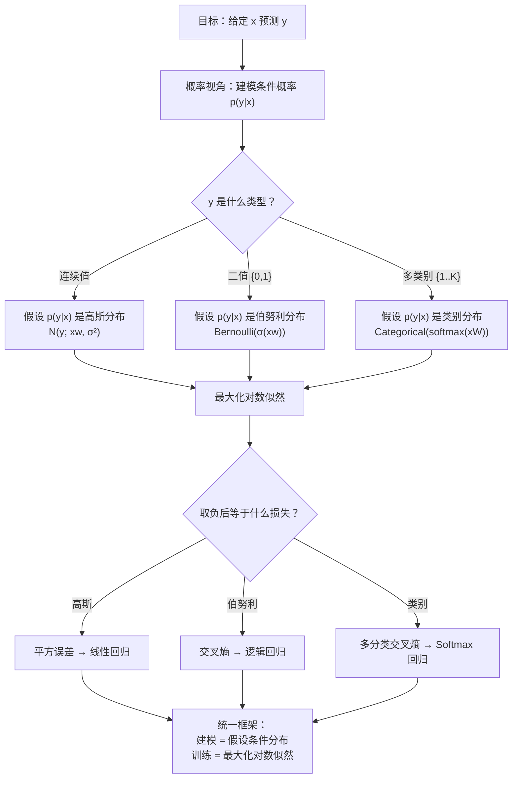
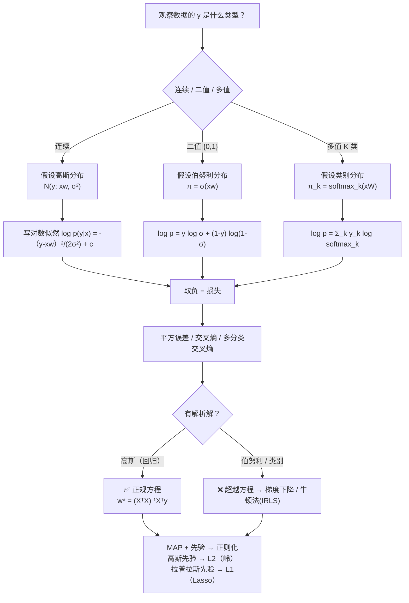

# 线性回归与分类的概率视角 (Probabilistic View of Linear Regression & Classification)

> [!info] 本讲导读
> 前两讲我们**直接**写出模型 $f(\boldsymbol{x})=\boldsymbol{xw}$ 和 $f(\boldsymbol{x})=\sigma(\boldsymbol{xw})$，然后**凭直觉**挑了损失函数（平方误差、交叉熵）。本讲要回答一个根本问题：
>
> **这些模型和损失函数，到底是"随便选的"，还是"必然的"？**
>
> 答案是：**它们都是必然的**——只要我们把"预测 $y$"这件事改成"**为 $y$ 假设一个条件概率分布 $p(y\mid\boldsymbol{x})$**"，再要求**最大化对数似然**，那么：
>
> | 假设 $p(y\mid\boldsymbol{x})$ 是 | 最大化对数似然 $\Longleftrightarrow$ 最小化 | 得到的模型 |
> |---|---|---|
> | **高斯分布**（连续） | **平方误差** | **线性回归** |
> | **伯努利分布**（二值） | **交叉熵** | **逻辑回归** |
> | **类别分布**（多值） | **多分类交叉熵** | **Softmax 回归** |
>
> **一句话总结本讲**：**"建模 = 为输出 $y$ 假设条件概率密度/质量函数；训练 = 最大化对数似然"**——回归与分类由此被统一到同一个框架下。
>
> 这也正是 [[Ch3 线性分类器（Linear Classifiers）|第 3 讲]] 留下的伏笔："在下一次课中，我们将从**精确建模**的角度，展示使用交叉熵损失的另一个优点。"

## 目录

- [[#一、引言：为什么需要概率视角|一、引言：为什么需要概率视角]]
  - [[#1.1 从确定性函数到条件概率|1.1 从确定性函数到条件概率]]
  - [[#1.2 两种预测准则：均值 vs 最大后验|1.2 两种预测准则：均值 vs 最大后验]]
  - [[#1.3 本讲路线图|1.3 本讲路线图]]
- [[#二、概率论预备知识|二、概率论预备知识]]
  - [[#2.1 一元高斯分布|2.1 一元高斯分布]]
  - [[#2.2 多元高斯分布|2.2 多元高斯分布]]
  - [[#2.3 协方差矩阵的谱分解与"旋转"|2.3 协方差矩阵的谱分解与"旋转"]]
  - [[#2.4 伯努利分布|2.4 伯努利分布]]
  - [[#2.5 类别分布|2.5 类别分布]]
  - [[#2.6 最大似然估计与 i.i.d. 假设|2.6 最大似然估计与 i.i.d. 假设]]
  - [[#2.7 三种分布一览|2.7 三种分布一览]]
- [[#三、从概率角度看回归|三、从概率角度看回归]]
  - [[#3.1 假设：条件分布是高斯|3.1 假设：条件分布是高斯]]
  - [[#3.2 从对数似然到平方误差|3.2 从对数似然到平方误差]]
  - [[#3.3 多样本情形：求和符号 Σ 从哪来|3.3 多样本情形：求和符号 Σ 从哪来]]
  - [[#3.4 结论：线性回归的概率身份|3.4 结论：线性回归的概率身份]]
  - [[#3.5 课件两个思考题的回答|3.5 课件两个思考题的回答]]
  - [[#3.6 例题（回归的概率视角）|3.6 例题（回归的概率视角）]]
- [[#四、从概率角度看分类|四、从概率角度看分类]]
  - [[#4.1 假设：条件分布是伯努利|4.1 假设：条件分布是伯努利]]
  - [[#4.2 从对数似然到交叉熵|4.2 从对数似然到交叉熵]]
  - [[#4.3 结论：逻辑回归的概率身份|4.3 结论：逻辑回归的概率身份]]
  - [[#4.4 例题（分类的概率视角）|4.4 例题（分类的概率视角）]]
- [[#五、多分类的概率视角|五、多分类的概率视角]]
  - [[#5.1 假设：条件分布是类别分布|5.1 假设：条件分布是类别分布]]
  - [[#5.2 参数化：π_k = softmax_k(xW)|5.2 参数化：π_k = softmax_k(xW)]]
  - [[#5.3 从对数似然到多分类交叉熵|5.3 从对数似然到多分类交叉熵]]
  - [[#5.4 例题（多分类的概率视角）|5.4 例题（多分类的概率视角）]]
- [[#六、统一框架|六、统一框架]]
  - [[#6.1 模型—分布—损失 对照总表|6.1 模型—分布—损失 对照总表]]
  - [[#6.2 统一公式|6.2 统一公式]]
  - [[#6.3 延伸：指数族与广义线性模型（GLM）|6.3 延伸：指数族与广义线性模型（GLM）]]
  - [[#6.4 延伸：正则化的概率解释（MAP）|6.4 延伸：正则化的概率解释（MAP）]]
- [[#七、重点·难点·易错点汇总|七、重点·难点·易错点汇总]]
- [[#八、简洁代码实现|八、简洁代码实现]]
- [[#九、知识点速查|九、知识点速查]]
- [[#十、本讲小结|十、本讲小结]]

---

## 一、引言：为什么需要概率视角

### 1.1 从确定性函数到条件概率

**回顾前两讲的"确定性"路线**：回归和分类的目标都是"在给定输入数据 $\boldsymbol{x}$ 的情况下，预测可能的输出 $y$"：

$$
\boldsymbol{x}\ \longrightarrow\ \text{预测}\ \longrightarrow\ y
$$

而预测是通过一个**确定性的函数**完成的：

| 任务 | 确定性模型 | 输出范围 |
|---|---|---|
| 回归（Regression） | $f(\boldsymbol{x})=\boldsymbol{xw}$ | $(-\infty,+\infty)$ |
| 分类（Classification） | $f(\boldsymbol{x})=\sigma(\boldsymbol{xw})$ | $(0,1)$，再阈值化成类别 |

**概率视角的转变**：从概率的角度来看，为了在给定 $\boldsymbol{x}$ 的情况下预测 $y$，我们**只需要建模条件概率**

$$
\boxed{\ p(y\mid\boldsymbol{x})\ }
$$

**这个转变的关键意义**：

> [!important] 确定性模型是"点估计"，概率模型是"整个分布"
> - **确定性模型**只回答"$y$ 最可能是多少"，但**不告诉你有多确定**；它把"预测 0.5"和"预测 0.9999"在模型结构上等同看待。
> - **概率模型**回答"$y$ 取各个值的可能性分别是多少"，因此**天然包含不确定性**，也天然能回答"我有多自信"。
> - 更重要的是：**一旦写出 $p(y\mid\boldsymbol{x})$，"该用什么损失函数"就不再是主观选择，而是数学必然**——这正是本讲要证明的核心命题。

> [!tip] 为什么这个视角如此重要？
> 因为**同一个确定性模型可以对应不同的损失函数**（回忆 [[Ch3 线性分类器（Linear Classifiers）|第 3 讲]]：逻辑回归既可以配平方误差也可以配交叉熵），但**一旦固定了 $p(y\mid\boldsymbol{x})$ 的形式，损失函数就被唯一确定**（是负对数似然）。换句话说：**"损失函数的选择"等价于"对数据噪声分布的假设"**。这就是为什么说"假设与损失必须匹配"。

### 1.2 两种预测准则：均值 vs 最大后验

有了条件概率 $p(y\mid\boldsymbol{x})$，输出可以按以下**两种方式**预测：

$$
\boxed{\ \hat y=\int y\,p(y\mid\boldsymbol{x})\,\mathrm dy\ }\qquad\text{（均值，mean）}
$$

$$
\boxed{\ \hat y=\arg\max_{y}\ p(y\mid\boldsymbol{x})\ }\qquad\text{（最大后验 / 众数）}
$$

| 准则 | 含义 | 适用场景 |
|---|---|---|
| **均值** $\int y p(y\mid\boldsymbol{x})\mathrm dy$ | 更侧重于预测输出的**平均结果** | 需要**连续预测**或**期望值估计**的场景（回归）；也等价于最小化平方误差 |
| **最大后验** $\arg\max_y p(y\mid\boldsymbol{x})$ | 更侧重于选择**最有可能**的类别或参数 | **分类问题**和**参数估计**；也等价于最小化 0-1 损失 |

> [!important] 回归和分类的目标都与条件概率紧密相关
> 课件这句话是**本讲全部内容的枢纽**：整个"概率视角"只做了一件事——**把"选模型"转化为"选 $p(y\mid\boldsymbol{x})$ 的形式"**，之后预测准则和损失函数都由这个选择自动决定。

> [!warning] 术语辨析：这里的"最大后验"要小心
> 严格来说，$\arg\max_y p(y\mid\boldsymbol{x})$ 是**条件分布的众数（mode）**，即"最可能出现的 $y$"。
> 而 **MAP（Maximum A Posteriori）** 这个词在机器学习中更常用于**参数估计**：$\hat{\boldsymbol{w}}_{\text{MAP}}=\arg\max_{\boldsymbol{w}}p(\boldsymbol{w}\mid\mathcal{D})$。
> 两者含义一致（都是"对后验分布取众数"），但**对象不同**：一个对 $y$（预测），一个对 $\boldsymbol{w}$（估计）。课件在预测语境下用"最大后验"指代 $\arg\max_y p(y\mid\boldsymbol{x})$，这是通行用法，但读文献时要注意区分。

> [!tip] 回归还能从另一个角度理解这两个准则
> 可以证明：
> - 用**均值**预测 $\Longleftrightarrow$ 最小化**平方误差** $\mathbb E[(y-\hat y)^2]$
> - 用**众数/中位数**预测 $\Longleftrightarrow$ 最小化**绝对误差** $\mathbb E[|y-\hat y|]$
> - 用**众数**预测 $\Longleftrightarrow$ 最小化 **0-1 损失**（分类场景）
>
> 所以"预测准则"与"损失函数"是一一对应的。[[Ch2 线性回归]] 中"为什么用平方误差"这个问题，在这里得到了概率论层面的答案：**因为隐含假设了高斯分布，而高斯的均值就是使平方误差最小的那个点**。

### 1.3 本讲路线图



---

## 二、概率论预备知识

本讲需要四种概率工具：**高斯分布**（回归用）、**伯努利分布**（二分类用）、**类别分布**（多分类用），以及**最大似然估计**（训练准则）。

### 2.1 一元高斯分布

**严谨定义**：

$$
\boxed{\ p(z)=\frac{1}{\sqrt{2\pi\sigma^{2}}}\exp\left(-\frac{1}{2}\frac{(z-\mu)^{2}}{\sigma^{2}}\right)\ \triangleq\ \mathcal N\!\left(z;\mu,\sigma^{2}\right)\ }
$$

**参数含义**：

| 符号 | 名称 | 定义/含义 |
|---|---|---|
| $\mu$ | **均值（mean）** | 分布的**峰值**与**中心** |
| $\sigma^{2}$ | **方差（variance）** | $\sigma^{2}=\mathbb E\left[(z-\mu)^{2}\right]$，衡量离散程度 |
| $\sigma$ | **标准差（standard deviation）** | $\sigma=\sqrt{\sigma^{2}}$，与 $z$ 同量纲 |

![[Ch4-img-univariate-gaussian.png]]

**通俗理解**：这是一条"**钟形曲线**"。$\mu$ 决定钟的**位置**（往左往右搬），$\sigma$ 决定钟的**胖瘦**（$\sigma$ 大则扁而宽，$\sigma$ 小则高而窄）

> [!important] 三个必须记住的定量事实
> 1. **归一化常数**：$\dfrac{1}{\sqrt{2\pi\sigma^{2}}}$ 的唯一作用是让 $\int_{-\infty}^{+\infty}p(z)\,\mathrm dz=1$。它等于**峰值高度**：$p(\mu)=\dfrac{1}{\sigma\sqrt{2\pi}}$。
>    **推论**：$\sigma$ 越大，峰值越低——曲线被"压扁"以保持面积为 1。
> 2. **拐点在 $\mu\pm\sigma$**：由 $p''(z)=0$ 解得 $z=\mu\pm\sigma$。这正是图中标注 $\mu$ 与 $2\sigma$ 的宽度所对应的几何意义——**曲线的"肩膀"位置就是一倍标准差处**（严格推导见 [[#3.6 例题（回归的概率视角）|例 4.2]]）。
> 3. **指数里的二次型** $-\dfrac{(z-\mu)^{2}}{2\sigma^{2}}$：这是"高斯"之所以"好算"的根本原因——**取对数后二次型变成二次函数，求导后变成线性**，于是最大似然问题退化为最小二乘，有解析解。

### 2.2 多元高斯分布
**严谨定义**：设 $\boldsymbol z\in\mathbb R^{D}$，

$$
\boxed{\ p(\boldsymbol z)=\frac{1}{(2\pi)^{D/2}\lvert\boldsymbol\Sigma\rvert^{1/2}}\exp\left(-\frac{1}{2}(\boldsymbol z-\boldsymbol\mu)^{\mathsf T}\boldsymbol\Sigma^{-1}(\boldsymbol z-\boldsymbol\mu)\right)\ \triangleq\ \mathcal N\!\left(\boldsymbol z;\boldsymbol\mu,\boldsymbol\Sigma\right)\ }
$$

**参数含义**：

| 符号 | 名称 | 含义 |
|---|---|---|
| $D$ | 维度 | $\boldsymbol z$ 的维数 |
| $\boldsymbol\mu\in\mathbb R^{D}$ | **均值向量** | 分布的峰值与中心 |
| $\boldsymbol\Sigma\in\mathbb R^{D\times D}$ | **协方差矩阵** | $\boldsymbol\Sigma=\mathbb E\left[(\boldsymbol z-\boldsymbol\mu)(\boldsymbol z-\boldsymbol\mu)^{\mathsf T}\right]$，决定离散程度与**方向** |

![[Ch4-img-multivariate-gaussian-3d.png]]

> [!warning] 课件此处有个小笔误（易错点）
> 课件第 7 页把 $\boldsymbol\Sigma$ 描述为"**标准差**"。严格说：
> - $\boldsymbol\Sigma$ 是**协方差矩阵（covariance matrix）**，$\boldsymbol\Sigma_{ij}=\mathrm{Cov}(z_i,z_j)$，对角元 $\boldsymbol\Sigma_{ii}=\sigma_i^{2}$ 是**方差**；
> - 标准差是 $\sigma_i=\sqrt{\boldsymbol\Sigma_{ii}}$（只有一元情形的"$\sigma$"才能直接叫标准差）。
>
> 这个区分不是吹毛求疵：**正因为 $\boldsymbol\Sigma$ 含非对角元，它才携带"变量间相关性/方向"的信息**，而这正是多元高斯比"各维独立的高斯"强大的地方（见 2.3 节）。

**三个关键结构**：

1. **马氏距离（Mahalanobis distance）**：指数中
   $$
   d_{\boldsymbol\Sigma}^{2}(\boldsymbol z,\boldsymbol\mu)=(\boldsymbol z-\boldsymbol\mu)^{\mathsf T}\boldsymbol\Sigma^{-1}(\boldsymbol z-\boldsymbol\mu)
   $$
   这是"用协方差加权后的欧氏距离"。**等概率面 $d_{\boldsymbol\Sigma}=c$ 是椭球面**（不是球面）——椭球的形状完全由 $\boldsymbol\Sigma$ 决定。

2. **归一化常数**：$\dfrac{1}{(2\pi)^{D/2}\lvert\boldsymbol\Sigma\rvert^{1/2}}$，其中 $\lvert\boldsymbol\Sigma\rvert=\det\boldsymbol\Sigma$。
   **关键**：必须 $\boldsymbol\Sigma$ 可逆（$\lvert\boldsymbol\Sigma\rvert\ne0$）。若 $\boldsymbol\Sigma$ 奇异，分布退化为低维子空间上的退化分布，密度无定义。

3. **$\boldsymbol\Sigma$ 必须对称半正定（PSD）**：
   - **对称**：由定义 $\boldsymbol\Sigma^{\mathsf T}=\mathbb E\left[(\boldsymbol z-\boldsymbol\mu)(\boldsymbol z-\boldsymbol\mu)^{\mathsf T}\right]^{\mathsf T}=\boldsymbol\Sigma$；
   - **半正定**：对任意 $\boldsymbol v$，$\boldsymbol v^{\mathsf T}\boldsymbol\Sigma\boldsymbol v=\mathbb E\left[\left(\boldsymbol v^{\mathsf T}(\boldsymbol z-\boldsymbol\mu)\right)^{2}\right]\ge0$。
   - 这条性质是下一节**谱分解**成立的前提（实对称矩阵必可正交对角化）。

**不同 $\boldsymbol\Sigma$ 下分布形状的变化**：

![[Ch4-img-covariance-shapes.png|534]]

| 情形 | $\boldsymbol\Sigma$ | 等高线形状 | 含义 |
|---|---|---|---|
| **(a)** $\sigma_1^{2}=\sigma_2^{2}$，$\rho=0$ | $\begin{pmatrix}\sigma^{2}&0\\0&\sigma^{2}\end{pmatrix}$ | **圆** | 各向同性，两维独立且方差相同 |
| **(b)** $\sigma_1^{2}>\sigma_2^{2}$，$\rho=0$ | $\begin{pmatrix}\sigma_1^{2}&0\\0&\sigma_2^{2}\end{pmatrix}$ | **轴对齐椭圆** | 两维独立，但方差不同 |
| **(c)** $\rho\ne0$ | $\begin{pmatrix}\sigma_1^{2}&\rho\\\rho&\sigma_2^{2}\end{pmatrix}$ | **倾斜椭圆** | 两维**相关**，主轴被旋转 |

> [!important] 无论 $\boldsymbol\Sigma$ 如何变化，峰值总是位于 $\boldsymbol\mu$（单峰）
> 这是课件强调的性质：**改变 $\boldsymbol\Sigma$ 只改变"胖瘦和朝向"，不改变"中心"**。
> **数学原因**：指数 $-\frac12(\boldsymbol z-\boldsymbol\mu)^{\mathsf T}\boldsymbol\Sigma^{-1}(\boldsymbol z-\boldsymbol\mu)$ 在 $\boldsymbol z=\boldsymbol\mu$ 处取最大值 $0$（因为 $\boldsymbol\Sigma^{-1}$ 正定，二次型非负），此时 $p(\boldsymbol\mu)=\dfrac{1}{(2\pi)^{D/2}\lvert\boldsymbol\Sigma\rvert^{1/2}}$ 是全局最大值。因此高斯**永远单峰**，永远以 $\boldsymbol\mu$ 为唯一峰值。

### 2.3 协方差矩阵的谱分解与"旋转"

**核心定理**：对于**每一个**协方差矩阵 $\boldsymbol\Sigma$（实对称半正定），它可以分解为

$$
\boxed{\ \boldsymbol\Sigma=\boldsymbol U\boldsymbol\Lambda\boldsymbol U^{\mathsf T}\ }
$$

其中：

- $\boldsymbol U$ 是一个**正交矩阵**，满足 $\boldsymbol U\boldsymbol U^{\mathsf T}=\boldsymbol I$（即 $\boldsymbol U^{-1}=\boldsymbol U^{\mathsf T}$）；
- $\boldsymbol\Lambda$ 是一个**对角矩阵**，对角元是 $\boldsymbol\Sigma$ 的**特征值** $\lambda_1\ge\lambda_2\ge\cdots\ge\lambda_D\ge0$；
- $\boldsymbol U$ 的**列**是 $\boldsymbol\Sigma$ 的**标准正交特征向量**。

> [!info] 这一步为什么成立？
> 线性代数基本定理：**实对称矩阵必可正交对角化**。而由 2.2 节，$\boldsymbol\Sigma$ 对称半正定，因此特征值都是非负实数，且特征向量可以取成两两正交的单位向量，拼成 $\boldsymbol U$。
> **几何意义**：$\boldsymbol U$ 是一个**旋转（或反射）**，$\boldsymbol\Lambda$ 是一个**沿坐标轴的缩放**。所以"任意椭圆"= "先旋转、再沿轴缩放、再转回来"。

**变换到主轴坐标系**：令

$$
\boldsymbol z'=\boldsymbol U^{\mathsf T}\boldsymbol z,\qquad \boldsymbol\mu'=\boldsymbol U^{\mathsf T}\boldsymbol\mu
$$

则分布可以表示为

$$
\boxed{\ p(\boldsymbol z')=\frac{1}{(2\pi)^{D/2}\lvert\boldsymbol\Lambda\rvert^{1/2}}\exp\left(-\frac{1}{2}(\boldsymbol z'-\boldsymbol\mu')^{\mathsf T}\boldsymbol\Lambda^{-1}(\boldsymbol z'-\boldsymbol\mu')\right)\ }
$$

![[Ch4-img-eigen-rotation.png|328]]

> 上图：**上**为变换后的 $p(\boldsymbol z')$——等高线**轴对齐**（因为 $\boldsymbol\Lambda$ 对角，各维独立）；**下**为原空间的 $p(\boldsymbol z)$——等高线**被 $\boldsymbol U$ 旋转**了，两根箭头即特征向量（椭圆主轴）。

**为什么这个变换"什么都不知道就能做"？** 关键是三个恒等式：

$$
\boldsymbol\Sigma^{-1}=\boldsymbol U\boldsymbol\Lambda^{-1}\boldsymbol U^{\mathsf T},\qquad
\lvert\boldsymbol\Sigma\rvert=\prod_{i=1}^{D}\lambda_i=\lvert\boldsymbol\Lambda\rvert,\qquad
\lvert\det\boldsymbol U\rvert=1
$$

- 第一式：$(\boldsymbol U\boldsymbol\Lambda\boldsymbol U^{\mathsf T})^{-1}=(\boldsymbol U^{\mathsf T})^{-1}\boldsymbol\Lambda^{-1}\boldsymbol U^{-1}=\boldsymbol U\boldsymbol\Lambda^{-1}\boldsymbol U^{\mathsf T}$。
- 第二式：$\lvert\boldsymbol U\boldsymbol\Lambda\boldsymbol U^{\mathsf T}\rvert=\lvert\boldsymbol U\rvert\lvert\boldsymbol\Lambda\rvert\lvert\boldsymbol U^{\mathsf T}\rvert=\lvert\boldsymbol\Lambda\rvert\cdot(\det\boldsymbol U)^{2}=\lvert\boldsymbol\Lambda\rvert$（正交矩阵行列式为 $\pm1$）。
- 第三式：**正交变换不改变体积**，所以概率**密度值不变**（$p(\boldsymbol z')=p(\boldsymbol z)$），这正是课件能直接对 $\boldsymbol z'$ 写出同一形式密度函数的原因。

**对角化带来的化简**：二次型变成

$$
(\boldsymbol z-\boldsymbol\mu)^{\mathsf T}\boldsymbol\Sigma^{-1}(\boldsymbol z-\boldsymbol\mu)
=\sum_{i=1}^{D}\frac{(z_i'-\mu_i')^{2}}{\lambda_i}
$$

于是密度**完全分解为 $D$ 个一维高斯的乘积**：

$$
p(\boldsymbol z')=\prod_{i=1}^{D}\frac{1}{\sqrt{2\pi\lambda_i}}\exp\left(-\frac{(z_i'-\mu_i')^{2}}{2\lambda_i}\right)
$$

> [!important] 三个可以直接使用的结论
> 1. **$\boldsymbol U$ 的列 = 椭圆主轴方向**；$\sqrt{\lambda_i}$ **正比于第 $i$ 根半轴的长度**。所以看 $\boldsymbol\Sigma$ 的特征值就能读出椭圆的"长宽比"，看特征向量就能读出"朝向"。
> 2. **在主轴坐标系下各维相互独立**：$\boldsymbol\Lambda$ 对角 $\Longrightarrow$ $z_1',\dots,z_D'$ 独立。
> 3. **对高斯，"不相关"等价于"独立"**：一般分布中不相关推不出独立，但高斯是例外（因为联合密度能分解成边缘密度之积）。$\rho=0$（不相关）$\iff$ 协方差对角 $\iff$ 独立。这是高斯极其特殊的性质。

> [!warning] 易错点：别把"对角化"与"标准化"混为一谈
> - **对角化** $\boldsymbol z'=\boldsymbol U^{\mathsf T}\boldsymbol z$ 只做**旋转**，保留各主轴的方差 $\lambda_i$；
> - **白化（whitening）** 还要再除以 $\sqrt{\lambda_i}$，即 $\boldsymbol z''=\boldsymbol\Lambda^{-1/2}\boldsymbol U^{\mathsf T}\boldsymbol z$，使协方差变成 $\boldsymbol I$。
>
> 课件做的是前者（旋转），因此变换后仍写作 $\mathcal N(\boldsymbol\mu',\boldsymbol\Lambda)$ 而非 $\mathcal N(\boldsymbol 0,\boldsymbol I)$。

### 2.4 伯努利分布

**严谨定义**：随机变量 $z\in\{0,1\}$，参数 $\pi\in[0,1]$ 是 $z=1$ 的概率，

$$
\boxed{\ p(z)=\pi^{z}\cdot(1-\pi)^{1-z}\ }
$$

它**可以简洁地表示为**（分段形式）：

$$
p(z)=
\begin{cases}
\pi, & \text{if } z=1\\[2pt]
1-\pi, & \text{if } z=0
\end{cases}
$$

**"指数当开关"的验证**（务必看懂这个技巧，它在全讲反复使用）：

| $z$ | $\pi^{z}(1-\pi)^{1-z}$ | 结果 |
|---|---|---|
| $1$ | $\pi^{1}(1-\pi)^{0}=\pi\cdot1$ | $\pi$ ✓ |
| $0$ | $\pi^{0}(1-\pi)^{1}=1\cdot(1-\pi)$ | $1-\pi$ ✓ |

**矩**：$\mathbb E[z]=\pi$，$\mathrm{Var}(z)=\pi(1-\pi)$。

> [!info] 与二项分布的关系（课件内容）
> **伯努利分布是二项分布的特殊情况**：$\mathrm{Bernoulli}(\pi)=\mathrm{Binomial}(n=1,\pi)$。
> 二项分布 $\mathrm{Bin}(n,\pi)$ 描述"$n$ 次独立伯努利试验中成功的次数"，$n=1$ 时自然退化为伯努利。✓

> [!warning] 纠错：课件"伯努利可视为高斯的特例"这一说法**不严谨**
> 课件第 17 页写道："在某些情况下，伯努利分布可以视为高斯分布的一个特例，特别是当高斯分布的协方差矩阵是对角矩阵时……高斯分布退化为伯努利分布。"**这个说法是错误的**，需要澄清：
>
> **为什么错**：
> - 高斯是**连续**分布，支撑集是 $\mathbb R$，有**概率密度**；
> - 伯努利是**离散**分布，支撑集是 $\{0,1\}$，只有**概率质量**（质量集中在两点，密度是狄拉克 $\delta$ 之和）；
> - 两者的支撑集和测度类型都不同，**不可能互相"退化"**。对角协方差只意味着"分量独立"，与"变成两点分布"毫无关系。
>
> **正确的关联应该是**：
> 1. **伯努利是二项分布的特例**（$n=1$）—— 课件这一条是对的；
> 2. **对角协方差的高斯 $\Longrightarrow$ 各分量相互独立**；而伯努利向量的分量也可以独立。两者共享的是"**独立性**"这一结论，**而不是分布本身**；
> 3. **真正的统一是"指数族"**：一元高斯 $\mathcal N(\mu,\sigma^{2})$ 与伯努利 $\mathrm{Bernoulli}(\pi)$ **都属于指数族**（exponential family），都能写成 $p(z)=h(z)\exp\left(\eta\,T(z)-A(\eta)\right)$ 的标准形式，只是**自然参数**不同：高斯的自然参数是 $\eta=\mu/\sigma^{2}$（均值参数化下为 $\mu$），伯努利的自然参数是 $\eta=\log\dfrac{\pi}{1-\pi}$（即 **logit**）。
> 4. 更进一步，两者都是**广义线性模型（GLM）**的特例——**这才是课件第 25 页"统一框架"的严格数学基础**（详见 [[#6.3 延伸：指数族与广义线性模型（GLM）|6.3 节]]）。

### 2.5 类别分布

**严谨定义**（也叫 Categorical / 多项分布的单次试验）：输出 $\boldsymbol z$ 是一个**独热向量**，即

$$
\boldsymbol z=\text{onehot}_k=\bigl[\underbrace{0,\ \cdots,\ 0}_{k-1},\ \underbrace{1}_{k},\ 0,\ \cdots,\ 0\bigr]
$$

**"$z$ 的 one-hot 的第 $k$ 个元素"记法**：$p(\boldsymbol z)=\pi_k$

该分布可以**等价地写为**

$$
\boxed{\ p(\boldsymbol z)=\prod_{k=1}^{K}\pi_k^{z_k}\ }
$$

其中 $\boldsymbol z$ 是一个独热向量（$\sum_k z_k=1$），且必须满足

$$
\sum_{k=1}^{K}\pi_k=1
$$

**验证**：若 $\boldsymbol z=\text{onehot}_j$，则 $z_j=1$ 而其余 $z_k=0$，故

$$
\prod_{k=1}^{K}\pi_k^{z_k}
=\pi_j^{1}\cdot\prod_{k\ne j}\pi_k^{0}
=\pi_j\cdot1=\pi_j
$$

正好等于"第 $j$ 类的概率" ✓

> [!important] 类别分布是"伯努利的推广"
> | | 伯努利 | 类别分布 |
> |---|---|---|
> | 取值 | $z\in\{0,1\}$ | $\boldsymbol z\in\{\text{onehot}_1,\dots,\text{onehot}_K\}$ |
> | 参数 | 标量 $\pi$ | 向量 $(\pi_1,\dots,\pi_K)$ |
> | 通用写法 | $\pi^{z}(1-\pi)^{1-z}$ | $\prod_k\pi_k^{z_k}$ |
> | 约束 | $0\le\pi\le1$ | $\sum_k\pi_k=1$ |
> | 特例 | — | $K=2$ 时等价于伯努利 |
>
> "指数当开关"的写法从 $2$ 个类别推广到 $K$ 个类别，就是 $K$ 个因子的乘积——**只有真实类别那一项的指数是 1，其余是 0**。这个技巧正是多分类交叉熵"内层求和只剩一项"的原因（见 5.3 节）。

### 2.6 最大似然估计与 i.i.d. 假设

**训练准则**：模型训练的目标是找到**使对数概率最大化的参数** $\boldsymbol w$：

$$
\max_{\boldsymbol w}\ \log p(y\mid\boldsymbol{x};\boldsymbol w)
$$

**多样本情形**：对 $N$ 个训练样本 $(\boldsymbol{x}_i,y_i)$，假设它们是**独立同分布（i.i.d., independent and identically distributed）** 的，可以得到它们的**联合条件概率密度函数**：

$$
p(y_1,\cdots,y_N\mid\boldsymbol{x}_1,\cdots,\boldsymbol{x}_N)=\prod_{i=1}^{N}p(y_i\mid\boldsymbol{x}_i;\boldsymbol w)
$$

取对数得**对数似然函数**：

$$
\log p(y_1,\cdots,y_N\mid\boldsymbol{x}_1,\cdots,\boldsymbol{x}_N)=\sum_{i=1}^{N}\log p(y_i\mid\boldsymbol{x}_i;\boldsymbol w)
$$

> [!important] i.i.d. 的两个字母各自的作用（本讲得分点）
> - **i（independent，独立）**：$p(y_1,\dots,y_N\mid\cdot)=\prod_i p(y_i\mid\cdot)$。**独立性把"联合"变成"乘积"**。
> - **id（identically distributed，同分布）**：所有样本**共用同一组参数** $\boldsymbol w$，所以连乘的每一项形式相同、都是 $p(\cdot;\boldsymbol w)$。若每个样本有各自不同的参数，连乘就失去意义（参数比样本还多，无法"共享统计强度"）。
> - **取对数**：$\log\prod_i=\sum_i\log$。**对数把乘积变成求和**——这就回答了课件第 14 页的思考题"为什么会出现求和符号 $\sum$"。

**为什么用对数似然而不是似然本身？**（三条理由，都要能说出来）

| 理由 | 说明 |
|---|---|
| **单调性** | $\log$ 严格单调递增，故 $\arg\max_{\boldsymbol w}\mathcal L=\arg\max_{\boldsymbol w}\log\mathcal L$，最优解不变 |
| **数值稳定** | 连乘 $N$ 个 $<1$ 的数会**下溢为 0**；取对数后变成"加法"，完全避免下溢（数值例子见 [[#3.6 例题（回归的概率视角）|例 4.4]]） |
| **求导方便** | 乘积的导数要用乘法法则（越乘越复杂）；对数的导数把乘积拆成可分离的和，且指数族分布取对数后**指数消失、只剩线性/二次项** |

> [!warning] 易错点：$\log$ 是凹函数，不能把 $\log$ 提到 $\max$ 外面乱交换
> $\max_{\boldsymbol w}\log\mathcal L(\boldsymbol w)=\log\max_{\boldsymbol w}\mathcal L(\boldsymbol w)$ 之所以成立，是因为 $\log$ 单调。但
> $$\log\Bigl(\sum_i\mathcal L_i\Bigr)\ \ne\ \sum_i\log\mathcal L_i$$
> ——"对数之和"与"和的对数"完全不同。**独立性的作用是让我们得到"乘积"，对数的进一步作用是把这个"乘积"变成"和"**。这两步不能混为一谈。

### 2.7 三种分布一览

| | **高斯** | **伯努利** | **类别分布** |
|---|---|---|---|
| 类型 | 连续 | 离散（二值） | 离散（多值） |
| 支撑集 | $\mathbb R$（或 $\mathbb R^{D}$） | $\{0,1\}$ | $\{\text{onehot}_1,\dots,\text{onehot}_K\}$ |
| 密度/质量 | $p(z)=\frac{1}{\sqrt{2\pi\sigma^{2}}}e^{-\frac{(z-\mu)^{2}}{2\sigma^{2}}}$ | $p(z)=\pi^{z}(1-\pi)^{1-z}$ | $p(\boldsymbol z)=\prod_k\pi_k^{z_k}$ |
| 参数 | $\mu,\sigma^{2}$（$\boldsymbol\mu,\boldsymbol\Sigma$） | $\pi\in[0,1]$ | $\pi_k\ge0,\ \sum_k\pi_k=1$ |
| 对应任务 | **回归** | **二分类** | **多分类** |
| 对应模型 | 线性回归 | 逻辑回归 | Softmax 回归 |
| 对应损失 | **平方误差** | **交叉熵** | **多分类交叉熵** |

---

## 三、从概率角度看回归

### 3.1 假设：条件分布是高斯

**核心假设**：从概率视角来看，为了进行预测，我们只需要指定条件概率分布 $p(y\mid\boldsymbol{x})$。对于**回归**问题，我们假设这个分布是**正态（高斯）分布**：

$$
\boxed{\ p(y\mid\boldsymbol{x};\boldsymbol w)=\frac{1}{\sqrt{2\pi\sigma^{2}}}\exp\left(-\frac{1}{2}\frac{(y-\boldsymbol{xw})^{2}}{\sigma^{2}}\right)=\mathcal N\!\left(y;\ \boldsymbol{xw},\ \sigma^{2}\right)\ }
$$

**逐项解读**：

- **均值 $\mu=\boldsymbol{xw}$**：这是我们熟悉的线性模型！**高斯分布的"中心"恰好就是线性预测值**。
- **方差 $\sigma^{2}$**：噪声的方差，刻画"$y$ 围绕 $\boldsymbol{xw}$ 波动的幅度"。**它被假设为与 $\boldsymbol{x}$ 无关的常数**——这叫**同方差性（homoscedasticity）**。
- 一句话：**$y=\boldsymbol{xw}+\epsilon$，其中 $\epsilon\sim\mathcal N(0,\sigma^{2})$**。这就是"**高斯噪声假设**"。

**预测**：我们使用**分布的均值**进行预测，即

$$
\hat y=\mathbb E[y\mid\boldsymbol{x}]=\boldsymbol{xw}
$$

> [!important] 这不是"选择"，而是"恢复"
> 注意这个假设的巧妙之处：**我们并没有"另起炉灶"发明一个新模型，而是给原来的线性模型 $f(\boldsymbol{x})=\boldsymbol{xw}$ 找到了一个概率身份**——它原来是"高斯分布的均值函数"。
> 所以概率视角**不是推翻**了前两讲的内容，而是**解释了**它们为什么长这样。

### 3.2 从对数似然到平方误差

从 $p(y\mid\boldsymbol{x};\boldsymbol w)$ 的表达式中，我们得到（**单样本**，取对数）：

$$
\boxed{\ \log p(y\mid\boldsymbol{x};\boldsymbol w)=-\frac{1}{2}\frac{(y-\boldsymbol{xw})^{2}}{\sigma^{2}}+\text{constant}\ }
$$

**推导（一步到位）**：

$$
\log p=-\frac{(y-\boldsymbol{xw})^{2}}{2\sigma^{2}}-\underbrace{\log\left(\sqrt{2\pi\sigma^{2}}\right)}_{\text{与 }\boldsymbol w\text{ 无关，记为 constant}}
$$

**关键观察**：式子里只有第一项含 $\boldsymbol w$！因此

$$
\max_{\boldsymbol w}\ \log p(y\mid\boldsymbol{x};\boldsymbol w)
\iff
\min_{\boldsymbol w}\ \frac{(y-\boldsymbol{xw})^{2}}{2\sigma^{2}}
\iff
\boxed{\ \min_{\boldsymbol w}\ (y-\boldsymbol{xw})^{2}\ }
$$

> [!important] 这正是回归中使用的损失函数！
> 于是我们证明了：**"高斯噪声假设 + 最大似然" $\Longrightarrow$ "最小二乘"**。
> 换句话说，[[Ch2 线性回归]] 里那个"凭直觉选的平方误差"，其实是**高斯假设下最大似然的必然产物**。

**还有两个值得注意的细节**：

1. **$\sigma^{2}$ 完全不影响最优 $\boldsymbol w$**。因为 $\frac{1}{2\sigma^{2}}>0$ 只是一个**正的常数缩放**，不改变 $\arg\min$ 的位置。所以：
   - 我们**不需要知道噪声方差**就能求出最优 $\boldsymbol w$；
   - 这也暗示了 $\boldsymbol w$ 与 $\sigma^{2}$ **可分离求解**（先解 $\boldsymbol w$，再估 $\sigma^{2}$，见例 4.1）。
2. **为什么是"平方"而不是"绝对值"？** 因为指数里是 $(y-\boldsymbol{xw})^{2}$。**这个二次型来自高斯密度的定义**。若换成拉普拉斯分布，指数里会是 $|y-\boldsymbol{xw}|$，最大似然就变成 **L1 损失**（见 [[#3.6 例题（回归的概率视角）|例 4.6]]）——**损失函数的形式完全由噪声分布的形式决定**。

### 3.3 多样本情形：求和符号 Σ 从哪来

对于 $N$ 个训练样本 $(\boldsymbol{x}_i,y_i)$，通过假设它们是**独立同分布（i.i.d.）** 的，可以得到它们的**联合条件概率密度函数**：

$$
p(y_1,\cdots,y_N\mid\boldsymbol{x}_1,\cdots,\boldsymbol{x}_N)=\prod_{i=1}^{N}\frac{1}{\sqrt{2\pi\sigma^{2}}}\exp\left(-\frac{1}{2}\frac{(y_i-\boldsymbol{x}_i\boldsymbol w)^{2}}{\sigma^{2}}\right)
$$

**对数似然函数是**：

$$
\boxed{\ \log p(y_1,\cdots,y_N\mid\boldsymbol{x}_1,\cdots,\boldsymbol{x}_N)=-\frac{1}{2\sigma^{2}}\sum_{i=1}^{N}(y_i-\boldsymbol{x}_i\boldsymbol w)^{2}+\text{constant}\ }
$$

**推导过程（看清 $\prod$ 如何变成 $\sum$）**：

$$
\log\prod_{i=1}^{N}(\cdot)_i=\sum_{i=1}^{N}\log(\cdot)_i
=\sum_{i=1}^{N}\left[-\frac{(y_i-\boldsymbol{x}_i\boldsymbol w)^{2}}{2\sigma^{2}}-\log\sqrt{2\pi\sigma^{2}}\right]
=-\frac{1}{2\sigma^{2}}\sum_{i=1}^{N}(y_i-\boldsymbol{x}_i\boldsymbol w)^{2}\underbrace{-\ N\log\sqrt{2\pi\sigma^{2}}}_{\text{constant}}
$$

**因此**，最大化对数似然 $\log p(y_1,\cdots,y_N\mid\boldsymbol{x}_1,\cdots,\boldsymbol{x}_N)$ 等价于最小化

$$
\boxed{\ L(\boldsymbol w)=\sum_{i=1}^{N}(y_i-\boldsymbol{x}_i\boldsymbol w)^{2}\ }
$$

**这与回归中使用的损失函数是相同的**（只差一个不影响极值点的常数因子 $1/N$）。

### 3.4 结论：线性回归的概率身份

从概率建模的角度来看，**线性回归实际上等价于**：

> [!important] 线性回归的概率身份
> - **建模**：假设条件分布是**（对角）高斯分布**
>   $$p(y\mid\boldsymbol{x};\boldsymbol w)=\mathcal N\!\left(y;\boldsymbol{xw},\sigma^{2}\right)$$
> - **训练**：通过**最大化对数似然**来训练模型
>   $$\max_{\boldsymbol w}\ \sum_{i=1}^{N}\log p(y_i\mid\boldsymbol{x}_i;\boldsymbol w)\iff\min_{\boldsymbol w}\ \sum_{i=1}^{N}(y_i-\boldsymbol{x}_i\boldsymbol w)^{2}$$

> [!info] 课件说的"对角高斯"是什么意思？
> 课件第 15 页写的是"假设条件分布是**对角高斯分布**"。严格说：
> - 若把 $N$ 个样本的响应拼成向量 $\boldsymbol y=(y_1,\dots,y_N)^{\mathsf T}$，则该向量的协方差是 $\sigma^{2}\boldsymbol I$——**对角**，因为 i.i.d. 假设意味着**样本之间不相关且方差相同**；
> - 若把每个 $y_i$ 看成独立的一元高斯，则"对角"是指**样本维度上的对角**，而不是特征维度上的。
>
> 两种理解都指向同一个事实：**协方差是 $\sigma^{2}\boldsymbol I$（对角且各向同性）**。这与"多元高斯 + 非对角 $\boldsymbol\Sigma$"（可用于建模样本间相关性，即广义最小二乘 GLS）形成对比。

### 3.5 课件两个思考题的回答

> [!question] 思考题 1（课件第 11 页）：在这里得到的 $\boldsymbol w$ 与传统回归中得到的 $\boldsymbol w$ 相同吗？
> **答案：相同，而且与 $\sigma^{2}$ 的取值完全无关。**
>
> **理由**：两种路线的目标函数本质上是同一个：
> - 传统路线：$\min_{\boldsymbol w}\sum_i(y_i-\boldsymbol{x}_i\boldsymbol w)^{2}$
> - 概率路线：$\max_{\boldsymbol w}\sum_i\log p(y_i\mid\boldsymbol{x}_i;\boldsymbol w)=\min_{\boldsymbol w}\frac{1}{2\sigma^{2}}\sum_i(y_i-\boldsymbol{x}_i\boldsymbol w)^{2}+\text{const}$
>
> 后者只是前者乘以**正常数** $\frac{1}{2\sigma^{2}}$。正数缩放不改变极小点，所以
> $$\boldsymbol w^{*}_{\text{MLE}}=\arg\min_{\boldsymbol w}\sum_i(y_i-\boldsymbol{x}_i\boldsymbol w)^{2}=(\boldsymbol X^{\mathsf T}\boldsymbol X)^{-1}\boldsymbol X^{\mathsf T}\boldsymbol y$$
> ——**正是 [[Ch2 线性回归]] 的正规方程解**。
>
> **反而要注意"哪里不同"**：概率视角**额外得到了** $\sigma^{2}$ 的估计（$\hat\sigma^{2}=\frac1N\sum_i(y_i-\boldsymbol{x}_i\boldsymbol w^{*})^{2}$），并**解释了**为什么要用平方误差。**模型没变，理解变深了。**

> [!question] 思考题 2（课件第 14 页）：你能想出为什么这里会出现求和符号 $\sum$ 吗？
> **答案：$\sum$ 来自两件事的叠加——"独立性"与"取对数"。**
>
> 1. **独立性（i.i.d. 的第一个 i）**：样本相互独立 $\Longrightarrow$ 联合概率 $=$ 边缘概率之**积** $\Longrightarrow$ 出现 $\prod_{i=1}^{N}$；
> 2. **取对数**：$\log\prod_{i=1}^{N}=\sum_{i=1}^{N}\log$，**乘积变求和** $\Longrightarrow\prod$ 变成 $\sum$。
>
> 所以 $\sum$ 的每一项代表"**第 $i$ 个样本对总似然的贡献**"，共 $N$ 项。
>
> **反过来说**：如果样本**不独立**（例如时间序列、图像相邻像素），联合概率就不能写成乘积，$\sum$ 的形式立刻失效，必须改用含交叉项的联合分布（例如用一个非对角的 $\boldsymbol\Sigma$）。**这就是"i.i.d. 假设"在数学上的具体作用。**

### 3.6 例题（回归的概率视角）

> [!example]- 例 4.1：从高斯 MLE 推出正规方程，并顺带估计噪声方差（核心）
> 设 $N$ 个样本满足 $y_i\mid\boldsymbol{x}_i\sim\mathcal N(\boldsymbol{x}_i\boldsymbol w,\sigma^{2})$ 且相互独立（$\boldsymbol{x}_i$ 为含偏置的行向量）。
> 1. 写出对数似然 $\log p(y_1,\dots,y_N\mid\boldsymbol{x}_1,\dots,\boldsymbol{x}_N;\boldsymbol w,\sigma^{2})$；
> 2. 证明 $\arg\max_{\boldsymbol w}$ 与 $\sigma^{2}$ 无关，并求出 $\boldsymbol w$ 的 MLE；
> 3. 求出 $\sigma^{2}$ 的 MLE（给定 $\boldsymbol w^{*}$）；
> 4. 说明 $\hat\sigma^{2}$ 的 MLE 是"有偏"的，并给出无偏版本。
>
> **解答：**
> 1. 由独立性与高斯密度：
>    $$\log p=-\frac{N}{2}\log(2\pi\sigma^{2})-\frac{1}{2\sigma^{2}}\sum_{i=1}^{N}(y_i-\boldsymbol{x}_i\boldsymbol w)^{2}$$
> 2. 上式对 $\boldsymbol w$ 而言，第一项是常数、第二项的系数 $\frac{1}{2\sigma^{2}}>0$ 是正常数，故
>    $$\arg\max_{\boldsymbol w}\log p=\arg\min_{\boldsymbol w}\sum_{i=1}^{N}(y_i-\boldsymbol{x}_i\boldsymbol w)^{2}=\arg\min_{\boldsymbol w}\lVert\boldsymbol X\boldsymbol w-\boldsymbol y\rVert^{2}$$
>    **与 $\sigma^{2}$ 无关** ✓
>    令梯度为零：$\dfrac{\partial}{\partial\boldsymbol w}\lVert\boldsymbol X\boldsymbol w-\boldsymbol y\rVert^{2}=2\boldsymbol X^{\mathsf T}(\boldsymbol X\boldsymbol w-\boldsymbol y)=\boldsymbol 0$，得**正规方程**
>    $$\boldsymbol X^{\mathsf T}\boldsymbol X\boldsymbol w=\boldsymbol X^{\mathsf T}\boldsymbol y\ \Longrightarrow\ \boldsymbol w^{*}=(\boldsymbol X^{\mathsf T}\boldsymbol X)^{-1}\boldsymbol X^{\mathsf T}\boldsymbol y$$
>    （与 [[Ch2 线性回归]] 完全一致 ✓）
> 3. 记残差平方和 $S(\boldsymbol w)=\sum_i(y_i-\boldsymbol{x}_i\boldsymbol w)^{2}$。对 $\sigma^{2}$ 求导（把 $\boldsymbol w$ 固定在 $\boldsymbol w^{*}$）：
>    $$\frac{\partial\log p}{\partial\sigma^{2}}=-\frac{N}{2\sigma^{2}}+\frac{S(\boldsymbol w^{*})}{2\sigma^{4}}=0\ \Longrightarrow\ \hat\sigma^{2}=\frac{S(\boldsymbol w^{*})}{N}=\frac{1}{N}\sum_{i=1}^{N}\bigl(y_i-\boldsymbol{x}_i\boldsymbol w^{*}\bigr)^{2}$$
>    **直觉**：噪声方差就是"**残差平方的平均**"。
> 4. **有偏性**：$\mathbb E[\hat\sigma^{2}_{\text{MLE}}]=\frac{N-d}{N}\sigma^{2}$，其中 $d=m+1$ 是参数个数。因为拟合时我们已经"用掉"了 $d$ 个自由度去最小化 $S$，所以 $S$ 系统性偏小。
>    **无偏版本**：$\hat\sigma^{2}_{\text{unbiased}}=\dfrac{S(\boldsymbol w^{*})}{N-d}=\dfrac{1}{N-m-1}\sum_i(y_i-\boldsymbol{x}_i\boldsymbol w^{*})^{2}$。
>    **要点**：**MLE 的"有偏"并不影响 $\boldsymbol w^{*}$ 的最优性**——$d$ 只出现在方差估计的分母上。这也说明"最大似然"和"无偏估计"是两个不同的准则，前者不保证后者。

> [!example]- 例 4.2：一元高斯的峰值、拐点与 $2\sigma$ 宽度（细节考察）
> 设 $p(z)=\dfrac{1}{\sqrt{2\pi\sigma^{2}}}\exp\left(-\dfrac{(z-\mu)^{2}}{2\sigma^{2}}\right)$。
> 1. 求 $p(z)$ 的最大值点与最大值；
> 2. 求 $\dfrac{p(\mu\pm\sigma)}{p(\mu)}$ 的值；
> 3. 证明曲线的拐点（$p''(z)=0$）恰好位于 $z=\mu\pm\sigma$；
> 4. 说明图中标注"$2\sigma$"的几何含义。
>
> **解答：**
> 1. 指数部分 $-\frac{(z-\mu)^{2}}{2\sigma^{2}}\le0$，当且仅当 $z=\mu$ 时取最大值 $0$。故**唯一峰值在 $z=\mu$**，峰值为
>    $$p(\mu)=\frac{1}{\sqrt{2\pi\sigma^{2}}}=\frac{1}{\sigma\sqrt{2\pi}}$$
>    **注意**：$\sigma$ 越大峰值越低（$\propto1/\sigma$），因为总面积必须保持为 1。
> 2. 代入：
>    $$\frac{p(\mu\pm\sigma)}{p(\mu)}=\exp\left(-\frac{(\pm\sigma)^{2}}{2\sigma^{2}}\right)=\exp\left(-\frac12\right)\approx0.6065$$
>    即在 $\pm1$ 倍标准差处，密度降到峰值的 **60.65%**。
> 3. 令 $u=z-\mu$，$\log p(u)=-\dfrac{u^{2}}{2\sigma^{2}}+c$。求导：
>    $$(\log p)'=-\frac{u}{\sigma^{2}},\qquad (\log p)''=-\frac{1}{\sigma^{2}}$$
>    而 $p'=p\,(\log p)'$，$p''=p\bigl[(\log p)''+((\log p)')^{2}\bigr]=p\left[-\dfrac{1}{\sigma^{2}}+\dfrac{u^{2}}{\sigma^{4}}\right]$
>    令 $p''=0$（$p>0$）：$u^{2}=\sigma^{2}\Longrightarrow u=\pm\sigma$，即 $z=\mu\pm\sigma$ ✓
>    **结论**：密度曲线从"凹"变"凸"的**拐点**恰好在一倍标准差处，这也是"钟形肩膀"的精确位置。
> 4. **几何含义**：图中从 $\mu-\sigma$ 到 $\mu+\sigma$ 的线段长度就是 $2\sigma$，它标记的是曲线**肩膀之间的宽度**（严格说是拐点间距），而非"包含 68% 概率的区间"。若指概率，则 $P(\mu-\sigma\le z\le\mu+\sigma)\approx68.27\%$——**"拐点位置"与"68% 概率区间"数值上一致，但概念不同**（前者是几何特征，后者是概率积分）。

> [!example]- 例 4.3：协方差矩阵的谱分解与椭圆主轴（进阶计算）
> 设二元高斯 $\boldsymbol z\sim\mathcal N(\boldsymbol 0,\boldsymbol\Sigma)$，$\boldsymbol\Sigma=\begin{pmatrix}2&1\\1&2\end{pmatrix}$。
> 1. 求 $\boldsymbol\Sigma$ 的特征值与标准正交特征向量，写出 $\boldsymbol\Sigma=\boldsymbol U\boldsymbol\Lambda\boldsymbol U^{\mathsf T}$；
> 2. 求 $\lvert\boldsymbol\Sigma\rvert$ 与 $\boldsymbol\Sigma^{-1}$；
> 3. 描述等概率等高线椭圆的**主轴方向**与**半轴长比例**；
> 4. 写出旋转后 $\boldsymbol z'=\boldsymbol U^{\mathsf T}\boldsymbol z$ 的分布，并说明为什么变换前后的密度表达式"看起来一样"。
>
> **解答：**
> 1. 特征方程：
>    $$\det(\boldsymbol\Sigma-\lambda\boldsymbol I)=(2-\lambda)^{2}-1=0\ \Longrightarrow\ \lambda^{2}-4\lambda+3=0\ \Longrightarrow\ \lambda_1=3,\ \lambda_2=1$$
>    - $\lambda_1=3$：$(2-3)x+y=0\Rightarrow -x+y=0\Rightarrow \boldsymbol v_1=\frac{1}{\sqrt2}(1,1)^{\mathsf T}$
>    - $\lambda_2=1$：$(2-1)x+y=0\Rightarrow x+y=0\Rightarrow \boldsymbol v_2=\frac{1}{\sqrt2}(1,-1)^{\mathsf T}$
>
>    $$\boldsymbol U=\frac{1}{\sqrt2}\begin{pmatrix}1&1\\1&-1\end{pmatrix},\qquad \boldsymbol\Lambda=\begin{pmatrix}3&0\\0&1\end{pmatrix}$$
>    验证：$\boldsymbol U\boldsymbol U^{\mathsf T}=\frac12\begin{pmatrix}2&0\\0&2\end{pmatrix}=\boldsymbol I$ ✓（$\boldsymbol U$ 正交）且 $\boldsymbol U\boldsymbol\Lambda\boldsymbol U^{\mathsf T}=\frac12\begin{pmatrix}4&2\\2&4\end{pmatrix}=\boldsymbol\Sigma$ ✓
> 2. $\lvert\boldsymbol\Sigma\rvert=2\cdot2-1\cdot1=3=\lambda_1\lambda_2$ ✓
>    $$\boldsymbol\Sigma^{-1}=\boldsymbol U\boldsymbol\Lambda^{-1}\boldsymbol U^{\mathsf T}=\frac{1}{3}\begin{pmatrix}2&-1\\-1&2\end{pmatrix}$$
>    验证：$\boldsymbol\Sigma\boldsymbol\Sigma^{-1}=\frac13\begin{pmatrix}3&0\\0&3\end{pmatrix}=\boldsymbol I$ ✓
> 3. 等高线为 $(\boldsymbol z-\boldsymbol\mu)^{\mathsf T}\boldsymbol\Sigma^{-1}(\boldsymbol z-\boldsymbol\mu)=c^{2}$，是**椭圆**：
>    - **主轴方向** = 特征向量方向：一根沿 $(1,1)$（即 45°），另一根沿 $(1,-1)$（即 −45°）；
>    - **半轴长度** $\propto\sqrt{\lambda_i}$：长半轴 $=c\sqrt3$（沿 $(1,1)$），短半轴 $=c\sqrt1=c$（沿 $(1,-1)$），**长宽比 $=\sqrt3\approx1.732$**。
>    - **注意**：主轴方向与 $\rho=1/2>0$ 一致——**正相关**意味着椭圆向右上倾斜 ✓
> 4. 变换后 $\boldsymbol z'\sim\mathcal N(\boldsymbol 0,\boldsymbol\Lambda)=\mathcal N\!\left(\boldsymbol 0,\mathrm{diag}(3,1)\right)$，即
>    $$p(\boldsymbol z')=\frac{1}{2\pi\sqrt{3}}\exp\left(-\frac{z_1'^{2}}{6}-\frac{z_2'^{2}}{2}\right)$$
>    **"看起来一样"的原因**：
>    ① 二次型在变换下形式不变：$(\boldsymbol z-\boldsymbol\mu)^{\mathsf T}\boldsymbol\Sigma^{-1}(\boldsymbol z-\boldsymbol\mu)=(\boldsymbol z'-\boldsymbol\mu')^{\mathsf T}\boldsymbol\Lambda^{-1}(\boldsymbol z'-\boldsymbol\mu')$；
>    ② **归一化常数也不变**，因为 $\lvert\boldsymbol\Sigma\rvert=\lvert\boldsymbol\Lambda\rvert$；
>    ③ **密度值本身也不变**，因为正交变换的雅可比行列式 $\lvert\det\boldsymbol U\rvert=1$（正交变换保体积）。
>    **三者缺一不可**——这正是"正交变换"相比一般线性变换的特殊之处。

> [!example]- 例 4.4：为什么必须用对数似然——一个会"下溢"的具体例子（数值细节）
> 设 $N=1000$ 个独立样本，每个样本的似然都是 $0.01$。
> 1. 直接计算联合似然 $\mathcal L=\prod_{i=1}^{N}p(y_i\mid\boldsymbol{x}_i)$ 会得到什么？
> 2. 计算对数似然 $\log\mathcal L$；
> 3. 若换成"每个样本似然为 $1-10^{-6}$"，情况如何？这说明什么？
> 4. 总结使用对数似然的三条理由。
>
> **解答：**
> 1. $\mathcal L=0.01^{1000}=10^{-2000}$。**float64 能表示的最小正规格化数约为 $2.2\times10^{-308}$**，因此 $10^{-2000}$ 会**下溢（underflow）为 0**。此时似然值变成 0，$\arg\max$ 失去意义（所有参数都给出 $\mathcal L=0$，无法比较）。
> 2. $\log\mathcal L=1000\times\ln(0.01)=1000\times(-4.6052)=-4605.2$。**完全可表示**（float64 的量级上限约 $1.8\times10^{308}$），且**信息无损**。
> 3. $\mathcal L=(1-10^{-6})^{1000}\approx e^{-1000\times10^{-6}}=e^{-0.001}\approx0.999$，这是一个**安全**的值；但若 $N=10^{9}$ 则 $(1-10^{-6})^{10^{9}}\approx e^{-1000}\approx0$（下溢）。取对数后 $\log\mathcal L\approx-1000$，依然安全。
>    **这说明**：下溢是否发生取决于 $N$ 与单个似然的乘积效应，**取对数把这个"指数级的动态范围"压缩成了线性可加的量**，稳定性与 $N$ 无关地得到保证。
> 4. **三条理由**：
>    ① **单调性**：$\log$ 严格递增，$\arg\max$ 不变，**不损失任何最优性信息**；
>    ② **数值稳定**：乘积 $\to$ 求和，彻底规避下溢/上溢；
>    ③ **计算简洁**：指数族分布取对数后，$e^{(\cdot)}$ 消失，只剩线性/二次项，梯度形式极简（这正是交叉熵梯度 $(\sigma-y)\boldsymbol{x}^{\mathsf T}$ 如此干净的原因）。
>
> **工程提示**：这也是为什么实际代码里从来不算 `prod`，而是算 `sum(log)`（`np.log` 后 `sum`）——见 [[#八、简洁代码实现|代码部分]]。

> [!example]- 例 4.5：伯努利的 MLE 就是样本均值（并看它与逻辑回归的联系）
> 1. 设 $z_1,\dots,z_N$ 是 i.i.d. 的 $\mathrm{Bernoulli}(\pi)$ 观测，求 $\pi$ 的 MLE；
> 2. 若观测为 $(1,1,0,1)$，求 $\hat\pi$；
> 3. 逻辑回归中为什么用 $\pi=\sigma(\boldsymbol{xw})$ 而不是别的函数？
> 4. 该结果与逻辑回归"没有解析解"是否矛盾？
>
> **解答：**
> 1. 对数似然：
>    $$\log\mathcal L=\sum_{i=1}^{N}\bigl[z_i\log\pi+(1-z_i)\log(1-\pi)\bigr]=k\log\pi+(N-k)\log(1-\pi),\qquad k=\sum_i z_i$$
>    求导置零：
>    $$\frac{\mathrm d\log\mathcal L}{\mathrm d\pi}=\frac{k}{\pi}-\frac{N-k}{1-\pi}=0\ \Longrightarrow\ k(1-\pi)=(N-k)\pi\ \Longrightarrow\ \boxed{\hat\pi=\frac{k}{N}}$$
>    **即样本均值（成功频率）**。这是"伯努利 MLE = 频率"这一经典结论。
> 2. $k=3,N=4\Rightarrow\hat\pi=0.75$。
> 3. 因为必须把**无约束的线性打分** $\boldsymbol{xw}\in(-\infty,+\infty)$ 映射到**伯努利的合法参数区间** $\pi\in(0,1)$。$\sigma$ 恰好满足：
>    ① **值域正确**：$\sigma:\mathbb R\to(0,1)$；
>    ② **单调可微**：保序且可求导，保证优化可行；
>    ③ **与"对数几率线性"自然对应**：$\operatorname{logit}(\pi)=\log\frac{\pi}{1-\pi}=\boldsymbol{xw}$，即线性模型恰好出现在**自然参数（natural parameter）**位置上——这是指数族/GLM 理论给出的"唯一自然选择"。
> 4. **不矛盾**。第 1 问中 $\pi$ 是一个**自由参数**，所以有闭式解 $k/N$。逻辑回归中 $\pi=\sigma(\boldsymbol{xw})$ 把 $\pi$ **参数化**成了 $\boldsymbol w$ 的非线性函数，于是方程变成
>    $$\sum_{i=1}^{N}\bigl(\sigma(\boldsymbol{x}_i\boldsymbol w)-y_i\bigr)\boldsymbol{x}_i^{\mathsf T}=\boldsymbol 0$$
>    ——非线性超越方程组，**没有解析解**（回顾 [[Ch3 线性分类器（Linear Classifiers）|第 3 讲 3.1 节]]）。
>    **关键区分**：**"伯努利 MLE 有闭式解"**（参数自由）与**"逻辑回归 MLE 无闭式解"**（参数被特征线性参数化）是两件事。后者是把前者"套上特征模型"后**代价**。

> [!example]- 例 4.6：把高斯换成拉普拉斯，损失函数会变成什么？（进阶，理解"假设决定损失"）
> 假设噪声服从**拉普拉斯分布**：$p(y\mid\boldsymbol{x};\boldsymbol w)=\dfrac{1}{2b}\exp\left(-\dfrac{\lvert y-\boldsymbol{xw}\rvert}{b}\right)$。
> 1. 写出负对数似然，说明它对应什么损失函数；
> 2. 对比高斯假设下的平方误差，说明为什么 L1 损失**更鲁棒**；
> 3. 用单样本数值对比两种损失对大偏差的惩罚，并说明梯度行为；
> 4. 由此总结"损失函数与噪声假设"的对应关系。
>
> **解答：**
> 1. 取负对数：
>    $$-\log p=\frac{\lvert y-\boldsymbol{xw}\rvert}{b}+\log(2b)$$
>    对 $N$ 个 i.i.d. 样本求和，忽略常数：
>    $$\min_{\boldsymbol w}\ \sum_{i=1}^{N}\lvert y_i-\boldsymbol{x}_i\boldsymbol w\rvert$$
>    ——这就是 **L1 损失（绝对误差 / 最小绝对偏差 LAD）**。
> 2. **鲁棒性的来源是尾部的"厚薄"**：
>    - **高斯**尾 $\propto e^{-u^{2}}$，**极薄**。这意味着"出现大偏差"在模型看来"几乎不可能"，因此一旦真的出现，似然会急剧下降，MLE 会**不惜代价**地调整 $\boldsymbol w$ 去迁就这个离群点。
>    - **拉普拉斯**尾 $\propto e^{-\lvert u\rvert}$，**指数级更厚**。它认为"大偏差虽不常见但可能发生"，因此不会为了迁就离群点而大幅移动模型。
>    - **一句话**：**越"重尾"的假设 $\Rightarrow$ 越鲁棒的方法**。
> 3. 设单个样本 $y=0$，模型预测值 $f=\boldsymbol{xw}$：
>
>    | $f$（偏差） | L2 惩罚 $f^{2}$ | L1 惩罚 $\lvert f\rvert$ | L2 梯度 $2f$ | L1 梯度 $\mathrm{sign}(f)$ |
>    |---|---|---|---|---|
>    | $1$ | $1$ | $1$ | $2$ | $1$ |
>    | $10$ | $100$ | $10$ | $20$ | $1$ |
>    | $100$ | $10000$ | $100$ | $200$ | $1$ |
>
>    **关键差异在梯度列**：偏差从 1 涨到 100（100 倍），L2 的梯度涨到 200（100 倍，**无界**），而 L1 的梯度**始终是 1（有界）**。
>    **含义**：一个极端离群点会产生巨大的 L2 梯度，把参数"拽跑"，损害对所有正常样本的拟合；而 L1 的梯度被"封顶"在 $\pm1$，离群点的影响被自动限制。
>    （顺带呼应 [[Ch3 线性分类器（Linear Classifiers）|第 3 讲]]：**交叉熵的梯度 $(\sigma-y)\in(-1,1)$ 也是有界的**，这也正是交叉熵比平方误差更鲁棒的原因之一。）
> 4. **对应关系总表**：
>
>    | 噪声/输出假设 | 负对数似然（损失） | 梯度是否有界 |
>    |---|---|---|
>    | 高斯 $\mathcal N$ | 平方误差（L2） | ❌ 无界（$\propto$ 偏差） |
>    | 拉普拉斯 | 绝对误差（L1） | ✅ 有界（$\pm1$） |
>    | 伯努利 | 交叉熵 | ✅ 有界（$\sigma-y$） |
>    | 类别分布 | 多分类交叉熵 | ✅ 有界（$\hat p_k-y_k$） |
>
>    **结论**：**"选损失"就是"选噪声分布"**。想清楚了数据的噪声长什么样，损失函数也就定下来了。

---

## 四、从概率角度看分类

### 4.1 假设：条件分布是伯努利

为了实现**二元分类**，我们假设条件概率是**伯努利分布**：

$$
\boxed{\ p(y\mid\boldsymbol{x})=\sigma(\boldsymbol{xw})^{y}\cdot\bigl(1-\sigma(\boldsymbol{xw})\bigr)^{1-y}\ }
$$

其中 $\pi=\sigma(\boldsymbol{xw})$，且 $y=0$ 或 $1$。

**逐项解读**：

| 部分 | 含义 |
|---|---|
| $\sigma(\boldsymbol{xw})$ | 把线性打分压到 $(0,1)$，充当伯努利的参数 $\pi$ |
| $y$ 和 $1-y$ | "**指数当开关**"：只有真实标签对应的那一项被激活 |
| $p(y=1\mid\boldsymbol{x})=\sigma(\boldsymbol{xw})$ | 正类概率 |
| $p(y=0\mid\boldsymbol{x})=\sigma(-\boldsymbol{xw})=1-\sigma(\boldsymbol{xw})$ | 负类概率 |

> [!important] 这一步做了两件事，必须分清楚
> 1. **假设了分布族**：$y\mid\boldsymbol{x}$ 服从伯努利分布（离散、二值）——这是"建模"；
> 2. **参数化了参数**：把伯努利的参数 $\pi$ 写成 $\pi=\sigma(\boldsymbol{xw})$——这是"接上线性模型"。
>
> 两者的结合才得到逻辑回归。**如果只做第 1 步**（让 $\pi$ 自由），得到的只是"用频率估计概率"（[[#4.4 例题（分类的概率视角）|例 4.5]]）；**第 2 步才是把特征引入的地方**。

### 4.2 从对数似然到交叉熵

**训练目标是最大化对数似然函数**：

$$
\log p(y\mid\boldsymbol{x})=y\log\sigma(\boldsymbol{xw})+(1-y)\log\bigl(1-\sigma(\boldsymbol{xw})\bigr)
$$

**推导**：直接对 4.1 的表达式取对数，指数立刻"掉下来"：

$$
\log p(y\mid\boldsymbol{x})=\log\Bigl[\sigma(\boldsymbol{xw})^{y}\bigl(1-\sigma(\boldsymbol{xw})\bigr)^{1-y}\Bigr]
=y\log\sigma(\boldsymbol{xw})+(1-y)\log\bigl(1-\sigma(\boldsymbol{xw})\bigr)
$$

（利用了 $\log a^{b}=b\log a$。）

**回想一下，逻辑回归最小化**：

$$
\text{cross entropy}\ \triangleq\ -y\log\sigma(\boldsymbol{xw})-(1-y)\log\bigl(1-\sigma(\boldsymbol{xw})\bigr)
$$

**比较两式**：它们**恰好互为相反数**！因此

$$
\boxed{\ \max\ \log p(y\mid\boldsymbol{x})\ \Longleftrightarrow\ \min\ \text{cross entropy}\ }
$$

即：**最大化 $\log p(y\mid\boldsymbol{x})$ 等价于最小化交叉熵。**

> [!important] 这就是第 3 讲留下的伏笔的答案
> [[Ch3 线性分类器（Linear Classifiers）|第 3 讲]] 从"希望真实标签的概率尽可能大"出发**猜出**了交叉熵，并从最大似然**顺手推出**了它；本讲则说明：
> **交叉熵不是"一个还不错的选择"，而是"伯努利假设下最大似然的唯一结果"。**
> 更准确地说：**只要假设 $y\mid\boldsymbol{x}$ 是伯努利分布并且用最大似然训练，损失函数就只能是交叉熵**——没有任何选择余地。
>
> 反过来也成立：**"平方误差 + Sigmoid" 对应的是"假设 $y\mid\boldsymbol{x}$ 是均值为 $\sigma(\boldsymbol{xw})$ 的高斯分布"，但在 $y\in\{0,1\}$ 时这个假设本身就不合理**（高斯允许 $y$ 取任意实数，而标签只有两个值）。这就是第 3 讲说的"平方损失非凸"的**根本病根**——**假设与数据不匹配**。

### 4.3 结论：逻辑回归的概率身份

> [!important] 逻辑回归的概率身份
> - **建模**：假设输出服从**伯努利条件分布**
>   $$p(y\mid\boldsymbol{x})=\sigma(\boldsymbol{xw})^{y}\bigl(1-\sigma(\boldsymbol{xw})\bigr)^{1-y},\qquad y\in\{0,1\}$$
> - **训练**：通过**最大化对数似然**来训练模型
>   $$\max_{\boldsymbol w}\ \sum_{i=1}^{N}\Bigl[y_i\log\sigma(\boldsymbol{x}_i\boldsymbol w)+(1-y_i)\log\bigl(1-\sigma(\boldsymbol{x}_i\boldsymbol w)\bigr)\Bigr]$$

**预测**：回忆 [[#1.2 两种预测准则：均值 vs 最大后验|1.2 节]] 的两个准则，分类必须用**最大后验（众数）**：

$$
\hat y=\arg\max_{y\in\{0,1\}}\ p(y\mid\boldsymbol{x})=\begin{cases}1,&\sigma(\boldsymbol{xw})\ge0.5\\0,&\text{otherwise}\end{cases}
\iff \boldsymbol{xw}\ge0
$$

这与 [[Ch3 线性分类器（Linear Classifiers）|第 3 讲]] 的决策规则完全一致 ✓

> [!tip] 为什么分类**不能**用均值预测？
> 因为均值为 $\mathbb E[y\mid\boldsymbol{x}]=\pi=\sigma(\boldsymbol{xw})\in(0,1)$，例如 $0.7311$——**这不是一个合法类别标签**！它是"属于类别 1 的概率"，而不是"类别 1"。
> 所以：**回归用均值（因为高斯下均值就是众数，二者等价），分类用众数**。这一区别严格来源于**高斯对称单峰而伯努利不对称双点**（对比见 [[#4.4 例题（分类的概率视角）|例 4.8]]）。

### 4.4 例题（分类的概率视角）

> [!example]- 例 4.7：验证"对数似然 $=-$ 交叉熵"，并算出梯度（基础但易错）
> 设 $\boldsymbol{x}=(1,2)$（含偏置），$\boldsymbol w=(0.5,\ 0.5)^{\mathsf T}$。
> 1. 计算打分 $z=\boldsymbol{xw}$ 与 $\pi=\sigma(z)$（保留 4 位小数）；
> 2. 分别对 $y=1$ 和 $y=0$ 计算 $\log p(y\mid\boldsymbol{x})$ 与交叉熵，验证两者互为相反数；
> 3. 分别计算两种情形下的梯度 $\partial L/\partial\boldsymbol w$（$L$ 为交叉熵）；
> 4. 判断梯度方向是否"推动预测走向正确"。
>
> **解答：**
> 1. $z=1\times0.5+2\times0.5=1.5$；
>    $$\pi=\sigma(1.5)=\frac{1}{1+e^{-1.5}}=\frac{1}{1+0.22313}=0.8176$$
> 2. **$y=1$**：$\log p(1\mid\boldsymbol{x})=\log 0.8176=-0.2013$；交叉熵 $=-\log 0.8176=0.2013$ ✓ 互为相反数
>    **$y=0$**：$\log p(0\mid\boldsymbol{x})=\log(1-0.8176)=\log 0.1824=-1.7014$；交叉熵 $=1.7014$ ✓
>    **观察**：$y=0$ 时的损失（1.7014）远大于 $y=1$ 时（0.2013）——因为模型"自信地"预测了 1，而此时真值是 0（**自信地犯错，代价高昂**）。
> 3. 由 [[Ch3 线性分类器（Linear Classifiers）|第 3 讲]] 的结论，单个样本的交叉熵梯度为 $(\pi-y)\boldsymbol{x}^{\mathsf T}$。
>    - $y=1$：$(0.8176-1)\times(1,2)=(-0.1824,\ -0.3648)$
>    - $y=0$：$(0.8176-0)\times(1,2)=(+0.8176,\ +1.6352)$
> 4. 更新规则 $\boldsymbol w\leftarrow\boldsymbol w-r\,\nabla L$：
>    - $y=1$ 时梯度为**负**，故 $\boldsymbol w$ **沿 $+\boldsymbol{x}^{\mathsf T}$ 方向增大** $\Rightarrow$ $z=\boldsymbol{xw}$ 增大 $\Rightarrow$ $\pi$ 增大（驱向 1）✓
>    - $y=0$ 时梯度为**正**，故 $\boldsymbol w$ **沿 $-\boldsymbol{x}^{\mathsf T}$ 方向减小** $\Rightarrow$ $z$ 减小 $\Rightarrow$ $\pi$ 减小（驱向 0）✓
>
>    **两者都正确地把预测推向真值**，且 $y=0$ 时的梯度范数（$\approx1.83$）远大于 $y=1$ 时（$\approx0.41$）——**错得越离谱，修正力度越大**。

> [!example]- 例 4.8：均值预测 vs 最大后验预测（核心概念辨析）
> 设 $p(y\mid\boldsymbol{x})=\mathcal N(y;1,4)$（回归场景）与 $p(y\mid\boldsymbol{x})=\mathrm{Bernoulli}(0.7)$（分类场景）。
> 1. 分别求出两种情形下的**均值预测**与**最大后验（众数）预测**；
> 2. 高斯情形下二者是否一致？为什么？
> 3. 伯努利情形下二者是否一致？为什么？
> 4. 由此说明"回归用均值、分类用众数"的严格理由。
>
> **解答：**
> 1.
>    | 情形 | 均值预测 $\int y\,p\,\mathrm dy$ | 众数预测 $\arg\max_y p(y\mid\boldsymbol{x})$ |
>    |---|---|---|
>    | $\mathcal N(1,4)$ | $1$ | $1$（峰值在 $\mu=1$） |
>    | $\mathrm{Bernoulli}(0.7)$ | $0.7$ | $1$（因 $0.7>1-0.7=0.3$） |
> 2. **一致**。因为高斯分布是**关于 $\mu$ 对称的单峰分布**，其均值、众数、中位数**三者重合**，都等于 $\mu$。所以 $\arg\max_y p=\mathbb E[y]=\boldsymbol{xw}$ ✓
>    **这就是课件能直接写"我们使用分布的均值进行预测，即 $\hat y=\boldsymbol{xw}$"的严格依据**——对高斯而言，用均值和用众数**是同一件事**。
> 3. **不一致**。伯努利是**两点分布**：概率质量只堆在 $0$ 和 $1$ 上，均值为 $0.7$，但 $0.7$ **不是一个可能的取值**，而且它也不是众数（众数是 $1$，因为 $p(1)=0.7>p(0)=0.3$）。
>    **一般规律**：伯努利的均值 $\pi$ 只有在 $\pi=0.5$ 时才恰好"跨在中间"；$\pi>0.5$ 时众数跳到 $1$，$\pi<0.5$ 时跳到 $0$——**均值与众数之间存在跳变**。
> 4. **严格理由**：
>    - **回归可以（也应当）用均值**：因为高斯对称单峰，均值 $=$ 众数，所以"用均值预测"与"用 MAP 预测"给出**同一个数**，且这个数就是**平方误差意义下的最优**；
>    - **分类必须用众数**：因为① 类别标签必须是 $\{0,1\}$，而均值 $\pi\in(0,1)$ 不是合法标签；② 伯努利不对称，均值与众数一般不重合；③ 分类的损失是 0-1 损失，其最优解正是众数。
>
>    **一句话**：**"对称单峰"是均值与众数重合的充要条件**（在常见分布中），高斯满足故回归可用均值，伯努利不满足故分类必须用众数。

> [!example]- 例 4.9：类别分布的 MLE 与 Softmax 的关系（承上启下）
> 设 $N$ 个 i.i.d. 观测 $\boldsymbol z_1,\dots,\boldsymbol z_N$，每个是 $K$ 类别的 one-hot 向量，且 $p(\boldsymbol z)=\prod_{k=1}^{K}\pi_k^{z_k}$。
> 1. 写出对数似然，并用**拉格朗日乘子**在约束 $\sum_k\pi_k=1$ 下求 $\pi_k$ 的 MLE；
> 2. 若 $N=10$、各类别出现次数为 $(2,5,3)$，求 $\hat{\boldsymbol\pi}$；
> 3. 说明"自由参数 $\pi_k$ 的 MLE"与"Softmax 回归"的关系；
> 4. 为什么不能直接把 $\pi_k$ 当作模型参数用于多分类？
>
> **解答：**
> 1. 记 $N_k=\sum_{i=1}^{N}z_{i,k}$（第 $k$ 类出现的次数），$N=\sum_k N_k$。
>    $$\log\mathcal L=\sum_{i=1}^{N}\sum_{k=1}^{K}z_{i,k}\log\pi_k=\sum_{k=1}^{K}N_k\log\pi_k$$
>    构造拉格朗日函数（约束 $\sum_k\pi_k-1=0$）：
>    $$\mathcal J(\boldsymbol\pi,\lambda)=\sum_{k=1}^{K}N_k\log\pi_k-\lambda\left(\sum_{k=1}^{K}\pi_k-1\right)$$
>    求偏导置零：
>    $$\frac{\partial\mathcal J}{\partial\pi_k}=\frac{N_k}{\pi_k}-\lambda=0\ \Longrightarrow\ \pi_k=\frac{N_k}{\lambda}$$
>    代入约束：$\sum_k\dfrac{N_k}{\lambda}=1\Rightarrow\dfrac{N}{\lambda}=1\Rightarrow\lambda=N$，故
>    $$\boxed{\hat\pi_k=\frac{N_k}{N}}$$
>    **即第 $k$ 类的出现频率**——与伯努利 MLE（$k/N$）完全同构 ✓
> 2. $(2/10,\ 5/10,\ 3/10)=(0.2,\ 0.5,\ 0.3)$，和为 1 ✓
> 3. **关系**：上面得到的是"**参数自由**时"的 MLE——它只是把训练集里的**类别频率**抄下来，**完全没用上特征 $\boldsymbol{x}$**，因此对**新样本毫无预测能力**（无论 $\boldsymbol{x}$ 是什么，都预测同一个分布）。
>    Softmax 回归把自由参数**参数化**为
>    $$\pi_k=\operatorname{softmax}_k(\boldsymbol{xW}),\qquad \boldsymbol W=[\boldsymbol w_1,\dots,\boldsymbol w_K]$$
>    从而让 $\pi_k$ **随特征 $\boldsymbol{x}$ 变化**，这才使模型具备判别能力（见 [[Ch3 线性分类器（Linear Classifiers）|第 3 讲 5.4 节]]）。
> 4. **不能直接用的原因**：
>    ① **不依赖特征**：$\hat\pi_k$ 是与 $\boldsymbol{x}$ 无关的常数，模型无法对新样本给出不同预测；
>    ② **无法泛化**：这是"查表式"估计，在训练集上最优，对未来数据无信息；
>    ③ **约束难满足**：若把 $\pi_k$ 直接当自由参数优化，必须显式维持 $\sum_k\pi_k=1,\pi_k\ge0$ 的约束（要用拉格朗日乘子或投影），**而 softmax 通过构造天然满足约束**，把有约束优化变成了无约束优化——这是 softmax 参数化最重要的工程价值。
>
>    **一句话**：**MLE 给出了"$\pi$ 应该等于频率"，Softmax 给出了"如何用特征预测 $\pi$"**。前者是统计估计，后者是机器学习。

---

## 五、多分类的概率视角

### 5.1 假设：条件分布是类别分布

**建模**：假设条件概率分布服从**类别分布**，并把概率 $\pi_k$ 参数化为

$$
\pi_k=\operatorname{softmax}_k(\boldsymbol{xW})
$$

于是

$$
\boxed{\ p(\boldsymbol y\mid\boldsymbol{x})=\prod_{k=1}^{K}\operatorname{softmax}_k(\boldsymbol{xW})^{y_k}\ }
$$

其中 $\boldsymbol y$ 是 one-hot 向量（$y_k=\mathbb 1[y=k]$），$\boldsymbol W=[\boldsymbol w_1,\dots,\boldsymbol w_K]$。

**与二分类的完全同构**：

| | 二分类 | 多分类 |
|---|---|---|
| 分布 | 伯努利 | 类别分布 |
| 参数 | 标量 $\pi=\sigma(\boldsymbol{xw})$ | 向量 $\pi_k=\operatorname{softmax}_k(\boldsymbol{xW})$ |
| 概率写法 | $\pi^{y}(1-\pi)^{1-y}$ | $\prod_k\pi_k^{y_k}$ |
| 常数因子个数 | 2 项（$y$ 与 $1-y$） | $K$ 项（$y_1,\dots,y_K$） |

> [!important] "指数当开关"从 2 项推广到 $K$ 项
> 二分类中 $y$ 和 $1-y$ 是"两个互补的开关"；多分类中 one-hot 的 $K$ 个分量 $y_1,\dots,y_K$ 中**恰有一个为 1、其余为 0**，因此乘积 $\prod_k\pi_k^{y_k}$ 展开后**只剩真实类别那一项**（其余项的指数为 0，因子为 1）。这正是下一节"内层求和只剩一项"的原因。

### 5.2 参数化：π_k = softmax_k(xW)

**训练**：给定一个训练样本 $(\boldsymbol{x},\boldsymbol{y})$，模型通过**最大化对数似然函数**进行训练：

$$
\log p(\boldsymbol y\mid\boldsymbol{x})=\sum_{k=1}^{K}y_k\cdot\log\operatorname{softmax}_k(\boldsymbol{xW})
$$

**推导**：对 $p(\boldsymbol y\mid\boldsymbol{x})=\prod_k\operatorname{softmax}_k(\boldsymbol{xW})^{y_k}$ 取对数，用 $\log\prod=\sum\log$ 与 $\log a^{b}=b\log a$：

$$
\log p(\boldsymbol y\mid\boldsymbol{x})=\sum_{k=1}^{K}\log\Bigl(\operatorname{softmax}_k(\boldsymbol{xW})^{y_k}\Bigr)=\sum_{k=1}^{K}y_k\log\operatorname{softmax}_k(\boldsymbol{xW})
$$

### 5.3 从对数似然到多分类交叉熵

由 one-hot 性质，内层求和**只剩真实类别 $k^{*}$ 那一项**：

$$
\sum_{k=1}^{K}y_k\log\operatorname{softmax}_k(\boldsymbol{xW})=\log\operatorname{softmax}_{k^{*}}(\boldsymbol{xW}),\qquad k^{*}=y
$$

因此

$$
\boxed{\ \log p(\boldsymbol y\mid\boldsymbol{x})\ =\ -\ \text{cross entropy（多分类）}\ }
$$

因为多分类交叉熵的定义正是

$$
L=-\frac{1}{N}\sum_{i=1}^{N}\sum_{k=1}^{K}y_{i,k}\log\operatorname{softmax}_k(\boldsymbol{x}_i\boldsymbol W)
$$

**结论**：**最大化对数似然 $\Longleftrightarrow$ 最小化多分类交叉熵**（与二分类完全平行）。

> [!important] 三行总结（本讲全部内容）
> | 假设 | 对数似然 | 取负后 = 损失 |
> |---|---|---|
> | $p(y\mid\boldsymbol{x})=\mathcal N(y;\boldsymbol{xw},\sigma^{2})$ | $-\frac{1}{2\sigma^{2}}(y-\boldsymbol{xw})^{2}+\text{c}$ | **平方误差** |
> | $p(y\mid\boldsymbol{x})=\mathrm{Bernoulli}(\sigma(\boldsymbol{xw}))$ | $y\log\sigma+(1-y)\log(1-\sigma)$ | **交叉熵** |
> | $p(\boldsymbol y\mid\boldsymbol{x})=\mathrm{Categorical}(\operatorname{softmax}(\boldsymbol{xW}))$ | $\sum_k y_k\log\operatorname{softmax}_k$ | **多分类交叉熵** |
>
> **训练目标是最大化对数似然，而"取负"之后就得到我们熟悉的三种损失**。这就是"统一框架"的全部内容。

### 5.4 例题（多分类的概率视角）

> [!example]- 例 4.10：从类别分布的 MLE 推出 Softmax 交叉熵的梯度（进阶，串联 Ch3）
> 单样本多分类：$\boldsymbol{x}$ 为含偏置的行向量，$K$ 类，$\boldsymbol W=[\boldsymbol w_1,\dots,\boldsymbol w_K]$，$\boldsymbol y$ 为 one-hot。
> 1. 写出对数似然 $\log p(\boldsymbol y\mid\boldsymbol{x})$；
> 2. 证明 $\dfrac{\partial\log p}{\partial\boldsymbol w_j}=\bigl(y_j-\operatorname{softmax}_j(\boldsymbol{xW})\bigr)\boldsymbol{x}^{\mathsf T}$；
> 3. 说明它与 [[Ch3 线性分类器（Linear Classifiers）|第 3 讲]] 中交叉熵梯度 $\bigl(\operatorname{softmax}_j-y_j\bigr)\boldsymbol{x}^{\mathsf T}$ 的关系；
> 4. 若 $K=2$，验证该梯度退化为二分类的梯度。
>
> **解答：**
> 1. $$\log p(\boldsymbol y\mid\boldsymbol{x})=\sum_{k=1}^{K}y_k\log\operatorname{softmax}_k(\boldsymbol{xW})$$
>    记 $z_k=\boldsymbol{xw}_k$，$\hat p_k=\operatorname{softmax}_k(\boldsymbol z)$。
> 2. 由 [[Ch3 线性分类器（Linear Classifiers）|第 3 讲 5.7 节]] 已证：
>    $$\frac{\partial\log\hat p_k}{\partial z_j}=\mathbb 1[k=j]-\hat p_j$$
>    于是
>    $$\frac{\partial\log p}{\partial z_j}=\sum_{k=1}^{K}y_k\bigl(\mathbb 1[k=j]-\hat p_j\bigr)=y_j-\hat p_j\underbrace{\sum_k y_k}_{=1}=y_j-\hat p_j$$
>    再用 $\dfrac{\partial z_j}{\partial\boldsymbol w_j}=\boldsymbol{x}^{\mathsf T}$，得
>    $$\boxed{\frac{\partial\log p}{\partial\boldsymbol w_j}=\bigl(y_j-\hat p_j\bigr)\boldsymbol{x}^{\mathsf T}}\qquad\blacksquare$$
> 3. **恰好互为相反数**：交叉熵 $L=-\log p$，故
>    $$\frac{\partial L}{\partial\boldsymbol w_j}=-\frac{\partial\log p}{\partial\boldsymbol w_j}=\bigl(\hat p_j-y_j\bigr)\boldsymbol{x}^{\mathsf T}$$
>    ——与第 3 讲的结果**逐字一致** ✓
>    这正是"**最大化对数似然 $\equiv$ 最小化交叉熵**"在**梯度层面**的体现：梯度上升 $\log p$ 与梯度下降 $L$ 走的是同一个方向。
> 4. $K=2$ 时，由 [[Ch3 线性分类器（Linear Classifiers）|第 3 讲 5.5 节]]，$\hat p_1=\sigma\bigl(\boldsymbol{x}(\boldsymbol w_1-\boldsymbol w_2)\bigr)$。代入 $j=1$：
>    $$\frac{\partial L}{\partial\boldsymbol w_1}=(\hat p_1-y_1)\boldsymbol{x}^{\mathsf T}=\bigl(\sigma(\boldsymbol{x}(\boldsymbol w_1-\boldsymbol w_2))-y_1\bigr)\boldsymbol{x}^{\mathsf T}$$
>    这正是**以 $\boldsymbol w_1-\boldsymbol w_2$ 为参数**的逻辑回归梯度 ✓（因为二分类中 $y_1=y$，且参数只有 $\boldsymbol w_1-\boldsymbol w_2$ 可辨识）。
>    **验证了"$K=2$ 的 Softmax 回归 $\equiv$ 逻辑回归"在概率视角下同样成立**——两者不仅模型相同，**似然函数也相同**。

> [!example]- 例 4.11：三种假设下的对数似然是否都属于"统一框架"？（概念统合）
> 请把下列三个模型的对数似然都写成 $\sum_{i=1}^{N}\log p(y_i\mid\boldsymbol{x}_i;\boldsymbol w)$ 的形式，并指出各自的 $p(\cdot)$ 与损失。
> 1. 用高斯假设做回归；
> 2. 用伯努利假设做二分类；
> 3. 用类别分布假设做多分类。
> 4. 由此说明"统一框架"到底统一了什么？
>
> **解答：**
> 1. $$p(y_i\mid\boldsymbol{x}_i;\boldsymbol w)=\frac{1}{\sqrt{2\pi\sigma^{2}}}\exp\left(-\frac{(y_i-\boldsymbol{x}_i\boldsymbol w)^{2}}{2\sigma^{2}}\right)$$
>    $$\log p(y_i\mid\boldsymbol{x}_i;\boldsymbol w)=-\frac{(y_i-\boldsymbol{x}_i\boldsymbol w)^{2}}{2\sigma^{2}}-\log\sqrt{2\pi\sigma^{2}}$$
>    损失：**平方误差**
> 2. $$p(y_i\mid\boldsymbol{x}_i;\boldsymbol w)=\sigma(\boldsymbol{x}_i\boldsymbol w)^{y_i}\bigl(1-\sigma(\boldsymbol{x}_i\boldsymbol w)\bigr)^{1-y_i}$$
>    $$\log p(y_i\mid\boldsymbol{x}_i;\boldsymbol w)=y_i\log\sigma(\boldsymbol{x}_i\boldsymbol w)+(1-y_i)\log\bigl(1-\sigma(\boldsymbol{x}_i\boldsymbol w)\bigr)$$
>    损失：**交叉熵**
> 3. $$p(\boldsymbol y_i\mid\boldsymbol{x}_i;\boldsymbol W)=\prod_{k=1}^{K}\operatorname{softmax}_k(\boldsymbol{x}_i\boldsymbol W)^{y_{i,k}}$$
>    $$\log p(\boldsymbol y_i\mid\boldsymbol{x}_i;\boldsymbol W)=\sum_{k=1}^{K}y_{i,k}\log\operatorname{softmax}_k(\boldsymbol{x}_i\boldsymbol W)$$
>    损失：**多分类交叉熵**
> 4. **"统一框架"统一的是"方法论"，不是"公式"**：
>
>    | 统一的部分 | 不统一的部分（需要你选择的部分） |
>    |---|---|
>    | 训练准则：**最大化对数似然** $\sum_i\log p(y_i\mid\boldsymbol{x}_i)$ | **为 $y$ 假设哪种条件分布** |
>    | 目标形式：**NLL = 逐样本损失之和** | **参数化方式**（$\pi$ 如何依赖 $\boldsymbol{x}$） |
>    | 求解思路：无解析解时用梯度法 / 有解析解时用正规方程 | **激活函数**（恒等 / Sigmoid / Softmax） |
>
>    **换句话说**：本讲给出的是一个"**配方**"——你只需要回答一个问题：**"$y$ 在给定 $\boldsymbol{x}$ 下服从什么分布？"**——剩下的（损失函数、激活函数、梯度形式）都由框架自动给出。
>    **这就是为什么这门课要先讲回归、再讲分类、最后用概率视角把它们缝合起来**：它们本来就是一回事。

---

## 六、统一框架

### 6.1 模型—分布—损失 对照总表

> [!important] 本讲的最终结论（这张表必须能默写）
> | | **回归** | **二分类** | **多分类** |
> |---|---|---|---|
> | 输出 $y$ | $\mathbb R$ | $\{0,1\}$ | $\{\text{onehot}_1,\dots,\text{onehot}_K\}$ |
> | **建模：条件分布** | **高斯** $\mathcal N(y;\boldsymbol{xw},\sigma^{2})$ | **伯努利** $\mathrm{Bernoulli}(\sigma(\boldsymbol{xw}))$ | **类别分布** $\mathrm{Categorical}(\operatorname{softmax}(\boldsymbol{xW}))$ |
> | 概率表达式 | $\frac{1}{\sqrt{2\pi\sigma^{2}}}e^{-\frac{(y-\boldsymbol{xw})^{2}}{2\sigma^{2}}}$ | $\pi^{y}(1-\pi)^{1-y}$ | $\prod_k\pi_k^{y_k}$ |
> | 参数化 | 均值 $=\boldsymbol{xw}$ | $\pi=\sigma(\boldsymbol{xw})$ | $\pi_k=\operatorname{softmax}_k(\boldsymbol{xW})$ |
> | 激活函数 | **恒等（identity）** | **Sigmoid** | **Softmax** |
> | **训练：对数似然** | $-\frac{1}{2\sigma^{2}}\sum_i(y_i-\boldsymbol{x}_i\boldsymbol w)^{2}+\text{c}$ | $\sum_i\bigl[y_i\log\sigma_i+(1-y_i)\log(1-\sigma_i)\bigr]$ | $\sum_i\sum_k y_{i,k}\log\hat p_{i,k}$ |
> | **$\Rightarrow$ 损失函数** | **平方误差** | **交叉熵** | **多分类交叉熵** |
> | 解析解 | ✅ 正规方程 | ❌ | ❌ |
> | 预测准则 | 均值（$=$ 众数） | 众数（$\arg\max$） | 众数（$\arg\max$） |
> | 参数 | $\boldsymbol w$ | $\boldsymbol w$ | $\boldsymbol W$ |

### 6.2 统一公式

用一句话把所有情况写出来：

$$
\boxed{\
\max_{\boldsymbol\theta}\ \sum_{i=1}^{N}\log p\bigl(y_i\mid\boldsymbol{x}_i;\boldsymbol\theta\bigr)
\ \Longleftrightarrow\
\min_{\boldsymbol\theta}\ \underbrace{-\sum_{i=1}^{N}\log p\bigl(y_i\mid\boldsymbol{x}_i;\boldsymbol\theta\bigr)}_{\text{负对数似然 (NLL)}}
\ }
$$

$$
\text{回归、逻辑回归和多类别回归可以被归纳到同一个通用框架下}
$$

> [!info] 课件第 25 页的总结
> - **建模**：为输出 $y$ **假设不同的条件概率密度/质量函数**
>   - 回归：高斯分布
>   - 逻辑回归：伯努利分布
>   - 多类别逻辑回归：类别分布
> - **训练**：**最大化对数似然函数**

**三条推论（值得记住的"元知识"）**：

1. **损失函数不是设计的，是推导的**：给定了分布假设，"该用什么损失"就没有自由度。
2. **"模型选择"的本质是"分布假设的选择"**：选高斯 $\to$ 平方误差，选拉普拉斯 $\to$ L1，选伯努利 $\to$ 交叉熵。**数据长什么样，就选什么分布**。
3. **NLL 的加法结构来自 i.i.d.**：$-\sum_i\log p(y_i\mid\boldsymbol{x}_i)$ 这种"逐样本损失求和"的形式，是"独立同分布 + 取对数"的产物。若样本不独立（如序列数据），损失函数就必须引入样本间的耦合项。

### 6.3 延伸：指数族与广义线性模型（GLM）

> [!tip] 这一节是"锦上添花"的严格化（课件未展开，但能解释"为什么是 Sigmoid 和 Softmax"）
> 课件把三种模型"归纳到同一个通用框架"。更严格的数学表述是：**它们都是广义线性模型（Generalized Linear Model, GLM）**的特例。
>
> **指数族（Exponential Family）** 的标准形式：
> $$p(y;\eta)=h(y)\exp\bigl(\eta^{\mathsf T}T(y)-A(\eta)\bigr)$$
> 其中 $\eta$ 是**自然参数（natural parameter）**，$T(y)$ 是**充分统计量**。
>
> | 分布 | 自然参数 $\eta$ | 与均值的链接 |
> |---|---|---|
> | 高斯（$\sigma^{2}$ 固定） | $\eta=\mu$ | **恒等链接**：$\mu=\eta=\boldsymbol{xw}$ |
> | 伯努利 | $\eta=\log\dfrac{\pi}{1-\pi}$（即 logit） | **logit 链接**：$\pi=\sigma(\eta)=\sigma(\boldsymbol{xw})$ |
> | 类别分布 | $\eta_k=\log\dfrac{\pi_k}{\pi_K}$ | **多项 logit 链接**：$\pi_k=\operatorname{softmax}_k(\boldsymbol{xW})$ |
>
> **GLM 的三要素**：
> 1. $y\mid\boldsymbol{x}$ 服从某个指数族分布；
> 2. 自然参数是输入的**线性函数**：$\eta=\boldsymbol{xw}$；
> 3. 预测 $\mathbb E[y\mid\boldsymbol{x}]$（即"均值"）。
>
> **这解释了课件没有回答的一个问题**：**为什么二分类用 Sigmoid、多分类用 Softmax？** 因为它们分别是伯努利和类别分布的**自然参数的反函数**（称为"典则链接函数, canonical link"）——不是谁"设计"出来的，而是指数族结构**强加**的。
>
> **顺带的结论**：GLM 框架下，负对数似然关于 $\boldsymbol w$ 的梯度总是形如 $\bigl(\mathbb E[y]-\text{观测}\bigr)\boldsymbol{x}^{\mathsf T}$——这正是我们在三种模型中反复看到的"**误差 $\times$ 输入**"模式（回顾 [[Ch3 线性分类器（Linear Classifiers）|第 3 讲]] 的"通用梯度模式"）。**它也是 GLM 的必然结果。**
>
> **其他 GLM 成员**（可自行了解）：泊松回归（计数数据，对数链接）、Gamma 回归、多项 Probit 模型等。

### 6.4 延伸：正则化的概率解释（MAP）

> [!important] 从 MLE 到 MAP：正则化不是"技巧"，是"先验"
> 前面讲的都是 **MLE（最大似然）**。若我们引入参数的**先验分布** $p(\boldsymbol w)$，用贝叶斯公式：
> $$p(\boldsymbol w\mid\mathcal D)=\frac{p(\mathcal D\mid\boldsymbol w)\,p(\boldsymbol w)}{p(\mathcal D)}\ \Longrightarrow\ \hat{\boldsymbol w}_{\text{MAP}}=\arg\max_{\boldsymbol w}\Bigl[\underbrace{\log p(\mathcal D\mid\boldsymbol w)}_{\text{对数似然}}+\underbrace{\log p(\boldsymbol w)}_{\text{对数先验}}\Bigr]$$
> 于是**正则项 $=$ 负对数先验**：
>
> | 先验 $p(\boldsymbol w)$ | $-\log p(\boldsymbol w)$ | 对应的正则化 |
> |---|---|---|
> | **高斯先验** $\mathcal N(\boldsymbol 0,\tau^{2}\boldsymbol I)$ | $\dfrac{1}{2\tau^{2}}\lVert\boldsymbol w\rVert^{2}+\text{c}$ | **L2 正则（岭回归）** |
> | **拉普拉斯先验** $\propto e^{-\lVert\boldsymbol w\rVert_1/b}$ | $\dfrac{1}{b}\lVert\boldsymbol w\rVert_1+\text{c}$ | **L1 正则（Lasso）** |
> | 均匀先验（常数） | 常数 | **无正则（退化为 MLE）** |
>
> **具体推导（高斯先验 $\to$ 岭回归）**：以高斯似然为例，
> $$\log p(\mathcal D\mid\boldsymbol w)+\log p(\boldsymbol w)=-\frac{1}{2\sigma^{2}}\sum_i(y_i-\boldsymbol{x}_i\boldsymbol w)^{2}-\frac{1}{2\tau^{2}}\lVert\boldsymbol w\rVert^{2}+\text{c}$$
> 取负并乘以 $2\sigma^{2}$，等价于最小化
> $$\boxed{\ \sum_i(y_i-\boldsymbol{x}_i\boldsymbol w)^{2}+\lambda\lVert\boldsymbol w\rVert^{2},\qquad \lambda=\frac{\sigma^{2}}{\tau^{2}}\ }
> $$
> ——**正是岭回归（Ridge Regression）**，且**正则强度 $\lambda$ 有明确的概率含义**：$\lambda=\sigma^{2}/\tau^{2}$ 是"**噪声方差与先验方差之比**"。
>
> **这条联系的三个实际价值**：
> 1. **解释了"为什么要正则化"**：它等价于"相信参数不会太大"，是一种**先验信念**的表达。
> 2. **解释了 [[Ch3 线性分类器（Linear Classifiers）|第 3 讲]] 的"线性可分时最优解在无穷远"问题**：MLE 下参数可以无限增大，但**高斯先验对 $\lVert\boldsymbol w\rVert$ 的惩罚随模长平方增长**，从而把最优解"拉回"有限处，保证解存在且唯一。
> 3. **给出了调参思路**：数据噪声越大（$\sigma^{2}$ 大）或多先验越宽（$\tau^{2}$ 大），$\lambda$ 就越小；反之越大。（正则化将在后续讲次中详细展开。）

---

## 七、重点·难点·易错点汇总

> [!warning]+ 本讲最容易失分 / 混淆的 12 个点
> 1. **本讲的核心命题只有一句话**：**建模 $=$ 为 $y$ 假设条件分布；训练 $=$ 最大化对数似然**。三种模型（线性回归/逻辑回归/Softmax）只是换了三种分布假设。答题时先亮出这句，再分述。
> 2. **高斯假设 $\Rightarrow$ 平方误差** 的推导要能独立完成：指数取对数 $\to$ 只剩 $-\frac{(y-\boldsymbol{xw})^{2}}{2\sigma^{2}}$ $\to$ 最大化它等价于最小化 $(y-\boldsymbol{xw})^{2}$。
> 3. **$\sigma^{2}$ 不影响最优 $\boldsymbol w$**（因为它是正的常数缩放）；但它**可以**在求出 $\boldsymbol w^{*}$ 后被估计为残差平方均值 $\hat\sigma^{2}=\frac1N\sum_i(y_i-\boldsymbol{x}_i\boldsymbol w^{*})^{2}$。**"$\boldsymbol w$ 与 $\sigma^{2}$ 可分离"是常考细节。**
> 4. **$\sum$ 从哪来**：i.i.d.（独立 $\to$ 乘积）$+$ 取对数（$\log\prod=\sum\log$）**共同**产生。缺任何一个都不成立。若样本不独立，$\sum$ 形式失效。
> 5. **为什么要取对数**：单调（不改变极值点）$+$ 防下溢（$\prod$ 变 $\sum$）$+$ 好求导（指数族取对数后指数消失）。三条都要说。
> 6. **均值 vs 众数（MAP）的选择**：**回归用均值、分类用众数**。严格理由是**高斯对称单峰（均值 $=$ 众数）而伯努利是不对称双点分布**。分类若用均值会得到 $0.7$ 这种"不是标签的数"。
> 7. **交叉熵不是"选的"**：它是伯努利假设下**负对数似然的唯一结果**。同理平方误差是高斯假设下 NLL 的唯一结果。**"损失函数 $\leftrightarrow$ 噪声分布"必须配对**。
> 8. **"伯努利可视为高斯特例"是错的**：高斯连续、伯努利离散，支撑集不同，**不可能互相退化**。正确的统一是**同属指数族**（以及同属 GLM）。**伯努利是二项分布的特例**（$n=1$）才是对的。
> 9. **协方差矩阵 $\boldsymbol\Sigma$ 不是"标准差"**：$\boldsymbol\Sigma_{ii}=\sigma_i^{2}$ 是方差，$\sigma_i=\sqrt{\boldsymbol\Sigma_{ii}}$ 才是标准差；且非对角元携带"相关性/方向"信息。
> 10. **谱分解 $\boldsymbol\Sigma=\boldsymbol U\boldsymbol\Lambda\boldsymbol U^{\mathsf T}$ 的三个用法**：$\boldsymbol\Sigma^{-1}=\boldsymbol U\boldsymbol\Lambda^{-1}\boldsymbol U^{\mathsf T}$、$\lvert\boldsymbol\Sigma\rvert=\prod_i\lambda_i$、$\boldsymbol U$ 的列是**椭圆主轴**方向、$\sqrt{\lambda_i}$ 正比于**半轴长**。另外 $\lvert\det\boldsymbol U\rvert=1$ 是"变换后密度值不变"的关键。
> 11. **对角协方差 $\iff$ 各维独立**（对高斯成立）：一般分布中"不相关"推不出"独立"，**高斯是例外**。这是高斯极特殊的性质，也是"$\boldsymbol z'=\boldsymbol U^{\mathsf T}\boldsymbol z$ 后分布分解为 $D$ 个一元高斯之积"的依据。
> 12. **"最大化对数似然"与"最小化负对数似然"是同一件事**：$\arg\max\log p=\arg\min(-\log p)$。**MLE 与 Cross-Entropy Minimization 只是符号方向不同**，别把两者当成两套方法。
>
> **补充两个记号陷阱**：
> - 课件用 $\boldsymbol{xw}$ 表示"行向量 $\boldsymbol{x}$ 乘列向量 $\boldsymbol{w}$"（标量）；但 $\boldsymbol{x}^{\mathsf T}\boldsymbol{x}$ 中 $\boldsymbol{x}$ 又被当列向量。**只要在推导中保持自洽即可**，但考试/作业里最好开头声明记号约定。
> - 伯努利的参数是 $\pi\in[0,1]$，**不是 $p$**；而 $p(\cdot)$ 在本讲被用作"概率/密度函数"的通用记号。别把 $p(z)$ 与 $\pi$ 混读。



---

## 八、简洁代码实现

> [!info] 代码说明
> 下面把"**统一框架**"直接翻译成代码：三个 NLL 函数（对应三种分布/三种损失）+ 两个求解器。关键在于**同一套"最大化对数似然"的模板**，只是换了 $-\log p$ 的实现。

```python
import numpy as np

# ============ 三个条件分布对应的负对数似然（= 三种损失） ============
def nll_gaussian(Xw, y, var=1.0):
    """回归：p(y|x) = N(xw, σ²)  →  -logL ∝ Σ(y-xw)²   （平方误差）"""
    return 0.5 * np.sum((y - Xw) ** 2) / var

def nll_bernoulli(Xw, y):
    """二分类：p(y|x) = Bernoulli(σ(xw))  →  -logL = 交叉熵"""
    p = 1.0 / (1.0 + np.exp(-Xw))
    p = np.clip(p, 1e-12, 1 - 1e-12)          # 防止 log(0) = -inf
    return -np.sum(y * np.log(p) + (1 - y) * np.log(1 - p))

def nll_categorical(XW, Y):
    """多分类：p(y|x) = Categorical(softmax(xW))  →  -logL = 多分类交叉熵"""
    Z = XW - XW.max(axis=1, keepdims=True)     # 数值稳定（softmax 平移不变）
    logp = Z - np.log(np.exp(Z).sum(axis=1, keepdims=True))
    return -np.sum(Y * logp)

# ============ 求解器 1：高斯 MLE 有解析解（= 正规方程），σ² 顺带估出 ============
def gaussian_mle(X, y):
    Xb = np.hstack([np.ones((len(X), 1)), X])          # 齐次化：吸收偏置
    w = np.linalg.lstsq(Xb, y, rcond=None)[0]          # argmax_w logL，与 σ² 无关
    var = np.mean((y - Xb @ w) ** 2)                   # σ̂² = 残差平方均值（MLE，有偏）
    return w, var

# ============ 求解器 2：伯努利 MLE 无解析解 → 梯度上升（= 梯度下降交叉熵） ============
def bernoulli_mle(X, y, lr=0.1, iters=3000):
    Xb = np.hstack([np.ones((len(X), 1)), X])
    n, d = Xb.shape
    w = np.zeros(d)
    for _ in range(iters):
        p = 1.0 / (1.0 + np.exp(-Xb @ w))
        w += lr * (Xb.T @ (y - p)) / n                 # ∇logL = Xᵀ(y-σ)/N（上升方向）
    return w

# ============ 求解器 3：多分类 MLE → 梯度上升 ============
def categorical_mle(X, y, K, lr=0.1, iters=3000):
    Xb = np.hstack([np.ones((len(X), 1)), X])
    n, d = Xb.shape
    W = np.zeros((d, K))
    Y = np.eye(K)[y]                                   # one-hot
    for _ in range(iters):
        S = Xb @ W
        S -= S.max(axis=1, keepdims=True)
        P = np.exp(S); P /= P.sum(axis=1, keepdims=True)
        W += lr * (Xb.T @ (Y - P)) / n                 # ∇logL = Xᵀ(Y-P)/N
    return W

# ============ MAP = MLE + 先验：高斯先验 → L2 正则（岭回归） ============
def gaussian_map_ridge(X, y, lam=1.0):
    Xb = np.hstack([np.ones((len(X), 1)), X])
    d = Xb.shape[1]
    R = lam * np.eye(d); R[0, 0] = 0.0                 # 通常不惩罚偏置
    return np.linalg.solve(Xb.T @ Xb + R, Xb.T @ y)    # (XᵀX + λI)⁻¹Xᵀy
```

> [!tip] 代码与公式的对应关系
> | 代码 | 公式/概念 |
> |---|---|
> | `nll_gaussian` | $-\log p\propto\sum(y-\boldsymbol{xw})^{2}$（高斯 $\to$ 平方误差） |
> | `nll_bernoulli` | $-\bigl[y\log\sigma+(1-y)\log(1-\sigma)\bigr]$（伯努利 $\to$ 交叉熵） |
> | `nll_categorical` | $-\sum_k y_k\log\operatorname{softmax}_k$（类别分布 $\to$ 多分类交叉熵） |
> | `np.clip(p, 1e-12, ...)` | 防止 $\log 0=-\infty$（数值细节，必做） |
> | `Z - Z.max(...)` | softmax 平移不变性 $\to$ 防上溢 |
> | `np.linalg.lstsq` | 高斯 MLE 的解析解 = 正规方程 |
> | `w += lr * (Xb.T @ (y - p)) / n` | **梯度上升** $\nabla\log L$（注意是 `+=`，与交叉熵梯度下降的 `-=` 等价） |
> | `gaussian_map_ridge` | MAP + 高斯先验 $=$ 岭回归 $(\boldsymbol X^{\mathsf T}\boldsymbol X+\lambda\boldsymbol I)^{-1}\boldsymbol X^{\mathsf T}\boldsymbol y$ |
>
> **请注意两个求解器的对比**：`gaussian_mle` 用 `lstsq` **一步求出**闭式解；`bernoulli_mle` / `categorical_mle` 必须**迭代**。这正对应"高斯 MLE 有解析解、伯努利/类别 MLE 无解析解"这一理论结论。

---

## 九、知识点速查

### 9.1 核心公式表

| 名称 | 公式 |
|---|---|
| 一元高斯 | $p(z)=\frac{1}{\sqrt{2\pi\sigma^{2}}}\exp\left(-\frac{(z-\mu)^{2}}{2\sigma^{2}}\right)$, 峰值 $p(\mu)=\frac{1}{\sigma\sqrt{2\pi}}$, 拐点 $z=\mu\pm\sigma$ |
| 多元高斯 | $p(\boldsymbol z)=\frac{1}{(2\pi)^{D/2}\lvert\boldsymbol\Sigma\rvert^{1/2}}\exp\left(-\frac12(\boldsymbol z-\boldsymbol\mu)^{\mathsf T}\boldsymbol\Sigma^{-1}(\boldsymbol z-\boldsymbol\mu)\right)$ |
| 马氏距离 | $d^{2}=(\boldsymbol z-\boldsymbol\mu)^{\mathsf T}\boldsymbol\Sigma^{-1}(\boldsymbol z-\boldsymbol\mu)$，等值面为**椭球** |
| 谱分解 | $\boldsymbol\Sigma=\boldsymbol U\boldsymbol\Lambda\boldsymbol U^{\mathsf T}$，$\boldsymbol U$ 正交，$\boldsymbol\Lambda$ 对角 |
| 谱分解推论 | $\boldsymbol\Sigma^{-1}=\boldsymbol U\boldsymbol\Lambda^{-1}\boldsymbol U^{\mathsf T}$，$\lvert\boldsymbol\Sigma\rvert=\prod_i\lambda_i$，$\lvert\det\boldsymbol U\rvert=1$ |
| 主轴变换 | $\boldsymbol z'=\boldsymbol U^{\mathsf T}\boldsymbol z$，$\boldsymbol\mu'=\boldsymbol U^{\mathsf T}\boldsymbol\mu$，$p(\boldsymbol z')=\prod_i\mathcal N(z_i';\mu_i',\lambda_i)$ |
| 伯努利 | $p(z)=\pi^{z}(1-\pi)^{1-z}$，$\mathbb E[z]=\pi$，$\mathrm{Var}(z)=\pi(1-\pi)$ |
| 类别分布 | $p(\boldsymbol z)=\prod_k\pi_k^{z_k}$，$\sum_k\pi_k=1$ |
| i.i.d. 联合似然 | $p(y_1..y_N\mid\boldsymbol{x}_1..\boldsymbol{x}_N)=\prod_{i=1}^{N}p(y_i\mid\boldsymbol{x}_i)$ |
| 对数似然 | $\log\prod_{i=1}^{N}=\sum_{i=1}^{N}\log$ |
| **回归模型** | $p(y\mid\boldsymbol{x};\boldsymbol w)=\mathcal N(y;\boldsymbol{xw},\sigma^{2})$，$\hat y=\boldsymbol{xw}$ |
| **回归对数似然** | $\log p=-\frac{(y-\boldsymbol{xw})^{2}}{2\sigma^{2}}+\text{c}$ |
| **回归 MLE** | $\min_{\boldsymbol w}\sum_i(y_i-\boldsymbol{x}_i\boldsymbol w)^{2}\Rightarrow \boldsymbol w^{*}=(\boldsymbol X^{\mathsf T}\boldsymbol X)^{-1}\boldsymbol X^{\mathsf T}\boldsymbol y$ |
| 噪声方差 MLE | $\hat\sigma^{2}=\frac1N\sum_i(y_i-\boldsymbol{x}_i\boldsymbol w^{*})^{2}$（无偏版分母为 $N-m-1$） |
| **二分类模型** | $p(y\mid\boldsymbol{x})=\sigma(\boldsymbol{xw})^{y}\bigl(1-\sigma(\boldsymbol{xw})\bigr)^{1-y}$ |
| **二分类对数似然** | $\log p=y\log\sigma(\boldsymbol{xw})+(1-y)\log\bigl(1-\sigma(\boldsymbol{xw})\bigr)$ |
| **二分类损失** | cross entropy $=-\log p$ |
| **多分类模型** | $p(\boldsymbol y\mid\boldsymbol{x})=\prod_k\operatorname{softmax}_k(\boldsymbol{xW})^{y_k}$ |
| **多分类对数似然** | $\log p=\sum_k y_k\log\operatorname{softmax}_k(\boldsymbol{xW})$ |
| **多分类损失** | 多分类交叉熵 $=-\log p$ |
| 均值预测 | $\hat y=\int y\,p(y\mid\boldsymbol{x})\,\mathrm dy$（回归用） |
| 众数/MAP 预测 | $\hat y=\arg\max_y p(y\mid\boldsymbol{x})$（分类用） |
| **MAP + 高斯先验** | $\min\ \sum_i(y_i-\boldsymbol{x}_i\boldsymbol w)^{2}+\lambda\lVert\boldsymbol w\rVert^{2}$，$\lambda=\sigma^{2}/\tau^{2}$（**岭回归**） |
| **MAP + 拉普拉斯先验** | $\min\ \sum_i(y_i-\boldsymbol{x}_i\boldsymbol w)^{2}+\lambda\lVert\boldsymbol w\rVert_1$（**Lasso**） |

### 9.2 分布—模型—损失 对照（必背）

| 输出类型 | 条件分布假设 | 参数化（激活） | 负对数似然（损失） | 模型 |
|---|---|---|---|---|
| 连续 $\mathbb R$ | **高斯** $\mathcal N$ | 恒等 | **平方误差** | 线性回归 |
| 二值 $\{0,1\}$ | **伯努利** | **Sigmoid** | **交叉熵** | 逻辑回归 |
| 多类 $\{1..K\}$ | **类别分布** | **Softmax** | **多分类交叉熵** | Softmax 回归 |

### 9.3 术语中英对照

| 中文 | English | 中文 | English |
|---|---|---|---|
| 条件概率 | conditional probability | 联合概率 | joint probability |
| 独立同分布 | i.i.d. (independent and identically distributed) | 似然 / 对数似然 | likelihood / log-likelihood |
| 最大似然估计 | MLE (Maximum Likelihood Estimation) | 最大后验 | MAP (Maximum A Posteriori) |
| 负对数似然 | NLL (Negative Log-Likelihood) | 均值 / 众数 / 中位数 | mean / mode / median |
| 高斯/正态分布 | Gaussian / normal distribution | 伯努利分布 | Bernoulli distribution |
| 二项分布 | binomial distribution | 类别分布 | categorical distribution |
| 协方差矩阵 | covariance matrix | 谱分解/特征分解 | spectral / eigendecomposition |
| 正交矩阵 | orthogonal matrix | 特征值 / 特征向量 | eigenvalue / eigenvector |
| 马氏距离 | Mahalanobis distance | 等高线 / 等值面 | contour / level set |
| 自然参数 | natural parameter | 指数族 | exponential family |
| 广义线性模型 | GLM (Generalized Linear Model) | 链接函数 | link function |
| 交叉熵 | cross-entropy | 先验 / 后验 | prior / posterior |
| 正则化 | regularization | 岭回归 / Lasso | ridge regression / Lasso |
| 下溢 | underflow | 数值稳定 | numerical stability |

---

## 十、本讲小结

### 核心思想总结

1. **视角的转变是本讲的灵魂**：从"设计一个确定性函数 $f(\boldsymbol{x})$"转变为"**为输出 $y$ 假设一个条件概率分布 $p(y\mid\boldsymbol{x})$**"。这一步之后，"该用什么损失函数"从一个**主观选择**变成了**数学必然**。

2. **两种预测准则**：
   - **均值** $\hat y=\int y\,p(y\mid\boldsymbol{x})\mathrm dy$——适合**连续预测/期望估计**（回归）；
   - **众数（最大后验）** $\hat y=\arg\max_y p(y\mid\boldsymbol{x})$——适合**分类**。
   - 回归可以"用均值"的严格原因是**高斯对称单峰，均值 $=$ 众数**；分类必须用众数，因为伯努利是**不对称双点分布**，均值 $\pi$ 不是合法标签。

3. **三条推导链（本讲的全部技术内容）**：
   $$
   \underbrace{\mathcal N(y;\boldsymbol{xw},\sigma^{2})}_{\text{高斯}}\xrightarrow{\ \max\log p\ }\underbrace{(y-\boldsymbol{xw})^{2}}_{\text{平方误差}}
   \qquad
   \underbrace{\mathrm{Bernoulli}(\sigma(\boldsymbol{xw}))}_{\text{伯努利}}\xrightarrow{\ \max\log p\ }\underbrace{\text{cross entropy}}_{\text{交叉熵}}
   $$
   $$
   \underbrace{\mathrm{Categorical}(\operatorname{softmax}(\boldsymbol{xW}))}_{\text{类别分布}}\xrightarrow{\ \max\log p\ }\underbrace{\text{multiclass cross entropy}}_{\text{多分类交叉熵}}
   $$

4. **求和符号 $\sum$ 的来源**：**独立性**（联合概率 $=$ 乘积）$+$ **取对数**（乘积变求和）。这也解释了为什么"逐样本损失相加"是机器学习的标准损失形式。

5. **$\sigma^{2}$ 与 $\boldsymbol w$ 可分离**：高斯假设下最优 $\boldsymbol w$ **与噪声方差无关**（正数缩放不改变极值点），而这正是"线性回归的概率视角与传统视角给出同一个 $\boldsymbol w$"的原因。$\sigma^{2}$ 还额外给了一个副产品：残差平方均值。

6. **"假设与损失必须匹配"**：高斯 $\to$ 平方误差，拉普拉斯 $\to$ L1（更鲁棒，因为梯度有界），伯努利 $\to$ 交叉熵（梯度有界）。**这就是"为什么要用交叉熵"的最终答案**——不是因为它"凸"，而是因为**它就是伯努利假设下最大似然的产物**，而伯努利是 $\{0,1\}$ 标签**唯一合理的分布假设**。

7. **统一框架**：回归、逻辑回归、多分类回归被归纳到同一框架——**建模 = 为 $y$ 假设不同的条件概率分布；训练 = 最大化对数似然**。更严格的数学基础是**指数族 + 广义线性模型（GLM）**：Sigmoid 和 Softmax 分别是伯努利与类别分布的**自然参数的反函数**，不是被"设计"出来的。

8. **延伸的收获**：**正则化 $=$ 先验**。高斯先验 $\to$ L2（岭回归，$\lambda=\sigma^{2}/\tau^{2}$），拉普拉斯先验 $\to$ L1（Lasso）。这既解释了"为什么要正则化"，也解释了 [[Ch3 线性分类器（Linear Classifiers）|第 3 讲]] 那个"线性可分时最优解在无穷远"的毛病为什么能被正则化治好。

### 学习路线图

```mermaid
flowchart LR
    A["Ch2 线性回归<br/>（确定性视角 + 平方误差）"] --> B["Ch3 线性分类器<br/>（确定性视角 + 交叉熵）"]
    B --> C["Ch4 概率视角<br/>（统一：分布假设 + 最大似然）"]
    C --> D["Ch5<br/>非线性化 + 过拟合 + 正则化<br/>（MAP / 先验的具体应用）"]
    D --> E["Ch6 支持向量机<br/>（另一种"损失"：合页损失）"]
    E --> F["Ch7 神经网络<br/>（多层非线性 + 同样的交叉熵）"]
```

> [!tip] 承上启下
> - **向上**：本讲把 [[Ch2 线性回归]] 和 [[Ch3 线性分类器（Linear Classifiers）]] 的"直觉设计"**追溯到了概率论根基**，说明它们不是巧合，而是"分布假设 $+$ 最大似然"的必然结果。
> - **向下**：既然**正则项就是负对数先验**，那么"如何选正则化"就变成了"如何选先验"，这直接通向**[[Ch5 模型的非线性化、过拟合及正则化|第 5 讲（过拟合与正则化）]]**；而"损失函数 $=$ 负对数似然"这一视角，也让我们在遇到 **SVM 的合页损失（hinge loss）** 时能立刻反应过来：**它是一个不对应任何标准概率分布的损失**（这正是 SVM 与概率模型的分野）。

---

## 关联笔记

- [[Ch1 回归]] —— 回归问题入门
- [[Ch2 线性回归]] —— 线性模型、正规方程、梯度下降（本讲证明了它们的概率根源）
- [[Ch3 线性分类器（Linear Classifiers）|Ch3 线性分类器]] —— 逻辑回归、交叉熵、Softmax（本讲回答了第 3 讲留下的伏笔）
- [[index]] —— 知识库索引
