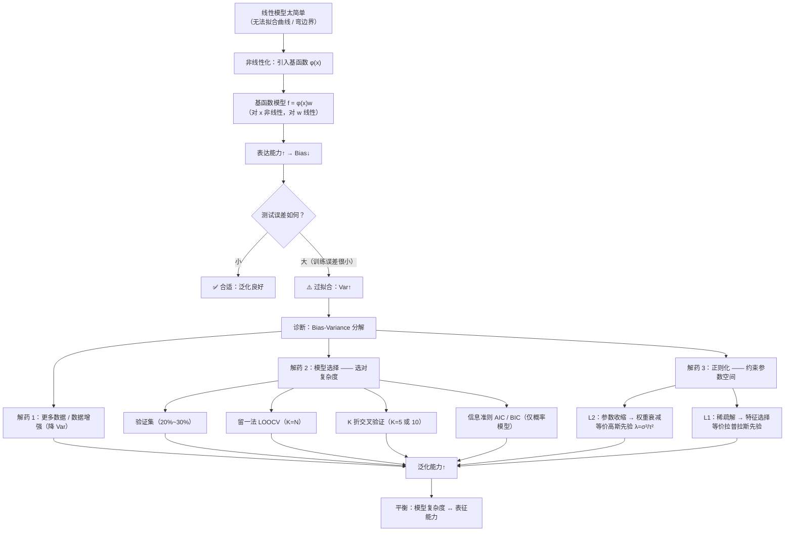

# 模型的非线性化、过拟合及正则化 (Model Nonlinearization, Overfitting & Regularization)

> [!info] 本讲导读
> 前四讲我们一直在**线性模型**里打转：$f(\boldsymbol{x})=\boldsymbol{xw}$ 与 $f(\boldsymbol{x})=\sigma(\boldsymbol{xw})$。本讲把这条主线整体向前推一步，回答三个层层递进的问题：
>
> 1. **模型怎么变强？** —— **非线性化**：用**基函数** $\boldsymbol{\phi}(\boldsymbol{x})$ 把原始特征映射到高维，得到**基函数模型** $f(\boldsymbol{x})=\boldsymbol{\phi}(\boldsymbol{x})\boldsymbol{w}$。它**对 $\boldsymbol{x}$ 非线性、对参数 $\boldsymbol{w}$ 仍然线性**，所以[[Ch2 线性回归|前几讲]]的全部工具（正规方程、梯度下降）**一字不改**就能用，只需把 $\boldsymbol{X}$ 换成 $\boldsymbol{\Phi}$。
> 2. **变强之后的代价是什么？** —— **过拟合（overfitting）**：训练误差一路下降，测试误差却先降后升。本讲用**偏差-方差分解**给出严格解释，并引出**模型复杂度**这一核心概念。
> 3. **怎么办？** —— **模型选择**（验证集 / 留一法 / $K$ 折交叉验证 / AIC·BIC）与**正则化**（$L_2$ 使参数收缩、$L_1$ 产生稀疏解）。
>
> **一句话总结本讲**：**用基函数换来表达力，用模型选择与正则化换回泛化能力。** 表达力与泛化能力之间的张力，是本讲乃至整个机器学习的中心矛盾。

## 目录

- [[#一、为什么需要非线性化|一、为什么需要非线性化]]
  - [[#1.1 线性模型的两大局限|1.1 线性模型的两大局限]]
  - [[#1.2 思路一：分段线性 = 常数 + 一组 sigmoid 之和|1.2 思路一：分段线性 = 常数 + 一组 sigmoid 之和]]
  - [[#1.3 思路二：基函数（本讲主线）|1.3 思路二：基函数（本讲主线）]]
- [[#二、基函数与特征映射|二、基函数与特征映射]]
  - [[#2.1 基函数模型|2.1 基函数模型]]
  - [[#2.2 回归：解析解仍然成立|2.2 回归：解析解仍然成立]]
  - [[#2.3 分类：交叉熵与梯度|2.3 分类：交叉熵与梯度]]
  - [[#2.4 "线性模型"一词的歧义（关键辨析）|2.4 "线性模型"一词的歧义（关键辨析）]]
  - [[#2.5 例题（非线性化）|2.5 例题（非线性化）]]
- [[#三、过拟合|三、过拟合]]
  - [[#3.1 现象：训练误差小、测试误差大|3.1 现象：训练误差小、测试误差大]]
  - [[#3.2 泛化能力与三种拟合状态|3.2 泛化能力与三种拟合状态]]
  - [[#3.3 偏差-方差分解（严格工具）|3.3 偏差-方差分解（严格工具）]]
  - [[#3.4 模型复杂度|3.4 模型复杂度]]
  - [[#3.5 缓解过拟合的四条路|3.5 缓解过拟合的四条路]]
  - [[#3.6 例题（过拟合）|3.6 例题（过拟合）]]
- [[#四、模型选择|四、模型选择]]
  - [[#4.1 问题定义|4.1 问题定义]]
  - [[#4.2 为什么不能用训练误差选模型|4.2 为什么不能用训练误差选模型]]
  - [[#4.3 验证集|4.3 验证集]]
  - [[#4.4 留一验证（LOOCV）|4.4 留一验证（LOOCV）]]
  - [[#4.5 K 折交叉验证|4.5 K 折交叉验证]]
  - [[#4.6 信息准则：AIC 与 BIC|4.6 信息准则：AIC 与 BIC]]
  - [[#4.7 例题（模型选择）|4.7 例题（模型选择）]]
- [[#五、正则化|五、正则化]]
  - [[#5.1 L2 正则化|5.1 L2 正则化]]
  - [[#5.2 为什么 L2 又叫"权重衰减"|5.2 为什么 L2 又叫"权重衰减"]]
  - [[#5.3 L1 正则化与稀疏性|5.3 L1 正则化与稀疏性]]
  - [[#5.4 为什么 L1 稀疏而 L2 不稀疏（两种严格解释）|5.4 为什么 L1 稀疏而 L2 不稀疏（两种严格解释）]]
  - [[#5.5 正则化的概率解释：正则项 = 负对数先验|5.5 正则化的概率解释：正则项 = 负对数先验]]
  - [[#5.6 例题（正则化）|5.6 例题（正则化）]]
- [[#六、重点·难点·易错点汇总|六、重点·难点·易错点汇总]]
- [[#七、简洁代码实现|七、简洁代码实现]]
- [[#八、知识点速查|八、知识点速查]]
- [[#九、本讲小结|九、本讲小结]]

---

## 一、为什么需要非线性化

### 1.1 线性模型的两大局限

**课件开篇的两句话，就是本讲的全部动机**：

> - 线性回归只能对输入 $\boldsymbol{x}$ 和输出 $y$ 之间的**线性关系**进行建模；
> - 对于线性分类器，其**决策边界只能是线性的**。

这两条局限在 [[Ch2 线性回归]] 与 [[Ch3 线性分类器（Linear Classifiers）]] 里都已经被严格论证过：

| 局限 | 具体表现 | 在哪里论证过 |
|---|---|---|
| 无法拟合非线性关系 | $y=x^2$、$y=\sin x$ 这类数据，任何直线都拟合不好 | 线性回归的假设空间是直线族 |
| 决策边界只能是超平面 | **同心圆**、XOR 等数据，任何超平面都分不开 | [[Ch3 线性分类器（Linear Classifiers）\|Ch3 4.3 节]] |

**对于更复杂的任务，模型应该具备更多的能力以捕获**：

- **非线性输入-输出关系**（回归）；
- **非线性决策边界**（分类）。

**结论**：**线性模型过于简单……我们需要更复杂的模型。**

> [!warning] 但"变复杂"绝不能是"随便加参数"
> 课件的下一句话很关键："**线性模型有严重的局限性：更灵活的模型！—— bias（偏差）**"。
> 意思是：更灵活的模型可以**降低偏差（bias）**——它有足够的能力去逼近真实规律。**但天下没有免费的午餐**：灵活性同时会**抬高方差（variance）**，这正是本讲后半部分"过拟合"的根源（严格论证见 [[#3.3 偏差-方差分解（严格工具）|3.3 节]]）。
> **本讲的结构就是"提出问题 → 付出代价 → 找到解药"**：非线性化（降 bias）→ 过拟合（涨 variance）→ 模型选择与正则化（控 variance）。

### 1.2 思路一：分段线性 = 常数 + 一组 sigmoid 之和

在正式引入"基函数"之前，课件先给了一条**非常直观、而且直通神经网络**的路线：**用分段线性函数去逼近任意曲线**。

**第一步：一条折线可以写成"常数 + 一组折线基元之和"**

![[Ch5-img-piecewise-sigmoid-sum.png]]

上图是本讲最著名的一张图。红色折线（目标曲线）被写成：

$$
\underbrace{\text{red curve}}_{\text{红折线}}\;=\;\underbrace{\text{constant}}_{\text{常数}}\;+\;\underbrace{\text{sum of a set of}}_{\text{一组 }\sigma_{\text{hard}}\text{ 之和}}
$$

图中标注了 4 个分量：**① ② ③ 是三个"硬 S 形（hard sigmoid）"基元**（各自在不同的位置"起坡—爬升—平台"），**⓪ 是一个常数（水平线）**。把它们按不同权重叠加，就拼出了那条红色折线。

**什么叫 hard sigmoid（硬 S 形）？** 它是普通 Sigmoid 的"折线版"：

$$
\sigma_{\text{hard}}(z)=\min\bigl(\max(z,0),\,1\bigr)=
\begin{cases}
0, & z<0\\
z, & 0\le z\le1\\
1, & z>1
\end{cases}
$$

它由"一段平、一段斜、一段平"构成——正是折线的"一段坡"。而**软化的版本**就是 [[Ch3 线性分类器（Linear Classifiers）|Ch3]] 的 Sigmoid $\sigma(z)=\frac{1}{1+e^{-z}}$（把折角磨圆）。

**第二步：所有分段线性曲线都能这样表示**

> [!important] 课件的两个递进结论
> - **红色的折线 = 常数 + 一组 $\sigma_{\text{hard}}$ 的和**（一条具体折线）
> - **所有分段线性曲线 = 常数 + 一组 $\sigma_{\text{hard}}$ 的和**（任意折线！）
> - **曲线更多段就需要更多的 $\sigma_{\text{hard}}$**

**严格的构造性证明（用 ReLU 更干净）**：

设 $f$ 是 $[b_0,b_k]$ 上的连续分段线性函数，断点为 $b_0<b_1<\cdots<b_k$，在第 $i$ 段 $[b_{i-1},b_i]$ 上的斜率为 $s_i$。定义 $\mathrm{ReLU}(z)=\max(z,0)$，则

$$
\boxed{\ f(x)=f(b_0)+s_1\,(x-b_0)+\sum_{i=2}^{k}\bigl(s_i-s_{i-1}\bigr)\,\mathrm{ReLU}\bigl(x-b_i\bigr)\ }
$$

**为什么成立？** 逐段验证：
- 在 $x<b_1$ 时所有 ReLU 项为 0，$f(x)=f(b_0)+s_1(x-b_0)$ —— 斜率 $s_1$ ✓
- 跨过 $b_2$ 时，$\mathrm{ReLU}(x-b_2)$ 开始贡献，斜率**增加** $(s_2-s_1)$，于是新斜率为 $s_1+(s_2-s_1)=s_2$ ✓
- 一般地，每跨过一个断点 $b_i$，斜率就被"追加"一个增量 $(s_i-s_{i-1})$ ✓

所以：**"常数 + 一组折线基元之和"不是近似，而是对任意分段线性函数的精确表示**。$\blacksquare$

（$\sigma_{\text{hard}}$ 与 ReLU 的关系是 $\sigma_{\text{hard}}(z)=\mathrm{ReLU}(z)-\mathrm{ReLU}(z-1)$，即"上升一段再停住"；因此"$\sigma_{\text{hard}}$ 之和"与"ReLU 之和"表示能力等价。课件用的是前者。）

**第三步：超越分段线性——用足够多的"段"逼近任意连续曲线**

![[Ch5-img-piecewise-approx.png]]

上图：绿色虚线是分段线性逼近，黑色实线是光滑的真实曲线。课件给出的基本想法是：

> **用分段线性曲线近似连续曲线——为了得到好的近似，我们需要足够的分段。**

**严谨表述**：设 $f$ 在紧区间上连续（甚至只需一致连续），则对任意 $\varepsilon>0$，存在分段线性函数 $g$ 使得 $\sup_x|f(x)-g(x)|<\varepsilon$；且**所需的段数与 $\varepsilon$ 成反比**（曲线越弯、精度要求越高，就越是需要更多段）。

> [!important] 这条路为什么极其重要？—— 它就是神经网络的雏形
> 把上面的结论合起来看：
> $$\text{任意曲线}\ \approx\ \text{分段线性}\ =\ c+\sum_{i=1}^{n}c_i\,\sigma_{\text{hard}}\bigl(a_i x+b_i\bigr)$$
> **这不就是一层神经网络吗？** 一般地，对 $m$ 个输入特征：
> $$y=b+\sum_{i=1}^{n}c_i\,\sigma\Bigl(\sum_{j=1}^{m}w_{ij}x_j+b_i\Bigr)$$
> - $n$ 个"基元" $\to$ **$n$ 个神经元**（隐藏层宽度）；"段数越多"$\to$ **神经元越多**；
> - $\sigma$（Sigmoid / hard-sigmoid / ReLU）$\to$ **激活函数**；
> - $c_i$ 与 $w_{ij}$ $\to$ **两层权重**。
>
> **"用足够多的分段线性逼近任意曲线"这一朴素的几何想法，正是"神经网络是通用逼近器"的直观来源。** 课件在此埋下的这条线，将在神经网络一讲被正式接起。

### 1.3 思路二：基函数（本讲主线）

分段线性路线给出了"为什么可以变强"的直觉；但要**套用我们已经掌握的优化工具**，需要一种更工程化的做法：

> **基本思想：使用基函数将线性模型非线性化。**

课件用最简单的例子点题：

$$
\boldsymbol{x}\ \longrightarrow\ \bigl[x,\ x^{2},\ x^{3}\bigr]
$$

即**把 1 个原始特征扩展成 3 个特征**，然后照旧做线性模型。这样：

- 对 $\boldsymbol{x}$ 而言，模型变成了 3 次多项式——**非线性**；
- 对参数 $\boldsymbol{w}$ 而言，它仍然是 $w_0+w_1x+w_2x^2+w_3x^3$——**线性**！

> [!tip] 这就是本讲的核心技巧
> **不改变模型的形式，只改变"喂给模型的特征"。** 线性模型的全部理论（解析解、凸性、梯度公式）都能**原封不动**地继承下来，而表达能力却被极大地增强了。这是一个"零成本升级"。

---

## 二、基函数与特征映射

### 2.1 基函数模型

**通过基函数进行非线性化**：课件先给出多项式变换的例子。

| | 使用原始特征的模型 | 使用扩展特征的模型 |
|---|---|---|
| 特征 | $x$ | $x\ \to\ [x,\ x^2,\ x^3]$ |
| 模型 | $f(x)=w_0+w_1x=[1,\ x]\,\boldsymbol{w}$ | $f(x)=w_0+w_1x+w_2x^{2}+w_3x^{3}=[1,\ x,\ x^{2},\ x^{3}]\,\boldsymbol{w}$ |
| 记号 | $f(x)=[1,\ x]\,\boldsymbol{w}$ | $f(x)=\boldsymbol{\phi}(x)\,\boldsymbol{w}$ |

**其中单个特征被扩展为 3 个特征**。

**一般形式**：通常，这种变换可以表示为

$$
\boxed{\ \bigl[x_1,\ x_2,\ \cdots,\ x_m\bigr]\ \longrightarrow\ \bigl[\phi_1(\boldsymbol{x}),\ \phi_2(\boldsymbol{x}),\ \cdots,\ \phi_n(\boldsymbol{x})\bigr]\ \triangleq\ \boldsymbol{\phi}(\boldsymbol{x})\ }
$$

**$\phi_k(\boldsymbol{x})$ 可以是任何能够产生有意义特征的函数**，例如课件列举：

$$
x,\qquad \log x,\qquad \frac{1}{x},\qquad x_1+x_2,\qquad x_1-x_2,\qquad x_1x_2
$$

这些函数被称为**基函数（basis functions）**。

**非线性化后的模型现在变为**：

$$
\boxed{\ f(\boldsymbol{x})=\boldsymbol{\phi}(\boldsymbol{x})\,\boldsymbol{w}\ }
$$

> [!important] 这被称为**基函数模型（basis function model）**
> **基函数模型关于 $\boldsymbol{x}$ 是非线性的，但关于模型参数 $\boldsymbol{w}$ 仍然是线性的。**

**常见基函数清单（工程上最常用的几种）**：

| 名称 | $\phi_k(x)$ | 典型用途 / 特点 |
|---|---|---|
| 多项式基 | $x^k$ | 光滑全局逼近；阶数高时**数值病态**（见 [[#3.6 例题（过拟合）\|例 5.4]]） |
| 高斯基（RBF） | $\exp\left(-\frac{(x-\mu_k)^2}{2s^2}\right)$ | **局部**响应，数值稳定，是 RBF 网络与核方法的基础 |
| Sigmoid 基 | $\sigma(a_kx+b_k)$ | 直接对应 [[#1.2 思路一：分段线性 = 常数 + 一组 sigmoid 之和\|1.2 节]]的神经网络视角 |
| ReLU 基 | $\max(0,a_kx+b_k)$ | 现代深度学习的主力激活 |
| 交互/交叉项 | $x_ix_j$ | 显式捕捉特征间的乘性关系 |
| 三角基（傅里叶） | $\cos(kx),\ \sin(kx)$ | 周期信号 |

> [!tip] 选基函数的三条经验
> 1. **多项式基**最容易讲清原理，但**阶数一高就数值爆炸**（$\boldsymbol{\Phi}^{\mathsf T}\boldsymbol{\Phi}$ 条件数按 $10$ 的幂次增长）——所以实践中更常用下面两种；
> 2. **局部基（高斯基/RBF）**每个基函数只"管"一小片区域，因此**互不干扰、条件数好、外推更保守**；
> 3. **Sigmoid/ReLU 基**可以**由数据学习**参数（$a_k,b_k$ 也可训练），这正是从"手工设计基"走向"神经网络"的关键一步。

### 2.2 回归：解析解仍然成立

**使用非线性变换后的特征 $\boldsymbol{\phi}(\boldsymbol{x})$，回归问题的最优模型参数 $\boldsymbol{w}^{*}$ 通过优化损失函数获得**：

$$
L(\boldsymbol{w})=\frac{1}{N}\bigl\lVert\boldsymbol{\Phi}(\boldsymbol{X})\boldsymbol{w}-\boldsymbol{y}\bigr\rVert^{2},
\qquad
\boldsymbol{\Phi}(\boldsymbol{X})\triangleq
\begin{bmatrix}
— \boldsymbol{\phi}(\boldsymbol{x}_1) —\\
\vdots\\
— \boldsymbol{\phi}(\boldsymbol{x}_N) —
\end{bmatrix}
$$

（即 $\boldsymbol{\Phi}$ 的第 $i$ 行是第 $i$ 个样本的**特征映射结果** $\boldsymbol{\phi}(\boldsymbol{x}_i)$，形状 $N\times n$。）

**使用符号 $\boldsymbol{\Phi}=\boldsymbol{\Phi}(\boldsymbol{X})$，最优模型参数 $\boldsymbol{w}^{*}$ 为**：

$$
\boxed{\ \boldsymbol{w}^{*}=\bigl(\boldsymbol{\Phi}^{\mathsf T}\boldsymbol{\Phi}\bigr)^{-1}\boldsymbol{\Phi}^{\mathsf T}\boldsymbol{y}\ }
$$

**我们也可以使用数值方法（例如梯度下降）来获得最优解。**

> [!important] 与线性回归**完全相同**，只是将 $\boldsymbol{X}$ 替换为 $\boldsymbol{\Phi}$
> 推导思路一字不差（回顾 [[Ch2 线性回归]]）：对 $\boldsymbol{w}$ 求梯度
> $$\frac{\partial L}{\partial\boldsymbol{w}}=\frac{2}{N}\boldsymbol{\Phi}^{\mathsf T}\bigl(\boldsymbol{\Phi}\boldsymbol{w}-\boldsymbol{y}\bigr)$$
> 令其为零得**正规方程** $\boldsymbol{\Phi}^{\mathsf T}\boldsymbol{\Phi}\boldsymbol{w}=\boldsymbol{\Phi}^{\mathsf T}\boldsymbol{y}$，解出即得上式。$\blacksquare$
>
> **这就是 2.1 节那句话的兑现**：因为损失关于 $\boldsymbol{w}$ 是**二次型**（无论 $\boldsymbol{\phi}$ 多复杂），所以整个线性回归的数学机器**原样可用**。唯一变化的是 $\boldsymbol{X}\to\boldsymbol{\Phi}$。

> [!warning] 但解析解"存在"不等于"可用"——两个陷阱
> 1. **$\boldsymbol{\Phi}^{\mathsf T}\boldsymbol{\Phi}$ 可能不可逆**：当 $n>N$（基函数个数超过样本数）时必然奇异。这与 [[Ch2 线性回归]] 的"特征数 > 样本数"是同一个病。
> 2. **即使可逆，也可能"数值上不可逆"**：高阶多项式基会让 $\boldsymbol{\Phi}^{\mathsf T}\boldsymbol{\Phi}$ 的条件数急剧膨胀。实测（[[#3.6 例题（过拟合）|例 5.4]]）：$x\in[0,1]$ 上 11 阶多项式对应 $\mathrm{cond}(\boldsymbol{\Phi}^{\mathsf T}\boldsymbol{\Phi})\approx4.6\times10^{17}$，**已超过 float64 的精度极限 $\varepsilon^{-1}\approx4.5\times10^{15}$**，直接求逆会得到完全错误的结果。
>
> **两条出路**：① 用 SVD/QR 分解（`np.linalg.lstsq`）求解，而不是显式求逆；② **加正则化**（见 [[#5.1 L2 正则化|5.1 节]]，$\boldsymbol{\Phi}^{\mathsf T}\boldsymbol{\Phi}+N\lambda\boldsymbol{I}$ 必然可逆）。

### 2.3 分类：交叉熵与梯度

**对于使用基函数的分类问题，交叉熵损失变为**：

$$
L(\boldsymbol{W})=-\frac{1}{N}\sum_{\ell=1}^{N}\sum_{k=1}^{K}y_k^{(\ell)}\log\operatorname{softmax}_k\bigl(\boldsymbol{\phi}(\boldsymbol{x}^{(\ell)})\boldsymbol{W}\bigr)
$$

**将 $\boldsymbol{\phi}(\boldsymbol{x}^{(\ell)})$ 表示为 $\boldsymbol{\phi}^{(\ell)}$，可以推导出梯度等于**

$$
\boxed{\ \frac{\partial L(\boldsymbol{W})}{\partial\boldsymbol{w}_j}=\frac{1}{N}\sum_{\ell=1}^{N}\Bigl(\operatorname{softmax}_j\bigl(\boldsymbol{\phi}^{(\ell)}\boldsymbol{W}\bigr)-y_j^{(\ell)}\Bigr)\boldsymbol{\phi}^{(\ell)\mathsf T}\ }
$$

> [!important] 与多类别逻辑回归相同，只是将 $\boldsymbol{x}^{(\ell)}$ 替换为 $\boldsymbol{\phi}^{(\ell)}$
> 对比 [[Ch3 线性分类器（Linear Classifiers）|Ch3 5.7 节]]的梯度 $\frac1N\sum_\ell(\operatorname{softmax}_j-y_j^{(\ell)})\boldsymbol{x}^{(\ell)\mathsf T}$——**结构完全一致**，"预测误差 $\times$ 输入"这一通用模式再次成立，只是"输入"从 $\boldsymbol{x}$ 变成了 $\boldsymbol{\phi}$。
>
> **最优的 $\boldsymbol{W}^{*}$ 只能通过数值方法获得**（交叉熵的梯度方程是超越方程，无解析解——见 [[Ch3 线性分类器（Linear Classifiers）|Ch3 3.1 节]]；这一点与回归不同，回归有正规方程）。

### 2.4 "线性模型"一词的歧义（关键辨析）

这是本讲**最容易在概念题上失分**的地方。

> [!warning] "线性模型"到底指对什么线性？
> | 说法 | 含义 | 基函数模型属于吗 |
> |---|---|---|
> | **对输入线性**（linear in input） | $f$ 是 $\boldsymbol{x}$ 的线性函数 | ❌ **不属于**（有 $x^2$、$\sin x$ 等） |
> | **对参数线性**（linear in parameters） | $f$ 是 $\boldsymbol{w}$ 的线性函数 | ✅ **属于** |
>
> **机器学习里说"线性模型"，一律指"对参数线性"。**
> 因此，**基函数模型虽然能拟合任意曲线、能产生弯的决策边界，它在专业术语里仍然是"线性模型"**（准确说是"线性参数模型 / 广义线性模型"）。
>
> **判别方法（一句话）**：把 $\boldsymbol{w}$ 看作变量——若目标函数是 $\boldsymbol{w}$ 的线性函数（且损失是凸的），就是线性模型。
> - $w_0+w_1x+w_2x^2$：对 $\boldsymbol{x}$ 非线性，对 $\boldsymbol{w}$ **线性** ✓
> - $w_0+w_1\sin(w_2x)$：对 $\boldsymbol{w}$ **非线性** ✗（这是神经网络的情形，$w_2$ 在函数里面）

**这个辨析的三个实际推论**：

1. **为什么解析解仍存在**：正规方程 $\boldsymbol{\Phi}^{\mathsf T}\boldsymbol{\Phi}\boldsymbol{w}=\boldsymbol{\Phi}^{\mathsf T}\boldsymbol{y}$ 中 $\boldsymbol{w}$ **线性出现**，所以能解出来。若 $\boldsymbol{w}$ 出现在基函数内部（如 $\sin(w_2x)$），方程立刻变成非线性，解析解消失。
2. **为什么损失仍是凸的**：$L(\boldsymbol{w})=\frac1N\lVert\boldsymbol{\Phi}\boldsymbol{w}-\boldsymbol{y}\rVert^2$ 是 $\boldsymbol{w}$ 的**凸二次函数**（海森矩阵 $\frac{2}{N}\boldsymbol{\Phi}^{\mathsf T}\boldsymbol{\Phi}\succeq0$），无局部极小。**表达能力增强，但优化难度没有变**——这正是基函数路线的价值所在。
3. **为什么[[Ch3 线性分类器（Linear Classifiers）|Ch3]]说"逻辑回归是线性分类器"**：那是把 $\boldsymbol{x}$ 直接喂给模型的情形；一旦使用 $\boldsymbol{\phi}$，**决策边界在原始空间中就可以是曲线**（回顾 Ch3 例 3.9 的同心圆）。

### 2.5 例题（非线性化）

> [!example]- 例 5.1：基函数回归的正规方程（基础但必须亲手推一遍）
> 设 $\boldsymbol{\phi}(\boldsymbol{x})=(1,\ x,\ x^{2})^{\mathsf T}$，训练集 $\{(\boldsymbol{x}_i,y_i)\}_{i=1}^{N}$。
> 1. 写出 $\boldsymbol{\Phi}$ 的具体形式与损失函数 $L(\boldsymbol{w})$；
> 2. 推导梯度并写出正规方程，求出 $\boldsymbol{w}^{*}$；
> 3. 说明为什么这个结果与[[Ch2 线性回归]]的正规方程"形式相同"，并指出"相同"的严格理由；
> 4. 若 $N=2$ 而模型是 2 次多项式（3 个参数），会发生什么？
>
> **解答：**
> 1. 含偏置的映射写作 $\boldsymbol{\phi}(x)=(1,x,x^{2})$，故
>    $$\boldsymbol{\Phi}=\begin{bmatrix}1&x_1&x_1^{2}\\1&x_2&x_2^{2}\\\vdots&\vdots&\vdots\\1&x_N&x_N^{2}\end{bmatrix}\in\mathbb R^{N\times3},\qquad
>    L(\boldsymbol{w})=\frac1N\sum_{i=1}^{N}\bigl(w_0+w_1x_i+w_2x_i^{2}-y_i\bigr)^{2}=\frac1N\lVert\boldsymbol{\Phi}\boldsymbol{w}-\boldsymbol{y}\rVert^{2}$$
> 2. 梯度：
>    $$\frac{\partial L}{\partial\boldsymbol{w}}=\frac{2}{N}\boldsymbol{\Phi}^{\mathsf T}\bigl(\boldsymbol{\Phi}\boldsymbol{w}-\boldsymbol{y}\bigr)$$
>    令其为零得正规方程 $\boldsymbol{\Phi}^{\mathsf T}\boldsymbol{\Phi}\boldsymbol{w}=\boldsymbol{\Phi}^{\mathsf T}\boldsymbol{y}$，故
>    $$\boldsymbol{w}^{*}=\bigl(\boldsymbol{\Phi}^{\mathsf T}\boldsymbol{\Phi}\bigr)^{-1}\boldsymbol{\Phi}^{\mathsf T}\boldsymbol{y}$$
> 3. **形式相同**，因为两者的损失都是"$\boldsymbol{w}$ 的加权最小二乘"：
>    $$L=\frac1N\lVert\boldsymbol{A}\boldsymbol{w}-\boldsymbol{y}\rVert^{2}\quad\text{（}\boldsymbol{A}=\boldsymbol{X}\text{ 或 }\boldsymbol{\Phi}\text{）}$$
>    对这个统一形式求导，无论 $\boldsymbol{A}$ 是什么，结果都是 $\frac2N\boldsymbol{A}^{\mathsf T}(\boldsymbol{A}\boldsymbol{w}-\boldsymbol{y})$。故解必然是 $\boldsymbol{w}^{*}=(\boldsymbol{A}^{\mathsf T}\boldsymbol{A})^{-1}\boldsymbol{A}^{\mathsf T}\boldsymbol{y}$。
>    **严格理由**：$\boldsymbol{\phi}$ 把每个样本映射成一个固定向量，之后 $\boldsymbol{\Phi}$ 与 $\boldsymbol{X}$ **在数学上毫无区别**——它们都只是"$N\times n$ 的常数矩阵"。**"非线性化"发生在数据预处理阶段，而不是在优化阶段。**
> 4. $\boldsymbol{\Phi}$ 是 $2\times3$，秩 $\le2<3$，故 $\boldsymbol{\Phi}^{\mathsf T}\boldsymbol{\Phi}$（$3\times3$）**奇异不可逆**，正规方程无唯一解。
>    **几何意义**：2 个点总能被无穷多条抛物线穿过（自由度 3 > 约束 2）——解集是一条直线（仿射子空间），而且**训练误差恰为 0**（两点必可插值）。
>    **这正是过拟合的极端形态**（课件"训练损失为零但测试损失较大"）：**参数个数 $\ge$ 样本个数时，模型可以记住训练集，却对测试集毫无保证。**

> [!example]- 例 5.2：把一条折线精确写成"常数 + 一组 ReLU 之和"（进阶构造）
> 设折线 $f$ 在 $[0,3]$ 上的断点为 $x=0,1,2,3$，对应函数值为 $f(0)=1,\ f(1)=2,\ f(2)=0,\ f(3)=1.5$。
> 1. 求各段斜率 $s_1,s_2,s_3$；
> 2. 用 $\mathrm{ReLU}$ 写出 $f$ 的精确表达式；
> 3. 验证 $x=1.5$ 与 $x=2.5$ 处的函数值与折线一致；
> 4. 说明需要多少个基元，并解释"段数越多需要越多基元"。
>
> **解答：**
> 1. 各段斜率：
>    $$s_1=\frac{2-1}{1-0}=1,\qquad s_2=\frac{0-2}{1}=-2,\qquad s_3=\frac{1.5-0}{1}=1.5$$
> 2. 由 [[#1.2 思路一：分段线性 = 常数 + 一组 sigmoid 之和|1.2 节]]的公式（$b_0=0$，断点 $b_2=1,b_3=2$，斜率增量 $s_2-s_1=-3$、$s_3-s_2=3.5$）：
>    $$\boxed{\,f(x)=1+1\cdot x-3\,\mathrm{ReLU}(x-1)+3.5\,\mathrm{ReLU}(x-2)\,}$$
>    （第一个断点 $b_1=0$ 对应基线项 $s_1(x-b_0)$，不用写 ReLU。）
> 3. **验证 $x=1.5$**：$\mathrm{ReLU}(1.5-1)=0.5$，$\mathrm{ReLU}(1.5-2)=0$，故
>    $$f(1.5)=1+1.5-3(0.5)+0=1.0$$
>    而折线在 $[1,2]$ 上从 $(1,2)$ 线性降到 $(2,0)$，中间点应为 $1.0$ ✓
>    **验证 $x=2.5$**：$\mathrm{ReLU}(2.5-1)=1.5$，$\mathrm{ReLU}(2.5-2)=0.5$，故
>    $$f(2.5)=1+2.5-3(1.5)+3.5(0.5)=3.5-4.5+1.75=0.75$$
>    折线在 $[2,3]$ 上从 $(2,0)$ 到 $(3,1.5)$，中间点应为 $0.75$ ✓
> 4. **共需 3 个基元**（1 个线性项 + 2 个 ReLU），即**基元个数 = 斜率发生变化的次数**。若把曲线细分到 $k$ 段（$k+1$ 个结点），就需要 $k$ 个基元。
>    **结论**：**逼近精度越高（段越多），所需基元/神经元越多**——这就是课件"曲线更多段就需要更多 $\sigma$"的严格含义，也是"神经网络越宽表达能力越强"的最朴素解释。

---

## 三、过拟合

### 3.1 现象：训练误差小、测试误差大

**高维特征 $\boldsymbol{\phi}(\boldsymbol{x})$ 往往能更好地拟合训练数据。**

课件用 1 阶 / 3 阶 / 5 阶多项式做对比，并问"**哪个模型更好？？**"，然后给出关键提醒：

> **从拟合训练数据的角度来看，模型阶数越高，拟合效果看起来肯定越好。**

**但**：

> **但是高阶模型在测试数据上的表现可能很差。**

![[Ch5-img-overfit-highorder.png]]

上图是**过拟合的经典形态**：高阶多项式为了穿过每一个训练点（红），曲线在两两之间剧烈震荡，**完全偏离了真实的数据规律**（测试点用绿点表示，曲线对它们几乎没有解释力）。

> [!important] 过拟合的定义
> **过拟合（overfitting）：训练数据上损失小，测试数据上损失大。**
> 即模型把训练集中的**噪声与偶然性**也当成规律学了下去，从而丧失了对新数据的预测能力。

**课件给了一个极端的例子**：某个函数**训练损失为零，但测试损失较大**。

> [!warning] 为什么会有人主动选择"训练损失为零"的模型？
> 因为**如果只看训练误差，它是最优的**。这正是"不能基于训练误差选模型"的原因（见 [[#4.2 为什么不能用训练误差选模型|4.2 节]]）。
> **训练损失为零当且仅当模型"记住"了训练集**。要记住 $N$ 个点，只需要 $N-1$ 阶多项式（$N$ 个参数）——所以**只要参数个数足够多（$\ge N$），任何数据集都能被完美拟合**，无论其中有多少噪声。这就是 [[#2.5 例题（非线性化）|例 5.1 第 4 问]]的情形。

### 3.2 泛化能力与三种拟合状态

**模型在新数据上表现良好的能力被称为模型的泛化能力（generalization）。**

**Training error vs testing error**——这是本讲最重要的一组曲线：

![[Ch5-img-error-vs-complexity.png]]

> 上图横轴是**模型复杂度**，红色是**训练误差**、绿色是**测试（/验证）误差**，图中标出了 "**Ideal Range for Model Complexity**"（复杂度的理想区间）以及两端的 **Underfitting（欠拟合）**与 **Overfitting（过拟合）**区域。

**三种拟合状态的严格判据**：

| 状态 | 训练误差 | 测试误差 | 曲线位置 | 病根 | 药方 |
|---|---|---|---|---|---|
| **欠拟合**（underfitting） | **大** | **大** | 复杂度 **<** 最优点 | **偏差大**：模型太简单，没有能力表示真实规律 | 增加复杂度：加基函数/加神经元/加特征 |
| **恰当** | 较小 | **最小** | 复杂度 **≈** 最优点 | — | — |
| **过拟合**（overfitting） | **很小** | **大** | 复杂度 **>** 最优点 | **方差大**：模型太灵活，把噪声也学了 | **更多数据**、**正则化**、**降低复杂度**、集成 |

**课件的判据（需要精确化）**：

> 如果随着模型复杂度的增加，验证误差减小，则表明模型**欠拟合**；否则，则意味着模型**过拟合**。

> [!warning] 这句话的实际含义
> 它描述的是"**当前所处的位置**"，判据是**验证误差曲线的斜率**：
> - 位于曲线**左侧**（验证误差**仍在下降**）→ **欠拟合**，应该继续增加复杂度；
> - 位于曲线**右侧**（验证误差**反而上升**，而训练误差还在降）→ **过拟合**，应该降低复杂度或加正则化。
>
> **最优点就是验证误差的最小值点**，这就是"模型选择"要去找的那个点（见第四章）。

### 3.3 偏差-方差分解（严格工具）

上一节的表格说"欠拟合 = 偏差大、过拟合 = 方差大"，但**偏差和方差到底是什么**？课件用一张图给出了直觉：

![[Ch5-img-constrained-model.png]]

> 图（来源 Prof. 李志毅）中有三样东西：
> - **点线 = 真实数据分布（不可观测）**；
> - **蓝点 = 训练数据**，**红点 = 测试数据**；
> - 右上：如果不加约束，$y=a+bx+cx^2$ 这样的模型可以有**无数种"自由发挥"的拟合**（浅色曲线），每一种都能把训练点拟合得不错，但彼此差异极大；
> - 右下：**受约束模型（constrained model）**只能给出**一条平滑的曲线**，它虽然不穿过每个训练点，却更接近真实分布。
>
> **"无数种自由发挥"就是高方差，"受约束"就是低方差。** 下面把这个直觉严格化。

**设定**：真实关系 $y=f(\boldsymbol{x})+\epsilon$，其中 $\mathbb E[\epsilon]=0$，$\mathrm{Var}(\epsilon)=\sigma^{2}$，且 $\epsilon$ 与训练集 $\mathcal D$ 独立。用 $\mathcal D$ 训练得到的模型记作 $\hat f_{\mathcal D}$（带上标 $\mathcal D$ 是因为**换个训练集，模型就不同了**）。则在固定点 $\boldsymbol{x}$ 处：

$$
\boxed{\ \mathbb E_{\mathcal D,\epsilon}\Bigl[\bigl(y-\hat f_{\mathcal D}(\boldsymbol{x})\bigr)^{2}\Bigr]
=\underbrace{\Bigl(\mathbb E_{\mathcal D}\bigl[\hat f_{\mathcal D}(\boldsymbol{x})\bigr]-f(\boldsymbol{x})\Bigr)^{2}}_{\text{偏差}^2\ \text{Bias}^2}
+\underbrace{\mathbb E_{\mathcal D}\Bigl[\bigl(\hat f_{\mathcal D}(\boldsymbol{x})-\mathbb E_{\mathcal D}[\hat f_{\mathcal D}(\boldsymbol{x})]\bigr)^{2}\Bigr]}_{\text{方差}\ \text{Variance}}
+\underbrace{\sigma^{2}}_{\text{不可约噪声}}\ }
$$

**推导**（三步，务必掌握）：

$$
\mathbb E\bigl[(y-\hat f)^{2}\bigr]=\mathbb E\bigl[(f+\epsilon-\hat f)^{2}\bigr]
=\mathbb E\bigl[(f-\hat f)^{2}\bigr]+\underbrace{2\,\mathbb E\bigl[\epsilon(f-\hat f)\bigr]}_{=0}+\mathbb E[\epsilon^{2}]
$$

- 交叉项为 0：因为 $\epsilon$ 与 $\hat f$ 独立且 $\mathbb E[\epsilon]=0$；
- $\mathbb E[\epsilon^2]=\sigma^2$。

再对第一项做"加一项减一项"（插入 $\mathbb E_{\mathcal D}[\hat f]$）：

$$
\mathbb E_{\mathcal D}\bigl[(f-\hat f)^{2}\bigr]
=\mathbb E\Bigl[\bigl(\underbrace{f-\mathbb E[\hat f]}_{\text{常数}}\bigr)^{2}+2\bigl(f-\mathbb E[\hat f]\bigr)\underbrace{\bigl(\mathbb E[\hat f]-\hat f\bigr)}_{=0\text{ 期望下}}+\bigl(\mathbb E[\hat f]-\hat f\bigr)^{2}\Bigr]
=\text{Bias}^{2}+\text{Var}\ \blacksquare
$$

**三项的物理意义**：

| 项 | 含义 | 谁能影响它 |
|---|---|---|
| **$\text{Bias}^2$** | 模型族的**平均预测**与真值的差距——"**模型根本表达不了真实规律**" | 换更强的模型族（加基函数）可降低 |
| **$\text{Var}$** | 换个训练集，模型预测的**波动**——"**模型太敏感**" | 加数据、加正则化、降低复杂度可降低 |
| $\sigma^{2}$ | 数据本身的噪声，**不可约（irreducible）** | **无人能降**（这是性能的绝对下限） |

> [!important] 这张分解表解释了本讲的所有现象
> | 现象 | 解释 |
> |---|---|
> | 低阶模型**欠拟合** | $\text{Bias}^2$ 很大（直线表达不了曲线）而 $\text{Var}$ 很小 |
> | 高阶模型**过拟合** | $\text{Bias}^2$ 很小而 $\text{Var}$ 很大（参数多、易受训练集扰动影响） |
> | **更多数据**能缓解过拟合 | 数据越多，$\hat f_{\mathcal D}$ 的**平均越稳定 $\Rightarrow \text{Var}$ 下降**（课件的"数据增强 / 更多的训练数据"） |
> | **正则化**能缓解过拟合 | 约束模型 ⇒ **牺牲一点 Bias，换回大幅降低的 Var**（课件的"受约束模型"；课件也明说"$\lambda$ 越大，对较小 $\boldsymbol{w}$ 值的偏好就越强"） |
> | **测试误差有下界** | 至少是 $\sigma^2$，**所以"训练误差降到 0"从来不是目标** |
>
> **核心矛盾**：**Bias 与 Var 此消彼长（trade-off）**。增大复杂度降低 Bias 但抬高 Var，减小复杂度反之。**"模型选择"的全部意义就是在这个权衡中找到总误差最小的那个点。**

> [!warning] 常见的误解：以为"方差"是数据的方差
> 这里的**方差指的是"模型预测的方差"**（对训练集的随机性取期望），**不是数据的方差**，也不是"某个参数估计的方差"。
> 更精炼的说法：**Bias 衡量"系统性偏离"，Var 衡量"随机性抖动"。**

### 3.4 模型复杂度

**课件的三条论断**：

> - **每个模型都对应着一个复杂度**；
> - **但很难给出一个精确的表达式来描述模型复杂度**；
> - **一般来说，模型复杂度取决于参数的数量，参数越多，模型越复杂**；
> - **为了让模型表现良好，我们应该平衡模型复杂度和表征能力。**

> [!warning] 关于"很难给出精确表达式"这句话的严谨说明
> 其实**存在**若干精确的复杂度度量，只是各有局限，所以工程上仍常用"参数个数"作为**启发式代理**：
> | 度量 | 精确定义 | 局限 |
> |---|---|---|
> | **参数个数** | 直接数 | 对神经网络过于粗糙（同参数量、不同结构复杂度差很多） |
> | **VC 维** | 能被模型族打散（shatter）的最大点集大小 | 界很松，且难以对深层网络计算 |
> | **Rademacher 复杂度** | 模型族拟合随机噪声的能力 | 计算困难，通常只能估上界 |
> | **范数/间隔** | $\lVert\boldsymbol{w}\rVert$、间隔大小 | 与实际泛化关系更紧（SVM 就用这个） |
>
> **因此更准确的说法是**：**参数个数是复杂度的一个（粗略但实用的）代理；真正决定泛化的是"模型族的有效容量"，而有效容量可以通过正则化（限制 $\lVert\boldsymbol{w}\rVert$）来压缩。** 这正是"参数多但正则化强"的模型仍能泛化良好的原因。

**一个重要的补充**：**复杂度还可以通过 $\boldsymbol{\phi}$ 的"形状"而非"个数"来影响**。例如使用**局部基（高斯基）**时，即使基函数个数很多，若每个基只在局部起效，有效复杂度仍然可控——这解释了为什么 RBF 网络/SVM 在高维空间仍不易过拟合（对比"多项式基"的全局耦合导致的剧烈震荡）。

### 3.5 缓解过拟合的四条路

| 手段 | 机制（用偏差-方差语言） | 代价 |
|---|---|---|
| **增加训练数据 / 数据增强** | 直接降低 $\text{Var}$ | 数据获取成本；增强可能引入偏差 |
| **降低模型复杂度** | 降低 $\text{Var}$，抬高 $\text{Bias}$ | 可能转为欠拟合 |
| **正则化** | 约束参数空间 $\Rightarrow$ 降 $\text{Var}$，略抬 $\text{Bias}$ | 需要调 $\lambda$；引入偏差 |
| **模型选择（验证集/CV）** | 不是"治疗"而是"**诊断与选型**"，用来找到最优复杂度 | 计算成本；需要额外数据 |

> [!tip] 经验优先级
> 实践中通常的优先顺序是：**① 先争取更多数据**（最根本，同时降 Variance 且不引入 Bias）→ **② 再做正则化/降复杂度**（便宜）→ **③ 最后才是换更复杂的模型**（要先确认已经欠拟合）。
> **反面模式**：训练误差已经很低而测试误差很高时，**继续加深模型是雪上加霜**。

### 3.6 例题（过拟合）

> [!example]- 例 5.3：偏差-方差分解的推导与数值直觉（核心）
> 设 $y=f(\boldsymbol{x})+\epsilon$，$\mathbb E[\epsilon]=0,\ \mathrm{Var}(\epsilon)=\sigma^{2}$，$\epsilon\perp\mathcal D$。
> 1. 推导 $\mathbb E_{\mathcal D,\epsilon}[(y-\hat f_{\mathcal D}(\boldsymbol{x}))^{2}]=\text{Bias}^2+\text{Var}+\sigma^{2}$；
> 2. 甲模型：$\text{Bias}^2=0.01,\text{Var}=0.30$；乙模型：$\text{Bias}^2=0.25,\text{Var}=0.02$。数据噪声 $\sigma^2=0.01$。分别算出期望测试误差，判断哪个更可能是"欠拟合"；
> 3. 若把甲模型加上很强的 $L_2$ 正则化，预期 $\text{Bias}^2,\text{Var}$ 各如何变化？
> 4. 从该分解出发，解释为什么"测试误差不可能低于 $\sigma^2$"。
>
> **解答：**
> 1. 见 [[#3.3 偏差-方差分解（严格工具）|3.3 节]]的完整推导：交叉项为 0（$\epsilon$ 与 $\hat f$ 独立、$\mathbb E[\epsilon]=0$），$\mathbb E[\epsilon^2]=\sigma^2$；而 $\mathbb E[(f-\hat f)^2]$ 经"插入 $\mathbb E[\hat f]$"分解为 $\text{Bias}^2+\text{Var}$。
> 2.
>    - 甲：$0.01+0.30+0.01=\mathbf{0.32}$
>    - 乙：$0.25+0.02+0.01=\mathbf{0.28}$
>
>    **乙的总误差更小**，尽管它的偏差大得多。**乙是"欠拟合"型**（Bias 主导，Var 小），**甲是"过拟合"型**（Var 主导）。
>    **要点**：**"偏差小"绝不等于"模型好"**——必须看总误差。甲模型的偏差（0.01）比乙（0.25）小 25 倍，但总误差反而更大。
> 3. 强 $L_2$ 正则化会把参数强烈拉向 0，相当于把假设空间"压缩"到一个更小的球内：
>    - $\text{Var}$ **显著下降**（模型对训练集扰动不再敏感）；
>    - $\text{Bias}^2$ **上升**（受限的空间可能不再包含真函数）；
>    - 若甲原本是过拟合（Var 主导 0.30），则**总误差大概率下降**（例如 $\text{Bias}^2\to0.08,\text{Var}\to0.05$，总误差 $0.14<0.32$）✓
>    - **但如果正则化过强**，$\text{Bias}^2$ 会涨到主导地位，总误差重新上升——**这就是 $\lambda$ 存在最优值的原因**。
> 4. 因为 $\sigma^2\ge0$ 恒成立，且 $\text{Bias}^2\ge0$、$\text{Var}\ge0$，三项均非负，所以
>    $$\mathbb E[(y-\hat f)^2]\ \ge\ \sigma^{2}$$
>    即**期望测试误差有一个由数据本身决定的下界**，**任何模型都无法突破**。
>    **推论**：**训练误差可以降到 0，但测试误差不能降到 $\sigma^2$ 以下**。所以"训练误差 = 0"既不必要（有 $\sigma^2$ 存在就不可能达到）也不充分（可能严重过拟合）。**这正是"不能只看训练误差"的根本理由。**

> [!example]- 例 5.4：多项式阶数升高时，训练/测试误差与条件数如何变化（实测数据）
> 数据：$f(x)=\sin(2\pi x)+0.3x$，$x\in[0,1]$，**20 个训练点**（噪声 $\sigma=0.2$），**1000 个测试点**。用 $d$ 阶多项式基 $\boldsymbol{\phi}(x)=(1,x,\dots,x^{d})$ 做最小二乘（用 `lstsq`/SVD 求解）。实测结果：
>
> | 阶数 $d$ | $\mathrm{cond}(\boldsymbol{\Phi})$ | $\mathrm{cond}(\boldsymbol{\Phi}^{\mathsf T}\boldsymbol{\Phi})$ | 训练 RMSE | **测试 RMSE** | 5 折 CV RMSE |
> |---|---|---|---|---|---|
> | 1 | $4.8\times10^{0}$ | $2.3\times10^{1}$ | 0.5610 | 0.4505 | 0.6729 |
> | 2 | $2.5\times10^{1}$ | $6.4\times10^{2}$ | 0.5580 | 0.4511 | 1.0068 |
> | 3 | $1.1\times10^{2}$ | $1.3\times10^{4}$ | 0.1829 | **0.1114** | 0.3659 |
> | 4 | $6.4\times10^{2}$ | $4.1\times10^{5}$ | 0.1584 | 0.1308 | 0.7664 |
> | 5 | $6.2\times10^{3}$ | $3.8\times10^{7}$ | 0.1458 | 0.1439 | 0.7121 |
> | 6 | $4.6\times10^{4}$ | $2.2\times10^{9}$ | 0.1444 | 0.1190 | **0.2274** |
> | 7 | $3.4\times10^{5}$ | $1.2\times10^{11}$ | 0.1411 | 0.2652 | 53.46 |
> | 8 | $4.3\times10^{6}$ | $1.9\times10^{13}$ | 0.1328 | 1.2459 | 30.96 |
> | 9 | $3.0\times10^{7}$ | $9.0\times10^{14}$ | 0.1325 | 1.6755 | 373.6 |
> | 10 | $2.3\times10^{8}$ | $3.7\times10^{16}$ | 0.1233 | 3.9074 | 677.6 |
> | 11 | $1.7\times10^{9}$ | $4.6\times10^{17}$ | **0.0955** | **21.17** | 1389.0 |
>
> 1. 训练误差随阶数如何变化？为什么？
> 2. 测试误差呈现什么形状？最优点在哪？说明什么？
> 3. $\mathrm{cond}(\boldsymbol{\Phi}^{\mathsf T}\boldsymbol{\Phi})$ 随阶数如何变化？$d=11$ 时意味着什么实际后果？
> 4. 5 折 CV 选出的阶数与测试误差最优阶数是否一致？为什么会有差异？
> 5. 为什么实践中更常用高斯基而不是高阶多项式基？
>
> **解答：**
> 1. **单调下降**（$0.5610\to0.0955$）。因为 $d$ 阶多项式族**包含** $(d-1)$ 阶多项式族（嵌套的假设空间），所以最优训练误差**只可能不增**。这是"表达能力单调增强"的必然结果——也解释了课件"从拟合训练数据的角度来看，阶数越高越好"。
> 2. **U 形**：从 0.4505 降到 $d=3$ 的最小值 **0.1114**，然后急剧上升，$d=11$ 时爆炸到 **21.17**（是 $d=3$ 的 **190 倍**）。
>    **说明**：约 $d\le3$ 时**欠拟合**（Bias 主导），$d\ge7$ 后**严重过拟合**（Var 主导）。
>    **关键对比**：$d=11$ 的**训练误差最小（0.0955）**但**测试误差最大（21.17）**——**这正是"训练损失小、测试损失大"的教科书式证据**。
> 3. **近似指数增长**（每升一阶约涨 10 倍），且满足
>    $$\mathrm{cond}(\boldsymbol{\Phi}^{\mathsf T}\boldsymbol{\Phi})=\mathrm{cond}(\boldsymbol{\Phi})^{2}$$
>    （实测 $4.8^2\approx23$ ✓；$1.7\times10^{9}$ 的平方 $\approx2.9\times10^{18}$，与 $4.6\times10^{17}$ 同量级 ✓）。
>    $d=11$ 时 $\mathrm{cond}\approx4.6\times10^{17}>\varepsilon^{-1}\approx4.5\times10^{15}$，意味着**矩阵在双精度下已数值奇异**：用显式求逆 $(\boldsymbol{\Phi}^{\mathsf T}\boldsymbol{\Phi})^{-1}$ 会得到**完全错误**的解（实测中必须用 `lstsq`/SVD 才得到上面这些合理数值）。
>    **工程结论**：**高阶多项式基的解析解在数学上存在，在数值上不可用**——这就是需要正则化（或改用局部基）的现实理由。
> 4. **不完全一致**：5 折 CV 选出 $d=6$（CV-RMSE 0.2274），而测试误差最优是 $d=3$（0.1114）。
>    **差异原因**：① CV 只在**20 个训练点**上做，每折验证集仅 4 个点，**估计方差极大**（看 CV 列在 $d\ge7$ 时的剧烈跳动：53→31→374→678→1389，毫无规律）；② CV 估计的是"用 16 个点训练"的误差，而最终模型用全部 20 个点训练，两者不完全等价。
>    **但重要的是**：CV **成功避开了灾难区**（它没有被 $d=11$ 的"训练误差最小"骗到，也没有选 $d=10,11$）。**CV 的作用不是"精确找到最优点"，而是"可靠地排除明显过拟合的选项"**——这已经足够有价值。
> 5. 因为**高阶多项式基是全局耦合的**：每个 $\phi_k(x)=x^{k}$ 在整个定义域上都有显著取值，改动一个参数会**全区间**改变曲线，因此参数之间高度相关（$\boldsymbol{\Phi}^{\mathsf T}\boldsymbol{\Phi}$ 病态），解对数据扰动极其敏感。
>    **高斯基是局部**的：$\phi_k(x)=e^{-(x-\mu_k)^2/2s^2}$ 只在 $\mu_k$ 附近显著，互不干扰，故条件数好得多、外推更保守、更少过拟合。
>    **一句话**：**"表达能力相同"的两个基函数族，数值行为与泛化行为可以天差地别——所以"选基函数"和"选阶数"同样重要。**

> [!example]- 例 5.5：用"参数个数/段数"为过拟合设定下界（概念+计算）
> 1. 用 $d$ 阶多项式（$d+1$ 个参数）拟合 $N$ 个点，要使得**训练误差恰好为 0**，$d$ 至少是多少？
> 2. 若 $N=100$ 且标签是**纯随机噪声**（与 $\boldsymbol{x}$ 无关），取 $d=99$ 会得到什么？此时测试误差约等于多少？
> 3. 由此说明"参数个数 $\ge$ 样本个数"这一条件为什么危险；
> 4. 正则化如何打破这个困境？
>
> **解答：**
> 1. $d+1$ 个参数可以满足 $N$ 个方程当且仅当
>    $$\boldsymbol{\Phi}\boldsymbol{w}=\boldsymbol{y}\ \text{有解}\ \Longleftrightarrow\ \mathrm{rank}(\boldsymbol{\Phi})=N\ \Longleftarrow\ d+1\ge N\ \Longrightarrow\ \boxed{d\ge N-1}$$
>    即 **$N-1$ 阶多项式一定能插值通过任意 $N$ 个点**（这其实就是拉格朗日插值多项式的阶数）。
> 2. 因为 $d=99\ge N-1=99$，模型能**完美插值** $\Rightarrow$ **训练误差 = 0**。
>    但标签是纯噪声，$y$ 与 $\boldsymbol{x}$ **毫无关系**，所以模型学到的全是噪声。对新的测试点，预测值与真实 $y$ 无关，最优预测只能是 $\bar y$，故
>    $$\text{测试误差}\approx\mathrm{Var}(y)=\sigma_y^{2}$$
>    **即测试误差等于标签本身的方差——模型完全没有产生任何信息增益，却付出了"训练误差 = 0"的假象。**
> 3. 因为此时**模型的自由度 $\ge$ 数据提供的约束数**：
>    - 数学上：$\boldsymbol{\Phi}^{\mathsf T}\boldsymbol{\Phi}$ 奇异或极度病态，解**不唯一且不稳定**；
>    - 统计上：**模型的方差达到最大**（$\text{Var}$ 巨大），任何一点噪声扰动都会让 $\boldsymbol{w}$ 大幅改变；
>    - 实践上：**训练误差变成了"零信息量"的指标**——它恒为 0，无法区分好模型和坏模型。**这就是"不能基于训练误差选模型"的数学根源。**
> 4. 正则化给参数加上"不能太大"的约束，把有效自由度从 $d+1$ 压到远小于 $N$：
>    $$\min_{\boldsymbol{w}}\ \lVert\boldsymbol{\Phi}\boldsymbol{w}-\boldsymbol{y}\rVert^{2}+\lambda\lVert\boldsymbol{w}\rVert^{2}
>    \ \Longrightarrow\ \boldsymbol{w}^{*}=\bigl(\boldsymbol{\Phi}^{\mathsf T}\boldsymbol{\Phi}+\lambda\boldsymbol{I}\bigr)^{-1}\boldsymbol{\Phi}^{\mathsf T}\boldsymbol{y}$$
>    - **解唯一**（$\boldsymbol{\Phi}^{\mathsf T}\boldsymbol{\Phi}+\lambda\boldsymbol{I}$ 对 $\lambda>0$ 必正定）；
>    - **方差大幅下降**（参数被"绑住"）；
>    - 训练误差不再为 0（**这恰恰是好事**：训练误差重新变成有信息的指标）。
>    **反直觉但重要**：**正则化"故意让训练误差变大"，正是为了降低测试误差。**

---

## 四、模型选择

### 4.1 问题定义

> **模型选择（model selection）：给定一组模型 $\mathcal M_1,\cdots,\mathcal M_m$，选择在未见过的测试数据上表现最好的那个。**

**要点**：

- 候选模型可以是**同一种类型**（如不同阶数的多项式），也可以是**不同类型**（如逻辑回归 vs SVM vs 神经网络）；
- **不能基于模型在训练数据上的表现来选择模型**（课件明确强调；理由见下一节）。

### 4.2 为什么不能用训练误差选模型

课件用 1 阶 / 3 阶 / 5 阶多项式直接点明：**如果看训练误差，一定选阶数最高的**——但这恰恰是最可能过拟合的选择。

> [!important] 严格的理由（三层）
> 1. **训练误差是"乐观有偏"的**：它是在**同一批数据**上既拟合又评估得到的，模型已经"见过答案"。数学上，训练误差是**期望测试误差的下偏估计**（in-sample error ≤ extra-sample error）。
> 2. **假设空间嵌套时训练误差单调不增**：$d$ 阶模型族包含 $(d-1)$ 阶，故训练误差随复杂度**单调下降**（[[#3.6 例题（过拟合）|例 5.4]] 实测 $0.5610\to0.0955$），它**根本没有极小值点**，无法用来"选"。
> 3. **训练误差可以被人为降到 0**：只要参数个数 $\ge$ 样本数（[[#3.6 例题（过拟合）|例 5.5]]），训练误差恒为 0，完全丧失区分能力。
>
> **结论**：**必须用"模型没见过的数据"来评估。** 这就引出验证集。

### 4.3 验证集

**做法**：

> - 拿出训练数据的一部分（**20% ~ 30%**）作为**验证集（validation set）**，剩下的作为训练数据；
> - 在**训练集**上训练模型，同时在留出的**验证集**上评估模型；
> - **训练集和验证集都不能包含测试样本**；
> - 选择在**验证集**上表现最好的模型；
> - **验证集不能太小。为什么？**

> [!warning] 数据划分的严格纪律（考点）
> | 集合 | 用途 | 允许的使用次数 |
> |---|---|---|
> | **训练集** | 拟合参数 $\boldsymbol{w}$ | 多次 |
> | **验证集** | 选择模型 / 调超参数（如 $\lambda$、阶数 $d$、$K$） | **多次**（这正是它的目的） |
> | **测试集** | **最终**报告泛化性能 | **只允许一次** |
>
> **三条铁律**：
> 1. **验证集不能参与训练**（否则验证误差又变成乐观有偏）；
> 2. **测试集不能参与任何选择**（用了它就等于把它变成验证集，最终报告会乐观有偏——这叫**信息泄漏 / data leakage**）；
> 3. **测试集应当在最后才被"开封"一次**。若反复用测试集调参，报告的"测试性能"就失去了意义。

**"验证集不能太小"的严格理由**：

验证误差是**从 $n_{\text{val}}$ 个样本上算出的随机量**，其标准差约为

$$
\mathrm{se}\bigl(\widehat{\text{Err}}_{\text{val}}\bigr)\approx\sqrt{\frac{\mathrm{Var}(\text{error})}{n_{\text{val}}}}\ \propto\ \frac{1}{\sqrt{n_{\text{val}}}}
$$

- **验证集太小** $\Rightarrow$ 标准误大 $\Rightarrow$ 两个模型的验证误差差异可能**纯属抽样波动** $\Rightarrow$ **可能选错模型**；
- **验证集太大** $\Rightarrow$ 训练集太小 $\Rightarrow$ 每个候选模型都训练不充分 $\Rightarrow$ 验证误差**系统性偏高**（悲观有偏）。

**这是"验证集大小"上的偏差-方差权衡**：

| 验证集比例 | 验证误差估计的偏差 | 验证误差估计的方差 | 模型训练是否充分 |
|---|---|---|---|
| 太小（如 5%） | 小 | **大**（估计不可靠） | 充分 |
| 太大（如 50%） | **大**（训练不足，悲观） | 小 | 不充分 |
| 20%~30% | 折中 | 折中 | 折中 ✓ |

> [!tip] 常用经验值
> 数据充足时用 **80/20** 或 **70/15/15**（训练/验证/测试）；数据稀缺时 **20%~30% 验证集**已经偏大，应改用 [[#4.5 K 折交叉验证|交叉验证]]以"重复利用"数据。

### 4.4 留一验证（LOOCV）

**普通验证方法存在的问题**：

> **训练数据通常是稀缺的。如果留出很大一部分用于验证，就没有足够的数据样本用于训练。**

**一个折中方案：留一法验证（Leave-One-Out Cross-Validation, LOOCV）**：

> 对于数据集中的每个样本，执行以下步骤：
> 1. 将该样本作为验证集，其余所有样本作为训练集；
> 2. 训练模型并评估其在验证集上的性能；
>
> 重复上述步骤，直到每个样本都被用作一次验证集。

**优点（课件原文）**：由于几乎整个数据集都用于训练（除了一个样本），因此模型可以**充分利用所有数据**，这通常可以提供**更稳定的性能估计**，**适用于小数据集**。

**严谨分析（务必理解"折中"在哪）**：

| 维度 | LOOCV 的表现 | 说明 |
|---|---|---|
| **偏差** | **小** | 每个模型用 $N-1$ 个样本训练，与最终用 $N$ 个样本训练的模型几乎相同 |
| **方差** | **可能偏大** | $N$ 个训练集彼此只差一个样本，**模型高度相关**，平均之后并不能像独立样本那样有效降低方差 |
| **计算量** | **$N$ 倍** | 需要训练 $N$ 个模型（$N$ 大时不可接受） |
| **分层/类别比例** | 差 | 单样本验证无法保证类别比例 |

> [!tip] LOOCV 的一个漂亮结论（加分项）
> 对于**线性平滑器**（含线性回归/基函数回归/岭回归），存在闭式捷径：LOOCV 误差可以由**一次**训练的结果算出：
> $$\text{LOOCV}=\frac1N\sum_{i=1}^{N}\left(\frac{y_i-\hat y_i}{1-h_{ii}}\right)^{2}$$
> 其中 $h_{ii}$ 是**帽子矩阵（hat matrix）** $\boldsymbol{H}=\boldsymbol{\Phi}(\boldsymbol{\Phi}^{\mathsf T}\boldsymbol{\Phi})^{-1}\boldsymbol{\Phi}^{\mathsf T}$ 的第 $i$ 个对角元。**因此对线性模型，LOOCV 的计算量与一次训练相同**——这解释了为什么 LOOCV 在统计教材里如此流行。
> 同时 $h_{ii}$ 也叫**杠杆值（leverage）**，衡量第 $i$ 个样本对拟合的影响程度；$h_{ii}\to1$ 的样本对模型影响极大（通常是离群点）。

### 4.5 K 折交叉验证

**一个常用方案：$K$ 折交叉验证（$K$-fold Cross-Validation）**：

> 1. 将整个训练数据集平均划分成 $K$ 个子集；
> 2. 在 $K-1$ 个子集上训练，在剩下的一个子集上评估；
> 3. 重复上述步骤 $K$ 次，每次都使用不同的子集进行验证。

最终取 $K$ 次验证误差的**平均**作为该模型的性能估计。

**$K$ 的取值权衡**：

| $K$ | 训练集大小 | 偏差 | 方差 | 计算量 | 备注 |
|---|---|---|---|---|---|
| $K=2$ | 50% | **大**（悲观） | 小 | 2 倍 | 太少，不推荐 |
| $K=5$ | 80% | 中 | 中 | 5 倍 | **常用** |
| $K=10$ | 90% | 小 | 中 | 10 倍 | **最常用**（经验最佳折中） |
| $K=N$（LOOCV） | $\approx100\%$ | **最小** | **可能偏大** | $N$ 倍 | 只适合小数据集 |

> [!important] 关于 $K$ 的两个常考结论
> 1. **$K$ 越大，训练集越大 $\Rightarrow$ 偏差越小**（因为训练规模更接近最终模型）。所以从"偏差"单一维度看，$K$ 越大越好。
> 2. **但 $K$ 折之间的训练集重叠度随 $K$ 增大而升高**（$K=N$ 时两两只差 1 个样本），**模型高度相关 $\Rightarrow$ 平均的降方差效果变差**；同时计算量线性增长。所以 $K$ 并非越大越好。
> 3. **经验黄金值：$K=5$ 或 $10$**。这是"偏差、方差、计算量、数据利用率"的综合折中，而非某个精确最优。
>
> **补充技巧**：**分层 $K$ 折（stratified $K$-fold）**——划分时保持每折的类别比例与总体一致，分类问题几乎总是应该使用它（否则某一折可能全是同一个类别，验证误差估计会失真）。

> [!warning] 交叉验证的正确用法与两个陷阱
> **正确用法**：CV 用于**选择模型/超参数**；**选定后，要用全部训练数据重新训练最终模型**，再用**独立测试集**报告性能。
> **陷阱 1：把 CV 误差当作最终性能报告**。CV 误差是"用 $K-1$ 折训练"的模型的误差，且与选择过程耦合，**作为最终性能会乐观有偏**。
> **陷阱 2：在 CV 之外做特征选择/标准化造成泄漏**。若先用**全部**数据做标准化或特征筛选，再划分 CV，则信息已经泄漏，CV 误差会**过于乐观**。
> **正确做法**：把标准化、特征选择等所有"依赖数据的步骤"都**放进每一折的训练集内部**完成（用 `sklearn` 的 `Pipeline` 可以自动保证）。

### 4.6 信息准则：AIC 与 BIC

除了"用留出数据评估"，还有一类**不划分数据、而是"打分"**的方法——**信息准则**。

**Akaike 信息量准则（AIC）**：

$$
\boxed{\ \mathrm{AIC}=2M-2\log\mathcal L\ }
$$

**贝叶斯信息量准则（BIC）**：

$$
\boxed{\ \mathrm{BIC}=M\log N-2\log\mathcal L\ }
$$

其中：

- $M$ 是**参数数量**（复杂度惩罚项）；
- $\mathcal L$ 是**（最大化的）对数似然**；
- $N$ 是**训练数据样本的数量**。

> [!warning] 课件此处有一处笔误（务必注意）
> 课件把 BIC 的公式误写成了 $\mathrm{AIC}=M\log N-2\log\mathcal L$（左边写了 AIC）。**正确形式应为**
> $$\mathrm{BIC}=M\log N-2\log\mathcal L$$
> 判据很简单：**同一个公式不可能同时是 AIC 和 BIC**；且 BIC 的惩罚系数是 $\log N$（BIC = **B**ayesian，惩罚与样本量有关），AIC 的惩罚系数是常数 $2$。
> **考试/作业中请写正确形式。**

**如何用它们选模型**：**AIC/BIC 越小越好**。两项的含义截然相反、互相制衡：

| 项 | 含义 | 模型变复杂时 |
|---|---|---|
| $-2\log\mathcal L$ | **拟合优度**（似然越大越好，故取负号后越小越好） | **下降**（复杂模型拟合更好） |
| $2M$ 或 $M\log N$ | **复杂度惩罚** | **上升** |

> [!important] AIC vs BIC 的核心区别
> | | AIC | BIC |
> |---|---|---|
> | 惩罚系数 | $2$（常数） | $\log N$（随样本量增长） |
> | 当 $N\ge8$ 时 | — | $\log N>2$，**BIC 惩罚更重** |
> | 倾向 | 选**更复杂**的模型 | 选**更简单**的模型 |
> | 理论目标 | 最小化与真实模型的 **KL 散度**（**预测导向**） | 近似贝叶斯**模型证据**（**一致性**：$N\to\infty$ 时能选出真模型） |
> | 适用场景 | 关心**预测精度** | 关心**识别真实模型/简约性** |
>
> **一句话记忆**：**BIC 比 AIC "更保守"，样本量越大越保守。**

> [!warning] 使用信息准则的三个前提（易错）
> 1. **只能用于概率模型，因为它们需要用到对数似然 $\mathcal L$**（课件明确指出）。因此 **SVM 这类不输出概率的模型不能直接用 AIC/BIC**（若要使用，需额外做概率校准）。
> 2. **$\mathcal L$ 必须是"在同一个数据集上、对同一目标变量"的最大化对数似然**。不同数据集、不同变换（如对 $y$ 取对数前后）的 $\mathcal L$ **不可直接比较**。
> 3. **不能随意丢弃似然中的常数项**。若两个模型的**分布族不同**（如高斯 vs 泊松），其归一化常数不同，丢弃后比较会出错；只有当所有候选模型属于**同一分布族**时，丢弃常数才安全。
>
> **补充**：还有 $\mathrm{AICc}=2M-2\log\mathcal L+\frac{2M(M+1)}{N-M-1}$（小样本修正版），当 $N/M$ 不够大（经验上 $N/M<40$）时应使用 AICc 而非 AIC。

### 4.7 例题（模型选择）

> [!example]- 例 5.6：验证集大小与"选错模型"的概率（进阶）
> 有两个模型 $\mathcal M_1,\mathcal M_2$，真实期望测试误差分别为 $0.30$ 与 $0.32$（$\mathcal M_1$ 略好）。单样本误差的方差约为 $\mathrm{Var}(\text{error})\approx1$（0-1 损失下的粗略量级）。
> 1. 若验证集大小 $n_{\text{val}}=20$，验证误差差值的标准误约为多少？两者真差 $0.02$ 是否"显著"？
> 2. 若 $n_{\text{val}}=1000$，标准误变为多少？
> 3. 由此说明"验证集不能太小"的定量含义；
> 4. 若数据稀缺无法扩大验证集，有什么替代方案？
>
> **解答：**
> 1. 两个模型在同一验证集上评估，**误差高度相关**，所以差值的方差远小于各自方差之和（不能直接用 $\sqrt{2\mathrm{Var}/n}$）。即便**乐观地**假设独立：
>    $$\mathrm{se}(\text{差值})\approx\sqrt{\frac{2\times1}{20}}=\sqrt{0.1}\approx0.32$$
>    而真差仅 $0.02$——**标准误是真差的 16 倍**。这意味着"用 20 个样本的验证集选出更好模型"几乎等同于**抛硬币**：选中的模型**很可能是错的**。
> 2. $n_{\text{val}}=1000$ 时：
>    $$\mathrm{se}\approx\sqrt{\frac{2\times1}{1000}}\approx0.045$$
>    仍是真差（0.02）的 2 倍多——**哪怕 1000 个样本，区分 0.02 的差异依然吃力**。
>    （实际情况比这更好，因为两模型在同一验证集上的误差**正相关**，差值方差更小；但结论方向不变。）
> 3. **定量含义**：验证集的**分辨率**大致是 $O(1/\sqrt{n_{\text{val}}})$。要可靠区分 $\Delta$ 的误差差异，需要
>    $$n_{\text{val}}\gtrsim\frac{\text{常数}}{\Delta^{2}}$$
>    即**要区分的差异越小，需要的验证集越大（按平方增长）**。所以"验证集 20%~30%"只是**经验下限**；当候选模型性能非常接近时，这个比例远远不够。
> 4. **替代方案（按推荐顺序）**：
>    ① **$K$ 折交叉验证**：让每个样本都参与验证一次，把"验证"的总样本量从 $n_{\text{val}}$ 提升到 $N$（以 $K$ 倍计算量为代价）——这是数据稀缺时最常用的解法；
>    ② **重复 $K$ 折（repeated $K$-fold）**：把 $K$ 折重复若干次（每次重新随机划分），进一步降低估计方差；
>    ③ **留一法**（$K=N$，训练集最大，偏差最小）；
>    ④ **信息准则（AIC/BIC）**：不划分数据，用"拟合优度 − 复杂度惩罚"打分（仅限概率模型）；
>    ⑤ **嵌套交叉验证（nested CV）**：当需要同时调超参**并**估计泛化性能时，外层 CV 估性能、内层 CV 调参，避免用同一批数据做两件事造成的乐观偏差。

> [!example]- 例 5.7：AIC/BIC 的计算与模型选择（含课件笔误纠正）
> 三个候选模型在同一数据集（$N=200$）上的最大化对数似然与参数个数如下：
>
> | 模型 | $M$ | $\log\mathcal L$ |
> |---|---|---|
> | $\mathcal M_1$ | 2 | $-120.0$ |
> | $\mathcal M_2$ | 5 | $-100.0$ |
> | $\mathcal M_3$ | 12 | $-96.0$ |
>
> 1. 分别计算 AIC 与 BIC（$\log 200\approx5.298$）；
> 2. 按 AIC 与按 BIC 分别选哪个模型？
> 3. 写出课件中 BIC 公式的笔误并给出正确形式；
> 4. 若 $N$ 增大到 $10^{6}$（$\log N\approx13.8$），BIC 的选择会如何变化？说明 BIC 的"保守性"随样本量增强。
> 5. 若 $\mathcal M_3$ 是一个 SVM（不输出概率），能否用 AIC/BIC 比较？为什么？
>
> **解答：**
> 1.
>    - AIC $=2M-2\log\mathcal L$：
>      - $\mathcal M_1$：$4-2(-120)=4+240=\mathbf{244}$
>      - $\mathcal M_2$：$10+200=\mathbf{210}$
>      - $\mathcal M_3$：$24+192=\mathbf{216}$
>    - BIC $=M\log N-2\log\mathcal L$（$\log 200=5.298$）：
>      - $\mathcal M_1$：$2(5.298)+240=10.6+240=\mathbf{250.6}$
>      - $\mathcal M_2$：$5(5.298)+200=26.5+200=\mathbf{226.5}$
>      - $\mathcal M_3$：$12(5.298)+192=63.6+192=\mathbf{255.6}$
> 2. - **AIC 最小者**：$\mathcal M_2$（210）✓
>    - **BIC 最小者**：$\mathcal M_2$（226.5）✓
>
>    **两者都选 $\mathcal M_2$**。注意 $\mathcal M_3$ 的似然最好（$-96$），但参数多 7 个：AIC 下惩罚 $2\times7=14$ 而似然只改善 $4\times2=8$，**不划算**；BIC 下惩罚 $7\times5.298=37.1$ 更不划算。
>    **这正好说明"似然越大越好"是错的——必须扣掉复杂度惩罚。**
> 3. **笔误**：课件写作 $\mathrm{AIC}=M\log N-2\log\mathcal L$（左边误写成 AIC）。
>    **正确形式**：$\boxed{\mathrm{BIC}=M\log N-2\log\mathcal L}$。
>    判别依据：惩罚系数为 $\log N$ 的是 **BIC**（Bayesian，与样本量相关）；系数为 $2$ 的才是 AIC。
> 4. $N=10^{6}$、$\log N=13.8$ 时重新计算 BIC：
>    - $\mathcal M_1$：$2(13.8)+240=267.6$
>    - $\mathcal M_2$：$5(13.8)+200=269.0$
>    - $\mathcal M_3$：$12(13.8)+192=357.6$
>
>    **选择反转了**：现在最小的是 $\mathcal M_1$（267.6，略优于 $\mathcal M_2$ 的 269.0）！
>    **原因**：BIC 的惩罚是 $M\log N$，**随 $N$ 对数增长**。样本量越大，BIC 对"多出来的参数"越不容忍——**大样本下 BIC 会倾向越来越简单的模型**，体现了它"$N\to\infty$ 时能识别真模型（一致性）"的理论性质。
>    （相反，AIC 的惩罚恒为 $2M$，**不随样本量变化**，因此它在大样本下仍可能选偏复杂的模型——AIC 的目标是预测最优，而非识别真模型。）
> 5. **不能直接比较**。AIC/BIC 都需要**对数似然 $\mathcal L$**，而 SVM 输出的是决策函数值 $\mathrm{sign}(\boldsymbol{w}^{\mathsf T}\boldsymbol{x}+b)$，**不提供概率模型**，无从计算 $\mathcal L$。
>    **若要使用必须**：① 先做**概率校准**（如 Platt scaling / 温度标定，用额外验证集把 SVM 输出映射为概率），或 ② 改用**间隔/范数类**的模型选择准则（如基于 $\lVert\boldsymbol{w}\rVert$ 或留出验证误差）。
>    **这也提醒**：AIC/BIC **不是通用工具**，它们的适用范围是"能写出似然的概率模型"。

---

## 五、正则化

**正则化的核心思想**：

> **除了拟合训练数据之外，对参数施加一些先验偏好。**

即把原始损失"加一项"：

$$
\boxed{\ \tilde L(\boldsymbol{w})=L(\boldsymbol{w})+\lambda\,\Omega(\boldsymbol{w})\ }
$$

其中：

- $L(\boldsymbol{w})$ 是**原始的回归或分类损失**（拟合训练数据的部分）；
- $\Omega(\boldsymbol{w})$ 是**正则项**（表达"先验偏好"的部分）；
- $\lambda\ge0$ 是**超参数**，控制正则项的**相对重要性**。

> [!important] 正则化不是"额外技巧"，而是 [[Ch4 线性回归与分类的概率视角|Ch4]] 埋下的伏笔
> [[Ch4 线性回归与分类的概率视角|第 4 讲]]已证明：**正则项 $=$ 负对数先验**。
> $$\tilde L(\boldsymbol{w})=-\log p(\mathcal D\mid\boldsymbol{w})-\log p(\boldsymbol{w})+\text{const}$$
> **所以"加正则项"的行为，等价于"为参数假设一个先验分布"。** 具体对应关系见 [[#5.5 正则化的概率解释：正则项 = 负对数先验|5.5 节]]（也正是本节两种正则化"性格不同"的根本原因）。

### 5.1 L2 正则化

$$
\boxed{\ \tilde L(\boldsymbol{w})=L(\boldsymbol{w})+\lambda\bigl\lVert\boldsymbol{w}\bigr\rVert_{2}^{2}\ }
$$

其中

$$
\bigl\lVert\boldsymbol{w}\bigr\rVert_2=\Bigl(\sum_{k=1}^{K}w_k^{2}\Bigr)^{1/2}
$$

是 **$L_2$ 范数**。（注意：$\lVert\boldsymbol{w}\rVert_2^2=\sum_k w_k^2$，**不带根号**；课件写法正是 $+\lambda\lVert\boldsymbol{w}\rVert_2^2$。）

**$L_2$ 正则化的特性**：

> - **倾向于将模型参数向零收缩**——**如果 $|w_k|<1$，那么 $w_k^{2}$ 会更小**；
> - **$\lambda$ 越大，对较小 $\boldsymbol{w}$ 值的偏好就越强**。

> [!important] 为什么"小于 1 的参数会被压得更小"？（课件这句的严格含义）
> 关键性质是：**当 $|w|<1$ 时 $w^{2}<|w|$**，即"平方"对小量级的惩罚**相对更轻**，于是优化器可以"用很小的代价"把 $|w|$ 从 $0.1$ 压到 $0.01$；而损失函数为了保住拟合效果，会**优先保留那些"确实重要"的大参数**。
> 更本质的说法：$L_2$ 惩罚 $\sum_k w_k^{2}$ 是一个**二次的、处处可导的、各向同性的**惩罚，它让"每个参数都稍微小一点"成为一个"廉价"的改善方向，从而**整体性地收缩**参数——但**不会把它们精确压到 0**。
> **$\lambda$ 的作用**：$\lambda$ 越大，这个"收缩压力"越强，模型越接近"只用很少的有效容量"，因此偏差上升、方差下降。

**实现**：

> 在实现上，$L_2$ 正则化通常被称为**权重衰减（Weight Decay）**，在框架如 PyTorch 中可以通过设置优化器的 **"weight_decay"** 参数轻松实现。

（为什么叫"权重衰减"——见 5.2 节的推导。）

**闭式解（岭回归）**：对基函数回归，$\tilde L(\boldsymbol{w})=\frac1N\lVert\boldsymbol{\Phi}\boldsymbol{w}-\boldsymbol{y}\rVert^2+\lambda\lVert\boldsymbol{w}\rVert_2^2$，令梯度为零：

$$
\frac2N\boldsymbol{\Phi}^{\mathsf T}(\boldsymbol{\Phi}\boldsymbol{w}-\boldsymbol{y})+2\lambda\boldsymbol{w}=\boldsymbol{0}
\ \Longrightarrow\
\boxed{\ \boldsymbol{w}^{*}=\bigl(\boldsymbol{\Phi}^{\mathsf T}\boldsymbol{\Phi}+N\lambda\boldsymbol{I}\bigr)^{-1}\boldsymbol{\Phi}^{\mathsf T}\boldsymbol{y}\ }
$$

> [!tip] 正则化的"第二个好处"：保证解存在且唯一
> 这个闭式解同时解决了 [[#2.2 回归：解析解仍然成立|2.2 节]]提出的**两个陷阱**：
> - **可逆性**：$\boldsymbol{\Phi}^{\mathsf T}\boldsymbol{\Phi}$ 半正定（$\succeq0$），加上 $N\lambda\boldsymbol{I}$（$\lambda>0$ 时正定）后**必然正定可逆**——即使 $n>N$（基函数比样本还多）也有唯一解 ✓
> - **数值病态**：加 $\lambda\boldsymbol{I}$ 把最小特征值从 $0$ 抬到 $N\lambda$，**条件数被显著改善** ✓
>
> 这与 [[Ch3 线性分类器（Linear Classifiers）|Ch3 2.6 节]]"线性可分时 MLE 最优解在无穷远"是同一个问题的解药：**高斯先验把最优解从无穷远拉回有限处**。

### 5.2 为什么 L2 又叫"权重衰减"

课件只给了名字，这里补上严格推导（**这是"细节考点"**）。

对 $\tilde L=L+\lambda\lVert\boldsymbol{w}\rVert_2^2$ 求梯度：

$$
\frac{\partial\tilde L}{\partial\boldsymbol{w}}=\frac{\partial L}{\partial\boldsymbol{w}}+2\lambda\boldsymbol{w}
$$

代入梯度下降更新式：

$$
\boldsymbol{w}^{(t+1)}=\boldsymbol{w}^{(t)}-r\Bigl(\frac{\partial L}{\partial\boldsymbol{w}}+2\lambda\boldsymbol{w}^{(t)}\Bigr)
=\underbrace{(1-2r\lambda)}_{\text{衰减因子}\ <\,1}\boldsymbol{w}^{(t)}-r\frac{\partial L}{\partial\boldsymbol{w}}
$$

> [!important] "权重衰减"名字的来源
> 每做一步更新，参数先被**乘上一个小于 1 的因子 $(1-2r\lambda)$**（只要 $r\lambda<1$），再沿负梯度走一步。
> **"每步先缩一点"$\Rightarrow$"权重不断衰减"$\Rightarrow$ 权重衰减（weight decay）** ✓
>
> **注意它与"$L_2$ 正则"并非总是严格等价**：只有在**普通 SGD**下两者才等价；在 **Adam 等自适应优化器**中，把 $L_2$ 项写进损失（梯度里加 $\lambda w$）与真正的 weight decay（直接缩放 $w$）**行为不同**——后者称为 **AdamW**。这是近年优化器实现中的重要细节。

> [!warning] 实现上的系数换算（极易错）
> | 写法 | 梯度中新增项 | PyTorch `weight_decay` 的值 |
> |---|---|---|
> | $\tilde L=L+\lambda\lVert\boldsymbol{w}\rVert^{2}$（课件写法） | $+2\lambda\boldsymbol{w}$ | 需设 `weight_decay $=2\lambda$` |
> | $\tilde L=L+\frac{\lambda'}{2}\lVert\boldsymbol{w}\rVert^{2}$（统计教材常用） | $+\lambda'\boldsymbol{w}$ | `weight_decay $=\lambda'$` |
>
> PyTorch 的 `weight_decay=λ'` 实现是 `g += λ' * w`，即对应 $\tilde L=L+\frac{\lambda'}{2}\lVert\boldsymbol{w}\rVert^{2}$。
> **所以课件里的 $\lambda$ 与 PyTorch 的 `weight_decay` 相差一个因子 2**——写作业或做实验时务必对齐约定，否则调出来的超参会差一倍。

### 5.3 L1 正则化与稀疏性

**另一种广泛使用的正则化是 $L_1$ 正则化**：

$$
\boxed{\ \tilde L(\boldsymbol{w})=L(\boldsymbol{w})+\lambda\bigl\lVert\boldsymbol{w}\bigr\rVert_{1}\ }
$$

其中

$$
\bigl\lVert\boldsymbol{w}\bigr\rVert_{1}\triangleq\sum_{k=1}^{K}\bigl|w_k\bigr|
$$

是 **$L_1$ 范数**。

**$L_1$ 正则化的特性**：

> - **与 $L_2$ 正则化类似，$L_1$ 正则化也倾向于使模型参数具有较小的值**；
> - **但是，$L_1$ 正则化通常会导致 $\boldsymbol{w}$ 出现稀疏解，即 $\boldsymbol{w}$ 中的许多元素为零。**

> [!important] "$L_1$ 产生稀疏解"是 $L_1$ 与 $L_2$ 最本质的区别
> - **$L_2$**：参数**整体变小**，但**几乎都不会恰好等于 0**（稠密解）；
> - **$L_1$**：一部分参数会被**精确地压到 0**（稀疏解）。

**实测证据**（$n=200$ 样本，$p=30$ 个特征，真值只有 5 个非零，$\lambda=1$；$L_1$ 用 ISTA 近端梯度求解）：

| 方法 | $|w|<10^{-8}$ 的个数 | $\lVert\boldsymbol{w}\rVert_1$ | 前 8 大的 $|w|$ |
|---|---|---|---|
| **$L_2$（岭）** | **0 / 30** | 6.696 | 1.44, 1.32, 0.96, 0.71, 0.46, 0.20, 0.16, 0.13 |
| **$L_1$（Lasso）** | **26 / 30** | 5.082 | 2.05, 1.64, 0.92, 0.47, **0, 0, 0, 0** |

- $L_2$ 的解**完全稠密**（30 个参数全非零），且大系数被明显**收缩**（真值 $3.0,2.5,2.0,1.5,1.0$ 被压到 $1.44,1.32,0.96,0.71,0.46$）——这就是"向零收缩"的代价（**偏差**）；
- $L_1$ 的解**高度稀疏**（只剩 4 个非零），且**成功挑出了真正重要的特征位置**（恢复出 $\{3,7,11,19\}$，真值为 $\{3,7,11,19,25\}$——漏掉 1 个，因为 $\lambda=1$ 偏强）。

> [!tip] 稀疏解的三大实际价值
> 1. **特征选择**：非零参数对应的特征就是"被模型选中"的特征——$L_1$ 有**内建的特征选择**能力（这叫 **Lasso**，Least Absolute Shrinkage and Selection Operator）；
> 2. **可解释性**：只依赖少数特征，模型容易解释（医疗、金融风控中极重要）；
> 3. **存储与计算**：稀疏参数可以用稀疏格式存储，预测时可跳过零参数（高维场景下的实际收益）。
>
> **代价**：① $L_1$ 在 0 点**不可导**，需要**次梯度**或近端算法（ISTA/FISTA/坐标下降）；② 当特征高度相关时，$L_1$ 会**任意挑一个**保留（不稳定），此时可用 **Elastic Net**（$L_1+L_2$ 混合）缓解。

### 5.4 为什么 L1 稀疏而 L2 不稀疏（两种严格解释）

这是本讲最值得深挖的问题。**两种解释都要掌握**。

**解释一：梯度/次梯度解释（分析视角）**

| | 惩罚项 | 对 $w_k$ 的（次）梯度 | 当 $w_k\to0$ 时的行为 |
|---|---|---|---|
| $L_2$ | $\lambda\sum_k w_k^{2}$ | $2\lambda w_k$ | **$\to0$**（梯度随 $w_k$ 一起消失） |
| $L_1$ | $\lambda\sum_k|w_k|$ | $\lambda\,\mathrm{sign}(w_k)$ | **恒为 $\pm\lambda$**，与 $w_k$ 大小**无关** |

**关键在"0 是否为最优解"的条件**：

对 $L_1$，$w_k=0$ 是最优解当且仅当 $0\in\partial_{w_k}\tilde L$。由于 $|w|$ 在 $0$ 处的**次微分是区间** $[-1,1]$：

$$
\partial|w_k|\big|_{w_k=0}=[-1,1]
\ \Longrightarrow\
0\in\nabla L_k+\lambda[-1,1]
\ \Longleftrightarrow\
\boxed{\ \bigl|\nabla L_k\bigr|\ \le\ \lambda\ }
$$

**这是一个"区间"条件**：只要数据损失的梯度**不够大**（不超过 $\lambda$），$w_k$ 的最优值就**恰好是 0**。特征越多，满足此条件的参数就越多——**于是产生稀疏解** ✓

对 $L_2$，$w_k=0$ 是最优解当且仅当

$$
\nabla L_k+2\lambda\cdot0=0\ \Longleftrightarrow\ \boxed{\ \nabla L_k=0\ }
$$

**这是一个"点"条件**（测度为零）：数据梯度恰好为 0 的概率几乎为 0，**所以 $w_k$ 几乎不会精确等于 0** ✓

> [!important] 一句话总结解释一
> **$L_1$ 的惩罚梯度在原点处"不消失"（可从 $-\lambda$ 到 $+\lambda$ 任取），因此能把参数"顶"到精确的 0 并**停住**；$L_2$ 的惩罚梯度在原点处"消失"（$\propto w_k$），因此只能把参数"拉近"0 却永远到不了 0。**

**解释二：几何解释（约束视角）**

等价地，正则化可以写成**带约束**的形式（拉格朗日对偶）：

$$
\min_{\boldsymbol{w}}\ L(\boldsymbol{w})\qquad \text{s.t.}\qquad \lVert\boldsymbol{w}\rVert_2^{2}\le t\quad\text{或}\quad\lVert\boldsymbol{w}\rVert_1\le t
$$

![[Ch5-img-l1-l2-contours.png]]

**几何直觉**：最优点出现在**损失函数的等高线**与**约束区域边界**相切处。

| | $L_2$ 约束域 | $L_1$ 约束域 |
|---|---|---|
| 形状 | **圆/球**（处处光滑） | **菱形/多面体**（有尖角） |
| 尖角在哪 | 无尖角 | **尖角恰好落在坐标轴上**（如 $(t,0),(0,t)$） |
| 切点位置 | 一般落在**光滑边界**上（各分量都非零） | 更容易落在**尖角**上（某些分量为 0） |
| 结果 | **稠密解** | **稀疏解** |

> [!important] 为什么"尖角在坐标轴上"就能产生稀疏？
> 因为坐标轴上的点形如 $(0,\dots,0,w_k,0,\dots,0)$，**除一个分量外全为 0**——正好就是"稀疏"。
> 而菱形把"最尖的角"放在了这些位置上，所以**只要等高线与菱形在尖角处相切，就得到一个稀疏解**。
> **维度越高，菱形的"尖角/棱"越多，稀疏性越强**（这也是高维问题中 Lasso 特别有用的原因）。

> [!tip] 两种解释的关系
> 解释一（次梯度）说"**为什么能精确到 0**"，解释二（几何）说"**为什么会偏向落在 0 上**"。两者等价（约束形式与惩罚形式互为拉格朗日对偶），但**直觉来源不同**：前者是优化视角，后者是几何视角。答题时给出任一即可，能同时给出两种更佳。

### 5.5 正则化的概率解释：正则项 = 负对数先验

[[Ch4 线性回归与分类的概率视角|第 4 讲]]已建立这条联系，这里给出与本讲完全对齐的推导。

由贝叶斯公式，**MAP 估计**为

$$
\hat{\boldsymbol{w}}_{\text{MAP}}=\arg\max_{\boldsymbol{w}}\Bigl[\underbrace{\log p(\mathcal D\mid\boldsymbol{w})}_{\text{对数似然}}+\underbrace{\log p(\boldsymbol{w})}_{\text{对数先验}}\Bigr]
$$

即 **正则项 $=$ 负对数先验**（差一个常数）。

| 先验 $p(\boldsymbol{w})$ | $-\log p(\boldsymbol{w})$（去掉常数） | 对应正则化 |
|---|---|---|
| **高斯先验** $\mathcal N(\boldsymbol{0},\tau^{2}\boldsymbol{I})$ | $\dfrac{1}{2\tau^{2}}\lVert\boldsymbol{w}\rVert_2^{2}$ | **$L_2$ 正则（岭）** |
| **拉普拉斯先验** $\propto e^{-\lVert\boldsymbol{w}\rVert_1/b}$ | $\dfrac{1}{b}\lVert\boldsymbol{w}\rVert_1$ | **$L_1$ 正则（Lasso）** |
| 均匀先验（常数） | 常数 | **无正则（退化为 MLE）** |

**高斯先验 $\to$ $L_2$ 的完整推导**（以回归为例）：

$$
\log p(\mathcal D\mid\boldsymbol{w})=-\frac{1}{2\sigma^{2}}\sum_i(y_i-\boldsymbol{\phi}_i\boldsymbol{w})^{2}+\text{c},
\qquad
\log p(\boldsymbol{w})=-\frac{1}{2\tau^{2}}\lVert\boldsymbol{w}\rVert^{2}+\text{c}
$$

取负并乘以 $2\sigma^{2}$，等价于最小化

$$
\sum_i\bigl(y_i-\boldsymbol{\phi}_i\boldsymbol{w}\bigr)^{2}+\frac{\sigma^{2}}{\tau^{2}}\lVert\boldsymbol{w}\rVert^{2}
\ \Longrightarrow\
\boxed{\ \lambda=\frac{\sigma^{2}}{\tau^{2}}\ }
$$

> [!important] 这个公式让 $\lambda$ 从"玄学超参数"变成了"有物理含义的量"
> $$\lambda=\frac{\sigma^{2}}{\tau^{2}}=\frac{\text{噪声方差}}{\text{先验方差}}$$
> - **数据噪声越大**（$\sigma^2\uparrow$）$\Rightarrow$ $\lambda$ **越大**（越该相信先验、越该收缩）——因为信号被噪声淹没时，拟合噪声毫无意义；
> - **先验越宽**（$\tau^2\uparrow$，即越"不确定参数该多小"）$\Rightarrow$ $\lambda$ **越小**（越该相信数据）。
>
> **这也从概率角度解释了 [[#3.3 偏差-方差分解（严格工具）|3.3 节]]的"受约束模型"**：高斯先验就是"相信参数不会离 0 太远"这一信念的数学表达，它把假设空间限制在一个球内，从而降低方差。

**拉普拉斯先验 $\to$ $L_1$**：因为拉普拉斯分布在 0 处有**尖峰（不可导的尖点）**，这个尖峰对应"参数很可能恰好为 0"的强先验信念，**这正是 $L_1$ 产生稀疏解的概率论根源**。

> [!tip] 两种先验的"性格"对比
> | | 高斯先验 $\Rightarrow L_2$ | 拉普拉斯先验 $\Rightarrow L_1$ |
> |---|---|---|
> | 密度形状 | 光滑钟形 | **0 处有尖峰**、尾部更厚 |
> | 先验信念 | "参数**都不大**" | "参数**大多就是 0**" |
> | 后验解 | 稠密、收缩 | **稀疏** |
> | 与[[#5.4 为什么 L1 稀疏而 L2 不稀疏（两种严格解释）\|5.4 节]]的呼应 | 梯度在 0 处消失 | 梯度在 0 处恒定 |
>
> **"先验在 0 处有没有尖峰"，决定了解稀不稀疏**——这是"概率视角"与"优化视角"的完美对应。

### 5.6 例题（正则化）

> [!example]- 例 5.8：L2 正则化的闭式解与"权重衰减"（核心推导）
> 设基函数回归损失 $\tilde L(\boldsymbol{w})=\frac1N\lVert\boldsymbol{\Phi}\boldsymbol{w}-\boldsymbol{y}\rVert^{2}+\lambda\lVert\boldsymbol{w}\rVert_2^{2}$。
> 1. 求 $\tilde L$ 的梯度，并推出闭式解 $\boldsymbol{w}^{*}$；
> 2. 证明 $\boldsymbol{\Phi}^{\mathsf T}\boldsymbol{\Phi}+N\lambda\boldsymbol{I}$ 在 $\lambda>0$ 时**必然可逆**；
> 3. 写出对应的梯度下降更新式，并指出"权重衰减"体现在哪一项；
> 4. 若采用 $\tilde L=\frac1N\lVert\boldsymbol{\Phi}\boldsymbol{w}-\boldsymbol{y}\rVert^{2}+\frac{\lambda'}{2}\lVert\boldsymbol{w}\rVert^{2}$，闭式解与 PyTorch `weight_decay` 的对应关系如何？
> 5. 分别讨论 $\lambda\to0^{+}$ 与 $\lambda\to\infty$ 两种极限。
>
> **解答：**
> 1. 记 $\boldsymbol{r}=\boldsymbol{\Phi}\boldsymbol{w}-\boldsymbol{y}$：
>    $$\frac{\partial\tilde L}{\partial\boldsymbol{w}}=\frac{2}{N}\boldsymbol{\Phi}^{\mathsf T}\boldsymbol{r}+2\lambda\boldsymbol{w}$$
>    令其为零：
>    $$\frac{2}{N}\boldsymbol{\Phi}^{\mathsf T}\boldsymbol{\Phi}\boldsymbol{w}-\frac{2}{N}\boldsymbol{\Phi}^{\mathsf T}\boldsymbol{y}+2\lambda\boldsymbol{w}=\boldsymbol{0}
>    \ \Longrightarrow\
>    \Bigl(\boldsymbol{\Phi}^{\mathsf T}\boldsymbol{\Phi}+N\lambda\boldsymbol{I}\Bigr)\boldsymbol{w}=\boldsymbol{\Phi}^{\mathsf T}\boldsymbol{y}$$
>    $$\boxed{\ \boldsymbol{w}^{*}=\bigl(\boldsymbol{\Phi}^{\mathsf T}\boldsymbol{\Phi}+N\lambda\boldsymbol{I}\bigr)^{-1}\boldsymbol{\Phi}^{\mathsf T}\boldsymbol{y}\ }$$
> 2. $\boldsymbol{\Phi}^{\mathsf T}\boldsymbol{\Phi}$ 是半正定的（对任意 $\boldsymbol{v}$：$\boldsymbol{v}^{\mathsf T}\boldsymbol{\Phi}^{\mathsf T}\boldsymbol{\Phi}\boldsymbol{v}=\lVert\boldsymbol{\Phi}\boldsymbol{v}\rVert^{2}\ge0$），其特征值 $\mu_i\ge0$。
>    矩阵 $\boldsymbol{\Phi}^{\mathsf T}\boldsymbol{\Phi}+N\lambda\boldsymbol{I}$ 的特征值为 $\mu_i+N\lambda$。当 $\lambda>0$ 时 $\mu_i+N\lambda\ge N\lambda>0$，**全部特征值严格为正 $\Rightarrow$ 正定 $\Rightarrow$ 可逆** ✓
>    **即使 $\boldsymbol{\Phi}^{\mathsf T}\boldsymbol{\Phi}$ 奇异（如 $n>N$）也成立**——这是正则化的一个重要副产品。
> 3. 梯度下降更新：
>    $$\boldsymbol{w}^{(t+1)}=\boldsymbol{w}^{(t)}-r\Bigl(\tfrac2N\boldsymbol{\Phi}^{\mathsf T}\boldsymbol{r}+2\lambda\boldsymbol{w}^{(t)}\Bigr)
>    =\underbrace{(1-2r\lambda)}_{\text{衰减因子}}\boldsymbol{w}^{(t)}-\frac{2r}{N}\boldsymbol{\Phi}^{\mathsf T}\boldsymbol{r}$$
>    **"权重衰减"体现在 $(1-2r\lambda)$ 这个乘性因子**：每步先按比例缩小一点权重，再沿负梯度走。只要 $r\lambda<1$，权重就持续衰减。
> 4. 若用 $\frac{\lambda'}{2}\lVert\boldsymbol{w}\rVert^{2}$，则梯度中新增项为 $\lambda'\boldsymbol{w}$，闭式解变为
>    $$\boldsymbol{w}^{*}=\bigl(\boldsymbol{\Phi}^{\mathsf T}\boldsymbol{\Phi}+N\lambda'\boldsymbol{I}\bigr)^{-1}\boldsymbol{\Phi}^{\mathsf T}\boldsymbol{y}$$
>    与第 1 问对比可知 **$\lambda'=2\lambda$**。PyTorch 的 `weight_decay=λ'` 实现的正是 $\frac{\lambda'}{2}\lVert\boldsymbol{w}\rVert^{2}$（其更新是 `g += λ'*w`），**因此 `weight_decay` $=2\times$（课件中的 $\lambda$）**。
> 5. **$\lambda\to0^{+}$**：退化为**无正则的最小二乘**，$\boldsymbol{w}^{*}\to(\boldsymbol{\Phi}^{\mathsf T}\boldsymbol{\Phi})^{-1}\boldsymbol{\Phi}^{\mathsf T}\boldsymbol{y}$。
>    - 偏差最小（在假设空间内无偏），但**方差最大**；
>    - 若 $\boldsymbol{\Phi}^{\mathsf T}\boldsymbol{\Phi}$ 奇异或病态，解不存在或不稳定（[[#2.2 回归：解析解仍然成立|2.2 节]]的两个陷阱）。
>
>    **$\lambda\to\infty$**：$N\lambda\boldsymbol{I}$ 主导，$\boldsymbol{w}^{*}\to\boldsymbol{0}$（因为 $(\boldsymbol{\Phi}^{\mathsf T}\boldsymbol{\Phi}+N\lambda\boldsymbol{I})^{-1}\to\frac{1}{N\lambda}\boldsymbol{I}$，故 $\boldsymbol{w}^{*}\to\frac{1}{N\lambda}\boldsymbol{\Phi}^{\mathsf T}\boldsymbol{y}\to\boldsymbol{0}$）。
>    - 模型退化为**常数预测**（只有偏置/或全零），偏差极大、方差极小——**典型欠拟合**。
>
>    **结论**：$\lambda$ 存在一个**最优中间值**，必须用[[#四、模型选择|模型选择]]（验证集/交叉验证）来确定。**这也印证了"Bias 与 Var 此消彼长"**。

> [!example]- 例 5.9：L1 稀疏性的次梯度严格论证（进阶，考察细节）
> 设 $\tilde L(\boldsymbol{w})=L(\boldsymbol{w})+\lambda\lVert\boldsymbol{w}\rVert_1$，其中 $L$ 可微。
> 1. 写出 $|w|$ 在 $w\ne0$ 与 $w=0$ 处的（次）导数；
> 2. 证明：$w_k=0$ 是 $\tilde L$ 关于 $w_k$ 的最优解**当且仅当** $|\partial L/\partial w_k|\le\lambda$；
> 3. 对 $L_2$ 正则做同样的分析，说明为什么"$w_k=0$ 恰好最优"几乎不可能；
> 4. 用一维例子 $L(w)=(w-3)^{2}$ 具体验证：$L_1$ 正则下 $w^{*}=0$ 需要 $\lambda$ 满足什么条件？并给出 $\lambda=2$ 时的最优解。
>
> **解答：**
> 1. - $w\ne0$ 时 $|w|$ 可导，导数为 $\mathrm{sign}(w)$；
>    - $w=0$ 时不可导，其次微分（subdifferential）为**区间**
>      $$\partial|w|\big|_{w=0}=[-1,\ 1]$$
>      （这是"过原点、斜率从 $-1$ 连续变到 $+1$ 的所有支撑线"的斜率集合。）
> 2. $w_k=0$ 是（关于 $w_k$ 的）最优解 $\iff$ $0\in\partial_{w_k}\tilde L\big|_{w_k=0}$。此时
>    $$\partial_{w_k}\tilde L=\frac{\partial L}{\partial w_k}+\lambda\,\partial|w_k|=\frac{\partial L}{\partial w_k}+\lambda[-1,1]$$
>    故
>    $$0\in\frac{\partial L}{\partial w_k}+\lambda[-1,1]
>    \ \Longleftrightarrow\
>    -\frac{\partial L}{\partial w_k}\in\lambda[-1,1]
>    \ \Longleftrightarrow\
>    \boxed{\ \Bigl|\frac{\partial L}{\partial w_k}\Bigr|\le\lambda\ }\ \blacksquare$$
>    **这是一个区间条件**：只要数据梯度不超过 $\lambda$，$w_k$ 就**恰好**取 0。
> 3. 对 $L_2$：$\partial_{w_k}\tilde L=\frac{\partial L}{\partial w_k}+2\lambda w_k$，在 $w_k=0$ 处为 $\frac{\partial L}{\partial w_k}+0$。故
>    $$0\in\partial_{w_k}\tilde L\big|_{0}\ \Longleftrightarrow\ \frac{\partial L}{\partial w_k}=0$$
>    **这是一个"点"条件**（单个等式而非区间）。连续分布下数据梯度恰为 0 的概率为零，**故 $w_k$ 的最优值几乎不可能精确为 0** ✓
>    **直觉对比**：$L_1$ 在原点的惩罚导数"不消失"（可以从 $-\lambda$ 到 $+\lambda$ 之间任取），给了优化器一个"把参数按住在 0"的自由度；$L_2$ 的惩罚导数在原点消失，没有这种自由度。
> 4. $L(w)=(w-3)^{2}$，$\frac{\mathrm dL}{\mathrm dw}=2(w-3)$，在 $w=0$ 处为 $-6$。
>    **$w^{*}=0$ 的条件**：$|{-6}|\le\lambda\Rightarrow\boxed{\lambda\ge6}$。
>
>    **$\lambda=2$ 时**（$2\not\ge6$，故 $w^{*}\ne0$）：
>    - 对 $w>0$：$\tilde L=(w-3)^{2}+2w$，$\tilde L'=2(w-3)+2=2w-4=0\Rightarrow w^{*}=2$；
>    - 检查 $w^{*}=2>0$ ✓（与假设一致）；
>    - 验证 $w=0$ 不是最优：$\tilde L(0)=9$，$\tilde L(2)=1+4=5<9$ ✓
>    - **得到 $\boldsymbol{w}^{*}=2$**。
>
>    **观察**：无正则时 $w^{*}_{\text{MLE}}=3$，$L_1$ 正则（$\lambda=2$）后 $w^{*}=2$。这正体现了 $L_1$ 的**软阈值（soft-thresholding）**行为：
>    $$w^{*}=\mathrm{sign}(w_{\text{MLE}})\max\bigl(|w_{\text{MLE}}|-\lambda/2,\ 0\bigr)=\max(3-1,0)=2\ ✓$$
>    **即"把参数朝 0 平移一个固定量 $\lambda/2$，若平移过头就归零"**——与 $L_2$ 的"按比例缩小"（形如 $w^{*}=3/(1+2\lambda)$）形成鲜明对比。**"固定量平移"能归零，"按比例缩小"不能**——这就是稀疏性的算术本质。

> [!example]- 例 5.10：从先验推导正则项（连接 Ch4）
> 1. 设 $p(\boldsymbol{w})=\mathcal N(\boldsymbol{0},\tau^{2}\boldsymbol{I})$，从 MAP 出发证明它等价于 $L_2$ 正则，并求出 $\lambda$ 与 $\sigma^{2},\tau^{2}$ 的关系；
> 2. 设 $p(w_k)=\frac{1}{2b}e^{-|w_k|/b}$，证明它等价于 $L_1$ 正则；
> 3. 数据噪声很大时（$\sigma^{2}$ 大），$\lambda$ 应该变大还是变小？从概率角度解释为什么这是合理的；
> 4. 若先验是均匀分布 $p(\boldsymbol{w})\propto1$，MAP 退化成什么？
>
> **解答：**
> 1. MAP 目标（以回归为例，$\boldsymbol{\phi}_i$ 为第 $i$ 个样本的映射）：
>    $$\log p(\mathcal D\mid\boldsymbol{w})+\log p(\boldsymbol{w})
>    =-\frac{1}{2\sigma^{2}}\sum_i(y_i-\boldsymbol{\phi}_i\boldsymbol{w})^{2}-\frac{1}{2\tau^{2}}\lVert\boldsymbol{w}\rVert^{2}+\text{c}$$
>    最大化它 $\iff$ 最小化
>    $$\sum_i(y_i-\boldsymbol{\phi}_i\boldsymbol{w})^{2}+\frac{\sigma^{2}}{\tau^{2}}\lVert\boldsymbol{w}\rVert^{2}
>    \ \Longrightarrow\
>    \boxed{\ \lambda=\frac{\sigma^{2}}{\tau^{2}}\ }$$
>    即**高斯先验 $\to$ $L_2$ 正则** ✓
> 2. 拉普拉斯先验：$\log p(\boldsymbol{w})=-\frac1b\sum_k|w_k|+\text{c}$，故目标为
>    $$\sum_i(y_i-\boldsymbol{\phi}_i\boldsymbol{w})^{2}+\frac{2\sigma^{2}}{b}\sum_k|w_k|
>    \ \Longrightarrow\
>    \boxed{\ \lambda=\frac{2\sigma^{2}}{b}\ }$$
>    即**拉普拉斯先验 $\to$ $L_1$ 正则** ✓
> 3. **$\lambda=\sigma^{2}/\tau^{2}$ 随 $\sigma^{2}$ 增大而增大**——$\sigma^{2}$ 大时应该**加大正则化**。
>    **概率解释**：$\sigma^{2}$ 大意味着数据本身的"信噪比"低；似然项 $\propto1/\sigma^{2}$ 被削弱，**数据的说服力下降**，此时后验会更倾向先验。**先验说了什么？"参数应该在 0 附近"**——所以模型应该更保守（收缩更强）。
>    **直观类比**：如果一堆测量数据本身误差很大，你不会据此大幅调整你的既有判断；反之（$\sigma^{2}$ 小、数据很准）就该多听数据（$\lambda$ 小）。
> 4. 均匀先验 $\log p(\boldsymbol{w})=\text{const}$，正则项变成常数，**对优化无任何影响** $\Rightarrow$ **MAP 退化为 MLE**。
>    **结论**：**"不做正则化"本身就等价于"假设了一个均匀（无信息）先验"**——所以"要不要正则化"其实不是一个可选项，而是一个必须回答的问题：**你打算对参数持什么先验？**

> [!example]- 例 5.11：模型选择 + 正则化的完整流程（综合题）
> 你的任务是：在 $d\in\{1,3,5,9\}$ 阶多项式、$\lambda\in\{0,0.01,0.1,1\}$ 的 16 个组合中选出最好的模型，并报告其泛化性能。数据共 1000 个样本。
> 1. 设计一个完整、无泄漏的评估流程（写清数据如何划分、每个 $\lambda$ 用在哪）；
> 2. 为什么不能"用测试集挑最好的 $(\lambda,d)$"？
> 3. 选定 $(\lambda,d)$ 后，最终模型应该用哪些数据训练？
> 4. 若报告"5 折 CV 的最小误差"作为最终性能，会有什么问题？
> 5. 如果测试集只有 50 个样本，你的报告应当注意什么？
>
> **解答：**
> 1. **推荐的划分与流程（三层）**：
>    - **第一步：划分出测试集**。从 1000 个样本中随机留出 **20%（200 个）作为测试集，封存不动**；剩下 800 个作为"开发集（development set）"。
>    - **第二步：在开发集上做 5 折交叉验证**。对 16 个 $(\lambda,d)$ 组合，每个组合做 5 折 CV（**重要的技术细节**：标准化/特征构造必须**在每折的训练集内部拟合**，再应用到该折验证集，避免泄漏）；
>    - **第三步：选出 CV 平均误差最小的 $(\lambda^{*},d^{*})$**；
>    - **第四步：用全部 800 个开发集样本重新训练**最终模型（带上 $\lambda^{*},d^{*}$）；
>    - **第五步：在封存的 200 个测试样本上评估一次**，报告该数值作为泛化性能。
> 2. **因为会造成信息泄漏与乐观偏差**。一旦用测试集来挑模型，测试集就**变成了验证集**：模型（以及你对模型的选择）已经"看过"测试数据，其误差不再是"对未见数据的无偏估计"。更严重的是，"16 个组合里挑测试误差最小的那个"这一操作本身带有**选择性偏差**——即使所有模型一样差，最小值的期望也会小于真实水平（类似"多重比较"问题）。**纪律：测试集只允许用一次，且只用于报告，不用于任何决策。**
> 3. **用全部 800 个开发集样本训练**（而不是只用 CV 中某一折的 640 个）。理由：CV 各折模型只是"为了估计泛化误差"而存在的**临时模型**；一旦确定超参，就用**尽可能多的数据**训练最终模型——数据越多，方差越小、性能越好。
> 4. **CV 最小误差是"选择性最小"，会乐观有偏**。CV 误差是 16 个组合中"挑出来的最小值"，这一最小值天然小于真实误差（挑最小的必然偏小）。此外 CV 误差对应"用 640 个样本训练"的模型，而最终模型用 800 个（实际会更好，所以偏差方向不单一，但**不可作为严谨的性能报告**）。**正确做法**：CV 只用于选型，最终性能用独立测试集报告；若必须只用 CV 报告，应使用**嵌套交叉验证（nested CV）**——外层 CV 估性能、内层 CV 选超参。
> 5. **测试集只有 50 个样本时，报告的不确定度很大**。测试误差的标准误约为
>    $$\mathrm{se}\approx\sqrt{\frac{\hat p(1-\hat p)}{n_{\text{test}}}}$$
>    若 $\hat p\approx0.1$、$n_{\text{test}}=50$，则 $\mathrm{se}\approx\sqrt{0.1\times0.9/50}\approx0.042$，即**约 ±4 个百分点**。
>    **因此应当**：① 报告**置信区间**（如"误差 $10\%\pm4\%$"）而不只是点估计；② 说明测试集规模，避免把"$10\%$ vs $12\%$"这样的微小差异解释为真实优劣；③ 若可能，扩大测试集或使用重复交叉验证来给出更稳的估计。

---

## 六、重点·难点·易错点汇总

> [!warning]+ 本讲最容易失分 / 混淆的 12 个点
> 1. **"线性模型"指"对参数线性"，不是"对输入线性"**。基函数模型 $f=\boldsymbol{\phi}(\boldsymbol{x})\boldsymbol{w}$ 对输入非线性、对参数线性，**因此在术语上仍是线性模型**，且损失仍是凸的、解析解仍存在。**这是本讲第一大概念考点。**
> 2. **非线性化只改数据、不改优化**：把 $\boldsymbol{X}$ 换成 $\boldsymbol{\Phi}$ 后，[[Ch2 线性回归|Ch2]]与[[Ch3 线性分类器（Linear Classifiers）|Ch3]]的**全部公式原样成立**（$\boldsymbol{w}^{*}=(\boldsymbol{\Phi}^{\mathsf T}\boldsymbol{\Phi})^{-1}\boldsymbol{\Phi}^{\mathsf T}\boldsymbol{y}$、梯度 $=\frac1N\boldsymbol{\Phi}^{\mathsf T}(\cdot-\boldsymbol{y})$）。**别把"非线性化"误当成"换成非线性模型/非线性优化"。**
> 3. **训练误差随复杂度单调下降，故不能用于选模型**：假设空间是嵌套的，所以阶数越高训练误差只会更低（实测 $0.5610\to0.0955$）；且**参数个数 $\ge$ 样本个数时可让训练误差恰好为 0**。**必须用验证/交叉验证。**
> 4. **偏差-方差分解是三部分**：$\mathbb E[(y-\hat f)^2]=\text{Bias}^2+\text{Var}+\sigma^2$。**$\sigma^2$ 是不可约噪声，所以测试误差有下界**；且"**Bias 小 ≠ 模型好**"——必须看总误差（[[#3.6 例题（过拟合）|例 5.3]]中 Bias 小 25 倍的模型总误差反而更大）。
> 5. **验证集、测试集的分工不能混**：验证集用于**选模型/调超参（可反复用）**；测试集只用于**最终报告（只用一次）**。**用测试集调参 = 信息泄漏**，报告会乐观有偏。
> 6. **"验证集不能太小"的定量理由**：验证误差估计的标准误 $\propto1/\sqrt{n_{\text{val}}}$。要区分 $\Delta$ 的误差差异，需要 $n_{\text{val}}\gtrsim\text{const}/\Delta^{2}$——**区分小差异需要大验证集（按平方增长）**。
> 7. **$K$ 折交叉验证的 $K$ 不是越大越好**：$K$ 大 $\Rightarrow$ 训练集大（**偏差小**）但**各折模型高度相关（降方差效果差）+ 计算量线性增长**；经验值是 **$K=5$ 或 $10$**。$K=N$ 即留一法。
> 8. **课件的 BIC 公式有笔误**：课件写成 $\mathrm{AIC}=M\log N-2\log\mathcal L$，**正确应为 $\mathrm{BIC}=M\log N-2\log\mathcal L$**。判别诀窍：惩罚系数 $2$ 是 AIC，$\log N$ 是 BIC；AIC/BIC **越小越好**，且**只能用于有似然的概率模型**（SVM 不行）。
> 9. **$L_2$ 正则的闭式解是 $(\boldsymbol{\Phi}^{\mathsf T}\boldsymbol{\Phi}+N\lambda\boldsymbol{I})^{-1}\boldsymbol{\Phi}^{\mathsf T}\boldsymbol{y}$**——注意那个 $N$！它来自"损失按 $1/N$ 平均"这一约定。若损失**不平均**，则为 $(\boldsymbol{\Phi}^{\mathsf T}\boldsymbol{\Phi}+\lambda\boldsymbol{I})^{-1}\boldsymbol{\Phi}^{\mathsf T}\boldsymbol{y}$。**约定不同，$\lambda$ 的数值相差 $N$ 倍，调参时极易踩坑。**
> 10. **$L_2$ 与"权重衰减"的系数差一个 2**：课件 $\lambda\lVert\boldsymbol{w}\rVert^2$ 的梯度是 $2\lambda\boldsymbol{w}$；PyTorch 的 `weight_decay=λ'` 对应 $\frac{\lambda'}{2}\lVert\boldsymbol{w}\rVert^{2}$，故 **$\lambda'=2\lambda$**。且"$L_2$ 正则 $\equiv$ weight decay"**只在普通 SGD 下成立**，Adam 下二者不同（故有 **AdamW**）。
> 11. **$L_1$ 稀疏 vs $L_2$ 稠密的双重解释**都要会：**次梯度视角**——$L_1$ 在原点次梯度是**区间** $[-\lambda,\lambda]$，故 $|\nabla L_k|\le\lambda$ 时 $w_k$ 恰好为 0（区间条件）；$L_2$ 在原点梯度为 0，需 $\nabla L_k=0$（点条件，几乎不可能）。**几何视角**——约束域是**菱形（尖角在坐标轴上）vs 圆（光滑）**，相切点更容易落在尖角上。
> 12. **"正则化不是技巧，是先验"**：$\lambda=\sigma^{2}/\tau^{2}$（高斯先验）。**$\lambda$ 的含义是"噪声方差与先验方差之比"**：噪声越大越该收缩。**"不用正则化"等价于"用了均匀先验（无信息先验）"**——所以这不是"要不要"的问题，而是"用什么先验"的问题。
>
> **补充三个易漏细节**：
> - **高阶多项式基的解析解"存在但不可用"**：$\mathrm{cond}(\boldsymbol{\Phi}^{\mathsf T}\boldsymbol{\Phi})$ 按 $10$ 的幂次增长，11 阶已达 $4.6\times10^{17}>\varepsilon^{-1}$，**必须用 SVD/lstsq 或正则化**。
> - **"训练误差 = 0"既不必要也不充分**：有噪声 $\sigma^2$ 时几乎不可能达到，且达到时通常已严重过拟合。
> - **基函数的"局部性"影响泛化**：高斯基（局部）通常显著优于高阶多项式基（全局耦合）——**同参数个数，泛化表现可以天差地别**。



---

## 七、简洁代码实现

> [!info] 代码说明
> 三段代码对应本讲三条主线：① 基函数回归（含 $L_2$ 闭式解）；② 过拟合的诊断（训练/测试误差 + 条件数）；③ $L_1$ 的近端梯度（ISTA）与 $L_2$ 的对比。

```python
import numpy as np

# ---------- 1. 基函数回归：非线性化的最小实现 ----------
def poly_phi(x, d):
    """多项式基 φ(x) = [1, x, x^2, ..., x^d]（含偏置）"""
    return np.vander(x, d + 1, increasing=True)

def fit_basis(X, y, d, lam=0.0):
    """基函数回归：L = (1/N)||Φw - y||² + λ||w||²
       λ=0 时为普通最小二乘；λ>0 时为岭回归（闭式解）"""
    Phi = poly_phi(X, d)
    n, p = Phi.shape
    if lam == 0.0:
        w, *_ = np.linalg.lstsq(Phi, y, rcond=None)      # 用 SVD，避免 ΦᵀΦ 病态
    else:
        w = np.linalg.solve(Phi.T @ Phi + n * lam * np.eye(p), Phi.T @ y)
    return w

# ---------- 2. 过拟合诊断：训练/测试误差 + 条件数 ----------
def diagnose_overfit(Xtr, ytr, Xte, yte, degrees):
    print("deg | cond(PhiᵀPhi) | trainRMSE | testRMSE")
    for d in degrees:
        Phi = poly_phi(Xtr, d)
        w = fit_basis(Xtr, ytr, d)
        tr = np.sqrt(np.mean((poly_phi(Xtr, d) @ w - ytr) ** 2))
        te = np.sqrt(np.mean((poly_phi(Xte, d) @ w - yte) ** 2))
        print(f"{d:3d} | {np.linalg.cond(Phi.T @ Phi):.2e} | {tr:9.4f} | {te:8.4f}")

# ---------- 3. K 折交叉验证（模型选择） ----------
def kfold_cv(X, y, degrees, K=5, lam=0.0, seed=0):
    rng = np.random.default_rng(seed)
    folds = np.array_split(rng.permutation(len(X)), K)     # 随机划分为 K 折
    scores = {}
    for d in degrees:
        errs = []
        for k in range(K):
            va = folds[k]                                  # 第 k 折作验证
            tr = np.concatenate([folds[j] for j in range(K) if j != k])
            w = fit_basis(X[tr], y[tr], d, lam)             # 只在训练折上拟合
            errs.append(np.mean((poly_phi(X[va], d) @ w - y[va]) ** 2))
        scores[d] = float(np.mean(errs))
    return scores

# ---------- 4. L1 正则：近端梯度（ISTA，软阈值） ----------
def soft_threshold(v, t):
    """软阈值算子 S_t(v) = sign(v)·max(|v|-t, 0) —— L1 近端算子"""
    return np.sign(v) * np.maximum(np.abs(v) - t, 0.0)

def fit_lasso(X, y, lam=1.0, iters=20000):
    """min (1/n)||Xw-y||² + λ||w||₁，用 ISTA 求解"""
    n, p = X.shape
    w = np.zeros(p)
    step = 1.0 / (np.linalg.norm(X, 2) ** 2 / n)            # 步长 = 1/L（L 为 Lipschitz 常数）
    for _ in range(iters):
        grad = X.T @ (X @ w - y) / n                        # ∇(数据损失)
        w = soft_threshold(w - step * grad, step * lam)     # 梯度步 + 近端步（一步完成）
    return w

# ---------- 5. L2 正则：闭式解（岭回归） ----------
def fit_ridge(X, y, lam=1.0):
    """min (1/n)||Xw-y||² + λ||w||²  →  w = (XᵀX + nλI)⁻¹Xᵀy"""
    n, p = X.shape
    return np.linalg.solve(X.T @ X + n * lam * np.eye(p), X.T @ y)
```

> [!tip] 代码与公式的对应关系
> | 代码 | 公式/概念 |
> |---|---|
> | `np.vander(x, d+1, increasing=True)` | 基函数映射 $\boldsymbol{\phi}(x)=(1,x,\dots,x^{d})$ |
> | `np.linalg.lstsq` | 用 **SVD** 解最小二乘，规避 $\boldsymbol{\Phi}^{\mathsf T}\boldsymbol{\Phi}$ 病态 |
> | `np.linalg.solve(Phi.T@Phi + n*lam*np.eye(p), ...)` | 岭回归闭式解 $(\boldsymbol{\Phi}^{\mathsf T}\boldsymbol{\Phi}+N\lambda\boldsymbol{I})^{-1}\boldsymbol{\Phi}^{\mathsf T}\boldsymbol{y}$（注意 $N\lambda$） |
> | `np.linalg.cond(Phi.T @ Phi)` | 模型复杂度/数值病态的诊断量 |
> | `np.array_split(rng.permutation(len(X)), K)` | $K$ 折交叉验证的**随机**划分 |
> | 只在 `tr` 上 `fit_basis` | **避免数据泄漏**：任何依赖数据的步骤只在训练折内做 |
> | `soft_threshold(w - step*grad, step*lam)` | $L_1$ 的**近端算子**（软阈值），一行实现 ISTA |
> | `np.sign(v)*np.maximum(np.abs(v)-t, 0)` | $S_t(v)=\mathrm{sign}(v)\max(\lvert v\rvert-t,0)$ —— $L_1$ 稀疏性的算术核心 |
> | `step = 1/(‖X‖₂²/n)` | ISTA 的步长取 $1/L$（$L$ 为梯度 Lipschitz 常数），保证收敛 |

> [!warning] 实现上的两个实践要点
> 1. **永远不要在 `lstsq` 之外显式求逆**：`np.linalg.inv(Phi.T @ Phi)` 在高阶多项式下会给出完全错误的结果（[[#3.6 例题（过拟合）|例 5.4]]实测 $\mathrm{cond}\approx4.6\times10^{17}$）。要么用 `lstsq`/`solve`，要么加正则化。
> 2. **标准化对正则化是必需的**：$L_2$/$L_1$ 惩罚的是**参数的绝对大小**，若各特征量纲不同（如"年龄"与"年收入"），惩罚就**不再公平**——量纲小的特征需要大参数才能起作用，反而被惩罚得更重。**所以做正则化前务必先标准化特征**（注意：标准化也要放在 CV 的每一折内部）。

---

## 八、知识点速查

### 8.1 核心公式表

| 名称 | 公式 |
|---|---|
| 基函数映射 | $\boldsymbol{x}\to\boldsymbol{\phi}(\boldsymbol{x})=[\phi_1(\boldsymbol{x}),\dots,\phi_n(\boldsymbol{x})]$ |
| **基函数模型** | $f(\boldsymbol{x})=\boldsymbol{\phi}(\boldsymbol{x})\boldsymbol{w}$（对 $\boldsymbol{x}$ 非线性，对 $\boldsymbol{w}$ **线性**） |
| 设计矩阵 | $\boldsymbol{\Phi}=\bigl[\boldsymbol{\phi}(\boldsymbol{x}_1);\dots;\boldsymbol{\phi}(\boldsymbol{x}_N)\bigr]\in\mathbb R^{N\times n}$ |
| 回归损失 | $L(\boldsymbol{w})=\frac1N\lVert\boldsymbol{\Phi}\boldsymbol{w}-\boldsymbol{y}\rVert^{2}$ |
| **回归解析解** | $\boldsymbol{w}^{*}=(\boldsymbol{\Phi}^{\mathsf T}\boldsymbol{\Phi})^{-1}\boldsymbol{\Phi}^{\mathsf T}\boldsymbol{y}$ |
| 分类损失 | $L(\boldsymbol{W})=-\frac1N\sum_\ell\sum_k y_k^{(\ell)}\log\operatorname{softmax}_k(\boldsymbol{\phi}^{(\ell)}\boldsymbol{W})$ |
| **分类梯度** | $\frac{\partial L}{\partial\boldsymbol{w}_j}=\frac1N\sum_\ell\bigl(\operatorname{softmax}_j(\boldsymbol{\phi}^{(\ell)}\boldsymbol{W})-y_j^{(\ell)}\bigr)\boldsymbol{\phi}^{(\ell)\mathsf T}$（**无解析解**） |
| 分段线性表示 | $f(x)=f(b_0)+s_1(x-b_0)+\sum_{i\ge2}(s_i-s_{i-1})\mathrm{ReLU}(x-b_i)$ |
| hard sigmoid | $\sigma_{\text{hard}}(z)=\min(\max(z,0),1)=\mathrm{ReLU}(z)-\mathrm{ReLU}(z-1)$ |
| **偏差-方差分解** | $\mathbb E[(y-\hat f)^2]=\text{Bias}^2+\text{Var}+\sigma^{2}$ |
| 模型复杂度（代理） | 参数个数 $M$（更严格：VC 维 / Rademacher 复杂度 / $\lVert\boldsymbol{w}\rVert$） |
| 验证集划分 | 验证集取 20%~30%；验证误差标准误 $\propto1/\sqrt{n_{\text{val}}}$ |
| LOOCV | $K=N$，每次留 1 个样本；线性平滑器有闭式捷径 $\frac1N\sum_i\bigl(\frac{y_i-\hat y_i}{1-h_{ii}}\bigr)^2$ |
| $K$ 折 CV | 划分 $K$ 折，轮流留一折验证，取平均；**$K=5$ 或 $10$** |
| **AIC** | $\mathrm{AIC}=2M-2\log\mathcal L$（**越小越好**） |
| **BIC** | $\mathrm{BIC}=M\log N-2\log\mathcal L$（**越小越好**；课件误写为 AIC） |
| **正则化通式** | $\tilde L(\boldsymbol{w})=L(\boldsymbol{w})+\lambda\Omega(\boldsymbol{w})$ |
| $L_2$ 正则 | $\tilde L=L+\lambda\lVert\boldsymbol{w}\rVert_2^{2}$，$\lVert\boldsymbol{w}\rVert_2=(\sum_kw_k^2)^{1/2}$ |
| **岭回归闭式解** | $\boldsymbol{w}^{*}=(\boldsymbol{\Phi}^{\mathsf T}\boldsymbol{\Phi}+N\lambda\boldsymbol{I})^{-1}\boldsymbol{\Phi}^{\mathsf T}\boldsymbol{y}$ |
| $L_2$ 的梯度 | $\nabla\tilde L=\nabla L+2\lambda\boldsymbol{w}$ |
| **权重衰减** | $\boldsymbol{w}^{(t+1)}=(1-2r\lambda)\boldsymbol{w}^{(t)}-r\nabla L$ |
| $L_1$ 正则 | $\tilde L=L+\lambda\lVert\boldsymbol{w}\rVert_1$，$\lVert\boldsymbol{w}\rVert_1=\sum_k|w_k|$ |
| $L_1$ 稀疏条件 | $w_k^{*}=0\iff\lvert\partial L/\partial w_k\rvert\le\lambda$（次梯度区间条件） |
| $L_1$ 软阈值 | $S_t(v)=\mathrm{sign}(v)\max(\lvert v\rvert-t,0)$ |
| $L_2$ 的正则梯度 | $2\lambda w_k$（$\to0$ 当 $w_k\to0$，故**不稀疏**） |
| $L_1$ 的正则次梯度 | $\lambda\,\mathrm{sign}(w_k)$（**恒为 $\pm\lambda$**，故能精确归零） |
| **MAP 与正则** | 高斯先验 $\to L_2$，$\lambda=\sigma^{2}/\tau^{2}$；拉普拉斯先验 $\to L_1$，$\lambda=2\sigma^{2}/b$ |
| PyTorch 换算 | `weight_decay` $=\lambda'=2\lambda$（因 PyTorch 用 $\frac{\lambda'}{2}\lVert\boldsymbol{w}\rVert^{2}$） |

### 8.2 概念对比表

**（1）欠拟合 vs 过拟合**

| | 欠拟合 | 过拟合 |
|---|---|---|
| 训练误差 | 大 | **很小**（可为 0） |
| 测试误差 | 大 | **大** |
| 主导项 | **Bias 大** | **Var 大** |
| 复杂度位置 | 曲线**左侧**（验证误差仍在降） | 曲线**右侧**（验证误差已升） |
| 药方 | **增加**复杂度、加特征 | **更多数据**、正则化、**降低**复杂度 |

**（2）$L_1$ vs $L_2$ 正则化**

| | $L_2$（岭 / weight decay） | $L_1$（Lasso） |
|---|---|---|
| 正则项 | $\lambda\sum_k w_k^{2}$ | $\lambda\sum_k\lvert w_k\rvert$ |
| 原点（次）梯度 | $2\lambda w_k\to0$ | $\lambda\,\mathrm{sign}(w_k)=\pm\lambda$ |
| 归零条件 | $\nabla L_k=0$（**点**条件，几乎不可能） | $\lvert\nabla L_k\rvert\le\lambda$（**区间**条件） |
| 约束域形状 | 圆/球（光滑） | **菱形（尖角在坐标轴上）** |
| 解 | **稠密**（都小但非零） | **稀疏**（许多精确为 0） |
| 参数操作 | **按比例缩小** | **固定量平移**（软阈值），过头则归零 |
| 概率对应 | **高斯先验** | **拉普拉斯先验** |
| 主要用途 | 防过拟合、稳定解 | **特征选择**、可解释性 |
| 可导性 | 处处可导 | **0 点不可导**（需次梯度/近端算法） |

**（3）验证集 / 交叉验证 / 信息准则**

| 方法 | 数据划分 | 计算量 | 偏差 | 适用 |
|---|---|---|---|---|
| 验证集 | 留 20%~30% | 1 倍 | 中 | 数据充足 |
| LOOCV | $K=N$ | $N$ 倍 | **最小** | **小数据集** |
| $K$ 折 CV | $K$ 折 | $K$ 倍 | 较小 | **最通用（$K=5/10$）** |
| AIC | 不划分 | 1 倍 | — | **概率模型**，重预测 |
| BIC | 不划分 | 1 倍 | — | **概率模型**，重简约 |

### 8.3 术语中英对照

| 中文 | English | 中文 | English |
|---|---|---|---|
| 非线性化 | nonlinearization | 基函数 | basis function |
| 特征映射 | feature mapping | 基函数模型 | basis function model |
| 过拟合 / 欠拟合 | overfitting / underfitting | 泛化能力 | generalization |
| 模型复杂度 | model complexity | 偏差 / 方差 | bias / variance |
| 不可约噪声 | irreducible noise | 偏差-方差权衡 | bias-variance trade-off |
| 模型选择 | model selection | 验证集 | validation set |
| 留一验证 | LOOCV (leave-one-out CV) | $K$ 折交叉验证 | $K$-fold cross-validation |
| 分层交叉验证 | stratified CV | 嵌套交叉验证 | nested CV |
| 信息准则 | information criterion | 赤池/贝叶斯信息准则 | AIC / BIC |
| 正则化 | regularization | 权重衰减 | weight decay |
| 岭回归 | ridge regression | Lasso | Lasso |
| 稀疏解 | sparse solution | 特征选择 | feature selection |
| 软阈值 | soft-thresholding | 近端梯度 | proximal gradient (ISTA) |
| 次梯度 | subgradient | 杠杆值 | leverage |
| 帽子矩阵 | hat matrix | 数据泄漏 | data leakage |
| 拉普拉斯先验 | Laplace prior | 高斯先验 | Gaussian prior |

---

## 九、本讲小结

### 核心思想总结

1. **非线性化的本质是"换特征"，不是"换模型"**。用基函数 $\boldsymbol{\phi}(\boldsymbol{x})$ 把输入映射到高维，得到 $f(\boldsymbol{x})=\boldsymbol{\phi}(\boldsymbol{x})\boldsymbol{w}$。它对 $\boldsymbol{x}$ **非线性**、对 $\boldsymbol{w}$ **线性**——因此损失仍是凸二次的，[[Ch2 线性回归|Ch2]]、[[Ch3 线性分类器（Linear Classifiers）|Ch3]] 的全部公式**原样可用**：
   $$\boldsymbol{w}^{*}=\bigl(\boldsymbol{\Phi}^{\mathsf T}\boldsymbol{\Phi}\bigr)^{-1}\boldsymbol{\Phi}^{\mathsf T}\boldsymbol{y},\qquad
   \frac{\partial L}{\partial\boldsymbol{w}_j}=\frac1N\sum_\ell\bigl(\operatorname{softmax}_j-y_j^{(\ell)}\bigr)\boldsymbol{\phi}^{(\ell)\mathsf T}$$
   **只要把 $\boldsymbol{X}$ 换成 $\boldsymbol{\Phi}$，别的一个字都不用改。**

2. **一条直通神经网络的捷径**：**任意分段线性函数 = 常数 + 一组 $\sigma_{\text{hard}}$（或 ReLU）之和**，且**用足够多的分段可以逼近任意连续曲线**。写成
   $$y=b+\sum_{i=1}^{n}c_i\,\sigma\Bigl(\sum_{j=1}^{m}w_{ij}x_j+b_i\Bigr)$$
   就是一层神经网络——**"段数 = 神经元个数"**。这为后续"神经网络"一讲埋下了全部伏笔。

3. **表达力是有代价的——过拟合**：训练误差随复杂度**单调下降**（因为假设空间嵌套），测试误差却是 **U 形**（实测：3 阶时 0.1114 为最优，11 阶时爆炸到 21.17，恰恰是训练误差最小的那一档）。**"训练误差小、测试误差大"就是过拟合。**

4. **偏差-方差分解给出了全部解释**：
   $$\mathbb E\bigl[(y-\hat f)^2\bigr]=\underbrace{\text{Bias}^2}_{\text{太简单}}+\underbrace{\text{Var}}_{\text{太敏感}}+\underbrace{\sigma^{2}}_{\text{不可约}}$$
   - 欠拟合 = Bias 主导；过拟合 = Var 主导；
   - **更多数据**降 Var；**正则化**用一点 Bias 换大幅降 Var；**$\sigma^2$ 是性能的绝对下界**；
   - **"Bias 小 ≠ 模型好"**——必须看三项之和。

5. **模型选择：必须用模型没见过的数据**。训练误差既会被"嵌套假设空间"单调压下去，又可以被"参数数 $\ge$ 样本数"直接压到 0，**完全不可用**。四套工具：
   - **验证集**（20%~30%，误差标准误 $\propto1/\sqrt{n_{\text{val}}}$，**不能太小**）；
   - **留一法**（$K=N$，训练集最大、偏差最小、计算量 $N$ 倍，适合小数据；线性模型有闭式捷径）；
   - **$K$ 折交叉验证**（$K=5/10$，偏差-方差-计算量的最佳折中）；
   - **AIC $=2M-2\log\mathcal L$ / BIC $=M\log N-2\log\mathcal L$**（**仅限概率模型**，越小越好；**注意课件把 BIC 误写为 AIC**）。
   - **纪律**：验证集可反复用，**测试集只能用一次**；任何依赖数据的预处理都要放进每折内部，否则泄漏。

6. **正则化 = 对参数施加先验偏好**：
   $$\tilde L(\boldsymbol{w})=L(\boldsymbol{w})+\lambda\Omega(\boldsymbol{w})$$
   - **$L_2$**：$\lambda\lVert\boldsymbol{w}\rVert_2^2$，参数**整体收缩**（闭式解 $(\boldsymbol{\Phi}^{\mathsf T}\boldsymbol{\Phi}+N\lambda\boldsymbol{I})^{-1}\boldsymbol{\Phi}^{\mathsf T}\boldsymbol{y}$），更新时体现为乘性衰减 $(1-2r\lambda)$——**这就是"权重衰减"**；**顺带解决了 $\boldsymbol{\Phi}^{\mathsf T}\boldsymbol{\Phi}$ 不可逆与病态的问题**。
   - **$L_1$**：$\lambda\lVert\boldsymbol{w}\rVert_1$，产生**稀疏解**（实测 30 个参数压到 4 个非零），可用于**特征选择**。
   - **为什么一个稀疏一个不稀疏**：$L_1$ 在原点**次梯度是区间** $[-\lambda,\lambda]$（归零是"区间条件"，容易命中），$L_2$ 在原点**梯度为 0**（归零是"点条件"，几乎不可能）；几何上则是**菱形尖角 vs 光滑圆**。

7. **正则化的概率身份**（对[[Ch4 线性回归与分类的概率视角|Ch4]]的兑现）：
   $$\lambda=\frac{\sigma^{2}}{\tau^{2}}\qquad\text{（高斯先验 $\to L_2$）},\qquad
   \lambda=\frac{2\sigma^{2}}{b}\qquad\text{（拉普拉斯先验 $\to L_1$）}$$
   **"不做正则化"等价于"假设均匀先验"**——所以问题从来不是"要不要正则化"，而是"你相信参数服从什么先验"。

8. **贯穿全讲的一句话**：**用基函数换取表达力（降 Bias），用模型选择与正则化换回泛化能力（控 Var）。** 这条张力线将一直延续到后续的间隔最大化方法与神经网络的正则化技巧。

### 学习路线图


> [!tip] 承上启下
> - **向上**：本讲把 [[Ch2 线性回归|Ch2]]/[[Ch3 线性分类器（Linear Classifiers）|Ch3]] 的线性模型"升级"为基函数模型，并解释了升级的代价（过拟合）与对策（模型选择、正则化）；同时兑现了 [[Ch4 线性回归与分类的概率视角|Ch4]] 关于"正则项 = 负对数先验"的伏笔。
> - **向下（Ch6）**：[[Ch6 支持向量机|SVM]] 提供了**另一条控制复杂度的思路**——不惩罚参数大小，而是**最大化间隔（margin）**。届时会看到 $\lVert\boldsymbol{w}\rVert$ 直接出现在优化目标里（$\min\frac12\lVert\boldsymbol{w}\rVert^2$），这正是本讲"**范数即复杂度**"思想的另一种表达；而 SVM 的**合页损失（hinge loss）**与本讲"用可导损失替代理想 0-1 损失"的思路一脉相承。
> - **向下（Ch7）**：本讲 1.2 节的"**分段线性 = 常数 + 一组 sigmoid 之和**"就是神经网络的雏形；届时"手工设计基函数 $\boldsymbol{\phi}$"将被"**让数据自己学习基函数**"所取代——这正是深度学习的起点。

---

## 关联笔记

- [[Ch1 回归]] —— 回归问题入门
- [[Ch2 线性回归]] —— 线性模型、正规方程、梯度下降（本讲把 $\boldsymbol{X}$ 换成 $\boldsymbol{\Phi}$ 后全部复用）
- [[Ch3 线性分类器（Linear Classifiers）|Ch3 线性分类器]] —— 逻辑回归、交叉熵、决策边界（本讲为它加上非线性边界）
- [[Ch4 线性回归与分类的概率视角|Ch4 概率视角]] —— 正则项 = 负对数先验（本讲 5.5 节兑现）
- [[Ch6 支持向量机]] —— 另一种线性分类器：最大间隔 + 核技巧（下一讲）
- [[index]] —— 知识库索引
