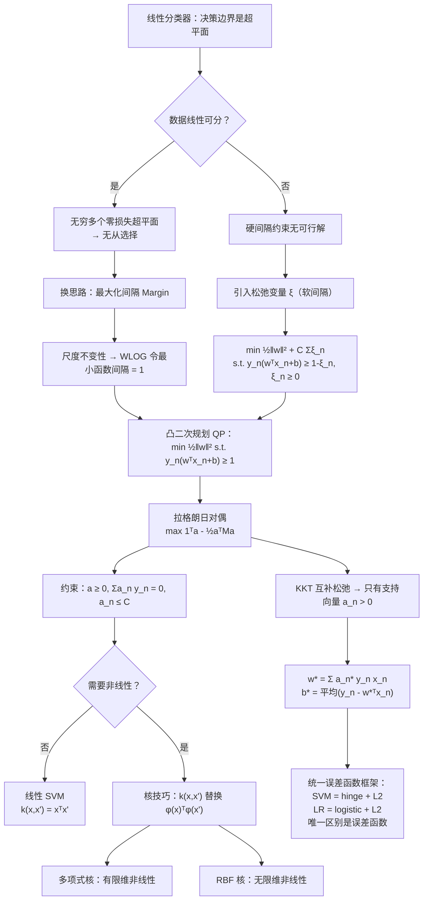
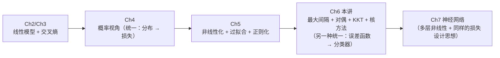

# 支持向量机 (Support Vector Machine, SVM)

> [!info] 本讲导读
> 前几讲的线性分类器（[[Ch3 线性分类器（Linear Classifiers）|逻辑回归]]）用**最小化损失**来定决策边界。本讲换一个完全不同的出发点：
>
> **不问"拟合得有多好"，只问"边界离数据有多远"。**
>
> 这条思路引出了支持向量机（SVM），它串起了本课程几乎所有的核心工具：
>
> 1. **动机**：线性可分时"零损失的超平面有无穷多个"，该挑哪一个？答案是**最大化间隔（margin）**——这是对泛化能力的直接追求。
> 2. **建模**：利用"几何间隔的尺度不变性"，把 max-margin 问题化为一个**凸二次规划（QP）**：
>    $$\min_{\boldsymbol{w},b}\ \tfrac12\lVert\boldsymbol{w}\rVert^{2}\quad\text{s.t.}\quad y_n\bigl(\boldsymbol{w}^{\mathsf T}\boldsymbol{x}_n+b\bigr)\ge1$$
> 3. **对偶**：用拉格朗日对偶把它变成只依赖**样本间内积** $\boldsymbol{x}_n^{\mathsf T}\boldsymbol{x}_m$ 的问题——**这一步是整个 SVM 的灵魂**，因为它让"无限维特征空间"变得可算。
> 4. **稀疏性**：KKT 的互补松弛条件证明**只有支持向量**（落在间隔边界上的样本）参与决策，这是 SVM 高效与稳健的根源。
> 5. **软间隔**：用松弛变量 $\xi_n$ 处理线性不可分，得到 $\min\frac12\lVert\boldsymbol{w}\rVert^2+C\sum_n\xi_n$。
> 6. **核技巧**：用核函数 $k(\boldsymbol{x},\boldsymbol{x}')$ 替换内积，把线性 SVM 直接升级为**无限维非线性**分类器（高斯核）。
> 7. **统一框架**：SVM、逻辑回归、理想分类器三者的**唯一区别是误差函数**——这为理解"损失函数设计"提供了最干净的视角。

> [!SUMMARY]+ Table of Contents

- [[Ch6 支持向量机#支持向量机 (Support Vector Machine, SVM)|支持向量机 (Support Vector Machine, SVM)]]
	- [[Ch6 支持向量机#一、线性分类器的决策边界|一、线性分类器的决策边界]]
		- [[Ch6 支持向量机#1.1 两种损失，两种"最优"|1.1 两种损失，两种"最优"]]
		- [[Ch6 支持向量机#1.2 理想分类器与它的困境|1.2 理想分类器与它的困境]]
		- [[Ch6 支持向量机#1.3 真正的问题是泛化|1.3 真正的问题是泛化]]
	- [[Ch6 支持向量机#二、线性最大间隔分类器|二、线性最大间隔分类器]]
	- [[Ch6 支持向量机#2.1 最大间隔目标|2.1 最大间隔目标]]
	- [[Ch6 支持向量机#2.2 点到超平面的距离|2.2 点到超平面的距离]]
	- [[Ch6 支持向量机#2.3 间隔（Margin）的定义|2.3 间隔（Margin）的定义]]
	- [[Ch6 支持向量机#2.4 尺度不变性与目标的等价变形|2.4 尺度不变性与目标的等价变形]]
	- [[Ch6 支持向量机#2.5 最终的优化问题：二次规划|2.5 最终的优化问题：二次规划]]
	- [[Ch6 支持向量机#2.6 例题（最大间隔）|2.6 例题（最大间隔）]]
	- [[Ch6 支持向量机#三、等价对偶形式|三、等价对偶形式]]
	- [[Ch6 支持向量机#3.1 为什么需要对偶|3.1 为什么需要对偶]]
	- [[Ch6 支持向量机#3.2 拉格朗日函数与对偶函数|3.2 拉格朗日函数与对偶函数]]
	- [[Ch6 支持向量机#3.3 闭式化简：g(a) 的推导|3.3 闭式化简：g(a) 的推导]]
	- [[Ch6 支持向量机#3.4 原问题与对偶问题的关系|3.4 原问题与对偶问题的关系]]
	- [[Ch6 支持向量机#3.5 KKT 条件与支持向量|3.5 KKT 条件与支持向量]]
	- [[Ch6 支持向量机#3.6 原问题 vs 对偶问题：复杂度对比|3.6 原问题 vs 对偶问题：复杂度对比]]
	- [[Ch6 支持向量机#3.7 例题（对偶与 KKT）|3.7 例题（对偶与 KKT）]]
	- [[Ch6 支持向量机#四、软最大间隔分类器|四、软最大间隔分类器]]
	- [[Ch6 支持向量机#4.1 线性不可分与硬约束的崩溃|4.1 线性不可分与硬约束的崩溃]]
	- [[Ch6 支持向量机#4.2 松弛变量|4.2 松弛变量]]
	- [[Ch6 支持向量机#4.3 软间隔的对偶形式|4.3 软间隔的对偶形式]]
	- [[Ch6 支持向量机#4.4 例题（软间隔）|4.4 例题（软间隔）]]
	- [[Ch6 支持向量机#五、支持向量机：核方法|五、支持向量机：核方法]]
	- [[Ch6 支持向量机#5.1 非线性化与维度灾难|5.1 非线性化与维度灾难]]
	- [[Ch6 支持向量机#5.2 核函数与 Mercer 定理|5.2 核函数与 Mercer 定理]]
	- [[Ch6 支持向量机#5.3 高斯核：无限维特征映射|5.3 高斯核：无限维特征映射]]
	- [[Ch6 支持向量机#5.4 核技巧|5.4 核技巧]]
	- [[Ch6 支持向量机#5.5 例题（核方法）|5.5 例题（核方法）]]
	- [[Ch6 支持向量机#六、与逻辑回归的关系：统一的误差函数框架|六、与逻辑回归的关系：统一的误差函数框架]]
	- [[Ch6 支持向量机#6.1 四种分类器的统一写法|6.1 四种分类器的统一写法]]
	- [[Ch6 支持向量机#6.2 三种误差函数|6.2 三种误差函数]]
	- [[Ch6 支持向量机#6.3 为什么 hinge 导致稀疏而 logistic 不稀疏|6.3 为什么 hinge 导致稀疏而 logistic 不稀疏]]
	- [[Ch6 支持向量机#6.4 例题（统一框架）|6.4 例题（统一框架）]]
	- [[Ch6 支持向量机#七、重点·难点·易错点汇总|七、重点·难点·易错点汇总]]
	- [[Ch6 支持向量机#八、简洁代码实现|八、简洁代码实现]]
	- [[Ch6 支持向量机#九、知识点速查|九、知识点速查]]
	- [[Ch6 支持向量机#9.1 核心公式表|9.1 核心公式表]]
	- [[Ch6 支持向量机#9.2 概念对比表|9.2 概念对比表]]
	- [[Ch6 支持向量机#9.3 术语中英对照|9.3 术语中英对照]]
	- [[Ch6 支持向量机#十、本讲小结|十、本讲小结]]
	- [[Ch6 支持向量机#核心思想总结|核心思想总结]]
	- [[Ch6 支持向量机#学习路线图|学习路线图]]
	- [[Ch6 支持向量机#关联笔记|关联笔记]]

## 一、线性分类器的决策边界

### 1.1 两种损失，两种"最优"

> **在线性分类器中，决策边界总是一个超平面。目标是找到能够分离不同类型样本的超平面**

课件先回顾 [[Ch3 线性分类器（Linear Classifiers）|逻辑回归]] 的做法：**决策边界超平面是通过最小化交叉熵损失来找到的**：

$$
L(\boldsymbol{w},b)=-\sum_{n}\Bigl[y_n\log\sigma\bigl(\boldsymbol{w}^{\mathsf T}\boldsymbol{x}_n+b\bigr)+\bigl(1-y_n\bigr)\log\bigl(1-\sigma(\boldsymbol{w}^{\mathsf T}\boldsymbol{x}_n+b)\bigr)\Bigr]
$$

**当得到最优的 $\boldsymbol{w}^{*}$ 和 $b^{*}$ 时，超平面由下式的 $\boldsymbol{x}$ 组成**：

$$
\bigl\{\boldsymbol{x}\ \big|\ \boldsymbol{w}^{*\mathsf T}\boldsymbol{x}+b^{*}=0\bigr\}
$$

两个几何事实（课件强调）：

- **超平面与向量 $\boldsymbol{w}^{*}$ 垂直**（$\boldsymbol{w}^{*}$ 是超平面的**法向量**）
- **从原点到平面的距离是 $-\dfrac{b^{*}}{\lVert\boldsymbol{w}^{*}\rVert}$**

> [!tip] 这两个事实的证明（各一行）
> **① $\boldsymbol{w}$ 是法向量**：取平面上任意两点 $\boldsymbol{x},\boldsymbol{x}'$，则 $\boldsymbol{w}^{\mathsf T}\boldsymbol{x}+b=\boldsymbol{w}^{\mathsf T}\boldsymbol{x}'+b=0$，相减得 $\boldsymbol{w}^{\mathsf T}(\boldsymbol{x}-\boldsymbol{x}')=0$。即 $\boldsymbol{w}$ 垂直于平面内**任意**方向，故 $\boldsymbol{w}$ 是法向量。$\blacksquare$
>
> **② 原点到平面的（有符号）距离 $=-\dfrac{b}{\lVert\boldsymbol{w}\rVert}$**：平面上离原点最近的点是 $\boldsymbol{x}_0=-\dfrac{b}{\lVert\boldsymbol{w}\rVert^{2}}\boldsymbol{w}$（可由拉格朗日乘子法或投影得到），它到原点的位移向量为 $-\dfrac{b}{\lVert\boldsymbol{w}\rVert^{2}}\boldsymbol{w}$，其长度是 $\dfrac{|b|}{\lVert\boldsymbol{w}\rVert}$；而这个位移在单位法向量 $\boldsymbol{w}/\lVert\boldsymbol{w}\rVert$ 方向上的**投影**为
> $$\Bigl(-\frac{b}{\lVert\boldsymbol{w}\rVert^{2}}\boldsymbol{w}\Bigr)\cdot\frac{\boldsymbol{w}}{\lVert\boldsymbol{w}\rVert}=-\frac{b}{\lVert\boldsymbol{w}\rVert}$$
> 这就是课件的写法（**带符号**：$b<0$ 时平面在 $\boldsymbol{w}$ 正方向一侧）。$\blacksquare$

### 1.2 理想分类器与它的困境

**换一种损失会怎样？** 课件给出"**理想分类器**"——直接数**误分类样本的个数**：

$$
L(\boldsymbol{w},b)=\sum_{\ell=1}^{N}e\Bigl(y^{(\ell)}\bigl(\boldsymbol{w}^{\mathsf T}\boldsymbol{x}^{(\ell)}+b\bigr)\Bigr),
\qquad y\in\{-1,\ 1\}
$$

$$
e(z)=
\begin{cases}
0, & z\ge0\\
1, & z<0
\end{cases}
$$

**于是 $L(\boldsymbol{w},b)$ 代表被错误分类的样本数量。**

> [!warning] 注意标签约定变了！
> 本讲（以及 SVM 的整个体系）使用 $y\in\{-1,+1\}$，而 [[Ch3 线性分类器（Linear Classifiers）|Ch3]] 用的是 $y\in\{0,1\}$。
> **为什么 SVM 必须用 $\pm1$？** 因为这样"判对/判错"可以统一写成 $y\cdot(\boldsymbol{w}^{\mathsf T}\boldsymbol{x}+b)\ge0$：
> - $y=+1$：$\boldsymbol{w}^{\mathsf T}\boldsymbol{x}+b\ge0$ ✓
> - $y=-1$：$\boldsymbol{w}^{\mathsf T}\boldsymbol{x}+b\le0$，两边乘 $-1$ 得 $y(\boldsymbol{w}^{\mathsf T}\boldsymbol{x}+b)\ge0$ ✓
>
> **一个表达式同时覆盖两类**——这是后面所有推导（间隔、约束、对偶）能写得如此紧凑的根本原因。
> 两者的换算关系：$y_{\pm1}=2y_{01}-1$。

**理想分类器的困境（课件第 6 页）**：

> **如果样本是线性可分的，将会有无数个理想分类器，它们由 $\boldsymbol{w}^{*}$ 和 $b^{*}$ 决定。**
> **每一对 $\boldsymbol{w}^{*}$ 和 $b^{*}$ 都对应一个超平面。上述所有超平面都能使损失降为零。**

也就是说：**理想损失对"线性可分的数据"完全没有区分能力**——它把无穷多个超平面都评为"满分 0"。

**同一个困境也发生在交叉熵上**：课件接着问"**哪个超平面是最好的？**"并指出：

- 存在某个超平面，**从最小化交叉熵损失的角度来看是最优的**；
- 也存在某个超平面，**从最小化误分类样本数量的角度来看是最优的**；
- 但**这两个"最优"给出的是不同的超平面**。

> [!important] 关键洞察：**损失函数在训练集上"归零"后，就无法再指导我们了**
> 无论用交叉熵还是 0-1 损失，只要数据线性可分，**最优值都是 0，且取到 0 的参数有一整族**。
> 换句话说：**"在训练集上做到最好"这件事，无法回答"哪个超平面更好"** ——因为在训练集上它们**一样好**。

### 1.3 真正的问题是泛化

课件的转折非常明确：

> **这些超平面都是在训练样本上进行评估的。但我们真正需要的是在（未见过的）测试数据上的表现。**
> **根据我们的直觉，下面的哪个超平面更有可能在测试数据上产生更好的结果？**

这正是 [[Ch5 模型的非线性化、过拟合及正则化|Ch5]] 反复强调的主题：**训练误差不是目标，泛化能力才是**。而 SVM 的答案极其漂亮：

> **不看损失，看"间隔"——让决策边界尽可能地远离两边的数据。**

> [!important] SVM 的核心哲学
> | | 逻辑回归 / 理想分类器 | **支持向量机** |
> |---|---|---|
> | 出发点 | 最小化**损失**（拟合训练数据） | **最大化间隔**（留出安全余量） |
> | 对"无穷多零损失解"的回答 | 无（都评为 0） | **选间隔最大的那个** |
> | 与泛化的联系 | 间接（通过损失） | **直接**（间隔大 ⟹ 容错空间大） |
>
> **直觉**：间隔越大，新样本稍稍偏离训练分布时**越不容易越界**——所以间隔本身就是泛化能力的几何度量。

---

## 二、线性最大间隔分类器

### 2.1 最大间隔目标

> **为了在未见过的数据上表现良好，直觉是找到一个能尽可能扩大间隔的超平面。**
> **当间隔较大时，我们可以预期未见过的样本有更高的几率被正确分类。**

![[Ch6-img-max-margin.png]]

上图就是最大间隔分类器的几何图像：

- **实线**：决策边界 $\boldsymbol{w}^{\mathsf T}\boldsymbol{x}+b=0$；
- **两条虚线**：间隔边界 $\boldsymbol{w}^{\mathsf T}\boldsymbol{x}+b=\pm1$；
- **灰色带**：间隔区（margin band），其宽度为 $2/\lVert\boldsymbol{w}\rVert$；
- **蓝圈标出的点**：**支持向量**（support vectors）——恰好落在间隔边界上的样本；
- **蓝色箭头**：法向量 $\boldsymbol{w}$，始终垂直于决策边界。

### 2.2 点到超平面的距离

**如何表示间隔？** 需要先能算"样本 $\boldsymbol{x}$ 到超平面 $\mathcal H$ 的距离"。记

$$
\boldsymbol{w}^{\mathsf T}\boldsymbol{x}+b=h(\boldsymbol{x})
$$

**课件给出一个非常干净的分解**：每个 $\boldsymbol{x}$ 都可以被分解为

$$
\boldsymbol{x}=\boldsymbol{m}_1+\boldsymbol{m}_2
$$

其中：

- $\boldsymbol{m}_1$ **在超平面 $\mathcal H$ 上**，即 $\boldsymbol{w}^{\mathsf T}\boldsymbol{m}_1+b=0$；
- $\boldsymbol{m}_2\perp\mathcal H$ 且 $\boldsymbol{m}_2\parallel\boldsymbol{w}$（**垂直于平面，因此平行于法向量**）。

**因此**：

$$
\boldsymbol{w}^{\mathsf T}\boldsymbol{x}+b=\boldsymbol{w}^{\mathsf T}(\boldsymbol{m}_1+\boldsymbol{m}_2)+b=\underbrace{\bigl(\boldsymbol{w}^{\mathsf T}\boldsymbol{m}_1+b\bigr)}_{=0}+\boldsymbol{w}^{\mathsf T}\boldsymbol{m}_2=h(\boldsymbol{x})
$$

由于 $\boldsymbol{m}_2\parallel\boldsymbol{w}$，可以写成

$$
\boldsymbol{m}_2=\gamma\cdot\frac{\boldsymbol{w}}{\lVert\boldsymbol{w}\rVert}
$$

**其中 $\gamma$ 代表 $\boldsymbol{m}_2$ 的长度**（即**带符号距离**）。

**代入 $h(\boldsymbol{x})=\boldsymbol{w}^{\mathsf T}\boldsymbol{m}_2$**：

$$
h(\boldsymbol{x})=\gamma\cdot\frac{\boldsymbol{w}^{\mathsf T}\boldsymbol{w}}{\lVert\boldsymbol{w}\rVert}=\gamma\cdot\frac{\lVert\boldsymbol{w}\rVert^{2}}{\lVert\boldsymbol{w}\rVert}=\gamma\lVert\boldsymbol{w}\rVert
\ \Longrightarrow\
\boxed{\ \gamma=\frac{h(\boldsymbol{x})}{\lVert\boldsymbol{w}\rVert}\ }
$$

**结论**：

- 位于超平面**上方**的样本到超平面的距离为 $\dfrac{h(\boldsymbol{x})}{\lVert\boldsymbol{w}\rVert}$；
- 位于超平面**下方**的样本到超平面的距离为 $-\dfrac{h(\boldsymbol{x})}{\lVert\boldsymbol{w}\rVert}$。

**用 $y\in\{-1,1\}$ 统一写**：

$$
\boxed{\ \text{样本 }(\boldsymbol{x},y)\text{ 到超平面的距离}=\frac{y\cdot h(\boldsymbol{x})}{\lVert\boldsymbol{w}\rVert}=\frac{y\bigl(\boldsymbol{w}^{\mathsf T}\boldsymbol{x}+b\bigr)}{\lVert\boldsymbol{w}\rVert}\ }
$$

> [!important] 为什么乘上 $y$ 就统一了"上方/下方"？
> - 若样本在**上方**（$h>0$）且 $y=+1$：$y\,h=h>0$ ✓ 距离为正
> - 若样本在**下方**（$h<0$）且 $y=-1$：$y\,h=(-1)h>0$ ✓ 距离为正
> - 若**分类正确**，则 $y\,h>0$，上式给出的就是"**正的几何距离**"；
> - 若**分类错误**，则 $y\,h<0$，上式给出**负值**——负号恰好标记了"分错了"。
>
> **所以 $y\,h(\boldsymbol{x})$ 这个量同时编码了"分对没分对"和"离边界多远"**，这是 SVM 全部公式的基石。

> [!warning] 极易错：$\boldsymbol{w}^{\mathsf T}\boldsymbol{x}+b$ **不是**距离！
> 它被称为**函数间隔（functional margin）**，是**距离乘以 $\lVert\boldsymbol{w}\rVert$**：
> $$\underbrace{\boldsymbol{w}^{\mathsf T}\boldsymbol{x}+b}_{\text{函数间隔（可任意缩放）}}=\lVert\boldsymbol{w}\rVert\times\underbrace{\frac{\boldsymbol{w}^{\mathsf T}\boldsymbol{x}+b}{\lVert\boldsymbol{w}\rVert}}_{\text{几何间隔（真正的距离）}}$$
> **只有除以 $\lVert\boldsymbol{w}\rVert$ 之后才是欧氏距离。** 忘记除以 $\lVert\boldsymbol{w}\rVert$ 是本讲最常见的错误（对应 [[#2.4 尺度不变性与目标的等价变形|2.4 节]]会看到，正是这个区别让问题可解）。

### 2.3 间隔（Margin）的定义

**一个超平面在一个数据集上的间隔由最小距离给出**，即：

$$
\boxed{\ \text{Margin}=\min_{\ell}\ \frac{y^{(\ell)}\cdot\bigl(\boldsymbol{w}^{\mathsf T}\boldsymbol{x}^{(\ell)}+b\bigr)}{\lVert\boldsymbol{w}\rVert}\ }
$$

**因此，最大间隔分类器的目标是找到最优的 $\boldsymbol{w}^{*}$ 和 $b^{*}$ 来使间隔最大化**：

$$
\boldsymbol{w}^{*},b^{*}=\arg\max_{\boldsymbol{w},b}\ \frac{1}{\lVert\boldsymbol{w}\rVert}\min_{\ell}\ y^{(\ell)}\cdot\bigl(\boldsymbol{w}^{\mathsf T}\boldsymbol{x}^{(\ell)}+b\bigr)
$$

**但是，如何优化是未知的。**

> [!warning] 为什么这个目标"不好优化"？——三个障碍
> 1. **分母 $\lVert\boldsymbol{w}\rVert$ 非凸**：$\max\ 1/\lVert\boldsymbol{w}\rVert$ 等价于 $\min\lVert\boldsymbol{w}\rVert$（这个还好，是凸的），但——
> 2. **内层的 $\min_\ell$ 破坏了凸性**：$\min$ 的**最大值**（max-min）问题**一般是非凸的**，不能直接套用凸优化工具；
> 3. **$\min_\ell y(\boldsymbol{w}^{\mathsf T}\boldsymbol{x}+b)$ 不是 $\boldsymbol{w},b$ 的线性函数**（它是分段线性的凹函数），与 $1/\lVert\boldsymbol{w}\rVert$ 相乘后形式混乱。
>
> **破解办法不是"硬算"，而是"换一个等价的目标函数"**——这正是 2.4 节的内容，也是本讲最精彩的一步。

### 2.4 尺度不变性与目标的等价变形

> **基本思想：优化一个与原问题具有相同最优解的目标函数。**

**第一步：发现尺度不变性（scale invariance）**

> **假设 $\boldsymbol{w}^{*}$ 和 $b^{*}$ 是 $\dfrac{1}{\lVert\boldsymbol{w}\rVert}\min_\ell y^{(\ell)}(\boldsymbol{w}^{\mathsf T}\boldsymbol{x}^{(\ell)}+b)$ 的最优解。那么，对于所有 $\kappa\ne0$，$\kappa\boldsymbol{w}^{*}$ 和 $\kappa b^{*}$ 也必定是最优解。**

**验证（课件用两个样本示意）**：对任意 $\kappa>0$，

$$
\frac{1}{\lVert\kappa\boldsymbol{w}^{*}\rVert}y^{(\ell)}\bigl(\kappa\boldsymbol{w}^{*\mathsf T}\boldsymbol{x}^{(\ell)}+\kappa b^{*}\bigr)
=\frac{1}{\kappa\lVert\boldsymbol{w}^{*}\rVert}\cdot\kappa\,y^{(\ell)}\bigl(\boldsymbol{w}^{*\mathsf T}\boldsymbol{x}^{(\ell)}+b^{*}\bigr)
=\frac{y^{(\ell)}\bigl(\boldsymbol{w}^{*\mathsf T}\boldsymbol{x}^{(\ell)}+b^{*}\bigr)}{\lVert\boldsymbol{w}^{*}\rVert}
$$

**$\kappa$ 被完全约掉了**——所以几何间隔**与尺度无关**。

> [!important] 这个不变性是整个 SVM 推导的枢纽
> - **几何间隔** $\dfrac{y(\boldsymbol{w}^{\mathsf T}\boldsymbol{x}+b)}{\lVert\boldsymbol{w}\rVert}$：**尺度不变**（分子分母同时放大 $\kappa$ 倍，约掉）；
> - **函数间隔** $y(\boldsymbol{w}^{\mathsf T}\boldsymbol{x}+b)$：**可任意缩放**（乘 $\kappa$ 就变 $\kappa$ 倍）。
>
> **因此存在无穷多组 $(\boldsymbol{w},b)$ 给出完全相同的分类器与相同的间隔。** 既然尺度是"自由"的，我们就可以**用它来做归一化**——这是"WLOG（不失一般性）"的经典用法。

**第二步：用尺度自由固定函数间隔为 1**

> **此外，总存在一个特定的 $\kappa$ 使得，对于所有 $\ell=1,2,\cdots,n$，$y^{(\ell)}\cdot(\kappa\boldsymbol{w}^{*\mathsf T}\boldsymbol{x}^{(\ell)}+\kappa b^{*})\ge1$，并且至少有一个等号成立。**

**做法**：取 $\kappa=\dfrac{1}{\min_\ell y^{(\ell)}(\boldsymbol{w}^{*\mathsf T}\boldsymbol{x}^{(\ell)}+b^{*})}>0$，则缩放后

$$
\min_\ell\ y^{(\ell)}\bigl(\kappa\boldsymbol{w}^{\mathsf T}\boldsymbol{x}^{(\ell)}+\kappa b\bigr)=1
$$

即**所有样本的函数间隔至少为 1，且至少有（恰好有）一个样本的函数间隔等于 1**。

**第三步：目标函数的等价改写**

因此，可以通过求解**两种等价形式**之一来得到最大间隔分类器：

$$
\underbrace{\max_{\boldsymbol{w},b}\ \frac{1}{\lVert\boldsymbol{w}\rVert}\min_{\ell}\ y^{(\ell)}\bigl(\boldsymbol{w}^{\mathsf T}\boldsymbol{x}^{(\ell)}+b\bigr)}_{\text{原目标（难优化）}}
\qquad\Longleftrightarrow\qquad
\underbrace{\max_{\boldsymbol{w},b}\ \frac{1}{\lVert\boldsymbol{w}\rVert}\quad\text{s.t.}\quad y^{(\ell)}\bigl(\boldsymbol{w}^{\mathsf T}\boldsymbol{x}^{(\ell)}+b\bigr)\ge1\ \ \forall\ell}_{\text{带约束形式（易优化）}}
$$

（后者其实也可视为无约束的 $\max_{\boldsymbol{w},b}\frac{1}{\lVert\boldsymbol{w}\rVert}\min_\ell y(\cdot)$，因为约束强制了 $\min_\ell=1$。）

> [!important] 课件对"等价性"的精确表述
> **最优解 $\boldsymbol{w}^{*},b^{*}$ 可能不相同，但它们所得到的 $\frac{1}{\lVert\boldsymbol{w}^{*}\rVert}\min_\ell y^{(\ell)}(\boldsymbol{w}^{*\mathsf T}\boldsymbol{x}^{(\ell)}+b^{*})$ 的值必定相等。**
> 这句话很关键：**"等价"指的是"最优值相等"，而不是"最优解相同"**。缩放后的解是不同的参数（模长不同），但对应**同一个超平面**、**同一个间隔**。

**第四步：把 max 变成 min**

在带约束形式中，由于 $y^{(\ell)}(\boldsymbol{w}^{\mathsf T}\boldsymbol{x}^{(\ell)}+b)\ge1$ 且至少有一个等号成立，我们可以很容易地得到：

$$
\min_{\ell}\ y^{(\ell)}\bigl(\boldsymbol{w}^{\mathsf T}\boldsymbol{x}^{(\ell)}+b\bigr)=1
$$

**因此，优化目标可以简化为 $\dfrac{1}{\lVert\boldsymbol{w}\rVert}$。**

**最大化 $\frac{1}{\lVert\boldsymbol{w}\rVert}$ 可以等价于最小化 $\lVert\boldsymbol{w}\rVert^{2}$。因此，该问题可以等价地写为**：

$$
\min_{\boldsymbol{w},b}\ \lVert\boldsymbol{w}\rVert^{2}
\qquad\text{s.t.}\qquad
y^{(\ell)}\bigl(\boldsymbol{w}^{\mathsf T}\boldsymbol{x}^{(\ell)}+b\bigr)\ge1,\quad\forall\ell
$$

> [!question] 课件的思考题："当最小化 $\lVert\boldsymbol{w}\rVert^{2}$ 时，'至少有一个等号成立'的约束条件将自动满足（为什么？？）"
> **解答（反证法）**：设 $(\boldsymbol{w},b)$ 满足全部约束，但**没有任何**等号成立，即
> $$m\triangleq\min_{\ell}\ y^{(\ell)}\bigl(\boldsymbol{w}^{\mathsf T}\boldsymbol{x}^{(\ell)}+b\bigr)>1$$
> 取缩放 $\bigl(\frac{\boldsymbol{w}}{m},\frac{b}{m}\bigr)$。因为它只是把 $(\boldsymbol{w},b)$ 乘以正数 $\frac1m$，故仍然满足所有约束（$\ge1$），而且它的目标值更小：
> $$\Bigl\lVert\frac{\boldsymbol{w}}{m}\Bigr\rVert^{2}=\frac{\lVert\boldsymbol{w}\rVert^{2}}{m^{2}}<\lVert\boldsymbol{w}\rVert^{2}\qquad(\text{因 }m>1)$$
> **这与 $(\boldsymbol{w},b)$ 的最优性矛盾。** 因此最优解处必有 $m=1$，即至少有一个等号成立。$\blacksquare$
>
> **直观理解**：如果所有约束都"松着"，就说明 $\boldsymbol{w}$ 还能再缩小（间隔还能再放大）——所以**最优解一定把某个约束"顶到紧"**。这也告诉我们：**"至少一个等号"不是额外假设，而是最优性的必然结果。**

### 2.5 最终的优化问题：二次规划

**因此，最大间隔超平面可以通过求解下面的优化问题来找到**：

$$
\boxed{\
\min_{\boldsymbol{w},b}\ \frac{1}{2}\lVert\boldsymbol{w}\rVert^{2}
\qquad\text{s.t.}\qquad
y^{(\ell)}\bigl(\boldsymbol{w}^{\mathsf T}\boldsymbol{x}^{(\ell)}+b\bigr)\ge1,\quad \ell=1,2,\cdots,N
\ }
$$

（加上系数 $\frac12$ 只是为了求导时消掉 2，不影响最优解。）

> [!important] 这是一个**二次规划（Quadratic Programming, QP）问题，它的最优解可以高效地通过数值方法找到**。
> **为什么是 QP？**
> - **目标** $\frac12\lVert\boldsymbol{w}\rVert^{2}$ 是**二次的**（且是凸的，海森矩阵 $=\boldsymbol{I}\succ0$）；
> - **约束**是**线性的**（关于 $\boldsymbol{w},b$ 都是仿射的）。
>
> **凸 QP 的三大好处**：① 没有局部极小，任何局部最优就是全局最优；② 有成熟高效的标准求解器（内点法、有效集法、SMO 等）；③ 满足强对偶性（这正是下一章对偶推导成立的前提）。

**QP 的一般形式（课件第 20 页）**：

$$
\min_{\boldsymbol{x}\in\mathbb{R}^{n}}\ \frac{1}{2}\boldsymbol{x}^{\mathsf T}\boldsymbol{Q}\boldsymbol{x}+\boldsymbol{c}^{\mathsf T}\boldsymbol{x}
\qquad\text{subject to}\qquad
\boldsymbol{A}\boldsymbol{x}\le\boldsymbol{b},\quad
\boldsymbol{E}\boldsymbol{x}=\boldsymbol{d},\quad
\boldsymbol{l}\le\boldsymbol{x}\le\boldsymbol{u}
$$

| 符号 | 含义 |
|---|---|
| $\boldsymbol{x}$ | **决策变量的向量** |
| $\boldsymbol{Q}$ | $n\times n$ 的**对称正定矩阵**，定义了二次项 |
| $\boldsymbol{c}$ | **线性项的系数向量** |
| $\boldsymbol{A},\boldsymbol{b}$ | 定义了**不等式约束** |
| $\boldsymbol{E},\boldsymbol{d}$ | 定义了**等式约束** |
| $\boldsymbol{l},\boldsymbol{u}$ | 定义了变量的**下界和上界** |

**把 SVM 对应进去**：$\boldsymbol{x}=(\boldsymbol{w},b)$，$\boldsymbol{Q}=\mathrm{diag}(1,\dots,1,0)$（注意 $b$ 不对应二次项，故 $\boldsymbol{Q}$ 只是**半正定**而非正定——这是 SVM 的一个技术细节）。

**预测**：当得到最优的 $\boldsymbol{w}^{*}$ 和 $b^{*}$ 时，一个未见过的数据 $\boldsymbol{x}$ 可以被分类为：

$$
\boxed{\ \hat y(\boldsymbol{x})=\operatorname{sign}\bigl(\boldsymbol{w}^{*\mathsf T}\boldsymbol{x}+b^{*}\bigr)\ }
$$

**课件列举的数值方法**：牛顿法、梯度下降法（神经网络学习）、共轭梯度下降法……

> [!warning] 为什么这里不直接用梯度下降？（理解 QP 的意义）
> 因为**约束**的存在。梯度下降是**无约束**优化方法；对带约束问题需要额外机制：
> - **投影梯度法**（每步投影回可行域）；
> - **罚函数/增广拉格朗日法**（把约束变成惩罚项）；
> - **内点法**（沿"中心路径"逼近约束边界）；
> - 或者——**转化成对偶问题**，把约束吸收进目标（这正是下一章要做的，也是 SVM 最漂亮的地方）。

### 2.6 例题（最大间隔）

> [!example]- 例 6.1：点到超平面的距离、函数间隔与几何间隔（基础但极易错）
> 设超平面由 $\boldsymbol{w}=(3,4)^{\mathsf T},\ b=-5$ 给出，即 $3x_1+4x_2-5=0$。
> 1. 求原点到该超平面的（带符号）距离，并验证课件公式 $-\frac{b}{\lVert\boldsymbol{w}\rVert}$；
> 2. 求点 $A(1,1)$、$B(0,0)$、$C(2,2)$ 各自的函数间隔与几何间隔；
> 3. 若数据集为 $\{(A,+1),(B,-1),(C,+1)\}$，求该超平面对这个数据集的**间隔**；
> 4. 把 $(\boldsymbol{w},b)$ 整体乘以 $10$，函数间隔与几何间隔分别如何变化？间隔是否变化？
>
> **解答：**
> $\lVert\boldsymbol{w}\rVert=\sqrt{3^{2}+4^{2}}=5$。
> 1. 原点到平面的距离 $=\dfrac{|3\cdot0+4\cdot0-5|}{5}=\dfrac{5}{5}=1$。
>    带符号距离（沿 $\boldsymbol{w}$ 方向投影）$=-\dfrac{b}{\lVert\boldsymbol{w}\rVert}=-\dfrac{-5}{5}=1$ ✓ 与课件公式一致。
>    **几何直觉**：$\boldsymbol{w}=(3,4)$ 指向右上，$b=-5<0$ 说明平面被"推"到了 $\boldsymbol{w}$ 的正方向一侧，所以从原点往 $\boldsymbol{w}$ 方向走 1 个单位就到达平面 ✓
> 2. 计算 $h(\boldsymbol{x})=3x_1+4x_2-5$：
>
>    | 点 | $h(\boldsymbol{x})$ | 标签 $y$ | 函数间隔 $y\,h$ | 几何间隔 $y\,h/\lVert\boldsymbol{w}\rVert$ |
>    |---|---|---|---|---|
>    | $A(1,1)$ | $3+4-5=2$ | $+1$ | $2$ | $2/5=0.4$ |
>    | $B(0,0)$ | $-5$ | $-1$ | $5$ | $5/5=1.0$ |
>    | $C(2,2)$ | $6+8-5=9$ | $+1$ | $9$ | $9/5=1.8$ |
>
>    **三者几何间隔都为正 ⟹ 三个点都被正确分类** ✓
> 3. **间隔 $=\min_\ell y^{(\ell)}h(\boldsymbol{x}^{(\ell)})/\lVert\boldsymbol{w}\rVert=\min(0.4,1.0,1.8)=0.4=\dfrac25$**。
>    **要点**：**间隔由"离得最近的那个点"决定**——这里是 $A$。这也预示了"支持向量"的概念：真正约束住间隔的只有少数几个点。
> 4. 令 $(\boldsymbol{w}',b')=10(\boldsymbol{w},b)=(30,40)^{\mathsf T},\ -50$，则 $\lVert\boldsymbol{w}'\rVert=50$，$h'(\boldsymbol{x})=10h(\boldsymbol{x})$：
>    - **函数间隔**：$y\,h'=10\,(y\,h)$，即变为原来的 **10 倍**（$2\to20$、$5\to50$、$9\to90$）；
>    - **几何间隔**：$\dfrac{y\,h'}{\lVert\boldsymbol{w}'\rVert}=\dfrac{10\,y\,h}{10\lVert\boldsymbol{w}\rVert}=\dfrac{y\,h}{\lVert\boldsymbol{w}\rVert}$，**完全不变**（$0.4,1.0,1.8$）；
>    - **间隔**：仍为 $0.4$ ✓ **不变**。
>
>    **结论**：**函数间隔是"尺度依赖"的（可任意放大），几何间隔是"尺度不变"的**。
>    **这正是 [[#2.4 尺度不变性与目标的等价变形|2.4 节]]"可以 WLOG 令函数间隔 $=1$"的依据**——因为放大缩小不改变真正的分类器，我们可以用这个自由度把函数间隔"标准化"到 1。

> [!example]- 例 6.2：一维 SVM 完整手算（从原问题到对偶解，含验证强对偶）
> 一维数据集（$x\in\mathbb{R}$）：$x=-2\ (y=-1)$，$x=-1\ (y=-1)$，$x=1\ (y=+1)$，$x=2\ (y=+1)$。
> 1. 写出最大间隔 QP 的完整形式；
> 2. 求出最优 $\boldsymbol{w}^{*},b^{*}$（提示：一维下超平面是一个点）；
> 3. 指出哪些是支持向量，并验证"至少有一个等号成立"；
> 4. 用 KKT 条件求出对偶变量 $a_n^{*}$；
> 5. 验证强对偶：比较原问题目标与对偶目标的值；
> 6. 用 $b^{*}$ 的公式（[[#3.4 原问题与对偶问题的关系|3.4 节]]）重新计算 $b^{*}$ 并核对。
>
> **解答：**
> 1. 记四个点为 $(x_1,y_1)=(-2,-1),\ (x_2,y_2)=(-1,-1),\ (x_3,y_3)=(1,+1),\ (x_4,y_4)=(2,+1)$。
>    $$\min_{w,b}\ \frac12 w^{2}\quad\text{s.t.}\quad
>    \begin{cases}
>    -(-2w+b)\ge1 & \text{即 } 2w-b\ge1\\
>    -(-w+b)\ge1 & \text{即 } w-b\ge1\\
>    (w+b)\ge1 & \\
>    (2w+b)\ge1 &
>    \end{cases}$$
> 2. **由对称性猜 $b^{*}=0$**（数据关于原点对称，且两类样本数相等——与 [[Ch3 线性分类器（Linear Classifiers）|Ch3]] 例 3.5 同样的道理）。
>    此时约束变为 $2w\ge1,\ w\ge1,\ w\ge1,\ 2w\ge1$，即最紧的是 $w\ge1$。
>    最小化 $\frac12w^{2}$ ⟹ 取最小的可行 $w$，即 $\boxed{w^{*}=1,\ b^{*}=0}$。
>    **超平面**：$x=0$（一维中就是一个点），把 $x<0$ 判为 $-1$、$x>0$ 判为 $+1$ ✓
> 3. **检查等号**：
>    - $x=-2$：$y\,h=(-1)(-2)=2>1$
>    - $x=-1$：$y\,h=(-1)(-1)=1$ **等号** ✓
>    - $x=1$：$y\,h=1$ **等号** ✓
>    - $x=2$：$y\,h=2>1$
>
>    **支持向量是 $x=-1$ 与 $x=1$**（$\mathcal S=\{2,3\}$），恰有两个，且**至少有一个等号成立** ✓
>    **几何验证**：决策边界在 $x=0$，最近的点在 $x=\pm1$，间隔（半宽）$=1=\dfrac{1}{\lVert w\rVert}=\dfrac11$ ✓ 与"间隔 $=1/\lVert\boldsymbol{w}\rVert$（函数间隔已归一化为 1）"一致。
> 4. 由 KKT 的**梯度条件**：$\boldsymbol{w}^{*}=\sum_n a_n^{*}y_n\boldsymbol{x}_n$。非支持向量（$x=\pm2$）互补松弛给出 $a=0$；设 $a_2=a_{-}$（对应 $x=-1$）、$a_3=a_{+}$（对应 $x=1$）。
>    $$w^{*}=a_{-}(-1)(-1)+a_{+}(+1)(+1)=a_{-}+a_{+}=1$$
>    再由等式约束 $\sum_n a_n y_n=0$：
>    $$a_{-}(-1)+a_{+}(+1)=0\ \Longrightarrow\ a_{-}=a_{+}$$
>    联立得
>    $$2a_{+}=1\ \Longrightarrow\ \boxed{a_{-}^{*}=a_{+}^{*}=\tfrac12}$$
> 5. **原问题最优值**：$\frac12(w^{*})^{2}=\frac12(1)^{2}=\mathbf{0.5}$。
>    **对偶目标**：$g(\boldsymbol{a})=\sum_n a_n-\frac12\sum_n\sum_m a_na_my_ny_mx_nx_m$。
>    只有 $n,m\in\{2,3\}$ 的项非零，且
>    $$M_{nm}=y_ny_mx_nx_m:\quad M_{22}=(-1)(-1)(-1)(-1)=1,\quad M_{33}=1,\quad M_{23}=M_{32}=(1)(-1)(1)(-1)=1$$
>    所以 $\sum\sum a_na_mM_{nm}=(a_{-}+a_{+})^{2}=1^{2}=1$，而 $\sum a_n=1$，故
>    $$g(\boldsymbol{a}^{*})=1-\tfrac12(1)=\mathbf{0.5}$$
>    **两者相等 ⟹ 强对偶成立（对偶间隙为 0）** ✓ 这验证了"凸 QP 满足强对偶性"，也说明**对偶问题的最优值就是原问题的最优值**——所以解对偶问题等价于解原问题。
> 6. 由 [[#3.4 原问题与对偶问题的关系|3.4 节]]的公式，取 $\mathcal S=\{2,3\}$（支持向量集），
>    $$b^{*}=\frac{1}{|\mathcal S|}\sum_{n\in\mathcal S}\Bigl[y_n-\sum_m a_m^{*}y_mx_nx_m\Bigr]$$
>    注意 $\sum_m a_m^{*}y_mx_m=w^{*}=1$，故
>    - $n=2$（$x=-1,y=-1$）：$y_n-w^{*}x_n=-1-1\cdot(-1)=0$
>    - $n=3$（$x=1,y=+1$）：$y_n-w^{*}x_n=1-1\cdot1=0$
>
>    $$b^{*}=\frac{0+0}{2}=0\ ✓$$
>    **与第 2 问的结果一致**，且可以看到公式的本质其实是"对每个支持向量解出 $b=y_n-\boldsymbol{w}^{\mathsf T}\boldsymbol{x}_n$，再取平均"（因为支持向量满足 $y_n(\boldsymbol{w}^{\mathsf T}\boldsymbol{x}_n+b)=1\Rightarrow b=y_n-\boldsymbol{w}^{\mathsf T}\boldsymbol{x}_n$）。

---

## 三、等价对偶形式

### 3.1 为什么需要对偶

> **每个凸优化问题都对应一个等价的对偶形式。**（课件注明：本节内容摘自凸优化这一学科。）

> [!important] 先记住"对偶能给我们什么"，再看推导（否则会觉得莫名其妙）
> | 收益 | 说明 |
> |---|---|
> | **① 消除约束** | 约束被吸收进拉格朗日函数，得到一个**只有下界约束 $\boldsymbol{a}\ge0$** 的问题 |
> | **② 只依赖内积** | 对偶目标只含 $\boldsymbol{x}_n^{\mathsf T}\boldsymbol{x}_m$ —— **这是核技巧能够成立的前提**（见第五章） |
> | **③ 参数个数换成样本数** | 原问题优化 $m+1$ 个参数（特征维度），对偶优化 $N$ 个参数（**样本数**）。**高维特征时对偶更高效** |
> | **④ 暴露稀疏性** | KKT 条件直接给出"只有支持向量非零"这一结论 |
>
> **一句话**：**对偶不是"换个写法"，而是让 SVM 从"线性分类器"升级为"核方法"的唯一通道。**

### 3.2 拉格朗日函数与对偶函数

**原始优化问题的拉格朗日函数**（为每个不等式约束引入一个乘子 $a_\ell\ge0$）：

$$
\boxed{\ \mathcal L(\boldsymbol{w},b,\boldsymbol{a})=\frac{1}{2}\lVert\boldsymbol{w}\rVert^{2}-\sum_{\ell=1}^{N}a_\ell\Bigl[y^{(\ell)}\bigl(\boldsymbol{w}^{\mathsf T}\boldsymbol{x}^{(\ell)}+b\bigr)-1\Bigr]\ }
$$

**其中，拉格朗日乘子 $a_\ell$ 必须满足 $a_\ell\ge0$。**

> [!tip] 拉格朗日函数是怎么"构造"出来的？（理解它的作用）
> 目标是最小化 $\frac12\lVert\boldsymbol{w}\rVert^{2}$，受约束 $g_\ell(\boldsymbol{w},b)\triangleq y^{(\ell)}(\boldsymbol{w}^{\mathsf T}\boldsymbol{x}^{(\ell)}+b)-1\ge0$。
> 构造 $\mathcal L=\text{目标}-\sum_\ell a_\ell g_\ell$，其中 $a_\ell\ge0$。于是：
> - 若**所有约束都满足**（$g_\ell\ge0$）：减去非负数项使 $\mathcal L\le$ 目标值；
> - 若**某个约束被违反**（$g_\ell<0$）：因为 $a_\ell\ge0$，$-a_\ell g_\ell>0$，**$\mathcal L$ 会被惩罚而变大**。
>
> 所以**"$\max_{\boldsymbol{a}\ge0}\mathcal L$" 会自动惩罚违反约束的解**，从而把约束问题转化为"先 max 再 min"的**极小极大问题**：
> $$\min_{\boldsymbol{w},b}\max_{\boldsymbol{a}\ge0}\ \mathcal L(\boldsymbol{w},b,\boldsymbol{a})$$
> **对偶**就是把 $\min$ 和 $\max$ 的顺序**交换**过来：$\max_{\boldsymbol{a}\ge0}\min_{\boldsymbol{w},b}\mathcal L$。

**拉格朗日对偶函数**：

$$
\boxed{\ g(\boldsymbol{a})=\min_{\boldsymbol{w},b}\ \mathcal L(\boldsymbol{w},b,\boldsymbol{a})\ }
$$

**原始优化问题的对偶形式**：

$$
\max_{\boldsymbol{a}}\ g(\boldsymbol{a})\qquad\text{s.t.}\qquad \boldsymbol{a}\ge\boldsymbol{0}
$$

> [!important] 弱对偶与强对偶（为什么可以交换 min/max）
> 一般地，**交换 min 与 max 只会让值变小**（弱对偶）：
> $$\max_{\boldsymbol{a}\ge0}\min_{\boldsymbol{w},b}\mathcal L\ \le\ \min_{\boldsymbol{w},b}\max_{\boldsymbol{a}\ge0}\mathcal L$$
> 但对**凸问题 + Slater 条件**（存在严格可行点），**强对偶成立**（两边相等）——SVM 的原始问题是凸 QP，且（在数据线性可分时）存在严格可行点，**所以强对偶成立**：
> $$\boxed{\ \max_{\boldsymbol{a}\ge0}\min_{\boldsymbol{w},b}\mathcal L\ =\ \min_{\boldsymbol{w},b}\max_{\boldsymbol{a}\ge0}\mathcal L\ }$$
> **解对偶问题 = 解原问题**（[[#2.6 例题（最大间隔）|例 6.2 第 5 问]]已用一个具体例子数值验证了这一点）。这一点是后面"用对偶解替代原问题解"的合法性依据。

### 3.3 闭式化简：g(a) 的推导

**第一步：把梯度置零**（因为 $g(\boldsymbol{a})=\min_{\boldsymbol{w},b}\mathcal L$，而无约束极小值点处梯度为零）

$$
\frac{\partial\mathcal L}{\partial\boldsymbol{w}}=\boldsymbol{w}-\sum_{\ell=1}^{N}a_\ell y^{(\ell)}\boldsymbol{x}^{(\ell)}=\boldsymbol{0}
\ \Longrightarrow\
\boxed{\ \boldsymbol{w}=\sum_{\ell=1}^{N}a_\ell y^{(\ell)}\boldsymbol{x}^{(\ell)}\ }
$$

$$
\frac{\partial\mathcal L}{\partial b}=-\sum_{\ell=1}^{N}a_\ell y^{(\ell)}=0
\ \Longrightarrow\
\boxed{\ \sum_{\ell=1}^{N}a_\ell y^{(\ell)}=0\ }
$$

> [!important] 第一个式子是 SVM 最重要的结构
> $$\boldsymbol{w}^{*}=\sum_{n}a_n^{*}y_n\boldsymbol{x}_n$$
> **最优法向量是训练样本的线性组合！** 而且由稀疏性（3.5 节），只有支持向量的 $a_n^{*}\ne0$，所以
> $$\boldsymbol{w}^{*}=\sum_{n\in\mathcal S}a_n^{*}y_n\boldsymbol{x}_n\qquad(\mathcal S=\text{支持向量集})$$
> **决策边界完全由支持向量决定**——这就是"SVM 只关心边界上的点"的代数表达。
>
> 第二个式子 $\sum_n a_ny_n=0$ 是**对偶问题的一个等式约束**，它保证了"两类的影响力平衡"。

**第二步：代入求 $g(\boldsymbol{a})$ 的闭式表达**

把 $\boldsymbol{w}=\sum_\ell a_\ell y^{(\ell)}\boldsymbol{x}^{(\ell)}$ 与 $\sum_\ell a_\ell y^{(\ell)}=0$ 代回

$$
\mathcal L=\frac12\lVert\boldsymbol{w}\rVert^{2}-\sum_\ell a_\ell y^{(\ell)}\boldsymbol{w}^{\mathsf T}\boldsymbol{x}^{(\ell)}-b\underbrace{\sum_\ell a_\ell y^{(\ell)}}_{=0}+\sum_\ell a_\ell
$$

注意中间项

$$
\sum_\ell a_\ell y^{(\ell)}\boldsymbol{w}^{\mathsf T}\boldsymbol{x}^{(\ell)}=\boldsymbol{w}^{\mathsf T}\underbrace{\sum_\ell a_\ell y^{(\ell)}\boldsymbol{x}^{(\ell)}}_{=\boldsymbol{w}}=\lVert\boldsymbol{w}\rVert^{2}
$$

于是

$$
\mathcal L=\frac12\lVert\boldsymbol{w}\rVert^{2}-\lVert\boldsymbol{w}\rVert^{2}+\sum_\ell a_\ell=-\frac12\lVert\boldsymbol{w}\rVert^{2}+\sum_\ell a_\ell
$$

再把 $\lVert\boldsymbol{w}\rVert^{2}=\bigl(\sum_\ell a_\ell y^{(\ell)}\boldsymbol{x}^{(\ell)}\bigr)^{\mathsf T}\bigl(\sum_j a_j y_j\boldsymbol{x}_j\bigr)=\sum_\ell\sum_j a_\ell a_j y^{(\ell)}y_j\boldsymbol{x}^{(\ell)\mathsf T}\boldsymbol{x}_j$ 代入，得到

$$
\boxed{\
g(\boldsymbol{a})=\sum_{\ell=1}^{N}a_\ell-\frac{1}{2}\sum_{\ell=1}^{N}\sum_{j=1}^{N}a_\ell a_j\,y^{(\ell)}y_j\,\boldsymbol{x}^{(\ell)\mathsf T}\boldsymbol{x}_j
=\boldsymbol{1}^{\mathsf T}\boldsymbol{a}-\frac{1}{2}\boldsymbol{a}^{\mathsf T}\boldsymbol{M}\boldsymbol{a}
\ }
$$

**其中**

$$
\boxed{\ M_{\ell j}\triangleq y^{(\ell)}y_j\,\boldsymbol{x}^{(\ell)\mathsf T}\boldsymbol{x}_j\ }
$$

> [!tip] 关于 $\boldsymbol{M}$ 的两个重要性质
> 1. **对称**：$M_{\ell j}=y^{(\ell)}y_j\boldsymbol{x}^{(\ell)\mathsf T}\boldsymbol{x}_j=y_jy^{(\ell)}\boldsymbol{x}_j^{\mathsf T}\boldsymbol{x}^{(\ell)}=M_{j\ell}$ ✓
> 2. **半正定**：令 $\boldsymbol{Z}=\mathrm{diag}(\boldsymbol{y})\boldsymbol{X}$，其第 $n$ 行为 $y_n\boldsymbol{x}_n^{\mathsf T}$，则
>    $$M_{\ell j}=y_\ell y_j\boldsymbol{x}_\ell^{\mathsf T}\boldsymbol{x}_j=(\boldsymbol{Z}\boldsymbol{Z}^{\mathsf T})_{\ell j}\ \Longrightarrow\ \boldsymbol{M}=\boldsymbol{Z}\boldsymbol{Z}^{\mathsf T}\succeq0\ ✓$$
>    **因此对偶目标 $g(\boldsymbol{a})=\boldsymbol{1}^{\mathsf T}\boldsymbol{a}-\frac12\boldsymbol{a}^{\mathsf T}\boldsymbol{M}\boldsymbol{a}$ 是一个凹二次函数**，最大化它是**凸优化**问题（等价于最小化 $\frac12\boldsymbol{a}^{\mathsf T}\boldsymbol{M}\boldsymbol{a}-\boldsymbol{1}^{\mathsf T}\boldsymbol{a}$）。

**因此，对偶优化问题变为**：

$$
\boxed{\
\max_{\boldsymbol{a}}\ g(\boldsymbol{a})
\qquad\text{s.t.}\qquad
\boldsymbol{a}\ge\boldsymbol{0}\quad\text{及}\quad \sum_{\ell=1}^{N}a_\ell y^{(\ell)}=0
\ }
$$

**它也是一个二次规划问题，可以通过数值方法高效地求解**

> [!important] 对偶问题的结构之美
> - **目标**：凹二次（仅依赖**样本间内积** $\boldsymbol{x}^{(\ell)\mathsf T}\boldsymbol{x}_j$）；
> - **约束**：只有"非负"与"一个等式"，**比原问题的 $N$ 个不等式约束简单得多**；
> - **变量个数**：$N$ 个 $a_\ell$，**与特征维度无关**。

### 3.4 原问题与对偶问题的关系

**给定最优解 $\boldsymbol{a}^{*}$，最优的 $\boldsymbol{w}^{*}$ 可以等价地表示为**：

$$
\boxed{\ \boldsymbol{w}^{*}=\sum_{\ell=1}^{N}a_\ell^{*}y_\ell\boldsymbol{x}_\ell\ }
$$

**由于对于所有位于间隔边界上的样本 $\bigl(\boldsymbol{x}^{(\ell)},y^{(\ell)}\bigr)$，都有 $y^{(\ell)}\bigl(\boldsymbol{w}^{*\mathsf T}\boldsymbol{x}^{(\ell)}+b\bigr)=1$，我们可以推导出**：

$$
\boxed{\ b^{*}=\frac{1}{|\mathcal S|}\sum_{n\in\mathcal S}\Bigl[y_n-\sum_m a_m^{*}y_m\boldsymbol{x}_n^{\mathsf T}\boldsymbol{x}_m\Bigr]\ }
$$

**其中 $\mathcal S$ 表示位于间隔边界上的样本集合**（即**支持向量集**）。

> [!important] 这个 $b^{*}$ 公式是怎么来的？为什么要"取平均"？
> 对任意一个支持向量 $n\in\mathcal S$，有 $y_n(\boldsymbol{w}^{*\mathsf T}\boldsymbol{x}_n+b^{*})=1$。由于 $y_n\in\{\pm1\}$，两边乘 $y_n$ 得
> $$\boldsymbol{w}^{*\mathsf T}\boldsymbol{x}_n+b^{*}=y_n\ \Longrightarrow\ b^{*}=y_n-\boldsymbol{w}^{*\mathsf T}\boldsymbol{x}_n=y_n-\sum_m a_m^{*}y_m\boldsymbol{x}_n^{\mathsf T}\boldsymbol{x}_m$$
> **理论上任取一个支持向量都能算出正确的 $b^{*}$**（它们给出同一个值）。
> **实践上要对所有支持向量取平均**，原因有两个：① 数值误差会让不同支持向量算出的 $b^{*}$ 略有差异，取平均更稳健；② 若某个支持向量恰好是离群点/数值病态点，取平均可降低其影响。

**因此，最大间隔分类器的两种等价形式**：

$$
\underbrace{\hat y(\boldsymbol{x})=\operatorname{sign}\bigl(\boldsymbol{w}^{*\mathsf T}\boldsymbol{x}+b^{*}\bigr)}_{\text{原问题形式}}
\qquad\Longleftrightarrow\qquad
\underbrace{\hat y(\boldsymbol{x})=\operatorname{sign}\Bigl(\sum_{n=1}^{N}a_n^{*}y_n\,\boldsymbol{x}_n^{\mathsf T}\boldsymbol{x}+b^{*}\Bigr)}_{\text{对偶问题形式}}
$$

**这两个分类器是等价的**（把 $\boldsymbol{w}^{*}=\sum_n a_n^{*}y_n\boldsymbol{x}_n$ 代入原问题形式即得对偶形式）。

> [!tip] 如何理解对偶形式的分类器？（课件第 28 页）
> 对于一个测试样本 $\boldsymbol{x}$：
> 1. **计算它与所有训练样本 $\boldsymbol{x}_n$（$n=1,\dots,N$）的相似度 $\boldsymbol{x}_n^{\mathsf T}\boldsymbol{x}$**；
> 2. **将所有标签 $y_n$ 按样本相似度 $\boldsymbol{x}_n^{\mathsf T}\boldsymbol{x}$ 和乘子 $a_n^{*}$ 进行加权求和**：
>    $$\hat y(\boldsymbol{x})=\operatorname{sign}\Bigl(\sum_{n=1}^{N}a_n^{*}\cdot\underbrace{\boldsymbol{x}_n^{\mathsf T}\boldsymbol{x}}_{\text{相似度}}\cdot\,y_n+b^{*}\Bigr)$$
>
> **直觉**：**"看这个新样本像哪些训练样本，就投票给它对应的类别——但要按相似度加权。"**
> 这与"基于实例的学习 / 最近邻"的思路相近，但权重 $a_n^{*}$ **是从优化中学出来的**（而不是人为设定的），而且**只有支持向量的权重非零**。

### 3.5 KKT 条件与支持向量

**对于任何凸优化问题，最优解都满足 KKT 条件**。对于这个问题，KKT 条件为：

| KKT 条件 | 本问题的具体形式 | 含义 |
|---|---|---|
| **对偶可行性** | $a_n^{*}\ge0$ | **拉格朗日乘子不小于零** |
| **原始可行性** | $y_n\bigl(\boldsymbol{w}^{*\mathsf T}\boldsymbol{x}_n+b^{*}\bigr)-1\ge0$ | **约束被满足** |
| **互补松弛性** | $a_n^{*}\Bigl[y_n\bigl(\boldsymbol{w}^{*\mathsf T}\boldsymbol{x}_n+b^{*}\bigr)-1\Bigr]=0$ | **拉格朗日乘子与约束的乘积为零** |
| **梯度条件** | $\boldsymbol{w}^{*}=\sum_n a_n^{*}y_n\boldsymbol{x}_n$，$\sum_n a_n^{*}y_n=0$ | **最优点的梯度为零** |

（课件注明：前两个条件来自原始的原问题和对偶问题。）

**从互补松弛条件可以看出，只有当 $y_n(\boldsymbol{w}^{*\mathsf T}\boldsymbol{x}_n+b^{*})=1$ 时，$a_n^{*}\ne0$。**

$$
a_n^{*}\cdot\underbrace{\Bigl[y_n\bigl(\boldsymbol{w}^{*\mathsf T}\boldsymbol{x}_n+b^{*}\bigr)-1\Bigr]}_{\ge0}=0
\quad\Longrightarrow\quad
\begin{cases}
\text{若 } y_n(\boldsymbol{w}^{*\mathsf T}\boldsymbol{x}_n+b^{*})>1, & \text{则 } a_n^{*}=0\\[3pt]
\text{若 } a_n^{*}>0, & \text{则 } y_n(\boldsymbol{w}^{*\mathsf T}\boldsymbol{x}_n+b^{*})=1
\end{cases}
$$

**如果 $\boldsymbol{x}_n$ 满足 $y_n(\boldsymbol{w}^{*\mathsf T}\boldsymbol{x}_n+b^{*})=1$，这意味着它位于间隔边界上。这类样本被称为支持向量（support vector）。**

![[Ch6-img-max-margin.png]]

> [!important] 稀疏性的严格表述（SVM 的招牌性质）
> - **绝大多数 $a_n^{*}$ 都为 0**（课件第 30 页特意强调"幸运的是，可以证明"）；
> - **只有支持向量（$\mathcal S$）的 $a_n^{*}>0$**；
> - 因此分类一个新样本时，
>   $$\hat y(\boldsymbol{x})=\operatorname{sign}\Bigl(\sum_{n\in\mathcal S}a_n^{*}y_n\boldsymbol{x}_n^{\mathsf T}\boldsymbol{x}+b^{*}\Bigr)$$
>   **只需要计算 $\boldsymbol{x}$ 与支持向量（样本）之间的相似度 $\boldsymbol{x}_n^{\mathsf T}\boldsymbol{x}$**——而不是与全部 $N$ 个训练样本。
>
> **这解决了课件第 30 页提出的"测试复杂度"担忧**：对偶分类器"乍一看比原分类器昂贵得多"（需要 $N$ 次内积而不是 1 次），但因为 $|\mathcal S|\ll N$，实际开销很小。

> [!warning] 常见误解："$a_n^*=0$ 的样本对模型没影响"
> 严格说：**它们对最终的决策函数 $\hat y(\boldsymbol{x})$ 没有直接贡献**（因为权重为 0）。但它们**间接影响了支持向量的选取**——如果加/删一个远处的点，最优解一般不会变；但若加的点落在间隔内，它就会变成新的支持向量并改变解。
> **正确的理解**：**决策边界只由支持向量"支撑"**（像拱桥只由几个拱石支撑），但数据整体的分布决定了"哪几个点会被选为支撑"。

### 3.6 原问题 vs 对偶问题：复杂度对比

| | **原问题** | **对偶问题** |
|---|---|---|
| 优化目标 | $\min_{\boldsymbol{w},b}\ \frac12\lVert\boldsymbol{w}\rVert^{2}$ | $\max_{\boldsymbol{a}}\ \boldsymbol{1}^{\mathsf T}\boldsymbol{a}-\frac12\boldsymbol{a}^{\mathsf T}\boldsymbol{M}\boldsymbol{a}$ |
| 约束 | $y_\ell(\boldsymbol{w}^{\mathsf T}\boldsymbol{x}_\ell+b)\ge1$（$N$ 个不等式） | $\boldsymbol{a}\ge\boldsymbol{0}$ 与 $\sum_\ell a_\ell y_\ell=0$ |
| **要优化的参数数量** | **特征维度**（$m+1$） | **训练样本数量**（$N$） |
| 依赖的量 | $\boldsymbol{x}$ 本身 | **样本间内积** $\boldsymbol{x}_\ell^{\mathsf T}\boldsymbol{x}_j$ |

> [!important] 课件结论：**在高维特征情况下，求解对偶问题更高效**
> 因为**对偶问题的规模只取决于样本数 $N$，与特征维度无关**。
> - 若 $m\gg N$（特征极多，如文本的词袋、基因数据）$\Rightarrow$ **对偶远优于原问题**；
> - 若 $N\gg m$（样本极多）$\Rightarrow$ 原问题可能更省。

**测试复杂度对比**：

| | 原问题形式 | 对偶问题形式 |
|---|---|---|
| 决策函数 | $\operatorname{sign}\bigl(\boldsymbol{w}^{*\mathsf T}\boldsymbol{x}+b^{*}\bigr)$ | $\operatorname{sign}\bigl(\sum_{n=1}^{N}a_n^{*}\boldsymbol{x}_n^{\mathsf T}\boldsymbol{x}\,y_n+b^{*}\bigr)$ |
| 内积运算次数 | **只需 1 次**内积 $\boldsymbol{w}^{*\mathsf T}\boldsymbol{x}$ | **需要 $N$ 次**内积 $\boldsymbol{x}_n^{\mathsf T}\boldsymbol{x}$（$n=1,\dots,N$） |
| 实际开销 | $O(m)$ | $O(|\mathcal S|\cdot m)$，**因 $|\mathcal S|\ll N$ 而可接受** |

> [!tip] 为什么"对偶看起来更贵"却仍然是主流？
> 因为**核技巧只能在对偶形式中使用**（第五章）。一旦用了核函数，$\boldsymbol{w}^{*}$ 可能根本写不出来（高斯核的 $\boldsymbol{w}^{*}$ 是无限维的），**原问题形式彻底失效**，而对偶形式只需核求值。
> **所以对偶的"贵"是值得的——它换来了非线性能力。**

### 3.7 例题（对偶与 KKT）

> [!example]- 例 6.3：推导对偶问题（核心推导，必须掌握）
> 设硬间隔 SVM 的原始问题为 $\min_{\boldsymbol{w},b}\frac12\lVert\boldsymbol{w}\rVert^{2}$ s.t. $y_\ell(\boldsymbol{w}^{\mathsf T}\boldsymbol{x}_\ell+b)\ge1$。
> 1. 写出拉格朗日函数 $\mathcal L(\boldsymbol{w},b,\boldsymbol{a})$；
> 2. 令 $\partial\mathcal L/\partial\boldsymbol{w}=\boldsymbol{0}$ 与 $\partial\mathcal L/\partial b=0$，解出 $\boldsymbol{w}$ 与一个关于 $\boldsymbol{a}$ 的约束；
> 3. 代回求出 $g(\boldsymbol{a})$ 的闭式表达，并写成 $\boldsymbol{1}^{\mathsf T}\boldsymbol{a}-\frac12\boldsymbol{a}^{\mathsf T}\boldsymbol{M}\boldsymbol{a}$ 的形式，给出 $M_{\ell j}$；
> 4. 写出完整的对偶问题，并说明它是凸优化问题；
> 5. 说明为什么"解对偶问题"是合法的（即为什么对偶最优值等于原问题最优值）。
>
> **解答：**
> 1. $$\mathcal L(\boldsymbol{w},b,\boldsymbol{a})=\frac12\lVert\boldsymbol{w}\rVert^{2}-\sum_{\ell=1}^{N}a_\ell\Bigl[y_\ell\bigl(\boldsymbol{w}^{\mathsf T}\boldsymbol{x}_\ell+b\bigr)-1\Bigr],\qquad a_\ell\ge0$$
> 2.
>    $$\frac{\partial\mathcal L}{\partial\boldsymbol{w}}=\boldsymbol{w}-\sum_\ell a_\ell y_\ell\boldsymbol{x}_\ell=\boldsymbol{0}
>    \Longrightarrow \boldsymbol{w}=\sum_\ell a_\ell y_\ell\boldsymbol{x}_\ell$$
>    $$\frac{\partial\mathcal L}{\partial b}=-\sum_\ell a_\ell y_\ell=0
>    \Longrightarrow \sum_\ell a_\ell y_\ell=0$$
> 3. 代入（见 [[#3.3 闭式化简：g(a) 的推导|3.3 节]]的完整步骤）：
>    $$\mathcal L=\frac12\lVert\boldsymbol{w}\rVert^{2}-\lVert\boldsymbol{w}\rVert^{2}-b\cdot0+\sum_\ell a_\ell=-\frac12\lVert\boldsymbol{w}\rVert^{2}+\sum_\ell a_\ell$$
>    $$g(\boldsymbol{a})=\sum_\ell a_\ell-\frac12\sum_\ell\sum_j a_\ell a_jy_\ell y_j\boldsymbol{x}_\ell^{\mathsf T}\boldsymbol{x}_j=\boldsymbol{1}^{\mathsf T}\boldsymbol{a}-\frac12\boldsymbol{a}^{\mathsf T}\boldsymbol{M}\boldsymbol{a},\qquad \boxed{M_{\ell j}=y_\ell y_j\boldsymbol{x}_\ell^{\mathsf T}\boldsymbol{x}_j}$$
> 4. $$\max_{\boldsymbol{a}}\ \boldsymbol{1}^{\mathsf T}\boldsymbol{a}-\frac12\boldsymbol{a}^{\mathsf T}\boldsymbol{M}\boldsymbol{a}
>    \qquad\text{s.t.}\qquad \boldsymbol{a}\ge\boldsymbol{0},\quad \sum_\ell a_\ell y_\ell=0$$
>    **凸性**：$\boldsymbol{M}=\boldsymbol{Z}\boldsymbol{Z}^{\mathsf T}\succeq0$（$\boldsymbol{Z}=\mathrm{diag}(\boldsymbol{y})\boldsymbol{X}$），所以 $-\frac12\boldsymbol{a}^{\mathsf T}\boldsymbol{M}\boldsymbol{a}$ 是**凹**函数，整个目标 $g$ 是**凹**的；**最大化凹函数 = 最小化凸函数**，属凸优化 ✓ 约束也是凸的（线性 + 非负象限）。
>    **结论**：对偶问题仍是 QP，可用标准求解器高效求解 ✓
> 5. **强对偶性**：原问题是**凸 QP**（凸目标 + 线性约束），且在数据线性可分时**存在严格可行点**（Slater 条件满足），因此**强对偶成立**：
>    $$\max_{\boldsymbol{a}\ge0}g(\boldsymbol{a})=\min_{\boldsymbol{w},b}\max_{\boldsymbol{a}\ge0}\mathcal L=\min_{\boldsymbol{w},b}\frac12\lVert\boldsymbol{w}\rVert^{2}$$
>    即**对偶最优值 = 原问题最优值**，故解对偶问题等价于解原问题 ✓
>    （[[#2.6 例题（最大间隔）|例 6.2 第 5 问]]已用具体数值验证：原问题 $0.5$ = 对偶 $0.5$。）

> [!example]- 例 6.4：用互补松弛条件给样本"分类"（KKT 的实战用法）
> 在一个**软间隔** SVM 求得最优解后，请根据 $z_n\triangleq y_n\bigl(\boldsymbol{w}^{*\mathsf T}\boldsymbol{x}_n+b^{*}\bigr)$ 的取值，说明 $a_n^{*}$ 与 $\xi_n^{*}$ 的取值情况，并解释每个区域里样本的"身份"。
> 1. 写出软间隔问题的全部 KKT 条件；
> 2. 分三种情况讨论：$z_n>1$、$z_n=1$、$z_n<1$；
> 3. 分别说明这些样本对决策边界的贡献；
> 4. 若某样本**被错误分类**（$z_n<0$），它属于哪一类？$\xi_n^{*}$ 等于多少？
>
> **解答：**
> 1. 软间隔问题：$\min\frac12\lVert\boldsymbol{w}\rVert^{2}+C\sum_n\xi_n$ s.t. $y_n(\boldsymbol{w}^{\mathsf T}\boldsymbol{x}_n+b)\ge1-\xi_n$ 与 $\xi_n\ge0$。
>    引入乘子 $a_n\ge0$（对应第一个约束）与 $\mu_n\ge0$（对应 $\xi_n\ge0$），KKT 条件为：
>    - **原始可行性**：$y_n(\boldsymbol{w}^{\mathsf T}\boldsymbol{x}_n+b)-1+\xi_n\ge0$，$\xi_n\ge0$
>    - **对偶可行性**：$a_n\ge0$，$\mu_n\ge0$
>    - **互补松弛**：$a_n\bigl[y_n(\boldsymbol{w}^{\mathsf T}\boldsymbol{x}_n+b)-1+\xi_n\bigr]=0$，$\mu_n\xi_n=0$
>    - **梯度条件**：$\boldsymbol{w}=\sum_n a_ny_n\boldsymbol{x}_n$，$\sum_n a_ny_n=0$，$C-a_n-\mu_n=0$
> 2. **三种情况**：
>
>    | 情况 | 位置 | $\xi_n^{*}$ | $a_n^{*}$ | 身份 |
>    |---|---|---|---|---|
>    | $z_n>1$ | **在间隔外**，正确分类 | $0$ | $\boldsymbol{a_n^{*}=0}$ | 非支持向量（对决策无贡献） |
>    | $z_n=1$ | **恰在间隔边界上** | $0$ | $0<a_n^{*}<C$ | **（标准）支持向量** |
>    | $z_n<1$ | **在间隔内或分错** | $\xi_n^{*}=1-z_n>0$ | $\boldsymbol{a_n^{*}=C}$ | **边界内支持向量**（越界点） |
>
>    **推导要点**：
>    - $z_n>1$：第一个约束严格成立（松弛），互补松弛给出 $a_n=0$；再由 $C-a_n-\mu_n=0$ 得 $\mu_n=C>0$，故 $\xi_n=0$ ✓
>    - $z_n=1$：互补松弛对 $a_n$ 无限制；但 $\xi_n=0$ 使 $\mu_n\xi_n=0$ 自动成立，$\mu_n=C-a_n\ge0\Rightarrow a_n\le C$。结合 $a_n$ 可能为正，得 $0<a_n<C$（$a_n=C$ 会迫使 $\mu_n=0$，与 $\xi_n=0$ 不矛盾，但此时边界情形需更细致讨论——标准结论是 $z_n=1$ 对应 $0<a_n\le C$）。**核心结论**：$z_n=1$ 的点是支持向量 ✓
>    - $z_n<1$：此时若 $\xi_n=0$ 则约束被违反，故必有 $\xi_n>0$，于是 $\mu_n=0$，由 $C-a_n-\mu_n=0$ 得 $\boldsymbol{a_n=C}$ ✓
> 3. **对决策边界的贡献**：
>    - $z_n>1$（$a_n=0$）：**完全不参与** $\boldsymbol{w}=\sum a_ny_n\boldsymbol{x}_n$ 的求和 → 删掉这些点**不影响**决策边界；
>    - $z_n=1$（$0<a_n<C$）：**参与**，且它们正是"撑起间隔"的点 → 删掉会改变边界；
>    - $z_n<1$（$a_n=C$）：**参与**，且权重被"顶到上界 $C$"——**这是 $C$ 作为"单个样本影响力上限"的含义**。
> 4. $z_n<0$ 属于第三种情况（$z_n<1$），故 $\boldsymbol{a_n^{*}=C}$，且
>    $$\xi_n^{*}=1-z_n>1$$
>    **注意 $\xi_n$ 可以大于 1**：$\xi_n=1$ 表示"正好落在决策边界上"，$\xi_n>1$ 表示"已经越到对面去了"（**被错误分类**）。
>    **几何意义**：$\xi_n$ 度量的是"违反间隔的程度"，**它允许超过 1**——这也是 $C$ 需要权衡的原因（越界太远的点代价很高）。

> [!example]- 例 6.5：原问题与对偶问题的规模对比（定量决策）
> 设一个二分类问题的特征维度 $m=10^{6}$（如文本词袋），样本数 $N=500$。
> 1. 原问题与对偶问题各需要优化多少个变量？
> 2. 若改用**高斯核**，原问题还能求解吗？为什么？
> 3. 若样本数变成 $N=10^{6}$、特征维度 $m=10$，哪个更划算？
> 4. 这说明"原问题 vs 对偶问题"的选择应该依据什么？
>
> **解答：**
> 1. - **原问题**：变量是 $(\boldsymbol{w},b)$，共 $m+1=10^{6}+1\approx10^{6}$ 个；
>    - **对偶问题**：变量是 $\boldsymbol{a}$，共 $N=500$ 个。
>
>    **对偶问题的规模小了 2000 倍** ✓ 这正是课件"在高维特征情况下，求解对偶问题更高效"的含义。
> 2. **不能求解**。高斯核对应**无限维**的特征映射 $\boldsymbol{\phi}(\cdot)$（见 [[#5.3 高斯核：无限维特征映射|5.3 节]]），此时：
>    - $\boldsymbol{w}$ 是无限维向量，**根本无法存储**；
>    - 原问题的目标 $\frac12\lVert\boldsymbol{w}\rVert^{2}$ 定义在无限维空间上，**没有有限参数化**；
>    - 而**对偶问题只涉及内积** $\boldsymbol{\phi}(\boldsymbol{x}_n)^{\mathsf T}\boldsymbol{\phi}(\boldsymbol{x}_m)=k(\boldsymbol{x}_n,\boldsymbol{x}_m)$，**可以精确计算**！
>
>    **这就是对偶形式不可替代的价值**：它让"无限维"变成"$N$ 个实数 $a_n$"。
> 3. 此时 $m+1=11\ll N=10^{6}$：
>    - 原问题：$11$ 个变量、$10^{6}$ 个约束；
>    - 对偶问题：$10^{6}$ 个变量。
>
>    **原问题明显更划算**（变量少了 5 个数量级），而且此时通常直接用**线性** SVM，无需核技巧。
>    （注：约束个数多也不一定差——很多求解器对"变量少、约束多"的问题处理得很好。但**变量数**是最主要的规模指标。）
> 4. **选择依据**：
>    - **看 $m$ 与 $N$ 的相对大小**：$m\gg N$ ⟹ 用对偶；$N\gg m$ ⟹ 用原问题；
>    - **看是否需要非线性（核技巧）**：只要用核，**就必须用对偶**（原问题不可参数化）；
>    - **看具体求解器与实现**：现代实现（如 `liblinear` vs `libsvm`）分别针对两种情形优化——`liblinear` 解原问题（适合线性、大样本），`libsvm` 解对偶（支持核、适合中小样本）。
>
>    **一句话**：**"对偶总是更好"是错的；但对偶是"通往非线性"的唯一入口。**

---

## 四、软最大间隔分类器

### 4.1 线性不可分与硬约束的崩溃

**之前最大间隔分类器中隐含的假设**：

> **训练样本是线性可分的！！！**

![[Ch6-img-nonlinear-lifting.png]]

（上图左侧示意一维中"两类交错、不可分"的情形；右侧显示通过特征映射升维后变得可分——这既是非线性化的动机，也说明了"不可分"是很常见的。）

**该优化问题没有可行解。也就是说，不存在这样的超平面**：

$$
\min_{\boldsymbol{w},b}\ \frac{1}{2}\lVert\boldsymbol{w}\rVert^{2}
\qquad\text{s.t.}\qquad
y_n\cdot\bigl(\boldsymbol{w}^{\mathsf T}\boldsymbol{x}_n+b\bigr)\ge1,\quad n=1,2,\cdots,N
$$

**在这种情况下，优化问题会发生什么？** 答案是**不可行（infeasible）**：约束集是空集，问题**根本没有解**——不是"解不好"，而是"无解"。

> [!warning] 硬间隔的三个现实问题
> 1. **数据不可分 ⟹ 无解**（如上）；
> 2. **对离群点极度敏感**：哪怕只有一个噪声点落在另一侧，它也会把整个超平面"拉偏"以试图满足约束（因为约束是**硬**的）；
> 3. **过拟合风险**：强迫模型在训练集上"零违反"，等价于 [[Ch5 模型的非线性化、过拟合及正则化|Ch5]] 中的"训练误差 = 0"，方差极大。

### 4.2 松弛变量

> **为了解决这个问题，我们不再要求对于所有 $n=1,\cdots,N$ 都必须满足 $y_n\cdot(\boldsymbol{w}^{\mathsf T}\boldsymbol{x}_n+b)\ge1$，而是只要求**：
> $$y_n\cdot\bigl(\boldsymbol{w}^{\mathsf T}\boldsymbol{x}_n+b\bigr)\ge1-\xi_n$$
> **其中 $\xi_n$ 是一个松弛变量（slack variable），并且 $\xi_n\ge0$。**

**几何含义（课件配图说明）**：设 $h=\boldsymbol{w}^{\mathsf T}\boldsymbol{x}+b$：

| $\xi_n$ | $h$ 的取值 | 样本位置 |
|---|---|---|
| $\xi_n=0$ | $y_nh\ge1$ | **在间隔边界之外（含边界）** ✓ 满足原约束 |
| $0<\xi_n<1$ | $0<y_nh<1$ | **落在间隔带内部**，但仍**分类正确** |
| $\xi_n=1$ | $y_nh=0$ | **恰在决策边界上**（分类不确定） |
| $\xi_n>1$ | $y_nh<0$ | **越过决策边界，被错误分类** |

![[Ch6-img-soft-margin-slack.png]]

> 上图：橙色双箭头是松弛量 $\xi_n$ 的**几何体现**（注意它沿**法向 $\boldsymbol{w}$** 度量，对应"函数间隔的违反量"，实际欧氏距离是 $\xi_n/\lVert\boldsymbol{w}\rVert$）。两个越界点分别标注 $\xi=0.4$（在间隔内）与 $\xi=2$（越过决策边界）。

**目标不再仅仅是最小化 $\frac12\lVert\boldsymbol{w}\rVert^{2}$，还需要最小化 $\xi_n$ 的总和**，从而得到以下目标函数：

$$
\boxed{\ \frac{1}{2}\lVert\boldsymbol{w}\rVert^{2}+C\sum_{n=1}^{N}\xi_n\ }
$$

**其中 $C$ 用于控制相对重要性。**

> [!important] $C$ 的双重身份
> | $C$ 的取值 | 对间隔的态度 | 对违反的容忍 | 相当于 |
> |---|---|---|---|
> | **$C$ 很大** | 极力扩大间隔（$\lVert\boldsymbol{w}\rVert$ 被压小） | **极不容忍违反** | 接近**硬间隔** SVM → 方差大，易过拟合 |
> | **$C$ 很小** | 相对次要 | **很宽容**（允许大量越界） | 正则很强 → 偏差大，易欠拟合 |
>
> **$C$ 是 SVM 最重要的超参数**，必须通过 [[Ch5 模型的非线性化、过拟合及正则化|Ch5]] 的验证集/交叉验证来选择。
> **记忆法**：**$C$ 大 = 严格 = 硬间隔**；**$C$ 小 = 宽容 = 强正则**。

**现在的优化问题变为**：

$$
\boxed{\
\min_{\boldsymbol{w},b,\boldsymbol{\xi}}\ \frac{1}{2}\lVert\boldsymbol{w}\rVert^{2}+C\sum_{n=1}^{N}\xi_n
\qquad\text{s.t.}\qquad
\begin{cases}
y_n\cdot\bigl(\boldsymbol{w}^{\mathsf T}\boldsymbol{x}_n+b\bigr)\ge1-\xi_n, & n=1,\dots,N\\[3pt]
\xi_n\ge0, & n=1,\dots,N
\end{cases}
\ }
$$

### 4.3 软间隔的对偶形式

**使用之前相同的方法，可以推导出对偶形式为**：

$$
\boxed{\
\max_{\boldsymbol{a}}\ g(\boldsymbol{a})
\qquad\text{s.t.}\qquad
a_n\ge0,\qquad \sum_{n=1}^{N}a_ny_n=0,\qquad \boxed{a_n\le C}
\ }
$$

**其中**

$$
g(\boldsymbol{a})=\sum_{n=1}^{N}a_n-\frac{1}{2}\sum_{n=1}^{N}\sum_{m=1}^{N}a_na_m\,y_ny_m\,\boldsymbol{x}_n^{\mathsf T}\boldsymbol{x}_m
$$

> [!important] 与硬间隔对偶形式的唯一区别：**多了一个上界约束 $a_n\le C$**
> | | 硬间隔 | 软间隔 |
> |---|---|---|
> | $g(\boldsymbol{a})$ | $\sum a_n-\frac12\boldsymbol{a}^{\mathsf T}\boldsymbol{M}\boldsymbol{a}$ | **完全相同** |
> | 约束 | $a_n\ge0$，$\sum a_ny_n=0$ | $a_n\ge0$，$\sum a_ny_n=0$，**$a_n\le C$** |
> | 作用 | $a_n$ 可无限大（不可分时无解） | **$a_n$ 被"封顶"，保证总有可行解** |
>
> **"当 $a_n>C$ 时，可以证明 $g(\boldsymbol{a})=-\infty$"**（课件原话）——也就是说，上界约束可以**直接并入目标函数**（违反即目标为 $-\infty$，最大化时自然被排除）。
> **这就是"盒约束（box constraint）$0\le a_n\le C$"的由来**：软间隔 SVM 的对偶问题就是一个**带盒子约束的 QP**，这也是 SMO 等算法高效的基础。

**分类**：当得到最优的 $\boldsymbol{a}^{*}$ 时，样本 $\boldsymbol{x}$ 被分类为

$$
\hat y(\boldsymbol{x})=\operatorname{sign}\Bigl(\sum_{n=1}^{N}a_n^{*}y_n\boldsymbol{x}_n^{\mathsf T}\boldsymbol{x}+b^{*}\Bigr)
$$

**当得到最优的 $\boldsymbol{w}^{*}$ 和 $b^{*}$ 时，样本 $\boldsymbol{x}$ 被分类为**

$$
\hat y(\boldsymbol{x})=\operatorname{sign}\bigl(\boldsymbol{w}^{*\mathsf T}\boldsymbol{x}+b^{*}\bigr)
$$

**此外，上面的两个分类器是等价的。**

**最优解 $\boldsymbol{a}^{*}$ 是稀疏的，只有间隔边界内/上的元素是非零的。**

![[Ch6-img-soft-margin-slack.png]]

> 上图还说明了软间隔下的三类点：间隔外的点（$a=0$）、**恰在间隔边界上的点**（$0<a<C$，标准支持向量）、**间隔内/越界的点**（$a=C$）。它们共同决定边界，但只有后两类有非零权重。

### 4.4 例题（软间隔）

> [!example]- 例 6.6：从约束推导合页损失（软间隔的"无约束"形式）
> 软间隔 SVM：$\min_{\boldsymbol{w},b,\boldsymbol{\xi}}\frac12\lVert\boldsymbol{w}\rVert^{2}+C\sum_n\xi_n$ s.t. $y_n(\boldsymbol{w}^{\mathsf T}\boldsymbol{x}_n+b)\ge1-\xi_n$，$\xi_n\ge0$。
> 1. 说明为什么在最优解处 $\xi_n^{*}=\max\bigl(0,\ 1-y_n(\boldsymbol{w}^{\mathsf T}\boldsymbol{x}_n+b)\bigr)$；
> 2. 把它代回目标，得到**无约束**优化问题；
> 3. 证明它等价于"合页损失 + $L_2$ 正则"，并给出 $\lambda$ 与 $C$ 的关系；
> 4. 写出对该无约束目标的次梯度，并指出"梯度只对哪些点求和"。
>
> **解答：**
> 1. 记 $h_n=\boldsymbol{w}^{\mathsf T}\boldsymbol{x}_n+b$，$z_n=y_nh_n$。约束可整理为
>    $$\xi_n\ \ge\ \max\bigl(0,\ 1-z_n\bigr)$$
>    （两个约束分别是 $\xi_n\ge1-z_n$ 与 $\xi_n\ge0$，取更强者。）
>    目标中 $\xi_n$ 的系数 $C>0$ 是**正的**，所以**最小化时会取 $\xi_n$ 的最小可行值**（下确界，且在可行域闭集上可取到）：
>    $$\boxed{\ \xi_n^{*}=\max\bigl(0,\ 1-z_n\bigr)\ }$$
>    **直观**：**"违反多少就罚多少，不违反就不罚"**——这正是合页损失的形状。
> 2. 代回目标：
>    $$\min_{\boldsymbol{w},b}\ \frac{1}{2}\lVert\boldsymbol{w}\rVert^{2}+C\sum_{n=1}^{N}\max\bigl(0,\ 1-y_n(\boldsymbol{w}^{\mathsf T}\boldsymbol{x}_n+b)\bigr)$$
>    **约束完全消失了**——这就是软间隔 SVM 的**无约束（原问题）形式**。
> 3. 把第一项除以 $C$（$C>0$，不改变最优解）：
>    $$\min_{\boldsymbol{w},b}\ \sum_{n=1}^{N}\underbrace{\max\bigl(0,\ 1-y_nh_n\bigr)}_{E_{SV}(y_nh_n)\ \text{合页损失}}+\frac{1}{2C}\lVert\boldsymbol{w}\rVert^{2}$$
>    对照"损失 + $L_2$ 正则"的标准形式 $\sum_n E_{SV}(y_nh_n)+\lambda\lVert\boldsymbol{w}\rVert^{2}$，得
>    $$\boxed{\ \lambda=\frac{1}{2C}\ }\qquad\text{即}\qquad C=\frac{1}{2\lambda}$$
>    **结论**：**软间隔 SVM = 合页损失 + $L_2$ 正则**，且
>    $$C\uparrow\iff\lambda\downarrow\iff\text{正则变弱}\iff\text{更接近硬间隔/更易过拟合}$$
>    $C$ 与 $\lambda$ 的**方向完全相反**，这是极易混淆的细节。
> 4. 次梯度（对 $\boldsymbol{w}$）：
>    $$\frac{\partial L}{\partial\boldsymbol{w}}=\boldsymbol{w}-C\sum_{n:\ y_nh_n<1}y_n\boldsymbol{x}_n$$
>    （$L$ 中第一项来自正则项的导数…更精确地，对 $\frac12\lVert\boldsymbol{w}\rVert^{2}+C\sum_n\max(0,1-z_n)$ 求次梯度得 $\boldsymbol{w}-C\sum_{n:z_n<1}y_n\boldsymbol{x}_n$。）
>    $$\frac{\partial L}{\partial b}=-C\sum_{n:\ y_nh_n<1}y_n$$
>    **关键观察**：**求和只对"违反间隔的点"（$y_nh_n<1$，即落在间隔内或分错）进行**！
>    - 对满足 $y_nh_n>1$ 的点，合页损失为 0，**梯度贡献为 0** → 它们不参与更新；
>    - 在 $y_nh_n=1$ 处次梯度区间为 $[-1,0]$，需按惯例选择。
>
>    **这就是 SVM 稀疏性的"优化视角"**：**每步梯度下降只用一小部分"越界"样本**（这正是 Pegasos、SGD-SVM 等随机优化算法高效的根源）。
>    （对比 [[Ch6 支持向量机#6.3 为什么 hinge 导致稀疏而 logistic 不稀疏|6.3 节]]：逻辑回归的对数损失**永不为 0**，所以每个样本都持续贡献梯度 —— 这就是 SVM 稀疏、LR 稠密的根本区别。）

> [!example]- 例 6.7：$C$ 的两个极端与"何时该调大/调小 C"（实践判断）
> 1. 写出 $C\to\infty$ 与 $C\to0^{+}$ 时软间隔 SVM 分别退化成什么；
> 2. 若训练准确率很低、训练误差很大，你应该把 $C$ 调大还是调小？用什么来判断？
> 3. 若训练准确率 99.9% 但验证准确率只有 70%，你应该把 $C$ 调大还是调小？
> 4. 从 $\lambda=1/(2C)$ 出发，用 [[Ch5 模型的非线性化、过拟合及正则化|Ch5]] 的偏差-方差语言解释 $C$ 的作用；
> 5. 为什么 $C$ "不能靠训练误差来选"？
>
> **解答：**
> 1. - **$C\to\infty$**：违反约束的代价无穷大，$\xi_n\to0$，**退化为硬间隔 SVM**。若数据线性不可分，则**无可行解**（所以实践中 $C$ 不能设得过大）。
>    - **$C\to0^{+}$**：违反几乎不要钱，目标被 $\frac12\lVert\boldsymbol{w}\rVert^{2}$ 主导 $\Rightarrow\boldsymbol{w}\to\boldsymbol{0}$，模型退化为"永远输出 $\operatorname{sign}(b)$"的**平凡分类器**（严重欠拟合）。
> 2. **应该把 $C$ 调大**。训练误差大 ⟹ 模型对训练集"不够上心" ⟹ **欠拟合**（正则过强）⟹ 减小正则 ⟹ 增大 $C$。
>    **判断依据必须是验证集**：$C$ 增大到"验证误差开始上升"时为止（[[Ch5 模型的非线性化、过拟合及正则化#3.2 泛化能力与三种拟合状态|Ch5 的 U 形曲线]]）。**训练误差只能告诉你是否欠拟合，不能告诉你是否过拟合。**
> 3. **应该把 $C$ 调小**（增强正则化）。训练准确率极高而验证准确率低 = **典型过拟合**（方差大）。减小 $C$ ⟹ 增大 $\lambda$ ⟹ 压缩参数空间 ⟹ 降低方差（代价是偏差略升）。
>    **顺带**：也可以考虑换更弱的核（如降低多项式核的阶数，或增大高斯核的 $\sigma$）。
> 4. **$C$ 增大 = $\lambda$ 减小 = 正则变弱**：
>    $$\text{Bias}\downarrow,\qquad \text{Var}\uparrow$$
>    - $C$ 太小：假设空间被压得过小 ⟹ **偏差主导 ⟹ 欠拟合**；
>    - $C$ 太大：假设空间几乎不受限 ⟹ **方差主导 ⟹ 过拟合**；
>    - **$C$ 存在最优中间值**：这正是 [[Ch5 模型的非线性化、过拟合及正则化|Ch5]]"偏差-方差权衡"在 SVM 上的体现。
>
>    **特别注意方向**：很多人会凭直觉认为"$C$ 越大正则越强"，**这是错的**。$C$ 是**违反代价**，越大越"纵容模型去迁就训练数据"。
> 5. **因为训练误差随 $C$ 增大单调不增**（与 [[Ch5 模型的非线性化、过拟合及正则化|Ch5]]"阶数越高训练误差越低"同理）：
>    - $C\to\infty$ 时（若可分）训练误差可以达到 **0**；
>    - 所以"训练误差最小"一定选最大的 $C$，而这通常是最过拟合的选择。
>    **必须用验证集或交叉验证**选择 $C$（实践中常在对数尺度上网格搜索，如 $C\in\{10^{-3},10^{-2},\dots,10^{3}\}$）。

---

## 五、支持向量机：核方法

### 5.1 非线性化与维度灾难

> **到目前为止，最大间隔分类器仍然是线性的。为了将模型非线性化，我们可以通过基函数将原始数据 $\boldsymbol{x}$ 变换到特征空间**：
> $$\boldsymbol{\phi}:\ \boldsymbol{x}\ \longrightarrow\ \boldsymbol{\phi}(\boldsymbol{x})$$

**那么，原最大间隔优化问题变为**：

$$
\min_{\boldsymbol{w},b,\boldsymbol{\xi}}\ \frac{1}{2}\lVert\boldsymbol{w}\rVert^{2}+C\sum_{n=1}^{N}\xi_n
\qquad\text{s.t.}\qquad
\begin{cases}
y_n\cdot\bigl(\boldsymbol{w}^{\mathsf T}\boldsymbol{\phi}(\boldsymbol{x}_n)+b\bigr)\ge1-\xi_n\\[3pt]
\xi_n\ge0
\end{cases}
$$

**分类器**：

$$
\hat y(\boldsymbol{x})=\operatorname{sign}\bigl(\boldsymbol{w}^{*\mathsf T}\boldsymbol{\phi}(\boldsymbol{x})+b^{*}\bigr)
$$

（课件此处写作 $\boldsymbol{\phi}(\boldsymbol{x}_n)$，应理解为对**待预测样本**做映射，即 $\boldsymbol{\phi}(\boldsymbol{x})$。）

> [!warning] 这里的 $\boldsymbol{w}$ 已经"换了空间"
> 注意此时 $\boldsymbol{w}$ 是**特征空间**中的法向量，维度与 $\boldsymbol{\phi}(\boldsymbol{x})$ 相同，**不再是原始空间的 $m$ 维**。这一点在第五章很重要：**当 $\boldsymbol{\phi}$ 是无限维时，$\boldsymbol{w}$ 根本写不出来。**

**课件给出的两条相互冲突的建议**：

> - **直观上，数据在高维空间中更容易被分离**；
> - **为了获得更好的性能，我们应该将变换后特征空间 $\boldsymbol{\phi}(\boldsymbol{x}_n)$ 的维度设置得尽可能高**；
> - **然而，基函数 $\boldsymbol{\phi}(\boldsymbol{x})$ 的维度不能设置得太高，因为原问题的计算成本会变得非常昂贵。**

> [!important] 这正是"核技巧"要解决的核心矛盾
> | 需求 | 后果 |
> |---|---|
> | 想要强表达力 ⟹ 高维 $\boldsymbol{\phi}$ | 原问题要优化 $O(\dim\boldsymbol{\phi})$ 个参数，**计算爆炸**；且 $\boldsymbol{\phi}(\boldsymbol{x})$ 本身的计算可能极其昂贵 |
> | 想要计算可行 ⟹ 低维 $\boldsymbol{\phi}$ | 表达力不足（回到[[Ch5 模型的非线性化、过拟合及正则化|Ch5]]的欠拟合） |
>
> **核技巧的答案**：**根本不算 $\boldsymbol{\phi}(\boldsymbol{x})$**——只在**对偶形式**中用核函数 $k(\boldsymbol{x},\boldsymbol{x}')$ 替换内积。这样既能享受"无限维"的表达力，计算量又只与**样本数 $N$** 有关。

### 5.2 核函数与 Mercer 定理

**该问题可以通过其对偶形式求解**：

$$
\max_{\boldsymbol{a}}\ g(\boldsymbol{a})
\qquad\text{s.t.}\qquad
a_n\ge0,\qquad \sum_{n=1}^{N}a_ny_n=0,\qquad a_n\le C
$$

**其中**

$$
g(\boldsymbol{a})=\sum_{n=1}^{N}a_n-\frac{1}{2}\sum_{n=1}^{N}\sum_{m=1}^{N}a_na_m\,y_ny_m\,\boldsymbol{\phi}(\boldsymbol{x}_n)^{\mathsf T}\boldsymbol{\phi}(\boldsymbol{x}_m)
=\boldsymbol{1}^{\mathsf T}\boldsymbol{a}-\frac{1}{2}\boldsymbol{a}^{\mathsf T}\boldsymbol{M}\boldsymbol{a}
$$

**分类器**：

$$
\hat y(\boldsymbol{x})=\operatorname{sign}\Bigl(\sum_{n=1}^{N}a_n^{*}y_n\,\boldsymbol{\phi}(\boldsymbol{x}_n)^{\mathsf T}\boldsymbol{\phi}(\boldsymbol{x})+b^{*}\Bigr)
$$

> [!important] 课件最关键的一句话
> **$\boldsymbol{a}$ 的维度与 $\boldsymbol{\phi}(\cdot)$ 的维度无关，因此对偶形式能够在非常大的特征空间 $\boldsymbol{\phi}(\cdot)$ 中工作。**
> - $\boldsymbol{a}\in\mathbb{R}^{N}$：**只与样本数有关**；
> - 唯一用到 $\boldsymbol{\phi}$ 的地方是**内积** $\boldsymbol{\phi}(\boldsymbol{x}_n)^{\mathsf T}\boldsymbol{\phi}(\boldsymbol{x}_m)$。
>
> **于是问题变成了**：能不能**不算 $\boldsymbol{\phi}$** 就直接算出这个内积？

**对偶形式需要计算内积 $\boldsymbol{\phi}(\boldsymbol{x}_n)^{\mathsf T}\boldsymbol{\phi}(\boldsymbol{x})$，这在高维情况下计算成本很高。这个问题可以通过使用核技巧来解决。**

**核函数**：

> **核函数是一个双变量函数 $k(\boldsymbol{x},\boldsymbol{x}')$，可以表示为某个函数 $\boldsymbol{\phi}(\cdot)$ 的内积**：
> $$k(\boldsymbol{x},\boldsymbol{x}')=\boldsymbol{\phi}(\boldsymbol{x})^{\mathsf T}\boldsymbol{\phi}(\boldsymbol{x}')$$

**默瑟定理（Mercer's Theorem）**：

> **如果一个函数 $k(\boldsymbol{x},\boldsymbol{x}')$ 是对称正定的，即**
> $$\iint g(\boldsymbol{x})\,k(\boldsymbol{x},\boldsymbol{y})\,g(\boldsymbol{y})\,\mathrm d\boldsymbol{x}\,\mathrm d\boldsymbol{y}\ \ge\ 0,\qquad\forall\,g(\cdot)\in L^{2}$$
> **那么必然存在一个函数 $\boldsymbol{\phi}(\cdot)$ 使得 $k(\boldsymbol{x},\boldsymbol{x}')=\boldsymbol{\phi}(\boldsymbol{x})^{\mathsf T}\boldsymbol{\phi}(\boldsymbol{x}')$。**

**显然，$\boldsymbol{x}^{\mathsf T}\boldsymbol{x}'$ 和 $\boldsymbol{\phi}(\boldsymbol{x})^{\mathsf T}\boldsymbol{\phi}(\boldsymbol{x}')$ 是核函数。**

> [!important] 默瑟定理的逆命题也成立（课件明确写出）
> **如果一个函数 $k(\boldsymbol{x},\boldsymbol{x}')$ 满足对称正定条件，那么它必然是一个核函数；反之，一个核函数也必然满足对称正定条件。**
> **这是一个充要条件**——它是"判断某个函数能不能当核用"的唯一严格标准。
>
> **实用形式（离散版，更好用）**：$k$ 是合法核函数 $\iff$ 对**任意有限个点** $\{\boldsymbol{x}_1,\dots,\boldsymbol{x}_n\}$，**Gram 矩阵** $\boldsymbol{K}$（$K_{ij}=k(\boldsymbol{x}_i,\boldsymbol{x}_j)$）都是**对称半正定**的。
> 由此可得两个**必要条件**（用来快速排除非法核）：
> - **对称性**：$k(\boldsymbol{x},\boldsymbol{x}')=k(\boldsymbol{x}',\boldsymbol{x})$；
> - **$k(\boldsymbol{x},\boldsymbol{x})\ge0$**（这是 $K_{ii}=\lVert\boldsymbol{\phi}(\boldsymbol{x})\rVert^{2}\ge0$ 的必然结果）。

**常见核函数**：

| 核函数 | 表达式 | $\boldsymbol{\phi}$ 的维度 | 备注 |
|---|---|---|---|
| **线性核** | $k(\boldsymbol{x},\boldsymbol{x}')=\boldsymbol{x}^{\mathsf T}\boldsymbol{x}'$ | $m$（有限） | 就是普通线性 SVM |
| **多项式核** | $k(\boldsymbol{x},\boldsymbol{x}')=(\boldsymbol{x}^{\mathsf T}\boldsymbol{x}'+c)^{d}$ | $\binom{m+d}{d}$（有限，但很大） | $d$ 阶所有单项式 |
| **高斯核 / RBF** | $k(\boldsymbol{x},\boldsymbol{x}')=\exp\Bigl(-\dfrac{\lVert\boldsymbol{x}-\boldsymbol{x}'\rVert^{2}}{2\sigma^{2}}\Bigr)$ | **无限维** | 最广泛使用 |
| Sigmoid 核 | $k=\tanh(a\boldsymbol{x}^{\mathsf T}\boldsymbol{x}'+b)$ | — | **并非对所有 $a,b$ 都合法**（不总满足 Mercer 条件），慎用 |

### 5.3 高斯核：无限维特征映射

**最广泛使用的核函数之一是高斯核，其形式为**：

$$
\boxed{\ k(\boldsymbol{x},\boldsymbol{x}')=\exp\Bigl(-\frac{1}{2\sigma^{2}}\lVert\boldsymbol{x}-\boldsymbol{x}'\rVert^{2}\Bigr)\ }
$$

**高斯核的函数 $\boldsymbol{\phi}(\cdot)$ 具有无限维度。** 课件给出一维情形下的展开：

$$
\boldsymbol{\phi}(x)=e^{-x^{2}/2\sigma^{2}}\Bigl[1,\ \tfrac{1}{1!\sigma^{2}}x,\ \tfrac{1}{2!\sigma^{4}}x^{2},\ \tfrac{1}{3!\sigma^{6}}x^{3},\ \cdots\Bigr]^{\mathsf T}
$$

> [!warning] 严谨性说明：课件此处的展开式漏了归一化因子（但结论正确）
> **正确的特征映射应为**（一维情形）：
> $$\boxed{\ \phi_k(x)=e^{-x^{2}/2\sigma^{2}}\cdot\frac{x^{k}}{\sigma^{k}\sqrt{k!}},\qquad k=0,1,2,\dots\ }$$
> **验证**（这是"高斯核为什么是核"的直接证明）：
> $$\sum_{k=0}^{\infty}\phi_k(x)\phi_k(x')
> =e^{-(x^{2}+x'^{2})/2\sigma^{2}}\sum_{k=0}^{\infty}\frac{(xx')^{k}}{\sigma^{2k}\,k!}
> =e^{-(x^{2}+x'^{2})/2\sigma^{2}}\cdot e^{xx'/\sigma^{2}}
> =e^{-(x-x')^{2}/2\sigma^{2}}\ ✓$$
> （中间一步用了 $e^{u}=\sum_k u^{k}/k!$。）
> 课件写的 $1/(k!\,\sigma^{2k})$ **缺少 $\sqrt{k!}$ 因子**——若照它计算，得到的是 $\sum_k (xx')^k/((k!)^2\sigma^{4k})$，这是**修正贝塞尔函数**而不是高斯核。**所以课件的公式是一处形式上的笔误；但它的核心结论——"$\boldsymbol{\phi}$ 是无限维的"——完全正确**（上面的正确展开有无穷多项）。
>
> **这个细节值得记住**：写作业或推导时要用带 $\sqrt{k!}$ 的正确形式。

**直观理解高斯核**：

![[Ch6-img-gaussian-kernel.png]]

> 上图：固定 $\boldsymbol{x}'$（黑点），把 $k(\boldsymbol{x},\boldsymbol{x}')$ 看作 $\boldsymbol{x}$ 的函数——它是一条**以 $\boldsymbol{x}'$ 为中心的高斯钟形曲线**。
> 因此高斯核度量的是"**相似度**"：$\boldsymbol{x}$ 离 $\boldsymbol{x}'$ 越近，$k$ 越接近 1；越远则指数衰减到 0。它天然是一个"**局部相似度**"的度量。

> [!important] 高斯核的三个关键性质
> 1. **$k(\boldsymbol{x},\boldsymbol{x})=1$**（取到最大值），且 $0<k\le1$——所以它是归一化的相似度；
> 2. **它是"局部"核**：每个支持向量只在它自己的邻域内"发言"（这带来**极强的表达能力**：理论上任意复杂的决策边界都能逼近）；
> 3. **$\sigma$ 控制"影响半径"**：
>    - $\sigma$ 很小 ⟹ 核极窄 ⟹ 每个点只影响极小邻域 ⟹ **决策边界极其曲折 ⟹ 过拟合**；
>    - $\sigma$ 很大 ⟹ 核接近常数 ⟹ 模型近似线性 ⟹ **欠拟合**。
>    **所以 $\sigma$（常写作 $\gamma=1/(2\sigma^2)$）与 $C$ 是 SVM 的两个关键超参数**，需一起调。

### 5.4 核技巧

**借助核函数，对偶最大间隔分类器可以等价地重写为**：

$$
\boxed{\ \hat y(\boldsymbol{x})=\operatorname{sign}\Bigl(\sum_{n=1}^{N}a_n^{*}y_n\,k(\boldsymbol{x}_n,\boldsymbol{x})+b^{*}\Bigr)\ }
$$

**其中**

$$
g(\boldsymbol{a})=\sum_{n=1}^{N}a_n-\frac{1}{2}\sum_{n=1}^{N}\sum_{m=1}^{N}a_na_m\,y_ny_m\,k(\boldsymbol{x}_n,\boldsymbol{x}_m)=\boldsymbol{1}^{\mathsf T}\boldsymbol{a}-\frac{1}{2}\boldsymbol{a}^{\mathsf T}\boldsymbol{M}\boldsymbol{a}
$$

$$
\max_{\boldsymbol{a}}\ g(\boldsymbol{a})\qquad\text{s.t.}\qquad a_n\ge0,\qquad \sum_{n=1}^{N}a_ny_n=0,\qquad a_n\le C
$$

> [!important] 核技巧（Kernel Trick）一句话定义
> **用核函数 $k(\boldsymbol{x},\boldsymbol{x}')$ 替代 $\boldsymbol{\phi}(\boldsymbol{x})^{\mathsf T}\boldsymbol{\phi}(\boldsymbol{x}')$。**
>
> **注意"替代"发生在两个地方**（缺一不可）：
> 1. **训练时的目标函数** $g(\boldsymbol{a})$ 中的内积；
> 2. **预测时的决策函数** 中的内积。
>
> **整个过程中我们从未计算 $\boldsymbol{\phi}(\boldsymbol{x})$**——甚至连它是什么都不需要知道！只要 $k$ 满足 Mercer 条件，就**保证**存在某个 $\boldsymbol{\phi}$ 使得一切在数学上自洽。

**结论可以总结如下**（课件第 52 页）：

| 核函数 | 得到的分类器 |
|---|---|
| $k(\boldsymbol{x},\boldsymbol{x}')=\boldsymbol{x}^{\mathsf T}\boldsymbol{x}'$ | **线性**最大间隔分类器 |
| $k(\boldsymbol{x},\boldsymbol{x}')=\boldsymbol{\phi}(\boldsymbol{x})^{\mathsf T}\boldsymbol{\phi}(\boldsymbol{x}')$ | 基于基函数的**有限维非线性**最大间隔分类器 |
| $k(\boldsymbol{x},\boldsymbol{x}')=\exp\bigl(-\frac{1}{2\sigma^{2}}\lVert\boldsymbol{x}-\boldsymbol{x}'\rVert^{2}\bigr)$ | **无限维非线性**最大间隔分类器 |

> [!tip] 核技巧的思想为什么如此深刻？
> 它把"**显式构造高维特征**"换成了"**直接定义高维空间中的内积**"。
> - 内积是**几何的基本量**：有了内积就能算距离、角度、投影——而 SVM 的决策函数**只需要内积**；
> - 所以**我们不需要"进入"高维空间，就能享受高维空间带来的线性可分性**；
> - 这正是 [[Ch5 模型的非线性化、过拟合及正则化|Ch5]]"非线性化 = 特征映射 + 线性模型"思想的**终极形态**：映射由核函数"隐式"给出，且可以是无限维。
>
> **一句话**：**核技巧 = 用"相似度"代替"坐标"。**

### 5.5 例题（核方法）

> [!example]- 例 6.8：验证核函数的合法性（Mercer 条件的应用）
> 判断下列函数是否为合法核函数，并说明理由：
> 1. $k(\boldsymbol{x},\boldsymbol{x}')=\boldsymbol{x}^{\mathsf T}\boldsymbol{x}'$
> 2. $k(\boldsymbol{x},\boldsymbol{x}')=(\boldsymbol{x}^{\mathsf T}\boldsymbol{x}')^{2}$（并写出 $\boldsymbol{\phi}$）
> 3. $k(\boldsymbol{x},\boldsymbol{x}')=(\boldsymbol{x}^{\mathsf T}\boldsymbol{x}'+1)^{3}$
> 4. $k(\boldsymbol{x},\boldsymbol{x}')=\exp\bigl(-\lVert\boldsymbol{x}-\boldsymbol{x}'\rVert^{2}/(2\sigma^{2})\bigr)$
> 5. $k(\boldsymbol{x},\boldsymbol{x}')=-\boldsymbol{x}^{\mathsf T}\boldsymbol{x}'$
> 6. $k(\boldsymbol{x},\boldsymbol{x}')=\boldsymbol{x}^{\mathsf T}\boldsymbol{x}'-1$
>
> **解答：**
> 用两个必要条件（**对称性**与 $k(\boldsymbol{x},\boldsymbol{x})\ge0$）+ 显式构造来判定。
> 1. **合法** ✓ 取 $\boldsymbol{\phi}(\boldsymbol{x})=\boldsymbol{x}$ 即得 $k=\boldsymbol{\phi}(\boldsymbol{x})^{\mathsf T}\boldsymbol{\phi}(\boldsymbol{x}')$。
> 2. **合法** ✓ 显式构造（以 $m=2$、$\boldsymbol{x}=(x_1,x_2)$ 为例）：
>    $$(\boldsymbol{x}^{\mathsf T}\boldsymbol{x}')^{2}=(x_1x_1'+x_2x_2')^{2}=x_1^{2}x_1'^{2}+2x_1x_2x_1'x_2'+x_2^{2}x_2'^{2}$$
>    故可取
>    $$\boldsymbol{\phi}(\boldsymbol{x})=\bigl(x_1^{2},\ \sqrt{2}\,x_1x_2,\ x_2^{2}\bigr)^{\mathsf T}$$
>    验证：$\boldsymbol{\phi}(\boldsymbol{x})^{\mathsf T}\boldsymbol{\phi}(\boldsymbol{x}')=x_1^2x_1'^2+2x_1x_2x_1'x_2'+x_2^2x_2'^2$ ✓
>    **维度**：$\binom{m+2-1}{2}=\binom{3}{2}=3$ ✓（$m=2$、$d=2$ 时所有 2 次单项式个数）。**有限维**。
> 3. **合法** ✓ 它是 $(\boldsymbol{x}^{\mathsf T}\boldsymbol{x}'+1)^{d}$ 在 $d=3$ 的情形，展开后是**所有次数 $\le3$ 的单项式**的内积（系数为正），故 $\boldsymbol{\phi}$ 存在且有限维。**维度** $\binom{m+3}{3}$（$m=2$ 时为 10）。
> 4. **合法** ✓ 由 [[#5.3 高斯核：无限维特征映射|5.3 节]]的显式展开证明。**无限维**。
>    （也可用 Mercer 定理：高斯核是特征函数的正定核。）
> 5. **不合法** ✗ 违反 $k(\boldsymbol{x},\boldsymbol{x})\ge0$：
>    $$k(\boldsymbol{x},\boldsymbol{x})=-\lVert\boldsymbol{x}\rVert^{2}\le0,\quad\text{当 }\boldsymbol{x}\ne\boldsymbol{0}\text{ 时严格小于 }0$$
>    这意味着 $\lVert\boldsymbol{\phi}(\boldsymbol{x})\rVert^{2}<0$，不可能。
>    （一般地，核函数必须是**半正定**的；乘以负常数会变成**负定**，不再合法。）
> 6. **不合法** ✗ 取 $\boldsymbol{x}=\boldsymbol{0}$：
>    $$k(\boldsymbol{0},\boldsymbol{0})=\boldsymbol{0}^{\mathsf T}\boldsymbol{0}-1=-1<0$$
>    违反 $k(\boldsymbol{x},\boldsymbol{x})\ge0$。
>    **注意**：$(\boldsymbol{x}^{\mathsf T}\boldsymbol{x}'-1)^{2}$ 或 $(\boldsymbol{x}^{\mathsf T}\boldsymbol{x}'+1)^{3}$ 都是合法的（系数非负），但**单纯的 $\boldsymbol{x}^{\mathsf T}\boldsymbol{x}'-1$ 不是**——**"加常数"能不能保核性，取决于常数符号与幂次**。
>
> **结论**：判定顺序是 ① 先查对称性；② 再查 $k(\boldsymbol{x},\boldsymbol{x})\ge0$（能快速排除 5、6）；③ 最后尝试显式构造 $\boldsymbol{\phi}$ 或用 Gram 矩阵半正定验证。

> [!example]- 例 6.9：核技巧的"维度魔术"——比较显式与隐式特征映射的计算量
> 设 $m=100$ 维输入，使用 3 次多项式核 $k(\boldsymbol{x},\boldsymbol{x}')=(\boldsymbol{x}^{\mathsf T}\boldsymbol{x}'+1)^{3}$。
> 1. 显式特征映射 $\boldsymbol{\phi}(\boldsymbol{x})$ 的维度是多少？
> 2. 若显式计算内积，需要多少次乘法？
> 3. 若用核技巧，计算 $k(\boldsymbol{x},\boldsymbol{x}')$ 需要多少次乘法？
> 4. 换成高斯核后，情况如何变化？
> 5. 由此解释"核技巧避免了维度灾难"的含义。
>
> **解答：**
> 1. 3 次多项式核展开后包含所有**次数 $\le3$** 的单项式。$\boldsymbol{x}$ 有 $m=100$ 个分量，次数恰好为 $d$ 的单项式个数为 $\binom{m+d-1}{d}$，故总维度为
>    $$\dim\boldsymbol{\phi}=\sum_{d=0}^{3}\binom{100+d-1}{d}=\binom{100}{0}+\binom{100}{1}+\binom{101}{2}+\binom{102}{3}$$
>    $$=1+100+5050+171700=\mathbf{176\,851}$$
>    约 **17.7 万维**。
> 2. 显式内积需要逐分量相乘再求和：
>    $$\text{乘法次数}\approx\dim\boldsymbol{\phi}=176\,851\ \text{次}$$
>    （更糟的是，**还要先花 $O(\dim\boldsymbol{\phi})$ 的时间和内存去构造 $\boldsymbol{\phi}(\boldsymbol{x})$**——这是真正的瓶颈。）
> 3. 用核技巧，只需**先在原始空间算内积，再立方**：
>    $$\boldsymbol{x}^{\mathsf T}\boldsymbol{x}'\ \text{（}m=100\text{ 次乘法）}\ \longrightarrow\ (\cdot+1)^{3}\ \text{（2 次乘法）}$$
>    $$\text{总乘法次数}=100+2=\mathbf{102}\ \text{次}$$
>    **快了约 1700 倍**，而且**内存占用从 17.7 万降到 100** ✓
> 4. **高斯核的情况更极端**：$\boldsymbol{\phi}$ 是**无限维**的，所以
>    - 显式计算**根本不可能**（需要无穷多次乘法与无穷大内存）；
>    - 而核技巧只需
>      $$\lVert\boldsymbol{x}-\boldsymbol{x}'\rVert^{2}\ \text{（}O(m)\text{）}\ \longrightarrow\ \exp(\cdot)\ \text{（}O(1)\text{）}$$
>      即**总共 $O(m)$ 次运算** ✓
>    **所以"无限维"从一个"不可计算的对象"变成了"一个 $O(m)$ 的表达式"。**
> 5. **"维度灾难"指的是**：所需样本量、计算量、内存随维度**指数增长**。
>    核技巧的贡献是：**在"只需要内积"的算法（如 SVM、核 PCA、核岭回归）中，把对 $\dim\boldsymbol{\phi}$ 的依赖完全消除，换成对 $N$（样本数）的依赖**：
>    $$\text{计算复杂度}:\ O\bigl(\mathrm{poly}(\dim\boldsymbol{\phi})\bigr)\ \longrightarrow\ O(N^{2}\ \text{或}\ N^{3})\ \text{（与 }\dim\boldsymbol{\phi}\text{ 无关）}$$
>    **代价**：① 必须保存 $N\times N$ 的核矩阵（内存 $O(N^{2})$）；② 训练复杂度通常 $O(N^{2})\sim O(N^{3})$。**所以核方法擅长"样本少、维度高"，不擅长"样本极多"。**

> [!example]- 例 6.10：从线性核到高斯核——参数 $\sigma$ 的偏差-方差分析
> 高斯核 $k(\boldsymbol{x},\boldsymbol{x}')=\exp\bigl(-\lVert\boldsymbol{x}-\boldsymbol{x}'\rVert^{2}/(2\sigma^{2})\bigr)$。
> 1. 分别求出 $\sigma\to0^{+}$ 与 $\sigma\to\infty$ 时 $k$ 的极限形式；
> 2. 说明这两种极限分别对应什么模型行为（用 [[Ch5 模型的非线性化、过拟合及正则化#3.3 偏差-方差分解（严格工具）|Ch5 的偏差-方差语言]]）；
> 3. 说明高斯核为什么能让决策边界"任意曲折"；
> 4. 若发现模型严重过拟合，应该调大还是调小 $\sigma$？同时 $C$ 应如何调整？
>
> **解答：**
> 1. - **$\sigma\to0^{+}$**：对任意 $\boldsymbol{x}\ne\boldsymbol{x}'$，$-\lVert\boldsymbol{x}-\boldsymbol{x}'\rVert^{2}/(2\sigma^{2})\to-\infty$，故 $k(\boldsymbol{x},\boldsymbol{x}')\to0$；而 $k(\boldsymbol{x},\boldsymbol{x})=1$ 恒成立。
>    于是 $\boldsymbol{K}\to\boldsymbol{I}$（**单位矩阵**）——**"每个点只和自己相似"**。
>    - **$\sigma\to\infty$**：指数 $\to0$，故 $k(\boldsymbol{x},\boldsymbol{x}')\to e^{0}=1$ 对所有 $\boldsymbol{x},\boldsymbol{x}'$ 成立。
>    于是 $\boldsymbol{K}\to\boldsymbol{1}\boldsymbol{1}^{\mathsf T}$（**全 1 矩阵**）——**"所有点彼此完全相似"**。
> 2. - **$\sigma\to0$（$\boldsymbol{K}\to\boldsymbol{I}$）**：模型可以把每个训练点都"单独编码"，决策边界可以围绕每个点任意扭曲 ⟹ **偏差极小、方差极大 ⟹ 严重过拟合**（等价于"最近邻"式的记忆）。
>    - **$\sigma\to\infty$（$\boldsymbol{K}\to\boldsymbol{1}\boldsymbol{1}^{\mathsf T}$）**：所有样本在特征空间中几乎同向（内积相同），**区分能力消失** ⟹ **偏差极大 ⟹ 严重欠拟合**（模型退化为常数预测）。
> 3. 因为高斯核是**局部**的：每个支持向量 $\boldsymbol{x}_n$ 只在以它为中心、半径 $\sim\sigma$ 的邻域内对决策函数有显著贡献（见 [[#5.3 高斯核：无限维特征映射|5.3 节]]的钟形曲线图）。决策函数
>    $$f(\boldsymbol{x})=\sum_{n\in\mathcal S}a_n^{*}y_n\,k(\boldsymbol{x}_n,\boldsymbol{x})+b^{*}$$
>    是许多**局部"凸包"**的叠加，因此可以在不同区域独立地"弯折" ⟹ **任意曲折的边界**。
>    **理论上**：高斯核对应的特征空间是无限维的，而无限维空间中的线性分类器映射回原空间可以表示**任意**（足够光滑的）边界。
> 4. **应该调大 $\sigma$**（即调小 $\gamma=1/(2\sigma^2)$）：增大影响半径 ⟹ 边界更平滑 ⟹ 降低方差。
>    **同时 $C$ 应该调小**（放宽违反代价 ⟹ 增大正则 $\lambda=1/(2C)$ ⟹ 进一步降方差）。
>
>    **注意两者的分工**：
>    - **$\sigma$ 控制"假设空间的复杂度"**（边界能弯到什么程度）；
>    - **$C$ 控制"在这个假设空间里拟合训练数据的力度"**。
>    实践中通常**在二维网格上联合搜索** $(\log C,\log\gamma)$（例如 $C,\gamma$ 各取 $2^{-5},2^{-3},\dots,2^{15}$），用交叉验证选最优组合。

---

## 六、与逻辑回归的关系：统一的误差函数框架

### 6.1 四种分类器的统一写法

课件的最后一部分把**四种分类器**放在同一个框架下——**它们的唯一区别是所选择的误差函数**。

**（1）逻辑回归**：我们最小化损失

$$
L(\boldsymbol{w},b)=-\sum_{n=1}^{N}\Bigl[y_n\log\sigma(h_n)+\bigl(1-y_n\bigr)\log\bigl(1-\sigma(h_n)\bigr)\Bigr]+\lambda\lVert\boldsymbol{w}\rVert^{2}
$$

**可以改写为**（下面给出逐步变形）

$$
=\sum_{n=1}^{N}\log\Bigl(1+\exp\bigl(-y_nh_n\bigr)\Bigr)+\lambda\lVert\boldsymbol{w}\rVert^{2}
=\boxed{\ \sum_{n=1}^{N}E_{LR}\bigl(y_nh_n\bigr)+\lambda\lVert\boldsymbol{w}\rVert^{2}\ }
$$

**其中**

$$
\boxed{\ E_{LR}(z)=\log\bigl(1+\exp(-z)\bigr)\ }
$$

（课件注：$y\in\{0,1\}$ 与 $y\in\{-1,1\}$ 两种约定都能写成这个形式。）

> [!tip] 那个"改写"是怎么来的？（一次值得掌握的代数技巧）
> 以 $y\in\{0,1\}$ 出发，设 $h=\boldsymbol{w}^{\mathsf T}\boldsymbol{x}+b$：
> - 若 $y=1$：$-\log\sigma(h)=-\log\frac{1}{1+e^{-h}}=\log(1+e^{-h})=\log(1+e^{-y h})$ ✓（因 $y=1$）
> - 若 $y=0$：$-\log(1-\sigma(h))=-\log\sigma(-h)=\log(1+e^{h})=\log(1+e^{-yh})$ ✓（因 $y=0\Rightarrow -yh=0\cdot h=0$… 需小心）
>
> 更干净的做法：把标签换成 $y\in\{-1,1\}$。此时 $P(y\mid\boldsymbol{x})=\sigma(yh)$（因为 $y=1$ 时是 $\sigma(h)$，$y=-1$ 时是 $\sigma(-h)=1-\sigma(h)$ ✓）。于是负对数似然为
> $$-\log\sigma(yh)=-\log\frac{1}{1+e^{-yh}}=\log\bigl(1+e^{-yh}\bigr)=E_{LR}(yh)\ ✓$$
> **这个统一形式非常漂亮：不论 $y$ 是正是负，损失都写成同一个函数 $E_{LR}(y h)$，其中 $z=yh$ 就是 [[#1.2 理想分类器与它的困境|1.2 节]]那个"既表示对错又表示余量"的量。**

**（2）理想分类器**：我们最小化损失

$$
L(\boldsymbol{w},b)=\sum_{n=1}^{N}E_{\text{Ideal}}\bigl(y_nh_n\bigr)+\lambda\lVert\boldsymbol{w}\rVert^{2}
$$

**其中**

$$
E_{\text{Ideal}}(z)=
\begin{cases}
0, & z\ge0\\
1, & z<0
\end{cases}
$$

**这是阶跃函数，不可导。**

**（3）线性最大间隔分类器（硬间隔）**：我们**等价地**最小化损失

$$
L(\boldsymbol{w},b)=\sum_{n=1}^{N}E_{\infty}\bigl(y_nh_n-1\bigr)+\frac{1}{2}\lVert\boldsymbol{w}\rVert^{2}
$$

**其中**

$$
E_{\infty}(z)=
\begin{cases}
0, & z\ge0\\
+\infty, & z<0
\end{cases}
$$

**这也是阶跃函数，可以发现仍然不可导。**

**回顾"线性最大间隔分类器"**：$\min\frac12\lVert\boldsymbol{w}\rVert^{2}$ s.t. $y_n(\boldsymbol{w}^{\mathsf T}\boldsymbol{x}_n+b)\ge1$。

> [!important] $E_\infty$ 就是"硬约束"的损失化身
> - 约束 $y_nh_n-1\ge0$ 被满足 $\Rightarrow$ 罚 0；
> - 约束被违反 $\Rightarrow$ 罚 $+\infty$（**"绝对不允许"**）。
>
> 所以"**硬约束**"与"**无穷大惩罚**"是同一件事的两种写法。这也解释了为什么线性不可分时**无解**：任何解都会有某个 $y_nh_n-1<0$，从而使总损失为 $+\infty$，**不存在有限的最优值**。

**（4）软线性最大间隔分类器**：

**回顾"软线性最大间隔分类器"**：$\min_{\boldsymbol{w},b,\boldsymbol{\xi}}\frac12\lVert\boldsymbol{w}\rVert^{2}+C\sum_n\xi_n$ s.t. $y_n(\boldsymbol{w}^{\mathsf T}\boldsymbol{x}_n+b)\ge1-\xi_n$，$\xi_n\ge0$。

**从约束推导损失函数**：

$$
\xi_n\ge0,\qquad \xi_n\ge1-y_n\cdot\bigl(\boldsymbol{w}^{\mathsf T}\boldsymbol{x}_n+b\bigr)
\ \Longrightarrow\
\boxed{\ \xi_n=\max\bigl(0,\ 1-y_n\cdot(\boldsymbol{w}^{\mathsf T}\boldsymbol{x}_n+b)\bigr)\ }
$$

**注：$\max(0,1-z)$。**

**在软线性最大间隔分类器中，我们等价地最小化损失**：

$$
L(\boldsymbol{w},b)=C\sum_{n=1}^{N}E_{SV}\bigl(y_nh_n\bigr)+\frac{1}{2}\lVert\boldsymbol{w}\rVert^{2}
=\boxed{\ \sum_{n=1}^{N}E_{SV}\bigl(y_nh_n\bigr)+\lambda\lVert\boldsymbol{w}\rVert^{2}\ }
$$

**其中**

$$
\boxed{\ E_{SV}(z)=\max\bigl(0,\ 1-z\bigr)\ }
$$

**这被称为合页损失（hinge loss）。**（$\lambda=1/(2C)$。）

> [!important] 四种分类器的统一结论（课件第 59 页）
> **我们可以看到，这四种分类器可以在同一个框架下进行建模，唯一的区别在于所选择的误差函数。**
>
> | 分类器 | 误差函数 $E(z)$，$z=y\,h$ | 正则 | 可导性 |
> |---|---|---|---|
> | **理想分类器** | $E_{\text{Ideal}}=1[z<0]$（0-1 损失） | $\lambda\lVert\boldsymbol{w}\rVert^2$ | ❌ 不可导（阶跃） |
> | **逻辑回归** | $E_{LR}=\log(1+e^{-z})$ | $\lambda\lVert\boldsymbol{w}\rVert^2$ | ✅ 处处可导 |
> | **硬间隔 SVM** | $E_{\infty}=0$ 若 $z\ge1$，否则 $+\infty$ | $\frac12\lVert\boldsymbol{w}\rVert^2$ | ❌ 不可导（阶跃） |
> | **软间隔 SVM** | $E_{SV}=\max(0,1-z)$（**合页**） | $\lambda\lVert\boldsymbol{w}\rVert^2$ | ⚠️ $z=1$ 处不可导（**可用次梯度**） |
>
> 课件注释：**$E_{SV}(z)$ 类似 ReLU**。

### 6.2 三种误差函数

![[Ch6-img-error-functions.png]]

> 上图（对应课件"三种误差函数的图"）：虚线是**理想损失** $E_{\text{Ideal}}$（台阶），绿线是**逻辑回归损失** $E_{LR}$（光滑），红线是**合页损失** $E_{SV}$（在 $z=1$ 有折点，$z\ge1$ 后恒为 0）。

**数值对比表（自己算一遍，理解三者的取舍）**：

| $z=y\,h$ | $E_{\text{Ideal}}$ | $E_{LR}=\log(1+e^{-z})$ | $E_{SV}=\max(0,1-z)$ |
|---|---|---|---|
| $-2$ | $1$ | $2.1269$ | $3$ |
| $0$ | $1$ | $0.6931$ | $1$ |
| $0.5$ | $0$ | $0.4741$ | $0.5$ |
| $1$ | $0$ | $0.3133$ | $\mathbf{0}$ |
| $2$ | $0$ | $0.1269$ | $\mathbf{0}$ |
| $3$ | $0$ | $0.0486$ | $\mathbf{0}$ |

**三条关键观察**：

1. **三者都是 $E_{\text{Ideal}}$ 的"凸替代（convex surrogate）"**：$E_{SV}$ 与 $E_{LR}$ 都**上界**了 0-1 损失（在 $z<0$ 处取值都 $\ge1$），因此**最小化它们也在压制误分类数**，但代价是它们是凸的、可优化的。
2. **$E_{SV}$ 在 $z\ge1$ 处"精确归零"**，而 $E_{LR}$ **永远为正**（$\to0$ 但从不到 0）。这一点造成了 SVM 与 LR 的**全部行为差异**（见 6.3 节）。
3. **$E_{SV}$ 对大负 $z$ 的惩罚是"线性增长"的**（斜率 $-1$），而没有 $E_{\text{Ideal}}$ 那样"一刀切"；这使它对离群点比 $E_{LR}$ 更"温和"？——**恰恰相反**：注意 $z=-2$ 时 $E_{SV}=3>E_{LR}=2.13$，**合页损失对大违反的惩罚比对数损失更重**（线性 vs 指数饱和）。这解释了 SVM 对"越过边界的点"更敏感（因此 $\xi_n$ 的代价 $C$ 需要仔细调）。

> [!warning] 一个容易搞错的细节：原始 $E_{LR}$ 并不是 0-1 损失的上界
> 课件写的 $E_{LR}(z)=\log(1+e^{-z})$ 在 $z=0$ 处等于 $\log2\approx0.6931<1$，而 $E_{\text{Ideal}}(0)=1$。所以严格来说
> $$E_{LR}(z)=\log(1+e^{-z})\ \not\ge\ E_{\text{Ideal}}(z)\quad\text{在 }z\in(-0.5413,\ 0)\text{ 上不成立}$$
> 若要用它作为 0-1 损失的**凸上界**，需要**归一化**：
> $$\tilde E_{LR}(z)=\frac{\log(1+e^{-z})}{\log 2}$$
> 此时 $\tilde E_{LR}(0)=1$，且 $\tilde E_{LR}(z)\ge E_{\text{Ideal}}(z)$ 对所有 $z$ 成立 ✓（这是标准的 logistic 凸替代损失）。
>
> **而 $E_{SV}(z)=\max(0,1-z)$ 本身就已经是 0-1 损失的凸上界**（验证：$z<0$ 时 $1-z>1>E_{\text{Ideal}}=1$… 等于 1 当 $z=0$ 时 $1>0$；$z\ge0$ 时 $E_{SV}\ge0=E_{\text{Ideal}}$，且 $z\in(0,1)$ 时 $E_{SV}>0$ ✓）。
> **结论**：谈"凸替代损失"时要留意**是否归一化**；课件给出的是未归一化的原始形式。

### 6.3 为什么 hinge 导致稀疏而 logistic 不稀疏

这是 SVM 与逻辑回归**最本质的行为差异**，也把本讲与 [[Ch5 模型的非线性化、过拟合及正则化|Ch5]] 的 $L_1/L_2$ 讨论串了起来。

| | **合页损失 $E_{SV}$（SVM）** | **对数损失 $E_{LR}$（逻辑回归）** |
|---|---|---|
| $z\ge1$ 时的值 | **恰好 0** | $\log(1+e^{-z})>0$（渐近于 0） |
| 该区域的梯度 | **恒为 0** | $\dfrac{-1}{1+e^{z}}\ne0$（很小但非零） |
| 对优化（或对偶）的影响 | 这些点**完全不参与** → $a_n=0$ | 这些点**持续参与** → 所有权重都非零 |
| 解的性质 | **稀疏**（只有支持向量非零） | **稠密**（所有样本都有贡献） |
| 预测时的计算量 | $O(\lvert\mathcal S\rvert)$ 次核求值 | $O(N)$ 次（无法省略任何样本） |

> [!important] 一句话解释稀疏性的根源
> **合页损失在"分类正确且已在间隔之外"（$z\ge1$）时精确等于 0，其梯度也为 0，因此这些样本对解没有任何影响；而对数损失在该区域仍严格为正，永远"牵挂"着每一个样本。**
> 这与 [[Ch5 模型的非线性化、过拟合及正则化#5.4 为什么 L1 稀疏而 L2 不稀疏（两种严格解释）|Ch5 的 $L_1$ vs $L_2$]] 是**同一类现象**："**损失/惩罚在某区域精确归零 ⟹ 稀疏**"。
>
> **延伸**：正因为 SVM 是稀疏的，它对**远离边界的离群点**比较稳健（这些点 $z$ 很可能 $\gg1$，直接不参与）；但对**落在间隔内的点**极其敏感（$a_n$ 被顶到 $C$）。这与"$L_1$ 对某些特征稳健、对相关特征不稳定"有异曲同工之妙。

> [!tip] 合页损失的（次）梯度与"类 ReLU"结构
> 课件注：**$E_{SV}(z)$ 类似 ReLU**，**训练时可导：可以使用次梯度求导**。
> 严格地说：
> $$E_{SV}(z)=\max(0,\ 1-z)=\mathrm{ReLU}(1-z)$$
> 因此（以 $z$ 为变量）：
> $$\frac{\partial E_{SV}(z)}{\partial z}=
> \begin{cases}
> -1, & z<1\\[2pt]
> 0, & z>1\\[2pt]
> [-1,\ 0], & z=1\ \text{（次梯度区间，任取其一）}
> \end{cases}$$
> 课件写的 $f'(x)=1\ (x>0),\ 0\ (x\le0)$ 是**以 $\mathrm{ReLU}(x)$ 本身为变量**的形式（即 $x=1-z$ 的导数）；由于 $\mathrm{ReLU}$ 与合页只差一个"翻转+平移"，**两者的次梯度结构完全相同**。
> **实践中**用 $0$ 作为 $z=1$ 处的次梯度最方便（相当于把"恰在边界上"的点不算作违反），这也是 `sklearn` 等库的默认处理。

### 6.4 例题（统一框架）

> [!example]- 例 6.11：验证"逻辑回归 = 对数损失 + $L_2$ 正则"的等价改写
> 设标签 $y\in\{-1,1\}$，$h=\boldsymbol{w}^{\mathsf T}\boldsymbol{x}+b$，逻辑回归的负对数似然为 $-\log\sigma(yh)$。
> 1. 证明 $-\log\sigma(yh)=\log(1+e^{-yh})$；
> 2. 证明它与 $y\in\{0,1\}$ 时的交叉熵写法 $-\bigl[y\log\sigma(h)+(1-y)\log(1-\sigma(h))\bigr]$ 完全等价（在标签换算 $y_{\pm1}=2y_{01}-1$ 下）；
> 3. 对 $E_{LR}(z)=\log(1+e^{-z})$ 求导，验证导数 $=-\sigma(-z)$，并指出它与 SVM 次梯度的区别；
> 4. 说明为什么"逻辑回归所有样本都参与、而 SVM 只有支持向量参与"。
>
> **解答：**
> 1. 用 $\sigma(u)=\dfrac{1}{1+e^{-u}}$：
>    $$-\log\sigma(yh)=-\log\frac{1}{1+e^{-yh}}=\log\bigl(1+e^{-yh}\bigr)\ ✓$$
>    （这一步同时用到了 $y\in\{-1,1\}\Rightarrow y^{2}=1$ 的性质，即 $yh$ 与 $y$、$h$ 的符号关系一致。）
> 2. 设 $y_{01}\in\{0,1\}$，$y_{\pm1}=2y_{01}-1$，则 $y_{01}=\dfrac{1+y_{\pm1}}{2}$。
>    交叉熵 $=-\Bigl[y_{01}\log\sigma(h)+\bigl(1-y_{01}\bigr)\log\bigl(1-\sigma(h)\bigr)\Bigr]$。
>    - 若 $y_{\pm1}=+1$（$y_{01}=1$）：结果为 $-\log\sigma(h)=\log(1+e^{-h})$，而 $\log(1+e^{-y_{\pm1}h})=\log(1+e^{-h})$ ✓
>    - 若 $y_{\pm1}=-1$（$y_{01}=0$）：结果为 $-\log(1-\sigma(h))=-\log\sigma(-h)=\log(1+e^{h})$，而 $\log(1+e^{-y_{\pm1}h})=\log(1+e^{h})$ ✓
>
>    两种情形都吻合，故**完全等价** ✓
>    **含义**：**"$y\in\{0,1\}$ 的交叉熵"与"$y\in\{-1,1\}$ 的对数损失"是同一个东西的两种写法**——这正是本讲能用统一框架把 LR 与 SVM 并列的原因。
> 3. $$\frac{\mathrm dE_{LR}}{\mathrm dz}=\frac{-e^{-z}}{1+e^{-z}}=-\frac{1}{1+e^{z}}=-\sigma(-z)$$
>    **性质**：
>    - **处处可导**（不像合页在 $z=1$ 有折点）；
>    - **处处非零**（$-\sigma(-z)<0$ 对所有 $z$ 成立），只是当 $z\to+\infty$ 时 $\to0$；
>    - $z=0$ 时导数 $=-\frac12$，$z\to-\infty$ 时导数 $\to-1$，**有界于 $(-1,0)$**。
>
>    **与 SVM 的区别**：合页的次梯度在 $z>1$ 时**恒等于 0**（"彻底放手"），而对数损失的导数**永远非零**（"永远牵挂"）。
> 4. **因为损失的"归零区域"不同**：
>    - **合页损失**在 $z\ge1$ 处**精确为 0，梯度也为 0** ⟹ 处于该区域的样本对梯度/对偶乘子**贡献为 0** ⟹ 求解后这些样本的 $a_n=0$ ⟹ **解稀疏**（只有支持向量）；
>    - **对数损失**在 $z\ge1$ 处**仍严格为正，梯度也严格为负** ⟹ 每个样本**永远贡献非零的梯度** ⟹ 最优解通常让所有样本都有非零权重 ⟹ **解稠密**。
>
>    **计算后果**：
>    - SVM 预测时只需 $O(\lvert\mathcal S\rvert)$ 次核求值（$\lvert\mathcal S\rvert\ll N$）；
>    - 逻辑回归预测时必须累加全部 $N$ 个样本（若用核化形式）——这也解释了为什么"核逻辑回归"在大数据上比 SVM 更慢。

> [!example]- 例 6.12：为给定场景选择分类器与误差函数（综合判断）
> 下列四个场景，你会选哪种分类器（理想/逻辑回归/硬间隔 SVM/软间隔 SVM/核 SVM）？说明理由，并指出对应的误差函数。
> 1. 医疗诊断，需要**输出概率**给医生参考，且要求模型**可解释**（能看出每个特征的影响）；
> 2. 手写数字识别，样本约 5000 个，维度 784，**允许黑箱**，追求最高准确率；
> 3. 高维基因数据，样本仅 80 个，维度 20000，预期存在**非线性**关系；
> 4. 数据**严格线性可分**且**无噪声**（如两个不相交的几何区域）。
> 5. 数据量 500 万、维度 50，需要在**毫秒级**完成在线预测。
>
> **解答：**
> 1. **逻辑回归**（误差函数 $E_{LR}=\log(1+e^{-z})$）。
>    **理由**：① 它直接输出**校准过的概率** $\sigma(\boldsymbol{w}^{\mathsf T}\boldsymbol{x}+b)$，而 SVM 的输出只是"到边界的距离"，需要额外做概率校准（Platt scaling）才能当概率用；② LR 的参数 $\boldsymbol{w}$ 可直接解释为"对数几率的贡献"（[[Ch3 线性分类器（Linear Classifiers）|Ch3 2.2 节]]），满足可解释性要求；③ 训练/预测都快。
>    **注意**：SVM 的概率输出是"后处理"出来的，不是模型内在的，可靠性不如 LR。
> 2. **核 SVM（软间隔 + RBF 核）**（误差函数 $E_{SV}=\max(0,1-z)$）。
>    **理由**：① 5000 个样本对核方法正好合适（核矩阵 $5000\times5000$ 可接受，$N$ 不算太大）；② 手写数字是典型的需要非线性边界的任务，RBF 核表现通常最好；③ 追求准确率、允许黑箱 ⟹ 可以放心用核 SVM；④ 软间隔（有限 $C$）以容忍少量噪声与不可分点。
>    **若数据量升到 10 万以上**，则应改用线性 SVM 或神经网络（核方法会因 $O(N^{2})$ 内存而失效）。
> 3. **核 SVM + RBF 核**，或**线性 SVM 配合特征映射**。
>    **理由**：① 典型"**样本少（80）、维度高（20000）**"场景 —— 这正是 [[#3.6 原问题 vs 对偶问题：复杂度对比|3.6 节]]说的"对偶问题更高效"的情形，对偶只需优化 80 个变量；② 预期非线性 ⟹ 用 RBF 核；③ **强烈需要正则化**（样本太少极易过拟合）⟹ 用**较小的 $C$**（或较大的 $\lambda$），并配合交叉验证调 $\sigma$。
>    **注意**：此时"维度 $20000$"对核方法**不是问题**（RBF 核计算量 $O(m)$ 每次），但**必须标准化特征**（否则距离度量被大量纲特征主导）。
> 4. **硬间隔 SVM**（误差函数 $E_{\infty}$）。
>    **理由**：数据严格可分且无噪声 ⟹ 硬间隔有可行解，且能得到**唯一**的最大间隔超平面（[[#2.4 尺度不变性与目标的等价变形|2.4 节]]的归一化消除了尺度自由度）。此时硬间隔是**理论最优**的选择（无需容忍任何违反）。
>    **但实践中仍建议用较大的 $C$ 而非真正的 $C=\infty$**：① 防止数值问题；② 万一有几个隐藏的噪声点，有限 $C$ 更稳健。**"理论数据"与"实际数据"总是有差距。**
> 5. **线性 SVM（原问题形式）或线性逻辑回归**，**不用核**。
>    **理由**：① 500 万样本 ⟹ **核方法的 $O(N^{2})$ 核矩阵完全不可行**（$N^{2}=2.5\times10^{13}$）；② 维度只有 50 ⟹ **线性模型足够**，且原问题形式（[[#3.6 原问题 vs 对偶问题：复杂度对比|3.6 节]]）只需 $O(m)=50$ 个参数；③ 毫秒级在线预测要求 ⟹ 线性模型只需 **1 次内积** $O(m)$，而核 SVM 需要 $O(\lvert\mathcal S\rvert\cdot m)$ 次（若 $\lvert\mathcal S\rvert$ 上千就慢了 3 个数量级）。
>    **误差函数选择**：若需要概率 → $E_{LR}$；若只判类别且希望稳健 → $E_{SV}$（如 `LinearSVC`）。
>    **训练算法**：用 SGD/对偶坐标下降（`liblinear`）或线性 SVM 的专用求解器，避免核矩阵。

---

## 七、重点·难点·易错点汇总

> [!warning]+ 本讲最容易失分 / 混淆的 14 个点
> 1. **标签约定变了**：SVM 用 $y\in\{-1,+1\}$（不是 [[Ch3 线性分类器（Linear Classifiers）|Ch3]] 的 $\{0,1\}$）。这样 $y(\boldsymbol{w}^{\mathsf T}\boldsymbol{x}+b)\ge0$ 可**同时表示两类判对**，是整个体系紧凑的原因。换算：$y_{\pm1}=2y_{01}-1$。
> 2. **函数间隔 $\ne$ 几何间隔**：$\boldsymbol{w}^{\mathsf T}\boldsymbol{x}+b$ 是**函数间隔**（可任意缩放）；除以 $\lVert\boldsymbol{w}\rVert$ 才是**几何间隔（真正的欧氏距离）**。**忘记除以 $\lVert\boldsymbol{w}\rVert$ 是本讲第一大错误。**
> 3. **"WLOG 令函数间隔 $=1$"的依据是尺度不变性**：几何间隔对 $(\boldsymbol{w},b)\to(\kappa\boldsymbol{w},\kappa b)$ **不变**，而函数间隔会放大 $\kappa$ 倍。所以可以用这个自由度把最小函数间隔**归一化**为 1——**这不是假设，而是不失一般性的规范化**。
> 4. **"至少有一个等号成立"是自动的**（不是额外假设）：若所有约束都松（$\min_\ell y_\ell h_\ell=m>1$），把 $(\boldsymbol{w},b)$ 除以 $m$ 会得到更小的目标值，与最优性矛盾。见 [[#2.5 最终的优化问题：二次规划|2.5 节]]。
> 5. **原点到超平面的距离是 $|b|/\lVert\boldsymbol{w}\rVert$**，课件写的 $-\frac{b}{\lVert\boldsymbol{w}\rVert}$ 是**带符号**距离（沿 $\boldsymbol{w}$ 方向的投影）。
> 6. **对偶目标的 $M_{\ell j}=y_\ell y_j\boldsymbol{x}_\ell^{\mathsf T}\boldsymbol{x}_j$**，且 $\boldsymbol{M}=\boldsymbol{Z}\boldsymbol{Z}^{\mathsf T}\succeq0$（$\boldsymbol{Z}=\mathrm{diag}(\boldsymbol{y})\boldsymbol{X}$）——**这个半正定性是对偶仍是凸 QP 的关键**。
> 7. **强对偶成立的条件**：问题凸 + Slater 条件（存在严格可行点）。SVM 线性可分时满足，故"解对偶 = 解原问题"。**不可分时硬间隔无可行点，Slater 不满足，问题直接无解**（这才需要软间隔）。
> 8. **KKT 的互补松弛是"支持向量"定义的来源**：$a_n[y_nh_n-1]=0$ ⟹ $y_nh_n>1\Rightarrow a_n=0$；$a_n>0\Rightarrow y_nh_n=1$（**落在间隔边界上**）。**"支持向量"不是人选的，是 KKT 逼出来的。**
> 9. **软间隔的对偶只比硬间隔多一个上界约束 $a_n\le C$**（目标函数完全相同）。这个"盒约束"保证了总有可行解，也是 SMO 等算法的基础。
> 10. **$C$ 与 $\lambda$ 方向相反**：软间隔 = 合页损失 + $L_2$ 正则，$\boxed{\lambda=\frac{1}{2C}}$。**$C$ 大 ⟹ $\lambda$ 小 ⟹ 正则弱 ⟹ 易过拟合**（"$C$ 大 = 严格 = 接近硬间隔"）。**很多人会记反。**
> 11. **$\xi_n$ 可以大于 1**：$\xi_n>1$ 表示**已被错误分类**（不是"最多违反到边界"）。三类点：$z_n>1$（$a_n=0$）、$z_n=1$（$0<a_n<C$）、$z_n<1$（$a_n=C$）。
> 12. **核技巧的本质是"用内积替换坐标"**：它同时作用于**训练目标**与**预测函数**两处。**有了核函数，$\boldsymbol{\phi}$ 可以永远不被计算**——甚至连它是什么都不知道。
> 13. **高斯核的 $\boldsymbol{\phi}$ 是无限维的**，所以**原问题形式彻底失效**（$\boldsymbol{w}$ 无法存储），**必须走对偶**。这是"对偶不可替代"的最强理由。（课件给出的 $\boldsymbol{\phi}$ 展开式**漏了 $\sqrt{k!}$ 因子**，正确形式见 [[#5.3 高斯核：无限维特征映射|5.3 节]]。）
> 14. **判断核函数合法性用 Mercer 条件**（对称 + 半正定），两个快速必要条件：**$k(\boldsymbol{x},\boldsymbol{x}')=k(\boldsymbol{x}',\boldsymbol{x})$** 与 **$k(\boldsymbol{x},\boldsymbol{x})\ge0$**。例如 $-\boldsymbol{x}^{\mathsf T}\boldsymbol{x}'$ 与 $\boldsymbol{x}^{\mathsf T}\boldsymbol{x}'-1$ 都**不合法**。
>
> **补充三个易漏细节**：
> - **SVM 与逻辑回归的唯一区别是误差函数**（合页 vs 对数），两者都带 $L_2$ 正则。这解释了为什么它们常常表现接近。
> - **合页损失在 $z\ge1$ 处精确归零 ⟹ 稀疏（只有支持向量）**；对数损失永不归零 ⟹ 稠密（所有样本都参与）。这与 [[Ch5 模型的非线性化、过拟合及正则化|Ch5]] 的 $L_1$/$L_2$ 稀疏性讨论是**同一类现象**。
> - **课件写 $E_{LR}(z)=\log(1+e^{-z})$ 未归一化，它不是 0-1 损失的严格上界**；若要作为凸替代损失，需除以 $\log 2$。而 $E_{SV}=\max(0,1-z)$ **本身就是** 0-1 损失的上界。



---

## 八、简洁代码实现

> [!info] 代码说明
> 两段代码：① 用 `sklearn` **调用** SVM（含 $C,\gamma$ 的网格搜索，体现正确流程）；② 用 NumPy **手写**软间隔 SVM 的次梯度下降（Pegasos 风格），把"合页损失 + $L_2$ 正则 + 只对违反点求和"这些公式落到代码上。

```python
import numpy as np
from sklearn.svm import SVC
from sklearn.model_selection import GridSearchCV, train_test_split
from sklearn.preprocessing import StandardScaler
from sklearn.pipeline import Pipeline

# ---------- 1. 标准用法：管道 + 网格搜索（防止数据泄漏） ----------
def train_rbf_svm(X, y, cv=5):
    """X:(n,m), y:(n,) 取值 ±1。返回调好参的管道。"""
    pipe = Pipeline([
        ("scaler", StandardScaler()),                 # 标准化：RBF 核基于距离，必须做
        ("svm", SVC(kernel="rbf")),                   # 软间隔 + RBF 核
    ])
    # C 控制违反代价；gamma = 1/(2σ²) 控制核宽度
    grid = {"svm__C": [2.0 ** k for k in range(-5, 16, 2)],
            "svm__gamma": [2.0 ** k for k in range(-15, 4, 2)]}
    # 注意：标准化在 Pipeline 内部，网格搜索的每一折都会重新拟合 scaler → 无泄漏
    search = GridSearchCV(pipe, grid, cv=cv, scoring="accuracy", n_jobs=-1)
    search.fit(X, y)
    return search

# 常用属性与公式的对应：
#   search.best_params_           → 最优 (C, gamma)
#   search.best_estimator_.named_steps["svm"].support_vectors_  → 支持向量（x_n, n∈S）
#   search.best_estimator_.named_steps["svm"].dual_coef_        → a_n* · y_n（仅支持向量）
#   search.best_estimator_.named_steps["svm"].intercept_        → b*
#   decision_function(X)          → w*ᵀx + b*（注意：不是距离，需除以 ‖w*‖）

# ---------- 2. 手写软间隔 SVM：次梯度下降（Pegasos 风格） ----------
def svm_primal_sgd(X, y, C=1.0, lr=0.01, epochs=50, seed=0):
    """线性软间隔 SVM 的原问题形式：
       min  ½‖w‖² + C Σ_n max(0, 1 - y_n(wᵀx_n + b))
       次梯度：∂/∂w = w - C Σ_{n: y_n h_n < 1} y_n x_n
               ∂/∂b =   - C Σ_{n: y_n h_n < 1} y_n
       关键：求和只对"违反间隔的点"进行（y_n h_n < 1）——这就是稀疏性的优化体现。"""
    n, m = X.shape
    w = np.zeros(m); b = 0.0
    rng = np.random.default_rng(seed)
    for _ in range(epochs):
        for i in rng.permutation(n):                  # 逐样本更新
            z = y[i] * (X[i] @ w + b)                 # z = y_n h_n
            if z < 1:                                 # 违反间隔 → 才有梯度贡献
                w = w - lr * (w - C * y[i] * X[i])    # 正则项 + 合页项（次梯度取 -1）
                b = b + lr * C * y[i]
            else:                                     # z >= 1：合页梯度为 0，只留正则项
                w = w - lr * w
    return w, b

def svm_predict(X, w, b):
    return np.sign(X @ w + b)                          # ŷ = sign(wᵀx + b)
```

> [!tip] 代码与公式的对应关系
> | 代码 | 公式/概念 |
> |---|---|
> | `StandardScaler()` 放进 `Pipeline` | 标准化**必须在每折内部做**，否则数据泄漏（[[Ch5 模型的非线性化、过拟合及正则化\|Ch5]] 的 CV 陷阱） |
> | `SVC(kernel="rbf")` | $k(\boldsymbol{x},\boldsymbol{x}')=\exp(-\gamma\lVert\boldsymbol{x}-\boldsymbol{x}'\rVert^{2})$，$\gamma=1/(2\sigma^{2})$ |
> | `grid` 中的 `C` | 软间隔的违反代价（`a_n ≤ C` 的上界） |
> | `support_vectors_` | **支持向量集 $\mathcal S$**（$a_n>0$ 的样本） |
> | `dual_coef_` | $a_n^{*}y_n$（**只存支持向量的值**——这正是稀疏性的工程体现） |
> | `decision_function` | $h(\boldsymbol{x})=\boldsymbol{w}^{\mathsf T}\boldsymbol{x}+b$（**函数间隔，不是距离**！注意 [[#2.2 点到超平面的距离\|2.2 节]]：$h$ 是几何距离的 $\lVert\boldsymbol{w}\rVert$ 倍） |
> | `if z < 1:` 分支 | **合页损失的次梯度只在 $z<1$ 时非零** → 只对违反点求和 |
> | `w = w - lr*(w - C*y[i]*X[i])` | $\boldsymbol{w}\leftarrow\boldsymbol{w}-r(\boldsymbol{w}-C\,y_i\boldsymbol{x}_i)$，即正则 + 合页的次梯度 |
> | `np.sign(X @ w + b)` | $\hat y=\operatorname{sign}(\boldsymbol{w}^{\mathsf T}\boldsymbol{x}+b)$ |

> [!warning] 三个实现上的实践要点
> 1. **SVM 必须做特征标准化**（尤其 RBF 核）。因为核函数基于**欧氏距离**，量纲差异巨大的特征会让距离完全被大量纲特征主导。**这是 SVM 最常见的实践错误。**
> 2. **`C` 和 `gamma`（或 $\sigma$）必须在二维网格上联合调**，且跨越多个数量级（$2^{-15}$ 到 $2^{15}$）。单独调一个往往得不到好结果。
> 3. **核方法不适合大样本**：核矩阵是 $N\times N$，训练复杂度约 $O(N^{2})\sim O(N^{3})$。样本超过约 $10^{4}$ 时，应优先考虑**线性 SVM**（`LinearSVC`）或**神经网络**。

---

## 九、知识点速查

### 9.1 核心公式表

| 名称 | 公式 |
|---|---|
| 决策函数 | $\hat y(\boldsymbol{x})=\operatorname{sign}\bigl(\boldsymbol{w}^{\mathsf T}\boldsymbol{x}+b\bigr)$ |
| 函数间隔 | $y_n\bigl(\boldsymbol{w}^{\mathsf T}\boldsymbol{x}_n+b\bigr)$（**可缩放**） |
| **几何间隔** | $\dfrac{y_n(\boldsymbol{w}^{\mathsf T}\boldsymbol{x}_n+b)}{\lVert\boldsymbol{w}\rVert}$（**尺度不变**） |
| 原点到超平面距离 | $-\dfrac{b}{\lVert\boldsymbol{w}\rVert}$（带符号） |
| 数据集间隔 | $\text{Margin}=\min_n\dfrac{y_n(\boldsymbol{w}^{\mathsf T}\boldsymbol{x}_n+b)}{\lVert\boldsymbol{w}\rVert}$ |
| **硬间隔 SVM（原问题）** | $\min_{\boldsymbol{w},b}\frac12\lVert\boldsymbol{w}\rVert^{2}$ s.t. $y_n(\boldsymbol{w}^{\mathsf T}\boldsymbol{x}_n+b)\ge1$ |
| **软间隔 SVM（原问题）** | $\min_{\boldsymbol{w},b,\boldsymbol{\xi}}\frac12\lVert\boldsymbol{w}\rVert^{2}+C\sum_n\xi_n$ s.t. $y_n(\boldsymbol{w}^{\mathsf T}\boldsymbol{x}_n+b)\ge1-\xi_n$，$\xi_n\ge0$ |
| 松弛变量的最优值 | $\xi_n^{*}=\max\bigl(0,\ 1-y_n(\boldsymbol{w}^{\mathsf T}\boldsymbol{x}_n+b)\bigr)$ |
| 拉格朗日函数 | $\mathcal L=\frac12\lVert\boldsymbol{w}\rVert^{2}-\sum_\ell a_\ell\bigl[y_\ell(\boldsymbol{w}^{\mathsf T}\boldsymbol{x}_\ell+b)-1\bigr]$，$a_\ell\ge0$ |
| 梯度条件 | $\boldsymbol{w}=\sum_\ell a_\ell y_\ell\boldsymbol{x}_\ell$，$\sum_\ell a_\ell y_\ell=0$ |
| **对偶目标** | $g(\boldsymbol{a})=\sum_n a_n-\frac12\sum_n\sum_m a_na_my_ny_m\boldsymbol{x}_n^{\mathsf T}\boldsymbol{x}_m=\boldsymbol{1}^{\mathsf T}\boldsymbol{a}-\frac12\boldsymbol{a}^{\mathsf T}\boldsymbol{M}\boldsymbol{a}$ |
| 矩阵 $\boldsymbol{M}$ | $M_{nm}=y_ny_m\boldsymbol{x}_n^{\mathsf T}\boldsymbol{x}_m$，$\boldsymbol{M}=\boldsymbol{Z}\boldsymbol{Z}^{\mathsf T}\succeq0$，$\boldsymbol{Z}=\mathrm{diag}(\boldsymbol{y})\boldsymbol{X}$ |
| **硬间隔对偶问题** | $\max_{\boldsymbol{a}}g(\boldsymbol{a})$ s.t. $a_n\ge0$，$\sum_n a_ny_n=0$ |
| **软间隔对偶问题** | 同上，**外加 $a_n\le C$** |
| 最优法向量 | $\boldsymbol{w}^{*}=\sum_n a_n^{*}y_n\boldsymbol{x}_n=\sum_{n\in\mathcal S}a_n^{*}y_n\boldsymbol{x}_n$ |
| **最优偏置** | $b^{*}=\dfrac{1}{\lvert\mathcal S\rvert}\sum_{n\in\mathcal S}\Bigl[y_n-\sum_m a_m^{*}y_m\boldsymbol{x}_n^{\mathsf T}\boldsymbol{x}_m\Bigr]$ |
| 对偶形式分类器 | $\hat y(\boldsymbol{x})=\operatorname{sign}\bigl(\sum_n a_n^{*}y_n\boldsymbol{x}_n^{\mathsf T}\boldsymbol{x}+b^{*}\bigr)$ |
| **KKT 条件** | $a_n^{*}\ge0$；$y_n(\boldsymbol{w}^{*\mathsf T}\boldsymbol{x}_n+b^{*})-1\ge0$；$a_n^{*}[y_n(\boldsymbol{w}^{*\mathsf T}\boldsymbol{x}_n+b^{*})-1]=0$；$\boldsymbol{w}^{*}=\sum a_n^{*}y_n\boldsymbol{x}_n$ |
| 支持向量 | $a_n^{*}>0\iff y_n(\boldsymbol{w}^{*\mathsf T}\boldsymbol{x}_n+b^{*})=1$（落在间隔边界上） |
| 软间隔 KKT 补充分类 | $z_n>1\Rightarrow a_n=0$；$z_n=1\Rightarrow0<a_n<C$；$z_n<1\Rightarrow a_n=C$ |
| **核函数** | $k(\boldsymbol{x},\boldsymbol{x}')=\boldsymbol{\phi}(\boldsymbol{x})^{\mathsf T}\boldsymbol{\phi}(\boldsymbol{x}')$ |
| Mercer 条件 | $k$ **对称**且**半正定**（$\iint g(\boldsymbol{x})k(\boldsymbol{x},\boldsymbol{y})g(\boldsymbol{y})\mathrm d\boldsymbol{x}\mathrm d\boldsymbol{y}\ge0$，$\forall g\in L^{2}$）$\iff$ $k$ 是合法核 |
| 线性核 | $k=\boldsymbol{x}^{\mathsf T}\boldsymbol{x}'$ → 线性 SVM |
| 多项式核 | $k=(\boldsymbol{x}^{\mathsf T}\boldsymbol{x}'+c)^{d}$ → 有限维非线性，维度 $\binom{m+d}{d}$ |
| **高斯/RBF 核** | $k=\exp\bigl(-\frac{1}{2\sigma^{2}}\lVert\boldsymbol{x}-\boldsymbol{x}'\rVert^{2}\bigr)$ → **无限维**非线性 |
| 高斯核的特征映射 | $\phi_k(x)=e^{-x^{2}/2\sigma^{2}}\dfrac{x^{k}}{\sigma^{k}\sqrt{k!}}$，$k=0,1,2,\dots$（课件漏了 $\sqrt{k!}$） |
| **核化对偶目标** | $g(\boldsymbol{a})=\sum_n a_n-\frac12\sum_n\sum_m a_na_my_ny_mk(\boldsymbol{x}_n,\boldsymbol{x}_m)$ |
| **核化分类器** | $\hat y(\boldsymbol{x})=\operatorname{sign}\bigl(\sum_{n\in\mathcal S}a_n^{*}y_nk(\boldsymbol{x}_n,\boldsymbol{x})+b^{*}\bigr)$ |
| **四种误差函数** | $E_{\text{Ideal}}=1[z<0]$；$E_{LR}=\log(1+e^{-z})$；$E_{\infty}=0\ (z\ge0)\ /\ +\infty$；$E_{SV}=\max(0,1-z)$ |
| 软间隔 = 损失 + 正则 | $\sum_n E_{SV}(y_nh_n)+\lambda\lVert\boldsymbol{w}\rVert^{2}$，$\lambda=\dfrac{1}{2C}$ |
| 合页的次梯度 | $\partial E_{SV}/\partial z=-1\ (z<1)$；$0\ (z>1)$；$[-1,0]\ (z=1)$ |
| 原问题梯度（次梯度下降） | $\dfrac{\partial L}{\partial\boldsymbol{w}}=\boldsymbol{w}-C\sum_{n:\,y_nh_n<1}y_n\boldsymbol{x}_n$ |

### 9.2 概念对比表

**（1）硬间隔 vs 软间隔**

| | 硬间隔 | 软间隔 |
|---|---|---|
| 约束 | $y_nh_n\ge1$（**不容违反**） | $y_nh_n\ge1-\xi_n$，$\xi_n\ge0$ |
| 目标 | $\frac12\lVert\boldsymbol{w}\rVert^2$ | $\frac12\lVert\boldsymbol{w}\rVert^2+C\sum_n\xi_n$ |
| 对偶约束 | $a_n\ge0$，$\sum a_ny_n=0$ | 同上 **$+\,a_n\le C$** |
| 线性不可分时 | **无可行解** | 总有解 ✓ |
| 对离群点 | 极敏感 | 由 $C$ 控制容忍度 |
| 误差函数 | $E_\infty$（0 或 $+\infty$） | $E_{SV}=\max(0,1-z)$（合页） |

**（2）原问题 vs 对偶问题**

| | 原问题 | 对偶问题 |
|---|---|---|
| 变量个数 | $m+1$（**特征维度**） | $N$（**样本数**） |
| 约束个数 | $N$ 个不等式 | 非负 + 1 个等式（+ 上界 $C$） |
| 依赖 | $\boldsymbol{x}$ 本身 | **仅内积** $\boldsymbol{x}_n^{\mathsf T}\boldsymbol{x}_m$ |
| 支持核技巧 | ❌ | ✅ **唯一途径** |
| 适用 | $N\gg m$ | $m\gg N$、或需要核 |

**（3）SVM vs 逻辑回归**

| | SVM（合页损失） | 逻辑回归（对数损失） |
|---|---|---|
| 误差函数 | $E_{SV}=\max(0,1-z)$ | $E_{LR}=\log(1+e^{-z})$ |
| 正则 | $\lambda\lVert\boldsymbol{w}\rVert^{2}$ | $\lambda\lVert\boldsymbol{w}\rVert^{2}$（**相同**） |
| 可导性 | $z=1$ 处不可导（用次梯度） | 处处可导 |
| $z\ge1$ 时 | **恰好 0**，梯度 0 | $>0$，梯度 $\ne0$ |
| 解 | **稀疏**（只有支持向量） | **稠密**（所有样本参与） |
| 输出 | 距离（**非概率**，需校准） | **天然概率** $\sigma(h)$ |
| 预测开销 | $O(\lvert\mathcal S\rvert)$（核化后） | $O(N)$（核化后） |
| 主要优势 | 间隔最大化、核方法、稳健 | 概率输出、可解释、易扩展 |

**（4）核函数对比**

| 核 | 表达式 | $\dim\boldsymbol{\phi}$ | 超参数 | 适用 |
|---|---|---|---|---|
| 线性 | $\boldsymbol{x}^{\mathsf T}\boldsymbol{x}'$ | $m$ | 无 | 高维稀疏、大样本 |
| 多项式 | $(\boldsymbol{x}^{\mathsf T}\boldsymbol{x}'+c)^{d}$ | $\binom{m+d}{d}$ | $c,d$ | 特征交互、图像 |
| RBF/高斯 | $\exp(-\frac{\lVert\boldsymbol{x}-\boldsymbol{x}'\rVert^{2}}{2\sigma^{2}})$ | **$\infty$** | $\sigma$（或 $\gamma$） | **通用默认选择** |

### 9.3 术语中英对照

| 中文 | English | 中文 | English |
|---|---|---|---|
| 支持向量机 | support vector machine (SVM) | 支持向量 | support vector |
| 超平面 | hyperplane | 法向量 | normal vector |
| 间隔 | margin | **函数间隔** | functional margin |
| **几何间隔** | geometric margin | 最大间隔分类器 | maximal margin classifier |
| 硬间隔 / 软间隔 | hard / soft margin | 松弛变量 | slack variable |
| 二次规划 | quadratic programming (QP) | 凸优化 | convex optimization |
| 拉格朗日乘子 | Lagrange multiplier | 对偶问题 | dual problem |
| 强/弱对偶 | strong / weak duality | 对偶间隙 | duality gap |
| KKT 条件 | KKT conditions | 互补松弛性 | complementary slackness |
| 原始/对偶可行性 | primal / dual feasibility | 梯度条件 | stationarity |
| 稀疏性 | sparsity | 核函数 | kernel function |
| 核技巧 | kernel trick | 默瑟定理 | Mercer's theorem |
| 半正定 | positive semi-definite | 格拉姆矩阵 | Gram matrix |
| 高斯核 / RBF 核 | Gaussian / RBF kernel | 多项式核 | polynomial kernel |
| 合页损失 | hinge loss | 对数损失 | logistic loss |
| 0-1 损失 | 0-1 loss / ideal loss | 凸替代损失 | convex surrogate loss |
| 次梯度 | subgradient | 概率校准 | probability calibration (Platt scaling) |
| 盒约束 | box constraint | 对偶坐标下降 | dual coordinate descent |

---

## 十、本讲小结

### 核心思想总结

1. **SVM 的出发点是"换个问题"**：逻辑回归问"损失最小是多少"，但线性可分时**零损失的超平面有无穷多个**，损失函数无从区分。SVM 改问：**哪个超平面离数据最远？** 这个几何问题有唯一答案，而且**直接指向泛化能力**。

2. **"间隔"的两个版本必须分清**：
   $$\underbrace{y_n(\boldsymbol{w}^{\mathsf T}\boldsymbol{x}_n+b)}_{\text{函数间隔：可缩放}}\quad\text{vs.}\quad\underbrace{\frac{y_n(\boldsymbol{w}^{\mathsf T}\boldsymbol{x}_n+b)}{\lVert\boldsymbol{w}\rVert}}_{\text{几何间隔：尺度不变（真正的距离）}}$$
   **几何间隔的尺度不变性**让我们可以 WLOG 把最小函数间隔归一化为 1，从而把难优化的
   $\max_{\boldsymbol{w},b}\frac{1}{\lVert\boldsymbol{w}\rVert}\min_n y_nh_n$ 变成干净的**凸二次规划**：
   $$\min_{\boldsymbol{w},b}\ \tfrac12\lVert\boldsymbol{w}\rVert^{2}\quad\text{s.t.}\quad y_n\bigl(\boldsymbol{w}^{\mathsf T}\boldsymbol{x}_n+b\bigr)\ge1$$
   而"至少一个等号成立"是**最优性的自动推论**（否则可以等比例缩小 $\boldsymbol{w}$ 得到更小的目标值）。

3. **对偶形式是 SVM 的灵魂**。通过拉格朗日对偶：
   $$\max_{\boldsymbol{a}}\ \boldsymbol{1}^{\mathsf T}\boldsymbol{a}-\tfrac12\boldsymbol{a}^{\mathsf T}\boldsymbol{M}\boldsymbol{a},\qquad M_{nm}=y_ny_m\boldsymbol{x}_n^{\mathsf T}\boldsymbol{x}_m$$
   它带来三重收益：**① 约束被吸收（只剩 $a_n\ge0$）**；**② 只依赖样本间内积**（这是核技巧的前提）；**③ 参数个数从"特征维度"换成"样本数"**（高维时更高效）。

4. **稀疏性来自 KKT 的互补松弛条件**：
   $$a_n^{*}\Bigl[y_n\bigl(\boldsymbol{w}^{*\mathsf T}\boldsymbol{x}_n+b^{*}\bigr)-1\Bigr]=0$$
   ⟹ **只有落在间隔边界上的样本（支持向量）才有 $a_n^{*}>0$**，其余全为 0。因此
   $$\boldsymbol{w}^{*}=\sum_{n\in\mathcal S}a_n^{*}y_n\boldsymbol{x}_n,\qquad
   \hat y(\boldsymbol{x})=\operatorname{sign}\Bigl(\sum_{n\in\mathcal S}a_n^{*}y_n\boldsymbol{x}_n^{\mathsf T}\boldsymbol{x}+b^{*}\Bigr)$$
   **决策边界完全由少数几个"支撑点"决定。**

5. **软间隔用松弛变量换取可行性**：$\xi_n$ 允许样本"越界"，但要在目标里付代价：
   $$\min_{\boldsymbol{w},b,\boldsymbol{\xi}}\tfrac12\lVert\boldsymbol{w}\rVert^{2}+C\sum_n\xi_n,\qquad \xi_n^{*}=\max\bigl(0,1-y_nh_n\bigr)$$
   对偶形式**只比硬间隔多一个盒约束 $a_n\le C$**。$C$ 是核心超参数：**$C$ 大 ⟹ 严格（接近硬间隔）⟹ 易过拟合；$C$ 小 ⟹ 宽容（强正则）⟹ 易欠拟合。**

6. **核技巧把 SVM 从线性升级为无限维非线性**：用 $k(\boldsymbol{x},\boldsymbol{x}')$ 替换所有 $\boldsymbol{\phi}(\boldsymbol{x})^{\mathsf T}\boldsymbol{\phi}(\boldsymbol{x}')$：
   $$\hat y(\boldsymbol{x})=\operatorname{sign}\Bigl(\sum_{n\in\mathcal S}a_n^{*}y_n\,k(\boldsymbol{x}_n,\boldsymbol{x})+b^{*}\Bigr)$$
   - **合法性判据是 Mercer 条件**（对称 + 半正定）；
   - **高斯核对应无限维特征空间**——此时**原问题彻底失效**（$\boldsymbol{w}$ 无法存储），**必须走对偶**；
   - **核技巧的本质：用"相似度"代替"坐标"。**

7. **统一误差函数框架**（本讲最漂亮的收尾）：

   | 分类器 | 误差函数 | 正则 |
   |---|---|---|
   | 理想分类器 | $E_{\text{Ideal}}=1[z<0]$ | $\lambda\lVert\boldsymbol{w}\rVert^2$ |
   | 逻辑回归 | $E_{LR}=\log(1+e^{-z})$ | $\lambda\lVert\boldsymbol{w}\rVert^2$ |
   | 硬间隔 SVM | $E_{\infty}$（0 或 $+\infty$） | $\frac12\lVert\boldsymbol{w}\rVert^2$ |
   | 软间隔 SVM | $E_{SV}=\max(0,1-z)$ | $\lambda\lVert\boldsymbol{w}\rVert^2$ |

   **四者的唯一区别是误差函数。** 而 $E_{\text{Ideal}}$ 不可导（无法优化）⟹ 用**凸的可导替代品** $E_{LR}$ 或 $E_{SV}$——这正是"损失函数设计"的核心思路。

8. **一个贯穿的规律**：**损失在哪片区域"精确归零"，决定了哪个样本参与决策。**
   - 合页损失 $z\ge1$ 时**恰为 0** ⟹ 那些点不参与 ⟹ **SVM 稀疏（只有支持向量）**；
   - 对数损失**永不为 0** ⟹ 所有点都参与 ⟹ **逻辑回归稠密**。
   这与 [[Ch5 模型的非线性化、过拟合及正则化|Ch5]] 的"$L_1$ 的惩罚梯度在 0 处不消失 ⟹ 稀疏；$L_2$ 的消失 ⟹ 稠密"是**同一类现象的不同侧面**。

### 学习路线图



> [!tip] 承上启下
> - **向上**：本讲用 [[Ch5 模型的非线性化、过拟合及正则化|Ch5]] 的"特征映射 $\boldsymbol{\phi}$"实现了非线性化，但走了一条**更聪明的路**——不显式构造 $\boldsymbol{\phi}$，而是用核函数隐式处理；同时把 [[Ch5 模型的非线性化、过拟合及正则化|Ch5]]"范数即复杂度"的思想推到极致：**SVM 直接把 $\lVert\boldsymbol{w}\rVert^{2}$ 放进优化目标**（即最大化间隔）。另外，本讲把 [[Ch3 线性分类器（Linear Classifiers）|Ch3]] 的交叉熵与合页损失并列到同一框架下，完成了"损失函数设计"这一主题的闭环。
> - **向下（Ch7 神经网络）**：本讲末尾的统一误差函数框架（$E_{LR}$、$E_{SV}$、$E_{\text{Ideal}}$）会以"**激活函数 + 损失函数**"的形式重现；而核方法"固定特征、学习权重"的思路，将被神经网络"**连特征一起学**"的做法取代：
>   - **核 SVM**：$\boldsymbol{\phi}$ 由**人为选定**，只学 $a_n$；
>   - **神经网络**：$\boldsymbol{\phi}$ 由**数据学习**（隐藏层权重），与输出层**联合优化**。
>
>   这也解释了为什么神经网络在大数据上更强（它不受"核固定"的限制），而 SVM 在小样本高维问题上依然极具竞争力（结构化风险最小化 + 凸优化 + 稀疏性）。

---

## 关联笔记

- [[Ch1 回归]] —— 回归问题入门
- [[Ch2 线性回归]] —— 线性模型的基础
- [[Ch3 线性分类器（Linear Classifiers）|Ch3 线性分类器]] —— 逻辑回归、交叉熵（本讲把它与 SVM 放进统一误差函数框架）
- [[Ch4 线性回归与分类的概率视角|Ch4 概率视角]] —— 分布假设 → 损失函数
- [[Ch5 模型的非线性化、过拟合及正则化]] —— 基函数、间隔与复杂度、正则化（本讲的直接前置）
- [[index]] —— 知识库索引
