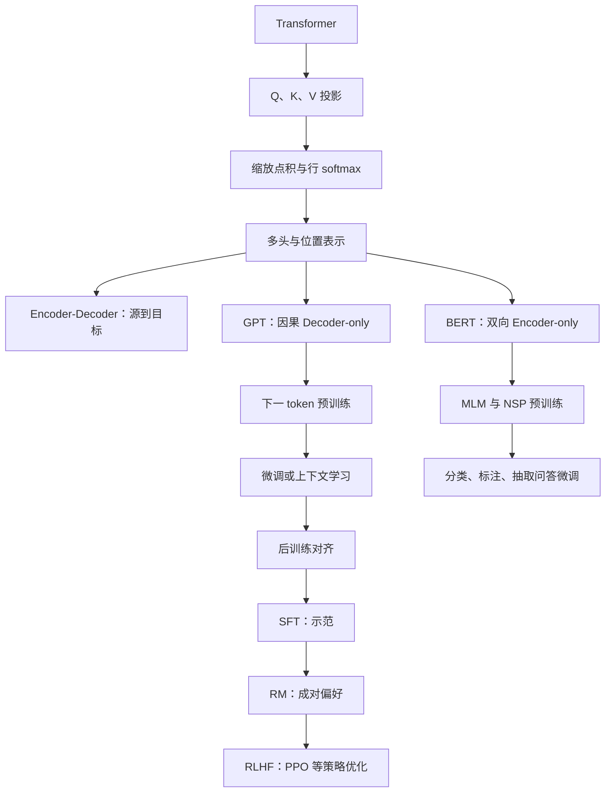

---
tags:
  - 机器学习
  - Transformer
  - 自注意力
  - GPT
  - BERT
  - RLHF
  - PPO
  - 课程笔记
课程: 机器学习与数据挖掘
章节: 第 8 章补充 2 Transformer、GPT 与 BERT
教材:
---

> [!info] 本章定位
> 本篇对应 Lecture 8 的 Supplement 2，是 [[Ch7 神经网络]] 中注意力概念的深入展开，也是 [[Ch8 神经网络的训练与优化]] 在语言模型上的应用。理解材料的四把钥匙：
> 1. **注意力先决定“从谁那里取信息”，再加权组合 Value**；分数、概率权重、输出向量是三个不同对象。
> 2. **模型的信息可见范围由遮罩决定**：GPT 的因果可见范围服务于下一 token 预测，BERT 的双向可见范围服务于上下文表示。
> 3. **预训练、微调、上下文学习有不同的参数更新方式**，不能仅凭“给模型一些示例”判断是否在训练。
> 4. **会续写不等于会遵循指令或偏好**：SFT、奖励模型、RLHF 分别给语言模型增加示范、评价和优化信号。

**材料范围**：林倞《Lec8-Supplement2-Transformer & GPT & BERT.pptx》，全部 35 页，原文件位于 `D:\Documents\Prof_Curriculur\ML\`。页码均指幻灯片序号。

**阅读约定**：课件是本篇主依据；补充的维度、推导、实现细节及自拟例题均明确标注。课件第 19–21、29、34–35 页的模型名称、数据量和性能属于**课件历史语境**，不作为当前产品规格。其不确定数字及概念混用在对应位置说明。基础优化器与 BN / LN 详见主讲笔记。

## 目录

- [[#1. Self-Attention：从词向量到上下文表示|1. Self-Attention：从词向量到上下文表示]]
	- [[#1.1 Query、Key、Value 的含义与维度|1.1 Query、Key、Value 的含义与维度]]
	- [[#1.2 缩放点积注意力的完整计算|1.2 缩放点积注意力的完整计算]]
	- [[#1.3 为什么除以根号维度|1.3 为什么除以根号维度]]
- [[#2. 因果遮罩、多头与位置编码|2. 因果遮罩、多头与位置编码]]
	- [[#2.1 Masked Self-Attention 与未来信息|2.1 Masked Self-Attention 与未来信息]]
	- [[#2.2 Multi-Head Self-Attention|2.2 Multi-Head Self-Attention]]
	- [[#2.3 Position Embedding 与排列等变性|2.3 Position Embedding 与排列等变性]]
- [[#3. 原始 Transformer 的 Encoder-Decoder 结构|3. 原始 Transformer 的 Encoder-Decoder 结构]]
	- [[#3.1 总体数据流与编码器|3.1 总体数据流与编码器]]
	- [[#3.2 解码器与交叉注意力|3.2 解码器与交叉注意力]]
	- [[#3.3 词表输出、训练与生成|3.3 词表输出、训练与生成]]
- [[#4. GPT：自回归预训练与上下文学习|4. GPT：自回归预训练与上下文学习]]
	- [[#4.1 Decoder-only 结构与语言模型目标|4.1 Decoder-only 结构与语言模型目标]]
	- [[#4.2 GPT-1 的预训练与监督微调|4.2 GPT-1 的预训练与监督微调]]
	- [[#4.3 GPT-2、GPT-3 与模型规模对比|4.3 GPT-2、GPT-3 与模型规模对比]]
- [[#5. BERT：双向表示与预训练任务|5. BERT：双向表示与预训练任务]]
	- [[#5.1 Encoder-only 与输入表示|5.1 Encoder-only 与输入表示]]
	- [[#5.2 MLM 与 NSP|5.2 MLM 与 NSP]]
	- [[#5.3 四类下游任务与微调|5.3 四类下游任务与微调]]
	- [[#5.4 GPT 与 BERT 的对比边界|5.4 GPT 与 BERT 的对比边界]]
- [[#6. 从 GPT 到 ChatGPT：后训练对齐|6. 从 GPT 到 ChatGPT：后训练对齐]]
	- [[#6.1 历史脉络与三阶段流程|6.1 历史脉络与三阶段流程]]
	- [[#6.2 指令微调 SFT|6.2 指令微调 SFT]]
	- [[#6.3 奖励模型的成对排序损失|6.3 奖励模型的成对排序损失]]
	- [[#6.4 RLHF、PPO 与优势函数|6.4 RLHF、PPO 与优势函数]]
	- [[#6.5 课件图中的 PPO 与 GRPO|6.5 课件图中的 PPO 与 GRPO]]
- [[#7. 多模态与长思考：课件案例的解释|7. 多模态与长思考：课件案例的解释]]
- [[#8. 例题|8. 例题]]
	- [[#8.1 注意力矩阵维度与权重方向|8.1 注意力矩阵维度与权重方向]]
	- [[#8.2 两个 token 的注意力手算|8.2 两个 token 的注意力手算]]
	- [[#8.3 因果遮罩不能只把分数置零|8.3 因果遮罩不能只把分数置零]]
	- [[#8.4 多头注意力参数量与复杂度|8.4 多头注意力参数量与复杂度]]
	- [[#8.5 没有位置编码的排列等变性|8.5 没有位置编码的排列等变性]]
	- [[#8.6 Encoder-Decoder Attention 的来源与形状|8.6 Encoder-Decoder Attention 的来源与形状]]
	- [[#8.7 GPT 的标签移位与未来泄漏|8.7 GPT 的标签移位与未来泄漏]]
	- [[#8.8 BERT 的输入、MLM 与 NSP|8.8 BERT 的输入、MLM 与 NSP]]
	- [[#8.9 微调与上下文学习辨析|8.9 微调与上下文学习辨析]]
	- [[#8.10 奖励模型损失与评分平移|8.10 奖励模型损失与评分平移]]
	- [[#8.11 PPO 裁剪的正负优势|8.11 PPO 裁剪的正负优势]]
	- [[#8.12 组相对优势与四个模型角色|8.12 组相对优势与四个模型角色]]
- [[#9. 易错点速查|9. 易错点速查]]
- [[#10. 知识点速查|10. 知识点速查]]

---

## 1. Self-Attention：从词向量到上下文表示

### 1.1 Query、Key、Value 的含义与维度

**课件第 3 页。** 通俗理解：每个词拿出三张卡片——Query 表示“我想找什么信息”，Key 表示“我有什么信息可供匹配”，Value 表示“匹配之后实际给出什么内容”。这些含义是理解计算的类比，三个向量并不是预先写好的自然语言标签。

设序列长度为 $T$，每个 token 的模型向量维度为 $d_{\rm model}$，把 token 向量按行组成

$$X\in\mathbb R^{T\times d_{\rm model}}.$$

**严谨定义**：由三个独立可学习的线性投影得到

$$Q=XW_Q,\qquad K=XW_K,\qquad V=XW_V,$$

$$W_Q,W_K\in\mathbb R^{d_{\rm model}\times d_k},\qquad
W_V\in\mathbb R^{d_{\rm model}\times d_v},$$

$$Q,K\in\mathbb R^{T\times d_k},\qquad V\in\mathbb R^{T\times d_v}.$$

本文为简洁省略投影偏置。**Self** 指 $Q,K,V$ 来自同一输入序列，不表示 $Q=K=V$；通常 $W_Q,W_K,W_V$ 不同。token 也不总等于完整单词：实际分词可能产生子词、字符等单位，课件以单词示例便于讲解。

### 1.2 缩放点积注意力的完整计算

**课件第 3–4 页。** 按三步区分中间量：

$$S=\frac{QK^T}{\sqrt{d_k}}\in\mathbb R^{T\times T},$$

$$A_{ij}=\frac{\exp(S_{ij})}{\sum_{k=1}^{T}\exp(S_{ik})},\qquad
A=\operatorname{softmax}_{\rm row}(S),$$

$$Z=AV\in\mathbb R^{T\times d_v},\qquad z_i=\sum_{j=1}^{T}A_{ij}v_j.$$

第 $i$ 行是**第 $i$ 个 Query 对所有 Key 的关注分布**；第 $j$ 列是被读取的第 $j$ 个位置。$A_{ij}\ge0$，每行和为 $1$。不使用注意力 Dropout 时，$z_i$ 是 Value 向量的凸组合。

课件的 “I have a dream” 按 $4$ 个词构成 $4\times4$ 注意力图。$QK^T$ 给出 word-to-word 的**原始分数图**；只有缩放并做行 softmax 以后，才得到概率意义的权重图。原始分数可为负，不要求行和为 $1$，而注意力矩阵通常也不对称

> [!tip] 一句话记住计算顺序
> **Query 与 Key 算相似度 → 每行归一化为权重 → 用权重汇总 Value。** 直接把 $QK^T$ 当输出、把 $K$ 当被加权内容，都会漏掉关键步骤。

### 1.3 为什么除以根号维度

**补充推导**：课件分母写为 $\sqrt d$，这里明确 $d=d_k$，是参与点积的 Query / Key 维度

> [!important]- 缩放因子的近似理由
> 假设 $q$ 与 $k$ 的坐标独立，零均值、单位方差，且彼此独立：
> $$q^Tk=\sum_{r=1}^{d_k}q_rk_r,\qquad \operatorname{Var}(q^Tk)=d_k.$$
> 因而 $q^Tk/\sqrt{d_k}$ 的方差约为 $1$。未经缩放时，维度增加可能使 softmax 输入幅度变大，输出过于尖锐，部分梯度很小。
> 这些独立性和尺度假设是分析近似，不是对训练后投影向量分布的精确断言。

缩放、行 softmax 和后续的多头结构对应 [Transformer 原论文](https://arxiv.org/abs/1706.03762)；本文的维度标注是对课件公式的补充说明。

## 2. 因果遮罩、多头与位置编码

### 2.1 Masked Self-Attention 与未来信息

**课件第 5–6 页。** 通俗理解：下一词预测必须像真实生成一样，不能提前偷看还没有生成的词。训练时整个目标句子虽然已知，也要遮住不应可见的位置。

对下标 $i,j\in\{1,\ldots,T\}$，定义加性因果遮罩

$$M_{ij}=\begin{cases}0,&j\le i,\\-\infty,&j>i.\end{cases}$$

$$A=\operatorname{softmax}_{\rm row}\left(\frac{QK^T}{\sqrt{d_k}}+M\right).$$

![[Ch8-Supplement2-img-causal-mask.png]]

课件示例中：

| Query 位置 | 允许关注的 Key |
|---|---|
| I | I |
| have | I、have |
| a | I、have、a |
| dream | I、have、a、dream |

> [!warning] “遮罩置零”必须说清在哪一步
> 课件说“用 $0$ 覆盖未来区域”，应理解为**未来位置最终注意力权重为 $0$**。在 softmax 前把禁止分数设为 $0$ 并不能禁止关注，因为 $e^0=1$。通常先把这些分数设为 $-\infty$，或用足够大的负数，使 softmax 权重为零。
> 在 softmax 后直接置零但不重新归一化，也会破坏权重行和为 $1$ 的性质。

**补充**：padding mask 用于排除补齐 token；causal mask 用于排除未来 token，二者目的不同。必须保证被计算的位置有至少一个有效 Key，避免整行全部遮住造成未定义的归一化。

### 2.2 Multi-Head Self-Attention

**课件第 7 页。** 通俗理解：一个注意力头提供一种“匹配和读取方式”；多头让模型在多个可学习子空间中同时组织上下文。不能预设某一头一定专门学语法或指代。

设头数为 $h$。标准等宽设置常取 $d_k=d_v=d_{\rm model}/h$，要求可整除。第 $r$ 个头使用独立参数：

$$Q_r=XW_Q^{(r)},\quad K_r=XW_K^{(r)},\quad V_r=XW_V^{(r)},$$

$$Z_r=\operatorname{softmax}_{\rm row}\left(\frac{Q_rK_r^T}{\sqrt{d_k}}+M\right)V_r.$$

然后按特征维拼接并投影：

$$\operatorname{MHA}(X)=\operatorname{Concat}(Z_1,\ldots,Z_h)W_O,$$

$$\operatorname{Concat}(Z_1,\ldots,Z_h)\in\mathbb R^{T\times hd_v},\qquad
W_O\in\mathbb R^{hd_v\times d_{\rm model}}.$$

课件的“先统一投影，再均分成 $h$ 份”是常见实现方式：把各头的矩阵拼成大投影矩阵计算，与分别投影等价。**同一输入做 $h$ 次完全相同、参数也相同的注意力**不会自动产生不同头；每个头须有相应可学习投影。

> [!warning] 多头分母的 $d$ 是每头维度
> 若总宽度为 $512$、头数为 $8$，每头点积维度是 $64$，应除以 $\sqrt{64}$，不能除以 $\sqrt{512}$。课件第 7 页的 $d$ 应按该头的 Query / Key 维度理解。

**补充复杂度**：每头注意力图是 $T\times T$。标准稠密注意力的注意力计算约为 $O(T^2d_{\rm model})$，显式保存所有头权重需要约 $O(hT^2)$ 空间；投影和 FFN 还有额外计算。训练可在序列维并行计算，但长序列的两两交互仍有成本。

### 2.3 Position Embedding 与排列等变性

**课件第 8 页。** 通俗理解：如果只根据内容匹配，“狗咬人”与“人咬狗”的词集合相同，模型还需要知道哪个词在前、哪个在后。

课件采用加法形式：

$$X_{\rm in}=E_{\rm token}+E_{\rm position}\in\mathbb R^{T\times d_{\rm model}}.$$

原始正弦位置编码为

$$\operatorname{PE}(pos,2i)=\sin\left(\frac{pos}{10000^{2i/d_{\rm model}}}\right),$$

$$\operatorname{PE}(pos,2i+1)=\cos\left(\frac{pos}{10000^{2i/d_{\rm model}}}\right).$$

$pos$ 是 token 位置，$i$ 编号一对相邻的偶 / 奇特征维，$d_{\rm model}$ 为向量总维度。不同维度使用不同频率，让位置有多尺度表示；$pos=0$ 时偶数维为 $0$、奇数维为 $1$。

> [!important]- 为什么说无位置信息的双向自注意力排列等变（补充）
> 令 $P$ 为 token 行的排列矩阵，$X'=PX$。共享线性投影给出 $Q'=PQ,K'=PK,V'=PV$，故
> $$S'=PSP^T,\quad A'=PAP^T,\quad Z'=A'V'=PAV=PZ.$$
> 输入重排，输出仅随之重排；内容注意力本身没有获得原始序号。这里是**等变**，不是“所有位置输出都相同”，也不是任何有遮罩模型都保持该性质。

**补充边界**：因果遮罩本身已带有顺序约束；上面的证明针对无位置编码、无改变可见关系的双向注意力。位置编码仍用于明确位置关系。正弦编码是课件所讲的一种方案；BERT 使用可学习绝对位置嵌入，不能把所有 Transformer 的位置机制都写成正弦公式。

## 3. 原始 Transformer 的 Encoder-Decoder 结构

### 3.1 总体数据流与编码器

**课件第 9–13 页。** 原始 Transformer 是 Seq2Seq 的 Encoder-Decoder 模型：编码器读取源序列，解码器根据源信息与已生成目标前缀产生目标序列。课件用法语 “Je suis étudiant” 到英语 “I am a student” 展示此数据流。

![[Ch8-Supplement2-img-transformer.png]]

图中的 $N\times$ 表示堆叠若干层，各层参数通常不同；不是同一层的权重必然重复共享。

每个 Encoder 层包含两类子层：

1. **Multi-Head Self-Attention**：各 token 读取源序列的上下文。
2. **Position-wise Feed Forward Network（FFN）**：对每个位置应用相同的前馈网络。

课件图中每个子层还有 **Add & Norm**。以原始 post-LN 形式补全：

$$U=\operatorname{LN}(X+\operatorname{MHA}(X)),\qquad
H=\operatorname{LN}(U+\operatorname{FFN}(U)).$$

实际训练还可在子层输出加入 Dropout。这里的 residual addition 保留输入路径，LN 沿 token 的特征维归一化；归一化原理见 [[Ch8 神经网络的训练与优化#7.4 Layer Normalization 与 Instance Normalization|主讲笔记第 7.4 节]]。

**补充 FFN 定义**：

$$\operatorname{FFN}(x)=\phi(xW_1+b_1)W_2+b_2,$$

$$W_1\in\mathbb R^{d_{\rm model}\times d_{\rm ff}},\qquad
W_2\in\mathbb R^{d_{\rm ff}\times d_{\rm model}}.$$

原始 Transformer 使用 ReLU；后续模型可改激活与结构。FFN 在位置间共享参数，但逐位置执行；**Attention 混合 token 信息，FFN 变换每个 token 的特征**。现代模型还可能采用 pre-LN，课件的 Add & Norm 位置不能概括全部架构。

### 3.2 解码器与交叉注意力

**课件第 11、14–15 页。** 每个原始 Decoder 层有三个子层：

1. **Masked Multi-Head Self-Attention**：只读取目标序列的可见前缀。
2. **Encoder-Decoder Attention（Cross-Attention）**：用目标端表示查询源端表示。
3. **FFN**：逐位置非线性变换。

每个子层外都有残差与 LN。设编码器最终输出 $H_E\in\mathbb R^{T_s\times d_{\rm model}}$，解码器当前表示 $H_D\in\mathbb R^{T_t\times d_{\rm model}}$，交叉注意力使用

$$Q=H_DW_Q,\qquad K=H_EW_K,\qquad V=H_EW_V.$$

此时 $QK^T\in\mathbb R^{T_t\times T_s}$，不必为方阵。通俗理解：翻译到当前英语词时，Query 来自目标端，Key / Value 提供法语源句中的信息。

![[Ch8-Supplement2-img-encoder-decoder-link.png]]

课件图强调：**编码器最终输出提供给每一层 Decoder 的交叉注意力**，不是第 $i$ 个编码器只与第 $i$ 个解码器一一连接。每层 Decoder 可用自己的投影参数读取同一份源表示。

### 3.3 词表输出、训练与生成

**课件第 16 页。** 对解码器某个位置的隐向量 $h_t\in\mathbb R^{d_{\rm model}}$，输出层为

$$z_t=h_tW_{\rm vocab}+b_{\rm vocab}\in\mathbb R^{|\mathcal V|},\qquad
p_t=\operatorname{softmax}(z_t),$$

$$W_{\rm vocab}\in\mathbb R^{d_{\rm model}\times|\mathcal V|}.$$

$\mathcal V$ 为词表。课件举词表大小 $10000$，因此 logits 和概率向量各有 $10000$ 维，每一维对应一个 token。**线性投影到词表维度不必总是“升维”**，取决于词表大小和模型宽度。

课件使用取最大概率的贪心解码 $\hat y_t=\arg\max_vp_t(v)$。补充：采样、beam search 等是其他生成策略，输出 softmax 本身不强制取 argmax。

**补充训练区别**：训练时用正确目标序列右移后的前缀作为 Decoder 输入（teacher forcing），在因果遮罩下并行计算各位置的下一 token 损失；生成时目标未来未知，必须逐步把已生成 token 放回前缀。**训练的序列并行不等于生成的所有未来 token 可以同时得到。**

## 4. GPT：自回归预训练与上下文学习

### 4.1 Decoder-only 结构与语言模型目标

**课件第 17 页。** 通俗理解：如果目标是续写一段文本，就没有另一个独立的源句必须先编码；模型直接读可见前缀并猜下一个 token。

GPT 使用因果 Transformer 块：**Masked Self-Attention + FFN + 残差 + LN**。它去掉原始 Transformer 的 Encoder，也去掉 Decoder 的 Encoder-Decoder Attention。所以 “GPT 用 Decoder” 指保留其因果自注意力思路，不是完整搬来原始三子层 Decoder。

**补充形式化目标**：

$$p_\theta(x_1,\ldots,x_T)=\prod_{t=1}^{T}p_\theta(x_t\mid x_{<t}),$$

$$\mathcal L_{\rm LM}(\theta)=-\sum_{t=1}^{T}\log p_\theta(x_t\mid x_{<t}).$$

在实现中，输入位置 $t$ 可以看到 $x_{\le t}$，该位置输出用于预测 $x_{t+1}$；与公式“预测 $x_t$ 只看 $x_{<t}$”只是下标移位，不冲突。

课件称之为“无监督预训练”；更精确地说是**自监督**：标签由文本本身的下一 token 构造，不需要人工逐条标注。概率损失与 [[Ch3 线性分类器（Linear Classifiers）]] 的多分类交叉熵一致，只是分类器输入变为上下文表示。

### 4.2 GPT-1 的预训练与监督微调

**课件第 18 页。** 两阶段策略：大规模无人工标签文本上训练语言模型 → 在有标签下游数据上监督微调。预训练提供通用表示和语言知识，微调将参数适配具体任务。

![[Ch8-Supplement2-img-gpt-task-inputs.png]]

课件图中的任务输入转换都值得区分：

| 任务 | 输入组织方式 | 预测位置 / 输出 |
|---|---|---|
| 分类 | Start + Text + Extract | 根据提取位置表示分类 |
| 蕴含判断 | Start + Premise + Delim + Hypothesis + Extract | 判断前提与假设的关系 |
| 相似度 | 两种句子顺序分别编码，再合并表示 | 降低仅由输入次序造成的不对称 |
| 多项选择 | 每个候选组织为 Context + Question + Answer | 比较不同候选对应得分 |

这些是原始 GPT-1 下游微调的输入转换，不能直接当作后来所有 GPT 的固定提示模板。具体任务可增加输出头，监督训练会更新参数。[GPT-1 作者代码与论文入口](https://github.com/openai/finetune-transformer-lm)

### 4.3 GPT-2、GPT-3 与模型规模对比

**课件第 19–21 页。** 核心变化包括增大网络与语料、减少对每个任务独立微调的依赖，以及把任务描述 / 示例放进上下文。

| 模型 / 年份 | 课件对比的代表配置 | 课件强调的训练 / 使用方式 |
|---|---|---|
| GPT-1，2018 | 约 $117$ M；$12$ 层、$12$ 头 | 语言模型预训练 + 下游监督微调 |
| GPT-2，2019 | 最大版本约 $1.5$ B；$48$ 层、$1600$ 维、$50257$ 词表；上下文 $1024$ | 更大自回归模型，强调零样本任务迁移 |
| GPT-3，2020 | 最大版本 $175$ B；$96$ 层、$96$ 头、$12288$ 维；上下文 $2048$ | zero-shot、one-shot、few-shot 上下文学习 |
| ChatGPT，2022 | 产品名称，不对应唯一固定参数量 | 面向对话、指令与偏好的后训练 |

**GPT-2 的结构细节**：课件图说明将 LN 移到子块输入处、在最终 self-attention 块之后补充 LN、按深度缩放部分残差路径权重，并增大宽度、词表和上下文。图中 $1/\sqrt N$ 的 $N$ 指相关残差层数，不应只凭该图猜测每个权重张量的具体初始化实现。[GPT-2 作者项目](https://github.com/openai/gpt-2)

**GPT-3 的重点**：最大版本约为 GPT-2 最大版本参数量的 $175/1.5\approx117$ 倍。课件强调它在上下文中看到任务描述与示例后完成任务，**该评估过程不进行梯度更新**。[GPT-3 原论文](https://arxiv.org/abs/2005.14165)

| 术语 | 是否在上下文给已完成示例 | 当前任务是否更新模型参数 |
|---|---|---|
| zero-shot | 无，可以有任务描述 | 否 |
| one-shot | 一个 | 否 |
| few-shot / in-context learning | 少量 | 否 |
| fine-tuning | 用训练数据拟合，可成批使用示例 | 是 |

> [!warning] 课件中的规模、语料与多任务表述
> 第 20 页列出 GPT-1 约 $5$ GB、GPT-2 $40$ G、GPT-3 $45$ TB，ChatGPT 则带“千亿级？百 T 级？”问号。这里保留课件的比较信息，但不同数字可能对应原始抓取量、过滤后数据量或不同统计口径，**不能直接当作统一口径的训练 token 数**；ChatGPT 的问号不是确认事实，笔记不猜写参数量。
> 第 19 页把 GPT-2 描述成“每个任务的损失都收敛”的共享参数训练，容易与显式监督多任务学习混淆。该课件要说明的主线是：通用下一 token 目标可从文本格式中获得多种任务行为，不要求预先为每个任务定义独立标签和损失。
> “GPT-2 / GPT-3 没有微调”应限定为课件强调的零 / 少样本使用方式，不能理解为这些模型在原则上禁止微调。

## 5. BERT：双向表示与预训练任务

### 5.1 Encoder-only 与输入表示

**课件第 22–24 页。** 通俗理解：BERT 更像一个把句子“读懂并编码”的模型，各位置可结合左侧和右侧上下文，形成用于分类、标注等任务的表示。

BERT 堆叠 Transformer Encoder 块，通常使用双向自注意力，没有用于标准自回归生成的因果遮罩。仍须排除 padding 等无效位置。

![[Ch8-Supplement2-img-bert-input.png]]

课件的输入由三部分相加：

$$e_i=e_i^{\rm token}+e_i^{\rm segment}+e_i^{\rm position}.$$

| 嵌入 | 作用 | 关键限定 |
|---|---|---|
| Token Embedding | 表示 token 内容 | tokenizer 的 token 不一定是完整单词 |
| Segment Embedding | 标识属于句子 A 还是 B | 是句段身份，不是 token 的位置 |
| Position Embedding | 表示序列位置 | 原始 BERT 使用可学习位置嵌入 |

课件以 $768$ 维说明 BERT，适用于 **BERT-base**；原始 BERT-large 使用 $1024$ 维。这是模型配置差异，不能说所有 BERT 都固定 $768$ 维。

**补充特殊 token**：句对输入可组织为 `[CLS] A [SEP] B [SEP]`。`[CLS]` 的最终表示常用于序列级分类；`[SEP]` 标记边界。特殊 token 同样有相应嵌入，并进入模型计算。

### 5.2 MLM 与 NSP

**课件第 25 页。** 普通双向编码器若直接在原位置预测可见的原词，会出现“答案已经放在输入里”的问题，所以需要破坏部分输入，再预测原 token。

**Masked Language Model（MLM）**：设被选中预测的位置集合为 $\mathcal M$，损坏后的输入为 $\tilde x$，补充形式化目标为

$$\mathcal L_{\rm MLM}=-\sum_{i\in\mathcal M}\log p_\theta(x_i\mid\tilde x).$$

通俗理解是完形填空；预测位置可结合左右上下文。损失针对被选中位置的原 token，不是要求每个未选中位置也贡献 MLM 损失。

**补充原始 BERT 的采样规则**：随机选约 $15\%$ 的 token 作为预测目标；这些被选中的 token 中，$80\%$ 换成 `[MASK]`，$10\%$ 换成随机 token，$10\%$ 保持原 token。保持原词的位置仍是预测目标。该细节用于减轻预训练与微调时输入形式不一致的问题。[BERT 原论文](https://arxiv.org/abs/1810.04805)

**Next Sentence Prediction（NSP）**：对句子对 $(A,B)$ 判断 B 是否是语料中 A 的实际后续句，标签为 `IsNext` 或 `NotNext`，使用二分类损失。原始方案一部分使用真实后续句，另一部分使用随机句。

> [!warning] NSP 不是任意语义关系判断
> “B 与 A 内容相关”“B 回答了 A 的问题”不自动等于 `IsNext`。预训练标签依赖语料中的后续关系；句对相似、蕴含、问答匹配则属于不同下游任务。NSP 是原始 BERT 的任务，也不是所有后续编码器模型都必需保留的任务。

### 5.3 四类下游任务与微调

**课件第 23、26 页。** 先用大量无人工标签语料做预训练，再用特定任务的带标签数据微调。不同任务主要改变输入组织和输出头，通常可同时更新 BERT 主体参数。

| 课件任务 | 输入与预测单位 | 输出头的补充形式 |
|---|---|---|
| 句对分类 | 两句话；相似度、蕴含或问题与候选答案关系 | `[CLS]` 表示接分类头 |
| 单句分类 | 一句话；情感、可接受性等 | `[CLS]` 表示接分类头 |
| 文本问答 | 问题 + 含答案的上下文 | 对上下文位置预测 start / end |
| 单句标注 | 每个 token 的实体、词性等标签 | 每个 token 表示接共享分类头 |

**补充问答公式**：若 $H\in\mathbb R^{T\times d}$，可定义 $p_{\rm start}=\operatorname{softmax}(Hw_s)$、$p_{\rm end}=\operatorname{softmax}(Hw_e)$，$w_s,w_e\in\mathbb R^d$。训练用正确起止位置的交叉熵；预测需限制答案位于上下文中且起点不晚于终点。它是**抽取式问答**，答案来自原文跨度，不等于任意自由生成回答。

### 5.4 GPT 与 BERT 的对比边界

**课件第 27 页。**

![[Ch8-Supplement2-img-gpt-bert.png]]

| 维度 | 课件中的 GPT | 原始 BERT |
|---|---|---|
| 主体 | Decoder-only 因果 Transformer | Encoder-only 双向 Transformer |
| 可见上下文 | 当前前缀；未来位置被遮住 | 未被损坏的左右上下文 |
| 预训练目标 | 下一 token 预测 | MLM + NSP |
| 主要输出形式 | 逐步扩展文本 | 序列 / token 的上下文表示 |
| 典型下游 | 生成、续写，也能分类等 | 分类、标注、抽取问答等 |
| 参数适配 | 微调或上下文学习等 | 常用任务微调或特征提取 |

> [!warning] “BERT 舍弃生成、换来更强理解”是教学概括
> 原始 BERT 没有标准 GPT 式的左到右生成机制，但 MLM 本身能预测被遮住的 token；不能说它“完全不能预测文字”。GPT 同样可以完成许多理解和分类任务，BERT 也不在任何任务上都必然更强。应从可见范围、训练目标和任务适配判断，而非把“理解”和“生成”划成互斥能力。

## 6. 从 GPT 到 ChatGPT：后训练对齐

### 6.1 历史脉络与三阶段流程

**课件第 28–30 页。** 通俗理解：预训练主要让模型掌握文本的规律，但互联网中的“常见下一句话”不一定就是用户想要的答案。后训练继续改变模型参数，使它更会遵循指令、组织回答和符合人类偏好。

课件的历史脉络是 GPT-1（2018）→ GPT-2（2019）→ GPT-3（2020）→ GPT-3.5 与 ChatGPT（2022）→ GPT-4（2023）→ o1 系列（2024）。这是背景，不是截至笔记编写日的全部模型清单。

> [!info] 历史材料的范围限定
> 课件把 GPT-3.5 标到 `2022.2`；这是课件的时间标注，此处不把它当作整个 GPT-3.5 系列的统一公开发布日期。第 20 页对 ChatGPT 参数量和语料量带问号，故只记录“不确定”，不填入推测数字。产品名称、模型版本、论文实验模型需区分。

三阶段对齐流程：

![[Ch8-Supplement2-img-rlhf.png]]

1. **SFT**：收集提示与人工示范回答，用监督学习训练策略。
2. **Reward Model（RM）**：给同一提示生成多个回答，让标注者排序，训练奖励模型。
3. **RLHF**：使用奖励模型提供的信号，通过 PPO 等算法继续优化语言模型策略。

课件图与经典 InstructGPT 的三阶段流程对应。该流程是本课件所讲的一条重要路径，不代表后来所有产品都采用完全相同的后训练算法。[InstructGPT 原论文](https://arxiv.org/abs/2203.02155)

### 6.2 指令微调 SFT

**课件第 31 页。** 构建高质量“指令 / 提示 → 回答”数据集：抽取问题，由标注人员撰写符合意图的答案，再对语言模型做监督微调。

**补充形式化**：提示为 $x$，示范回答为 $y=(y_1,\ldots,y_T)$，则

$$\mathcal L_{\rm SFT}(\theta)=-\mathbb E_{(x,y)\sim\mathcal D_{\rm SFT}}
\left[\sum_{t=1}^{T}\log\pi_\theta(y_t\mid x,y_{<t})\right].$$

$\pi_\theta$ 是作为策略使用的自回归语言模型。训练方式仍是 token 交叉熵与反向传播；与基础预训练的差异主要是**数据内容、输入输出组织和损失覆盖范围**，并非换成一种完全不同的神经网络。这里把损失写在回答 token 上，是常见目标约定。

课件强调 SFT 的改进与局限：更会遵循指令、对话质量提高，但输出仍不一定符合人类偏好；同一个问题可能有多个合理回答，单个示范也不能完整表达所有质量差异。

### 6.3 奖励模型的成对排序损失

**课件第 32 页。** 通俗理解：SFT 教“照着好答案写”，RM 教“两个答案哪个更好”。奖励模型不是人工打分规则的硬编码，而是从比较数据学习评分函数。

对于同一提示 $x$，采样 $K$ 个回答，标注者排序；可转成最多 $\binom K2$ 个成对比较。$y_w$ 为较受偏好的回答，$y_l$ 为较不受偏好的回答，$r_\phi(x,y)\in\mathbb R$ 是标量评分。

令 $\Delta r=r_\phi(x,y_w)-r_\phi(x,y_l)$，模型化的偏好概率为

$$P_\phi(y_w\succ y_l\mid x)=\sigma(\Delta r),\qquad
\sigma(z)=\frac1{1+e^{-z}}.$$

基本成对损失为

$$\mathcal L_{\rm RM}(\phi)=-\mathbb E_{(x,y_w,y_l)\sim\mathcal D_{\rm pair}}
\log\sigma\big(r_\phi(x,y_w)-r_\phi(x,y_l)\big).$$

**补充展开课件的归一化系数**：若每条数据记录保存完整的 $K$ 个回答排序，可在一条记录内部写成

$$\mathcal L_{\rm RM}=-\mathbb E_{(x,\mathrm{ranking})}
\left[\frac1{\binom K2}\sum_{(w,l)\in\mathcal P(x)}\log\sigma(\Delta r_{wl})\right].$$

$\mathcal P(x)$ 是该提示的比较对集合。若 $\mathcal D_{\rm pair}$ 已是归一化抽样的比较对数据集，则上一个期望已经表达平均，不必再机械地除一次配对数。课件沿用 $1/\binom K2$ 的符号，理解时必须明确期望针对单对还是整组。

> [!important]- 损失为何鼓励好答案得高分（补充推导）
> 单对损失 $\ell(\Delta r)=-\log\sigma(\Delta r)=\log(1+e^{-\Delta r})$。
> $$\frac{d\ell}{d\Delta r}=\sigma(\Delta r)-1<0.$$
> 因此增大“好回答分数减坏回答分数”会降低损失。初始差为 $0$ 时损失为 $\log2$；差越大，损失越接近 $0$。

> [!warning] 课件第 32 页左侧的 `log(θ)` 应辨为损失记号错误
> 公式是对评分差的负对数似然，应记作 $\mathcal L_{\rm RM}(\phi)$ 或 `loss(φ)`，不是“参数本身的对数”。模型只根据评分差学习比较；给全部评分加同一个常数不会改变成对损失。

RM 分数表达学到的偏好，不自动等于事实正确概率，也不保证泛化到所有提示。它在 RL 阶段通常固定为评价者，不能与正在更新的生成策略混为一谈。

### 6.4 RLHF、PPO 与优势函数

**课件第 33 页。** 通俗理解：模型自己生成回答，评价者给出分数，再让策略提高更好回答的出现概率。PPO 避免仅凭一批奖励把策略更新得过于激进。

**补充语言生成的强化学习对应**：

| 强化学习对象 | 语言模型中的对应 |
|---|---|
| 状态 $s_t$ | 提示 $q$ 与已生成前缀 $o_{<t}$ |
| 动作 $a_t$ | 当前生成的 token $o_t$ |
| 策略 $\pi_\theta(a_t\mid s_t)$ | 模型下一 token 的概率分布 |
| 奖励 | 奖励模型评分，及可能的其他约束项 |
| 回合 | 生成一个回答直到结束 |
| 价值函数 $V_\psi(s_t)$ | 从当前前缀出发的期望回报估计 |

课件的操作步骤为：旧策略采样经验 → 价值模型与 GAE 估计优势 → 构造概率比乘优势的目标并裁剪 → 更新策略 → 重新采样迭代。

**优势 $\hat A_t$ 的直觉**：当前动作的回报相比状态的基线“好多少”。正优势表示这次动作比基线好，应鼓励其概率增加；负优势表示较差，应减少其概率。

**补充 GAE 定义**：对一步残差

$$\delta_t=r_t+\gamma_{\rm RL}V_\psi(s_{t+1})-V_\psi(s_t),$$

$$\hat A_t^{\rm GAE}=\sum_{l=0}^{L_t-1}(\gamma_{\rm RL}\lambda_{\rm GAE})^l\delta_{t+l}.$$

$\gamma_{\rm RL}$ 是回报折扣因子，$\lambda_{\rm GAE}$ 控制偏差与方差的折中，$L_t$ 为剩余轨迹长度；终止后的价值通常取零。这里使用带下标的 $\gamma_{\rm RL}$，避免与 LN 的仿射参数 $\gamma$ 混淆。策略更新中通常把已估计优势作为固定训练信号。

定义新旧策略对采样 token 的概率比：

$$\varrho_t(\theta)=\frac{\pi_\theta(o_t\mid q,o_{<t})}
{\pi_{\theta_{\rm old}}(o_t\mid q,o_{<t})}.$$

课件 PPO 裁剪目标可规范为

$$\boxed{J_{\rm clip}(\theta)=\mathbb E_{q,o\sim\pi_{\rm old}}
\left[\frac1{|o|}\sum_{t=1}^{|o|}
\min\left(\varrho_t\hat A_t,
\operatorname{clip}(\varrho_t,1-\epsilon,1+\epsilon)\hat A_t\right)\right]}.$$

其中提示 $q$ 来自提示分布，回答 $o$ 来自旧策略；$|o|$ 是回答 token 数，$\epsilon$ 是裁剪幅度。此处 **最大化** $J_{\rm clip}$；若优化器统一最小化损失，则用 $-J_{\rm clip}$。

> [!important]- `min` 如何区分正负优势（补充推导）
> 若 $\hat A_t>0$，过度提高概率比会被截断在 $1+\epsilon$，不继续获得更高目标；但概率下降过多仍会恶化目标。
> 若 $\hat A_t<0$，过度降低概率比会被截断在 $1-\epsilon$，不继续获得更高目标；而提高坏动作概率仍会受到惩罚。
> `min` 选择保守的收益估计。裁剪发生在目标函数中，**不是把策略概率直接改写为裁剪值，也不是硬性保证最终概率比一定落在区间内**。

**补充图中 KL 的含义**：经典 RLHF 常约束策略不要远离固定参考模型，例如在回报中加入对 $\pi_{\rm ref}$ 的 KL 惩罚。参考模型与采样用的旧策略不同：前者提供长期锚点，后者提供本批采样分布和概率比分母。课件展示的裁剪式不包含完整训练所需的全部价值损失或其他正则项，不能把它当作所有 PPO 实现的完整总损失。

### 6.5 课件图中的 PPO 与 GRPO

课件第 33 页附图同时画了 PPO 与 **GRPO（Group Relative Policy Optimization）**；正文主要讲 PPO，图中差别也需读懂。

![[Ch8-Supplement2-img-ppo-grpo.png]]

| 角色 / 步骤 | 图中 PPO | 图中 GRPO |
|---|---|---|
| 策略模型 | 生成回答并接受更新 | 对同一提示生成一组回答并接受更新 |
| 参考模型 | 提供 KL 锚点 | 同样提供 KL 锚点 |
| 奖励模型 / 评分 | 评价生成结果 | 评价组内每个结果 |
| 优势来源 | 价值模型 + GAE | 同提示一组回答的相对奖励 |
| 独立价值模型 | 图中需要 | 用组内基线替代 |

**补充最小公式**：对同一提示采样 $G$ 个回答，评分为 $r_1,\ldots,r_G$，一种 outcome reward 约定使用

$$\hat A_i=\frac{r_i-\bar r}{\operatorname{std}(r_1,\ldots,r_G)+\delta},\qquad
\bar r=\frac1G\sum_{j=1}^{G}r_j.$$

$\delta$ 为数值稳定项。它反映“在这一组回答中相对较好还是较差”，并非跨提示统一的绝对质量。图的核心是用组内奖励基线替代单独的价值函数近似；GRPO 的完整目标及其他奖励约定超出课件正文范围。[DeepSeekMath 原论文](https://arxiv.org/abs/2402.03300)

## 7. 多模态与长思考：课件案例的解释

**课件第 34–35 页。** 这两页提供模型能力的历史案例，而不是给出新的 Transformer 公式。

**多模态案例**：课件第 34 页展示模型接收含视频附件的任务截图，以及数学、编程和科学问答的测试结果图。截图体现的是“根据多种形式的信息完成文本任务”的应用方向；仅凭截图不能判断视频如何编码、是否取帧，也不能认定某个具体 API 支持直接输入任意视频。

> [!warning] GPT-4o 与 o 系列不能按字母相似混为一类
> 课件把这一节称为 “GPT-O 系列”，容易混合 GPT-4o 与 o1。官方文档中 GPT-4o 的 `o` 指 **omni**，而 o1 属于强调复杂推理、通过强化学习训练的 o 系列。多模态能力与推理训练是两个不同维度；不能仅凭这两页推出它们共享相同内部架构。[GPT-4o 官方文档](https://developers.openai.com/api/docs/models/gpt-4o)、[o1 官方文档](https://developers.openai.com/api/docs/models/o1)

![[Ch8-Supplement2-img-o1-benchmark.png]]

课件图中读到的历史数值如下，**各行指标不能互相混算**：

| 课件图的任务 / 指标 | GPT-4o | o1-preview | o1 | 其他对照 |
|---|---:|---:|---:|---:|
| AIME 2024，准确率（%） | 13.4 | 56.7 | 83.3 | — |
| Codeforces，百分位 | 11.0 | 62.0 | 89.0 | — |
| GPQA Diamond，准确率（%） | 56.1 | 78.3 | 78.0 | expert human：69.7 |

这些数字只是该图特定评测设置下的报告；不能写成“所有数学题正确率 $83.3\%$”，不能把 Codeforces 百分位当准确率，也不能据此声称模型在一切情形都优于专家。GPQA 图中 o1 与 o1-preview 的大小关系也并非单调上升。

**长思考案例**：第 35 页用一个密码解码示例展示等待后给出多步骤解释的输出，最后得到关于 “strawberry 中有三个 r” 的文本。它用于说明复杂任务可能使用更多推理计算、分解与核验；截图显示的步骤不是对模型内部全部计算的直接观测，也不能视为正确性的保证。

**补充区分**：训练阶段通过数据与奖励改变参数；推理阶段投入更多计算仍可在固定参数下生成答案。更长输出并不自动更正确，“多花推理计算”与“把网络参数再训练一遍”不是同一件事。

## 8. 例题

以下 **12 道均为自拟例题**，重点检查维度、信息可见范围、目标函数和模型角色。

### 8.1 注意力矩阵维度与权重方向

输入含 $5$ 个 token，每个向量 $12$ 维；单头 $d_k=4,d_v=6$。求 $W_Q,W_K,W_V,Q,K,V,S,A,Z$ 的形状。$A_{2,4}$ 表示什么？为何 $A$ 不一定对称？

> [!example]- 解析
> $W_Q,W_K$ 为 $12\times4$，$W_V$ 为 $12\times6$；$Q,K$ 为 $5\times4$，$V$ 为 $5\times6$。
> $S=QK^T/\sqrt4$ 与 $A$ 均为 $5\times5$；$Z=AV$ 为 $5\times6$。
> $A_{2,4}$ 是第 $2$ 个 token 查询时赋予第 $4$ 个 token 的权重，参与 $z_2$ 对 $v_4$ 的加权。
> $Q,K$ 投影通常不同，且 softmax 分母依赖各行，所以 $A_{2,4}$ 与 $A_{4,2}$ 不必相等。权重矩阵的对称性不是自注意力定义的一部分。

### 8.2 两个 token 的注意力手算

给定 $Q=K=I_2$，$V=\begin{pmatrix}1&0\\0&2\end{pmatrix}$，$d_k=2$，无遮罩。计算第一个 token 的注意力权重和输出；加入因果遮罩后又如何？

> [!example]- 解析
> 第一行分数是 $(1/\sqrt2,0)$，令 $a=e^{1/\sqrt2}/(e^{1/\sqrt2}+1)\approx0.669762$。
> 权重为 $(a,1-a)$，输出 $z_1=a(1,0)+(1-a)(0,2)=(a,2(1-a))\approx(0.669762,0.660477)$。
> 加因果遮罩后，第一行第二个 Key 被禁止，分数为 $(1/\sqrt2,-\infty)$，权重变为 $(1,0)$，输出为 $(1,0)$。
> 注意力输出维度由 Value 决定，不是由权重图的宽度决定。

### 8.3 因果遮罩不能只把分数置零

某 Query 的两项原始分数是 $(2,5)$，第二项为未来位置。如果在 softmax 前把第二项改成 $0$，是否成功遮罩？若先 softmax 再把第二项清零会怎样？

> [!example]- 解析
> 改成 $(2,0)$ 后，权重为 $(e^2/(e^2+1),1/(e^2+1))\approx(0.880797,0.119203)$，未来信息仍占约 $11.9\%$。
> 应改为 $(2,-\infty)$，得到 $(1,0)$。
> 若先对 $(2,5)$ 做 softmax，再把未来权重置零，剩余第一项约为 $0.047426$，行和不再为 $1$，输出尺度也被改变。必须对允许位置重新归一化，或在 softmax 前使用加性遮罩。

### 8.4 多头注意力参数量与复杂度

$d_{\rm model}=12$，$h=3$，每头 $d_k=d_v=4$，忽略偏置。Q/K/V 投影加输出投影共多少参数？它是否是同宽单头的三倍？$T=10$ 时共保存多少注意力权重标量？

> [!example]- 解析
> 每种 Q/K/V 投影合计为 $3\times12\times4=144$ 个参数；三种合计 $432$。
> 拼接宽度 $hd_v=12$，输出投影为 $12\times12=144$，总计 $576=4\times12^2$。
> 在保持总宽度的等宽设置下，同宽单头也可为 $576$，不是直接乘以头数。多头分割的是每头宽度。
> 每头权重图 $10\times10$，三头合计 $300$ 个标量。序列长度翻倍为 $20$ 时变为 $1200$，增加至四倍；若实现不显式保存完整权重，实际内存组织可不同。

### 8.5 没有位置编码的排列等变性

无位置编码、无因果遮罩的自注意力网络，把输入从 $(x_1,x_2,x_3)$ 重排为 $(x_3,x_1,x_2)$。输出是否必然完全不变？若最后对 token 输出做求和池化呢？

> [!example]- 解析
> token 级输出会按相同顺序重排，为 $(z_3,z_1,z_2)$，这是排列等变，不是逐位置完全不变。
> 若最后做求和或平均池化，重排不会改变聚合结果，此时序列级结果可以排列不变。
> 若引入与位置绑定的编码或改变可见关系的遮罩，证明条件不再满足。因此不能用这个结论断言因果模型完全没有顺序信息。

### 8.6 Encoder-Decoder Attention 的来源与形状

源序列有 $7$ 个 token，目标端有 $4$ 个可计算位置，$d_k=8,d_v=6$。交叉注意力的 Q/K/V 分别来自哪里，权重图与输出是什么形状？是否应禁止 Query 读取源句中“靠后”的词？

> [!example]- 解析
> $Q$ 来自目标端当前层表示，形状 $4\times8$；$K$ 来自编码器输出，形状 $7\times8$；$V$ 也来自编码器输出，形状 $7\times6$。
> 权重为 $4\times7$，输出为 $4\times6$。
> 标准离线翻译在生成前已获得完整源句，不按目标位置对源句施加同样的因果三角遮罩；仍需排除源 padding。目标端自注意力才负责不看未来目标 token。流式翻译可能另有可见范围约束，不属于这里的标准设定。

### 8.7 GPT 的标签移位与未来泄漏

训练序列为 `[BOS], I, have, a, dream, [EOS]`。列出输入与下一 token 标签。既然因果遮罩允许看见当前位置，是否已经看到了标签？若误去掉遮罩会怎样？

> [!example]- 解析
> 输入可取 `[BOS], I, have, a, dream`，标签对应为 `I, have, a, dream, [EOS]`。
> 第 $t$ 个输入位置用于预测第 $t+1$ 个 token，因此能看输入当前位置不等于看到了自己的标签。
> 若去掉遮罩，输入中靠后位置包含许多前面位置的正确答案，训练可能利用这种捷径，评估损失显得很好，但真实生成时未来不存在，形成训练生成不一致。
> 训练可以一次矩阵计算各位置损失；生成仍需逐步扩展前缀。

### 8.8 BERT 的输入、MLM 与 NSP

句对输入为 `[CLS] A1 A2 [SEP] B1 B2 [SEP]`。说明 segment 与 position 的差别。一个含 $200$ 个普通 token 的样本，按原始 BERT 的 $15\%$ 和 $80/10/10$ 规则，预期有多少预测目标、`[MASK]`、随机替换和保持原词位置？B 与 A 相似是否一定是 NSP 正例？

> [!example]- 解析
> segment 表示 A / B 句段身份；position 表示每个位置的序号。句段内不同 token 可共享 segment 嵌入，但不能共享同一个位置编号。特殊 token 的具体句段归属按输入约定处理。
> 预测目标预期为 $200\times0.15=30$；其中 $24$ 个换成 `[MASK]`，$3$ 个随机替换，$3$ 个保持原词。三类都算预测目标，并非只有 `[MASK]` 位置参与损失。
> NSP 正例需是语料中的真实后续句，语义相似不足以确定标签。以上是期望数量，具体抽样结果不必每次都精确相同。

### 8.9 微调与上下文学习辨析

方法 A 给模型输入三条“句子 → 情感标签”示例，然后预测新句子，模型权重保持不变。方法 B 用这些示例计算交叉熵并执行优化器更新。哪一个是 few-shot 上下文学习，哪一个是微调？A 能否证明模型完全没有从数据中学习？

> [!example]- 解析
> A 是 few-shot / in-context learning；示例是当前输入的一部分，没有梯度更新。B 是监督微调，训练改变参数。
> A 的“学习”是上下文中的任务适配，不等于训练参数学习。它能够利用示例的能力本身来自已有训练，不能据此说模型从未从数据学习。
> 再次调用时若没有保留这些示例，不能假设 A 已永久记住了本次映射。也不能把提示中的示例数直接当作参数微调的样本量。

### 8.10 奖励模型损失与评分平移

同一提示的好坏回答评分分别为 $2$ 和 $0$。求偏好概率与单对损失；若全部评分加 $100$ 会改变结果吗？若有 $4$ 个已排序回答，最多能形成多少对？

> [!example]- 解析
> 分差 $\Delta r=2$，概率 $\sigma(2)\approx0.880797$，损失 $-\log\sigma(2)=\log(1+e^{-2})\approx0.126928$。
> 加 $100$ 后分差仍为 $102-100=2$，概率与损失完全不变。这说明成对损失不辨识统一加性常数，也不自动确定分数的绝对零点。
> $4$ 个回答可组成 $\binom42=6$ 对；它们共享相同回答，不应误认为六对完全独立。把 $\Delta r$ 换成 $-2$，损失约为 $2.126928$，好坏排序反转会受到更大惩罚。

### 8.11 PPO 裁剪的正负优势

裁剪幅度 $\epsilon=0.2$。分别计算四种情形的单项目标：$(\varrho,A)=(1.5,2),(0.5,2),(0.5,-2),(1.5,-2)$。为什么裁剪不能理解为“所有更新后概率比都在 $[0.8,1.2]$”？

> [!example]- 解析
> $A=2,\varrho=1.5$：$\min(3,2.4)=2.4$，好动作概率增加过多不再加分。
> $A=2,\varrho=0.5$：$\min(1,1.6)=1$，好动作概率下降仍损害目标。
> $A=-2,\varrho=0.5$：$\min(-1,-1.6)=-1.6$，坏动作概率过度降低的收益被截断。
> $A=-2,\varrho=1.5$：$\min(-3,-2.4)=-3$，坏动作概率提高仍受惩罚。
> 裁剪改变目标函数的激励范围，并没有对模型参数施加使全部概率比都落区间的硬约束；多个样本共享参数，更新还可能同时影响其他 token。

### 8.12 组相对优势与四个模型角色

同一提示的三个回答评分为 $(1,2,3)$，用总体标准差做组内标准化，忽略稳定项，求相对优势。随后说明策略、参考、奖励、价值模型的职责。若奖励全部一样，相对优势提供什么信号？

> [!example]- 解析
> 均值 $2$，方差 $(1+0+1)/3=2/3$，标准差 $\sqrt{2/3}$，优势为 $(-\sqrt{3/2},0,\sqrt{3/2})$，约 $(-1.224745,0,1.224745)$。
> 策略模型决定 token 分布并更新；参考模型提供偏离程度的锚点；奖励模型评价回答；PPO 的价值模型估计状态回报并用于优势计算。采样期间固定的旧策略与固定参考模型也需区分。
> 若所有评分相同，组内没有相对质量差异；稳定项避免零分母，但归一化优势仍为零，不能凭空制造奖励差异。图中 GRPO 用组内基线替代独立价值模型，不意味着它不需要评分或策略更新。

## 9. 易错点速查

| 易错点 | 正确理解 |
|---|---|
| Self-Attention 的 Q/K/V 相同 | 来源序列相同，投影参数通常不同 |
| $QK^T$ 就是概率权重 | 它是分数；还要缩放和行 softmax |
| $A_{ij}$ 表示第 $j$ 个词读取第 $i$ 个词 | 按本文行约定，是 Query $i$ 读取 Value $j$ |
| 注意力图一定对称 | 投影和行归一化都可能导致不对称 |
| 分母取 Value 维度或总宽度 | 取实际点积的每头 Query / Key 维度的平方根 |
| 未来分数设为 $0$ 就被禁止 | softmax 前通常用 $-\infty$；未来最终权重才是 $0$ |
| causal mask 与 padding mask 相同 | 前者防未来泄漏，后者排除无效补齐位置 |
| 多头就是复制同一个头和相同参数 | 各头有相应可学习投影，结果拼接后还有输出投影 |
| 位置编码必须是正弦 | 课件给出原始方案，其他模型可用不同位置机制 |
| 无位置编码的输出完全不随词序变化 | 无遮罩双向自注意力是排列等变；池化才可能不变 |
| FFN 混合不同 token | 标准 position-wise FFN 逐位置作用，Attention 混合位置 |
| 各 Decoder 只读对应编号的 Encoder 层 | 标准结构让各 Decoder 读取编码器最终输出 |
| 交叉注意力 Q/K/V 都来自目标端 | Q 来自目标端，K/V 来自源端编码输出 |
| GPT 保留完整的原始 Decoder 三子层 | 通常没有 Encoder-Decoder Attention |
| 因果遮罩允许当前 token，所以泄漏标签 | 标签右移，当前位置用于预测下一 token |
| 训练并行意味着生成并行 | 自回归生成依赖已生成前缀，通常逐步进行 |
| few-shot 就是用少量样本执行梯度微调 | 上下文 few-shot 可不改变参数 |
| “GPT-2 / 3 没微调”是架构禁令 | 指相关零 / 少样本评估方式，不是不可微调 |
| 所有 BERT 的 token 向量都是 $768$ 维 | BERT-base 为 $768$；配置可以不同 |
| BERT 的位置嵌入等于原始正弦 PE | 原始 BERT 使用可学习绝对位置嵌入 |
| MLM 只有 `[MASK]` 位置参与损失 | 原始规则中随机替换与保留原词的选中位置也参与 |
| NSP 判断任意语义相关 | 原始标签判断真实下一句与随机句 |
| 抽取式问答就是自由生成回答 | 预测上下文中的答案跨度 |
| BERT 不能预测文字、GPT 不能理解 | 这是过度二分；应看目标与任务适配 |
| ChatGPT 等于一个固定参数量的论文模型 | 产品可能使用不同模型与配置，不确定数据不能猜写 |
| SFT 一定使用强化学习 | SFT 是监督 token 损失；RLHF 才引入奖励优化 |
| RM 分数是事实正确概率 | 是学到的偏好评价，二者不等价 |
| 奖励模型损失是 $\log(\theta)$ | 应为评分差的负对数偏好似然 |
| PPO 的新旧概率比使用参考模型作分母 | 分母是采样用旧策略；参考模型主要用于偏离约束 |
| PPO clip 是对概率比的硬约束 | 是目标中的裁剪，不保证所有最终概率比落区间 |
| GRPO 没价值模型就不需要奖励 | 仍需评分和组内相对奖励信号 |
| GPT-4o 与 o1 都有 o，所以是一类相同模型 | omni 命名与 o 系列推理定位需区分 |
| 课件测试图可代表任意任务当前表现 | 是特定历史版本与评测设定的数据 |
| 输出解释越长，推理必然越正确 | 计算量、可见解释与正确性不能直接等同 |

## 10. 知识点速查

| 核心概念 | 速查 |
|---|---|
| 自注意力 | $Q=XW_Q,K=XW_K,V=XW_V$ |
| 缩放点积 | $\operatorname{softmax}_{\rm row}(QK^T/\sqrt{d_k}+M)V$ |
| 每头权重图 | $T\times T$；交叉注意力为 $T_t\times T_s$ |
| 多头 | 拼接不同头的结果，再乘 $W_O$ |
| 位置表示 | 添加位置；课件正弦 PE 使用多频率 sin / cos |
| Encoder | 双向自注意力 + FFN，子层有残差与 LN |
| 原始 Decoder | 因果自注意力 + 交叉注意力 + FFN |
| GPT | 通常无交叉注意力；预测下一 token |
| 上下文学习 | 示例放进输入，使用时不更新权重 |
| BERT 输入 | token + segment + position |
| MLM | 预测被选中的损坏位置原 token |
| NSP | 判断真实后续句关系 |
| SFT | 人工示范回答的监督训练 |
| RM | $-\log\sigma(r_w-r_l)$ |
| PPO | 最大化保守的概率比乘优势目标 |
| GRPO 图示 | 用同提示组内相对奖励代替独立价值基线 |
| 长思考 | 推理计算与训练参数更新要分开 |

**五句话核心思想**：

1. Attention 用 Query / Key 形成读取权重，再对 Value 加权，核心区别在信息路由。
2. 因果遮罩约束可见前缀，位置表示补充顺序信息，多头在不同子空间中组织上下文。
3. 原始 Transformer 连接源与目标，GPT 侧重自回归续写，BERT 侧重双向表示学习。
4. 预训练学通用规律，微调改变参数，上下文学习在固定参数下利用任务描述与示例。
5. SFT 提供示范，RM 提供偏好评价，RLHF 用评价继续优化策略；这些机制不保证所有输出都正确。

**章节衔接**：

- [[Ch3 线性分类器（Linear Classifiers）]]：词表 softmax、token 交叉熵与评分差 Sigmoid 的基础。
- [[Ch4 线性回归与分类的概率视角]]：语言模型联合概率分解、负对数似然与损失函数的关系。
- [[Ch7 神经网络]]：残差、前馈网络与注意力的概念起点。
- [[Ch8 神经网络的训练与优化]]：Adam、Dropout、LN 和数据划分仍是语言模型训练的基础。

**课件覆盖核对**：第 1–2 页封面 / 目录；第 3–4 页对应第 1 节，第 5–8 页对应第 2 节，第 9–16 页对应第 3 节，第 17–21 页对应第 4 节，第 22–27 页对应第 5 节，第 28–33 页对应第 6 节（含图中的 GRPO），第 34–35 页对应第 7 节（含历史测试图与长思考示例）。全部内容页均已对应；第 20 页带问号的 ChatGPT 规模数据保留为未确认信息。
