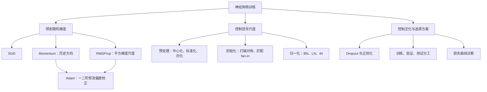

---
tags:
  - 机器学习
  - 神经网络
  - 优化
  - SGD
  - Adam
  - Dropout
  - BatchNormalization
  - 课程笔记
课程: 机器学习与数据挖掘
章节: 第 8 章 神经网络的训练与优化
教材:
---

> [!info] 本章定位
> [[Ch7 神经网络]] 解决了“网络怎样表示函数、怎样计算梯度”；本章解决“拿到梯度以后，怎样把网络稳定地训练好”。理解本章的四把钥匙：
> 1. **优化器改变更新方向或各坐标的步长**，不改变反向传播所求梯度的定义。
> 2. **数据预处理、初始化、归一化控制数值尺度**，使信号和梯度不至于逐层衰减或放大。
> 3. **Dropout 控制过拟合，归一化改善训练条件**；它们在训练与测试时有明确的行为差异。
> 4. **验证集用于选择训练方案，测试集用于最后报告**；训练损失下降不等于泛化变好。

**材料范围**：林倞《Lec8-神经网络的训练与优化.pptx》，全部 29 页。原文件位于 `D:\Documents\Prof_Curriculur\ML\`。页码指 PPT 中的幻灯片序号。

**阅读约定**：正文按课件主题整理；标为“补充解释 / 补充推导 / 自拟例题”的内容用于讲透原理，不视为课件原有结论。课件中的符号混用或简化说法在对应位置辨析。Transformer 补充课件单列为 [[Ch8 Supplement2 Transformer、GPT 与 BERT]]。

## 目录

- [[#1. 训练问题与随机梯度下降|1. 训练问题与随机梯度下降]]
	- [[#1.1 目标、符号与训练循环|1.1 目标、符号与训练循环]]
	- [[#1.2 SGD 的随机性与小批量|1.2 SGD 的随机性与小批量]]
	- [[#1.3 非凸性与病态曲率|1.3 非凸性与病态曲率]]
- [[#2. SGD 加动量|2. SGD 加动量]]
	- [[#2.1 更新方程与物理直觉|2.1 更新方程与物理直觉]]
	- [[#2.2 为什么能减小震荡、加快前进|2.2 为什么能减小震荡、加快前进]]
- [[#3. RMSProp 与指数滑动平均|3. RMSProp 与指数滑动平均]]
	- [[#3.1 按坐标调整步长|3.1 按坐标调整步长]]
	- [[#3.2 滑动平均的展开、权重与记忆长度|3.2 滑动平均的展开、权重与记忆长度]]
- [[#4. Adam：方向平滑与尺度适应|4. Adam：方向平滑与尺度适应]]
	- [[#4.1 六步完整算法|4.1 六步完整算法]]
	- [[#4.2 偏差校正为什么必要|4.2 偏差校正为什么必要]]
	- [[#4.3 与 RMSProp、AdaGrad 的关系|4.3 与 RMSProp、AdaGrad 的关系]]
- [[#5. 数据预处理与参数初始化|5. 数据预处理与参数初始化]]
	- [[#5.1 中心化、标准化和白化|5.1 中心化、标准化和白化]]
	- [[#5.2 随机初始化与对称性|5.2 随机初始化与对称性]]
	- [[#5.3 为什么初始化尺度依赖 fan-in|5.3 为什么初始化尺度依赖 fan-in]]
- [[#6. Dropout：随机屏蔽与期望尺度|6. Dropout：随机屏蔽与期望尺度]]
	- [[#6.1 训练时丢弃神经元|6.1 训练时丢弃神经元]]
	- [[#6.2 测试时缩放与 inverted dropout|6.2 测试时缩放与 inverted dropout]]
- [[#7. BN、LN 与 IN|7. BN、LN 与 IN]]
	- [[#7.1 Batch Normalization 的完整计算|7.1 Batch Normalization 的完整计算]]
	- [[#7.2 测试统计量与训练测试差异|7.2 测试统计量与训练测试差异]]
	- [[#7.3 MLP 与 CNN 中的统计轴|7.3 MLP 与 CNN 中的统计轴]]
	- [[#7.4 Layer Normalization 与 Instance Normalization|7.4 Layer Normalization 与 Instance Normalization]]
- [[#8. 超参数调优与训练诊断|8. 超参数调优与训练诊断]]
	- [[#8.1 数据集三分与超参数的角色|8.1 数据集三分与超参数的角色]]
	- [[#8.2 从损失曲线判断问题|8.2 从损失曲线判断问题]]
- [[#9. 例题|9. 例题]]
	- [[#9.1 SGD 与动量两步手算|9.1 SGD 与动量两步手算]]
	- [[#9.2 病态二次函数的步长限制|9.2 病态二次函数的步长限制]]
	- [[#9.3 RMSProp 的逐坐标更新|9.3 RMSProp 的逐坐标更新]]
	- [[#9.4 Adam 的首步与零初始化偏差|9.4 Adam 的首步与零初始化偏差]]
	- [[#9.5 滑动平均的有限权重|9.5 滑动平均的有限权重]]
	- [[#9.6 标准化为什么不是白化|9.6 标准化为什么不是白化]]
	- [[#9.7 初始化尺度与深度|9.7 初始化尺度与深度]]
	- [[#9.8 Dropout 的期望与方差|9.8 Dropout 的期望与方差]]
	- [[#9.9 BN 前向计算及恢复变换|9.9 BN 前向计算及恢复变换]]
	- [[#9.10 BN、LN、IN 的轴和参数量|9.10 BN、LN、IN 的轴和参数量]]
	- [[#9.11 验证集选模型与数据泄漏|9.11 验证集选模型与数据泄漏]]
	- [[#9.12 训练曲线综合诊断|9.12 训练曲线综合诊断]]
- [[#10. 易错点速查|10. 易错点速查]]
- [[#11. 知识点速查|11. 知识点速查]]

---

## 1. 训练问题与随机梯度下降

### 1.1 目标、符号与训练循环

**课件第 3–4 页。** 通俗理解：反向传播告诉我们“往哪边走能降低当前损失”，优化器决定“这一步怎么走”。网络结构负责表达，损失函数负责定义好坏，反向传播负责求导，优化器负责更新；四者不能混为一谈。

设训练集 $\mathcal D=\{(x_i,y_i)\}_{i=1}^{N}$，把全部可学习权重、偏置展开为 $\theta\in\mathbb R^{P}$。一般目标为

$$
F(\theta)=\frac1N\sum_{i=1}^{N}\ell(f_\theta(x_i),y_i)+\lambda R(\theta).
$$

其中 $P$ 是参数数目，$\ell$ 是单样本损失，$R$ 是正则项。损失的概率解释见 [[Ch4 线性回归与分类的概率视角]]，正则化见 [[Ch5 模型的非线性化、过拟合及正则化]]。

为统一课件前后不同的时间下标，本文固定：**第 $t$ 步在 $\theta_{t-1}$ 上求梯度，得到 $\theta_t$**。$\eta_t>0$ 表示学习率，对应课件的 $lr$ 或 $\alpha$。

一次训练迭代包含：取小批量 → 前向传播 → 计算损失 → 反向传播得到梯度 → 优化器更新。一个 **epoch** 是训练集的一次遍历，一个 **step / iteration** 是一次参数更新；若批量大小为 $B$，通常每个 epoch 约有 $\lceil N/B\rceil$ 次更新。

### 1.2 SGD 的随机性与小批量

**严谨定义**：对小批量 $\mathcal B_t$，使用随机梯度估计

$$
g_t=\frac1{|\mathcal B_t|}\sum_{i\in\mathcal B_t}
\nabla_\theta\ell(f_{\theta_{t-1}}(x_i),y_i)
+\lambda\nabla R(\theta_{t-1}),
\qquad
\theta_t=\theta_{t-1}-\eta_tg_t.
$$

$g_t\in\mathbb R^P$ 与参数维度相同。对不可微正则项，需要次梯度或相应优化方法。课件把仅使用部分数据估计的梯度统称为 SGD；严格区分时，$B=1$ 是单样本 SGD，$1<B<N$ 是 mini-batch SGD，$B=N$ 是全批量梯度下降。

**补充解释**：均匀抽样时，给定当前参数，$\mathbb E[g_t\mid\theta_{t-1}]=\nabla F(\theta_{t-1})$。小批量梯度不必每一步都让完整训练集损失下降；它用更便宜的有噪声估计换取更频繁的更新。独立抽样条件下，平均梯度的方差通常随 $B$ 增大而减小，但大批量也增加计算和内存成本。

> [!warning] 学习率与梯度不是同一个概念
> 原始 SGD 的各坐标共用一个标量学习率，但 **SGD 也能使用随时间变化的学习率计划**。课件第 9 页“SGD 学习率不改变”描述的是固定学习率版本，不能当作 SGD 的定义。

### 1.3 非凸性与病态曲率

通俗理解：损失地形可能有许多山谷，也可能像一条很窄、很长的沟。你横向稍走大一点就撞到沟壁，只能缩小步子；可纵向原本就很平，缩小步子后前进更慢。

课件指出两类困难：**局部最优**与**病态曲率（pathological curvature）**。

- 非凸目标可能存在局部极小值、鞍点、平坦区域。SGD 噪声和动量有时有助于离开某些区域，但都不保证找到全局最优。
- 病态曲率表示不同方向的曲率尺度差异很大。在局部二次近似中，Hessian 的特征值差异大，会导致震荡与慢收敛。

![[Ch8-img-pathological-curvature.png]]

课件图中，狭窄谷底的更新轨迹来回折返：陡方向要求小步长，平方向需要大步长，一个统一步长难以兼顾。

**补充模型**：$F(x,y)=\tfrac12(ax^2+by^2)$，其中 $a\gg b>0$，Hessian 为 $\operatorname{diag}(a,b)$，条件数为 $\kappa=a/b$。梯度下降满足

$$
x_t=(1-\eta a)x_{t-1},\qquad y_t=(1-\eta b)y_{t-1}.
$$

要使两个坐标收敛，需要 $0<\eta<2/a$。于是 $1-\eta b$ 可能很接近 $1$，$y$ 方向前进很慢。这一分析针对正定二次目标；一般非凸网络不能直接套用全局收敛结论。

## 2. SGD 加动量

### 2.1 更新方程与物理直觉

**课件第 5 页。** 通俗理解：普通 SGD 每次只看当前坡度；动量还记住过去几步的方向。如果连续几步都朝同一方向，它就更坚定地往前走。

沿用课件的**未归一化动量**形式：

$$
u_0=0,\qquad u_t=\rho u_{t-1}+g_t,
\qquad\theta_t=\theta_{t-1}-\eta_tu_t.
$$

$u_t\in\mathbb R^P$ 是累计梯度，$\rho\in(0,1)$ 是历史信息的保留系数，课件给出 $0.9,0.95,0.99$ 等取值。这里 $u_t$ 没有吸收学习率，所以实际参数位移是 $-\eta_tu_t$。

![[Ch8-img-momentum-step.png]]

图中当前梯度与历史方向合成实际更新方向；下降位移的负号已经包含在具体方向的画法中。

> [!warning] 对“摩擦力”的辨析
> 课件把滚小球作为类比，但“摩擦力与 $\rho$ 成正比”不适合直接记忆：按更新式，**$\rho$ 越大，旧动量保留越多，阻尼效果越弱**。物理类比服务于方程，不能反过来改变方程含义。

### 2.2 为什么能减小震荡、加快前进

**补充推导**：展开递推式得到

> [!important]- 动量的历史加权形式
> $$u_t=\sum_{k=1}^{t}\rho^{t-k}g_k.$$
> 若某个坐标的梯度不断正负交替，历史项部分抵消，减少横向震荡；若另一个坐标的梯度方向持续一致，历史项不断累积，增加沿谷底的位移。
> 当 $g_k=g$ 恒定时，
> $$u_t=\frac{1-\rho^t}{1-\rho}g\longrightarrow\frac{g}{1-\rho}.$$
> 因此在这个理想化情形中，稳态位移幅度相当于把学习率放大为 $\eta/(1-\rho)$。

有些资料使用 $m_t=\rho m_{t-1}+(1-\rho)g_t$。此时 $m_t=(1-\rho)u_t$；保持相同参数位移，需要重新匹配学习率。**含不含 $(1-\rho)$ 的公式不能直接用同一个学习率比较。**

动量可能越过很小的局部凹陷，也可能在最优点附近过冲；$\rho$ 大不代表永远更好。它主要平滑方向，并未像 RMSProp 那样为各坐标维护平方梯度尺度。

## 3. RMSProp 与指数滑动平均

### 3.1 按坐标调整步长

**课件第 6 页。** 通俗理解：某个坐标的梯度总是很大，就给它踩一点刹车；某个坐标的梯度较小，就相对允许它迈更大的步子。

$$
s_0=0,\qquad s_t=\rho s_{t-1}+(1-\rho)g_t\odot g_t,
\qquad
\theta_t=\theta_{t-1}-\eta_t\frac{g_t}{\sqrt{s_t}+\epsilon}.
$$

$s_t\in\mathbb R^P$ 估计梯度的**逐元素二阶原点矩**，$\odot$、平方、平方根和除法均按元素进行。$\epsilon>0$ 防止零分母，是正文对课件简化公式的数值稳定补充。也有实现把 $\epsilon$ 放在平方根内部，应以具体实现为准。

第 $j$ 个参数的有效缩放系数为 $\eta_t/(\sqrt{s_{t,j}}+\epsilon)$。这缓解不同坐标尺度差异，但它是**对角缩放**，不会完整消除任意旋转后的曲率耦合。

> [!warning] 分母必须有平方根
> 课件文字提取会把根号结构打平；对照原图可确认分母是 $\sqrt{s_t}$。除以 $s_t$ 与除以 $\sqrt{s_t}$ 是不同算法。

### 3.2 滑动平均的展开、权重与记忆长度

**课件第 7 页。** 指数滑动平均（EMA）是“新记录权重大，旧记录逐渐忘掉”。对任意同维向量 $a_t$：

$$
z_t=\rho z_{t-1}+(1-\rho)a_t.
$$

> [!important]- 从前三步展开到一般式（补充推导）
> $$z_1=\rho z_0+(1-\rho)a_1,$$
> $$z_2=\rho^2z_0+\rho(1-\rho)a_1+(1-\rho)a_2,$$
> $$z_3=\rho^3z_0+\rho^2(1-\rho)a_1+\rho(1-\rho)a_2+(1-\rho)a_3.$$
> 因而
> $$z_t=\rho^tz_0+(1-\rho)\sum_{k=1}^{t}\rho^{t-k}a_k.$$
> 有限步中，观测值权重和为
> $$(1-\rho)\sum_{j=0}^{t-1}\rho^j=1-\rho^t.$$
> 加上初始值 $z_0$ 的权重 $\rho^t$ 才严格等于 $1$。当 $t\to\infty$ 时，观测值权重和才趋近于 $1$。

因此，零初始化并不意味着早期估计已经是归一化的历史均值。这正是 Adam 偏差校正的来源。课件第 7 页“所有权重之和为 $1$”需要区分包含初始项的有限和与不包含初始项的极限。

**补充解释**：$\rho$ 越大，遗忘越慢，估计越平滑、响应越迟。常用的粗略记忆长度是 $1/(1-\rho)$ 步；半衰期为 $\log(1/2)/\log\rho$，两者不是严格相同的指标。

## 4. Adam：方向平滑与尺度适应

### 4.1 六步完整算法

**课件第 8–13 页。** 通俗理解：Adam 同时准备一个“方向记忆”和一个“幅度记忆”，用平滑方向除以梯度幅度的估计，再修正训练最初几步的低估。

按课件六步组织，并统一时间下标：

1. **初始化**：$\theta_0$ 为初始参数，$m_0=v_0=0\in\mathbb R^P$，$t=0$。
2. **求梯度**：令 $t\leftarrow t+1$，在 $\theta_{t-1}$ 上计算 $g_t$。
3. **一阶矩**：$m_t=\beta_1m_{t-1}+(1-\beta_1)g_t$。
4. **二阶矩**：$v_t=\beta_2v_{t-1}+(1-\beta_2)g_t\odot g_t$。
5. **偏差校正**：$\hat m_t=m_t/(1-\beta_1^t)$，$\hat v_t=v_t/(1-\beta_2^t)$。
6. **参数更新**：

$$
\boxed{\theta_t=\theta_{t-1}-\eta_t\frac{\hat m_t}{\sqrt{\hat v_t}+\epsilon}}.
$$

课件给出默认起点 $\beta_1=0.9$、$\beta_2=0.999$、$\eta=10^{-3}$，数值稳定常数示例为 $\epsilon=10^{-8}$。它们是可调超参数，不是对所有任务都最优的常数。

> [!warning] 二阶矩不是方差；公式版本也要区分
> $v_t$ 估计的是 $\mathbb E[g^2]$，而方差是 $\mathbb E[g^2]-(\mathbb E[g])^2$。课件第 11–13 页有“方差”的宽泛表述，笔记统一称为**二阶原点矩**。
> 第 8 页是省略偏差校正和 $\epsilon$ 的概览；第 13 页图片把 $\epsilon$ 放入根号，原始 Adam 算法通常写为 $\sqrt{\hat v_t}+\epsilon$。这里采用原算法形式，并将两种数值稳定约定分开。[Adam 原论文](https://arxiv.org/abs/1412.6980)

### 4.2 偏差校正为什么必要

通俗理解：记忆最初全是零，即使梯度一直是 $2$，第一步的 EMA 也可能只有 $0.2$；不是梯度变小了，而是历史槽位尚未填满。

> [!important]- 零初始化偏差的推导（补充）
> 设各步梯度的期望保持为 $\mu_g$，$m_0=0$，则
> $$\mathbb E[m_t]=(1-\beta_1)\sum_{k=1}^{t}\beta_1^{t-k}\mu_g=(1-\beta_1^t)\mu_g.$$
> 除以 $1-\beta_1^t$ 得 $\mathbb E[\hat m_t]=\mu_g$。
> 类似地，若二阶矩保持为 $\nu_g$，有 $\mathbb E[v_t]=(1-\beta_2^t)\nu_g$，从而 $\mathbb E[\hat v_t]=\nu_g$。
> 在梯度分布随参数更新而改变时，校正主要消除**零初始化造成的权重缺口**，不能保证精确等于当前真实矩。

首步中 $\hat m_1=g_1$、$\hat v_1=g_1^2$。当 $|g_{1,j}|\gg\epsilon$ 时，首步第 $j$ 个坐标位移约为 $-\eta\operatorname{sign}(g_{1,j})$，与梯度绝对值不成正比；但不能据此认为 Adam 所有后续更新都是符号梯度。

### 4.3 与 RMSProp、AdaGrad 的关系

**课件第 8–9 页。** 课件把 Adam 解释为适应性梯度方法与 RMSProp 优点的结合；同时给出了把 $\beta_1$ 设为 $0$ 的退化关系。

| 方法 | 历史信息 | 更新中的分子 | 更新中的分母 | 主要直觉 |
|---|---|---|---|---|
| SGD | 无额外状态 | $g_t$ | $1$ | 当前梯度直接决定方向 |
| Momentum | 梯度累加 $u_t$ | $u_t$ | $1$ | 连贯方向加速，交替方向抵消 |
| RMSProp | 平方梯度 EMA $s_t$ | $g_t$ | $\sqrt{s_t}+\epsilon$ | 按坐标适应近期幅度 |
| Adam | 梯度 EMA 和平方梯度 EMA | $\hat m_t$ | $\sqrt{\hat v_t}+\epsilon$ | 方向平滑、幅度适应、初始校正 |

**补充解释 AdaGrad**：令 $G_t=G_{t-1}+g_t^2$，更新时按 $\sqrt{G_t}$ 缩放。对频繁出现的大梯度坐标，累计量更大，步长逐渐缩小；较少更新的坐标相对保留大步长。这适合某些稀疏梯度情形，但累计量持续增长也可能让后期步长太小。RMSProp 用 EMA 代替永久累积，对近期尺度更敏感。

**退化关系的条件**：设 $\beta_1=0$ 则 $m_t=\hat m_t=g_t$，所以 Adam 的方向平滑消失。但完整 Adam 仍保留 $\hat v_t=v_t/(1-\beta_2^t)$；只有把二阶矩校正、$\epsilon$ 约定等也对齐后，才与相应 RMSProp 版本一致。课件的“退化为 RMSProp”适用于简化更新式。

优化器仍依赖基础学习率 $\eta_t$；自适应并不表示“不用调学习率”，也不表示所有坐标的实际位移会完全相同。

## 5. 数据预处理与参数初始化

### 5.1 中心化、标准化和白化

**课件第 15 页。** 通俗理解：先把坐标原点移到数据中心，再把各坐标的单位统一；若还存在强相关，可进一步旋转和缩放，使数据不再呈细长斜椭圆。

![[Ch8-img-preprocessing.png]]

从左到右为原始、中心化、方差标准化、白化。注意第三幅仍是倾斜椭圆：各维尺度一致不代表相关性消失。

设单样本 $x\in\mathbb R^d$，训练均值 $\mu\in\mathbb R^d$，协方差 $\Sigma\in\mathbb R^{d\times d}$：

| 操作 | 定义 | 控制了什么 | 没有保证什么 |
|---|---|---|---|
| 中心化 | $x_c=x-\mu$ | 各维均值约为 $0$ | 各维方差相同、互不相关 |
| 标准化 | $z_j=(x_j-\mu_j)/\sqrt{\sigma_j^2+\epsilon}$ | 各维方差约为 $1$ | 协方差矩阵为单位阵 |
| 白化 | $z=\Sigma^{-1/2}(x-\mu)$，非奇异时 | 均值为 $0$、协方差为 $I$ | 任意分布下各维统计独立 |

**补充推导白化**：若 $\Sigma=U\Lambda U^T$，其中 $U$ 正交，$\Lambda$ 为特征值对角阵，PCA 白化可以写为

$$z=\Lambda^{-1/2}U^T(x-\mu),\qquad \operatorname{Cov}(z)=I.$$

另一种 ZCA 白化为 $z=U\Lambda^{-1/2}U^T(x-\mu)$。小特征值或奇异协方差需要正则化 / 降维；例如使用 $(\Lambda+\epsilon I)^{-1/2}$ 时，协方差只是近似单位阵。谱分解背景见 [[Ch4 线性回归与分类的概率视角]]。

> [!warning] 只在训练数据上拟合预处理
> 验证集、测试集只应用已经确定的均值、标准差或白化矩阵。先用全数据算统计量再划分数据，会把评估数据的信息带入训练流程。是否需要白化取决于数据与模型，课件并未要求所有任务都使用白化。

### 5.2 随机初始化与对称性

**课件第 16 页。** 课件先给出固定小高斯分布：

$$W_{ij}\sim\mathcal N(0,0.01^2).$$

这里 $0.01$ 是标准差，$0.01^2$ 是方差。它可作为较浅网络的简单起点；课件举出“层数小于 $8$”的经验例子，**不是浅深网络的严格数学分界**。

**补充解释**：随机初始化的作用之一是打破同层神经元的对称性。如果隐藏神经元从完全相同的权重出发，在对称结构下会得到相同输出和相同梯度，后续仍学成同一特征。偏置设为零通常可行，但不能因此推断所有隐藏层权重都可设为零。

### 5.3 为什么初始化尺度依赖 fan-in

设 $W_\ell\in\mathbb R^{n_{\rm out}\times n_{\rm in}}$；$n_{\rm in}$ 是该层每个神经元的输入数量，即 **fan-in**。课件给出

$$W_{\ell,ij}\sim\mathcal N(0,\sigma_\ell^2),\qquad
\sigma_\ell=\frac1{\sqrt{n_{\rm in}}},\qquad
\operatorname{Var}(W_{\ell,ij})=\frac1{n_{\rm in}}.$$

通俗理解：一个神经元加了 $n_{\rm in}$ 份输入，若每份权重尺度不减小，总信号会随输入数增长。

> [!important]- 方差传播的近似推导（补充）
> 令 $a_i=\sum_{j=1}^{n_{\rm in}}W_{ij}h_j$。在权重零均值、权重与输入独立、交叉项可以忽略的初始化分析中，
> $$\operatorname{Var}(a_i)=n_{\rm in}\operatorname{Var}(W_{ij})\mathbb E[h_j^2].$$
> 若输入零均值，则 $\mathbb E[h_j^2]=\operatorname{Var}(h_j)$。选 $\operatorname{Var}(W)=1/n_{\rm in}$ 就能近似保持线性层前后的尺度。
> 若每层都把尺度乘上一个大于 $1$ 或小于 $1$ 的因子，深度增加会让信号逐层放大或衰减，所以固定的 $0.01$ 未必适合深网络。

**补充：Xavier 与 He 初始化**。Xavier 的一种方差约定为 $2/(n_{\rm in}+n_{\rm out})$；对 ReLU，He 初始化常取 $2/n_{\rm in}$。后者考虑对称输入经 ReLU 后二阶矩约减半，故需在权重方差中补偿因子 $2$。这些名称和激活相关的细分是补充内容，课件只明确给出 $1/n_{\rm in}$ 的方差规则。

初始化仅决定起点；参数随后不断变化，因此还需要训练期间的归一化等手段稳定尺度。

## 6. Dropout：随机屏蔽与期望尺度

### 6.1 训练时丢弃神经元

**课件第 17 页。** 通俗理解：训练时随机让一些神经元“休息”，使模型不能过度依赖一条固定通路或某几个特征；测试时使用完整网络。

![[Ch8-img-dropout.png]]

为避免课件第 17–18 页的概率混用，本文统一：$p$ 为**丢弃率**，$q=1-p$ 为**保留率**。对隐藏向量 $h\in\mathbb R^d$，逐坐标独立抽样

$$r_j\sim\operatorname{Bernoulli}(q),\qquad\tilde h=r\odot h.$$

每次前向传播重新抽掩码 $r$，被丢弃单元的输出为零，该次反向传播沿相应通路的梯度也为零。丢弃率是超参数；课件以 $p=0.5$ 为常见示例，不意味着所有层都应取 $0.5$。

**补充解释**：不同掩码对应共享参数的不同子网络，因此可以把 Dropout 理解为一种隐式模型集成及对共同适应的抑制。但测试时的一次完整网络前向，并不一般等于所有非线性子网络输出的精确平均。

### 6.2 测试时缩放与 inverted dropout

**课件第 18 页。** 测试时希望给定输入产生稳定输出，所以关闭随机屏蔽；同时要处理训练和测试之间的幅度差异。

> [!important]- 期望匹配的推导（补充）
> 对固定的 $h_j$，$\mathbb E[r_jh_j]=qh_j$。因而对于下一层的线性输入，
> $$\mathbb E[W\tilde h+b]=qWh+b.$$
> 普通 Dropout 在测试时使用 $qh$，或等价地使用 $qW$，使线性输入的期望尺度匹配。
> 这里匹配的是**线性输入的期望**；一般 $\mathbb E[\sigma(W\tilde h+b)]\ne\sigma(qWh+b)$，因为非线性函数不能随意移出期望。

实际常采用 **inverted dropout（补充）**：

$$
\tilde h^{\rm train}=\frac{r\odot h}{q},\qquad
\tilde h^{\rm test}=h,
\qquad\mathbb E[\tilde h^{\rm train}\mid h]=h.
$$

| 约定 | 训练时 | 测试时 | 缩放发生在哪里 |
|---|---|---|---|
| 普通 Dropout | $r\odot h$ | $qh$ | 测试时乘保留率 |
| inverted dropout | $(r\odot h)/q$ | $h$ | 训练时除以保留率 |

> [!warning] 课件的 $p$ 在两页中含义不一致
> 第 17 页明确说“以概率 $p$ 丢弃”；第 18 页测试缩放却写成乘 $p$。如果 $p$ 是丢弃率，缩放必须用 $1-p$；只有把 $p$ 改定义为保留率，乘 $p$ 才成立。$p=0.5$ 会掩盖这一错误。该页相邻层下标也不统一，笔记统一写为下一层预激活 $a^{(\ell+1)}=W_\ell h^{(\ell)}+b_\ell$。

Dropout 增加训练噪声，主要用于缓解过拟合；过强的丢弃可能使训练更困难。训练时随机屏蔽、测试时关闭是标准行为，测试时主动保留随机性属于其他专门用途。

## 7. BN、LN 与 IN

### 7.1 Batch Normalization 的完整计算

**课件第 19–21 页。** 通俗理解：让同一层某个特征在一批样本里的尺度更稳定，再给模型两个可学习旋钮，决定这个特征应该放大多少、平移多少。

对 MLP 某层输入 $H\in\mathbb R^{B\times D}$，行是样本，列是特征。对第 $j$ 列：

$$
\mu_{\mathcal B,j}=\frac1B\sum_{i=1}^{B}H_{ij},\qquad
\sigma^2_{\mathcal B,j}=\frac1B\sum_{i=1}^{B}(H_{ij}-\mu_{\mathcal B,j})^2,
$$

$$
\hat H_{ij}=\frac{H_{ij}-\mu_{\mathcal B,j}}{\sqrt{\sigma^2_{\mathcal B,j}+\epsilon}},\qquad
Y_{ij}=\gamma_j\hat H_{ij}+\beta_j.
$$

$\gamma,\beta\in\mathbb R^D$ 是可学习参数，与网络权重一起更新；$\mu,\sigma^2$ 是数据统计量，不是经梯度下降学习的普通参数。$\epsilon$ 为数值稳定补充；使用它时，标准化后的方差通常略小于 $1$。

![[Ch8-img-bn-flow.png]]

图的主线是“计算统计量 → 归一化 → 缩放平移”；训练中还维护供测试使用的统计量。

> [!important]- 为什么要有 $\gamma$ 和 $\beta$（补充推导）
> 若仅把特征强制规范到固定尺度，可能限制后续激活函数和模型表达。忽略 $\epsilon$ 时，设置 $\gamma_j=\sigma_{\mathcal B,j}$、$\beta_j=\mu_{\mathcal B,j}$，便有 $Y_{ij}=H_{ij}$。
> 保留 $\epsilon$ 时，精确恢复该批输入应取 $\gamma_j=\sqrt{\sigma^2_{\mathcal B,j}+\epsilon}$、$\beta_j=\mu_{\mathcal B,j}$。
> 这是给定统计量下的代数说明；学习出的固定 $\gamma,\beta$ 不会自动随每个批次的统计量变化。

课件归纳三个作用：**加快收敛、提高训练稳定性、产生一定正则化效果**。它以“减少内部协变量偏移”解释 BN，这是原论文的提出动机，不能把它视为唯一已证明机制，也不能推断 BN 必然解决所有梯度问题。[Batch Normalization 原论文](https://arxiv.org/abs/1502.03167)

> [!warning] 归一化不等于变成标准正态分布
> 课件第 20 页使用“归一化到标准正态分布”的说法；减均值、除标准差只控制前两阶矩，**不会把任意分布变成高斯分布**。BN 逐特征归一化，也不是完整白化，不保证去掉所有特征相关性。

### 7.2 测试统计量与训练测试差异

**课件第 22 页。** 通俗理解：同一张图在测试时不应仅因同批的其他图改变就得到不同预测，因此通常不用测试批次即时统计量。

课件给出两种方案：

1. 在网络参数固定后，用训练数据估计各层总体均值和方差；统计确定后供测试使用。
2. 训练过程中对各批次统计量维护滑动平均，测试时使用固定的运行统计量。

若用历史保留率 $\rho$ 表达第二种方案：

$$
\mu_{\rm run}\leftarrow\rho\mu_{\rm run}+(1-\rho)\mu_{\mathcal B},\qquad
\sigma^2_{\rm run}\leftarrow\rho\sigma^2_{\rm run}+(1-\rho)\sigma^2_{\mathcal B}.
$$

**补充限定**：上式表达基本思想，具体实现可能对方差采用不同估计约定；有些框架的 `momentum` 指新统计量权重，因此与这里的 $\rho$ 互补。不同批次方差的平均也不能无条件等同于完整训练集的精确方差。

测试计算为

$$Y_{ij}=\gamma_j\frac{H_{ij}-\mu_{{\rm run},j}}{\sqrt{\sigma^2_{{\rm run},j}+\epsilon}}+\beta_j.$$

训练时样本之间通过批统计量耦合；测试时使用固定统计量，预测不依赖测试批次的其他样本。若小批量很小，统计量噪声可能较大。课件给出的常见放置方式是 **FC → BN → tanh**；实际网络可能选择其他顺序，不能把这个示意当作唯一结构。

### 7.3 MLP 与 CNN 中的统计轴

**课件第 23 页。** 重点不是记住名称，而是回答：**固定什么坐标，把哪些轴上的数据合在一起算均值和方差？**

![[Ch8-img-bn-mlp-cnn.png]]

| 场景 | 输入形状 | 固定对象 | 求统计量的轴 | 统计量形状 | 仿射参数形状 |
|---|---|---|---|---|---|
| MLP BN | $B\times D$ | 每个特征 $j$ | 批次轴 $B$ | $1\times D$ | $1\times D$ |
| CNN BN | $B\times C\times H\times W$ | 每个通道 $c$ | $B,H,W$ | $1\times C\times1\times1$ | $1\times C\times1\times1$ |

CNN 中每个通道独立计算：

$$\mu_c=\frac1{BHW}\sum_{n,h,w}X_{nchw},\qquad
\sigma_c^2=\frac1{BHW}\sum_{n,h,w}(X_{nchw}-\mu_c)^2.$$

通道内的空间位置共享统计量和仿射参数，符合卷积层的参数共享思想。BN 在一个通道里合并多个样本及所有空间位置；不是把所有通道一起归一化。

### 7.4 Layer Normalization 与 Instance Normalization

**课件第 24–25 页。** 通俗理解：BN 问“这个特征在一批人中偏高还是偏低”，LN 问“同一个人的各个特征相对如何”，IN 则在“同一张图的同一个通道内部”比较像素。

**Layer Normalization（LN）**：在 $H\in\mathbb R^{B\times D}$ 中，固定样本 $i$，沿特征轴计算

$$\mu_i=\frac1D\sum_jH_{ij},\qquad
\sigma_i^2=\frac1D\sum_j(H_{ij}-\mu_i)^2,$$

$$Y_{ij}=\gamma_j\frac{H_{ij}-\mu_i}{\sqrt{\sigma_i^2+\epsilon}}+\beta_j.$$

统计量形状为 $B\times1$，仿射参数形状仍为 $1\times D$。**统计量轴和仿射参数轴不同**。LN 不依赖其他样本，通常训练和测试都使用当前样本的统计量，无需 BN 式运行统计量。

![[Ch8-img-bn-ln.png]]

**Instance Normalization（IN）**：对于图像张量 $X\in\mathbb R^{B\times C\times H\times W}$，固定样本 $n$ 和通道 $c$，沿 $H,W$ 计算

$$\mu_{nc}=\frac1{HW}\sum_{h,w}X_{nchw},\qquad
\sigma^2_{nc}=\frac1{HW}\sum_{h,w}(X_{nchw}-\mu_{nc})^2.$$

标准化后可使用通道级仿射参数 $\gamma_c,\beta_c$。统计量形状为 $B\times C\times1\times1$；若开启仿射变换，参数形状为 $1\times C\times1\times1$。按课件的标准 IN 约定，训练和测试均用当前实例统计量。

![[Ch8-img-bn-in.png]]

| 方法 | 典型输入 | 统计量聚合范围 | 是否跨样本 | 测试时使用什么 |
|---|---|---|---|---|
| MLP BN | $B\times D$ | 同一特征的 $B$ 个值 | 是 | 固定训练统计量 |
| CNN BN | $B\times C\times H\times W$ | 同通道的 $BHW$ 个值 | 是 | 固定训练统计量 |
| MLP LN | $B\times D$ | 同样本的 $D$ 个值 | 否 | 当前样本统计量 |
| IN | $B\times C\times H\times W$ | 同样本同通道的 $HW$ 个值 | 否 | 当前实例统计量 |

**补充衔接**：Transformer 中通常对 $X\in\mathbb R^{B\times T\times D}$ 的每个 token 沿最后的 $D$ 维使用 LN；不同 token 不必合并计算。图像 LN 的具体归一化轴要看定义或 `normalized_shape`，不能把 MLP 的二维示意机械移植到所有张量。

## 8. 超参数调优与训练诊断

### 8.1 数据集三分与超参数的角色

**课件第 26–27 页。** 通俗理解：训练集是练习题，验证集帮助选择学习方法，测试集是最后一次考试。不断查看测试成绩来换方法，等于逐渐把考试题当作练习题。

| 数据 / 变量 | 用途 | 是否参与梯度更新 |
|---|---|---|
| 训练集 | 拟合模型参数、拟合预处理统计量 | 用于更新参数 |
| 验证集 | 比较超参数、选择模型或检查点 | 通常不直接更新模型参数 |
| 测试集 | 报告最终泛化性能 | 不用于选择方案 |
| 参数 | $W,b$，BN / LN 的 $\gamma,\beta$ | 通过优化学习 |
| 超参数 | 学习率、$\rho,\beta_1,\beta_2$、Dropout 丢弃率等 | 通常通过验证表现选择 |

课件要求：训练集训练 → 验证集调优 → 测试集报告。与 [[Ch5 模型的非线性化、过拟合及正则化]] 的模型选择流程相连。重复选择会逐渐适应验证集，所以测试集仍需保持独立。

### 8.2 从损失曲线判断问题

**课件第 28 页。** 调参应先从合理默认起点出发，再根据训练现象缩小范围。

![[Ch8-img-learning-rate.png]]

课件图的含义：学习率非常高可能导致损失上升；过低下降很慢；偏高可能快速下降后停留在较高平台；合适的学习率在该示意中兼顾速度和较低损失。这些是诊断线索，不是每种曲线形状的唯一成因。

![[Ch8-img-overfitting-curve.png]]

训练损失继续下降，验证损失在某时刻后上升，提示过拟合。补充的 **early stopping** 可选择验证损失最低的检查点，而非最后一个检查点。

| 观察 | 可能原因 | 下一步验证 / 调整（补充） |
|---|---|---|
| 损失迅速爆炸、出现非有限值 | 学习率过高、数值或梯度问题 | 先降低学习率，检查输入、损失和梯度 |
| 训练损失下降极慢 | 学习率太低、信号尺度不合适 | 比较不同学习率，检查初始化和归一化 |
| 训练损失低、验证损失高 | 过拟合或分布差异 | 检查划分；比较 Dropout、正则化、早停 |
| 训练与验证损失都高 | 欠拟合、优化未成功、数据问题 | 先确认可拟合少量样本，再判断表达能力 |
| 测试预测随批次搭配显著变化 | BN 可能仍使用训练批统计量 | 检查训练 / 测试模式和运行统计量 |

不能仅凭“训练与验证存在差距”就断言模型过于灵活；需要同时看绝对误差、划分方式与数据分布。课件第 29 页的总结覆盖优化器、初始化、预处理、Dropout、归一化和调参，正文至此已逐项对应。

## 9. 例题

以下 **12 道均为自拟例题**，用于检查课件概念、推导条件与训练测试差异。

### 9.1 SGD 与动量两步手算

给定标量 $\theta_0=1$，$\eta=0.1$，已求出的梯度 $g_1=2,g_2=-1$。分别计算 SGD 与课件形式的动量法（$\rho=0.9,u_0=0$）两步后的参数。为什么第二步动量法仍可能向负方向移动？

> [!example]- 解析
> SGD：$\theta_1=1-0.1\times2=0.8$，$\theta_2=0.8-0.1\times(-1)=0.9$。
> 动量：$u_1=2$，$\theta_1=0.8$；$u_2=0.9\times2-1=0.8$，故 $\theta_2=0.8-0.1\times0.8=0.72$。
> 第二步当前梯度已变号，但旧累计梯度仍占主导，更新方向尚未反转。这体现记忆，也说明动量可能过冲。
> 若改用带 $(1-\rho)$ 的 EMA 形式却保持学习率不变，数值将不同，不能把两种公式直接混用。

### 9.2 病态二次函数的步长限制

$F(x,y)=\tfrac12(100x^2+y^2)$，从 $(1,1)$ 出发。学习率 $0.03$ 会怎样？改为 $0.01$ 后，两个方向的收敛速度有什么差别？

> [!example]- 解析
> 更新乘子为 $1-100\eta$ 和 $1-\eta$。取 $0.03$ 时，$x$ 乘子为 $-2$，绝对值超过 $1$，会交替发散；$y$ 乘子为 $0.97$，其自身仍收敛。
> 取 $0.01$ 时，$x_1=0$，此后保持 $0$；$y_t=0.99^t$，每步仅减小 $1\%$。
> 同一学习率被最陡方向限制，平缓方向因此缓慢。条件数为 $100$，整体收敛需要 $0<\eta<0.02$。这说明训练慢可能源自曲率，不一定是模型表达力不足。

### 9.3 RMSProp 的逐坐标更新

给定 $g_1=(2,0.2)$，$s_0=(0,0)$，$\rho=0.9$，$\eta=0.01$，忽略 $\epsilon$，求 $s_1$ 与参数位移。是否意味着所有后续坐标位移相同？

> [!example]- 解析
> $s_1=0.1(4,0.04)=(0.4,0.004)$，$\sqrt{s_1}\approx(0.632456,0.063246)$。
> 两个坐标的 $g_{1,j}/\sqrt{s_{1,j}}$ 均约为 $3.162278$，位移均为 $-0.031623$。
> 这一首步相同是因为零初始化使分母正比于当前梯度幅度。后续分母来自历史平方梯度，各坐标的历史与当前梯度关系不同，实际位移不必相同。
> 若某坐标梯度为零，忽略 $\epsilon$ 会遇到 $0/0$，所以稳定项具有实际意义。

### 9.4 Adam 的首步与零初始化偏差

给定 $g_1=2$、$\beta_1=0.9$、$\beta_2=0.999$、$\eta=0.001$，求校正前后的一二阶矩。忽略 $\epsilon$ 时，校正与不校正的首步位移分别是多少？

> [!example]- 解析
> $m_1=0.1\times2=0.2$，$v_1=0.001\times4=0.004$。
> $\hat m_1=0.2/0.1=2$，$\hat v_1=0.004/0.001=4$，校正后的位移为 $-0.001\times2/2=-0.001$。
> 不校正时，位移为 $-0.001\times0.2/\sqrt{0.004}\approx-0.003162$。
> “两个矩都偏小，所以步长一定偏小”是错误推断，因为它们以不同衰减率进入分子与平方根分母，最终比值可能偏大。

### 9.5 滑动平均的有限权重

$z_0=0$，$\rho=0.9$，连续三步观测均为 $10$。求 $z_3$、观测权重和与校正结果。为什么不能说三步观测权重和就是 $1$？

> [!example]- 解析
> $z_1=1$，$z_2=1.9$，$z_3=2.71$。
> 三个观测权重分别为 $0.081,0.09,0.1$，总和 $0.271=1-0.9^3$。
> 初始值的权重仍有 $0.9^3=0.729$，但初始值是零，所以不会贡献数值。
> 除以 $1-0.9^3$ 得 $2.71/0.271=10$。观测权重和趋近 $1$ 是无限步极限，不是早期有限步事实。

### 9.6 标准化为什么不是白化

已中心化的数据协方差为 $\Sigma=\begin{pmatrix}4&3\\3&9\end{pmatrix}$。逐坐标除以标准差以后协方差是多少？数据是否已经白化？

> [!example]- 解析
> 标准差为 $(2,3)$。设 $D=\operatorname{diag}(2,3)$，标准化后
> $$\operatorname{Cov}(z)=D^{-1}\Sigma D^{-1}=\begin{pmatrix}1&0.5\\0.5&1\end{pmatrix}.$$
> 对角线成为 $1$，但非对角线仍为 $0.5$；相关性保留，没有白化。
> 白化还需用协方差的特征向量和特征值旋转、缩放，令协方差成为 $I$。即使白化后不相关，在一般非高斯分布中也不能推出独立。

### 9.7 初始化尺度与深度

某线性层 fan-in 为 $400$，输入各维零均值、方差为 $1$，满足方差传播近似条件。固定标准差 $0.01$、课件 fan-in 规则各给出多大的预激活方差？ReLU 的 He 标准差是多少？

> [!example]- 解析
> 固定标准差时，权重方差为 $10^{-4}$，预激活方差约为 $400\times10^{-4}=0.04$。
> 课件规则：权重标准差 $1/\sqrt{400}=0.05$，方差 $0.0025$，预激活方差约为 $1$。
> ReLU 的 He 标准差约为 $\sqrt{2/400}\approx0.07071$，用于补偿 ReLU 对二阶矩的约减半。
> 若许多线性层都把方差乘 $0.04$，尺度会快速衰减；有激活函数时还要考虑其影响，不能直接把线性近似当作任意网络的精确公式。

### 9.8 Dropout 的期望与方差

固定 $h=4$，丢弃率 $p=0.25$。普通与 inverted dropout 的输出分布、均值和方差分别是什么？普通 Dropout 测试时应输出多少？

> [!example]- 解析
> 保留率 $q=0.75$。普通输出以概率 $0.75$ 为 $4$，以概率 $0.25$ 为 $0$，均值 $qh=3$，方差 $q(1-q)h^2=3$。
> inverted 输出以概率 $0.75$ 为 $4/0.75=16/3$，以概率 $0.25$ 为 $0$，均值 $4$，方差 $h^2(1-q)/q=16/3$。
> 普通测试时用 $qh=3$；inverted 测试时直接用 $h=4$。把丢弃率 $0.25$ 当缩放系数，会得到 $1$，不匹配训练期望。
> inverted 保持均值，并没有保持方差，更没有消除训练噪声。

### 9.9 BN 前向计算及恢复变换

单特征批次输入为 $(1,3,5)$，$\gamma=2$、$\beta=-1$，忽略 $\epsilon$。计算 BN 输出；再求能恢复输入的 $\gamma,\beta$。

> [!example]- 解析
> 均值 $\mu=3$，课件采用分母为 $B=3$ 的批方差：$\sigma^2=(4+0+4)/3=8/3$，$\sigma=\sqrt{8/3}$。
> 归一化值为 $(-\sqrt{3/2},0,\sqrt{3/2})$，输出为 $(-1-\sqrt6,-1,-1+\sqrt6)$，约 $(-3.44949,-1,1.44949)$。
> 取 $\gamma=\sqrt{8/3}$、$\beta=3$ 即可恢复 $(1,3,5)$。若保留 $\epsilon$，恢复用 $\gamma=\sqrt{8/3+\epsilon}$。
> 标准化本身的均值为 $0$，但加入 $\beta$ 后输出均值为 $-1$；不能说 BN 最终输出永远零均值、单位方差。

### 9.10 BN、LN、IN 的轴和参数量

图像张量形状为 $8\times16\times32\times32$。CNN BN 与 IN 各有多少组统计量，每组用了多少值？开启通道级仿射后参数量是多少？再考虑 Transformer 张量 $8\times20\times64$ 的 token LN。

> [!example]- 解析
> CNN BN 固定通道，共 $16$ 组均值和方差；每组使用 $8\times32\times32=8192$ 个值。均值、方差各为 $1\times16\times1\times1$。
> IN 固定样本和通道，共 $8\times16=128$ 组；每组使用 $32\times32=1024$ 个值，统计量为 $8\times16\times1\times1$。
> 二者的通道级仿射参数都为 $16$ 个 $\gamma$ 和 $16$ 个 $\beta$，合计 $32$ 个。统计量组数不等于可学习参数数目。
> token LN 固定样本和 token，共 $8\times20=160$ 组统计量，每组沿 $64$ 维计算；仿射参数共享于所有 token，为 $64+64=128$ 个。

### 9.11 验证集选模型与数据泄漏

三个检查点的训练损失分别为 $(0.8,0.3,0.1)$，验证损失分别为 $(0.9,0.5,0.7)$。应选哪个？若测试损失更偏好第三个，是否可以改选？预处理均值可否用三份数据一起计算？

> [!example]- 解析
> 依据既定验证损失标准选第二个检查点，验证损失最低为 $0.5$。第三个训练损失更低但验证已恶化，符合过拟合线索。
> 查看测试结果后改选，会把测试集变成模型选择数据；最终报告的测试性能不再是独立评估。
> 均值和标准差同样是拟合出来的变换，应只在训练集上估计，并原样应用到验证和测试。若采用交叉验证，每折也应在该折训练部分单独拟合预处理。

### 9.12 训练曲线综合诊断

模型 A 的训练损失持续爆炸；模型 B 的训练损失很低、验证损失持续升高；模型 C 的单样本测试预测随同批其他样本明显改变。给出优先检查项，并说明为何不能都用增大网络容量解决。

> [!example]- 解析
> A 优先检查学习率、输入数值和梯度，降低过大步长可验证优化失稳假设；扩大网络可能进一步恶化数值问题。
> B 优先检查数据划分及过拟合，比较早停、正则化和 Dropout；容量增加可能使训练更好而泛化更差。
> C 优先检查 BN 是否处于测试模式、是否使用运行统计量，以及是否误用其他跨样本操作。它主要是预测流程问题，增加容量不会解除跨样本依赖。
> 三种现象分别涉及优化、泛化、训练测试流程，应根据证据诊断。

## 10. 易错点速查

| 易错说法 / 操作 | 正确理解 |
|---|---|
| 反向传播就是 SGD | 反向传播求梯度，SGD 用梯度更新参数 |
| SGD 必须使用固定学习率 | 可设置随时间变化的学习率 |
| 随机梯度每一步必使全数据损失下降 | 随机估计有噪声，无此逐步保证 |
| 动量能保证离开局部最优 | 无全局最优保证，也可能过冲 |
| $\rho$ 越大，摩擦越大 | 按课件递推，旧动量保留越多 |
| 动量公式含不含 $1-\rho$ 都可直接替换 | 必须匹配学习率和变量定义 |
| RMSProp 除以平方梯度均值 | 除以其平方根，并考虑稳定项 |
| 有限 EMA 的观测权重和等于 $1$ | 零初始化时为 $1-\rho^t$ |
| Adam 的二阶矩就是方差 | 是 $\mathbb E[g^2]$，没有减去均值平方 |
| Adam 用自适应学习率，所以不用调 $\eta$ | 基础学习率仍需选择 |
| 完整 Adam 设 $\beta_1=0$ 就严格等于普通 RMSProp | 还需匹配二阶矩校正和稳定项 |
| 初始化 $\mathcal N(0,0.01^2)$ 中 $0.01$ 是方差 | $0.01$ 是标准差 |
| fan-in 规则是标准差 $1/n_{\rm in}$ | 标准差 $1/\sqrt{n_{\rm in}}$，方差 $1/n_{\rm in}$ |
| 全零初始化只会让训练慢一点 | 隐藏神经元可能一直对称，无法学出不同特征 |
| 标准化就是白化 | 标准化仅分别缩放各维，相关性可能保留 |
| 白化就意味着独立 | 一般只能保证不相关；高斯等条件下才有更强结论 |
| Dropout 测试乘丢弃率 | 普通版本乘保留率 $1-p$ |
| inverted dropout 训练后，测试仍需乘保留率 | 训练已缩放，测试直接使用完整激活 |
| 保持 Dropout 期望等于保持所有输出分布 | 只匹配相关线性量的期望，方差和非线性期望不同 |
| BN 把数据变成标准高斯 | 仅控制均值、方差，不改变任意分布为高斯 |
| BN 最终输出一定零均值单位方差 | $\gamma,\beta$ 会改变输出尺度和均值 |
| BN 的均值、方差是梯度学习的参数 | 它们是统计量；$\gamma,\beta$ 才是可学习参数 |
| CNN BN 对所有通道一起计算 | 每个通道沿 $B,H,W$ 分别计算 |
| LN 统计量与仿射参数形状一致 | MLP 中分别是 $B\times1$ 与 $1\times D$ |
| IN 合并同批全部图片 | 按单样本、单通道沿空间轴计算 |
| 用全数据拟合预处理不算训练 | 会泄漏验证 / 测试信息 |
| 训练损失最低的模型一定最好 | 模型选择依据独立验证表现 |
| 先看测试成绩再选超参数 | 测试集因此失去独立评估作用 |

## 11. 知识点速查

| 核心概念 | 最小记忆式 / 判断点 |
|---|---|
| SGD | $\theta_t=\theta_{t-1}-\eta_tg_t$ |
| 动量 | $u_t=\rho u_{t-1}+g_t$，更新用 $u_t$ |
| RMSProp | 平方梯度 EMA；除以其平方根 |
| Adam | 梯度 EMA + 平方梯度 EMA + 偏差校正 |
| EMA 权重缺口 | $1-\rho^t$，早期不等于 $1$ |
| fan-in 初始化 | 课件：权重方差 $1/n_{\rm in}$ |
| 中心化 / 标准化 / 白化 | 零均值 / 各维单位方差 / 单位协方差 |
| Dropout | 丢弃率 $p$，保留率 $q=1-p$ |
| inverted dropout | 训练除以 $q$，测试不缩放 |
| BN | 按特征 / 通道，跨样本统计，测试固定统计量 |
| LN | 按样本的特征统计；Transformer 常按每个 token |
| IN | 每样本、每通道，沿空间轴统计 |
| 模型选择 | 训练拟合，验证选择，测试报告 |

**五句话核心思想**：

1. 网络可以有很强表达力，但训练仍会被非凸地形、曲率与数值尺度卡住。
2. 动量平滑历史方向，RMSProp 平衡逐坐标尺度，Adam 合并两者并修正零初始化偏差。
3. 预处理、合理初始化与归一化分别在输入、起点和训练过程中控制尺度。
4. Dropout 的训练测试切换必须与保留率匹配，BN 的切换必须与统计量来源匹配。
5. 调参依据验证表现与训练证据，最后用独立测试集报告泛化性能。

**章节衔接**：

- [[Ch2 线性回归]]：梯度下降的基本形式与凸二次目标，构成本章优化分析的起点。
- [[Ch5 模型的非线性化、过拟合及正则化]]：Dropout、验证集选择与一般正则化框架的关系。
- [[Ch7 神经网络]]：先掌握层间计算与反向传播，再理解优化器如何消费梯度。
- [[Ch8 Supplement2 Transformer、GPT 与 BERT]]：LN 用于 Transformer 子层，语言模型训练仍依赖本章的梯度与优化框架。

**课件覆盖核对**：第 1–2、14、29 页为封面 / 大纲 / 总结；第 3–4 页对应第 1 节，第 5 页对应第 2 节，第 6–7 页对应第 3 节，第 8–13 页对应第 4 节，第 15–16 页对应第 5 节，第 17–18 页对应第 6 节，第 19–25 页对应第 7 节，第 26–28 页对应第 8 节。全部内容页均已对应。
