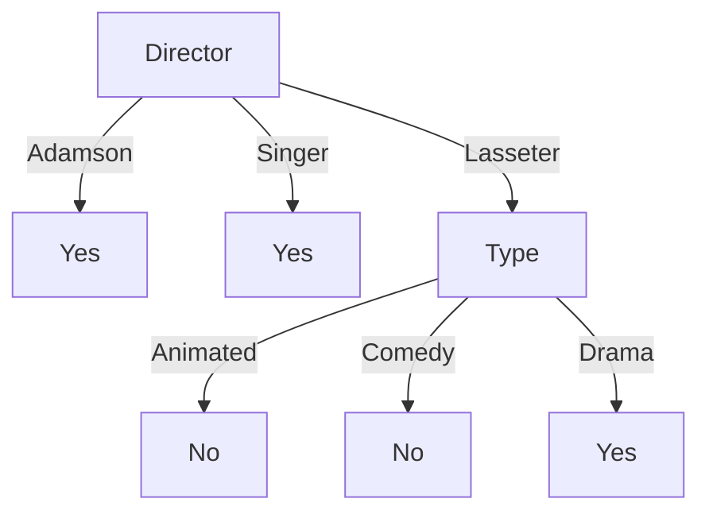

---
tags:
  - 机器学习
  - 决策树
  - 信息增益
  - Bagging
  - 随机森林
  - AdaBoost
  - 课程笔记
课程: 机器学习与数据挖掘
章节: 第 9 章 决策树与集成方法
教材:
---

> [!info] 本章定位
> 前面的 [[Ch6 支持向量机]] 与 [[Ch7 神经网络]] 通过间隔或可学习的连续函数构造分类器；决策树通过一系列条件判断，把输入空间切成若干区域。理解本章的四条主线：
> 1. **树的学习是递归划分**：每个节点只针对到达它的样本重新选属性，根节点的最优选择不保证整棵树全局最优。
> 2. **信息增益衡量划分前后的标签不确定性减少量**：子节点熵必须按样本比例加权，不能直接相加。
> 3. **纯叶只说明训练样本被分开**：停止生长与剪枝控制复杂度，泛化判断仍需独立数据。
> 4. **集成需要准确性与差异性**：Bagging 用重采样和聚合降低不稳定性；随机森林进一步降低树间相关性；AdaBoost 依次调整样本权重并学习投票权重。

> [!info]- 材料与记号
> 来源：林倞《Lec9-决策树与集成方法.pptx》，位于 `D:\Documents\Prof_Curriculur\ML\`，全部 **51 张幻灯片**。本文“第 n 页”均指 PPT 幻灯片顺序，包含封面、路线图与小结，不使用动态页脚日期判断材料版本。
> 正文按“树的表示 → 熵与划分 → 递归学习与剪枝 → 集成 → AdaBoost 目标”组织。标为“补充解释 / 补充推导 / 自拟”的内容用于展开原理，不冒充课件原文。原图保留于本章附件；图中的标签按原图读取，不把示意边界当作测量数据。
> 训练集 $D=\{(x_i,y_i)\}_{i=1}^{N}$，$x_i\in\mathbb R^d$ 或离散属性空间，$C$ 为类别数；$D_v$ 表示当前节点按属性值 $v$ 分出的子集。熵使用 $\log_2$，单位为 bit；AdaBoost 使用自然对数 $\ln$，标签与弱分类器输出均为 $\{-1,+1\}$。
> 信息论小节沿用课件的随机变量 $Y,Z$；树学习中用 $Y$ 表示标签、$A$ 表示候选属性。$h_t$ 是第 $t$ 个基分类器，$\alpha_t$ 是其投票权重，$w_i^{(t)}$ 是训练它之前的第 $i$ 个样本权重；样本权重与分类器权重是两种对象。

## 目录

- [[#1. 决策树怎样表示分类规则|1. 决策树怎样表示分类规则]]
	- [[#1.1 节点、边、路径与叶子|1.1 节点、边、路径与叶子]]
	- [[#1.2 连续特征与轴平行区域|1.2 连续特征与轴平行区域]]
	- [[#1.3 打球示例提出的问题|1.3 打球示例提出的问题]]
- [[#2. 熵、条件熵与信息增益|2. 熵、条件熵与信息增益]]
	- [[#2.1 熵：类别分布的不确定性|2.1 熵：类别分布的不确定性]]
	- [[#2.2 条件熵：分支内不确定性的加权平均|2.2 条件熵：分支内不确定性的加权平均]]
	- [[#2.3 信息增益与互信息|2.3 信息增益与互信息]]
	- [[#2.4 把信息增益用于树节点|2.4 把信息增益用于树节点]]
- [[#3. 电影案例：从根节点到完整的树|3. 电影案例：从根节点到完整的树]]
	- [[#3.1 原始数据与根节点熵|3.1 原始数据与根节点熵]]
	- [[#3.2 四个属性逐一比较|3.2 四个属性逐一比较]]
	- [[#3.3 进入 Lasseter 分支必须重新计算|3.3 进入 Lasseter 分支必须重新计算]]
- [[#4. 决策树学习、停止生长与剪枝|4. 决策树学习、停止生长与剪枝]]
	- [[#4.1 递归学习的输入、过程与停止条件|4.1 递归学习的输入、过程与停止条件]]
	- [[#4.2 为什么会过拟合|4.2 为什么会过拟合]]
	- [[#4.3 预剪枝、后剪枝与验证集|4.3 预剪枝、后剪枝与验证集]]
	- [[#4.4 隐形眼镜示例与课件课堂小问|4.4 隐形眼镜示例与课件课堂小问]]
- [[#5. 集成学习与分类器的组合|5. 集成学习与分类器的组合]]
	- [[#5.1 基学习器为什么需要差异性|5.1 基学习器为什么需要差异性]]
	- [[#5.2 多数投票、加权投票与回归平均|5.2 多数投票、加权投票与回归平均]]
- [[#6. Bagging 与随机森林|6. Bagging 与随机森林]]
	- [[#6.1 Bootstrap 采样与 Bagging 流程|6.1 Bootstrap 采样与 Bagging 流程]]
	- [[#6.2 平均为什么能降低方差，相关性又为何重要|6.2 平均为什么能降低方差，相关性又为何重要]]
	- [[#6.3 随机森林：样本随机性再加特征随机性|6.3 随机森林：样本随机性再加特征随机性]]
- [[#7. Boosting 与 AdaBoost 的完整机制|7. Boosting 与 AdaBoost 的完整机制]]
	- [[#7.1 从独立重采样转向依次纠错|7.1 从独立重采样转向依次纠错]]
	- [[#7.2 二分类 AdaBoost 算法|7.2 二分类 AdaBoost 算法]]
	- [[#7.3 样本权重如何变化|7.3 样本权重如何变化]]
	- [[#7.4 边界情况、轮数与错误率曲线|7.4 边界情况、轮数与错误率曲线]]
- [[#8. AdaBoost 的指数损失、推导与三轮实例|8. AdaBoost 的指数损失、推导与三轮实例]]
	- [[#8.1 指数损失与分类间隔|8.1 指数损失与分类间隔]]
	- [[#8.2 从损失推导分类器系数与样本更新|8.2 从损失推导分类器系数与样本更新]]
	- [[#8.3 课件十个点的三轮训练轨迹|8.3 课件十个点的三轮训练轨迹]]
	- [[#8.4 三条简单边界怎样组合成复杂边界|8.4 三条简单边界怎样组合成复杂边界]]
	- [[#8.5 Bagging 与 Boosting 的训练依赖比较|8.5 Bagging 与 Boosting 的训练依赖比较]]
- [[#9. 例题|9. 例题]]
	- [[#9.1 条件熵会不会在某个分支增大|9.1 条件熵会不会在某个分支增大]]
	- [[#9.2 完整回答打球例子的三个问题|9.2 完整回答打球例子的三个问题]]
	- [[#9.3 样本编号为什么会骗过信息增益|9.3 样本编号为什么会骗过信息增益]]
	- [[#9.4 XOR 反例：零增益不代表后续无用|9.4 XOR 反例：零增益不代表后续无用]]
	- [[#9.5 后剪枝该由什么数据决定|9.5 后剪枝该由什么数据决定]]
	- [[#9.6 Bootstrap 采样次数与不同记录数|9.6 Bootstrap 采样次数与不同记录数]]
	- [[#9.7 分类器相关性限制平均的效果|9.7 分类器相关性限制平均的效果]]
	- [[#9.8 AdaBoost 一轮权重与错误率|9.8 AdaBoost 一轮权重与错误率]]
	- [[#9.9 为什么三轮都错三点，最终还能全对|9.9 为什么三轮都错三点，最终还能全对]]
	- [[#9.10 指数损失下降能保证什么|9.10 指数损失下降能保证什么]]
- [[#10. 易错点速查|10. 易错点速查]]
- [[#11. 知识点速查|11. 知识点速查]]
	- [[#11.1 从问题到机制|11.1 从问题到机制]]
	- [[#11.2 核心计算与适用条件|11.2 核心计算与适用条件]]
	- [[#11.3 五句话与章节衔接|11.3 五句话与章节衔接]]

---

## 1. 决策树怎样表示分类规则

### 1.1 节点、边、路径与叶子

**课件第 3–4 页。** 给定一组属性与类别标签，决策树（decision tree，DT）把分类写成连续的条件判断。

> [!note] 决策树的组成
> - **内部节点**：一个属性测试，如“Director 是谁”或“$x_1\le 3$ 吗”。
> - **边**：测试的一种结果，如某个离散值或某个阈值区间。
> - **叶子**：最终预测，如 Yes / No。
> - **根到叶的路径**：沿途条件的合取，定义一个输入区域；该区域共享叶子的输出。

预测时从根开始，根据新样本的属性值选择分支，直至到达叶子。若路径长为 $L$，预测只需进行约 $L$ 次测试，不必遍历整棵树。

学习时需要回答三个问题：

1. 当前节点使用哪个属性？
2. 属性值怎样分组，连续属性的阈值设在哪里？
3. 什么时候停止扩展，已经长出的分支是否需要删去？

**补充解释**：叶子既可以输出多数类，也可以输出叶内各类的经验比例。后者提供概率估计，但小叶子的频率可能很不稳定，不能自动视作校准良好的真实概率。

### 1.2 连续特征与轴平行区域

**课件第 5–6 页。** 二维示例先按 $x_1\le 3$ 分左右，再分别测试 $x_2\le 1$ 和 $x_2\le 3.5$：

![[Ch9-p05-轴平行划分.png]]

对应规则为：

| 根节点条件 | 第二层条件 | 预测 |
|---|---|---|
| $x_1\le 3$ | $x_2\le 1$ | Blue |
| $x_1\le 3$ | $x_2>1$ | Red |
| $x_1>3$ | $x_2\le 3.5$ | Red |
| $x_1>3$ | $x_2>3.5$ | Blue |

每次只测试一个坐标，切分线与坐标轴平行；多维时得到轴对齐超矩形的交。很多这样的区域能够拼出复杂的非线性边界。第 6 页的新样本星号位于左侧中部，满足 $x_1\le3,x_2>1$，因此预测为 Red。

**补充：怎样找阈值。** 对当前节点的某个连续特征排序，设相邻不同值为 $u_j<u_{j+1}$，可以测试中点 $s=(u_j+u_{j+1})/2$，比较 $x_k\le s$ 与 $x_k>s$ 的划分增益。只需考虑能够改变训练样本分组的阈值，不必搜索所有实数。该特征在更深处仍可能继续按另一个阈值切分。

这与离散多叉树“某属性用过就移出候选集”的处理不同；**所有属性用完**不是所有决策树实现通用的停止理由。

### 1.3 打球示例提出的问题

**课件第 7 页。** 14 条天气记录使用 Outlook、Temperature、Humidity、Wind 预测是否打球，课件给出以下树：

![[Ch9-p07-打球数据与树.png]]

- Outlook = Overcast：直接输出 Yes。
- Outlook = Sunny：看 Humidity；High 输出 No，Normal 输出 Yes。
- Outlook = Rain：看 Wind；Strong 输出 No，Weak 输出 Yes。

课件提出：为什么先选 Outlook？为什么后续选 Humidity 与 Wind？为什么不再扩展，Temperature 又为什么没出现？这些问题需要“标签还有多少不确定性”和“一个测试能减少多少不确定性”的定量准则，见第 2 节与例题 9.2。

## 2. 熵、条件熵与信息增益

### 2.1 熵：类别分布的不确定性

**课件第 9–13 页。** 随机变量 $Z$ 的取值集合为 $\mathcal C$，分布为 $p(z)$。

> [!note] 信息熵
> $$H(Z)=-\sum_{z\in\mathcal C}p(z)\log_2p(z).$$
> 约定 $0\log_2 0=0$，因为 $\lim_{p\to0^+}p\log_2p=0$。熵衡量观察结果前的平均不确定性，$C$ 个可能类别满足 $0\le H(Z)\le\log_2 C$。

课件的三个分布依次为：

| 分布 | 熵的计算 | 结果 |
|---|---|---|
| 四个结果各 $1/4$ | $-4\times\frac14\log_2\frac14$ | $2$ bit |
| 两个非零概率 $3/4,1/4$ | $-\frac34\log_2\frac34-\frac14\log_2\frac14$ | $0.811278$ bit |
| 某结果概率 $1$ | $-1\log_2 1$ | $0$ bit |

等概率分布最难事先猜中，确定分布没有不确定性。“分布越平坦熵越大”应在**相同类别空间**上理解；不是比较柱状图的绝对高度或样本总数。

二分类的伯努利变量满足 $P(Z=1)=p,P(Z=0)=1-p$，因此

$$
H_b(p)=-p\log_2p-(1-p)\log_2(1-p).
$$

![[Ch9-p13-伯努利熵.png]]

$H_b(0)=H_b(1)=0$，$H_b(1/2)=1$，曲线关于 $p=1/2$ 对称。

**补充推导：为什么中间最高。** 对 $0<p<1$，

$$
H_b'(p)=\log_2\frac{1-p}{p},\qquad
H_b''(p)=-\frac1{\ln2}\left(\frac1p+\frac1{1-p}\right)<0.
$$

唯一驻点为 $p=1/2$，严格凹性保证它是最大值点。注意：树节点的熵由**标签比例**计算；不是把输入特征数值直接代进伯努利熵。

### 2.2 条件熵：分支内不确定性的加权平均

**课件第 14–15 页。** 已知 $Y=y$ 后，$Z$ 的条件分布为 $p(z\mid y)$。

$$
H(Z\mid Y=y)=-\sum_zp(z\mid y)\log_2p(z\mid y),
$$

$$
H(Z\mid Y)=\sum_yP(Y=y)H(Z\mid Y=y).
$$

第一式对应**某一个分支**，第二式是在知道会观察 $Y$、尚不知道具体观察值时，对所有分支求平均。零概率分支对总和的贡献为零。

课件六条记录是 $(Y,Z)$：$(t,t)$ 四条、$(f,t)$ 一条、$(f,f)$ 一条。于是：

1. $Y=t$ 分支占 $4/6$，其中 $Z$ 全为 $t$，熵为 $0$。
2. $Y=f$ 分支占 $2/6$，其中 $Z$ 各一半，熵为 $1$。
3. 加权得到 $H(Z\mid Y)=\frac46\times0+\frac26\times1=\frac13$。
4. 不观察 $Y$ 时，$Z$ 的比例为 $5/6,1/6$，所以 $H(Z)=H_b(1/6)=0.650022$。

> [!important] “知道更多，平均不确定性不增加”的准确范围
> 对这里的离散变量，$H(Z\mid Y)\le H(Z)$；这是**对 $Y$ 的所有结果求平均后**成立。不能推成每一个具体分支都满足 $H(Z\mid Y=y)\le H(Z)$。

本例恰好提供反例：$H(Z\mid Y=f)=1>0.650022$。遇到少数分支后，不确定性可以变大，但加权平均仍降为 $1/3$。

课件第 15 页中间一行展开式把第二项误写成加号；根据熵的定义，应保留 $-\frac16\log_2\frac16$。最后的约 $0.65$ 是正确结果。

### 2.3 信息增益与互信息

**课件第 16 页。** 知道 $Y$ 能让 $Z$ 的不确定性减少多少？

> [!note] 信息增益与互信息
> $$I(Z;Y)=H(Z)-H(Z\mid Y).$$
> 课件记为 $IG(Y)$，其中“目标变量是 $Z$”隐含在上下文中。互信息也满足 $I(Z;Y)=H(Y)-H(Y\mid Z)$，数值对称。

上例的增益为 $0.650022-1/3=0.316689$ bit，约为课件的 $0.32$。

**补充推导：非负性与对称性从哪里来。** 在离散有限分布上展开：

$$
\begin{aligned}
H(Z)-H(Z\mid Y)
&=\sum_{y,z}p(y,z)\log_2\frac{p(z\mid y)}{p(z)}\\
&=\sum_{y,z}p(y,z)\log_2\frac{p(y,z)}{p(y)p(z)}.
\end{aligned}
$$

右边是联合分布与边缘乘积分布的 KL 散度，故非负；式子对 $Y,Z$ 对称。KL 非负可由 $-\ln u\ge1-u$ 对正概率项求和得到。两变量独立时联合分布等于边缘乘积，互信息为零；反过来零 KL 也要求两分布相同。

这里说“信息多”，指**对目标标签提供的信息多**。某个属性自身有很多不同值，不代表它对新样本的标签有用。

### 2.4 把信息增益用于树节点

设当前节点有 $n=|D|$ 条记录，$p_c$ 为其中第 $c$ 类的比例，候选离散属性 $A$ 的取值集合为 $\mathcal V_A$。

$$
H_D(Y)=-\sum_{c=1}^{C}p_c\log_2p_c,
$$

$$
H_D(Y\mid A)=\sum_{v\in\mathcal V_A}\frac{|D_v|}{|D|}H_{D_v}(Y),
\qquad
\operatorname{Gain}(D,A)=H_D(Y)-H_D(Y\mid A).
$$

**选择规则**：对当前节点允许的划分逐一计算，选增益最大的。父节点熵相同，所以等价于选加权子节点熵最小的划分。

**补充边界：多值偏好。** 若“样本编号”对每条记录都唯一，按编号切分会得到全为单例的纯叶，训练条件熵为零，增益达到父节点熵；但它几乎不能帮助预测新编号。这说明经验增益可能偏好多取值属性，不能直接当作泛化保证。

其他划分准则如增益率、Gini 不纯度属于相关扩展；**本课件并未给出 C4.5 或 CART 的完整算法**，本文不将它们列为课件已讲内容。

## 3. 电影案例：从根节点到完整的树

### 3.1 原始数据与根节点熵

**课件第 3、18–22 页。** 9 条电影记录如下，Actor 是课件 Famous actors 的简写。

| 编号 | Type | Length | Director | Actor | Liked? |
|---|---|---|---|---|---|
| 1 | Comedy | Short | Adamson | No | Yes |
| 2 | Animated | Short | Lasseter | No | No |
| 3 | Drama | Medium | Adamson | No | Yes |
| 4 | Animated | Long | Lasseter | Yes | No |
| 5 | Comedy | Long | Lasseter | Yes | No |
| 6 | Drama | Medium | Singer | Yes | Yes |
| 7 | Animated | Short | Singer | No | Yes |
| 8 | Comedy | Long | Adamson | Yes | Yes |
| 9 | Drama | Medium | Lasseter | No | Yes |

Yes 共 $6$ 条，No 共 $3$ 条：

$$
H_D(Y)=H_b(6/9)=0.918296\text{ bit}.
$$

课件写为 $0.91$，是较粗的近似；以下保留更多小数以免层层舍入改变比较。

### 3.2 四个属性逐一比较

对 Type，Comedy 的 Yes / No 为 $2/1$，Animated 为 $1/2$，Drama 为 $3/0$；三个分支各占 $1/3$。

$$
H_D(Y\mid\mathrm{Type})=
\tfrac13H_b(2/3)+\tfrac13H_b(1/3)+\tfrac13\times0
=0.612197.
$$

Length 的 Short 为 $2/1$，Long 为 $1/2$，Medium 为 $3/0$，因此有相同条件熵。

Director 的 Adamson 为 $3/0$，Singer 为 $2/0$，Lasseter 为 $1/3$：

$$
H_D(Y\mid\mathrm{Director})=
\tfrac39\times0+\tfrac29\times0+\tfrac49H_b(1/4)
=0.360568.
$$

Actor = No 有 $4$ Yes、$1$ No，Actor = Yes 有 $2$ Yes、$2$ No：

$$
H_D(Y\mid\mathrm{Actor})=
\tfrac59H_b(4/5)+\tfrac49H_b(1/2)=0.845516.
$$

| 属性 | 加权条件熵 | 信息增益 |
|---|---|---|
| Type | $0.612197$ | $0.306099$ |
| Length | $0.612197$ | $0.306099$ |
| Director | $0.360568$ | **$0.557728$** |
| Actor | $0.845516$ | $0.072780$ |

因此根节点选择 Director。课件第 18–19 页的 $0.61,0.36,0.85$ 与 $0.3,0.55$ 是近似；其 Actor 增益写成 $0.06$，按原始 9 条数据精算应约为 **$0.0728$**。这不改变根节点选择。

### 3.3 进入 Lasseter 分支必须重新计算

Adamson 与 Singer 分支已经全是 Yes，不必继续划分。Lasseter 子集只剩编号 $2,4,5,9$，其中 Yes / No 为 $1/3$。

$$
H_{D_L}(Y)=H_b(1/4)=0.811278.
$$

重新计算时，样本数的分母是 **$4$**：

- Type：Animated 两条全 No，Comedy 一条 No，Drama 一条 Yes，各分支纯，条件熵为 $0$。
- Length：Short 一条 No，Long 两条 No，Medium 一条 Yes，各分支纯，条件熵也为 $0$。
- Actor：No 的两条各为一类，Yes 的两条全 No，条件熵为 $\frac24\times1+\frac24\times0=0.5$。

三者增益依次是 $0.811278,0.811278,0.311278$。Type 与 Length 并列最优，课件选择 Type；选择 Length 也符合当前贪心准则。

所有叶子在训练集上纯，故结束。预测一个 Lasseter 导演的 Drama 电影时，按 Director → Type 路径得到 Yes。

**补充解释**：这只说明训练集拟合完全，不说明导演对偏好有因果作用，也不保证新电影一定按同样规律出现。局部最优划分与全局最小树、最低测试误差是不同目标。

## 4. 决策树学习、停止生长与剪枝

### 4.1 递归学习的输入、过程与停止条件

**课件第 20–23 页；以下流程是对课件的补充整理。** 每次递归的输入为当前样本集 $D$、可用测试集合和约束，输出一棵子树。

1. 统计当前节点标签，确定其多数类，作为无法继续划分时的叶子输出。
2. 若所有标签相同，直接返回该标签叶子。
3. 若无可用属性 / 有效阈值，或深度达到限制，则返回多数类叶子。
4. 枚举允许划分，计算加权子节点熵，选信息增益最大者。
5. 若最大增益小于停止阈值，返回多数类叶子；否则建立测试节点。
6. 根据测试结果分出子集，对每个非空子集递归。离散属性完整多叉划分后可移除该属性；连续阈值划分不必永久移除该特征。
7. 把各子树接到对应边上，返回当前子树。

> [!note] 课件明确列出的停止准则
> 标签全相同、属性用尽、达到最大深度、信息增益小于阈值。它们是可选择的停止条件，不要求同时满足。

**补充的实现边界**：同样特征却标签相反的两条记录不可能仅靠这些特征完全分开，此时需要多数类 / 概率叶；遇到训练时未出现的属性值，可约定回退到当前节点的多数类或分布。回退与平票规则必须预先明确，不能暗中保证每个新样本都有已见分支。

**复杂度口径（补充）**：单节点有 $n$ 条样本、$d$ 个离散属性，使用计数表评估它们约需 $O(nd)$；连续属性若逐节点排序，会增加约 $O(dn\log n)$ 的排序代价。整棵树成本取决于深度、重复排序与候选测试实现，不能把单节点代价当成所有树通用的训练复杂度。预测成本主要随路径深度增长。

### 4.2 为什么会过拟合

**课件第 24 页。** 树越深、叶子越多，就越能为少量特殊样本定制规则。它可能同时拟合了稳定规律、采样偶然性和错误标签。

训练准确率通常随复杂度增加而改善；课件图中的测试准确率却在一段增长后回落。这与 [[Ch5 模型的非线性化、过拟合及正则化]] 的过拟合现象一致。

- 更深的树有更强表达能力，但叶内样本减少，估计更不稳定。
- 很小的数据变化可能改变顶层划分，再连带改变大块子树，这是单棵树容易具有高方差的原因之一。
- 训练纯度是划分准则；泛化能力需用验证或测试数据评估，两者不等价。

### 4.3 预剪枝、后剪枝与验证集

**课件第 25 页。** 控制复杂度有两种时机：

| 方式 | 何时做 | 机制与代价 |
|---|---|---|
| 预剪枝 | 生长过程中 | 在不满足深度、样本数或增益要求时停止；节省训练，但可能错过后续有用组合 |
| 后剪枝 | 先长出树，再简化 | 把某内部节点及其后代整体替换成叶子；更充分探索结构，但训练成本较高 |

**补充展开：基于验证集的后剪枝。**

1. 用训练集长树，验证集不参与这一步的标签计数。
2. 对候选内部节点，暂时将整棵子树替换成一个叶子；通常用该节点训练样本的多数类作输出。
3. 比较剪前与剪后的验证准确率；优先接受不降低准确率、或能提高准确率的剪枝。
4. 在候选中贪心选择，再重新评估下一轮，直到没有满足规则的剪枝。

课件“贪婪地移除对验证准确率提升最小的节点”可理解为去掉对验证表现贡献较小的分支；实现时应具体比较**替换整棵子树后**的准确率变化，不是删除一个测试节点后让它的子节点悬空。

> [!warning] 验证与测试的职责
> 剪枝使用验证集选择结构，测试集用于最后评估。若反复用测试集决定剪哪里，测试分数就不再是独立评估。某个分支的训练信息增益小，也不自动证明剪掉后验证准确率一定提高。

### 4.4 隐形眼镜示例与课件课堂小问

**课件第 26–29 页。** 以下只把图作为算法教学样例，不推断现实配镜规则。剪枝前的树为：

![[Ch9-p26-剪枝前.png]]

按原图逐条读取：

- 泪液分泌减少 → 无。
- 泪液正常、散光 → 看年龄；非老花眼群体 → 软性，老花眼群体 → 无。
- 泪液正常、不散光、远视 → 硬性。
- 泪液正常、不散光、近视 → 看年龄；年轻 → 硬，不年轻 → 无。

小明的属性是“泪液分泌正常、不散光、近视、年轻”。原树路径经过右侧年龄节点，输出“硬”。

![[Ch9-p28-剪枝位置全图.png]]

课件圈出左右两个年龄子树：左边替换为“软”，右边替换为“无”。剪枝后：

![[Ch9-p29-剪枝后.png]]

小明沿“正常 → 不散光 → 近视”直接到达“无”。因此，**剪枝后该样本的预测由硬变为无**，并不是保持不变。

> [!warning] 这张示意图能说明什么
> 第 28 页说“经计算每个枝条的信息增益”后剪枝，但课件未提供配套样本计数、增益值、阈值或验证集结果。因此能确认被剪位置与预测变化，**无法复算剪枝依据，也无法判定小明真实标签或整体准确率是否提高**。左、右替换标签按课件记录，不能反推出未给出的多数类计数。

剪枝使模型更简单、减少对年龄的依赖，可能降低方差，也可能损失某些局部规律。单个样本预测改变不是泛化改善或恶化的充分证据。

## 5. 集成学习与分类器的组合

### 5.1 基学习器为什么需要差异性

**课件第 31 页。** 集成学习训练多个基学习器，并把它们的预测组合为一个输出。课件的问题是：怎样产生这些分类器，怎样组合它们？

基学习器可以是决策树、SVM、神经网络或逻辑回归；一个集成中也不一定必须混用不同模型。分类器可以在不同样本上各有所长，但要组合得有效，通常需要同时考虑：

- **有一定预测能力**：若全是随机猜测或系统性错误，简单投票没有普遍改进保证。
- **错误存在差异**：若所有模型总在相同样本上出错，多复制几份不会纠正共同错误。

**术语补充**：课件宽泛地把基分类器称为“弱分类器”。在二分类 Boosting 理论中，“弱学习”更具体地要求学习器在所考虑的加权分布上能优于随机猜测，例如错误率低于 $1/2$。不能仅因一个模型“只擅长猫、不擅长狗”，就断言它满足该理论条件。

### 5.2 多数投票、加权投票与回归平均

**课件第 32 页。** 设有 $T$ 个分类器 $h_t$。

二分类硬投票可以写为

$$
H(x)=\operatorname{sign}\left(\sum_{t=1}^{T}h_t(x)\right),
\qquad h_t(x)\in\{-1,+1\}.
$$

加权投票为

$$
H(x)=\operatorname{sign}\left(\sum_{t=1}^{T}\alpha_th_t(x)\right).
$$

课件用两个线性基分类器举例：$h_1(x)=\operatorname{sign}(w_1^\top x)$、$h_2(x)=\operatorname{sign}(w_2^\top x)$，组合在两者**已经输出的标签**上加权，再取符号；这不等价于先合并原始线性分数再取符号。

**补充辨析**：

- 多分类的投票数为 $\sum_t\mathbb1[h_t(x)=c]$，取票数最大的类别；加权版把每票改成 $\alpha_t$。
- 回归常用 $\bar f(x)=\frac1T\sum_tf_t(x)$，输出连续数值。
- 对类别编号 $1,2,3$ 直接算数值平均没有一般分类意义。概率平均也不同于硬标签投票。
- 二分类偶数票可能打平，$\operatorname{sign}(0)$ 需约定处理。正权重整体乘同一正常数不改变分类边界，但权重的相对比例会改变结果。

课件将 Bagging 简称“多数投票法”、Boosting 简称“加权平均法”，方便记忆；两类方法更根本的区别在于**如何构造有差异的基学习器以及训练之间的依赖关系**。

## 6. Bagging 与随机森林

### 6.1 Bootstrap 采样与 Bagging 流程

**课件第 34–35 页。** Bootstrap aggregating，简称 Bagging：

1. 从 $N$ 条训练记录中**有放回**抽取 $N$ 次，得到训练多重集 $D^{(1)}$。
2. 独立重复这一采样过程 $T$ 次，得到 $D^{(1)},\ldots,D^{(T)}$。每份可有重复记录，也会漏掉一些原记录，并非互不相交的划分。
3. 在第 $t$ 份样本上训练基学习器 $h_t$。各次训练不需要上一个模型的预测，可独立安排。
4. 测试时把同一个 $x$ 送入所有模型；分类用多数投票，回归用平均。

![[Ch9-p35-Bagging流程.png]]

课件用“获得预测误差相互独立的分类器”描述动机。Bootstrap 会增加数据差异，**并不保证预测误差独立**：各模型仍共享同一个原始数据集、相似特征与归纳偏好。

**补充推导：一份 bootstrap 到底漏了多少记录。** 一条指定记录一次未被抽中的概率为 $1-1/N$，$N$ 次都未抽中的概率为

$$
P(\text{未入本次训练集})=\left(1-\frac1N\right)^N\to e^{-1}\approx0.368.
$$

故每份样本包含的**不同原记录数的期望**为

$$
N\left[1-\left(1-\frac1N\right)^N\right]\approx0.632N.
$$

不是“只抽了 $0.632N$ 次”；总抽取次数仍是 $N$。未抽到的记录称为该模型的袋外（out-of-bag，OOB）记录。可以只用没有见过某记录的树为其投票，估计袋外误差；这是对课件的补充，不意味着可以无限次用 OOB 调参而仍获得完全独立的最终评估。

### 6.2 平均为什么能降低方差，相关性又为何重要

**课件第 36–37 页；以下为补充推导。** 固定输入 $x$，将数据采样、bootstrap 和训练随机性视为随机来源。假设各回归预测 $f_t(x)$ 的方差相同，为 $\sigma^2$，任意两者相关系数相同，为 $\rho$。

$$
\begin{aligned}
\operatorname{Var}\left(\frac1T\sum_{t=1}^{T}f_t(x)\right)
&=\frac1{T^2}\left[T\sigma^2+T(T-1)\rho\sigma^2\right]\\
&=\rho\sigma^2+\frac{1-\rho}{T}\sigma^2.
\end{aligned}
$$

- 若不相关，$\rho=0$，方差降为 $\sigma^2/T$。
- 若完全同向，$\rho=1$，平均后的方差仍为 $\sigma^2$。
- 若 $0<\rho<1$，继续增加树可降低第二项，但留下相关性造成的部分。

该公式适用于给定协方差假设下的数值平均。**分类硬投票包含非线性的 argmax / sign，不能直接把此式当作分类错误率公式**。

![[Ch9-p36-Bagging边界.png]]

课件比较单树、5 棵、25 棵和 100 棵树聚合后的边界，显示聚合能减弱单树局部波动。图示不提供某个数据集上的通用单调性能保证；树越多也不能消除所有共同偏差。

### 6.3 随机森林：样本随机性再加特征随机性

**课件第 37–38 页。** 如果所有树总选择同一个强特征作为顶层分裂，即使训练样本略有差异，预测仍可能高度相关。

> [!note] 随机森林的核心机制
> 在 Bagging 树的基础上引入特征随机性：划分时只在随机选出的候选特征中寻找最优测试，再聚合多棵树。目标是在单树能力和树间差异性之间取得平衡。

![[Ch9-p38-随机森林.png]]

课件写“仅使用一个随机选择的属性子集来构建决策树”，没有明确随机子集的抽取粒度。**补充标准做法**：通常在每一个待分裂节点重新随机选取 $m$ 个候选特征，再只在这 $m$ 个特征中比较划分；不是先给每棵树固定一个子集并永不变化。

1. 每棵树抽取自己的 bootstrap 样本。
2. 每个节点随机抽取候选特征子集。
3. 在该子集内寻找当前节点最优的属性 / 阈值。
4. 按停止条件递归，最终分类投票或回归平均。

更小的 $m$ 可能降低树间相关性，也可能削弱单树；更大的 $m$ 给单树更多选择，但可能增加相关性。设 $m=d$ 时，特征候选随机性消失，仍可保留 Bagging 的样本随机性。森林能并行训练各树，但不保证每次随机选特征都会提高测试准确率。

## 7. Boosting 与 AdaBoost 的完整机制

### 7.1 从独立重采样转向依次纠错

**课件第 39–40 页。** Boosting 的后续学习器依赖之前的结果。AdaBoost 通过调整训练样本权重，把更多关注分配给当前难以分类的样本，再按每轮表现决定分类器投票权重。

两种权重必须分清：

| 对象 | 符号 | 作用 |
|---|---|---|
| 第 $i$ 个训练样本 | $w_i^{(t)}$ | 决定第 $t$ 轮训练与错误率计算中的重要程度 |
| 第 $t$ 个分类器 | $\alpha_t$ | 决定它在最终组合分数中的投票份量 |

前者在不同样本之间分配注意力，后者在不同模型之间分配话语权。

### 7.2 二分类 AdaBoost 算法

**课件第 41、47 页。** 输入 $N$ 条记录，$y_i\in\{-1,+1\}$、最大轮数 $T$；弱学习器返回 $h_t(x)\in\{-1,+1\}$。为方便读者复算，以下采用每轮归一化的权重。

**初始化**：

$$
w_i^{(1)}=\frac1N,\qquad F_0(x)=0.
$$

**第 $t$ 轮**：

1. 使用 $w_i^{(t)}$ 加权的训练集学习 $h_t$。加权训练可以直接让学习器接受样本权重；按权重重采样是另一种近似实现，不能把权重只用于评分而训练仍忽略它。
2. 计算当前分布下的**加权错误率**：

$$
\epsilon_t=\sum_{i=1}^{N}w_i^{(t)}\mathbb1[y_i\ne h_t(x_i)].
$$

3. 在 $0<\epsilon_t<1/2$ 时，设置

$$
\alpha_t=\frac12\ln\frac{1-\epsilon_t}{\epsilon_t}>0.
$$

4. 更新组合分数与样本权重：

$$
F_t(x)=F_{t-1}(x)+\alpha_th_t(x),
$$

$$
\widetilde w_i^{(t+1)}=w_i^{(t)}e^{-\alpha_ty_ih_t(x_i)},
\quad Z_t=\sum_{j=1}^{N}\widetilde w_j^{(t+1)},
\quad w_i^{(t+1)}=\frac{\widetilde w_i^{(t+1)}}{Z_t}.
$$

到达选定轮数或停止条件后，输出

$$
H_T(x)=\operatorname{sign}F_T(x)
=\operatorname{sign}\left(\sum_{t=1}^{T}\alpha_th_t(x)\right).
$$

课件第 47 页使用未显式归一化的权重，并在错误率中除以权重总和：

$$
\epsilon_t=\frac{\sum_iw_i^{(t)}\mathbb1[y_i\ne h_t(x_i)]}{\sum_iw_i^{(t)}}.
$$

这与归一化形式等价；权重整体乘正常数不会改变该错误率。课件该页公式中 $i,n$ 下标混用，本文统一为 $i$，避免把不同样本的标签与输入混配。

### 7.3 样本权重如何变化

若正确分类，$y_ih_t(x_i)=+1$，未归一化权重乘 $e^{-\alpha_t}$；若分错，则乘 $e^{\alpha_t}$。

$$
e^{\alpha_t}=\sqrt{\frac{1-\epsilon_t}{\epsilon_t}},
\qquad e^{-\alpha_t}=\sqrt{\frac{\epsilon_t}{1-\epsilon_t}}.
$$

一个分错样本相对一个分对样本的权重比，在本轮后乘上

$$
e^{2\alpha_t}=\frac{1-\epsilon_t}{\epsilon_t}.
$$

**分类器越准，$\alpha_t$ 越大**，但并非“权重与正确率成正比”的线性关系。$\alpha_t$ 实际是正确率与错误率之比的对数的一半。

对归一化形式，可进一步写成便于手算的更新：

$$
w_i^{(t+1)}=
\begin{cases}
\displaystyle\frac{w_i^{(t)}}{2\epsilon_t},&h_t(x_i)\ne y_i,\\[6pt]
\displaystyle\frac{w_i^{(t)}}{2(1-\epsilon_t)},&h_t(x_i)=y_i.
\end{cases}
$$

推导见第 8.2 节的 $Z_t$。由此可知：标准系数更新后，**本轮错分集合的总权重变为 $1/2$，本轮分对集合也为 $1/2$**。这指刚训练的 $h_t$ 在新分布下的错误率为 $1/2$，不代表下一轮学习器必然无用。

### 7.4 边界情况、轮数与错误率曲线

- $\epsilon_t=0$：系数公式趋于正无穷，需要采用明确的停止 / 极限处理，不直接数值代入 $\ln(1/0)$。它表示当前加权训练集上该弱分类器已完美。
- $\epsilon_t=1/2$：$\alpha_t=0$，当前分类器不提供正向投票贡献。
- $\epsilon_t>1/2$：系数为负，不满足通常的正向弱学习条件；二分类且允许翻转预测时，用 $-h_t$ 可把错误率变成 $1-\epsilon_t$。也可重新训练或停止，不能原样宣称“每轮都能提升”。
- 停止通常由轮数、验证集表现或训练状态决定；课件三轮例子停在第三轮，是示例安排，不是 AdaBoost 永远只迭代三次。

![[Ch9-p48-AdaBoost错误曲线.png]]

**课件第 48 页。** 典型误差曲线随弱分类器增多快速下降后趋缓；课件列出的基学习器有决策树、逻辑回归和神经网络。该图没有建立“测试误差永远单调下降”定理。AdaBoost 会不断强调低间隔样本，错误标签或异常点可能因此获得很大权重。

## 8. AdaBoost 的指数损失、推导与三轮实例

### 8.1 指数损失与分类间隔

**课件第 49 页。** 组合分类器取符号之前的分数是

$$
F_T(x)=\sum_{t=1}^{T}\alpha_th_t(x),
\qquad L(F)=\sum_{i=1}^{N}e^{-y_iF(x_i)}.
$$

这里的 $F(x)$ 是实数分数，**不是**已经取符号的 $H(x)$。$m_i=y_iF(x_i)$ 称为这里的未归一化分类间隔：正值表示分对，负值表示分错，绝对值反映分数离零的程度。

- $m_i$ 很大且为正：损失很小。
- $m_i=0$：损失为 $1$。
- $m_i<0$：损失大于 $1$，且越负增长越快。

课件称 AdaBoost“以序列式方式最小化指数损失”。准确展开是：**固定已经加入的分类器，每轮贪心选择一个新分类器和一个系数**；不是一次性求所有树与权重的全局最优组合，也不是反向传播训练整片森林。

### 8.2 从损失推导分类器系数与样本更新

**补充推导。** 第 $t$ 轮加入 $\alpha h(x)$ 后，

$$
L(F_{t-1}+\alpha h)
=\sum_ie^{-y_iF_{t-1}(x_i)}e^{-\alpha y_ih(x_i)}.
$$

把前半部分归一化为样本分布：

$$
w_i^{(t)}=\frac{e^{-y_iF_{t-1}(x_i)}}{\sum_je^{-y_jF_{t-1}(x_j)}}.
$$

因此相对于旧损失，新损失的倍率为

$$
Z_t(\alpha)=(1-\epsilon_t)e^{-\alpha}+\epsilon_te^{\alpha}.
$$

**第一步：固定 $\alpha>0$ 时，应该选怎样的 $h$？** 改写成

$$
Z_t(\alpha)=e^{-\alpha}+\epsilon_t(e^{\alpha}-e^{-\alpha}).
$$

括号内为正，所以选择较小的加权错误率会得到较小的损失。这就是第 $t$ 轮弱学习器要看样本权重的原因。

**第二步：固定 $h_t$ 后优化 $\alpha$。** 求导并令其为零：

$$
-(1-\epsilon_t)e^{-\alpha}+\epsilon_te^{\alpha}=0
\Longrightarrow e^{2\alpha}=\frac{1-\epsilon_t}{\epsilon_t}
\Longrightarrow\alpha_t=\frac12\ln\frac{1-\epsilon_t}{\epsilon_t}.
$$

当 $0<\epsilon_t<1$ 时，二阶导数
$Z_t''(\alpha)=(1-\epsilon_t)e^{-\alpha}+\epsilon_te^{\alpha}>0$，故是唯一极小值；要得到正系数还需 $\epsilon_t<1/2$。

代回最优系数：

$$
Z_t=2\sqrt{\epsilon_t(1-\epsilon_t)}.
$$

**第三步：下一轮权重来自新损失各项。**

$$
e^{-y_iF_t(x_i)}
=e^{-y_iF_{t-1}(x_i)}e^{-\alpha_ty_ih_t(x_i)},
$$

归一化后恰好得到第 7.2 节的权重递推。因此，重加权、分类器系数和指数损失是同一机制的三个侧面。

**补充：训练误差上界的适用范围。** 对 $m_i\le0$ 有 $1\le e^{-m_i}$，所以把平票也算错时，训练错误率满足

$$
\widehat R(H_T)\le\frac1N\sum_ie^{-y_iF_T(x_i)}
=\prod_{t=1}^{T}Z_t.
$$

等式来自 $F_0=0$ 时平均损失为 $1$，每轮乘 $Z_t$。若每轮均有 $\epsilon_t\le1/2-\gamma$、固定 $\gamma>0$，则

$$
Z_t\le\sqrt{1-4\gamma^2}\le e^{-2\gamma^2},
\qquad\widehat R(H_T)\le e^{-2T\gamma^2}.
$$

这是训练误差的条件上界，前提是弱学习器能在**不断变化的每一轮分布**上保持该优势；它既不证明任意模型都满足前提，也不是测试误差保证。

### 8.3 课件十个点的三轮训练轨迹

**课件第 41–46 页。** 基分类器是与坐标轴平行的决策树桩，只作一个阈值判断。课件写 $\operatorname{sign}(x_1+b)$ 或 $\operatorname{sign}(x_2+b)$；图中同时存在左右两种极性，完整形式可写为 $h(x)=s\operatorname{sign}(x_j-\theta)$，$s\in\{-1,+1\}$。

![[Ch9-p41-AdaBoost样本.png]]

图中蓝色 “+” 为正类，红色 “−” 为负类，共 10 个。为复算而不臆测坐标，按图上相对位置命名：上部的三个正点为 $P_1,P_2,P_3$；左侧中下部两个正点为 $P_4,P_5$；右上与右下两个负点为 $N_1,N_5$；中间两个及左下一个负点为 $N_2,N_3,N_4$。下面只用位置、类别和各轮分对分错，不赋造坐标数值。

**第一轮：$h_1$ 用靠左的竖线，左正右负。**

![[Ch9-p42-AdaBoost第一轮全图.png]]

初始每点权重 $1/10$；错分的是上部三个正点 $P_1,P_2,P_3$，所以

$$
\epsilon_1=3/10=0.3,\qquad
\alpha_1=\tfrac12\ln(7/3)=0.423649.
$$

![[Ch9-p43-AdaBoost重加权全图.png]]

更新后，三个错分点各为 $(1/10)/(2\times3/10)=1/6$，其他七点各为 $(1/10)/(2\times7/10)=1/14$。三点和七点分别占总权重 $1/2$。

**第二轮：$h_2$ 用靠右的竖线，左正右负。**

![[Ch9-p44-AdaBoost第二轮.png]]

原先错分的三个上部正点现已分对，但中间 / 左下三个负点 $N_2,N_3,N_4$ 被错分。它们每个当前权重为 $1/14$，因此

$$
\epsilon_2=3/14=0.214286,\qquad
\alpha_2=\tfrac12\ln(11/3)=0.649641.
$$

错误仍是 3 个，错误率却从 $0.3$ 变成约 $0.21$，因为这一轮计算的是**不同权重分布**下的错误。

更新后：

- $N_2,N_3,N_4$ 各 $1/6$，成为本轮重点。
- $P_1,P_2,P_3$ 各 $(1/6)/(2\times11/14)=7/66$。
- $P_4,P_5,N_1,N_5$ 各 $(1/14)/(2\times11/14)=1/22$。

**第三轮：$h_3$ 用水平线，上正下负。**

![[Ch9-p45-AdaBoost第三轮.png]]

这次错分左侧两个较低正点 $P_4,P_5$ 和右上负点 $N_1$，它们各为 $1/22$，所以

$$
\epsilon_3=3/22=0.136364,\qquad
\alpha_3=\tfrac12\ln(19/3)=0.922913.
$$

课件展示 $\epsilon_3\approx0.14,\alpha_3\approx0.92$。二者来自同一个精确错误率的分别舍入；若先把 $0.14$ 代回系数公式，只得到约 $0.908$，这是提前舍入造成的差异。

汇总每轮训练前的权重：

| 样本组 | 数量 | 第 1 轮前 | 第 2 轮前 | 第 3 轮前 | 对应错分轮次 |
|---|---|---|---|---|---|
| $P_1,P_2,P_3$ | $3$ | $1/10$ | $1/6$ | $7/66$ | 第 1 轮 |
| $N_2,N_3,N_4$ | $3$ | $1/10$ | $1/14$ | $1/6$ | 第 2 轮 |
| $P_4,P_5$ | $2$ | $1/10$ | $1/14$ | $1/22$ | 第 3 轮 |
| $N_1$ | $1$ | $1/10$ | $1/14$ | $1/22$ | 第 3 轮 |
| $N_5$ | $1$ | $1/10$ | $1/14$ | $1/22$ | 三轮均正确 |

表中权重是**每个点**的权重，算总和时要乘样本组数量。三轮各自错分 3 点，不妨碍最终组合把所有训练点分对。

### 8.4 三条简单边界怎样组合成复杂边界

![[Ch9-p46-AdaBoost组合边界.png]]

最终分类器为

$$
H(x)=\operatorname{sign}\bigl(0.423649h_1(x)+0.649641h_2(x)+0.922913h_3(x)\bigr).
$$

三轮每组的训练间隔为：

| 样本组 | 间隔 $yF(x)$ | 近似值 |
|---|---|---|
| $P_1,P_2,P_3$ | $-\alpha_1+\alpha_2+\alpha_3$ | $1.148906$ |
| $N_2,N_3,N_4$ | $\alpha_1-\alpha_2+\alpha_3$ | $0.696921$ |
| $P_4,P_5,N_1$ | $\alpha_1+\alpha_2-\alpha_3$ | $0.150377$ |
| $N_5$ | $\alpha_1+\alpha_2+\alpha_3$ | $1.996203$ |

全部为正，所以按读图得到的三组错分关系，组合模型在这 10 个训练点上均正确；这是本例计算，不是每个三轮 AdaBoost 都能实现的性质。

从空间区域看：左侧窄条中 $h_1=h_2=+1$，即使 $h_3=-1$，仍有 $\alpha_1+\alpha_2>\alpha_3$，输出正；中间区域两个竖线分类器互相抵消一部分，水平分类器决定上下；最右侧 $h_1=h_2=-1$，即使上方 $h_3=+1$，也输出负。单个树桩只能给一条直线，组合后出现折线形分区。

### 8.5 Bagging 与 Boosting 的训练依赖比较

**课件第 50–51 页。**

![[Ch9-p50-并行与串行.png]]

| 比较项 | Bagging / 随机森林 | 本章的 AdaBoost |
|---|---|---|
| 产生差异的主要方式 | Bootstrap；森林再加入特征随机性 | 根据已有预测改变样本权重 |
| 训练依赖 | 各树不依赖前一棵的输出，可并行 | 第 $t+1$ 轮需第 $t$ 轮的结果，轮间顺序依赖 |
| 样本关注度 | 各份 bootstrap 中出现次数不同 | 显式维护随轮次变化的权重 |
| 聚合 | 分类常用等权投票，回归平均 | 依据加权错误率确定正系数投票 |
| 主要直觉 | 平均掉不稳定波动，降低相关性 | 依次补充对当前难点有效的模型 |
| 边界 | 共同偏差与相关性无法靠堆树消除 | 弱学习条件不自动成立，噪声可能被强调 |

“并行 / 串行”描述的是**训练轮次间的数据依赖**。AdaBoost 完成训练后，各 $h_t(x)$ 的推理可以独立计算再求和；每轮内部也可有并行计算。降低方差、减少偏差是常见分析视角，不是互斥的定义，更不是每次训练的严格保证。

## 9. 例题

### 9.1 条件熵会不会在某个分支增大

**课件第 14–16 页的补充解析。** 六条记录为 $(t,t)$ 四条、$(f,t)$ 一条、$(f,f)$ 一条。求 $H(Z)$、$H(Z\mid Y)$、$I(Z;Y)$，并判断“知道 $Y$ 的值后，每种情况都更确定”是否正确。

> [!example]- 解析
> 总体 $P(Z=t)=5/6$，故 $H(Z)=H_b(1/6)=0.650022$。
> $Y=t$ 分支确定，熵为 $0$；$Y=f$ 分支各一半，熵为 $1$。因此平均条件熵是 $4/6\times0+2/6\times1=1/3$，互信息为 $0.316689$。
> 观察到 $Y=f$ 后熵反而从 $0.650022$ 上升到 $1$。错误说法把平均条件熵与单分支条件熵混为一谈；正确结论只保证加权平均不增。

### 9.2 完整回答打球例子的三个问题

**课件第 7 页原问题；以下为补充计算与解析。** 按图中的 14 条记录说明根节点、下一层与停止原因。

> [!example]- 解析
> **先看总体**：Yes 共 $9$ 条，No 共 $5$ 条，$H_D(Y)=H_b(9/14)=0.940286$。
>
> **比较根节点**：Outlook 的 Sunny 分支为 $2$ Yes / $3$ No，Overcast 为 $4/0$，Rain 为 $3/2$。因此条件熵为 $\frac5{14}H_b(2/5)+\frac4{14}\times0+\frac5{14}H_b(3/5)=0.693536$，增益为 $0.246750$。
> Temperature 的 Hot 为 $2/2$，Mild 为 $4/2$，Cool 为 $3/1$，条件熵 $0.911063$、增益 $0.029223$；Humidity 的 High 为 $3/4$、Normal 为 $6/1$，条件熵 $0.788450$、增益 $0.151836$；Wind 的 Weak 为 $6/2$、Strong 为 $3/3$，条件熵 $0.892159$、增益 $0.048127$。最大者为 Outlook。
>
> **再算分支**：Sunny 有 5 条，按 Humidity 划分后 High 的 3 条全 No、Normal 的 2 条全 Yes，条件熵为零，增益 $H_b(2/5)=0.970951$，达到这个节点的最大可能值。Rain 同样有 5 条，按 Wind 划分后 Weak 的 3 条全 Yes、Strong 的 2 条全 No，增益也为 $0.970951$。Overcast 原本就全 Yes。
>
> **为什么停止**：这些叶子全部纯，再划分不能降低训练标签熵。Temperature 没出现，是因为已选路径足够把本训练集分纯；它并非“全局完全无信息”，根处其增益约为 $0.0292>0$，也不是已证明在真实分布中无用。

### 9.3 样本编号为什么会骗过信息增益

**自拟。** 4 条训练记录的标签是 Yes、Yes、No、No。编号全不同，而属性 $A$ 划成两个分支，分别包含 2 个 Yes 与 2 个 No。比较两者增益，说明仅凭增益能否决定哪个更适合泛化。

> [!example]- 解析
> 总体标签各半，熵为 $1$。编号生成四个单例叶，每叶熵为零，增益为 $1$。$A$ 生成两个纯叶，条件熵也为零，增益同样为 $1$。
> 两者训练增益相同，但编号需要四个分支且无法自然处理未见编号；若 $A$ 对应稳定可复用的特征，则可能更适合新样本。仅凭这四条数据的增益不能证明真实泛化优劣，还要考虑属性语义、复杂度控制与独立验证。

### 9.4 XOR 反例：零增益不代表后续无用

**自拟补充。** 数据是 $(0,0)\to0,(0,1)\to1,(1,0)\to1,(1,1)\to0$。每个属性只能按 0 / 1 划分。若规则是“最大增益为零就停止”，会发生什么？

> [!example]- 解析
> 父节点两类各半，熵为 $1$。按 $x_1$ 划分后，每个分支仍各有一个 0、一个 1，条件熵为 $1$，增益为零；$x_2$ 同理。
> 若因此立即停止，单叶只能输出某个多数类，平票需约定，训练错误率为 $1/2$。但若先允许按 $x_1$ 做零增益划分，再在每个子节点按 $x_2$ 划分，就得到四个纯叶，训练错误为零。
> 因此，正增益预剪枝可能阻断只有特征组合才显现的规律。例子证明局部贪心的局限，不代表应取消所有复杂度约束。

### 9.5 后剪枝该由什么数据决定

**自拟。** 某内部节点的训练多数类为 Yes，其子树在 10 条到达该节点的验证记录上预测正确 7 条。若剪成 Yes 叶，在同一批验证记录上会正确 8 条。其他路径不变。是否接受？若这里是测试集呢？

> [!example]- 解析
> 在以验证准确率为准且不设其他限制的规则下，接受该剪枝：该节点覆盖区域正确数增加 1，其他路径不变，整体验证准确率随之上升。无需知道其他路径的具体正确数，也能确定变化方向。
> 叶子标签来自训练多数类；验证集负责比较结构效果，不能把上述“正确 8 条”解释成拿验证标签重新训练整棵树。若反复对同一验证集比较很多候选，仍可能对它过拟合。
> 若这 10 条是最终测试集，则不应用结果决定剪枝；否则测试集已参与模型选择，需要另留独立数据来报告最终表现。

### 9.6 Bootstrap 采样次数与不同记录数

**自拟。** 原训练集有 10 条记录，每份 bootstrap 抽 10 次。某一记录未出现的概率是多少？不同记录数期望是多少？

> [!example]- 解析
> 一次未选中指定记录的概率为 $9/10$，10 次独立抽样都未选中为 $(9/10)^{10}=0.348678$。
> 每条记录出现过的概率为 $1-0.348678$，对 10 个指示变量求期望，总不同记录数为 $10(1-0.348678)=6.513216$。期望可以不是整数，但某一份具体样本的不同记录数一定是整数。
> 常说约 $63.2\%$ 是 $N$ 很大时的极限近似；这里精确比例为约 $65.13\%$。不是每份都必然恰好 6 或 7 条，也不是抽样次数减少了。

### 9.7 分类器相关性限制平均的效果

**自拟。** 回归基学习器单个预测方差为 $4$，任意两者相关系数为 $0.3$。比较 10 个、100 个及无限多个模型平均的方差。

> [!example]- 解析
> 在同方差、等相关假设下，方差是 $4[0.3+0.7/T]$。$T=10$ 时为 $1.48$，$T=100$ 时为 $1.228$，$T\to\infty$ 时趋于 $1.2$。
> 增加模型可降低未相关部分，却无法消除共有部分。若保持其他假设并把相关系数降为 $0.1$，100 个平均的方差为 $4[0.1+0.9/100]=0.436$。
> 这个假设计算说明降低相关性的价值；真实随机森林减少候选特征也可能改变单树方差与偏差，不能假定只改变 $\rho$。它也不直接给出分类投票错误率。

### 9.8 AdaBoost 一轮权重与错误率

**自拟。** 四个样本当前权重为 $(0.4,0.3,0.2,0.1)$，分类器只错第四个。求加权错误率、分类器权重与下一轮权重。若只错第一个呢？

> [!example]- 解析
> 只错第四个时，$\epsilon=0.1$，$\alpha=\frac12\ln9=1.098612$。错分样本下一轮权重为 $0.1/(2\times0.1)=0.5$；其余分别为 $0.4/1.8=2/9$、$0.3/1.8=1/6$、$0.2/1.8=1/9$。和为 $1$。
> 只错第一个时，同样只错 1 条，但 $\epsilon=0.4$，$\alpha=\frac12\ln1.5=0.202733$，比前一种情况弱得多。新权重为 $(1/2,1/4,1/6,1/12)$。
> 两种情况普通错误率都为 $1/4$，加权错误率与投票份量却不同。只有初始均匀分布时，普通错误率才与加权错误率一致。

### 9.9 为什么三轮都错三点，最终还能全对

**课件第 41–46 页的补充解析。** 用第 8.3 节的三组错分关系，验证组合是否把所有训练点分对，并说明第三轮误差 $0.14$ 与系数 $0.92$ 的关系。

> [!example]- 解析
> 精确加权误差依次为 $3/10,3/14,3/22$，系数依次为 $0.423649,0.649641,0.922913$。每个分类器错的主要样本组不同，且三个系数满足三角关系：任一系数都小于其他两者之和。
> 因此，对只被一个分类器分错的点，正确的两票权重之和都超过错误的一票。本例各点最多被一个分类器错分，所以间隔全为正；最小间隔是 $\alpha_1+\alpha_2-\alpha_3=0.150377$。
> 第三轮 $3/22=0.136364$ 舍入为 $0.14$，对应精确系数 $0.922913$ 舍入为 $0.92$。若把已舍入的错误率再代公式，会产生二次舍入差异。这不影响原图的机制解释，但手算应保留分数到最后。

### 9.10 指数损失下降能保证什么

**自拟。** 若每轮加权错误率都是 $0.3$，训练 10 轮，求平均指数损失的理论倍率。能否据此断言测试错误率低于同样数值？

> [!example]- 解析
> 每轮 $Z=2\sqrt{0.3\times0.7}=\sqrt{0.84}<1$。初始平均损失为 $1$，10 轮后为 $Z^{10}=0.84^5=0.418212$，训练错误率不超过这个数值。这个上界可能较松，不能当作实际训练错误率。
> 一般边界 $\epsilon\le1/2-\gamma$ 取 $\gamma=0.2$ 时给出 $e^{-2\times10\times0.2^2}=e^{-0.8}\approx0.449329$，也是上界，但更松。
> 这里假设每轮在自身变化的权重分布上都达到 $0.3$，不是重复计算第一轮的错误率；也没有任何测试集或真实分布的误差证据，故不能推出测试误差低于上述数值。

## 10. 易错点速查

| 常见的错误说法 | 应当如何判断 |
|---|---|
| 决策树只会表示线性边界 | 单个测试可为轴平行切分，多路径组合形成分段非线性区域 |
| 叶子对应输入属性 | 内部节点对应测试，边对应结果，叶子对应预测 |
| 每个子节点的熵相加就是条件熵 | 按该节点内的分支样本比例加权；每次递归重算分母 |
| 熵只取决于样本数 | 熵看标签比例；同样比例的不同样本量可有相同经验熵 |
| 知道一个属性后，每个分支熵都更小 | 仅保证平均条件熵不大于总体熵；稀有分支可以更不确定 |
| 信息增益最大就能保证测试最优 | 增益是局部训练准则；编号属性、特征组合与噪声都会暴露边界 |
| 根节点最优属性以后都最优 | 进入分支后只对当前子集重算，类别比例与增益均可变化 |
| 不出现在树中的属性完全没有信息 | 可能被其他测试替代或训练纯度已满足；看实际增益与验证结果 |
| 增益为零说明永远不该划分 | XOR 可在第一层零增益后于第二层完全分开，预剪枝有取舍 |
| 训练叶子纯，就不会过拟合 | 纯叶可能只记住噪声，泛化仍需独立评估 |
| 连续属性分过一次就不能再使用 | 更深节点可对同一特征使用新阈值 |
| 剪枝一定提高每个样本的正确性 | 剪枝可能改变预测、牺牲局部拟合；只按给定评估证据判断 |
| 课件配镜例已经证明准确率提高 | 缺少计数和验证集，只能确认结构与小明预测的变化 |
| Bootstrap 是无放回划分 | 从原始 $N$ 条记录有放回抽 $N$ 次，各份可重叠、内部可重复 |
| 每份 bootstrap 恰好有 $63.2\%$ 不同样本 | 这是大样本极限下的期望比例，有限 $N$ 有精确公式与随机波动 |
| 有放回重采样保证树的错误独立 | 共享数据与特征仍会产生相关错误；随机森林进一步引入特征随机性 |
| 随机森林只随机抽样本 | 还随机限制节点的候选特征；只抽样本更接近普通 Bagging 树 |
| 模型平均方差公式就是分类错误率 | 它针对数值平均的协方差，硬投票错误率另需分析 |
| AdaBoost 权重都是分类器权重 | 区分样本 $w_i^{(t)}$ 与模型 $\alpha_t$，前者控制训练分布，后者控制组合 |
| 每轮错误率都是错分条数除以 $N$ | 除初始均匀情形外，应按当前样本权重累计 |
| 模型权重与正确率线性成正比 | 采用 $\frac12\ln[(1-\epsilon)/\epsilon]$，是对数优势比 |
| 更新后错分点权重总和会一直增加 | 标准归一化更新把本轮错分集合质量变为 $1/2$；比较前后单点与相对权重 |
| 指数损失应输入最终 $\pm1$ 标签 | 损失输入取符号前的实数分数 $F$，否则丢掉间隔信息 |
| AdaBoost 的损失优化是全局最优求解 | 每轮固定已有组合，贪心添加一个分类器和一个系数 |
| 训练误差上界下降意味着测试误差同样下降 | 上界依赖每轮弱学习条件，只描述训练误差；测试仍需独立评估 |
| Boosting 任何环节都不能并行 | 轮间训练有依赖；轮内计算与训练后各基模型推理可并行 |

## 11. 知识点速查

### 11.1 从问题到机制

| 要解决的问题 | 核心机制 | 本章位置 |
|---|---|---|
| 把条件判断写成分类器 | 节点测试、路径区域、叶子输出 | 第 1 节 |
| 如何比较候选划分 | 标签熵减去加权子节点熵 | 第 2 节 |
| 如何长出整棵树 | 在当前子集上贪心选择、递归更新 | 第 3–4 节 |
| 如何控制过拟合 | 停止生长、预剪枝、验证集后剪枝 | 第 4 节 |
| 如何组合多个预测 | 硬投票、加权投票、回归平均 | 第 5 节 |
| 如何降低单树不稳定性 | Bootstrap + 聚合 | 第 6.1–6.2 节 |
| 如何进一步降低树间相关性 | 节点候选特征随机化 | 第 6.3 节 |
| 如何逐轮关注难点 | 更新样本权重、学习模型系数 | 第 7 节 |
| AdaBoost 方程为何这样设计 | 指数损失的逐步加法优化 | 第 8 节 |

### 11.2 核心计算与适用条件

| 计算 | 关系 | 条件 |
|---|---|---|
| 熵 | $H(Y)=-\sum_cp_c\log_2p_c$ | 离散标签，$0\log0=0$ |
| 条件熵 | $H_D(Y\mid A)=\sum_v\frac{\lvert D_v\rvert}{\lvert D\rvert}H_{D_v}(Y)$ | 使用当前节点的子集和分母 |
| 信息增益 | $\operatorname{Gain}(D,A)=H_D(Y)-H_D(Y\mid A)$ | 经验标签分布；局部选择准则 |
| Bootstrap 未出现概率 | $(1-1/N)^N$ | 有放回独立抽 $N$ 次 |
| 不同记录数期望 | $N[1-(1-1/N)^N]$ | 不代表每份具体样本的不同记录数 |
| 平均预测方差 | $\rho\sigma^2+(1-\rho)\sigma^2/T$ | 同方差、等相关的数值平均 |
| AdaBoost 加权错误 | $\epsilon_t=\sum_iw_i^{(t)}\mathbb1[y_i\ne h_t(x_i)]$ | 当前权重已归一化；否则除权重总和 |
| 模型系数 | $\alpha_t=\frac12\ln[(1-\epsilon_t)/\epsilon_t]$ | 正向有效轮次 $0<\epsilon_t<1/2$ |
| 样本更新 | $w_i^{(t+1)}\propto w_i^{(t)}e^{-\alpha_ty_ih_t(x_i)}$ | $y_i,h_t\in\{-1,+1\}$，更新后归一化 |
| 分类组合 | $H_T=\operatorname{sign}\sum_t\alpha_th_t$ | 平票需约定；不同于平均类别编号 |
| 指数损失 | $L(F)=\sum_ie^{-y_iF(x_i)}$ | $F$ 为实数分数，未取 sign |
| 每轮最优损失倍率 | $Z_t=2\sqrt{\epsilon_t(1-\epsilon_t)}$ | 固定当前弱分类器，使用标准最优系数 |
| 训练误差上界 | $\widehat R\le\prod_tZ_t$ | 不是测试误差上界 |

### 11.3 五句话与章节衔接

1. 决策树把输入划成路径定义的区域，每个节点只对到达它的样本负责。
2. 信息增益比较的是标签不确定性在划分前后的减少量，计算时必须保留分支权重。
3. 训练拟合得越细，泛化不一定越好；停止与剪枝是表达能力和估计稳定性之间的取舍。
4. Bagging 希望通过有差异的预测减少波动，随机森林用特征随机性削弱树间相关性。
5. AdaBoost 用样本重加权寻找补充分类器，用指数损失推导投票系数；它的训练保证依赖明确条件。

过拟合、验证集与偏差—方差分析衔接 [[Ch5 模型的非线性化、过拟合及正则化]]；分类损失与概率解释可回看 [[Ch3 线性分类器（Linear Classifiers）]]、[[Ch4 线性回归与分类的概率视角]]。与 [[Ch8 神经网络的训练与优化]] 对照：神经网络常在固定结构中连续更新参数，本章主要通过贪心长树或依次添加基学习器构造模型。

> [!info]- 材料范围、补充内容与逐页覆盖
> 本章仅摄入指定第九章课件。以下覆盖全部 51 张幻灯片，页码闭区间包含两端；封面、重复路线图和小结保留定位作用，不重复抄写。
>
> | 幻灯片 | 实质内容 | 正文对应 |
> |---|---|---|
> | 1 | 主题、主讲人 | 材料说明 |
> | 2 | 决策树三部分路线 | 第 1–4 节 |
> | 3 | 9 条电影属性与结果 | 第 3.1 节完整数据表 |
> | 4 | 树的组成、学习的三个选择 | 第 1.1 节 |
> | 5–6 | 二维轴平行划分、树与新输入预测 | 第 1.2 节，附原图与四条规则 |
> | 7 | 14 条天气数据、打球树与三个问题 | 第 1.3 节原图，例题 9.2 完整补解 |
> | 8 | 转入属性选择的路线图 | 第 2 节 |
> | 9–11 | 不确定性、熵定义、三个分布的比较 | 第 2.1 节，保留具体概率与熵 |
> | 12–13 | 伯努利熵、曲线、极值与平坦性 | 第 2.1 节，附原图与补充导数 |
> | 14 | 条件熵定义与六条数据 | 第 2.2 节，例题 9.1 |
> | 15 | 总体熵与条件熵比较、不等式 | 第 2.2–2.3 节，说明排印与平均含义 |
> | 16 | 信息增益、互信息与约 0.32 的例子 | 第 2.3 节，补充对称与非负推导 |
> | 17 | 转入树学习的路线图 | 第 3–4 节 |
> | 18–19 | 电影根节点四属性比较 | 第 3.1–3.2 节，逐分支复算与近似辨析 |
> | 20 | Director 根与纯分支停止 | 第 3.3 节 |
> | 21 | Lasseter 子集条件熵与并列最优 | 第 3.3 节，使用子集分母 4 |
> | 22 | 最终电影树与纯叶终止 | 第 3.3 节，Mermaid 结构 |
> | 23 | 四类停止条件 | 第 4.1 节 |
> | 24 | 树复杂度与训练 / 测试准确率 | 第 4.2 节 |
> | 25 | 预剪枝、后剪枝与验证集贪心原则 | 第 4.3 节 |
> | 26 | 剪枝前配镜树 | 第 4.4 节，原图及完整路径 |
> | 27 | 小明原树预测 | 第 4.4 节，正常 → 不散光 → 近视 → 年轻 → 硬 |
> | 28 | 圈出两个年龄子树、增益剪枝描述 | 第 4.4 节，原图与缺少计数的范围说明 |
> | 29 | 剪枝后树与课堂提问 | 第 4.4 节，补答预测由硬变无 |
> | 30 | 决策树小结 | 第 1–4、10–11 节 |
> | 31 | 弱分类器组合的动机、两个问题 | 第 5.1 节 |
> | 32 | 等权 / 加权组合、两线性分类器、可用基学习器 | 第 5.2 节 |
> | 33 | Bagging / Boosting 路线图 | 第 6–8 节 |
> | 34 | Bootstrap 与基树训练 | 第 6.1 节 |
> | 35 | 聚合流程与测试时多数票 | 第 6.1 节，原图 |
> | 36 | 单树、5 / 25 / 100 棵树的边界 | 第 6.2 节，原图及相关性解释 |
> | 37 | 相关误差问题、随机属性子集 | 第 6.2–6.3 节 |
> | 38 | 随机森林多树聚合图 | 第 6.3 节，补充节点随机子集粒度 |
> | 39 | 转入 Boosting 的路线图 | 第 7 节 |
> | 40 | 错误样本重加权、分类器加权组合 | 第 7.1–7.3 节 |
> | 41 | 十点二分类与轴平行弱分类器 | 第 8.3 节，补充分类器极性 |
> | 42 | 第一轮误差、模型系数 | 第 8.3 节，原图与精确值 |
> | 43 | 错分放大、正确削弱 | 第 7.3、8.3 节，原图与归一化权重 |
> | 44 | 第二轮分类边界、权重分布与约 0.21 / 0.65 | 第 8.3 节，保留三图并复算 |
> | 45 | 第三轮边界、约 0.14 / 0.92 与停止 | 第 7.4、8.3 节，原图与舍入说明 |
> | 46 | 三分类器线性组合与最终分区 | 第 8.4 节，原图与全点间隔验证 |
> | 47 | AdaBoost 五步、加权误差与样本权重更新 | 第 7.2–7.3 节，统一下标并说明归一化等价 |
> | 48 | 典型误差曲线、三类弱学习器 | 第 7.4 节，原图与泛化边界 |
> | 49 | 指数损失与逐步最小化 | 第 8.1–8.2 节，展开系数与重加权推导 |
> | 50 | Bagging 并行与 Boosting 串行 | 第 8.5 节，原图与训练 / 推理区分 |
> | 51 | 集成方法小结 | 第 10–11 节 |
>
> **补充内容**：连续阈值搜索、叶概率与未见值回退、熵导数与互信息推导、多值偏好、递归流程与复杂度边界、XOR 反例、Bootstrap / OOB 计算、平均方差推导、随机森林节点粒度、AdaBoost 完整归一化算法、边界错误率处理、指数损失与训练误差上界、十点例的分数重算，均为本文的讲解补充。
> **题目与未解决材料项**：第 7 页三个问题在例题 9.2 解答；第 29 页课堂问题在第 4.4 节解答。例题 9.1、9.9 是课件例子的补充解析，其余为自拟。第 26–29 页缺少原始样本计数与验证结果，无法复算剪枝数值依据；十点图未给数值坐标，本文仅复算图中可辨认的分类关系，不猜坐标。本课件未另列教材作业题号。
