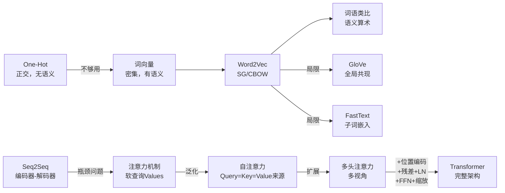

> **课程**：人工智能（专业必修）｜**对象**：计算机科学与技术专业二年级  
> **主题**：NLP基础 → 词嵌入 → Seq2Seq → 注意力机制 → Transformer

## 目录

1. [[#一、NLP基础与问题引入]]
2. [[#二、词嵌入（Word Embedding）]]
    - [[#2.1 One-Hot 表示的局限]]
    - [[#2.2 分布语义学与词向量]]
    - [[#2.3 Word2Vec]]
    - [[#2.4 CBOW 详解]]
    - [[#2.5 Skip-Gram 模型]]
    - [[#2.6 CBOW vs Skip-Gram 比较]]
    - [[#2.7 词语类比：有趣结论]]
    - [[#2.8 GloVe]]
    - [[#2.9 FastText]]
3. [[#三、Seq2Seq 模型]]
    - [[#3.1 机器翻译背景]]
    - [[#3.2 Seq2Seq 架构]]
    - [[#3.3 条件语言模型]]
    - [[#3.4 Seq2Seq 的瓶颈]]
4. [[#四、注意力机制（Attention）]]
    - [[#4.1 注意力的直觉]]
    - [[#4.2 注意力的数学形式]]
    - [[#4.3 注意力的优势]]
    - [[#4.4 注意力的通用定义]]
5. [[#五、Transformer]]
    - [[#5.1 设计动机]]
    - [[#5.2 自注意力（Self-Attention）]]
    - [[#5.3 训练技巧]]
    - [[#5.4 位置编码]]
    - [[#5.5 多头自注意力]]
    - [[#5.6 编码器-解码器注意力]]
    - [[#5.7 解码器：掩码与输出]]
    - [[#5.8 完整架构总结]]
6. [[#六、例题与练习]]
7. [[#七、总结与要点速览]]

---

## 一、NLP基础与问题引入

### 什么是 NLP

**自然语言处理（Natural Language Processing，NLP）** 是研究让计算机理解和生成人类语言的技术。

> **通俗理解**：人类用"中文""英文"等自然语言交流，而计算机只懂数字。NLP 就是搭建这两者之间的桥梁。

**NLP 的发展三阶段**：

|阶段|方法|特点|
|---|---|---|
|经验主义|基于规则|人工编写语言规则，维护代价高|
|理性主义|基于统计|从大量数据中学规律|
|深度学习时代|神经网络|端到端学习，性能大幅提升|

**NLP 典型任务**：机器翻译、文本摘要、分类、信息抽取、语音识别、对话系统……

---

## 二、词嵌入（Word Embedding）

### 2.1 One-Hot 表示的局限

#### 概念

最朴素的词表示方式：**One-Hot 向量**——词典中有多少个词，向量就有多少维，该词对应位置为1，其余为0。

```
词典: [apple, banana, cat, dog, hotel, motel, ...]

motel = [0, 0, 0, 0, 0, 1, 0, ...]
hotel = [0, 0, 0, 0, 1, 0, 0, ...]
```

#### ⚠️ 根本缺陷

**两个 One-Hot 向量是正交的！**  
即任意两个词的点积恒为 0：$\text{motel} \cdot \text{hotel} = 0$

这意味着从向量角度看，"motel"和"hotel"毫无相似性，但语义上它们几乎是同义词。这会导致：

- 搜索"Seattle motel"时无法匹配含"Seattle hotel"的文档
- 向量维度极高（词典可达 50万+），稀疏且低效
- 无法捕捉词汇间的语义关系

> **直觉类比**：就像用身份证号来判断两个人是否是亲戚——号码完全不同，但这并不代表他们没有关系。

---

### 2.2 分布语义学与词向量

#### 核心思想

> **"You shall know a word by the company it keeps."**  
> ——J. R. Firth, 1957

**分布语义学（Distributional Semantics）**：一个词的含义，由经常出现在它附近的词决定。

**举例**：

- "banking"周围经常出现 money, deposit, loan, interest → 与"金融"相关
- "music"周围经常出现 song, rhythm, melody → 与"音乐"相关

#### 词向量（Word Vector / Word Embedding）

**定义**：将每个词映射为一个**低维稠密的实数向量**（通常50~300维），使得语义相似的词在向量空间中距离更近。

- **稠密（Dense）**：大多数维度非零
- **低维**：相比 One-Hot 的几十万维，50~300 维极为紧凑
- **相似度度量**：用**点积**或**余弦相似度**

> **直觉**：词向量就像词的"坐标"，把所有词扔进一个多维空间，意思相近的词自然聚在一起。

---

### 2.3 Word2Vec

#### 来源

Mikolov et al., 2013 提出的词向量学习框架，核心思想极其简洁。

#### 总体思路

1. 准备大量文本语料（如维基百科）
2. 对每个位置 $t$，以中心词 $c$ 为核心，用大小为 $m$ 的滑动窗口确定上下文词 $o$
3. 通过词向量的相似度，计算 $P(o | c)$（给定中心词，预测上下文词）
4. 不断调整词向量，**最大化这个概率**

#### 目标函数

对位置 $t = 1, \ldots, T$，在窗口 $m$ 内，最大化数据似然：

$$L(\theta) = \prod_{t=1}^{T} \prod_{\substack{-m \leq j \leq m \ j \neq 0}} P(w_{t+j} \mid w_t; \theta)$$

等价地，**最小化负对数似然**（即损失函数）：

$$J(\theta) = -\frac{1}{T} \sum_{t=1}^{T} \sum_{\substack{-m \leq j \leq m \ j \neq 0}} \log P(w_{t+j} \mid w_t; \theta)$$

#### 预测函数：Softmax

每个词有**两个向量**：

- $v_w$：当 $w$ 作为**中心词**时
- $u_w$：当 $w$ 作为**上下文词**时

$$P(o \mid c) = \frac{\exp(u_o^T v_c)}{\sum_{w \in V} \exp(u_w^T v_c)}$$

公式解读：

1. $u_o^T v_c$（点积）：衡量中心词 $c$ 与候选词 $o$ 的**相似度**，值越大概率越高
2. $\exp(\cdot)$：指数确保结果为正
3. 分母：对整个词典做**归一化**，得到合法概率分布

这就是 **Softmax 函数**，将任意实数映射为概率分布。"soft"是因为它给所有词赋予非零概率；"max"是因为它放大了最大值的概率。

> ⚠️ **易错点**：为什么每个词需要两个向量（$v$ 和 $u$）？  
> 为了更容易优化。训练完成后，通常取两者均值作为最终词向量。

#### 训练细节

**两种模型变体**：

|变体|思路|特点|
|---|---|---|
|**Skip-Gram (SG)**|给定中心词，预测周围的上下文词|对稀有词效果好；需要更多数据|
|**CBOW**|给定上下文词，预测中心词|训练快；对高频词效果好|

**损失函数优化方案**：

- **朴素 Softmax**：计算所有词的分母，开销 $O(|V|)$，词典大时极慢
- **负采样（Negative Sampling）**：每次只比较正例和少量负例（通常5~20个）
- **分层 Softmax（Hierarchical Softmax）**：用二叉树结构加速

---

### 2.4 CBOW 详解

**Continuous Bag of Words（CBOW）**：用上下文预测中心词。

**例子**：句子 "The cat sat on floor"，窗口大小为2，预测 "sat"

输入：["the", "cat", "on", "floor"]（上下文词）  
输出：["sat"]（中心词）

**网络结构**：

```
输入层                隐藏层              输出层
x_cat (one-hot) ──┐
                   ├─→ v̂ = (v_cat + v_on) / 2 ──→ z = W'v̂ ──→ ŷ = softmax(z)
x_on  (one-hot) ──┘
```

**计算步骤**：

1. 每个上下文词的 one-hot 向量乘以嵌入矩阵 $W$，得到对应词向量
2. 对所有上下文词向量**取平均**（这就是"Bag of Words"的意思，忽略顺序）
3. 乘以输出矩阵 $W'$，得到 logits
4. Softmax 得到概率分布，目标是让中心词概率最大

**CBOW 目标函数**：

$$J = -\log P(w_t \mid w_{t-m}, \ldots, w_{t-1}, w_{t+1}, \ldots, w_{t+m})$$

**需要学习的参数**：嵌入矩阵 $W \in \mathbb{R}^{|V| \times |N|}$ 和输出矩阵 $W' \in \mathbb{R}^{|N| \times |V|}$

---

### 2.5 Skip-Gram 模型

**Skip-Gram**：用中心词预测上下文词，与 CBOW 方向相反。

- 输入：中心词（如"cat"）
- 输出：上下文中每个词的概率（如"the"、"sat"……）

> **类比**：给你一个词"猫"，预测它周围经常出现哪些词——"爪子""喵喵""老鼠"……

---

### 2.6 CBOW vs Skip-Gram 比较

|对比维度|CBOW|Skip-Gram|
|---|---|---|
|方向|上下文 → 中心词|中心词 → 上下文|
|稀有词处理|❌ 较差（上下文平均会稀释稀有信息）|✅ 较好|
|数据需求|少（收敛快）|多|
|直觉|"看上下文猜中间词"|"给一个词，猜周围词"|
|适用场景|数据量较少、高频词为主|数据量充足、需要捕捉稀有词语义|

> ⚠️ **易错点**：CBOW 不适合稀有词不是因为模型本身弱，而是因为取平均的操作会"稀释"稀有词的信号。

---

### 2.7 词语类比：有趣结论

Word2Vec 训练出的词向量有一个惊人性质：**向量运算可以反映语义关系**。

$$\text{king} - \text{man} + \text{woman} \approx \text{queen}$$

$$\text{China} - \text{Beijing} + \text{Tokyo} \approx \text{Japan}$$

这说明词向量空间中，语义关系被编码为**方向**（向量差），例如"国家-首都"关系对应一个特定方向。

**"king" 的 GloVe 词向量（50维示例）**：

```
[0.50451, 0.68607, -0.59517, -0.022801, 0.60046, ...]
```

看起来像一堆随机数，但这些数字编码了"king"的所有语义信息。

---

### 2.8 GloVe

#### Word2Vec 的遗留问题

1. **窗口限制**：两个词出现在同一篇文章中但距离很远（超过窗口大小），Word2Vec 无法捕捉它们的关系
2. **形态盲**：reading、reader、readable 共享词根，但 Word2Vec 将它们视为三个独立词

#### GloVe 解法

**GloVe（Global Vectors for Word Representation）**：全局向量词嵌入，解决问题①。

- **核心思想**：先统计整个语料库的**全局共现矩阵**（不限窗口），再用对数双线性回归模型从中学习词向量
- **输入**：语料库（无需预先构建训练集）
- **输出**：包含全局语义信息的词向量

> **对比 Word2Vec**：Word2Vec 是局部窗口方法（看局部），GloVe 是全局统计方法（看全局）。两者各有优势，现实中 GloVe 词向量效果往往很好。

---

### 2.9 FastText

**FastText**（Facebook, 2016）：解决问题②（形态信息缺失）。

**创新点：子词嵌入（Subword Embedding）**

- 将词分解为**字符 n-gram**（子词）
- 词的向量 = 其所有子词向量之和
- 例如 "reading" 被分解为 <re, rea, ead, adi, din, ing, ng>, \<reading> 等

**优点**：

- 能处理训练集中未见过的词（Out-of-Vocabulary，OOV）
- 自动捕捉词缀的语义（un-, -ing, -tion 等）
- 整体架构类似 CBOW，改动最小

---

## 三、Seq2Seq 模型

### 3.1 机器翻译背景

**任务定义**：将源语言句子 $x$ 翻译为目标语言句子 $y$。

**历史演进**：

|时期|方法|缺点|
|---|---|---|
|1990s–2010s|统计机器翻译（SMT）|系统极复杂，需要大量特征工程，每对语言都要重新设计|
|2014年+|神经机器翻译（NMT）|端到端，单一模型，效果更好|

**NMT 的里程碑**：

- 2014：第一篇 Seq2Seq 论文（Sutskever et al.）
- 2016：Google 翻译从 SMT 切换到 NMT，到 2018 年全面替代
- 令人震撼：数百工程师花数年建的 SMT 系统，被小团队数月内用 NMT 超越

---

### 3.2 Seq2Seq 架构

**神经机器翻译（NMT）** 的核心是 **Seq2Seq（序列到序列）** 模型，包含两个 RNN：

```
源序列 x₁ x₂ x₃ x₄         目标序列 y₁ y₂ y₃
    ↓   ↓   ↓   ↓                ↑   ↑   ↑
  [编码器  Encoder   ] ──→ c ──→ [解码器  Decoder   ]
     (RNN，逐词读入)    语境向量      (RNN，逐词生成)
```

**编码器（Encoder）**：读入整个源序列，将其压缩为一个固定大小的**上下文向量（Context Vector）** $c$，通常是最后一个隐藏状态。

**解码器（Decoder）**：以 $c$ 为初始状态，自回归地逐词生成目标序列（每次将上一步的输出作为下一步的输入）。

#### Seq2Seq 的通用性

Seq2Seq 本质是**编码器-解码器（Encoder-Decoder）**架构，适用于一切"序列输入→序列输出"的任务：

|任务|输入|输出|
|---|---|---|
|机器翻译|中文句子|英文句子|
|文本摘要|长文章|短摘要|
|对话系统|用户输入|系统回复|
|代码生成|自然语言描述|Python 代码|
|NL2SQL|自然语言问题|SQL 查询|

---

### 3.3 条件语言模型

Seq2Seq 是**条件语言模型**：

- "语言模型"：因为解码器预测目标句子 $y$ 的下一个词
- "条件"：因为预测是以源句子 $x$ 为条件的

$$P(y \mid x) = \prod_{t=1}^{T} P(y_t \mid y_1, \ldots, y_{t-1}, x)$$

**训练数据**：需要大量人工翻译的**平行语料**（双语句子对，如"我爱你 / I love you"）。

---

### 3.4 Seq2Seq 的瓶颈

> ⚠️ **重要缺陷：信息瓶颈（Bottleneck）**

无论源句子有多长，编码器都必须将全部信息压缩进**一个固定大小的向量** $c$！

- 短句子还好
- 长句子：句子越长，信息丢失越严重
- 早期词的信息经过多个时间步传递后，容易被"遗忘"（梯度消失）

这就像让你把整本书的内容压缩成一句话，再让别人根据这句话完整复述全书——无论如何都会丢失大量细节。

---

## 四、注意力机制（Attention）

### 4.1 注意力的直觉

**核心思想**：解码时不依赖单一的上下文向量，而是在**每一步**都直接回顾编码器的所有隐藏状态，"关注"与当前输出最相关的部分。

> **人类翻译的类比**：翻译一句话时，你会不断回头看原文，而不是只看一眼就翻译整句。注意力机制模拟的正是这种行为。

把注意力理解为一个**"模糊的哈希表"**：

- 普通哈希表：query 精确匹配唯一的 key，返回对应 value
- 注意力：query 与所有 key 进行软匹配，以匹配程度为权重，返回所有 value 的加权和

---

### 4.2 注意力的数学形式

设编码器隐藏状态为 $h_1, \ldots, h_N \in \mathbb{R}^h$，解码器在时间步 $t$ 的隐藏状态为 $s_t \in \mathbb{R}^h$。

**步骤1：计算注意力分数**

$$e_t = [s_t^T h_1, \ldots, s_t^T h_N] \in \mathbb{R}^N$$

（解码器状态与每个编码器状态的点积，衡量"相关程度"）

**步骤2：Softmax 归一化 → 注意力分布**

$$\alpha^t = \text{softmax}(e^t) \in \mathbb{R}^N \quad (\text{和为1的概率分布})$$

**步骤3：加权求和 → 注意力输出**

$$a^t = \sum_{i=1}^{N} \alpha_i^t h_i \in \mathbb{R}^h$$

**步骤4：拼接，输入解码器**

$$[a^t; s_t] \in \mathbb{R}^{2h}$$

---

### 4.3 注意力的优势

|优势|说明|
|---|---|
|✅ **解决瓶颈**|解码器可直接访问编码器所有状态，不再依赖单一向量|
|✅ **缓解梯度消失**|提供了梯度传播的"捷径"|
|✅ **可解释性**|注意力权重 $\alpha$ 可视化后，能看出翻译时"看"了源句的哪些词|
|✅ **软对齐**|无需人工标注，模型自动学习源语言和目标语言词的对应关系|

---

### 4.4 注意力的通用定义

注意力不只用于 Seq2Seq，它是一种通用的深度学习操作：

> **定义**：给定一组向量 **Values** 和一个查询向量 **Query**，注意力计算 Values 的加权和，权重由 Query 与 Values 的相似度决定。

$$\text{Attention}(Q, K, V) = \text{softmax}(QK^T) V$$

其中 $Q$（Query）、$K$（Key）、$V$（Value）是三个角色：

- **Query**：当前想查什么
- **Key**：被查询项的"标签"
- **Value**：被查询项的实际内容

---

## 五、Transformer

### 5.1 设计动机

论文：**"Attention is All You Need"**（Vaswani et al., 2017）

Transformer 的三大设计目标：

|目标|问题|解决方案|
|---|---|---|
|**最小化每层计算复杂度**|RNN 序列化处理，每层 $O(n \cdot d^2)$|自注意力并行计算|
|**最小化词间最大路径长度**|RNN 需要 $O(n)$ 步才能让远距离词交互|自注意力 $O(1)$ 步直接连接任意两词|
|**最大化并行化**|RNN 必须顺序计算，$h_t$ 依赖 $h_{t-1}$|自注意力对所有位置同时计算|

#### 与 RNN 的对比

```
RNN (顺序):      x1 → x2 → x3 → x4 → x5    （O(n)步，无法并行）
Transformer:     x1 ↔ x2 ↔ x3 ↔ x4 ↔ x5    （O(1)步，全连接，可并行）
                  ↕    ↕    ↕    ↕    ↕
```

> **核心优势**：每个词可以**一步**直接关注序列中任意其他词，且所有词同时计算，GPU 利用率极高。

---

### 5.2 自注意力（Self-Attention）
**自注意力**：query、key、value 全部来自**同一序列**（编码器关注编码器，或解码器关注解码器）。
与 Seq2Seq 中注意力的区别：
- Seq2Seq 注意力：解码器 query → 编码器 key/value（跨序列）
- 自注意力：同一序列的每个词 query → 同一序列的所有词 key/value（自身内部）
#### 计算步骤
对每个词 $x_i$，分别用三个线性变换生成 Q、K、V：
$$q_i = W^Q x_i, \quad k_i = W^K x_i, \quad v_i = W^V x_i$$

**步骤2**：计算注意力分数

$$e_{ij} = q_i \cdot k_j$$

**步骤3**：Softmax 归一化

$$\alpha_{ij} = \text{softmax}(e_{ij}) = \frac{\exp(e_{ij})}{\sum_k \exp(e_{ik})}$$

**步骤4**：加权求和

$$\text{output}_i = \sum_j \alpha_{ij} v_j$$

#### 矩阵形式（向量化）

$$Q = XW^Q, \quad K = XW^K, \quad V = XW^V$$

$$\text{Output} = \text{softmax}(QK^T) V$$

> ⚠️ **注意**：自注意力没有元素级非线性——它只是对 value 向量做加权平均（线性操作）。因此需要在后面加**前馈网络（FFN）**提供非线性。

---

### 5.3 训练技巧

#### Trick #1：残差连接（ResidualConnection）

$$x_l = F(x_{l-1}) + x_{l-1}$$

**动机**：深层网络很难学习恒等函数，残差连接相当于"提供一条直通道"，确保梯度和信息可以不失真地传递到浅层。

**额外效果**：平滑损失地貌（Loss Landscape），使训练更稳定。

```
输入 x ─────────────────────────────────────> (+) ──→ 输出
         └──→ 子层（自注意力或FFN）────────────┘
```

#### Trick #2：层归一化 （Layer Normalization）

**问题**：深层网络中，底层输出不断变化，上层参数难以适应（内部协变量偏移）。

**解决**：在每层内部，对每个样本的所有特征维度做归一化（均值为0，方差为1），然后用可学习的 $\gamma, \beta$ 缩放和平移：

$$\text{LayerNorm}(x) = \gamma \cdot \frac{x - \mu}{\sigma} + \beta$$

> ⚠️ **区分 LayerNorm vs BatchNorm**：  
> BatchNorm 对一个 batch 内所有样本的同一维度归一化（跨样本）；  
> LayerNorm 对单个样本的所有维度归一化（跨维度），不依赖 batch，更适合序列模型。

#### Trick #3：缩放点积注意力 （Scaled Dot-Product Attention）

**问题**：当 key/query 维度 $d_k$ 很大时，点积结果的方差会随 $d_k$ 线性增长，导致 softmax 进入梯度近乎为零的饱和区。

**推导**：若 $q$ 和 $k$ 的各维度独立同分布（均值0，方差1），则点积 $q \cdot k = \sum_{i=1}^{d_k} q_i k_i$ 的方差为 $d_k$，标准差为 $\sqrt{d_k}$。

**解决**：除以 $\sqrt{d_k}$ 将方差归一化为1：

$$\text{Attention}(Q, K, V) = \text{softmax}\left(\frac{QK^T}{\sqrt{d_k}}\right) V$$

> ⚠️ **易错点**：除以的是 $\sqrt{d_k}$（key 的维度的平方根），不是 $d_k$。

---

### 5.4 位置编码

#### 问题：自注意力没有顺序感

自注意力对所有位置的处理是**对称的**——"Man eats dinosaur" 和 "Dinosaur eats man" 得到完全相同的表示（输入打乱后注意力结果不变）。

但词序非常重要！

#### 解决方案：位置编码（Positional Encoding）

**方法**：在输入词向量中加入位置信息向量 $p_i$，使网络知道每个词在序列中的位置：

$$\tilde{x}_i = x_i + p_i$$

> **关键**：只需要在第一层加入，后续层通过残差连接保留位置信息。

#### 原始正弦位置编码

$$p_{i, 2j} = \sin\left(\frac{i}{10000^{2j/d}}\right), \quad p_{i, 2j+1} = \cos\left(\frac{i}{10000^{2j/d}}\right)$$

其中 $i$ 是位置，$j$ 是维度索引，$d$ 是嵌入维度。

**特点**：

- 每个位置对应一个唯一的"正弦指纹"
- 不同频率的正弦/余弦函数组合，理论上可外推到更长序列
- 缺点：不可学习，固定函数

#### 扩展：相对位置编码

现代模型（如 RoPE、ALiBi）更倾向于使用**相对位置编码**：捕捉词与词之间的**相对距离**，而非绝对位置。

**直觉**：在许多语言任务中，重要的是两个词"相距多远"，而不是它们在句子中的绝对位置。

---

### 5.5 多头自注意力

#### 动机

单个自注意力只能"看向"一种关注方向。但一个词可能因为不同原因而关注不同的其他词：

- "bank"可能同时需要关注"river"（河边）和"money"（银行）
- 不同的注意力头可以捕捉不同类型的依赖关系

#### 方法

使用 $h$ 个独立的注意力头，每个头有自己的 $Q_l, K_l, V_l$ 矩阵：

$$Q_l, K_l, V_l \in \mathbb{R}^{d \times d/h}$$

每个头独立计算：

$$\text{output}_l = \text{softmax}\left(\frac{X Q_l K_l^T X^T}{\sqrt{d/h}}\right) X V_l, \quad \text{output}_l \in \mathbb{R}^{d/h}$$

所有头的输出拼接后乘以输出矩阵 $Y \in \mathbb{R}^{d \times d}$：

$$\text{output} = Y[\text{output}_1; \ldots; \text{output}_h]$$

> ⚠️ **易错点**：每个头的维度是 $d/h$，不是 $d$，所以多头的总计算量与单头相当（不增加计算量，只是分多个视角）。

---

### 5.6 编码器-解码器注意力

在 Transformer 解码器中，有一种"跨注意力"（Cross-Attention）：

- **Key 和 Value 来自编码器**（"记忆"）：$k_i = K h_i, \quad v_i = V h_i$
- **Query 来自解码器**：$q_i = Q z_i$

这类似于 Seq2Seq 中的注意力机制，让解码器每一步"查询"编码器的内容。

---

### 5.7 解码器：掩码与输出

#### 掩码多头自注意力（Masked Multi-Head Attention）

**问题**：训练时，解码器一次性接收整个目标序列（并行训练）。但在预测第 $t$ 个词时，不应该"看见" $t$ 之后的词（防止作弊！）。

**解决**：在计算注意力分数时，将未来位置的分数设为 $-\infty$，这样 softmax 后对应权重趋向于0：

```
位置: 1  2  3  4  5
  1: ✅  ✗  ✗  ✗  ✗
  2: ✅  ✅  ✗  ✗  ✗
  3: ✅  ✅  ✅  ✗  ✗
  4: ✅  ✅  ✅  ✅  ✗
  5: ✅  ✅  ✅  ✅  ✅
```

（下三角矩阵掩码，✅可见，✗被掩盖）

#### 输出层

解码器最终输出经过：

1. **前馈网络（FFN）**：两层线性变换 + ReLU，提供非线性
2. **线性层**：将 $d$ 维嵌入投影到词典大小 $|V|$（logits）
3. **Softmax**：生成每个位置的词概率分布

---

### 5.8 完整架构总结

```
输入序列
   ↓
词嵌入 + 位置编码
   ↓
┌─────────────────────────────────┐
│         编码器 × N层             │
│  多头自注意力 → Add&Norm         │
│  前馈网络(FFN) → Add&Norm        │
└─────────────────────────────────┘
   ↓ 编码器输出 h₁, ..., hₙ
                              目标序列（右移一位）
                                 ↓
                          词嵌入 + 位置编码
                                 ↓
                    ┌─────────────────────────────────┐
                    │        解码器 × N层               │
                    │  掩码多头自注意力 → Add&Norm       │
                    │  编码器-解码器注意力 → Add&Norm    │
                    │  前馈网络(FFN) → Add&Norm         │
                    └─────────────────────────────────┘
                                 ↓
                           线性 + Softmax
                                 ↓
                            输出概率分布
```

**编码器一层的模块**：

1. 多头自注意力
2. 残差连接 + 层归一化
3. 前馈网络（FFN）
4. 残差连接 + 层归一化

**解码器一层的模块**：

1. 掩码多头自注意力
2. 残差连接 + 层归一化
3. 编码器-解码器注意力（Cross-Attention）
4. 残差连接 + 层归一化
5. 前馈网络（FFN）
6. 残差连接 + 层归一化

#### 尺度定律（Scaling Law）

Transformer 有一个极其重要的性质：随着**模型大小、训练数据量、计算资源**同步增加，性能以**幂律关系**稳定提升，且多个数量级内没有放缓的迹象。这是 GPT、Claude、Gemini 等超大模型的理论基础。

---

## 六、例题与练习

### 例题1：One-Hot 向量的相似度计算

**题目**：词典为 {apple, cat, dog, hotel, motel}（按字母顺序索引0~4）。

(1) 写出 "hotel" 和 "motel" 的 one-hot 向量；  
(2) 计算它们的余弦相似度；  
(3) 用词向量（假设 $v_{\text{hotel}} = [0.8, 0.6]$，$v_{\text{motel}} = [0.7, 0.7]$）重新计算余弦相似度，并说明词向量的优势。

**解答**：

(1) hotel = [0, 0, 0, 1, 0]，motel = [0, 0, 0, 0, 1]

(2) 余弦相似度 = $\frac{\text{hotel} \cdot \text{motel}}{|\text{hotel}||\text{motel}|} = \frac{0}{1 \times 1} = 0$

(3) $\cos(\theta) = \frac{0.8 \times 0.7 + 0.6 \times 0.7}{\sqrt{0.64+0.36} \times \sqrt{0.49+0.49}} = \frac{0.56 + 0.42}{1.0 \times \sqrt{0.98}} \approx \frac{0.98}{0.99} \approx 0.99$

**结论**：One-Hot 向量永远正交（相似度为0），无法反映语义相似性；词向量能编码语义，语义相近的词余弦相似度接近1。

---

### 例题2：Word2Vec 目标函数分析

**题目**：给定句子 "I love deep learning"，窗口大小 $m=1$，使用 Skip-Gram 模型。

(1) 写出中心词为 "love" 时，需要预测的上下文词；  
(2) 写出此时需要最大化的概率表达式；  
(3) 如果词典大小 $|V| = 10000$，解释为什么朴素 Softmax 计算代价高昂，并说明负采样如何解决这个问题。

**解答**：

(1) 上下文词为 "I" 和 "deep"（窗口大小1，左右各取1个词）

(2) 需要最大化：$P(\text{"I"} | \text{"love"}) \times P(\text{"deep"} | \text{"love"})$

展开：

$$P(o|c) = \frac{\exp(u_o^T v_c)}{\sum_{w \in V} \exp(u_w^T v_c)}$$

(3) **朴素 Softmax 问题**：分母需要对所有 $|V|=10000$ 个词计算 $\exp(u_w^T v_c)$，每次梯度更新都需要遍历整个词典，计算量为 $O(|V|)$。

**负采样**：将"预测上下文词"改为"区分真实词和噪声词"的二分类问题：

- 正例：真实的中心词-上下文词对（1对）
- 负例：随机采样的噪声词（通常5~20个）

目标函数变为：

$$J = \log \sigma(u_o^T v_c) + \sum_{k=1}^{K} \log \sigma(-u_k^T v_c)$$

计算量从 $O(|V|)$ 降至 $O(K)$，K通常为5~20，效率大幅提升。

---

### 例题3：注意力机制计算

**题目**：Seq2Seq 模型中，编码器输出3个隐藏状态（已归一化）：

$$h_1 = [1, 0], \quad h_2 = [0, 1], \quad h_3 = [1, 1]/\sqrt{2}$$

解码器当前隐藏状态 $s_t = [1, 1]/\sqrt{2}$。

(1) 计算注意力分数 $e_t = [s_t^T h_1, s_t^T h_2, s_t^T h_3]$；  
(2) 计算注意力分布 $\alpha^t = \text{softmax}(e_t)$（保留2位小数）；  
(3) 计算注意力输出 $a^t = \sum_i \alpha_i^t h_i$，说明模型最"关注"哪个位置。

**解答**：

(1) $$e_1 = \frac{[1,1]}{\sqrt{2}} \cdot [1,0] = \frac{1}{\sqrt{2}} \approx 0.707$$ $$e_2 = \frac{[1,1]}{\sqrt{2}} \cdot [0,1] = \frac{1}{\sqrt{2}} \approx 0.707$$ $$e_3 = \frac{[1,1]}{\sqrt{2}} \cdot \frac{[1,1]}{\sqrt{2}} = \frac{2}{2} = 1.0$$

(2) $\text{softmax}([0.707, 0.707, 1.0])$：

$$e^{0.707} \approx 2.028, \quad e^{1.0} \approx 2.718$$ $$\text{sum} = 2.028 + 2.028 + 2.718 = 6.774$$ $$\alpha = [0.30, 0.30, 0.40]$$

(3) $a^t = 0.30 \times [1,0] + 0.30 \times [0,1] + 0.40 \times [1,1]/\sqrt{2}$ $$= [0.30, 0] + [0, 0.30] + [0.283, 0.283] = [0.583, 0.583]$$

**结论**：模型最关注位置3（权重0.40最大），因为 $h_3$ 方向与查询 $s_t$ 最相似（余弦相似度为1.0）。

---

### 例题4：Scaled Dot-Product Attention 的必要性

**题目**：设 query 和 key 的维度均为 $d_k = 64$，假设它们的各分量独立同分布于 $\mathcal{N}(0, 1)$。

(1) 计算点积 $q \cdot k = \sum_{i=1}^{64} q_i k_i$ 的期望和方差；  
(2) 如果不除以 $\sqrt{d_k}$，softmax 输入的标准差约为多少？这会造成什么问题？  
(3) 除以 $\sqrt{d_k}$ 后方差变为多少？

**解答**：

(1) 期望：$E[q_i k_i] = E[q_i] E[k_i] = 0$（独立），因此 $E[q \cdot k] = 0$。

方差：$\text{Var}[q_i k_i] = E[q_i^2 k_i^2] - 0 = E[q_i^2] E[k_i^2] = 1$（因为 $E[q_i^2] = \text{Var}[q_i] = 1$）

因此 $\text{Var}[q \cdot k] = d_k \cdot 1 = 64$，标准差 $= 8$。

(2) 不缩放时，softmax 输入的标准差约为8，值域大约在 $[-24, +24]$（3σ范围）。

Softmax 对于极端输入会饱和：$\text{softmax}([0, 0, \ldots, 24]) \approx [0, 0, \ldots, 1.0]$，梯度接近0，模型难以训练（"硬"分布，梯度消失）。

(3) 除以 $\sqrt{64} = 8$ 后，方差变为 $\frac{64}{64} = 1$，标准差为1，softmax 输入分布温和，梯度正常。

---

### 例题5：Transformer 位置编码与掩码

**题目**：

(1) 解释为什么 Transformer 必须使用位置编码，而 RNN 不需要。  
(2) 对于序列 "A B C D"，画出解码器掩码矩阵（✅/✗表示是否可见）。  
(3) 如果不使用掩码，在训练时会出现什么问题？在推理（生成）时是否需要掩码？

**解答**：

(1) **RNN** 按时间顺序处理序列（$h_1 \to h_2 \to \ldots$），顺序信息天然编码在时序中；**Transformer 的自注意力**对所有位置同时计算，输入打乱顺序后得到完全相同的结果（置换等变性），因此必须显式注入位置信息。

(2) 解码器掩码矩阵（行=当前位置，列=可见位置）：

```
     A   B   C   D
A  [ ✅   ✗   ✗   ✗ ]
B  [ ✅   ✅   ✗   ✗ ]
C  [ ✅   ✅   ✅   ✗ ]
D  [ ✅   ✅   ✅   ✅ ]
```

(3) **不使用掩码的训练问题**：预测 B 时可以直接"看见" C、D，模型只需复制答案，根本不需要真正学习语言建模，训练出的模型在推理时（逐词生成，无未来信息）会完全失效。

**推理时是否需要掩码**：推理时模型**逐步自回归生成**，每一步只有已生成的词，未来词本来就不存在，所以推理时**不需要**显式掩码，但效果等同于掩码（因为根本没有未来词可看）。

---

### 例题6：多头注意力的参数分析

**题目**：一个 Transformer 编码器层，嵌入维度 $d = 512$，多头注意力头数 $h = 8$。

(1) 每个注意力头的 $Q_l, K_l, V_l$ 矩阵各是什么维度？  
(2) 整个多头注意力模块（8个头+输出矩阵 $Y$）共有多少可学习参数？  
(3) 前馈网络（FFN）若使用 $d_{\text{ff}} = 2048$，参数量是多少？

**解答**：

(1) 每个头的维度：$d/h = 512/8 = 64$

$$Q_l, K_l, V_l \in \mathbb{R}^{512 \times 64}$$

(2) 参数量计算：

- 每个头：$3 \times 512 \times 64 = 98304$（Q、K、V 各一个矩阵）
- 8个头：$8 \times 98304 = 786432$
- 输出矩阵 $Y \in \mathbb{R}^{512 \times 512}$：$262144$
- **总计**：$786432 + 262144 = 1048576 \approx 1M$ 参数

(3) FFN 参数量（两层线性变换，不含偏置）： $$512 \times 2048 + 2048 \times 512 = 2 \times 512 \times 2048 = 2097152 \approx 2M \text{ 参数}$$

**结论**：FFN 的参数量（2M）约是多头注意力（1M）的2倍，这在 Transformer 的参数分布中是典型比例。

---

## 七、总结与要点速览

### 知识点脉络



### ⚠️ 重难点与易错点汇总

|易错点|正确理解|
|---|---|
|认为词向量和 One-Hot 没本质区别|词向量是**稠密连续**向量，能编码语义相似性|
|混淆 CBOW 和 Skip-Gram 方向|CBOW：上下文→中心词；Skip-Gram：中心词→上下文|
|Word2Vec 每个词为什么有两个向量|为优化方便，最终取均值；也可实现单向量版本|
|认为自注意力有顺序感|自注意力**没有**顺序感，必须加位置编码|
|Scaled Attention 除以什么|除以 $\sqrt{d_k}$（key维度的平方根）|
|多头注意力增加了计算量|每头维度为 $d/h$，总计算量与单头**相当**|
|推理时也需要掩码|推理时逐词生成，**不存在**未来词，无需掩码|
|LayerNorm 和 BatchNorm 混淆|LayerNorm 在特征维度归一化，不依赖batch大小|
|残差连接是 $F(x)$|残差连接是 $F(x) + x$，加上了原始输入|

### 核心公式速查

|公式名称|表达式|
|---|---|
|Softmax|$\text{softmax}(x_i) = \frac{e^{x_i}}{\sum_j e^{x_j}}$|
|Word2Vec 预测|$P(o \mid c) = \frac{\exp(u_o^T v_c)}{\sum_{w} \exp(u_w^T v_c)}$|
|注意力输出|$a^t = \sum_i \alpha_i^t h_i$，$\alpha^t = \text{softmax}(e^t)$|
|缩放点积注意力|$\text{Attention}(Q,K,V) = \text{softmax}\left(\frac{QK^T}{\sqrt{d_k}}\right)V$|
|自注意力 QKV|$Q=XW^Q,\ K=XW^K,\ V=XW^V$|
|残差连接|$x_l = F(x_{l-1}) + x_{l-1}$|
|层归一化|$\text{LayerNorm}(x) = \gamma \frac{x-\mu}{\sigma} + \beta$|

### Transformer 的影响力

- **NLP领域**：BERT、GPT、T5、LLaMA、Claude 等几乎所有现代大语言模型均基于 Transformer
- **计算机视觉**：Vision Transformer（ViT）将图像切割为 patch，用 Transformer 处理
- **多模态**：DALL-E、Stable Diffusion、Flamingo 等跨模态模型
- **尺度定律**：模型规模+数据量+算力同步增加，性能稳定提升（幂律关系），没有放缓迹象

---

> 📚 **课程资源**：超算习堂 https://easyhpc.net/course/143