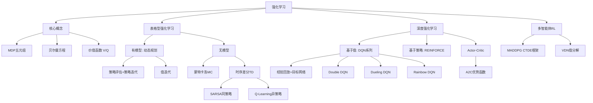

> **课程**：人工智能（专业必修）｜**对象**：计算机科学与技术专业二年级  
> **主题**：强化学习基础 → 表格型RL → 深度RL → 多智能体RL → AlphaGo

## 目录

1. [[#一、强化学习概述]]
2. [[#二、强化学习基础]]
    - [[#2.1 核心要素：智能体与环境]]
    - [[#2.2 马尔可夫决策过程（MDP）]]
    - [[#2.3 策略函数]]
    - [[#2.4 回报与折扣因子]]
    - [[#2.5 价值函数]]
    - [[#2.6 贝尔曼方程]]
    - [[#2.7 贝尔曼最优方程]]
3. [[#三、表格型强化学习]]
    - [[#3.1 动态规划（有模型方法）]]
    - [[#3.2 蒙特卡洛估计方法]]
    - [[#3.3 时序差分方法（TD）]]
    - [[#3.4 SARSA算法]]
    - [[#3.5 Q-Learning算法]]
    - [[#3.6 同策略 vs 异策略]]
4. [[#四、深度强化学习]]
    - [[#4.1 为什么需要深度RL]]
    - [[#4.2 基于值的深度RL：DQN系列]]
    - [[#4.3 基于策略的RL：REINFORCE]]
    - [[#4.4 Actor-Critic（AC）方法]]
5. [[#五、多智能体强化学习（MARL）]]
6. [[#六、案例：AlphaGo]]
7. [[#七、例题与练习]]
8. [[#八、总结与速览]]

---

## 一、强化学习概述

### 强化学习是什么

强化学习（Reinforcement Learning，RL）是机器学习的**第三种范式**，研究智能体如何在**复杂不确定的环境**中通过大量试错（trial-and-error）学习最优决策策略。

> **核心问题**：在与环境的动态交互中，如何通过获得的奖励信号，学习到使长期累积奖励最大化的行为策略？

### 与监督学习/无监督学习的本质区别

|范式|数据来源|学习信号|是否交互|是否序列决策|
|---|---|---|---|---|
|监督学习|提前给定的静态数据|人工标注标签|❌|❌|
|无监督学习|提前给定的静态数据|无标签，发现规律|❌|❌|
|**强化学习**|**与环境动态交互产生**|**环境奖励信号**|✅|✅|

强化学习的四大特征：

- **试错学习**：通过尝试不同动作，依据奖励调整策略
- **延迟奖励**：奖励可能在多步后才到来，需考虑长期回报
- **动态策略**：策略随交互不断更新
- **序列决策**：每个动作都影响后续状态

### 重要应用

|领域|代表成果|
|---|---|
|博弈游戏|AlphaGo（围棋）、AlphaZero（棋类）、DouZero（斗地主）|
|机器人|仿人运动、ReLMM自主导航抓取、外骨骼辅助|
|无人机|击败人类世界冠军的无人机竞速（Nature 2023）|
|科学工程|芯片设计（Nature 2021）、矩阵乘法算法（Nature 2022）、蛋白质设计（Science 2023）|
|大语言模型|RLHF（基于人类反馈的强化学习），如 ChatGPT 的对齐训练|

---

## 二、强化学习基础

### 2.1 核心要素：智能体与环境

```
              ┌─────────────────────────────────┐
              │           环境 Environment       │
              │                                  │
  ┌───────────┤  Reward 奖励        State 状态   ├──────────────┐
  │           │                                  │              │
  │           └─────────────────────────────────┘              │
  │                                                             │
  ▼                                                             │
智能体 Agent ──────────────── Action 动作 ──────────────────────┘
```

四个基本要素：

|要素|说明|例子（冒险岛游戏）|
|---|---|---|
|**智能体（Agent）**|做决策的主体|玩家角色|
|**环境（Environment）**|智能体外的一切|道路、障碍、怪物|
|**状态（State）**|当前时刻的环境描述|当前帧画面|
|**动作（Action）**|智能体可执行的操作|向前走、跳跃、向后走|
|**奖励（Reward）**|环境对动作的即时反馈|收集苹果+50，碰到怪物游戏结束|

**强化学习的目标**：最大化在环境中所能获得的**累积奖励**。
### 2.2 马尔可夫决策过程（MDP）

#### 马尔可夫性质

> **定义**：给定当前状态，未来状态与历史状态**条件独立**。 $$P_r{S_{t+h}=s \mid S_i=s_i, i \leq t} = P_r{S_{t+h}=s \mid S_t=s_t}, \quad \forall h > 0$$

**通俗理解**：下一时刻的状态只取决于**当前状态**，与历史无关。  
就像下围棋，决定下一步最优落子的只是棋盘当前状态，而不是哪步棋先落的。

#### MDP 五元组 $(\mathcal{S}, \mathcal{A}, p, R, \gamma)$

|符号|含义|说明|
|---|---|---|
|$\mathcal{S}$|状态空间|所有可能状态的集合|
|$\mathcal{A}$|动作空间|所有可能动作的集合|
|$p(s'\mid s,a)$|**状态转移函数**|在状态 $s$ 采取动作 $a$ 后，转移到 $s'$ 的概率|
|$R(s,a,s')$|**奖励函数**|状态转移后获得的即时奖励|
|$\gamma \in [0,1]$|**折扣因子**|衡量未来奖励的当前价值|

> ⚠️ **易错点**：奖励函数 $R$ 不仅取决于当前状态，还受到动作和下一状态的影响（三元组）。
### 2.3 策略函数

**策略（Policy）**：从状态空间到动作空间的映射，即"在什么状态下该干什么"。

**两种类型**：

|类型|形式|说明|适用场景|
|---|---|---|---|
|**随机性策略**|$\pi(a \mid s)$|输出在状态 $s$ 下选动作 $a$ 的**概率**|博弈（如石头剪刀布）需要不可预测性|
|**确定性策略**|$a = \pi(s)$|直接输出确定动作|大多数控制任务|

随机性策略须满足：$\sum_{a \in \mathcal{A}} \pi(a \mid s) = 1$

**两种表达形式**：

- **表格型策略**：直接用一个表格存储每个状态对应的动作概率，简单直观
- **参数化策略** $\pi_\theta(a \mid s)$：用神经网络等参数模型表示，可处理大规模/连续空间

---

### 2.4 回报与折扣因子

#### 回报（Return）

**回报 $G_t$**：从时间步 $t$ 开始的**折扣奖励总和**：

$$G_t = R_{t+1} + \gamma R_{t+2} + \gamma^2 R_{t+3} + \ldots = \sum_{k=0}^{\infty} \gamma^k R_{t+k+1}$$

#### 折扣因子 $\gamma$ 的意义

$k+1$ 步后的奖励 $R$ 在当前的价值定义为 $\gamma^k R$，即越远的奖励打折越多。

**为什么需要折扣**：

1. **数学性质**：确保无限步长时回报有限，保证算法收敛
2. **避免循环**：马尔可夫过程若有环，无折扣会导致无限奖励
3. **不确定性**：未来奖励存在不确定性，折扣反映风险
4. **现实依据**：人类和动物更倾向于即时奖励；经济学上当前收益价值高于未来
5. **特殊情况**：$\gamma = 0$，只关注即时奖励；$\gamma = 1$，完全不折扣（等权重）

---

### 2.5 价值函数
价值函数是强化学习的核心，用于**评估一个策略的好坏**
#### 状态价值函数 $V^\pi(s)$
从状态 $s$ 出发，按策略 $\pi$ 行动的**期望回报**：
$$V^\pi(s) \triangleq \mathbb{E}_\pi[G_t \mid S_t = s]$$
> **直觉**：$V^\pi(s)$ 表示"从这个状态出发，按照这个策略，平均能得多少分"。
#### 动作价值函数（Q函数）$Q^\pi(s,a)$

从状态 $s$ 出发，先执行动作 $a$，再按策略 $\pi$ 行动的期望回报：

$$Q^\pi(s,a) \triangleq \mathbb{E}_\pi[G_t \mid S_t=s, A_t=a]$$

#### 两者的关系

$$V^\pi(s) = \sum_{a \in \mathcal{A}} \pi(a \mid s) Q^\pi(s,a)$$

$$Q^\pi(s,a) = \mathcal{R}^a_s + \gamma \sum_{s' \in \mathcal{S}} \mathcal{P}^a_{ss'} V^\pi(s')$$

> **理解**：$V$ 是 $Q$ 关于动作的加权平均；$Q$ 是即时奖励加上下一个状态价值的期望。

#### 最优价值函数
$$V^*(s) = \max_{\pi} V^\pi(s), \quad Q^*(s,a) = \max_{\pi} Q^\pi(s,a)$$

$$V^*(s) = \max_a Q^*(s,a)$$

从 $Q^*$ 可直接得到**最优策略**：$\pi^*(a \mid s) = \begin{cases} 1 & \text{if } a = \arg\max_{a \in \mathcal{A}}Q^*(s,a) \\ 0 & \text{otherwise} \end{cases}$

### 2.6 贝尔曼方程
贝尔曼方程是强化学习的理论核心，将价值函数递归分解为**即时奖励 + 后续折扣价值**
#### 状态价值贝尔曼方程
$$\boxed{V^\pi(s) = \sum_{a \in \mathcal{A}} \pi(a \mid s) \left[ \mathcal{R}^a_s + \gamma \sum_{s' \in \mathcal{S}} \mathcal{P}^a_{ss'} V^\pi(s') \right]}$$
**推导过程**：
$$V^\pi(s) = \mathbb{E}_\pi[G_t \mid S_t=s]$$ $$= \mathbb{E}_\pi[R_{t+1} + \gamma G_{t+1} \mid S_t=s]$$ $$= \mathbb{E}_\pi[R_{t+1} + \gamma V^\pi(S_{t+1}) \mid S_t=s]$$
#### 动作价值贝尔曼方程

$$\boxed{Q^\pi(s,a) = \mathcal{R}^a_s + \gamma \sum_{s' \in \mathcal{S}} \mathcal{P}^a_{ss'} \sum_{a' \in \mathcal{A}} \pi(a' \mid s') Q^\pi(s',a')}$$

---

### 2.7 贝尔曼最优方程
$$\boxed{V^*(s) = \max_a \left( \mathcal{R}^a_s + \gamma \sum_{s' \in \mathcal{S}} \mathcal{P}^a_{ss'} V^*(s') \right)}$$
$$\boxed{Q^*(s,a) = \mathcal{R}^a_s + \gamma \sum_{s' \in \mathcal{S}} \mathcal{P}^a_{ss'} \max_{a'} Q^*(s',a')}$$
贝尔曼方程满足动态规划的两个性质：
- **最优子结构**：全局最优解可分解为子问题最优解
- **重叠子问题**：价值函数存储并重用子问题的解
## 三、表格型强化学习
### 表格型RL 场景
在**有限状态和动作空间**中，可以用一个 **Q 表**（二维表格，行=状态，列=动作）存储所有 $Q(s,a)$ 的估计值
**典型环境**：冰湖（Frozen Lake）——智能体在冰面上从起点走到终点，避开冰洞
Q 表的更新方法分两大类：

| 类别                     | 特点                         | 代表算法                  |
| ---------------------- | -------------------------- | --------------------- |
| **有模型方法（Model-Based）** | 已知转移函数 $p$ 和奖励函数 $R$，用动态规划 | 策略迭代、值迭代              |
| **无模型方法（Model-Free）**  | 不知道 $p$ 和 $R$，通过交互数据更新     | 蒙特卡洛、SARSA、Q-Learning |

### 3.1 动态规划（有模型方法）
#### 策略评估（Policy Evaluation）
**任务**：给定策略 $\pi$，求其对应的价值函数 $V^\pi$
**方法**：迭代使用贝尔曼期望方程进行同步更新（每次迭代更新所有状态）：
$$v_{k+1}(s) = \sum_{a \in \mathcal{A}} \pi(a \mid s) \left[ \mathcal{R}^a_s + \gamma \sum_{s' \in \mathcal{S}} \mathcal{P}^a_{ss'} v_k(s') \right]$$
**收敛性**：贝尔曼期望算子 $B^\pi$ 是 $\gamma$-压缩映射（Contraction Mapping），由压缩映射定理保证唯一不动点 $V^\pi$ 存在且算法收敛
> **直觉**：反复把"当前估计的价值"代入贝尔曼方程，每次迭代都更接近真实价值，最终收敛
#### 策略提升（Policy Improvement）
**任务**：根据当前 $V^\pi$（或 $Q^\pi$），改进策略 $\pi$
**贪心策略提升**：
$$\pi'(a \mid s) = \arg\max_{a \in \mathcal{A}} Q^\pi(s,a)$$
**定理（策略提升定理）**：贪心改进后的策略 $\pi'$ 一定足 $V^{\pi'}(s) \geq V^\pi(s), \forall s$
#### 策略迭代（Policy Iteration）
交替执行策略评估和策略提升，直至收敛：
```
初始化 v, π
循环：
  1. 策略评估：迭代求解 V^π
  2. 策略提升：π' = greedy(V^π)
  3. 若 π' == π，则停止（已达最优）
```

**问题**：每次策略提升前需完整运行策略评估（可能需要多次迭代）→ 引出值迭代。
#### 值迭代（Value Iteration）
**思想**：直接迭代贝尔曼最优方程，无需显式维护策略：
$$v_{k+1}(s) \leftarrow \max_a \left( \mathcal{R}^a_s + \gamma \sum_{s' \in \mathcal{S}} \mathcal{P}^a_{ss'} v_k(s') \right)$$
与策略迭代的区别：**没有显式的策略**，直接从值函数导出最优策略

|方法|目标|使用的方程|特点|
|---|---|---|---|
|策略评估|求 $V^\pi$|贝尔曼期望方程|需要给定 $\pi$|
|策略迭代|求最优策略|期望方程 + 贪心提升|每轮需完整评估|
|值迭代|求最优策略|贝尔曼最优方程|无需显式策略|

**计算复杂度**：$n$ 个状态，$m$ 个动作时，每次迭代基于 $V$：$O(mn^2)$；基于 $Q$：$O(m^2n^2)$。
### 3.2 蒙特卡洛估计方法
**核心思想**：通过**采样多条完轨迹**，用累积回报的**样本均值**估计价值函数。不需要知道转移函数 $p$
$$V^\pi(s) \approx \frac{1}{N} \sum_{i=1}^{N} G^{(i)}(s)$$
#### 两种变体
**首次访问蒙特卡洛（First-Visit MC）**：每条轨迹中，只取**第一次访问**状态 $s$ 的回报：
$$V_N(s) = \frac{G^{(1,1)}(s) + G^{(2,1)}(s) + \ldots + G^{(N,1)}(s)}{N} \quad \text{（无偏估计）}$$
**每次访问蒙特卡洛（Every-Visit MC）**：每次访问都计入（有偏估计，但当访问次数 $\to \infty$ 时同样收敛）
#### 增量式更新
不用存所有回报，可以递推更新：
$$Q_N(s,a) = Q_{N-1}(s,a) + \frac{1}{N}\left[G^{(N,1)}(s,a) - Q_{N-1}(s,a)\right]$$
> **理解**：每拿到一个新回报，就把Q值向它"调整一小步"。
#### ε-贪心策略（解决探索问题）
MC 策略评估需要所有状态动作对都被访问到，因此策略不能完全贪心。**ε-贪心策略**：
$$\pi'(a \mid s) = \begin{cases} \epsilon/|\mathcal{A}| + 1-\epsilon & \text{if } a = \arg\max_a Q_N(s,a) \\
 \epsilon/|\mathcal{A}| & \text{otherwise} \end{cases}$$
- 以 $1-\epsilon$ 的概率**贪心选择**当前最优动作（利用）
- 以 $\epsilon$ 的概率**随机选择**（探索）

> ⚠️ **ε-贪心满足策略提升定理**：可以证明 $q_\pi(s, \pi'(s)) \geq v_\pi(s)$，即 ε-贪心策略不比原策略差。

#### 蒙特卡洛的优缺点

|优点|缺点|
|---|---|
|无需环境模型（$p$ 未知也行）|需要完整 episode，不适合无限步长|
|可只评估部分重要状态|方差大，收敛慢|
|适用于非马尔可夫场景|采样不足时易收敛到次优|

---

### 3.3 时序差分方法（TD）
TD 方法综合了动态规划（用估计值更新）和蒙特卡洛（用采样更新）的优点：
$$\boxed{V(S_t) \leftarrow V(S_t) + \alpha \underbrace{(R_{t+1} + \gamma V(S_{t+1}) - V(S_t))}_{\text{TD 误差 } \delta_t}}$$
- $R_{t+1} + \gamma V(S_{t+1})$ 称为 **TD 目标**（用下一步的估计值替代后续所有回报）
- $\delta_t = R_{t+1} + \gamma V(S_{t+1}) - V(S_t)$ 称为 **TD 误差**（现实与预期的差距）
**自举（Bootstrapping）**：用 $V(S_{t+1})$ 的估计值来更新 $V(S_t)$，不等 episode 结束即可更新。
#### MC vs TD vs DP 比较

| 方法       | 更新时机       | 使用真实值还是估计值 | 偏差     | 方差    |
| -------- | ---------- | ---------- | ------ | ----- |
| **动态规划** | 基于模型       | 期望（真实）     | 无偏     | 低     |
| **蒙特卡洛** | episode 结束 | 真实完整回报     | 无偏     | **高** |
| **时序差分** | 每步都可       | 下一步估计值     | **有偏** | 低     |
> **结论**：偏差方面 MC 优于 TD；方差方面 TD 优于 MC。两者各有取舍。
#### n步时序差分

在 TD（$n=1$）和 MC（$n=\infty$）之间做权衡：

$$G_t^{(n)} = R_{t+1} + \gamma R_{t+2} + \ldots + \gamma^{n-1} R_{t+n} + \gamma^n V(S_{t+n})$$

$$V(S_t) \leftarrow V(S_t) + \alpha(G_t^{(n)} - V(S_t))$$

$n$ 越大，方差越大，偏差越小；进一步可用 **$\lambda$-回报**（对所有 $n$ 的加权平均）
### 3.4 SARSA算法
**SARSA** = 同策略（On-Policy）的时序差分控制算法，使用五元组 $\langle S_t, A_t, R_{t+1}, S_{t+1}, A_{t+1} \rangle$ 更新 Q 值：
$$\boxed{Q(S_t, A_t) \leftarrow Q(S_t, A_t) + \alpha\left[R_{t+1} + \gamma Q(S_{t+1}, A_{t+1}) - Q(S_t, A_t)\right]}$$
- **策略评估**：用上式估计当前策略的 $Q^\pi$
- **策略提升**：用 ε-贪心策略提升
> ⚠️ **SARSA 是同策略（On-Policy）**：行为策略和目标策略相同，下一步动作 $A_{t+1}$ 是由**当前 ε-贪心策略**选出来的。
### 3.5 Q-Learning算法
**Q-Learning** = 异策略（Off-Policy）的时序差分控制算法：
$$\boxed{Q(S_t, A_t) \leftarrow Q(S_t, A_t) + \alpha\left[R_{t+1} + \gamma \max_{a'} Q(S_{t+1}, a') - Q(S_t, A_t)\right]}$$
**与 SARSA 的核心区别**：目标值使用的是 $\max_{a'}$ 而非实际执行的 $A_{t+1}$。
**推导思路**：令目标策略为贪心策略 $\pi(s) = \arg\max_a Q(s,a)$，则： $$Q^\pi(S_t, A_t) = \mathbb{E}_\pi[R_{t+1} + \gamma \max_{a'} Q(S_{t+1}, a')]$$
由于 $R_{t+1}$ 和 $S_{t+1}$ 只由环境决定，与采样策略无关，所以**可以用任意行为策略采集数据，目标策略始终是贪心策略**——这就是"异策略"的含义

|对比维度|SARSA|Q-Learning|
|---|---|---|
|策略类型|同策略（On-Policy）|异策略（Off-Policy）|
|目标值|用实际动作 $Q(S_{t+1}, A_{t+1})$|用 $\max_{a'} Q(S_{t+1}, a')$|
|探索影响|探索行为会影响值函数估计|探索不影响目标策略|
|数据复用|难以复用旧策略数据|可复用旧策略数据|

### 3.6 同策略 vs 异策略
**同策略（On-Policy）**：行为策略 = 目标策略（边采样边学习自身策略）
**异策略（Off-Policy）**：行为策略 $\mu \neq$ 目标策略 $\pi$（用一个策略采样，学习另一个策略）
异策略的**优势**：
- 可以复用旧策略 $\pi_1, \pi_2, \ldots$ 产生的经验
- 可以通过观察其他智能体的行为学习
- 可以保持充分探索（行为策略更 exploratory）
## 四、深度强化学习

### 4.1 为什么需要深度RL

表格型方法的根本局限：

|问题|说明|
|---|---|
|**维度灾难**|象棋约 $10^{120}$ 个状态，围棋约 $10^{170}$，根本无法建表|
|**连续状态**|机器人关节角度、图像像素等连续空间无法离散化|
|**缺乏泛化**|对未见过的状态完全没有经验，无法推广|
|**存储开销**|状态-动作对数量指数增长|

**解决方案**：用**深度神经网络**近似值函数/策略函数，实现高维状态下的泛化。

**深度强化学习（DRL）** = 强化学习 + 深度学习：

- 深度神经网络：处理图像、高维连续向量等复杂感知数据
- 强化学习框架：处理序列决策优化问题

---

### 4.2 基于值的深度RL：DQN系列
#### Naïve DQN
**思路**：用神经网络 $Q_w(s,a)$ 近似 Q 函数，通过最小化 TD 误差来训练：
$$y_i = r_i + \gamma \max_{a'} Q_w(s_i', a')$$ $$w \leftarrow \arg\min_w \frac{1}{2} \sum_i (Q_w(s_i, a_i) - y_i)^2$$
**问题1**：**样本相关性高**——时间相近的状态之间极为相似（相邻帧画面几乎一样），违反了梯度下降对独立同分布数据的假设，训练不稳定
**问题2**：**不是真正的梯度下降（Semi-Gradient）**——目标值 $y_i$ 本身也依赖于 $Q_w$，参数更新时目标也在变动，不能保证收敛，可能震荡
#### Classic DQN（经验回放 + 目标网络）
**解决问题1：经验回放池（Experience Replay Buffer）**
- 与环境交互，将样本 $(s, a, s', r)$ 存入缓存 $\mathcal{B}$
- 每次从 $\mathcal{B}$ 中**随机**采样一批数据进行更新
- 效果：打破样本相关性，批量数据降低梯度方差
**解决问题2：目标网络（Target Network）**
- 维护两个网络：**当前网络** $Q_w$（频繁更新）和**目标网络** $Q_{w'}$（定期更新）
- 目标值使用目标网络计算：$y_i = r_i + \gamma \max_{a'} Q_{w'}(s_i', a')$
- 在一段时间内，目标固定，训练更稳定
- 每隔固定步数，将 $w$ 复制给 $w'$
```
Classic DQN 伪码：
1. 初始化当前网络 Q_w 和目标网络 Q_{w'} (w' ← w)
2. 循环：
   a. 与环境交互，采样 (s, a, s', r)，存入缓存 B
   b. 从 B 随机采样 mini-batch
   c. 用目标网络计算 y_i = r_i + γ max_{a'} Q_{w'}(s_i', a')
   d. 梯度更新：w ← w - α Σ (Q_w(s_i,a_i) - y_i) ∇_w Q(s_i,a_i)
   e. 每隔 C 步：w' ← w（更新目标网络）
```

#### Double DQN：解决 Q 值高估问题
**问题**：Classic DQN 容易高估 Q 值
**根本原因**：对于随机变量 $X_1, X_2$： $$\mathbb{E}[\max(X_1, X_2)] \geq \max(\mathbb{E}[X_1], \mathbb{E}[X_2])$$
即估计值中带有随机噪声时，取 max 操作会系统性地高估
**解决方案**：将**动作选择**和**价值计算**分离到两个网络：
- **DQN 目标值**：$y = r + \gamma Q_{w'}(s', \arg\max_{a'} Q_{w'}(s', a'))$（同一网络选动作+算价值）
- **Double DQN 目标值**：$y = r + \gamma Q_{w'}(s', \arg\max_{a'} Q_w(s', a'))$（当前网络选动作，目标网络算价值）
两个网络的误差不完全相同，可以在一定程度上抵消高估偏差
#### Dueling DQN：分解 Q 值
**思想**：将 Q 值分解为**状态价值 $V(s)$**（只取决于状态）和**优势函数 $A(s,a)$**（动作相对于平均水平的优劣）：
$$Q(s,a) = V(s) + A(s,a)$$
**优势**：
- 分辨价值来自状态还是动作，针对性更新
- 当前方无车时，不同动作 $A(s,a)$ 应无差异 → 只需更新 $V(s)$
- 当前方有车时，不同动作 $A(s,a)$ 有明显差异 → 同时更新

> ⚠️ **易错点**：为防止 $V$ 退化为0、$A$ 直接学 $Q$，实际使用**去均值优势函数**： $$Q_{\theta,\phi}(s,a) = V_\theta(s) + A_\phi(s,a) - \frac{1}{|\mathcal{A}|}\sum_{a'} A_\phi(s,a')$$ 这保证了 $\max_{a'} A_\phi(s,a') \to 0$，$V$ 才能真正学到状态价值。

#### Rainbow DQN

整合多种 DQN 改进技术：

- Double DQN（解决高估）
- Dueling DQN（分解V和A）
- **优先经验回放（PER）**：TD误差大的样本给予更高采样优先级：$p_t \propto |\delta_t| + \epsilon$
- **多步学习**：使用 n 步回报加速奖励传播
- **分布式学习**：对价值分布而非期望建模
- **噪声网络**：在网络参数中加噪声，实现参数化探索
- 目标网络的**软更新**

> ⚠️ **优先经验回放的副作用**：重新引入了样本相关性（高 TD 误差的样本更常被选到），需要通过**重要性采样权重** $\alpha_t \leftarrow \alpha \cdot (np_t)^{-\beta}$ 进行补偿（$\beta$ 越大，对相关性的校正越强）。

---

### 4.3 基于策略的RL：REINFORCE

#### 动机

基于值的方法（DQN）**无法直接用于**：

- 高维离散动作空间（枚举代价高）
- **连续动作空间**（无法枚举）
- 混合动作空间

**基于策略的方法**：直接用神经网络 $\pi_\theta(a \mid s)$ 表示策略，用梯度上升更新参数。

#### 目标函数

最大化平均轨迹回报：

$$\max_\theta J(\theta) = \max_\theta \mathbb{E}_{\tau \sim p_\theta(\tau)} \sum_t r(s_t, a_t)$$

#### 策略梯度定理（Policy Gradient Theorem）

$$\nabla_\theta J(\theta) = \mathbb{E}_{\tau \sim p_\theta(\tau)} \left[ \sum_{t=1}^T \nabla_\theta \log \pi_\theta(a_t \mid s_t) \cdot G(\tau) \right]$$

**推导关键步骤**：

1. $\nabla_\theta J(\theta) = \nabla_\theta \int p_\theta(\tau) G(\tau) d\tau$
2. 利用对数导数技巧：$\nabla_\theta p_\theta(\tau) = p_\theta(\tau) \nabla_\theta \log p_\theta(\tau)$
3. 展开 $\nabla_\theta \log p_\theta(\tau)$：初始状态概率和转移概率与 $\theta$ 无关，化简得： $$\nabla_\theta \log p_\theta(\tau) = \sum_{t=1}^T \nabla_\theta \log \pi_\theta(a_t \mid s_t)$$

#### REINFORCE 算法

基于蒙特卡洛方法估计策略梯度：

```
REINFORCE 主循环：
1. 用当前策略 π_θ 采样 N 条轨迹 {τ_i}
2. 计算梯度：
   ∇_θ J(θ) ≈ (1/N) Σ_i Σ_t [R(τ_i) · ∇_θ log π_θ(a_t^i | s_t^i)]
3. 更新参数：θ ← θ + α ∇_θ J(θ)
4. 重复
```

**REINFORCE 是同策略（On-Policy）算法**：梯度估计所用数据必须由当前策略 $\pi_\theta$ 采集。

#### 添加基线减少方差

**问题**：若所有奖励为正，没被采样到的动作概率会被间接降低，产生偏差。

**解决**：减去一个与动作无关的基线 $b$：

$$\nabla_\theta J(\theta) \approx \frac{1}{N} \sum_i \sum_t (R(\tau^i) - b) \cdot \nabla_\theta \log \pi_\theta(a_t^i \mid s_t^i)$$

**为什么减基线不影响期望**：

$$\mathbb{E}\left[\nabla_\theta \log p_\theta(\tau) \cdot b\right] = b \nabla_\theta \int p_\theta(\tau) d\tau = b \nabla_\theta 1 = 0$$

通常取 $b = \frac{1}{N} \sum_i R(\tau^i)$（奖励均值）。减去基线后，$R(\tau) - b$ 有正有负，使得好的动作概率提升，差的动作概率降低，效果更明显，方差更小。

---

### 4.4 Actor-Critic（AC）方法

#### REINFORCE 的问题

REINFORCE 使用整条轨迹的回报 $G(\tau)$，**方差较大**（回报依赖于后续所有随机变量）。

#### AC 的改进思路

用**价值网络（Critic）**估计 $Q^\pi(s_t, a_t)$ 代替蒙特卡洛回报，降低方差：

$$\nabla_\theta J(\theta) \approx \frac{1}{N} \sum_i \sum_t \nabla_\theta \log \pi_\theta(a_t^i \mid s_t^i) \hat{Q}^\pi(s_t^i, a_t^i)$$

#### Actor-Critic 框架

```
Actor-Critic 主循环：
1. Actor（π_θ）在环境中采样
2. 策略提升（Actor 更新）：
   θ ← θ + α · (1/N) Σ_i Σ_t ∇_θ log π_θ(a_t^i|s_t^i) Q̂^π(s_t^i,a_t^i)
3. Critic 更新：
   拟合 Q̂^π(s_t^i, a_t^i) ≈ Σ_{t'≥t} r(s_t'^i, a_t'^i)  [用蒙特卡洛]
   或用 TD：Q̂^π(s_t, a_t) ≈ r + γV^π(s_{t+1})
```

#### Advantage Actor-Critic（A2C）

**进一步减小方差**：用**优势函数** $\hat{A}^\pi(s_t, a_t) = \hat{Q}^\pi(s_t, a_t) - \hat{V}^\pi(s_t)$ 代替 $\hat{Q}^\pi$。

$$\nabla_\theta J(\theta) \approx \frac{1}{N} \sum_i \sum_t \nabla_\theta \log \pi_\theta(a_t^i \mid s_t^i) \hat{A}^\pi(s_t^i, a_t^i)$$

**为什么可以替换（等价性证明）**：

$$\mathbb{E}_{a_t \sim \pi_\theta} \left[\nabla_\theta \log \pi_\theta(a_t \mid s_t) \hat{V}^\pi(s_t)\right] = \hat{V}^\pi(s_t) \nabla_\theta \sum_{a} \pi_\theta(a \mid s_t) = \hat{V}^\pi(s_t) \cdot \nabla_\theta 1 = 0$$

因此减去 $\hat{V}^\pi$ 不改变期望，但能减小方差。

**实践中的优势函数估计**：

$$\hat{A}^\pi(s_t, a_t) \approx R(s_t, a_t) + \gamma \hat{V}^\pi(s_{t+1}) - \hat{V}^\pi(s_t) \quad \text{（TD 残差）}$$

只需训练一个**价值网络 $\hat{V}^\pi$** 即可。

#### AC 的一般表达式

$$\nabla_\theta J(\theta) \approx \frac{1}{N} \sum_i \sum_t \nabla_\theta \log \pi_\theta(a_t^i \mid s_t^i) \cdot \Psi_t$$

常见 $\Psi_t$ 的选择：

|$\Psi_t$|含义|
|---|---|
|$V_t$|状态价值函数|
|$Q_t$|动作价值函数|
|$A_t = Q_t - V_t$|**优势函数（A2C）**|
|$\delta_t = r + \gamma V(s_{t+1}) - V(s_t)$|TD 误差|
|$G_t - V_t$|用价值函数作基线的回报|

#### AC 网络架构选择

**方案一（双网络）**：Actor 和 Critic 分别用独立网络

- 优点：训练稳定
- 缺点：参数量大，效率较低

**方案二（共享网络）**：前几层特征提取层共享，分出不同的输出头

- 优点：参数少，效率高
- 缺点：训练稳定性稍差（策略和值所需特征可能有差异）

---

## 五、多智能体强化学习（MARL）

### MARL vs SARL

|维度|单智能体（SARL）|多智能体（MARL）|
|---|---|---|
|环境平稳性|平稳（Stationary）|**非平稳**（每个智能体的行为都影响环境）|
|观测|通常全局可观测|常常**部分可观测**|
|奖励|单一奖励函数|每个智能体可能有不同奖励|
|策略依赖|独立|相互依赖|

### MARL 的困境

- **环境非平稳性**：每个智能体的策略更新都改变了其他智能体面对的"环境"，整个系统不断变化
- **部分可观测**：智能体只能看到局部信息，决策受限
- **维度灾难**：联合状态和动作空间随智能体数量**指数增长**
- **策略协同**：合作任务中需要隐式或显式通信来协调
- **博弈对抗**：竞争任务中是零和博弈，存在对抗性行为

### 场景分类

- **合作型**：最大化团队奖励（如无人机编队）
- **竞争型**：最大化个体奖励（如博弈游戏）
- **混合型**：部分合作、部分竞争

### 代表算法

#### MADDPG（多智能体深度确定性策略梯度）

采用**中央式训练 + 分布式执行（CTDE）**框架：

- **训练时**：Critic 使用所有智能体的全局状态和动作，解决非平稳性
- **执行时**：每个智能体只用自己的局部观测做决策

#### VDN（值分解网络）

将全局 Q 函数分解为各智能体局部 Q 函数之和：

$$Q_{\text{total}} = \sum_i Q_i(\tau_i, a_i)$$

其中 $\tau_i$ 是智能体 $i$ 的局部观测轨迹。解决了 MADDPG 中值函数维度爆炸和信任分配问题。

---

## 六、案例：AlphaGo

### 围棋问题的特点

- 棋盘 19×19，361 个位置
- 状态：黑/白/空的分布，可表示为 $19 \times 19 \times 2$ 张量
- 动作空间：$\mathcal{A} \subset {1,2,\ldots,361}$
- 状态数约 $10^{170}$（原子数约 $10^{80}$）→ 表格型方法完全无法处理

### AlphaGo 训练三步骤

```
步骤1：行为克隆（监督学习）
  → 用人类对局记录（KGS 数据集，16万局）训练策略网络
  → 让策略网络模仿人类落子

步骤2：策略梯度强化学习
  → 两个策略网络自我对弈（Player vs Opponent）
  → Opponent 随机从历史版本中选取（避免过拟合当前策略）
  → 奖励：赢棋 r_T = +1，输棋 r_T = -1，中间步骤 r = 0
  → 用 REINFORCE 算法更新策略网络

步骤3：训练价值网络
  → 将策略网络固定，通过自我对弈的轨迹训练价值网络 v(s;w)
  → 价值网络估计当前局面的胜率（输出 [-1, +1] 的标量）
```

### 执行阶段：蒙特卡洛树搜索（MCTS）

每次落子，AlphaGo 重复以下 4 步数千次模拟：

**步骤1：选择（Selection）**

对每个合法动作 $a$，计算得分：

$$\text{score}(a) = Q(a) + \eta \cdot \frac{\pi(a \mid s_t; \theta)}{1 + N(a)}$$

- $Q(a)$：MCTS 估计的动作价值（初始化为0）
- $\pi(a \mid s_t; \theta)$：策略网络输出的先验概率
- $N(a)$：动作 $a$ 被选择的次数（已被探索越多，得分越低，促进探索其他动作）

选择得分最高的动作

**步骤2：扩展（Expansion）**

对手按策略网络 $\pi(\cdot \mid s_t'; \theta)$ 采样动作，得到新状态 $s_{t+1}$（模拟对手行为）。

**步骤3：评估（Evaluation）**

从 $s_{t+1}$ 开始：

- 用**价值网络**评估：$v(s_{t+1}; w)$
- 用**快速走子（Rollout）** 模拟到终局，获得奖励 $r_T \in {+1, -1}$
- 综合评分：$V(s_{t+1}) = \frac{1}{2}v(s_{t+1}; w) + \frac{1}{2}r_T$

**步骤4：回传（Backup）**

将 $V(s_{t+1})$ 记录，更新动作价值：$Q(a_t) = \text{mean of all recorded } V$

**最终决策**：选择访问次数 $N(a)$ 最多的动作（而非得分最高的）。

### AlphaGo Zero vs AlphaGo

|对比点|AlphaGo|AlphaGo Zero|
|---|---|---|
|使用人类经验|✅ 行为克隆|❌ 纯自我对弈|
|MCTS 用于训练|❌|✅ MCTS 结果监督策略网络|
|网络结构|独立策略网络+价值网络|**共享主干网络**（双头输出）|
|性能|击败人类冠军|**100:0 击败 AlphaGo**|

**关键发现**：人类棋谱对围棋 AI 反而是**有害的**（限制了策略的想象空间）。

---

## 七、例题与练习

### 例题1：MDP 回报计算
**题目**：考虑一个学生学习MDP，已知折扣因子 $\gamma = 0.5$，奖励如下：
- 科目一：$R = -2$
- 科目二：$R = -2$
- 科目三：$R = -2$
- 通过测验：$R = +10$
- 睡觉（终止）：$R = 0$
- 玩手机：$R = -1$
计算轨迹 "科目一→科目二→科目三→通过→睡觉" 的回报 $G_1$
**解答**：
$$G_1 = -2 + 0.5 \times (-2) + 0.5^2 \times (-2) + 0.5^3 \times 10 + 0.5^4 \times 0$$ $$= -2 - 1 - 0.5 + 1.25 + 0 = -2.25$$
### 例题2：贝尔曼方程递推
**题目**：某MDP有3个状态，给定随机策略（每个动作等概率），已知：
- 从 $s_1$ 出发，动作 $a_1$ 转到 $s_2$（$p=0.6$）或 $s_3$（$p=0.4$），奖励均为 $-1$
- $V^\pi(s_2) = 2$，$V^\pi(s_3) = -1$
- $\gamma = 0.9$
求 $V^\pi(s_1)$（只有动作 $a_1$ 可选）
**解答**：
$$V^\pi(s_1) = \pi(a_1 \mid s_1) \left[ \mathcal{R}^{a_1}_{s_1} + \gamma \sum_{s'} P(s' \mid s_1, a_1) V^\pi(s') \right]$$ $$= 1 \times \left[ -1 + 0.9 \times (0.6 \times 2 + 0.4 \times (-1)) \right]$$ $$= -1 + 0.9 \times (1.2 - 0.4) = -1 + 0.9 \times 0.8 = -1 + 0.72 = -0.28$$
### 例题3：ε-贪心策略与策略提升
**题目**：某状态 $s$ 有3个动作，当前 Q 值估计为：
$$Q(s, a_1) = 2.0, \quad Q(s, a_2) = 3.5, \quad Q(s, a_3) = 1.0$$
取 $\epsilon = 0.3$。
(1) 计算 ε-贪心策略 $\pi'(a \mid s)$ 中每个动作的概率；  
(2) 计算 $q_\pi(s, \pi'(s)) = \sum_a \pi'(a \mid s) Q(s,a)$，并验证 $\geq V_\pi(s) = \sum_a \pi(a \mid s)Q(s,a)$（假设原策略是均匀随机策略）
>[!TIP] 说明
>因为题目里的Q是按旧的策略$\pi$得到的价值，第2问里按新策略$\pi'$去计算时只是第一步动作按$\pi'$，后续还是用旧的策略选择，所以用$q_\pi(s, \pi'(s))$表示

**解答**：
(1) $|\mathcal{A}| = 3$，最优动作为 $a_2$： $$\pi'(a_1 \mid s) = \epsilon / 3 = 0.1$$ $$\pi'(a_2 \mid s) = 1 - \epsilon + \epsilon/3 = 0.7 + 0.1 = 0.8$$ $$\pi'(a_3 \mid s) = \epsilon / 3 = 0.1$$
(2) 原策略均匀随机：$\pi(a_i \mid s) = 1/3$，则 $$V_\pi(s) = \frac{1}{3}(2.0 + 3.5 + 1.0) = \frac{6.5}{3} \approx 2.17$$

ε-贪心期望： $$q_\pi(s, \pi'(s)) = 0.1 \times 2.0 + 0.8 \times 3.5 + 0.1 \times 1.0 = 0.2 + 2.8 + 0.1 = 3.1$$

$3.1 \geq 2.17$，✅ 满足策略提升定理

### 例题4：SARSA vs Q-Learning 的本质区别

**题目**：在一个环境中，当前状态为 $s$，动作 $a$，执行后收到奖励 $r=1$，转移到下一状态 $s'$。在 $s'$ 中： $$Q(s', a_1) = 3, \quad Q(s', a_2) = 5, \quad Q(s', a_3) = 1$$

当前使用 ε-贪心策略，在 $s'$ 实际选择了 $a_1$（探索）。折扣因子 $\gamma = 0.9$，$Q(s, a) = 2$，学习率 $\alpha = 0.1$。

(1) 计算 SARSA 的更新值；  
(2) 计算 Q-Learning 的更新值；  
(3) 说明两者的区别及各自适用的场景。

**解答**：

(1) **SARSA**（使用实际执行的动作 $A_{t+1} = a_1$）： $$Q(s, a) \leftarrow 2 + 0.1 \times (1 + 0.9 \times Q(s', a_1) - 2)$$ $$= 2 + 0.1 \times (1 + 0.9 \times 3 - 2) = 2 + 0.1 \times 1.7 = 2.17$$

(2) **Q-Learning**（使用 $\max_{a'} Q(s', a') = Q(s', a_2) = 5$）： $$Q(s, a) \leftarrow 2 + 0.1 \times (1 + 0.9 \times 5 - 2)$$ $$= 2 + 0.1 \times 3.5 = 2.35$$
(3) **区别**：SARSA 用实际采取的动作（受探索影响），Q-Learning 始终用贪心最优动作
Q-Learning 学到的是**最优策略的值**，而 SARSA 学到的是**当前 ε-贪心策略的值**（包含探索代价）
在风险较高的场景（如靠近悬崖边），Q-Learning 会更激进（因为假设总是选最优动作），SARSA 会更保守（因为考虑了偶尔会探索到危险位置）
### 例题5：DQN 的经验回放与目标网络
**题目**：解释以下场景中经验回放（Experience Replay）和目标网络（Target Network）各自解决了什么问题，以及若不使用这两个技巧分别会发生什么
同时回答：在优先经验回放中，若样本 TD 误差极大（如 $\delta = 100$）但实际上是噪声，会发生什么问题？如何缓解？
**解答**：
**经验回放的作用**：Atari 游戏中相邻帧画面高度相似（时间相关），若逐步更新，参数连续朝同一方向梯度下降，容易陷入局部最优或不稳定震荡。经验回放将历史数据存入缓存，**随机采样打破时间相关性**，并使梯度估计更接近独立同分布，降低方差
若不用：连续相似样本使网络参数在局部区域反复跳动，训练极不稳定

**目标网络的作用**：DQN 的训练目标 $y_i = r + \gamma \max_{a'} Q_w(s', a')$ 本身也依赖参数 $w$，是"移动靶子"。若每步都同步更新，目标值快速变化，出现正反馈（参数朝某方向变，目标也跟着动），导致 Q 值震荡甚至发散。目标网络保持参数固定一段时间，**提供稳定的训练目标**
若不用：训练曲线剧烈震荡，Q 值可能发散到无穷大（DQN 论文中实验证明了这一点）

**优先经验回放的噪声问题**：若某个样本因为环境噪声导致 $\delta$ 异常大，该样本将被极高频率地采样，使网络对此噪声样本"死记硬背"，破坏泛化性能，同时重新引入样本相关性（高优先级样本反复被选到）

**缓解方案**：
1. 使用基于排名的优先级 $p_t \propto 1/\text{rank}(t)$（对异常点更鲁棒）
2. 引入重要性采样权重 $\alpha_t \leftarrow \alpha \cdot (np_t)^{-\beta}$，高优先级样本使用更小学习率

### 例题6：策略梯度推导与基线

**题目**：

(1) 用对数导数技巧，推导策略梯度的表达式（主要步骤即可）；

(2) 设计如下场景：3个动作，奖励均为正值（$r_1=1, r_2=3, r_3=2$），但只采样到了 $a_1$ 和 $a_3$。说明不加基线时会出现什么问题，并说明加入基线 $b = (r_1+r_3)/2 = 1.5$ 后如何改善。

(3) 从理论上证明减去任意与动作无关的基线 $b$ 不影响梯度的期望。

**解答**：

(1) 关键步骤： $$\nabla_\theta J(\theta) = \nabla_\theta \int p_\theta(\tau) G(\tau) d\tau = \int \nabla_\theta p_\theta(\tau) G(\tau) d\tau$$ $$= \int p_\theta(\tau) \frac{\nabla_\theta p_\theta(\tau)}{p_\theta(\tau)} G(\tau) d\tau = \mathbb{E}_\tau \left[\nabla_\theta \log p_\theta(\tau) G(\tau)\right]$$ $$= \mathbb{E}_\tau \left[\sum_t \nabla_\theta \log \pi_\theta(a_t \mid s_t) \cdot G(\tau)\right]$$

(注：利用 $\nabla_\theta \log p_\theta(\tau) = \sum_t \nabla_\theta \log \pi_\theta(a_t|s_t)$，因为初始状态和转移概率与 $\theta$ 无关。)

(2) **不加基线的问题**：

只采样到 $a_1$（奖励1）和 $a_3$（奖励2），更新时会提升 $a_1$ 和 $a_3$ 的概率，降低其余所有动作（包括 $a_2$）的概率。但 $a_2$ 的奖励是3，本来应该是最好的动作，却被错误地压低。

**加入基线 $b=1.5$ 后**：$a_1$ 的调整量 $= 1 - 1.5 = -0.5 < 0$（降低 $a_1$ 概率），$a_3$ 的调整量 $= 2 - 1.5 = 0.5 > 0$（提升 $a_3$ 概率）。相对区分了好动作和差动作，更准确。

(3) 数学证明：

$$\mathbb{E}\left[\nabla_\theta \log p_\theta(\tau) \cdot b\right] = \int p_\theta(\tau) \nabla_\theta \log p_\theta(\tau) \cdot b , d\tau$$ $$= b \int \nabla_\theta p_\theta(\tau) d\tau = b \nabla_\theta \int p_\theta(\tau) d\tau = b \nabla_\theta 1 = 0$$

因此减基线后梯度期望不变，但方差减小（$R(\tau)-b$ 有正有负，与 $\log\pi$ 的相关性更强）。

---

### 例题7：A2C 优势函数的理解

**题目**：在某状态 $s$，Critic 网络估计：

$$\hat{V}^\pi(s) = 5.0$$

执行动作 $a_1$ 后：$r = 2$，下一状态 $s'$，$\hat{V}^\pi(s') = 4.0$，$\gamma = 0.9$。

(1) 计算 TD 目标和 TD 误差（作为优势函数估计）；  
(2) 这个优势值说明动作 $a_1$ 是好动作还是差动作？如何影响策略更新？  
(3) 与直接用 $Q$ 值相比，使用优势函数有什么好处？

**解答**：

(1) TD 目标 $= r + \gamma \hat{V}^\pi(s') = 2 + 0.9 \times 4.0 = 5.6$

TD 误差（优势函数估计）$= 5.6 - \hat{V}^\pi(s) = 5.6 - 5.0 = +0.6$

即 $\hat{A}^\pi(s, a_1) \approx +0.6$

(2) 优势值 $+0.6 > 0$，说明 $a_1$ 比该状态下的**平均水平**好（期望回报为5.0，实际是5.6）。

策略更新：$\theta \leftarrow \theta + \alpha \cdot \nabla_\theta \log \pi_\theta(a_1 \mid s) \cdot (+0.6)$，由于系数为正，$a_1$ 的选择概率会**增大**。

(3) 使用优势函数的好处：

- 优势函数以 $V(s)$ 为基线，值域围绕0，**方差更小**
- 若所有状态的 $V$ 都很大（如高分游戏），直接用 $Q$ 值梯度信号很"嘈杂"；减去 $V$ 后信号只反映"比平均水平好多少"，更准确
- 数学上等价（不影响期望），但实践中收敛更快、更稳定

---

## 八、总结与速览

### 强化学习知识体系脉络



### ⚠️ 重难点与易错点

|易错点|正确理解|
|---|---|
|马尔可夫性质是"无记忆"|不是无记忆，而是当前状态已包含所有历史有用信息|
|$\gamma=0$ 代表不关心未来|是的；$\gamma=1$ 代表完全不折扣，适用有限步长任务|
|Q函数和V函数分不清|$V(s)$ 只看状态；$Q(s,a)$ 看状态+动作；$V(s) = \sum_a \pi(a\|s)Q(s,a)$|
|策略迭代和值迭代混淆|策略迭代有显式策略，交替评估和提升；值迭代无显式策略，直接用最优方程迭代|
|SARSA 和 Q-Learning 混淆|SARSA 用实际下一步动作（同策略）；Q-Learning 用 max（异策略）|
|DQN 目标网络为何不实时更新|实时更新造成"移动靶子"，训练震荡；周期更新提供稳定目标|
|Dueling DQN 直接用 V+A|会导致 V 恒等于0；需减去 A 的最大值（或均值）消除不确定性|
|REINFORCE 减基线影响无偏性|不影响！减基线的期望为0（证明已给出），只降低方差|
|Actor-Critic 与 DQN 的根本区别|DQN 只有 Critic；AC 同时有 Actor（策略网络）和 Critic（值网络）|
|A2C 中优势函数的计算|$\hat{A}(s_t, a_t) \approx r + \gamma \hat{V}(s_{t+1}) - \hat{V}(s_t)$（TD残差），不需要 Q 网络|

### 核心公式速查

|公式|表达式|
|---|---|
|回报|$G_t = \sum_{k=0}^{\infty} \gamma^k R_{t+k+1}$|
|状态价值贝尔曼方程|$V^\pi(s) = \sum_a \pi(a\|s)\left[\mathcal{R}^a_s + \gamma \sum_{s'}\mathcal{P}^a_{ss'}V^\pi(s')\right]$|
|贝尔曼最优方程|$V^_(s) = \max_a\left(\mathcal{R}^a_s + \gamma\sum_{s'}\mathcal{P}^a_{ss'}V^_(s')\right)$|
|TD 更新|$V(S_t) \leftarrow V(S_t) + \alpha(R_{t+1}+\gamma V(S_{t+1}) - V(S_t))$|
|SARSA 更新|$Q(S_t,A_t) \leftarrow Q(S_t,A_t) + \alpha[R_{t+1}+\gamma Q(S_{t+1},A_{t+1})-Q(S_t,A_t)]$|
|Q-Learning 更新|$Q(S_t,A_t) \leftarrow Q(S_t,A_t) + \alpha[R_{t+1}+\gamma\max_{a'}Q(S_{t+1},a')-Q(S_t,A_t)]$|
|策略梯度|$\nabla_\theta J(\theta) = \mathbb{E}_\tau\left[\sum_t \nabla_\theta \log\pi_\theta(a_t\|s_t) G(\tau)\right]$|
|优势函数|$\hat{A}^\pi(s_t,a_t) = r + \gamma\hat{V}^\pi(s_{t+1}) - \hat{V}^\pi(s_t)$|
|DQN 目标值|$y_i = r_i + \gamma\max_{a'}Q_{w'}(s_i',a')$|
|Double DQN 目标值|$y = r + \gamma Q_{w'}(s', \arg\max_{a'}Q_w(s',a'))$|

---

> 📚 **课程资源**：超算习堂 https://easyhpc.net/course/143