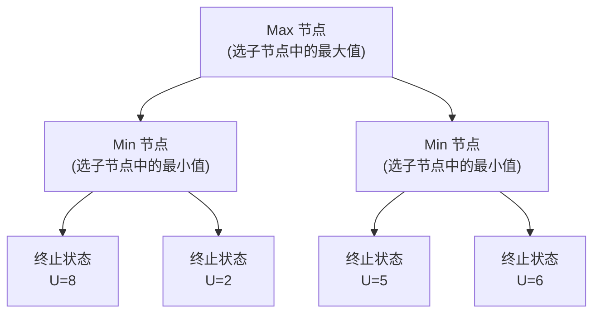
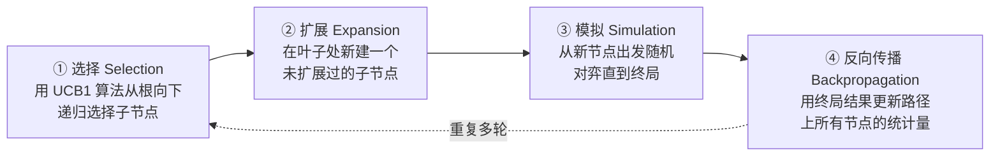

---
tags:
  - 人工智能
  - 对抗性搜索
  - MiniMax
  - Alpha-beta剪枝
  - 蒙特卡洛树搜索
  - MCTS
课程: 人工智能
章节: 第四章 搜索技术II
---

>[!INFO] 简介
> 本讲从"单智能体、环境完全可控"的经典搜索，推广到"多智能体、彼此利益冲突"的**博弈/对抗性搜索（Adversarial Search）**。核心主线：**博弈问题的形式化 → MiniMax 算法（穷举求解） → Alpha-Beta 剪枝（不损失最优性地提速） → 资源受限下的评价函数（工程近似） → 蒙特卡洛树搜索 MCTS（面向超大搜索空间的采样式方法）**。

## 目录

- [[#1. 从搜索到博弈：问题的泛化|1. 从搜索到博弈：问题的泛化]]
    - [[#1.1 为什么需要对抗性搜索|1.1 为什么需要对抗性搜索]]
    - [[#1.2 博弈类型举例|1.2 博弈类型举例]]
    - [[#1.3 现实世界问题：囚徒困境|1.3 现实世界问题：囚徒困境]]
    - [[#1.4 博弈问题的复杂性|1.4 博弈问题的复杂性]]
- [[#2. 双人博弈的形式化|2. 双人博弈的形式化]]
    - [[#2.1 零和博弈 vs 一般博弈|2.1 零和博弈 vs 一般博弈]]
    - [[#2.2 双人博弈的扩展定义（DZFI）|2.2 双人博弈的扩展定义（DZFI）]]
    - [[#2.3 形式化五元组|2.3 形式化五元组]]
    - [[#2.4 博弈树与状态的价值|2.4 博弈树与状态的价值]]
- [[#3. MiniMax 算法|3. MiniMax 算法]]
    - [[#3.1 MiniMax 的核心思想|3.1 MiniMax 的核心思想]]
    - [[#3.2 MiniMax 的递归定义与伪代码|3.2 MiniMax 的递归定义与伪代码]]
    - [[#3.3 MiniMax 的深度优先实现|3.3 MiniMax 的深度优先实现]]
    - [[#3.4 MiniMax 的效率|3.4 MiniMax 的效率]]
- [[#4. Alpha-Beta 剪枝|4. Alpha-Beta 剪枝]]
    - [[#4.1 剪枝的动机|4.1 剪枝的动机]]
    - [[#4.2 α 剪枝（对 Max 节点）|4.2 α 剪枝（对 Max 节点）]]
    - [[#4.3 β 剪枝（对 Min 节点）|4.3 β 剪枝（对 Min 节点）]]
    - [[#4.4 剪枝的一般化定理|4.4 剪枝的一般化定理]]
    - [[#4.5 Alpha-Beta 剪枝算法步骤总结|4.5 Alpha-Beta 剪枝算法步骤总结]]
    - [[#4.6 剪枝的效果与效率|4.6 剪枝的效果与效率]]
- [[#5. 实际操作中的问题：资源受限搜索|5. 实际操作中的问题：资源受限搜索]]
    - [[#5.1 深度受限搜索与评价函数|5.1 深度受限搜索与评价函数]]
    - [[#5.2 评价函数的设计要求|5.2 评价函数的设计要求]]
    - [[#5.3 加权线性评价函数|5.3 加权线性评价函数]]
    - [[#5.4 案例：井字棋的评价函数|5.4 案例：井字棋的评价函数]]
- [[#6. 蒙特卡洛树搜索 MCTS|6. 蒙特卡洛树搜索 MCTS]]
    - [[#6.1 MCTS 的动机|6.1 MCTS 的动机]]
    - [[#6.2 MCTS 的四个步骤|6.2 MCTS 的四个步骤]]
    - [[#6.3 AlphaGo 中的 MCTS 改进|6.3 AlphaGo 中的 MCTS 改进]]
- [[#7. 综合例题（难度递增）|7. 综合例题（难度递增）]]
- [[#8. 常见误区与易错点|8. 常见误区与易错点]]
- [[#9. 公式速查表|9. 公式速查表]]
## 1. 从搜索到博弈：问题的泛化

### 1.1 为什么需要对抗性搜索

前一讲（第5-6讲）所讨论的所有搜索算法，都建立在一个隐含假设之上：**智能体对环境有完全的控制**——除非智能体自己采取行动改变状态，否则状态不会自己变化。这种假设下，我们要做的只是"构造一条到达目标状态的路径"。

但现实中，这个假设常常并不成立：

- **环境可能随机变化**（Stochastic environment），比如天气、交通状况；
- **可能存在与你的智能体利益相冲突的其他智能体**——它们也在主动地改变环境。

这时，即便搜索算法找到了一条"理论上可行"的路径，实际执行时状态也可能被别的智能体改变，导致这条路径根本无法真正带你到达目标。**对抗性搜索正是为了处理"状态变化不完全由己方控制"这一泛化场景而生**，其典型设定是：**存在两个（或更多）智能体，都试图最大化自己的利益**。

### 1.2 博弈类型举例

|类别|具体例子|
|---|---|
|棋盘游戏|井字棋、西洋跳棋、国际/中国象棋、围棋|
|纸牌游戏|德州扑克、桥牌|
|骰子游戏|僵尸骰子|
|棋牌游戏|麻将|
|猜拳游戏|剪刀石头布|

### 1.3 现实世界问题：囚徒困境

**囚徒困境（Prisoner's Dilemma）**源于 1950 年梅里尔·弗拉德（Merrill Flood）等人的相关困境理论，后被艾伯特·塔克（Albert W. Tucker）命名为"囚徒困境"。

**经典设定**：两个犯罪嫌疑人被分别监禁，无法沟通，每人只能选择"揭发对方"或"保持沉默"：

1. 若 A、B 互相揭发，则每人监禁 3 年；
2. 若 A 揭发 B、B 保持沉默，则 A 被释放，B 监禁 4 年（反之亦然）；
3. 若 A、B 都保持沉默，则每人只监禁 1 年。

这个模型也可以推广到国际关系等复杂博弈场景（如某国的"合作 vs 对抗"策略选择矩阵），核心都在于——**每一方的最优决策依赖于对方的决策，形成了"联合依赖"（joint-dependency）**：你该怎么做取决于你认为对方会怎么做，对方怎么做又取决于他们认为你会怎么做。

### 1.4 博弈问题的复杂性

囚徒困境、象棋、跳棋、围棋、井字棋都属于**完美信息博弈**——博弈的复杂性主要来自"空间"和"时间"两方面，人工智能的核心任务是在每个决策点上寻找胜率最大的路径。

而**非完美信息博弈**（如纸牌、麻将）除了空间时间的复杂性外，还依赖于**博弈策略**本身（因为部分信息对对手不可见）。现实生活中的非完美信息博弈几乎无处不在。

**规模直观感受**：围棋可能的棋局数约为 $10^{170}$，**比宇宙中原子的数目还要多**——这解释了为什么围棋长期被认为是 AI 最难攻克的博弈之一，也是理解后面 MiniMax/Alpha-Beta/MCTS 各自适用场景差异的重要背景。
## 2. 双人博弈的形式化

### 2.1 零和博弈 vs 一般博弈

**零和博弈（Zero-Sum Games）**：

- 双方的效用（utility）**完全相反**——可以只用**一个**数值来表示，一方最大化它，另一方最小化它；
- 属于纯粹的对抗、纯竞争关系。

**一般博弈（General Games）**：

- 各方拥有**独立**的效用函数；
- 可能出现合作、无差异、竞争等多种复杂关系并存的情况（本讲聚焦零和博弈，一般博弈留待后续课程）。

**剪刀石头布的收益矩阵示例**（零和博弈的典型直观展示）：

|玩家1 \ 玩家2|R 石头|P 布|S 剪刀|
|---|---|---|---|
|**R 石头**|0/0|-1/1|1/-1|
|**P 布**|1/-1|0/0|-1/1|
|**S 剪刀**|-1/1|1/-1|0/0|

（格子中"玩家1得分/玩家2得分"，1=赢，0=平，-1=输，可以验证任意格子两个数字之和恒为 0，这正是"零和"的直接体现。）

### 2.2 双人博弈的扩展定义（DZFI）

经典的双人博弈通常同时具备以下四个特征，可以用 **DZFI** 帮助记忆（确定性 Deterministic、零和 Zero-sum、完美信息 perFect information，加上隐含的离散有限）：

|特征|含义|
|---|---|
|**两个玩家**|恰好两方参与博弈|
|**离散的（Discrete）**|游戏状态和决策都可以映射为离散值|
|**有限的（Finite）**|状态种类和可采取的动作种类都是有限的|
|**确定性（Deterministic）**|没有随机因素（没有骰子、抛硬币等）|
|**零和博弈（Zero-Sum）**|完全的竞争——一方赢多少，另一方就输多少|
|**完美信息（Perfect Information）**|任何层面的状态都可被双方观察（没有隐藏的手牌等）|

**易混淆提示**：井字棋、象棋、围棋都满足以上全部特征；但很多纸牌游戏（如德州扑克）因为存在"手牌隐藏"，**不满足完美信息**这一条，属于不完美信息博弈，需要更复杂的博弈论工具（超出本讲范围）。

### 2.3 形式化五元组

一个双人博弈可形式化为：

- **两个玩家**：$A$（Max）和 $B$（Min）
- **状态集合** $S$：游戏所有可能状态的有限集合
- **初始状态** $I \in S$
- **终止状态集合** $T \subseteq S$：游戏结束时所处的状态
- **后继函数**：输入状态，输出通过某个动作能到达的状态集合
- **效益（Utility）/收益（payoff）函数** $U: T \to \mathbb{R}$：把终止状态映射为一个实数，表示该终止状态对玩家 A 的有利程度（同时也是对玩家 B 的不利程度）

**博弈过程**：

- 玩家交替行动（通常从 Max 开始），到达某终止状态 $t\in T$ 时游戏结束；
- 一个"游戏状态"实际上是一个（状态，待行动玩家）二元组；
- **玩家 A（Max）希望最大化**终止状态的效益 $U(t)$；**玩家 B（Min）希望最小化** $U(t)$；
- 从"零和"的角度理解：在终止状态 $t$，A 获得 $U(t)$ 的收益，B 获得 $-U(t)$ 的收益——这正是"零和"名称的来源。

### 2.4 博弈树与状态的价值

**博弈树（Game Tree）**：以初始状态为根，每一层交替代表 Max 方和 Min 方的决策，叶节点为终止状态（带有预先定义的效用值）。

**状态的价值（Value of a State）**：指在该状态下，"假设双方都采取对自己最优的行动"时**可获得的最佳收益**。终止状态的价值由效用函数直接给出；非终止状态的价值需要通过 MiniMax 递归计算。



（示例：若 B 节点在 ${8,2}$ 中取最小值 2，C 节点在 ${5,6}$ 中取最小值 5，则根节点 Max 在 ${2,5}$ 中取最大值 5，即根的 MiniMax 值为 5。）

---

## 3. MiniMax 算法

### 3.1 MiniMax 的核心思想
**基本假设：对方总是会做出对自己最优的行动**。因此己方的最佳策略是：**总是做出能"最小化对方能获得的收益"的行动**——由于是零和博弈，"最小化对方收益"等价于"最大化己方收益"
**重要限定条件**：MiniMax 策略的最优性建立在"对方也按最优策略行动"这一假设之上。如果已经知道对方在某些情况下**不会**采取最优行动（比如对手是新手、或非理性），那么可能存在比 MiniMax **更好**（收益更高）的策略——但那需要对对手的行为建模，超出经典 MiniMax 的范畴
### 3.2 MiniMax 的递归定义与伪代码

**递归定义**：终止节点的效用值 $U(t)$ 是预先给定的（游戏规则的一部分）。对非终止节点 $n$： $$ U(n) = \begin{cases} \min{U(c) : c \text{ 是 } n \text{ 的子节点}}, & n \text{ 是 Min 节点} \ \max{U(c) : c \text{ 是 } n \text{ 的子节点}}, & n \text{ 是 Max 节点} \end{cases} $$
**伪代码**（三个互相调用的函数）：
```python
def value(state):
    if state.is_terminal():
        return state.utility()
    if state.next_agent() == MAX:
        return max_value(state)
    else:  # next_agent == MIN
        return min_value(state)

def max_value(state):
    v = -infinity
    for successor in state.successors():
        v = max(v, value(successor))
    return v

def min_value(state):
    v = +infinity
    for successor in state.successors():
        v = min(v, value(successor))
    return v
```

> **通俗理解**：MiniMax 就是"从叶子往根，逐层做加权投票"——Max 层永远挑对自己最有利（最大）的那个孩子，Min 层永远挑对 Max 最不利（最小）的那个孩子，一层层往上传递，最终根节点的值就是"双方都理性对弈"情况下的博弈结果

### 3.3 MiniMax 的深度优先实现

**动机**：我们希望知道整个博弈树的信息才能做决策，但博弈树的规模是**指数级增长**的，直接完整构建整棵树代价过高。事实上，**并不需要真的把整棵博弈树都存下来**——只要用深度优先搜索的方式递归求值，就能在得出 MAX 玩家（或 MIN 玩家）的下一步动作的同时，避免存储指数级大小的博弈树，只需按需计算。

**深度优先 MiniMax 伪代码**：

```text
DFMiniMax(n, Player):
    # 返回：假设 Player 是 MIN 或 MAX 时，状态 n 的效用值

    if n is TERMINAL:
        return U(n)                      # 游戏规则给定的终止状态效用

    ChildList = n.Successors(Player)     # 应用 Player 的可行动作，得到后继状态

    if Player == MIN:
        return min( DFMiniMax(c, MAX) for c in ChildList )
    else:  # Player == MAX
        return max( DFMiniMax(c, MIN) for c in ChildList )
```

**前提与优点**：该算法要求博弈树深度有限；其最大优点是**空间复杂度低**（与普通 DFS 一致），因为不需要在内存中同时保存整棵树。

### 3.4 MiniMax 的效率

MiniMax 本质上就是一次穷举式的 DFS：

- **时间复杂度**：$O(b^d)$
- **空间复杂度**：$O(b^d)$

（其中 $b$ 是分支因子，$d$ 是搜索深度/层数。）

**现实困境**：以国际象棋为例，$b \approx 35$，$d \approx 50$，完全穷举求出精确解**完全不可行**。这就引出了一个关键问题：**我们真的需要探索整棵博弈树吗？**——答案是否定的，这正是下一节 Alpha-Beta 剪枝要解决的问题。

---

## 4. Alpha-Beta 剪枝

### 4.1 剪枝的动机
**核心洞察**：MiniMax 做决策时，**没有必要计算整棵博弈树**。假设用深度优先方式生成博弈树：
- 只需要计算节点 $n$ 的**一部分**子节点，就可能已经能确定"MiniMax 策略下根本不会走到节点 $n$（或它的某些兄弟）"；
- 一旦确定某个节点不会被最终选中，就不必再继续计算它剩余的子节点了——这就是**剪枝（pruning）**
有两种剪枝类型：
- **对 Max 节点的剪枝（α-cuts）**
- **对 Min 节点的剪枝（β-cuts）**
**直觉例子**：假设叶子节点取值只有 $1$ 和 $-1$，如果某个分支已经能确定会导致某方"必胜"（比如已经找到值为 1 的分支，而当前是 Max 层），那么就不必再评估该 Max 节点下的其他子节点了——因为它们不可能让结果变得更糟（对 Max 而言）

### 4.2 α 剪枝（对 Max 节点）

**记号约定**：全局维护 $\alpha$（当前搜索路径上，某个 Max 祖先节点目前找到的最优值下界）和 $\beta$（某个 Min 祖先节点目前找到的最优值上界），初始时 $\alpha=-\infty$，$\beta=+\infty$。

在某个 **Max 节点 $S$**：

- 设 $\alpha_S$ 是 $S$ 已经遍历过的子节点中的**最高值**（随着子节点遍历不断更新）；
- 设 $\beta$ 是 $S$ 的（Min 类型）父节点/祖先在遍历 $S$ 的兄弟节点时得到的**当前最低值**（在评估 $S$ 期间保持固定）。

**剪枝规则**：**当 $S$ 的 $\alpha_S \geq \beta$ 时，就可以停止遍历 $S$ 剩余的子节点。**

**为什么正确**？因为 $S$ 的（Min 类型）父节点 $P$ 一定会在其所有子节点中选择**最小值**。既然 $S$ 已经能保证至少达到 $\alpha_S$（$\geq \beta$），而 $P$ 已经有一个更小的选项 $\beta$ 可选，那么 $P$ **绝不会选择通过 $S$ 这条分支**（因为 $S$ 分支的值只会更大，对 Min 更不利），所以无论 $S$ 剩下的子节点值是多少，都不会影响最终决策，可以放心跳过。

### 4.3 β 剪枝（对 Min 节点）

在某个 **Min 节点 $S$**：

- 设 $\alpha$ 是 $S$ 的兄弟节点中（到目前为止）遇到过的**最高值**（在评估 $S$ 期间固定）；
- 设 $\beta_S$ 是 $S$ 已遍历子节点中的**最低值**（随遍历不断更新）。

**剪枝规则**：**当 $\beta_S \leq \alpha$ 时，可以停止扩展 $S$ 剩余的子节点。**

**为什么正确**？因为 $S$ 的（Max 类型）父节点一定会在其所有子节点中选择**最大值**。既然 $S$ 已经保证至多只能达到 $\beta_S$（$\leq \alpha$），而父节点已经有一个更大的选项 $\alpha$ 可选，父节点绝不会选择 $S$ 分支，因此 $S$ 剩余子节点无论如何都不影响最终结果。

> **更一般的表述**：在 Min 节点 $S$，如果 $\beta$ 值变得 $\leq$ 某个 **Max 祖先节点**的 $\alpha$ 值，就可以停止扩展 $S$（不局限于直接父节点，可以是任意更高层的 Max 祖先）——这也是下一小节"一般化定理"的内容。

### 4.4 剪枝的一般化定理

**定理**：如果 $\alpha(m') = U(m) \geq \beta(n)$，那么节点 $n$ 可以被剪枝。

_证明_（数学归纳法）：

- **基例**：$m'=n'$（$n$ 的直接父节点就是产生 $\alpha$ 值的节点），此时显然可以剪枝（即前面 4.2/4.3 小节的直接情形）。
- **归纳步**：
    - **情形 1**：$\alpha(n') > \beta(n)$：$n$ 的其它兄弟子节点不会再影响 $U(n')$（父节点 $n'$ 已经有更好选择），所以 $n$ 可以剪枝。
    - **情形 2**：$\alpha(n') = \beta(n)$：此时 $U(m) \geq \beta(n) = \alpha(n') \geq \beta(n'')$（$n''$ 为更高层祖先），根据归纳假设，$n''$ 可以被剪枝，从而 $n$ 也可以被剪枝。

这个定理保证了剪枝判断不必局限于"直接父子关系"，只要沿搜索路径的**任意祖先**满足条件即可安全剪枝，这也是实现中"沿路径传递 $\alpha,\beta$ 值"的理论依据。

### 4.5 Alpha-Beta 剪枝算法步骤总结

1. 沿搜索路径**记录**每个 Max 节点的 $\alpha$ 值变化和每个 Min 节点的 $\beta$ 值变化；
2. **Max 节点**：若其 $\alpha$ 值 $\geq$ **任意祖先 Min 节点**的 $\beta$ 值，进行 $\alpha$ 剪枝；
3. **Min 节点**：若其 $\beta$ 值 $\leq$ **任意祖先 Max 节点**的 $\alpha$ 值，进行 $\beta$ 剪枝。

**统一判据（记忆口诀）**：**「$\alpha \geq \beta$ 就剪枝」**——不论是从 Max 节点视角还是 Min 节点视角，只要发现当前的 $\alpha$（Max 方目前最好选择的下界）已经不小于 $\beta$（Min 方目前最好选择的上界），就说明这条分支不可能再影响最终决策，可以安全跳过。

**简化伪代码**（结合 3.3 节 DFMiniMax，加入 α、β 参数）：

```text
AlphaBeta(n, Player, α, β):
    if n is TERMINAL:
        return U(n)

    if Player == MAX:
        v = -infinity
        for c in n.Successors(MAX):
            v = max(v, AlphaBeta(c, MIN, α, β))
            α = max(α, v)
            if α >= β:
                break                      # β 剪枝发生在 MIN 层向上看，这里统一写作 α>=β 即可剪枝
        return v
    else:  # Player == MIN
        v = +infinity
        for c in n.Successors(MIN):
            v = min(v, AlphaBeta(c, MAX, α, β))
            β = min(β, v)
            if α >= β:
                break
        return v
```

### 4.6 剪枝的效果与效率

- **没有剪枝**：需要扩展 $O(b^d)$ 个节点，与普通 MiniMax 完全一样；
- **若节点遍历顺序是最优的**（即真正的最优动作被优先遍历到），使用 Alpha-Beta 剪枝**只需要遍历 $O(b^{d/2})$ 个节点**；
- 这意味着：**在相同的计算资源下，理论上可以把搜索深度提升一倍**（因为指数从 $d$ 降到 $d/2$，等价于分支因子从 $b$ 降到 $\sqrt{b}$）；
- **实例**：在 IBM 深蓝程序中，Alpha-Beta 剪枝使得每个节点的**有效分支系数**从 35 降到了 6，效果显著。

**注意**：$O(b^{d/2})$ 是"最优排序"下的**最好情况**，实际效果高度依赖于"先遍历哪个子节点"的顺序策略（比如先尝试历史上表现好的走法、启发式排序等），排序越接近"最优动作优先"，剪枝效果越好。

---

## 5. 实际操作中的问题：资源受限搜索

### 5.1 深度受限搜索与评价函数

**现实困境**：真实游戏很难生成整棵博弈树。例如国际象棋分支因子约 35，完整博弈树约有 $2.7\times10^{15}$ 个节点，即便用了 Alpha-Beta 剪枝，效果依然十分有限，**必须限制搜索树的深度**。

**解决方案：深度受限搜索（Depth-Limited Search）**——只搜索到树中某个有限深度，然后用一个**评价函数（Evaluation Function）**去"启发式地估计"这些非叶子（未真正到达终局）节点的效用值，代替原本只有终止状态才有的真实效用值。

**代价**：使用评价函数近似之后，**"保证最优对弈"这一性质就不再成立了**——毕竟评价函数只是一个近似估计，不是真实的博弈结果。

**搜索深度（plies 层数）对棋力的影响**：假设有 100 秒时间、每秒可探索 1 万个节点，则总共能检查 100 万个节点，大约能达到 8 层深度——这对应一个中等水平的国际象棋程序。**更多层数往往能带来棋力的巨大差异**，因为：

- 评价函数永远是不完美的；
- **评价函数被"埋"得越深（即距离真实终局越远时才被使用），它的不准确性对最终决策的影响就越小**——这是"搜索深度"和"评价函数精细程度"之间权衡（trade-off）关系的重要体现：与其花大量计算资源打磨一个极其精细但很慢的评价函数，不如用一个简单快速的评价函数、把节省下来的算力用于多搜几层。

实际应用中常配合**迭代加深搜索**，使算法具备"随时可以停止并给出当前最好答案"的 anytime 特性（时间越充裕，搜索深度越大，答案质量越高）。

### 5.2 评价函数的设计要求

一个好的评价函数需要同时满足三条要求：

1. **必须使得终止节点的排序与原来真实的效用函数保持一致**（至少在关键顺序上不能颠倒黑白）；
2. **计算不能太耗时**——因为它会在博弈树的每一个待评估非叶子节点上被反复调用，性能至关重要；
3. **对非叶子（非终止）节点，评价函数需要与该节点"实际能获得胜利的概率"强相关**——否则评价函数的估计毫无参考价值。

### 5.3 加权线性评价函数

**最常见的实现方式**：分别计算若干个"特征"的数值贡献，再进行加权求和：

$$\boxed{Eval(s) = w_1\cdot f_1(s) + w_2\cdot f_2(s) + \dots + w_n\cdot f_n(s) = \sum_{i=1}^{n} w_i \cdot f_i(s)}$$

**国际象棋案例**：每个兵评价为 1 分，马/象评价为 3 分，车评价为 5 分，皇后评价为 9 分——这些权重**不是游戏规则的一部分**，而是**来自人类经验的估计**；如果没有这样的先验经验，权重也可以通过机器学习技巧（如自我对弈、强化学习）估计得到。

**Deep Blue 用了超过 8000 个特征**来构建其评价函数，可见工程上评价函数的设计可以非常复杂精细。

**隐含的强假设**：这种加权线性求和方式假设**所有特征对最终结果的贡献是相互独立**的——这在很多实际场景中只是一种近似（比如"车"和"象"配合可能产生远超各自独立价值之和的战术效果），但因为计算简单、易于调参，仍是实践中最常用的形式。

### 5.4 案例：井字棋的评价函数

定义 $X_n$ = 只包含 $n$ 个 X 而没有 O 的行/列/对角线的数量，同理定义 $O_n$。

**终止状态的效用**：任何满足 $X_3=1$ 的状态赋值 $+1$（X 方获胜）；任何满足 $O_3=1$ 的状态赋值 $-1$（O 方获胜）；其他终止状态效用为 $0$（平局）。

**非终止状态的线性评价函数**： $$\boxed{Eval(s) = 3X_2(s) + X_1(s) - \big(3O_2(s) + O_1(s)\big)}$$

（直觉：一条线上已经有 2 个 X、没有 O，权重给到 3；只有 1 个 X 的线权重给到 1，说明"更接近连成一线"的格局被赋予更高价值；O 方的对应项同理，但取负号，因为对 X 方而言 O 方越接近获胜局面越糟糕。）

**如何使用**（配合 Alpha-Beta 剪枝的经典教学演示）：

1. 从空白棋盘开始建立博弈树，扩展到第 2 层；
2. 用上述评价函数标注第 2 层每个节点的值；
3. 用 MiniMax 算法向上传播，标出第 0、1 层节点的值；
4. 在"假设最优节点最先生成"的前提下，标出第 2 层哪些节点会被 Alpha-Beta 剪枝掉。

---

## 6. 蒙特卡洛树搜索 MCTS

### 6.1 MCTS 的动机

对搜索算法进行优化，本质上是在解决两个核心问题：**优先扩展哪些节点，以及放弃扩展哪些节点**——归纳起来就是"如何高效地扩展搜索树"。

如果把目标从"求精确最优解"降低为"求一个近似最优解"，这个问题就可以看作一个**探索性问题**：算法从根节点出发，每一步动作是"选择"一个已存在的子节点，或"扩展"一个新的子节点；执行该动作后所获得的**奖励**可以用来评价这个动作的优劣（奖励可以基于路径代价或游戏终局分数来定义）。

**核心困难**：算法**事先并不知道**每个节点会得到怎样的代价/终局分数分布，只能通过**采样式探索**来获得计算奖励所需的样本——因为这种方法利用蒙特卡洛法通过采样来估计每个动作的优劣，所以被称为**蒙特卡洛树搜索（Monte-Carlo Tree Search, MCTS）**。

> **适用场景**：MCTS 特别适合像围棋这样**分支因子极大、难以设计精确评价函数**的博弈——与其费力构造一个精细但可能不准确的手工评价函数，不如靠大量随机模拟对局的统计结果来估计局面优劣。

### 6.2 MCTS 的四个步骤

MCTS 的每一轮迭代都包含以下四个步骤：



1. **选择（Selection）**：算法从搜索树的根节点出发，向下递归选择子节点，直到到达一个叶子节点，或到达一个"存在还未被扩展过的子节点"的节点 $L$。这个递归选择过程通常由 **UCB1 算法**实现，选择时会综合考虑"每个节点已被选择的次数"和"每个节点获得的平均奖励"（即在"利用已知较优节点"和"探索访问较少节点"之间做权衡）。
2. **扩展（Expansion）**：如果节点 $L$ 不是一个终止节点（或对抗搜索意义下的终局节点），就随机扩展它的一个尚未被扩展过的后继节点 $M$。
3. **模拟（Simulation）**：从节点 $M$ 出发，继续"模拟式"地向下扩展，直到到达一个终止节点。这一步所用的策略**通常与选择阶段的 UCB1 策略不同**——模拟阶段一般采用比较简单的策略，例如完全随机策略（因此这一步在早期文献中也被称为"随机走子/Rollout"）。
4. **反向传播（Back Propagation）**：用模拟得到的结果（终止节点的代价，或游戏终局分数），沿着"根 → $M$"这条路径回溯，更新路径上（含 $M$ 本身）所有节点的**奖励均值**和**被访问次数**这两个统计量。

**关键概念辨析**：

- **选择阶段**依据 UCB1（结合利用与探索）在**已经存在**的树结构中前进；
- **模拟阶段**在**尚未纳入树结构**的部分用简单随机策略"预演"到终局，只是为了获得一个奖励样本，并不会把模拟路径上的每个节点都加入正式的搜索树（只有扩展阶段新建的那一个节点 $M$ 会被正式纳入树）。

### 6.3 AlphaGo 中的 MCTS 改进

**AlphaGo 对经典 MCTS 做了改进**：把标准流程中的第③步（模拟）改造为**评估（Evaluation）**，第④步（反向传播）改称为**后援（Backup）**。

**两个深度神经网络协同工作**：

- **价值网络（Value Networks）**：用来直接评估当前棋盘局面的优劣（替代或补充传统模拟阶段的随机走子结果）；
- **策略网络（Policy Networks）**：用于指导"应该优先尝试落子在哪些位置"，即在选择/扩展阶段提供更聪明的先验概率，取代纯粹随机或简单启发式的走子选择。

> **理解要点**：AlphaGo 的核心创新，就是**用深度学习学到的"局面评估能力"和"落子选择偏好"，去替换传统 MCTS 中依赖大量随机模拟才能获得的粗糙统计估计**，从而大幅提升了搜索效率和棋力上限——这正是"结合手工搜索框架（MCTS）和数据驱动的评估模型（深度神经网络）"这一现代 AI 系统设计范式的典型代表。

---

## 7. 综合例题（难度递增）

### 例题 1（基础）：MiniMax 值计算

**题目**：给定一棵深度为 2 的博弈树，根为 Max 节点，其下两个 Min 子节点，每个 Min 子节点各有两个叶子节点（终止状态效用值分别为 ${3,12,8,2}$ 和 ${4,6,14,5,2}$ 中的部分，具体如下）：

设左侧 Min 节点的叶子值为 ${3,12,8,2}$，右侧 Min 节点的叶子值为 ${14,5,2}$（示例简化自课件"Minimax Example"）。

**求解过程**：

- 左侧 Min 节点：$\min(3,12,8,2) = 2$
- 右侧 Min 节点：$\min(14,5,2) = 2$
- 根节点（Max）：$\max(2, 2) = 2$

**根节点的 MiniMax 值为 2。**

**思考**：如果双方都按 MiniMax 最优策略行动，博弈树中哪条路径会是游戏实际进行的路径？——答案是**从根节点出发，每一层都沿着"取到该层 MiniMax 值"的那个孩子走下去**，即从根走向左（或右，若有多个并列最优则任选其一）Min 节点，再走向那个取值为 2 的叶子。

### 例题 2（中等）：Alpha-Beta 剪枝——两值终局的极限情形

**题目**：假设所有叶子节点（终止状态）的效用值只有 $1$ 和 $-1$，用深度优先方式实现 MiniMax，应该在哪里进行剪枝？

**分析要点**：由于取值范围极窄（只有 $\pm1$），一旦某个分支已经让当前玩家确定能拿到"己方能达到的最好结果"（比如 Max 方已经找到一个通向 $+1$ 的分支），那么：

- 对 Max 节点而言，$\alpha$ 值会立刻跳到 $1$（已达到理论上限），后续所有子节点无论如何都不可能比 1 更优，**可以直接剪枝所有其余同层兄弟分支**；
- 对 Min 节点同理，一旦 $\beta$ 值跳到 $-1$（理论下限），也可以立即停止。

**教学意义**：这个极限案例直观展示了 Alpha-Beta 剪枝在"效用值区间较窄、容易提前锁定最优/最差结果"的博弈中，剪枝效果尤其显著。

### 例题 3（中高难度）：完整 Alpha-Beta 剪枝标注

**题目**：如图所示的博弈树中，方框（□）表示 Max 节点，圆圈（○）表示 Min 节点，叶子节点自左向右的效用值为：

$$0,\ 5,\ -3,\ 3,\ 3,\ -3,\ 0,\ 2,\ 2,\ -3,\ 0,\ -2,\ 3,\ 5,\ 4,\ 1,\ -3,\ 0,\ 6,\ 8,\ 9,\ -3$$

以"优先生成左边子节点"的顺序进行 α-β 剪枝，标出发生剪枝的位置，并用粗体标出最优走步路径。

**解题方法（通用步骤，适用于任何这类题目）**：

1. **自左向右、深度优先**地展开博弈树，每扩展到一个叶子就立即得到其效用值；
2. 每当某个 Min 节点的 $\beta$ 值不断被子节点更新，**只要发现 $\beta \leq$ 该节点某个 Max 祖先的 $\alpha$**，立即停止扩展该 Min 节点剩余的子节点（β 剪枝）；
3. 每当某个 Max 节点的 $\alpha$ 值不断被子节点更新，**只要发现 $\alpha \geq$ 该节点某个 Min 祖先的 $\beta$**，立即停止扩展该 Max 节点剩余的子节点（α 剪枝）；
4. 剪枝发生后，**这些被剪掉的分支的具体数值不影响最终根节点的 MiniMax 值**，只是没有被访问到而已；
5. 最终从根节点开始，沿着"每一层都选中该层 MiniMax 值对应的孩子"回溯，即为最优走步路径。

> **课件原答案**：红色标记为被剪枝的节点，蓝色路径为最优走步路径（具体标注请结合博弈树图形逐层核对：核心判据始终是"当前节点的界限值是否已经不劣于某个祖先节点的相反界限值"）。

### 例题 4（较高难度）：井字棋评价函数的构建与应用

**题目**：使用评价函数 $Eval(s) = 3X_2(s)+X_1(s)-(3O_2(s)+O_1(s))$，从空白棋盘开始建立博弈树并扩展到第 2 层，标注每个第 2 层节点的评价值，再用 MiniMax 计算第 0、1 层节点的值，并标出（假设最优节点最先生成时）第 2 层会被 Alpha-Beta 剪枝掉的节点。

**解题思路提示**：

1. 第 1 层（X 方第一步）：由于井字棋的对称性，本质上只有 3 种不同的落子位置（角、边、中心），可以只分析这 3 种代表性走法；
2. 第 2 层（O 方应对）：对每种 X 的开局，枚举 O 方所有可能应对，用评价函数逐一计算 $Eval(s)$；
3. 向上用 MiniMax 传播：第 1 层节点（O 方视角，是 Min 层）取其所有第 2 层子节点的**最小值**；第 0 层（根，Max）取第 1 层所有节点的**最大值**；
4. 结合 Alpha-Beta 规则，在"最优节点最先生成"假设下，凡是满足 $\alpha \geq \beta$ 的第 2 层剩余节点均可标记为被剪枝。

**练习意义**：这道题把"评价函数设计"和"Alpha-Beta 剪枝"两个知识点结合在一起，训练"先算评价值，再走标准 MiniMax + 剪枝流程"的综合能力，是本讲期末考试的高频题型模式。

### 例题 5（拓展）：另一组 Alpha-Beta 剪枝练习（22 个叶子）

**题目**：叶子节点效用值为： $$3,9,1,8,4,5,5,20,-1,8,7,8,1,-1,3,-2,2,4,7,2,11,4,8,13$$

方框为 Max 节点，圆圈为 Min 节点，仍按"优先生成左边节点"的顺序执行 α-β 剪枝，标出剪枝位置和最优路径。

**难度提示**：相比例题 3，这组数据的叶子节点数量更多、数值分布更离散，是对"多层嵌套剪枝判断"熟练度的进一步考察——建议做题时严格按照"自左向右 DFS + 沿路径维护 α、β + 随时检查是否满足剪枝条件"的标准流程逐步推进，不要跳步骤，否则极易在层数较深时漏判或误判剪枝点。

---

## 8. 常见误区与易错点

|误区|正确理解|
|---|---|
|认为 MiniMax 总能给出真正最优解|MiniMax 只在"对手也按最优策略行动"的假设下最优；若对手非理性，可能存在收益更高的其它策略|
|认为 Alpha-Beta 剪枝会改变最终的 MiniMax 值|**不会**！Alpha-Beta 剪枝只是跳过了"不可能影响最终决策"的子树，根节点算出的值与不剪枝时完全一致，剪枝只提升效率、不牺牲正确性|
|混淆 α 剪枝和 β 剪枝的适用节点类型|**α 剪枝发生在 Max 节点**（判据：$\alpha_S \geq \beta$，$\beta$ 来自某个 Min 祖先）；**β 剪枝发生在 Min 节点**（判据：$\beta_S \leq \alpha$，$\alpha$ 来自某个 Max 祖先）|
|认为 $O(b^{d/2})$ 是 Alpha-Beta 剪枝的普遍保证|这是**最优节点排序**下的最好情形；实际效果依赖于子节点被访问的顺序，排序越差、剪枝效果越弱，最坏情况下退化为 $O(b^d)$（与不剪枝一样）|
|认为深度受限搜索+评价函数依然能保证最优对弈|**不能**！一旦引入评价函数近似非终止节点的效用，"保证最优"这一性质就丧失了，只能保证是"在给定资源下的较优近似"|
|认为评价函数的权重必须来自机器学习|权重既可以来自**人类经验**（如国际象棋的棋子价值），也可以通过机器学习估计——课件明确指出两者都是可行途径|
|认为 MCTS 中"模拟"阶段用的策略和"选择"阶段一样|二者通常**不同**：选择阶段用 UCB1（兼顾探索与利用）；模拟阶段常用简单的随机策略（Rollout），因为模拟需要跑很多次、必须足够快|
|认为 AlphaGo 就是"纯 MCTS"|AlphaGo 是 **MCTS + 深度神经网络（价值网络+策略网络）的结合**，用神经网络的评估（Evaluation）取代传统随机模拟，用后援（Backup）机制融合网络评估结果，而非单纯依赖大量随机走子的统计平均|
|认为对抗性搜索只适用于严格的两人零和博弈|本讲聚焦零和博弈便于建立基础理论，但博弈论框架可以推广到多人、非零和的一般博弈（如囚徒困境的收益矩阵形式），只是求解方法会更复杂|

---

## 9. 公式速查表

**MiniMax 递归定义**： $$U(n) = \begin{cases} \min{U(c): c \in children(n)}, & n \text{ 是 Min 节点} \ \max{U(c): c \in children(n)}, & n \text{ 是 Max 节点} \end{cases}$$

**MiniMax 复杂度**： $$\text{时间} = O(b^d), \qquad \text{空间} = O(b^d)$$

**Alpha-Beta 剪枝判据（统一形式）**： $$\boxed{\alpha \geq \beta \implies \text{剪枝}}$$

- Max 节点：$\alpha_S \geq \beta(\text{某祖先 Min 节点}) \Rightarrow$ 停止扩展 $S$ 的剩余子节点（α 剪枝）
- Min 节点：$\beta_S \leq \alpha(\text{某祖先 Max 节点}) \Rightarrow$ 停止扩展 $S$ 的剩余子节点（β 剪枝）

**Alpha-Beta 剪枝复杂度**： $$\text{无剪枝}: O(b^d) \qquad \text{最优排序下}: O(b^{d/2})$$

**加权线性评价函数**： $$Eval(s) = \sum_{i=1}^n w_i \cdot f_i(s)$$

**井字棋评价函数示例**： $$Eval(s) = 3X_2(s) + X_1(s) - (3O_2(s)+O_1(s))$$

**MCTS 四步循环**： $$\text{选择（UCB1）} \to \text{扩展} \to \text{模拟（随机走子）} \to \text{反向传播（更新统计量）}$$

**AlphaGo 对应改造**： $$\text{模拟} \to \text{评估（价值网络）}, \qquad \text{反向传播} \to \text{后援（Backup）}$$