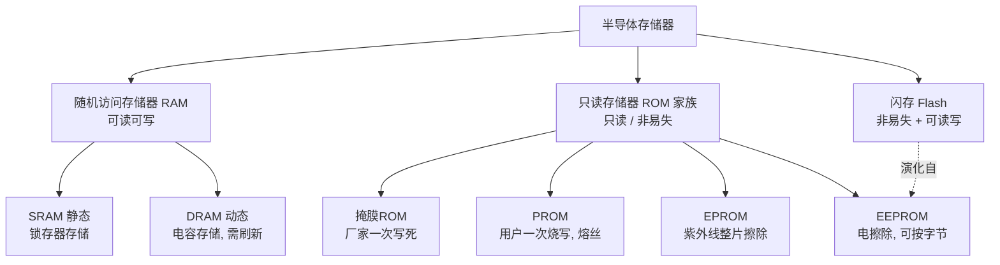
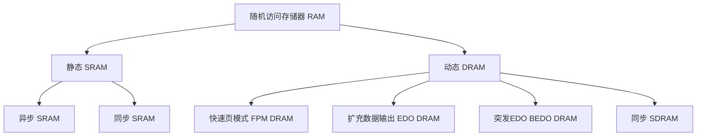
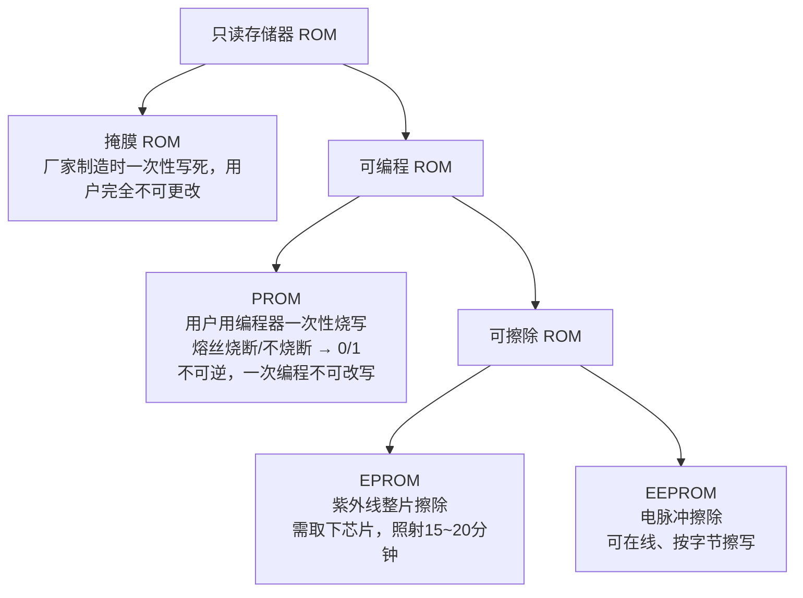
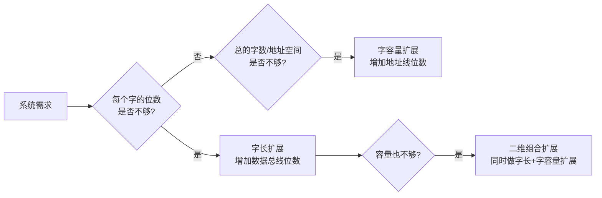
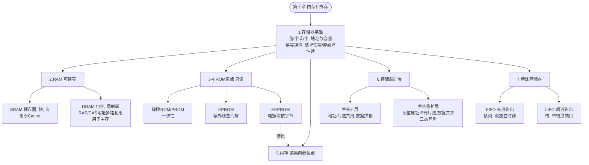

> [!abstract] 本章地图 本章讲的是**半导体存储器**这一大类硬件部件的工作原理与分类。整体逻辑是一条线： **存储的基本单位→怎么组织成阵列→怎么读写→RAM(可读写)细分SRAM/DRAM→ROM(只读)细分掩膜/PROM/EPROM/EEPROM→Flash(两者优点合体)→芯片不够大怎么"拼"起来(扩展)→两种特殊队列结构存储器(FIFO/LIFO)**。 把这条线抓住，几乎所有题目都能对号入座

---

## 0. 预备知识：二进制数据单位

> [!important] 严谨定义
> 
> - **位（bit）**：二进制数据的最小单位，取值只能是 0 或 1。
> - **半字节（nibble）**：4 个 bit 组成的单元（恰好对应 1 位十六进制数字）。
> - **字节（byte）**：固定为 **8 位**，是计算机中最常用的基本存储/编址单位。
> - **字（word）**：**一个完整的信息单位**，由一个或多个字节构成；字长不是固定值，而是**由具体系统/总线设计决定**（8 位机、16 位机、32 位机、64 位机字长各不相同）。

> [!warning] 易错点 "字"和"字节"不是同一个东西！字节永远是 8 位，但字的位数（字长）依系统而定。考试中如果题目给出"字长"，一定要按题目给的位数算，不要默认成 8 位。

---

## 1. 半导体存储器基础

### 1.1 存储器的组织与容量公式

存储器本质上是一个由许多**存储元（cell）**排成的**阵列（array）**，每个存储元存 1 bit。存储器的"型号"通常写成：

$$\text{字数} \times \text{字长}$$

例如 **16K × 8**：表示有 $16K = 2^{14} = 16384$ 个可编址的"字"，每个字 8 位。

> [!important] 严谨定义：为什么字数总是 2 的幂？ 存储器中每一个"字"都通过一个**唯一的二进制地址码**来访问。如果用 $N$ 根地址线（即地址码有 $N$ 位），那么这 $N$ 位二进制数能表示的不同取值恰好有 $2^N$ 个，**不多不少**。所以一个存储器能寻址的字数，几乎总是设计成正好等于 $2^N$（否则就是在浪费地址编码空间），这就是"实际字数总是 2 的幂"的根本原因（如 $2^{16}=65536$）。
> 
> 推广一下，记住这个**核心换算公式**（几乎所有扩展题、容量题都要用）： $$N_{\text{地址线}} = \log_2(\text{字数})\qquad\Longleftrightarrow\qquad \text{字数} = 2^{N_{\text{地址线}}}$$ $$\text{总容量(bit)} = \text{字数} \times \text{字长}$$

### 1.2 存储地址和容量

- **地址（address）**：存储器阵列中某个数据单元（可以是某一位，也可以是某一个字节/字）所在的**位置编号**。在二维阵列里，地址通常拆成"行号 + 列号"两部分共同确定（这是后面 RAM/ROM 内部译码电路设计的根本依据）。
- **容量（capacity）**：该存储器**总共能存放的数据单元数目**（可以用"位数"表示，也可以用"字数×字长"表示，要看题目语境）。

> [!warning] 易错点：行列地址 vs 总容量 给出一个 $R$ 行 $\times C$ 列的存储阵列，"某一位的地址"指的是它的(行号, 列号)坐标；而"容量"是 $R\times C$（如果阵列里每个交叉点存 1 bit）。两者不要混着问、混着答。

### 1.3 存储器的基本操作：读 / 写

存储器对外的两条最重要的总线：

|总线|方向|作用|
|---|---|---|
|**地址总线 Address Bus**|单向（控制器→存储器）|指明要访问哪一个地址|
|**数据总线 Data Bus**|**双向**|写时数据流入存储器，读时数据流出存储器，故必须双向|

**写操作（Write）的过程**：

1. 把要写入的**地址码**放到地址总线上 → 地址译码器据此选中目标存储单元；
2. 把要写入的**数据**放到数据总线上；
3. 发出写命令（如 $\overline{WE}$ 有效）→ 该地址处原有的数据被**覆盖（替换）**，新数据写入。

**读操作（Read）的过程**：

1. 把要读取的**地址码**放到地址总线上；
2. 发出读命令；
3. 该地址中存储的内容被放到数据总线上输出，而**存储器内部该单元的内容保持不变**。

> [!danger] 全章最重要的概念辨析之一：破坏性写入 vs 非破坏性读出
> 
> - **写操作是"破坏性"的**：新数据写入会**永久覆盖**原有数据，原数据彻底丢失，无法恢复。
> - **（绝大多数存储器的）读操作是"非破坏性读出"（Non-destructive Readout）**：读取一个单元只是把它的内容"复制"一份输出到数据总线，**单元本身保存的内容不受影响、不会被清空**。SRAM、ROM 的读操作都是非破坏性的。
> - **但 DRAM 是个例外**！DRAM 单元读取时，电容上的电荷会被读出电路抽走一部分（电荷感应读出），相当于"读了就丢了一点"，所以 DRAM 读出后内部必须立刻把同样的值**重新写回（刷新/再生）**该单元，否则数据会丢失。这一点是考试里最容易被忽略、也最容易被出题人拿来"挖坑"的细节——**千万不要笼统地说"所有存储器读操作都是非破坏性的"**。

---

## 2. 随机访问存储器 RAM

### 2.1 RAM 的定义（严谨表述）

> [!important] 定义 **RAM（Random Access Memory，随机访问存储器）**是一种**读/写存储器**，其特点是：数据可以按**任意顺序**写入任何被选中的地址，也可以按任意顺序从任何被选中的地址读出——即**访问某个地址所需的时间和该地址的物理位置无关**，这才是"随机访问"（Random Access）这个名字的真正含义。

> [!warning] 易错点：随机访问 ≠ RAM 的专利！ 严格来说，"随机访问"描述的是一种**访问方式**（任意顺序、等时间访问），并不是 RAM 独有的特性——**ROM 的读取同样是随机访问**的（你可以按任意顺序去读 ROM 里任意地址的数据，耗时也基本相同）。只是历史上、行业里约定俗成地把"RAM"这个名字**专门留给了"可读可写"的存储器**，而 ROM 虽然访问方式也是随机的，却不叫"RAM"。这是个**纯粹的命名习惯问题**，不是技术本质问题，考试中如果问"为什么 ROM 不叫 RAM"，要答到这一点上。

### 2.2 RAM 两大类：SRAM 与 DRAM

|               |                                  | **DRAM（动态 RAM）**                                |
| ------------- | -------------------------------- | ----------------------------------------------- |
| 存储元件          | **锁存器**（Latch，由晶体管构成的双稳态电路）      | **电容**（用电荷的有/无表示 0/1）                           |
| 是否需要刷新        | **不需要**——只要一直加直流电源，数据可无限期保存      | **需要**——电容会漏电，必须定期"刷新"（读出再写回）才能维持数据             |
| 速度            | **更快**（读 SRAM 比读 DRAM 快得多）       | 更慢（受限于电容充放电、感应放大、以及刷新开销）                        |
| 同样物理尺寸/成本下的容量 | 较小（每个 SRAM 存储元通常要 4~6 个晶体管，结构复杂） | **更大**（每个 DRAM 存储元基本只需 1 个电容 + 1 个晶体管，结构极简，密度高） |
| 典型应用          | **CPU 缓存（Cache）**                | **计算机主存（内存）**                                   |

> [!important] 为什么"快的 SRAM 用得少、慢的 DRAM 用得多"？——理解记忆，别死记 这是一个**速度 vs 容量/成本**的工程权衡（trade-off）：CPU 缓存需要的容量不大，但对速度要求极高（要跟得上 CPU 主频），所以用贵但快的 SRAM；主存需要的容量很大（GB 级别），如果全部用 SRAM 成本会高得离谱，所以用便宜、密度高的 DRAM，牺牲一点速度但换来巨大的容量性价比。**这正是现代计算机"Cache（SRAM）+ 主存（DRAM）+ 外存"多级存储体系结构存在的根本原因。**

**SRAM/DRAM 的进一步细分（了解即可，重点是知道这些名字属于谁）：**

### 2.3 静态 RAM（SRAM）详解

#### 2.3.1 基本 SRAM 阵列与三态输出

SRAM 阵列由许多存储元按行、列排列而成，通过"行选（Row Select）"线和数据 I/O 线读写指定的存储元。

> [!important] 三态输出（Tri-state Output）——必须吃透的硬件概念 普通逻辑门的输出只有两种状态：高电平（1）、低电平（0）。**三态输出多出第三种状态：高阻态（开路/悬空，Hi-Z）**，即在电路上"什么都不输出"，相当于完全断开。
> 
> **为什么存储器芯片必须有三态输出？** 因为实际系统里，往往有**多个存储器芯片共用同一组数据总线**（后面"存储器扩展"一节会反复用到）。如果每个芯片的输出永远只有 0/1 两态，那么没被选中的芯片也会强行把自己的（无意义的）0 或 1 "怼"到数据总线上，跟被选中芯片的真实输出**互相打架（总线冲突）**。引入高阻态后，**未被选中（未使能）的芯片可以把自己的输出"放空"**，彻底退出总线的争夺，只有被选中的那一个芯片真正驱动总线——这就从硬件层面解决了多芯片共享总线的冲突问题。

#### 2.3.2 32K×8 SRAM 结构示例

例如一片"32K×8"的 SRAM：

- 字数 $32K = 2^{15}$，按内部物理排布组织成 **256 行 × 128 列**（$256\times128=32768=2^{15}$，恰好对应字数）；
- 每个地址存一个字节（8 位），故总容量 $=2^{15}\text{字} \times 8\text{位/字} = 2^{15}$ **字节**；
- 地址译码同样分为"行地址译码"和"列地址译码"两部分协同工作（思想与下面 ROM 部分讲的行列译码完全一致，是所有存储器通用的设计套路）。

#### 2.3.3 基本异步 SRAM 的读写周期（重点！常考时序概念）

**读周期（Read Cycle）的三个关键时间参数：**

|参数|定义|
|---|---|
|**地址存取时间** $t_{AA}$|从**有效地址**加到地址输入端开始，到输出端出现**有效数据**为止所经过的时间（此时片选、输出使能均已处于有效状态）|
|**芯片使能存取时间** $t_{ACS}$|从**片选/芯片使能信号变为有效**开始，到输出端出现有效数据为止的时间|
|**使能存取时间（输出使能存取时间）** $t_{OE}$|从**输出使能信号变为有效**开始，到输出端出现有效数据为止的时间|

> [!warning] 理解这三者的关系，而不是死记名字 这三个参数其实是在回答同一个问题——"数据多久才能稳定出现在输出端"——但**起算的参考点不同**（地址稳定时刻 / 片选有效时刻 / 输出使能有效时刻，三者谁最后到达，谁就是真正限制访问速度的瓶颈）。实际系统设计时要保证：**地址、片选、输出使能都满足各自的存取时间要求之后，才能去读输出端的数据，否则读到的可能是中间过渡的"垂圾"值**。

**写周期（Write Cycle）的三个关键时间参数：**

|参数|定义|
|---|---|
|**地址建立时间** $t_{AS}$（Address Setup Time）|地址必须在写命令变为有效**之前**已经保持稳定的最短时间，保证写命令来的时候地址已经"站稳了"|
|**写使能保持时间** $t_{WR/WH}$（Write Enable Hold Time）|写命令至少需要保持有效的最短持续时间，否则数据来不及被真正写进存储元|
|**数据保持时间** $t_{DH}$（Data Hold Time）|写命令撤销**之后**，数据仍需在数据总线上保持稳定的最短时间，确保写入动作完整收尾，数据被正确"锁定"进存储元|

> [!danger] 易错点 很多同学会把"读周期"和"写周期"的参数名字记混。一个快速区分技巧：**读周期关心的是"数据什么时候才稳定出现"（结果导向，三个时间都是"到数据有效为止"）；写周期关心的是"地址/数据/控制信号谁要先稳定、要稳定多久"（过程导向，是建立/保持类型的时间）**。

#### 2.3.4 应用：高速缓冲存储器 Cache

Cache 是插在 CPU 与主存（DRAM）之间的一块**更小、但速度更快**的存储器（用 SRAM 实现），利用程序访问的"局部性原理"提前把可能用到的数据/指令从慢速主存搬到快速 Cache 中，从而降低 CPU 的平均访存时间。典型结构：CPU ↔（内部 L1 Cache）↔（L2 Cache）↔ Cache 控制器 ↔ 主存（DRAM）。

### 2.4 动态 RAM（DRAM）详解

#### 2.4.1 基本存储元：电容

DRAM 的每个存储元的核心就是**一个电容**（再配合一个用于选通的晶体管），靠电容**有电荷/无电荷**表示存了 1 还是 0。

> [!important] 为什么 DRAM 简单、便宜，但又"娇气"（需要刷新）？ 一个电容加一个晶体管，结构远比 SRAM 的锁存器（多个晶体管互锁）简单，占用芯片面积小，所以**同样面积能放下更多存储元，单位成本更低**——这是 DRAM 容量大、便宜的根本原因。但电容天生会"漏电"，存进去的电荷会随时间慢慢泄漏掉，如果不管它，过一段时间（毫秒级）数据就会丢失。因此 DRAM 必须依靠外部电路定期对每一个存储单元做"**刷新（Refresh）**"——本质就是把该单元的内容读出来，再原样写回去，给电容"充值"，防止电荷耗尽。

#### 2.4.2 DRAM 存储元的四种基本动作

|动作|说明|
|---|---|
|**写 1**|通过位线对电容充电，使其存有电荷，表示逻辑 1|
|**写 0**|通过位线把电容放电至接近 0V，表示逻辑 0|
|**读 1**|选通该存储元，感应放大器（Sense Amplifier）检测电容上残余的电荷量，判定输出为 1|
|**刷新存的 1**|由于电荷会持续泄漏，需要周期性地把该单元重新读出、再写回同样的值，给电容"补充电荷"，防止数据丢失|

> [!danger] 重要细节：DRAM 的"读"其实是破坏性的！ 前面第 1 章讲过"读操作一般是非破坏性的"，但 **DRAM 是反例**：读取一个 DRAM 存储元时，感应放大器要靠"抽走/感应"电容上的电荷量来判断它是 0 还是 1，这个动作本身就会让电容上的电荷发生改变（变少）。所以严格来说，**DRAM 读出之后，必须立即由内部电路把读到的值重新写回（再生）该单元**，否则这次"读"操作就等于顺带把数据破坏了一部分。这也是为什么 DRAM 内部电路天生就要把"读"和"刷新"紧密绑在一起设计。

#### 2.4.3 地址多路复用（Address Multiplexing）——DRAM 最具特色的设计

为了**减少芯片对外的地址引脚数量**（封装引脚是稀缺资源，越少越省成本/越省空间），DRAM 把完整的地址拆成两半，**分两次、通过同一组物理地址引脚**先后送入芯片：

1. **行地址选择 $\overline{RAS}$（Row Address Strobe）**：先把**行地址**放到地址引脚上，$\overline{RAS}$ 信号变有效，把这部分地址锁存进"行地址锁存器"，激活对应的一整行存储元（这一行所有位的电荷被同时读到一行"行缓冲区"里）；
2. **列地址选择 $\overline{CAS}$（Column Address Strobe）**：接着，再把**列地址**放到**同一组**地址引脚上，$\overline{CAS}$ 信号变有效，把列地址锁存进"列地址锁存器"，从刚才已经激活的那一整行中，**挑出指定的列**，最终输出/写入这一个具体单元。

> [!important] 一句话理解地址多路复用 假如完整地址是 $2N$ 位，不用多路复用就需要 $2N$ 根地址引脚同时输入；用了多路复用后，**只需要 $N$ 根地址引脚，分两次（先行后列）传完整地址**，相当于用"时间"换"引脚数量（空间/成本）"。代价是：访问必须先等行地址锁定、再等列地址锁定，**两步串行操作天然比 SRAM"地址一步给全"的单步访问慢**——这正是 DRAM 比 SRAM 慢的另一个根本原因（除了电容读出本身慢之外）。

> [!warning] 易错点 $\overline{RAS}$、$\overline{CAS}$ 上面那条"非"号线表示它们都是**低电平有效**信号——拉低才是"选中/有效"，不是拉高。做时序图分析题时一定要看清楚是低有效还是高有效。

---

## 3. 只读存储器 ROM

### 3.1 ROM 的定义

> [!important] 严谨定义 **ROM（Read-Only Memory，只读存储器）**：用于**永久或半永久性**地存储数据的存储器。其内容**可以被正常读取**，但存储的数据**在正常工作状态下根本无法被更改**——要么彻底不能改（如掩膜 ROM），要么只能借助**专用的设备/特殊的擦写流程**才能改（如 EPROM 需要紫外线灯、EEPROM/PROM 需要专门的编程器）。

### 3.2 ROM 家族分类

|类型|写入方式|擦除方式|是否可重复编程|特点|
|---|---|---|---|---|
|掩膜 ROM|制造时用光刻掩膜直接确定|**不可擦除**|否|大批量生产时成本最低，但出厂后内容永远不能变|
|PROM|用户用编程器烧断熔丝|不可擦除|**否（一次性，OTP）**|熔丝烧断过程**不可逆**|
|EPROM|加高电压把电子注入浮栅|**紫外线**照射整片擦除|是，但每次要取下芯片整片擦除|芯片封装上有透明窗口|
|EEPROM|电压脉冲写入浮栅|**电脉冲**擦除|**是，可在电路中按字节擦写**|比 EPROM 方便得多|

### 3.3 ROM 存储元的物理结构

> [!important] 一个 ROM 位是怎么"存"下来的？ 在最经典的（掩膜/PROM 类）ROM 阵列中，每个存储位本质上是阵列交叉点处的**一个晶体管**，它的**栅极是否与对应的行线相连**，决定了这一位存的是 0 还是 1：
> 
> - 若**行线与该晶体管栅极之间存在连接**（行线接通该晶体管的栅极）：行线被选中（加电压）时，该晶体管被**导通**，把对应的列线拉向某个固定电平——代表存了某个值（如"0"，具体看电路的有效电平约定）；
> - 若**该处行线与晶体管栅极之间没有连接（断开）**：无论行线是否被选中，这个晶体管永远不会被这条行线驱动导通，列线保持另一种状态——代表存了另一个值（如"1"）。
> 
> 换句话说：**"有无物理连接"这个永久性的、出厂时就确定好的硬件事实，就是 ROM 存储数据的方式**——这跟 RAM 用"电荷/锁存器状态"这种可以随时改变的、动态的方式完全不同，所以 ROM 天然就是"只读"、非易失的。

### 3.4 行 / 列译码：所有存储器通用的"分而治之"设计思想（极重要）

如果一个 ROM 要寻址 $2^n$ 个字，最朴素的做法是用一个 $n$ 位输入、$2^n$ 位输出的"超大译码器"，一次性把 $2^n$ 行全部摆开——但这样译码器规模会随 $n$ 指数爆炸，硬件代价极高。**实际芯片几乎都不这么干**，而是采用"**行译码 + 列译码**"分两步进行的方案：

以课件中 **256×4 ROM**（8 位地址 $A_0\sim A_7$，4 位数据输出 $O_0\sim O_3$）为例：

- 把 8 位地址拆成两组：**高位的 5 位**送入**行译码器**，译出 $2^5=32$ 条行选线中的 1 条（即在 32 行存储阵列里精确选中 1 行）；
- **低位的 3 位**送入**列译码器（实际上是列选择多路开关 + 门电路）**，从该行所横跨的 32 列中，选出当前要输出的 **4 列**数据（$2^3=8$ 种可能的"4 列组合"之一，正好对应 $32\div4=8$）。
- 行、列两次选择共同确定的交叉点群，就是被访问的那 4 位数据，经输出缓冲器送出。

> [!important] 为什么这样设计更省硬件？ 如果直接用 $2^8=256$ 路译码器，门的数量会随地址位数 $n$ **指数级**增长。而拆成"行 $2^5=32$ 路 + 列 $2^3=8$ 路（每路选 4 列）"之后，总的译码硬件规模只跟 $2^5+2^3$ 量级相关，**远小于** $2^8$，节省的硬件代价随存储器规模增大会越发明显。**这正是几乎所有半导体存储器（不管是 ROM 还是 RAM）内部都采用二维阵列 + 行列双译码结构的根本原因**，是本章一个反复出现、跨小节通用的核心设计思想，请务必理解、不要孤立地记某一张图。

### 3.5 ROM 的经典应用：用作组合逻辑实现器（查表法）

课件给出"用 ROM 实现二进制码到格雷码转换"的例子，背后是一个**非常通用、非常重要的原理**：

> [!important] 核心结论 **任何一个组合逻辑函数（或一组组合逻辑函数）的真值表，都可以直接"灌"进一个 ROM 里来实现**：把输入变量接到 ROM 的**地址线**上，把真值表里对应的输出值预先编程进 ROM 的**数据**里。这样，每当外部给出一组输入（=一个地址），ROM 就自动"查表"输出对应结果（=该地址存的数据）。
> 
> 一般地，$n$ 个输入变量、$m$ 个输出函数的组合逻辑，可以用一个 **$2^n \times m$** 的 ROM 直接实现，**完全不需要做卡诺图化简、不需要设计具体门电路**——这是 ROM／查表法相对于"门电路化简法"实现组合逻辑的最大优势（代价是当 $n$ 较大时，所需 ROM 容量 $2^n$ 会指数增长，不一定经济）。

### 3.6 ROM 存取时间

**ROM 存取时间**：在使能信号（片选 $\overline{E}$ 等）已经处于有效状态的前提下，从**有效地址码出现在地址输入线**开始，到**有效输出数据出现在数据输出线**为止所经过的时间。这与前面 SRAM 读周期里讲的"地址存取时间"是完全同一个概念，只是换了一个存储器种类来讲而已——再次提醒：**本章很多"时间参数"的定义在 RAM、ROM 里是通用的，理解一次即可，不要重复死记**。

---

## 4. 可编程 ROM 详解（PROM / EPROM / EEPROM）

### 4.1 PROM（Programmable ROM）

- 存储原理：每个存储位对应阵列中的一个"**熔丝（fuse）**"，熔丝**是否被烧断**决定该位存 0 还是存 1。
- 编程过程：使用专用的 PROM 编程器（烧写器），对选定的熔丝施加远高于正常工作电流的脈冲，把熔丝**熔断**。
- **熔丝烧断过程是不可逆的物理变化**——烧断了就回不去了，因此 PROM 是**一次性编程（OTP, One-Time Programmable）**，编程完成后**永远不能再修改**。

### 4.2 EPROM（Erasable PROM）

- 存储原理：每个存储位是一个带**浮空栅（浮栅）**的特殊 MOS 管，**浮栅上是否囤积了电子**决定阈值电压的高低，从而决定该位读出的是 0 还是 1。
- **编程**：通过加高电压，把电子"打"到浮栅上（电子一旦进入被绝缘层包围的浮栅，正常情况下无法自行逃逸，因此即使断电，数据依然保留——这就是"非易失性"的物理来源）。
- **擦除（特指 UV-EPROM）**：把芯片**从电路板上取下来**，通过封装顶部的**石英玻璃窗口**，用**强紫外线**照射整个芯片约 **15~20 分钟**——紫外光子的能量足够让浮栅上囤积的电子重新获得能量、穿过绝缘层逃逸出去，使整片芯片**所有存储位一次性、不分对象地全部恢复到出厂的擦除状态**。
- **再编程**：擦除之后可以用编程器重新写入新内容（用的还是和最初一样的"加高压注入电子"的电编程方式）。

> [!danger] 易错点：EPROM 的"擦除"用的是紫外线，"写入"用的却是电 很多同学会以为 EPROM 全靠光来操作。**正确理解是：写入（编程）始终是电学过程（高压注入电子）；只有"擦除"这一步是用紫外线完成的**。EPROM 这个名字里的 "E"（Erasable）其实特指"可以被紫外线擦除"，并不是说它整体靠光工作。

### 4.3 EEPROM（Electrically Erasable PROM）

- 存储原理与 EPROM 基本相同（同样基于浮栅技术）。
- 关键改进：**擦除也改成用电（特定的电压脉冲，依赖量子隧穿效应把浮栅上的电子"吸"走）来完成**，**不再需要紫外线、不需要把芯片从电路中取下来**。
- 优点：可以做到**在线（不下电路板）、按字节（甚至更小粒度）单独擦除/重写**，比 EPROM 方便得多，几乎已经取代了 EPROM 在实际产品中的地位。
- 局限：相比普通 RAM，EEPROM 的擦写次数仍然是**有限的**（一般几万到几十万次量级），且擦写速度比读取慢得多，因此**不适合当作频繁读写的工作内存**，更适合存放"不常变化但需要断电保存"的数据（如设备配置参数、出厂校准值等）。

---

## 5. 闪存 Flash Memory

> [!important] 严谨定义 **闪存（Flash Memory）**：一种**高密度的非易失性读/写存储器**——"非易失"（断电数据不丢失）这一点继承自 ROM/EEPROM 家族，"可读写"这一点又像 RAM，是**融合了 ROM 的持久性与 RAM 的可改写性**的混合型存储器。

### 5.1 存储原理：浮栅 MOS 管

闪存的每一个存储位同样是一个带**浮空栅极**的 MOS 晶体管（与 EPROM/EEPROM 同宗同源），靠浮栅上**囤积的电子数量**编码逻辑值：

- **存 0**：浮栅上电子**较多**（more electrons = more charge）；
- **存 1**：浮栅上电子**较少**（few electrons = less charge）。

（具体 0/1 与电荷多寡的对应关系，不同厂商/不同教材的约定可能不同，**考试时请以题目/课件给出的具体约定为准**，但"浮栅囤积电荷量的多少编码了存储的位"这一物理原理是通用、严谨的。）

### 5.2 闪存 vs EEPROM：名字里的"闪"到底闪在哪？

> [!important] 闪存的核心特色：块擦除（Block Erase），不是字节擦除 EEPROM 虽然也能电擦除，但传统 EEPROM 往往是**逐字节**擦写。**闪存的革命性改进在于：擦除操作是按一整个"块/扇区"为单位、一次性完成**的（不像 EEPROM 那样精细到字节），这种"一大片瞬间擦光"的速度感正是"闪存（Flash，意为闪光/瞬间）"这个名字的来源。代价是：闪存**写入前往往必须先把整个块擦除干净**（不能像 RAM 一样随意覆盖单个字节），这也是闪存读写逻辑比普通 RAM 复杂的根本原因（U 盘、SSD 速度特性、"先擦后写"等工程现象都源于此）。

### 5.3 各类存储器横向大对比（综合复习表，强烈建议背熟）

|特性|RAM (SRAM/DRAM)|掩膜ROM/PROM|EPROM|EEPROM|Flash|
|---|---|---|---|---|---|
|断电后数据|**丢失（易失）**|保留（非易失）|保留（非易失）|保留（非易失）|保留（非易失）|
|是否可重写|可，任意次数，速度快|不可 / 仅一次|可，但需取下芯片整片擦|可，可在线按字节擦写|可，按块/扇区擦写|
|擦除手段|不需要"擦除"，直接覆盖写|无|紫外线|电脉冲|电脉冲(块级)|
|典型用途|CPU缓存 / 计算机主存|固定程序、查表用的固定数据|早期可更新的固件|配置参数、校准数据|U盘 / SSD / 存储卡 / 嵌入式固件|

---

## 6. 存储器扩展（重点 + 高频考点）

### 6.1 为什么需要扩展？

任何一片现成的存储器芯片，其**字长（每个字多少位）**和**字容量（一共多少个可寻址的字）**在出厂时都是**固定**的（由芯片型号决定）。当系统实际需要的位宽或容量**超过单片芯片的规格**时，就必须用**多片芯片组合**搭建出一个更大的、逻辑上统一的存储器——这就是"存储器扩展"。

扩展只有两个**互相独立的方向**，分清楚这两个方向是本节的核心：

### 6.2 字长扩展（Word-length Expansion）

> [!important] 严谨定义与方法 **目的**：解决"单片字长不够宽"的问题——增加**数据总线**的位数。 **方法**：把多片芯片**并联**——**地址总线完全共用同一套**，**控制信号（片选/读写）也完全共用同一套**，使每一次访问时**所有芯片被同时选中、同时工作**。每片芯片仍各自只负责输出最终大字里**自己负责的那一段位（bit slice）**，把它们的数据输出**横向拼接**起来，就组成了位宽更大的一个字。 **所需芯片数**： $$ \text{所需芯片数} = \dfrac{\text{目标字长}}{\text{单片字长}} $$

**例**：把两片 $65536\times4$（即 $64K\times4$）的 ROM 扩展成一片 $65536\times8$（$64K\times8$）的 ROM——两片芯片的全部 16 根地址线 $A_0\sim A_{15}$ 与片选信号 $\overline{E}$ 完全并联共用，芯片1 输出数据的低 4 位（$O_0\sim O_3$），芯片2 输出数据的高 4 位（$O_4\sim O_7$），两者拼接形成 8 位数据总线。

把 $64K\times4$ 扩展成 $64K\times16$ 同理：$16\div4=4$，需要 **4 片**，分别负责最终 16 位中的 [0:3]、[4:7]、[8:11]、[12:15]，地址、片选仍然全部共用同一套。

### 6.3 字容量扩展（Word-capacity Expansion）

> [!important] 严谨定义与方法 **目的**：解决"单片能存的字数（地址空间）不够大"的问题——增加**地址**的位数。 **方法**：用多片芯片，**低位地址线**直接并联共用给所有芯片（用于片内寻址）；**新增的高位地址线**送入一个译码器（或者最简单的 2 片情形，直接用反相器即可），译出**若干路互不重叠的片选信号**，**每次访问只让其中一片芯片被选中（使能）**，其余芯片全部处于**未选中（禁止）**状态。所有芯片的**数据输出线则直接并接在同一组共享数据总线**上——因为同一时刻只有一片在真正驱动总线（输出有效电平），其余芯片的输出靠**三态高阻特性**自动"退出"总线，所以不会发生总线冲突。 **所需芯片数 与 新增地址位数**：设要把容量从 $N$ 字扩大到 $K\times N$ 字（$K$ 通常取 2 的整数次幂）： $$ \text{所需芯片数} = K \qquad \text{需新增地址位数} = \log_2 K $$

> [!danger] 字容量扩展为什么必须依赖三态输出？ 这正是第 2 节里强调"三态输出"的真正用武之地——**如果存储器芯片没有三态输出（高阻态）能力，字容量扩展（多片共享数据总线）根本无法实现**，因为没被选中的芯片会一直把垫圾数据怼在总线上跟真正被选中的芯片打架。**牢记这一条因果关系，是把"基本概念"和"扩展应用"串联起来理解的关键**。

**例1**：四片 $64K\times4$ 的 ROM 扩展成一片 $256K\times4$ 的 ROM。$256K\div64K=4=K$，需要 $\log_2 4=2$ 根新增的高位地址线，送入一个 **2线-4线译码器**，产生 4 路片选信号 $\overline{E_0}\sim\overline{E_3}$，分别使能 4 片中的某一片；原来的 16 根低位地址线 $A_0\sim A_{15}$ 仍然所有芯片共用，负责片内寻址；4 片的 4 位数据输出**直接并接**在共用的 4 位数据总线上。

**例2**：两片 $512K\times4$ 的 RAM 扩展成一片 $1M\times4$ 的 RAM。$1M\div512K=2=K$，只需 **1 根新增高位地址线**，配合一个反相器即可生成两路互补的片选信号，分别使能两片中的某一片。

### 6.4 字长扩展 vs 字容量扩展：终极对比表（高频送分/送命题）

|对比维度|**字长扩展**|**字容量扩展**|
|---|---|---|
|解决什么问题|单字位数（位宽）不够|总字数（地址空间）不够|
|地址线接法|**全部芯片共用同一套地址线**（并联）|低位地址线共用，**新增高位地址线接入译码器**生成片选|
|片选/使能接法|**所有芯片同时被使能**（共用同一片选信号）|**任意时刻只有一片被使能**，其余芯片禁止|
|数据线接法|各芯片占据数据总线**不同的位段**，互不重叠，**同时**输出|各芯片**共用同一组数据线**，靠三态、分时占用（互斥）输出|
|是否需要外加译码器|一般不需要|通常需要（新增地址位数 $\geq2$ 时）|
|所需芯片数公式|目标位宽 ÷ 单片位宽|目标字数 ÷ 单片字数|
|核心硬件支撑|普通并联即可|**必须依赖三态输出机制**|

> [!warning] 易错点：判断一道扩展题该用哪种方法，先问自己一句话 "题目要扩大的是**每个字有多少位**，还是**总共能存多少个字**？" ——位数不够 → 字长扩展；字数不够 → 字容量扩展；**两者都不够，就要把两种方法叠加（二维组合）使用**：先按字容量分组（每组负责一段地址范围，组间用高位地址译码片选），组内再按字长拼接（组内多片地址、片选全部共用，数据位段拼接）。

### 6.5 二维组合扩展（字长 + 字容量同时扩展）

> [!important] 通用公式 若单片芯片规格为 $a\times b$（$a$ 个字，每字 $b$ 位），要扩展成 $A\times B$（$A$ 个字，每字 $B$ 位，且 $A$、$B$ 均大于 $a$、$b$）： $$ \text{所需总芯片数} = \underbrace{\dfrac{B}{b}}_{\text{字长扩展倍数（"列"方向，组内并联）}} \times \underbrace{\dfrac{A}{a}}_{\text{字容量扩展倍数（"行"方向，组间分时片选）}} $$ 把所有芯片摆成一个"行×列"的矩阵：**同一行**（同一容量组）内的芯片做字长扩展（地址、片选共用，数据位段拼接）；**不同行**之间做字容量扩展（低位地址共用，新增高位地址经译码后产生"行使能"，每次仅使能一整行）。

---

## 7. 特殊类型的存储器：FIFO 与 LIFO

这两种存储器跳出了"随机访问"的框架，是按照**特定固定顺序**读写数据的存储结构，本质上对应软件里大家熟悉的"**队列**"和"**栈**"这两种基础数据结构在硬件上的实现。

### 7.1 FIFO（先进先出）存储器

> [!important] 严谨定义 **FIFO（First-In-First-Out）存储器**：数据**写入的顺序**与**读出的顺序完全相同**——最先被写入的数据，最先被读出；像排队一样，谁先进就谁先出。

**典型实现**：由一组**移位寄存器级联排列**而成。

> [!danger] 易错点核心：FIFO 移位寄存器 与 普通移位寄存器 的本质区别
> 
> - **普通（传统）移位寄存器**：**每一个时钟脉冲**，无论有没有"真正需要移动"的数据，**所有比特位置统一整齐地移动一位**——新数据进入时，会**强行**把已经在寄存器里的旧数据（哪怕是还没被读取、本不该动的"垂圾位 X"）一并往后推。
> - **FIFO 移位寄存器**：数据**不是**靠统一的时钟节拍被"整齐推动"的，而是**自动"下落（fall through）"**——一个数据字一旦写入，会立刻、自主地往输出端方向"流动"，**一直流到它前方第一个仍是空（"—"标记，而非传统移位寄存器里的"X"垂圾标记）的位置就停下来**，等待这个位置进一步被读出腾空后再继续往前流。空位置和占用位置在 FIFO 内部是被**明确区分、明确追踪**的（这是与传统移位寄存器"don't-care"式处理方式的本质不同）。
> 
> 一句话总结："传统移位寄存器是**靠时钟硬推**；FIFO 是**靠空位自己流**。"

**两个独立时钟**：FIFO 拥有**互相独立的写时钟**（控制数据写入/输入端）和**读时钟**（控制数据读出/输出端），二者**速率、相位都可以完全不同、互不同步**——"数据输出独立于数据进入"，这正是 FIFO 存在的根本意义。

**约束**：数据**不能写入已经被占用的位置**（即 FIFO 写满时不能再硬塞数据，必须等待读出腾出空间——实际芯片通常有"FIFO Full（满）"标志位来提示这一约束）。

> [!important] FIFO 的核心应用场景：在不同数据速率的系统之间做"缓冲/搬运工" 这是理解 FIFO 存在意义的关键——**FIFO 本质上是一个"速率适配缓冲器"**，专门用来连接两个工作速度不匹配、或者时钟域完全异步的系统，让两边都不需要互相等待、互相同步。课件给出四种典型组合（务必能举一反三）：
> 
> 1. **不规则输入 → 恒定输出**：上游数据来得忽快忽慢、毫无规律，FIFO 把它"熨平"成下游需要的、稳定均匀的输出节奏；
> 2. **低速输入 → 高速输出**：数据慢慢攒进 FIFO，攒够了再一次性高速"猛"读出去（如低速采集、高速处理的场景）；
> 3. **恒定输入 → 脉冲（突发）输出**：上游持续稳定地灌入数据，但下游只是偶尔、一阵一阵地来取数据；
> 4. **脉冲（突发）输入 → 恒定输出**：上游一阵一阵猛灌数据，FIFO 把它"摊平"成下游持续稳定消费的节奏。

### 7.2 LIFO（后进先出）存储器

> [!important] 严谨定义 **LIFO（Last-In-First-Out）存储器**：**最后写入**的数据，**最先被读出**——读出顺序与写入顺序**完全相反**。这就是软件里最常见的数据结构**"栈"（Stack）**，也称**"下推堆栈"（Push-down Stack）**。

**两个核心操作：**

|操作|中文|含义|
|---|---|---|
|**PUSH**|压入 / 入栈（栈顶推入）|把新数据写到栈顶位置|
|**POP**|弹出 / 出栈（栈顶推出）|把当前栈顶的数据读出（并移除），下面的数据自动成为新的栈顶|

**栈顶（Top-of-stack）**：永远指向"**当前最后一个被压入、且还没被弹出**"的那个数据位置——这是 LIFO 存储器**唯一**可以直接读写的位置，被压在下面更深处的数据**必须先把上面的全部弹出**才能轮到访问。

> [!example] 课件给出的顺序示例 依次压入 A → B → C（栈顶从下到上：A, B, C，C 最后压入、在最上面）； 此后依次弹出：第一次弹出 **C**（最后进的最先出），第二次弹出 **B**，第三次弹出 **A**——**完全与压入顺序相反**。

> [!warning] 易错点：LIFO 的读写端口与 FIFO 不同 FIFO 有"输入端"和"输出端"两个**物理上独立**的端口，配两个独立时钟；而 **LIFO 读和写共用同一个"栈顶"端口**（同一物理位置），只是**分时**进行——先压入操作占用这个端口写一次，之后弹出操作再占用同一个端口读一次，**不是两个独立端口同时工作**，这是两者结构上很本质的区别，常被出题人拿来设陷阱。

### 7.3 FIFO vs LIFO 终极对比表

|对比维度|**FIFO（先进先出）**|**LIFO（后进先出 / 栈）**|
|---|---|---|
|读出顺序|与写入顺序**相同**（队列特性）|与写入顺序**相反**（栈特性）|
|典型硬件结构|移位寄存器阵列|下推堆栈|
|访问端口数|输入端 / 输出端**两个独立端口**（各自独立时钟）|**单一栈顶端口**，读写分时复用|
|生活类比|排队买票 / 自来水管（先进的水先流出）|一摞盘子 / 弹夹压子弹（最后放的最先拿出）|
|主要用途|不同速率系统/时钟域之间的数据缓冲、速率匹配|CPU 子程序调用现场（返回地址）保存与恢复、表达式求值、撤销(undo)历史记录|

---

## 8. 本章高频易错点速查清单（考前必看）

> [!danger] 十大易错点合集
> 
> 1. **"随机访问"≠"RAM 专属"**——ROM 读取本质上也是随机访问，只是命名习惯把"RAM"这个词留给了"可读写"的存储器。
> 2. **读操作一般非破坏性，但 DRAM 是例外**——DRAM 读出会消耗电容电荷，读后必须重新写回（与"刷新"机制天然绑定）。
> 3. **SRAM 不需要刷新（锁存器，只要供电就一直保持）；DRAM 需要刷新（电容会漏电）**——别把两者搞反。
> 4. **EPROM 写入靠电（高压注入电子），擦除靠紫外光**——不要以为整个过程都是"光"在起作用。
> 5. **EEPROM 比 EPROM 方便在哪**——可以在线（不拆芯片）、按字节擦除/重写，无需紫外线、无需整片擦除。
> 6. **闪存的"闪"在于按块/扇区整体擦除**，与 EEPROM 逐字节擦除是有差别的（密度/速度优势的来源）。
> 7. **字长扩展 vs 字容量扩展**——位数不够用字长扩展（地址/片选全共用，数据拼接，同时输出）；字数不够用字容量扩展（低位地址共用，高位地址译码出片选，数据线共用但分时三态互斥）。
> 8. **三态输出（高阻态）是字容量扩展能够"多片共享数据总线而不冲突"的根本前提**——没有三态就没法做字容量扩展。
> 9. **FIFO 是"自动流动找空位"，不是"统一时钟硬推"**——这是它与普通移位寄存器最本质的区别。
> 10. **FIFO 双端口异步、LIFO 单端口分时**——FIFO 读写互相独立（两个时钟），LIFO 读写共用栈顶这一个端口（先写后读，时间上错开）。

---

## 9. 例题精讲（难度稍高，覆盖细节）

> [!question] 例题 1：容量与地址线计算（基础但常考细节） 某存储器型号为 **128K × 16**。 (1) 该存储器需要多少根地址线？多少根数据线？ (2) 该存储器的总容量是多少**位（bit）**？换算成多少 MB（1 byte = 8 bit）？ (3) 若把它当作"按字节编址"而不是"按字编址"，地址线又需要多少根？

> [!success]- 解析与答案 
> (1) 字数 $128K=2^{17}$，所以需要地址线 **17 根**（$\log_2 2^{17}=17$）；每个字 16 位，所以数据线 **16 根**。
>  (2) 总容量 $=2^{17}\times16 \text{ bit} = 2^{17}\times2^4 = 2^{21}\text{ bit} = 2^{18}\text{ byte} = 256K\text{ byte} = 0.25\text{MB}$。
> 
> - 易错提醒：很多同学会把"字数×位/字"直接当成"字节数"，漏掉除以 8 这一步，一定要看清单位是"位"还是"字节"。 (3) 若按字节编址，则总容量 $2^{18}$ 字节意味着要能区分 $2^{18}$ 个不同的字节地址，需要地址线 **18 根**（而原来按 16 位字编址只需要 17 根，因为每个地址单元信息量更大、单元数更少）。
> - 本小题考察的本质：**"编址单位（按字还是按字节）"会直接改变地址线的根数**，这是计算机组成里一个经常被忽视的细节。

> [!question] 例题 2：SRAM/DRAM 综合判断（概念辨析） 判断下列说法是否正确，并说明理由： ① SRAM 的存储密度比 DRAM 高，所以大容量内存都用 SRAM 做。 ② DRAM 采用地址多路复用技术后，封装引脚数量翻倍。 ③ DRAM 读出某个存储单元后，该单元内容会保持不变，无需任何额外操作。 ④ 在相同制造工艺下，SRAM 的访问速度比 DRAM 快。

> [!success]- 解析与答案 
> ① **错误**。恰恰相反，**DRAM** 的存储密度（同样面积下能存的位数）比 SRAM **更高**（DRAM 存储元结构简单，通常只需 1 管 1 容；SRAM 锁存器结构复杂，需要多个晶体管），因此大容量主存通常采用 DRAM，而不是 SRAM
>  ② **错误**。地址多路复用的目的恰恰是**减少**引脚数量——把完整地址拆成行地址和列地址，分两次通过**同一组**（数量减半的）地址引脚送入芯片，而不是增加引脚
>  ③ **错误**。DRAM 的读出本质上是**破坏性**的：感应放大器读取电容电荷的过程会使电荷量发生变化，因此读出后**必须**立刻把数据重新写回（刷新/再生）该单元，否则数据会受影响——这是 DRAM 区别于 SRAM/ROM 等"非破坏性读出"器件的关键特性
>   ④ **正确**。SRAM 用锁存器直接保持电平状态，访问时不需要像 DRAM 那样经历"行选→列选→电容电荷感应放大"等多个慢速步骤，所以同等工艺下 SRAM 访问速度明显快于 DRAM。

---

> [!question] 例题 3：ROM 内部行列译码计算（在课件 256×4 ROM 基础上加深） 设计一个 **1024×8** 的 ROM，内部仍采用"行译码 + 列译码"的二维阵列结构。 (1) 共需要多少根地址线？ (2) 若希望行译码器输出 64 条行选线（即整个阵列设计为 64 行），那么：地址线中有几位送入行译码器？阵列共有多少列？列译码器需要从这些列中选出多少列作为当前输出？地址线中又有几位送入列译码器？

> [!success]- 解析与答案 
> (1) 字数 $1024=2^{10}$，所以地址线共 **10 根**（$A_0\sim A_9$）。
> (2) 已知行译码器要产生 **64** 条行选线，$64=2^6$，所以需要 **6 位**地址送入行译码器（消耗 $A_4\sim A_9$，具体哪 6 位看实际接法，但**位数一定是 6**）。
> 
> - 阵列总的存储单元数 $=$ 字数 $\times$ 字长 $=1024\times8=8192$ 个存储位。已知行数是 64，所以列数 $=8192\div64=128$ **列**。
> - 列译码器的任务是从这 128 列中，每次选出 8 列（对应输出的 8 位数据，即一个字长），$128\div8=16$，说明共有 16 种"4列分组"的选择方式，需要 $\log_2 16=4$ **位**地址送入列译码器（消耗剩余的 $A_0\sim A_3$）。
> - 校验：$6\text{位（行）}+4\text{位（列）}=10\text{位}$，恰好等于总地址线数，**完全吃光，没有遗漏也没有多余**，说明设计自洽。
> 
> > 本题的关键技巧：**总存储位数 = 行数 × 列数** 这个恒等式，是行列译码类计算题的"金钥匙"，无论题目怎么变着问，先把这个等式列出来，再结合"字数×字长=总位数"和"$2^n$=被选中的行/列数目"，几乎都能解出来。

---

> [!question] 例题 4：存储器扩展综合题（难度较高，模拟考试压轴） 现有若干片 $16K\times4$ 的 RAM 芯片（带三态数据输出、片选 $\overline{CS}$、读写控制 $R/\overline{W}$），要求用最少的芯片数搭建一个 $64K\times8$ 的 RAM 系统。 (1) 该任务同时涉及哪两种扩展方式？分别的扩展倍数是多少？ (2) 共需要多少片芯片？ (3) 简述地址线、片选信号、数据线应如何连接（不需画图，文字描述清楚即可）。

> [!success]- 解析与答案 
> (1) 目标 $64K\times8$ 相对单片 $16K\times4$：
> 	- 字长 $4\to8$，**扩大 2 倍**，需要做**字长扩展**；
> 	- 字数 $16K\to64K$，**扩大 4 倍**（$64K\div16K=4$），需要做**字容量扩展**。
> 	- 所以这是一道**二维组合扩展**题，两种扩展方式都要用到。 
> (2) 由 6.5 节公式：$\text{总片数} = \dfrac{8}{4}\times\dfrac{64K}{16K} = 2\times4=\boxed{8}$ **片**。 
> (3) 连接方式：
> - 把 8 片芯片排成 **4 行 × 2 列** 的矩阵；
> - **同一行**内的 2 片做字长扩展：这 2 片共用同一套低位地址线（$16K=2^{14}$，需 14 根，记为 $A_0\sim A_{13}$）和同一个片选信号（同时被选中/不选中），其中一片输出最终 8 位数据的低 4 位，另一片输出高 4 位；
> - **不同行**之间做字容量扩展：$64K=2^{16}$，比单组 $16K=2^{14}$ 多出 2 位地址（$\log_2 4=2$），把这 2 位高位地址（记为 $A_{14},A_{15}$）送入一个 **2线-4线译码器**，译出 4 路片选信号，分别使能 4 行中的某一行（同一时刻只有 1 行、即 2 片同时被选中工作，其余 6 片均处于未选中、三态高阻状态）；
> - 全部 8 片的数据输出按"行内分两段、行间复用同一段"的方式，接到共享的 8 位数据总线上（即第 1、3、5、7 片接数据线低 4 位，第 2、4、6、8 片接数据线高 4 位，但每一时刻只有"当前被选中的那一行"真正驱动这 8 位）。
> 
> > 易错提醒：**千万别把 2 位地址全送进同一片芯片内部参与片内寻址**——它们的唯一作用是经过外部译码器，产生"挑选哪一行（哪一组）芯片生效"的片选信号，这是字容量扩展题最容易出错、失分最多的地方。

---

> [!question] 例题 5：三态输出与总线冲突（概念应用题） 某系统用 4 片 RAM 做字容量扩展，构成共享数据总线结构。某次调试中发现：无论怎样改变地址，数据总线上读出的值都是一堆杂乱不定的电平，怀疑是其中某一片芯片的"使能/片选译码逻辑"出现了设计错误。请结合"三态输出"的原理，说明可能是什么类型的错误，并解释会导致什么后果。

> [!success]- 解析与答案 字容量扩展能够正常工作的前提是：**任意时刻，4 片芯片中只允许恰好 1 片的片选信号有效（输出处于真正驱动的 0/1 状态），其余 3 片的片选信号必须无效（输出保持高阻态，从总线上"退出"）**。
> 
> 如果译码电路设计有误，导致**同一时刻有两片（甚至更多）芯片同时被片选信号选中**，那么这两片芯片的三态输出缓冲器会**同时**尝试去驱动同一根（或多根）公共数据线——如果两片此刻输出的电平恰好不同（一个驱动高、一个驱动低），就会造成**总线竞争（Bus Contention）**：两个驱动源互相争抢同一根线的电平，结果是该线上的电压被强行拉到两个驱动电平之间的某个不确定中间值，逻辑上读出来就是杂乱不定（既不稳定的 0，也不稳定的 1），这正是题目描述的现象。
> 
> 结论：故障原因很可能是**片选译码逻辑存在错误，导致出现了"多片同时使能"的情况，破坏了三态总线"任意时刻只能有一个驱动源"的基本前提**。修复方法是检查并修正译码器的真值表/接线，确保译码输出在任何地址组合下都满足"互斥使能"（即一组片选信号里最多只能有一个为有效电平）。

---

> [!question] 例题 6：FIFO 工作过程模拟（细节题） 一个深度为 4 的 FIFO（即最多缓存 4 个数据），初始为空。按以下时间顺序操作： 写入 D1 → 写入 D2 → 读出一个数据 → 写入 D3 → 写入 D4 → 写入 D5 → 读出一个数据 → 读出一个数据 请问： (1) 第 6 步"写入 D5"时会发生什么？为什么？ (2) 最终（执行完以上所有能执行的操作后）FIFO 内部按"由先到后将被读出的顺序"排列，还剩下哪些数据？

> [!success]- 解析与答案 先逐步模拟（FIFO 内部用"队列"表示，左边是最先会被读出的一端）：
> 
> 1. 写 D1 → 队列：[D1]（占用1格，剩3空位）
> 2. 写 D2 → 队列：[D1, D2]（占用2格，剩2空位）
> 3. 读出一个 → 读出 **D1**（最先进的先出），队列：[D2]（占用1格，剩3空位）
> 4. 写 D3 → 队列：[D2, D3]（占用2格，剩2空位）
> 5. 写 D4 → 队列：[D2, D3, D4]（占用3格，剩1空位）
> 6. 写 D5 → 此时只剩 1 个空位，刚好够用 → 队列：[D2, D3, D4, D5]（占用4格，**刚好写满，0空位**）
> 
> - **注意**：本题深度为4，前5步实际只占用到3格，所以第6步写入D5时**正好还有空位，可以正常写入**，不会发生溢出错误——这是本题用来检验"是否会无脑认为第5/6次写入必然冲突"的细节陷阱，必须真正逐步数清楚占用格数，而不是凭印象判断。
> 
> 7. 读出一个 → 读出 **D2**，队列：[D3, D4, D5]
> 8. 读出一个 → 读出 **D3**，队列：[D4, D5]
> 
> (1) 第 6 步写入 D5 时，FIFO **当时占用了 3 格、还剩 1 个空位**，所以可以**正常写入**，不会发生"写入被占用位置"的错误，也不会触发"FIFO 满"标志（写入后才刚好变满）。 (2) 最终剩下 **D4, D5**，按"由先到后将被读出的顺序"排列就是 **D4 在前、D5 在后**（即下一次读出会先吐出 D4，再吐出 D5）。

---

> [!question] 例题 7：LIFO 工作过程模拟 + FIFO/LIFO 综合辨析（难度较高） 一个深度为 5 的栈（LIFO），初始为空。依次执行：PUSH A → PUSH B → PUSH C → POP → PUSH D → POP → POP。 (1) 写出每一步操作后，栈内从栈底到栈顶的数据排列，以及每次 POP 弹出的是哪个数据。 (2) 若把这道题的存储介质从"栈（LIFO）"换成同样深度的"队列（FIFO）"，其他操作序列不变（PUSH 理解为"写入"，POP 理解为"读出"），最终（执行完全部 7 步操作后）剩在存储器里的数据是什么？请与 (1) 中栈的最终剩余结果做对比，说明两种结构的本质区别体现在哪里。

> [!success]- 解析与答案 **(1) LIFO 模拟**（括号内从左到右表示"栈底→栈顶"）：
> 
> 1. PUSH A → (A) — 栈顶是A
> 2. PUSH B → (A, B) — 栈顶是B
> 3. PUSH C → (A, B, C) — 栈顶是C
> 4. POP → 弹出 **C**（栈顶元素），剩 (A, B)
> 5. PUSH D → (A, B, D) — 栈顶是D
> 6. POP → 弹出 **D**，剩 (A, B)
> 7. POP → 弹出 **B**（此时栈顶是B），剩 (A)
> 
> 最终栈内只剩 **A**（在栈底，也是当前栈顶，因为只有它一个）。
> 
> **(2) 换成 FIFO 后的模拟**（括号内从左到右表示"先进的一端→后进的一端"，即队首→队尾）：
> 
> 8. 写A → (A)
> 9. 写B → (A, B)
> 10. 写C → (A, B, C)
> 11. 读出 → 读出 **A**（最先进的先出，而不是C！），剩 (B, C)
> 12. 写D → (B, C, D)
> 13. 读出 → 读出 **B**，剩 (C, D)
> 14. 读出 → 读出 **C**，剩 (D)
> 
> 最终队列里只剩 **D**。
> 
> **本质区别对比**：同样的"写写写、读、写、读、读"操作序列，作用在 LIFO 上最终剩下最早写入的 **A**（因为 A 一直被压在最底层，后续的读操作总是先弹走"后来者"，A 反而最难被读出去）；而作用在 FIFO 上最终剩下的却是**最晚写入的 D**（因为 FIFO 的读操作总是优先清走"先来者"，越晚写入的反而越靠后被读出，剩到最后）。**两种结构对"谁会被优先清空、谁会被留到最后"这个问题给出的答案是完全相反的**——这正是 LIFO（栈，后进先出 = 早来的留到最后）与 FIFO（队列，先进先出 = 晚来的留到最后）在行为效果上最直观、最本质的差异，也是这两种特殊存储器分别适用于不同应用场景（栈→现场保存/恢复类需要"原路返回"的场景；队列→流水线式、按到达顺序处理的缓冲场景）的根本原因。

---

> [!question] 例题 8：综合大题（仿照课件习题，难度提升版） 现有 **512×8** 位的 RAM 芯片（带三态输出、片选 $\overline{CS}$、$R/\overline{W}$ 控制端）以及一片 **3线-8线译码器**，要求只使用这些器件，搭建一个 **4K×8** 位的 RAM 存储系统（不允许使用其它芯片）。 (1) 需要多少片 512×8 的 RAM？ (2) 整个系统一共需要多少根地址线？其中哪些用于片内寻址、哪些用于片选译码？ (3) 简要说明数据总线的连接方式，并指出为什么这种连接方式不会发生冲突。

> [!success]- 解析与答案 (1) $4K\div512=8$ → 需要 **8 片** $512\times8$ 的 RAM（恰好与 3线-8线译码器的 8 路输出一一对应，可见题目特意设计成"刚好配套"，这也是一种常见的出题手法——看到 3 线-8 线译码器，应该立刻联想到"这意味着系统要分成 8 组"）。 (2) 总字数 $4K=2^{12}$，共需 **12 根**地址线。
> 
> - 单片字数 $512=2^9$，所以**低 9 位**地址线（$A_0\sim A_8$）接到每一片芯片的地址输入端，作为**片内寻址**（8 片全部共用这同一组 9 根线）；
> - 剩余 **高 3 位**地址线（$A_9\sim A_{11}$，共 $12-9=3$ 位）送入 3线-8线译码器，产生 8 路片选输出 $\overline{Y_0}\sim\overline{Y_7}$，分别接到 8 片芯片各自的 $\overline{CS}$ 端，作为**片选译码**——任一时刻，12位地址中的高3位唯一确定这8路输出中哪一路有效，从而唯一确定哪一片芯片被选中工作。 (3) 数据总线连接：本题只做了**字容量扩展**（位宽本来就是8位，和目标一致，不需要字长扩展），所以 8 片芯片的**数据输出/输入引脚（8根）全部直接并接在同一组公共的8位数据总线上**。
> - 不会冲突的原因：3线-8线译码器在任意一个地址组合下，**8 路输出中必定只有 1 路为有效（低）电平，其余 7 路必为无效（高）电平**（这是标准译码器的基本互斥特性——输出"一位独热"），因此 8 片芯片中**任意时刻必定只有 1 片的 $\overline{CS}$ 有效、处于正常驱动状态，其余 7 片的 $\overline{CS}$ 均无效，其数据输出端自动呈现高阻态（三态特性），彻底"退出"总线**，所以共享同一组数据总线时不会出现多片同时驱动、互相争抢电平的总线冲突现象。

---

## 10. 思考与拓展（开放性问题，建议自行整理答案）

> [!question] 拓展思考（不要求标准答案，建议自己动笔写一写，加深理解）
> 
> 1. 如果手头只有 ROM（无法读写），但系统需要用类似 FIFO 的方式输出一段固定数据序列，是否可行？应该如何设计？（提示：结合"ROM地址递增"与"计数器"思考）
> 2. 现代计算机的多级缓存（L1/L2/L3 Cache）+ 主存 + 外存（SSD/HDD）体系结构，可以看作是本章哪几种存储器按"速度从快到慢、容量从小到大"组合而成的？分别对应哪种存储介质？
> 3. 为什么嵌入式系统里常用 Flash 存程序代码（替代早期的 EPROM/掩膜ROM），却很少直接用 Flash 当作 CPU 运行时的工作内存（RAM）来用？结合 Flash 的"块擦除""擦写次数有限""速度较慢"等特性试着解释。

---

## 11. 一图速览（全章知识结构汇总）

---

_笔记完。建议配合课件中的具体电路图（如 32K×8 SRAM 结构图、DRAM RAS/CAS 时序图、ROM 行列译码电路图、FIFO/LIFO 数据流动示意图）对照阅读，文字定义务必落实到图上的每一根线、每一个信号，理解会更牢固。_