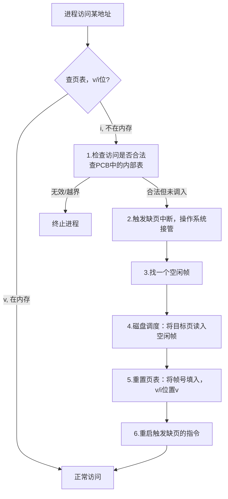

> **Tags**: #操作系统 #虚拟内存 #页面置换 #内存管理

## 一、为什么需要虚拟内存

### 核心动机

程序代码必须在内存中才能执行，但**整个程序并不需要同时驻留内存**：

- 错误处理代码（很少触发）
- 异常例程（偶尔才用）
- 大型数据结构（可能只用到一部分）

> [!tip] 关键洞察 如果只把"现在需要的"部分装入内存，就可以让程序突破物理内存限制！

### 按需加载的好处

|好处|说明|
|---|---|
|程序不受物理内存限制|逻辑地址空间可以远大于物理内存|
|每个程序占用更少内存|同时运行更多程序，提高CPU利用率|
|加载/交换所需I/O更少|每个程序响应更快|

---

## 二、虚拟内存基础

### 2.1 什么是虚拟内存

**通俗理解**：虚拟内存就是给每个进程"画了一张大饼"——让它以为自己拥有一片巨大的连续内存空间，但实际上物理内存中只存放了其中一小部分，其余的放在磁盘上。

> [!info] 严谨定义 
> **虚拟内存（Virtual Memory）**：将用户的逻辑内存（虚拟地址空间）与物理内存解耦的技术。进程看到的地址是逻辑地址（虚拟地址），通过 MMU（内存管理单元）翻译为物理地址后才真正访问内存设备。

### 2.2 MMU（内存管理单元）

**MMU 是 CPU 内部的一个模块**，专门负责地址翻译（虚拟地址 → 物理地址）。

CPU 执行一条指令的完整流程：

```
1. PC 中存放虚拟地址 → 送给 MMU
2. MMU 翻译为物理地址 → 访问内存取出指令
3. CPU 解码指令（指令中的地址也是虚拟地址！）
4. MMU 再次翻译数据地址 → 访问内存取出数据
5. 执行完毕
```

> [!warning] 易错点 **指令中存放的永远是虚拟地址，不是物理地址！** 每次内存访问都要经过 MMU 翻译。

### 2.3 虚拟地址空间布局

一个典型进程的虚拟地址空间从地址 0 开始，呈现如下布局：

```
最高地址  ┌─────────────────┐
         │      stack      │  ← 向下增长 ↓
         │                 │
         │    (空洞/hole)   │  ← 未使用区域，不占物理内存！
         │                 │
         │      heap       │  ← 向上增长 ↑
         ├─────────────────┤
         │      data       │  全局变量
         ├─────────────────┤
         │      code       │  程序代码 + 常量
最低地址 └─────────────────┘
```

**空洞（Hole）的意义**：stack 和 heap 之间的空白区域不需要物理页支撑，只有在 stack/heap 增长时才按需分配物理帧。这就实现了**稀疏地址空间**。启用具有孔的稀疏地址空间以供增长、动态链接库等

- 通过映射到虚拟地址空间共享的系统库
- 通过将页读写映射到虚拟地址空间来共享内存
- 在fork（）期间可以共享页面，从而加快进程创建

### 2.4 虚拟内存的两种实现方式

1. **请求分页（Demand Paging）** ← 主流，本章重点
2. **按需分段（Demand Segmentation）**

---

## 三、请求（按需）分页

### 3.1 基本思想

不在加载时把整个进程放入内存，而是**只把当前需要的页调入内存**，其余页留在磁盘上

**惰性交换（Lazy Swapping）**：除非真正需要，永远不把页换入内存。处理页面级别换入/换出的程序称为**调页程序（Pager）**、
- 好处：
	- 所需的I/O更少，没有不必要的I/O；
	- 所需内存更少
	- 更快的响应；
	- 更支持多用户
通过交换，调页程序在再次交换之前猜测将使用哪些页面
- 调页程序只将这些要使用的页面带入内存
- 如何确定这组页面？需要新的MMU功能来实现请求分页
- 如果所需的页已经驻留在内存中，与非请求分页没有区别
- 如果需要页但不是内存驻留页面时，需要检测页面并将其从磁盘加载到内存中
	• 不需要改变程序行为；
	• 无需程序员更改代码；
### 3.2 有效-无效位（Valid-Invalid Bit）

页表中每个条目都有一个 v/i 位：

|位值|含义|
|---|---|
|**v**（valid）|该页在物理内存中，帧号有效|
|**i**（invalid）|该页不在内存中（可能在磁盘，或根本不合法）|

- 初始时所有条目设为 **i**
- 访问 i 位的页 → 触发**缺页中断（Page Fault）**

> [!warning] 易错点：i 位有两种含义！
> 
> 1. 地址合法但页面不在内存 → 需要调入
> 2. 地址本身无效（越界访问）→ 终止进程
> 
> 处理缺页时必须先检查引用是否合法！

### 3.3 缺页处理流程


![[Pasted image 20260520150028.png|600]]
**详细12步版本**（包含I/O等待期间的CPU调度）：
1. OS 陷入（trap into OS）
2. 保存用户寄存器和进程状态
3. 确认中断是缺页错误
4. 检查引用合法性，确定页在磁盘位置
5. 向磁盘发出读取命令（进入设备队列等待）
6. **等待期间，CPU 分配给其他进程**
7. 磁盘 I/O 完成，触发中断
8. 保存当前进程（其他用户）的寄存器和状态
9. 确认中断来自磁盘
10. 更新页表（设为 v，填入帧号）
11. 等待 CPU 重新调度回本进程
12. 还原寄存器/状态，**重启**被中断的指令

### 3.4 纯请求分页（Pure Demand Paging）

极端情况：进程启动时内存中**一页都没有**。第一条指令就缺页，然后一路缺页缺过去，纯请求分页。实际系统中允许这种做法，因为局部性原理保证了很快会稳定下来。
- 请求分页所需的硬件支持
	- 具有有效/无效位的页表
	- 辅助内存（带交换空间的交换设备）
	- 指令重启，在缺页错误后能够重启任何指令
### 3.5 指令重启的问题

缺页后需要**重新执行**导致缺页的指令。对于简单指令（如三地址 ADD）没问题，但对于**块移动（Block Move）**指令，源和目的地址可能重叠：

> [!warning] 重叠问题 若源块和目的块部分重叠，指令执行一半发生缺页 → 源数据已被部分覆盖 → 不能简单地重新执行！

**解决方案**：

1. **微代码预检**：执行前先检查两端地址，若有缺页先解决再执行
2. **临时寄存器备份**：执行前保存被覆盖位置的旧值，缺页时恢复内存到指令执行前状态，再重试

### 3.6 空闲帧列表

OS 维护一个**空闲帧链表**，发生缺页时从中取帧：

```
head → [7] → [97] → [15] → [126] → ... → [75]
```

分配时使用**零填充按需（Zero-fill-on-demand）**：在帧分配给进程之前先清零，防止旧数据泄露给新进程。

系统启动时所有可用内存放入空闲帧列表。

---

## 四、请求分页的性能分析
**Three major activities**
- Service the interrupt – careful coding means just several hundredinstructions needed
- Read the page – lots of time
- Restart the process – again just a small amount of time

### 4.1 有效访问时间（EAT）

$$\text{EAT} = (1-p) \times t_{mem} + p \times (t_{fault} + t_{swap_{out}} + t_{swap_{in}})$$

其中 $p$ 为缺页率（$0 \le p \le 1$）。

**数值示例**：

- 内存访问时间 = 200 ns
- 平均缺页服务时间 = 8 ms = 8,000,000 ns

$$\text{EAT} = 200 + p \times 7,999,800 \text{ (ns)}$$

若每 1000 次访问有 1 次缺页（$p = 0.001$）：

$$\text{EAT} \approx 8,200 \text{ ns} = 8.2 \mu s$$

**是无缺页情况的 40 倍减速！**

**若要性能下降 < 10%**（EAT < 220 ns）：

$$p < 0.0000025 \approx \frac{1}{400000}$$

即每 40 万次内存访问中不能超过 1 次缺页。

> [!danger] 重点 缺页率对性能影响极其巨大，这是所有页面置换算法追求的优化目标。

### 4.2 性能优化策略

- **交换空间 I/O 比文件系统 I/O 快**：交换空间以更大块分配，管理开销小
- **旧 BSD 策略**：进程加载时先复制全部映像到交换空间，再从交换空间调页
- **现代策略（Solaris/BSD）**：直接从程序二进制文件（磁盘上）请求调页；释放帧时直接丢弃（不脏）或写入交换空间（脏，如堆/栈的匿名内存）
- **移动系统**：通常不支持交换，通过压缩内存或回收只读页（如代码页）来应对内存压力

---

## 五、写时复制（Copy-on-Write, COW）

### 5.1 基本概念

**通俗理解**：`fork()` 后父子进程共享同一批物理页，谁都不急着复制。只有某个进程真正**写**某一页时，才把那页单独复制一份给它，其他进程继续用原来的。

> [!info] 严谨定义 **写时复制（COW）**：父进程和子进程初始共享内存中相同的物理页（标记为只读）。只有当某个进程试图写某共享页时，才触发复制——OS 分配新帧，将该页复制过去，然后允许写入。

### 5.2 COW 示意

```flowchart
fork() 之前：
process₁ → [page A] ← process₂
process₁ → [page B] ← process₂  
process₁ → [page C] ← process₂

process₁ 写 page C 之后：
process₁ → [Copy of page C]  (新帧)
process₂ → [page C]          (原帧不变)
process₁ → [page A] ← process₂  (仍共享)
process₂ → [page B] ← process₁  (仍共享)
```

### 5.3 vfork()

`vfork()` 是 `fork()` 的变体：

- 父进程**挂起**
- 子进程直接使用父进程的地址空间（**不复制，不用COW**）
- 父进程能看到子进程的修改
- 设计用于子进程立即调用 `exec()` 的场景（效率极高）

> [!warning] COW 的零填充页池 OS 需要维护一个**按需零填充的空闲帧池**，以便 COW 时快速分配新帧。 为什么要预先清零？**防止旧数据泄露给新进程**（安全需要）。

---

## 六、页面置换

### 6.1 为什么需要页面置换

当物理内存帧全部用完，又需要调入新页时，必须**置换**（换出）一个现有页。

**过度分配（Overallocation**问题：系统承诺给进程的虚拟内存总量可能超过物理内存。

### 6.2 基本页面置换流程

1. 在磁盘上找到目标页的位置
2. 寻找空闲帧：
    - 有空闲帧 → 直接用
    - 无空闲帧 → **选择受害帧（victim frame）**
    - 若受害帧是脏页（dirty bit = 1）→ 先写回磁盘
3. 将目标页读入（现在空闲的）帧
4. 更新页表和帧表
5. 重启导致缺页的指令

> [!warning] 脏位（Dirty Bit / Modify Bit）的作用 若受害帧的内容**未被修改**（脏位=0），无需写回磁盘，直接覆盖即可。 这大幅减少了 I/O 开销（省去一次磁盘写操作）。
> 
> 最坏情况：需要 2 次磁盘 I/O（写出受害页 + 读入新页），EAT 进一步增大。

### 6.3 评估页面置换算法

用**引用串（Reference String**来测试算法性能——记录一系列页号访问序列，统计缺页次数来评估

> [!note] 评估规则
> 
> - 重复访问同一页不算缺页（页已在内存）
> - 帧数越多，缺页一般越少（但有例外！）
> - 用于本章示例的引用串：`7, 0, 1, 2, 0, 3, 0, 4, 2, 3, 0, 3, 0, 3, 2, 1, 2, 0, 1, 7, 0, 1`

---

## 七、页面置换算法

### 7.1 FIFO 算法（先进先出）

**策略**：替换在内存中停留**时间最长**（最先进入）的页

用 3 帧运行示例引用串：共产生 **15 次缺页**

> [!danger] Belady 异常（FIFO 特有！） **Belady 异常**：对于 FIFO 算法，**增加帧数有时反而导致缺页次数增加**！
> 
> 示例：引用串 `1, 2, 3, 4, 1, 2, 5, 1, 2, 3, 4, 5`
> 
> - 3 帧：9 次缺页
> - 4 帧：10 次缺页 ← 更多！
> 
> 这是 FIFO 的严重缺陷，违反直觉。

**实现**：只需维护一个 FIFO 队列即可

### 7.2 OPT 算法（最优置换）

**策略**：替换***未来*最长时间内不会被使用**的页

用 3 帧运行示例引用串：共产生 **9 次缺页**（最优）

> [!info] OPT 的地位
> 
> - 现实中**无法实现**（无法预知未来）
> - 作为**理论上界/基线**，用于衡量其他算法的性能差距
> - OPT 和 LRU 同属**堆栈算法**，不会出现 Belady 异常

### 7.3 LRU 算法（最近最少使用）

**策略**：替换**最近最长时间未被使用**的页（用过去预测未来）。

用 3 帧运行示例引用串：共产生 **12 次缺页**

性能：OPT > LRU > FIFO（一般情况下）

> [!note]
> “使用”：如果访问发生了缺页，也算是“使用”
**LRU 不会出现 Belady 异常**（是堆栈算法）。

**实现方式**：

**方式一：计数器（Counter）**

- 每个页表项维护一个时间戳计数器
- 每次访问时将当前时钟值写入该页的计数器
- 置换时扫描所有页找最小值
- 缺点：需要扫描整个页表，开销大

**方式二：堆栈（Stack，双向链表）**

- 维护一个页号的双向链表
- 每次访问某页：将该页移到链表顶部（需改 6 个指针）
- 置换时：链表底部就是 LRU 页，无需搜索
- 缺点：每次引用都要更新链表，开销也不小

堆栈法示意：

```
访问页 2（当前栈：4, 7, 0, 1, 2）
→ 将 2 移到顶部
→ 新栈：2, 4, 7, 0, 1（1 是最久未用，在栈底）
```

### 7.4 近似 LRU 算法

真正的 LRU 需要特殊硬件支持，代价高。实际系统用**引用位（Reference Bit** 近似实现。

**引用位机制**：

- 每页关联 1 个引用位，初始值 = 0
- 硬件：每次该页被访问时自动将引用位置 1
- OS：定期检查/清除引用位

#### 额外引用位算法

为每页保留 **8 位历史寄存器**。OS 定期（如每 100ms）将引用位移入历史寄存器的最高位，整体右移一位：

```
历史寄存器：11000100  → 最近被使用较多
历史寄存器：01110111  → 较久之前被使用多，近期少
```

数值更小 → 更"古老" → 优先置换。

#### 第二次机会算法（时钟算法）

FIFO + 引用位。用**循环队列**模拟时钟指针：

```
检查指针指向的页：
  引用位 = 0 → 置换此页（它没被用过了）
  引用位 = 1 → 清为 0，指针前移，给它"第二次机会"
                继续检查下一个
```

> [!tip] 为什么叫"时钟"算法 循环队列 + 扫描指针，形状像时钟；遇到 1 就清零跳过，遇到 0 就置换，指针循环扫描。

#### 增强型第二次机会算法

同时考虑**引用位**和**修改位（脏位）**，形成四种类型：

|(引用, 修改)|含义|置换优先级|
|---|---|---|
|**(0, 0)**|最近未用 + 未修改|**最高（最佳受害者）**|
|**(0, 1)**|最近未用 + 已修改|次之（需写磁盘，有代价）|
|**(1, 0)**|最近已用 + 未修改|较低（可能很快再用）|
|**(1, 1)**|最近已用 + 已修改|**最低（最不应换）**|

置换时：找到属于最低优先级类别中的第一个页，可能需要多次扫描循环队列。

### 7.5 计数算法

维护每页的引用次数计数器：

**LFU（最不常用）**：置换计数最小的页。

- 问题：某页在初始化时大量使用后就再也不用，但计数很高，不会被置换
- 改进：定期将计数右移1位（指数衰减），使旧引用的权重降低

**MFU（最常用）**：置换计数最大的页。

- 逻辑：计数最小的页可能是刚刚调入的新页，不应被立即换出

> [!note] 计数算法的局限 两种算法都不能很好地近似 OPT，在实际系统中较少单独使用。

### 7.6 页面缓冲算法

**核心思想**：始终维护一个**空闲帧池**，在还没到"不得不置换"时就开始回收帧。

工作方式：

- 发生缺页时，先从空闲帧池取一帧，读入新页（进程立即可以继续）
- 同时，选出受害帧，**异步**将其写回磁盘，完成后加入空闲帧池
- 不需要等待受害帧写完再恢复进程

**额外优化**：

- 记录空闲帧池中哪个帧存的是哪个页，若该页再次被需要，直接"反悔"不用重新从磁盘读

---

## 八、帧分配

### 8.1 基本问题
- 每个进程至少需要多少帧？（由指令集结构决定，如处理一条 SS MOVE 指令最多需 6 帧）
- 空闲帧如何在进程间分配？
### 8.2 固定分配
**相等分配**：若有 m 帧和 n 个进程，每个进程分 m/n 帧。
**比例分配**：按进程大小比例分配。
$$a_i = \frac{s_i}{S} \times m$$
其中 $s_i$ 是进程 $i$ 的大小，$S = \sum s_i$，$m$ 是总帧数。
**示例**：
- $m = 64$，$s_1 = 10$，$s_2 = 127$，$S = 137$，可用帧 62
- $a_1 = \frac{10}{137} \times 62 \approx 4$，$a_2 = \frac{127}{137} \times 62 \approx 57$
### 8.3 优先级分配
高优先级进程分配更多帧（或允许从低优先级进程夺取帧）。
### 8.4 全局置换 vs 局部置换

|         | 全局置换                 | 局部置换       |
| ------- | -------------------- | ---------- |
| **策略**  | 从所有进程的帧中选受害帧         | 只从自己的帧中选   |
| **优点**  | 吞吐量更高，高优先级进程可抢低优先级的帧 | 每个进程性能更可预测 |
| **缺点**  | 进程无法控制自己的缺页率         | 可能内存利用率不高  |
| **常见度** | **更常用**              | 较少         |
**页面回收**：
- 一种实现全局置换的策略
- 所有内存请求都会从空闲帧列表满足，而不是等待列表减少为0
- 当列表降低到一个阈值之后就会触发页面置换
- 这个策略尝试保证永远有足够的空闲内存来满足新的请求

---

## 九、系统抖动（Thrashing）

### 9.1 什么是抖动

> [!danger] 抖动定义 **抖动（Thrashing）**：进程的调页时间（换入/换出）**多于**实际执行时间，导致进程几乎一直在等待 I/O 而无法有效执行。

**抖动产生的恶性循环**：

```
进程缺页 → CPU 利用率下降
    ↓
OS 认为需要增加多道程序度
    ↓
引入更多进程，帧更紧张
    ↓
缺页更频繁，CPU 利用率进一步下降（抖动）
```

### 9.2 局部性模型

**请求分页之所以能工作**，是因为程序有**局部性（Locality）**：

- **时间局部性**：刚访问的数据很快还会被访问
- **空间局部性**：访问某地址后，附近地址也可能被访问
- 进程在一段时间内只在某个"局部"活动，之后转移到另一个局部

**抖动的根本原因**：

$$\sum SizeOfLocality > \text{total physical memory}$$

各进程局部性大小之和超过物理内存，导致不断相互抢占对方需要的帧。

**缓解方法**：使用局部置换或优先级置换（抖动时不让一个进程影响其他进程）。

### 9.3 工作集模型（Working Set Model）

**工作集**（WSS）是防止抖动的主要工具

> [!info] 工作集定义 进程 $P_i$ 的工作集 $WSS_i$（Working Set Size）= 在最近 $\Delta$ 次页面引用中涉及的**不同页面数量**。 $\Delta$ 称为工作集窗口（Working-Set Window）。

- $\Delta$ 太小 → 覆盖不了整个局部 → 缺页多
- $\Delta$ 太大 → 涵盖多个局部 → 分配过多帧
- $\Delta = \infty$ → 涵盖整个程序

**工作集策略**：

$$D = \sum WSS_i \quad \text{（总需求帧数）}$$

- 若 $D > m$（可用物理帧数）→ 有进程会抖动 → 挂起/换出某个进程
- 若 $D \le m$ → 可以再引入新进程

**实现近似**：用定时中断 + 引用位来近似工作集（无法精确计算，但可以近似）。

### 9.4 缺页错误率（PFF）控制法

比工作集模型更直接的抖动控制方法：

**设定缺页率的上下界**：

- 实际缺页率 > 上界 → 进程帧数不够 → **增加帧**
- 实际缺页率 < 下界 → 进程帧数过多 → **减少帧**（归还给其他进程）

若系统中帧不够分配 → 挂起某个进程。

---

## 十、内核内存分配

内核内存与用户内存的管理方式不同：

- 内核需要**不同大小**的内存块（各种数据结构）
- 部分内核内存需要**物理连续**（如 DMA 设备 I/O）

### 10.1 伙伴系统（Buddy System）

**思想**：从物理连续的固定大小内存段中，用**2的幂次分配器**来满足请求。

**分配过程**（256KB 块，申请 21KB）：

```
256KB
├── 128KB (A_L) 被使用
│   ├── 64KB (B_L) 被使用
│   │   ├── 32KB (C_L) ← 分配给21KB请求（实际用21KB，浪费11KB）
│   │   └── 32KB (C_R) 空闲
│   └── 64KB (B_R) 空闲
└── 128KB (A_R) 空闲
```

- **优点**：释放时，两个相邻的伙伴块可以快速**合并（coalesce）**为更大块
- **缺点**：内部碎片（申请21KB，给了32KB，浪费11KB）

### 10.2 Slab 分配器

> [!info] Slab 分配器定义
> 
> - **Slab**：一个或多个物理连续的页组成的块
> - **Cache**：一个或多个 Slab 组成的集合，每种内核数据结构（如 `task_struct`）对应一个独立的 Cache
> - **Object**：Cache 中的每个单元，是某种数据结构的实例

**工作原理**：

1. 创建 Cache 时，用对应大小的 Object 填满，全部标记为 **free**
2. 分配时，从 Cache 中取一个 free Object，标记为 **used**
3. Slab 有三种状态：**Full**（全用完）、**Empty**（全空闲）、**Partial**（部分使用）
4. 优先从 Partial 的 Slab 分配；若没有 Partial，从 Empty 分配；若没有 Empty，新建 Slab

**优点**：

- **无碎片**：Object 大小固定，不会有剩余空间浪费
- **分配速度快**：直接从预分配的 Object 池取，无需复杂计算

**Linux 中的变体**：

- **SLAB**：原始版本（Solaris 起源）
- **SLOB**：适合内存极有限的系统（Simple List of Blocks，维护 small/medium/large 三个列表）
- **SLUB**：性能优化版，去掉 per-CPU 队列，元数据存入页结构，**现代 Linux 默认**

---

## 十一、其他注意事项

### 11.1 预调页（Prepaging）

进程启动时，预先调入它**可能需要**的页面，减少启动阶段的大量缺页。

设预调 $s$ 页，其中比例 $\alpha$ 实际被用到：

- 节省：$s \times \alpha$ 次缺页
- 浪费：$s \times (1-\alpha)$ 次不必要 I/O

若 $\alpha \approx 0$，预调页完全失效。需要合理预测。
### 11.2 页面大小的权衡

页面大小通常是 2 的幂次，范围 $2^{12}$（4KB）到 $2^{22}$（4MB）。

|        |   更小的页   |    更大的页    |
| ------ | :------: | :--------: |
| Frgmt  |  内部碎片更少  |    页表更小    |
|        | 局部性粒度更细  | I/O 传输效率更高 |
| Pg Flt | 缺页次数可能更多 |  缺页次数可能更少  |
|        |  页表项更多   |  可能增加内部碎片  |
大小在 $2^{12}\to2^{22}$B
**趋势**：随时间推移，页面大小总体在增大。

### 11.3 TLB 范围（TLB Reach）

$$\text{TLB Reach} = TLB Size(\text{TLB 条目数}) \times PageSize(\text{页面大小})$$

理想情况：每个进程的工作集都能放入 TLB → 几乎无 TLB 缺失。

提升 TLB Reach 的方法：

1. 增大页面大小（可能增加碎片）
2. 提供多种页面大小（大页给需要大内存的应用，避免碎片）

### 11.4 程序结构对缺页的影响

**示例**：`int data[128][128]`（每行存于一页）

```c
// 程序1（按列访问）：128 × 128 = 16,384 次缺页！
for (j = 0; j < 128; j++)
    for (i = 0; i < 128; i++)
        data[i][j] = 0;

// 程序2（按行访问）：128 次缺页
for (i = 0; i < 128; i++)
    for (j = 0; j < 128; j++)
        data[i][j] = 0;
```

> [!warning] 编程启示 访问数组时，**按行优先（row-major）**访问符合局部性，缺页远少于按列优先。

### 11.5 I/O 联锁（I/O Interlock）

进行 DMA I/O 时，正在传输数据的缓冲页**必须被锁定**（Pinned）在内存中，不能被页面置换算法换出。否则，DMA 写入了一个已被置换的帧，该帧又被分给另一进程，造成数据损坏。

---

## 十二、非均匀内存访问（NUMA）

**NUMA 系统**：多个 CPU 各自连接一块本地内存，通过互联总线访问其他 CPU 的内存。访问本地内存快，访问远端内存慢。

**优化策略**：尽量将进程的内存分配在其所在 CPU 的本地内存区域，调度器也尽量将线程调度到靠近其内存的 CPU 上。

**Solaris 的解决方案**：创建 **lgroup**（低延迟组），跟踪 CPU/内存的延迟关系，调度和内存分配时尽量在同一 lgroup 内完成。

---

## 十三、例题精选

### 例题 1：缺页处理流程（填空/简答）

**题目**：进程 P 访问虚拟页 3，页表显示页 3 的有效位为 i，描述后续发生的事情。

**解答**：

1. MMU 检测到有效位为 i，产生**缺页中断**，陷入操作系统
2. OS 检查进程的内部表（PCB）：地址引用是否合法？
    - 若非法 → 终止进程
    - 若合法 → 继续
3. OS 寻找**空闲帧**（从空闲帧列表取）
4. OS 发起磁盘 I/O，将页 3 从辅助存储读入该空闲帧（进程阻塞，CPU 调度给其他进程）
5. I/O 完成后，OS 更新页表：填入帧号，将有效位置为 **v**
6. OS 重新调度该进程，**重启**触发缺页的那条指令

---

### 例题 2：EAT 计算

**题目**：已知内存访问时间为 100ns，缺页处理时间（磁盘读取）为 10ms，若要求有效访问时间不超过内存访问时间的 110%（即 ≤ 110ns），求最大允许的缺页率 p。

**解答**：

$$\text{EAT} = (1-p) \times 100 + p \times 10{,}000{,}000 \le 110 \text{ (ns)}$$

$$100 + p \times (10{,}000{,}000 - 100) \le 110$$

$$p \times 9{,}999{,}900 \le 10$$

$$p \le \frac{10}{9{,}999{,}900} \approx 10^{-6}$$

**答**：最大缺页率约为 $10^{-6}$，即每 100 万次内存访问中最多 1 次缺页。

---

### 例题 3：FIFO / LRU / OPT 算法比较

**题目**：参考串为 `1, 2, 3, 4, 1, 2, 5, 1, 2, 3, 4, 5`，分配 3 帧，分别用 FIFO、OPT、LRU 算法，计算缺页次数。

**FIFO（3帧）**：

| 引用  | 1   | 2   | 3   | 4     | 1     | 2     | 5     | 1   | 2   | 3     | 4     | 5   |
| --- | --- | --- | --- | ----- | ----- | ----- | ----- | --- | --- | ----- | ----- | --- |
| 帧1  | 1   | 1   | 1   | **4** | 4     | 4     | **5** | 5   | 5   | 5     | 5     | 5   |
| 帧2  |     | 2   | 2   | 2     | **1** | 1     | 1     | 1   | 1   | **3** | 3     | 3   |
| 帧3  |     |     | 3   | 3     | 3     | **2** | 2     | 2   | 2   | 2     | **4** | 4   |
| 缺页  | ✗   | ✗   | ✗   | ✗     | ✗     | ✗     | ✗     | -   | -   | ✗     | ✗     |     |

**缺页次数：9**（注意这是 Belady 异常展示的参考串，3帧和4帧对比见下）

**FIFO（4帧）**：

|引用|1|2|3|4|1|2|5|1|2|3|4|5|
|---|---|---|---|---|---|---|---|---|---|---|---|---|
|缺页|✗|✗|✗|✗|-|-|✗|-|-|✗|✗|✗|

**缺页次数：10**（4帧比3帧多！Belady 异常发生）

> [!danger] Belady 异常 FIFO 算法下，帧数从 3 增到 4，缺页次数从 9 增到 10。LRU 和 OPT 不会有此现象（它们是堆栈算法）。

---

### 例题 4：工作集计算

**题目**：某进程的页面引用序列如下，工作集窗口 Δ = 5，计算在 t=10 时刻的工作集。

```
引用序列：1, 2, 3, 4, 2, 1, 5, 3, 2, 1  （t=1 至 t=10）
```

**解答**：t=10 时，最近 Δ=5 次引用为：`5, 3, 2, 1`（t=6~t=10 为 `1, 5, 3, 2, 1`）

工作集 WSS = {1, 2, 3, 5}，共 **4 个不同页**，需要 4 帧。

---

### 例题 5：伙伴系统分配

**题目**：系统有 256KB 的连续物理内存，依次申请：80KB、35KB，然后释放 80KB 的块，再申请 64KB，画出最终内存状态。

**解答**：

```
初始：256KB 整块

申请 80KB → 向上取整到 128KB
256 → [128|128]
取左边 128KB 分配给 80KB（内部碎片 48KB）

申请 35KB → 向上取整到 64KB  
右边 128KB → [64|64]
取左 64KB 分配给 35KB（内部碎片 29KB）

释放 80KB（占用 128KB 块）→ 左边 128KB 归还
右边 64KB（35KB用） + 64KB（空）
左边 128KB（空） + 右边 64KB(used) + 64KB(free)

申请 64KB → 右边空闲的 64KB 满足
```

最终：

```
[128KB 空闲] | [64KB, 35KB used] | [64KB, 64KB used]
```

---

### 例题 6：第二次机会（时钟）算法

**题目**：内存中有 4 帧，当前状态如下（括号中为引用位），按 FIFO 顺序排列：

`页3(1) → 页5(0) → 页2(1) → 页7(0)` （指针指向页3）

现在需要调入新页 **页9**（发生缺页），用第二次机会算法找受害帧。

**解答**：

```
检查页3：引用位=1 → 清为0，指针前移
  状态：页3(0) → 页5(0) → 页2(1) → 页7(0)，指针→页5

检查页5：引用位=0 → 置换！页5是受害帧
  将页9装入页5的帧，指针前移到页2
```

**答**：置换**页5**，装入页9。指针移至页2。

---

### 例题 7：比例分配

**题目**：系统有 60 个可用帧（除 OS 占用外），当前有 3 个进程：

- P1 大小 = 10 页
- P2 大小 = 30 页
- P3 大小 = 20 页

按比例分配各进程的帧数。

**解答**：

$$S = 10 + 30 + 20 = 60$$

$$a_1 = \frac{10}{60} \times 60 = 10 \text{ 帧}$$

$$a_2 = \frac{30}{60} \times 60 = 30 \text{ 帧}$$

$$a_3 = \frac{20}{60} \times 60 = 20 \text{ 帧}$$

**答**：P1 分 10 帧，P2 分 30 帧，P3 分 20 帧。

---

## 十四、知识点总结与易错点

### 重要公式汇总

|公式|说明|
|---|---|
|$\text{EAT} = (1-p) \times t_{mem} + p \times t_{fault}$|有效访问时间|
|$a_i = \frac{s_i}{S} \times m$|比例帧分配|
|$\text{TLB Reach} = \text{TLB Size} \times \text{Page Size}$|TLB 覆盖范围|
|$D = \sum WSS_i$|工作集总需求帧|

### 算法缺页次数对比（示例引用串，3帧）

|算法|缺页次数|特点|
|---|---|---|
|FIFO|15|简单，有 Belady 异常|
|LRU|12|良好近似，无 Belady 异常|
|OPT|9|最优，不可实现，作为基线|

### 易错点汇总

> [!warning] 易错1：有效位 i 的含义 i 位不一定意味着"非法访问"，还可能是"合法但不在内存"。必须先查 PCB/内部表确认。

> [!warning] 易错2：Belady 异常 只有 FIFO 会出现 Belady 异常。LRU 和 OPT 是堆栈算法，帧增加缺页一定不会增加。

> [!warning] 易错3：缺页处理的"重启指令" 处理缺页后是**重新执行**（restart）那条指令，不是继续执行下一条。整条指令重来。

> [!warning] 易错4：脏位在置换时的作用 置换时只有脏位=1的页需要写回磁盘；脏位=0（未修改）可以直接丢弃，磁盘上已有副本。

> [!warning] 易错5：程序二维数组访问顺序 C语言数组按行存储。按列访问会造成大量缺页，远多于按行访问。

> [!warning] 易错6：伙伴系统的碎片 伙伴系统有**内部碎片**（申请大小向上取整到2的幂次）但基本没有外部碎片（合并机制）。Slab 分配器则几乎无内部碎片。

> [!warning] 易错7：vfork 与 fork 的区别 `fork()` 用 COW，父子都可继续执行；`vfork()` 不用 COW，父进程挂起，子进程直接使用父进程空间，仅适合子进程立即 exec() 的场景。