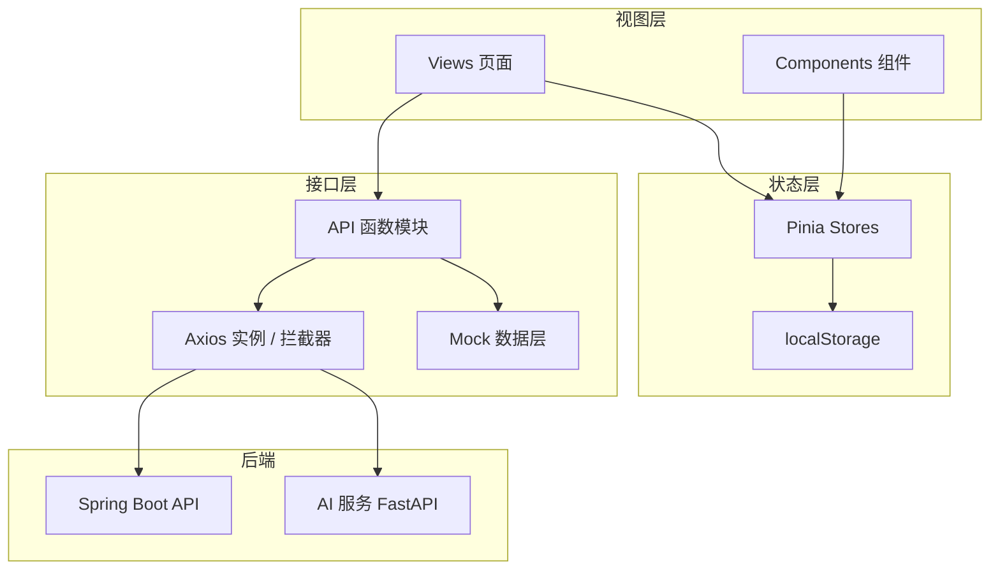
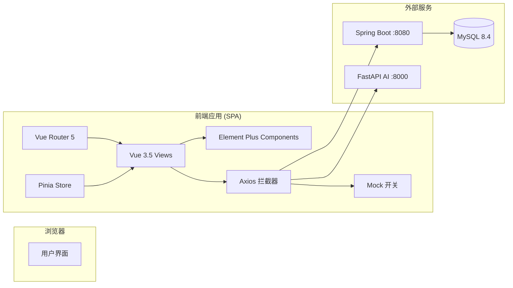
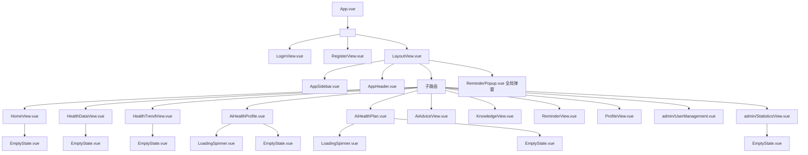
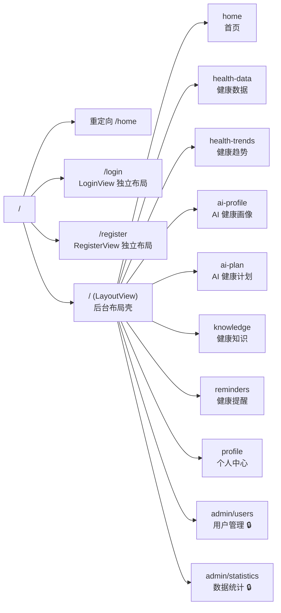
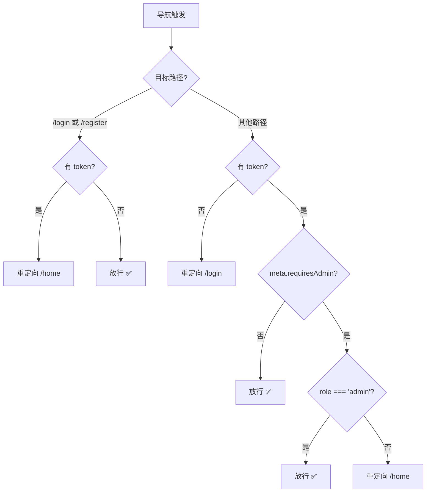
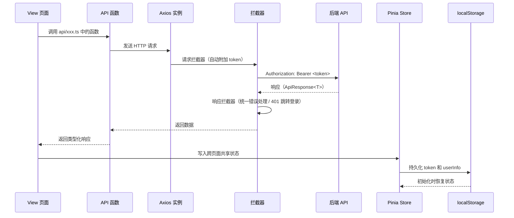
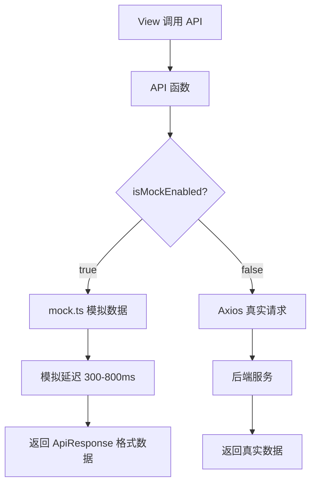
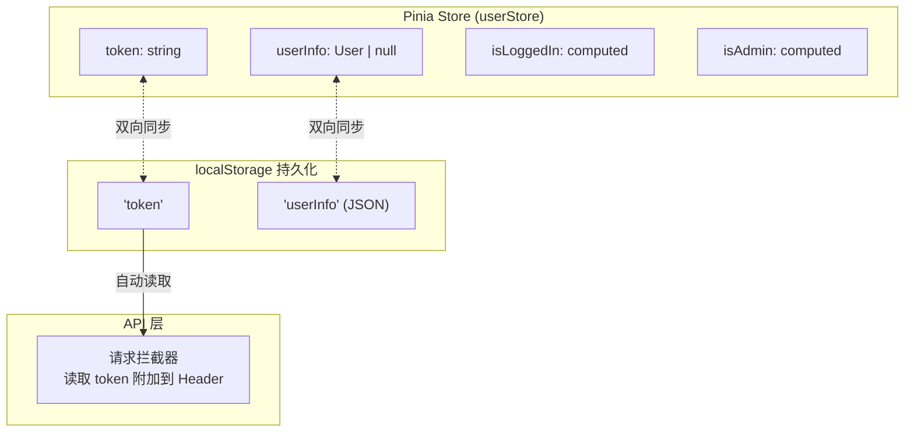

# 前端总体设计架构

> AI 个性化私人健康管理系统 · 前端架构文档
> 版本 1.0

---

## 1. 项目概述

AI 个性化私人健康管理系统是一款面向个人用户的智能健康管理平台。前端基于 **Vue 3 + TypeScript + Vite** 构建，提供健康数据管理、AI 健康画像、个性化健康计划、健康知识推送、定时提醒等功能，并包含管理员后台模块。

---

## 2. 技术栈

| 类别 | 选型 | 版本 | 选型理由 |
|------|------|------|----------|
| 框架 | Vue 3 | 3.5.x | Composition API + `<script setup>`，生态成熟 |
| 语言 | TypeScript | 6.0 | 静态类型检查，减少运行时错误 |
| 构建工具 | Vite | 8.0 | 极速冷启动，原生 ESM |
| UI 组件库 | Element Plus | 2.14 | 企业级 Vue3 组件库，中文文档完善 |
| 路由 | Vue Router | 5.0 | 官方路由方案，支持懒加载 |
| 状态管理 | Pinia | 3.0 | Vue3 官方推荐，TypeScript 友好 |
| HTTP 客户端 | Axios | 1.16 | 拦截器机制，统一错误处理 |

---

## 3. 整体架构

### 3.1 架构分层

系统采用**四层架构**：视图层 → 状态层 → 接口层 → 后端服务层。



### 3.2 技术架构图



---

## 4. 目录结构

```
frontend/
├── index.html                  # HTML 入口
├── package.json                # 依赖与脚本
├── vite.config.ts              # Vite 配置（代理、环境变量）
├── tsconfig.json               # TypeScript 配置
├── .env.example                # 环境变量模板
│
├── public/
│   ├── favicon.svg
│   └── icons.svg
│
└── src/
    ├── main.ts                 # 应用入口：注册 Pinia / Router / Element Plus
    ├── App.vue                 # 根组件，仅 <RouterView />
    ├── style.css               # 全局样式
    ├── env.d.ts                # .vue 文件类型声明
    │
    ├── views/                  # 页面组件（路由级别）
    │   ├── LoginView.vue           # 登录页（独立布局）
    │   ├── RegisterView.vue        # 注册页（独立布局）
    │   ├── LayoutView.vue          # 后台布局壳（侧栏 + 顶栏 + <RouterView />）
    │   ├── HomeView.vue            # 首页 / 数据总览
    │   ├── HealthDataView.vue      # 健康数据录入与管理
    │   ├── HealthTrendView.vue     # 健康趋势图（Canvas 自绘）
    │   ├── AiHealthProfile.vue     # AI 健康画像
    │   ├── AiHealthPlan.vue        # AI 个性化健康计划
    │   ├── AiAdviceView.vue        # AI 健康建议（预留）
    │   ├── KnowledgeView.vue       # 健康知识库与推送
    │   ├── ReminderView.vue        # 健康提醒设置
    │   ├── ProfileView.vue         # 个人中心
    │   └── admin/
    │       ├── UserManagement.vue  # 用户管理（管理员）
    │       └── StatisticsView.vue  # 数据统计（管理员）
    │
    ├── components/             # 可复用组件
    │   ├── layout/
    │   │   ├── AppHeader.vue       # 顶部导航栏
    │   │   └── AppSidebar.vue      # 侧边栏菜单
    │   ├── health/
    │   │   └── HealthChart.vue     # 健康图表组件（预留）
    │   ├── reminder/
    │   │   └── ReminderPopup.vue   # 定时提醒弹窗（全局）
    │   └── common/
    │       ├── LoadingSpinner.vue  # 加载中状态
    │       └── EmptyState.vue      # 空数据占位
    │
    ├── router/
    │   └── index.ts            # 路由配置 + 导航守卫
    │
    ├── api/                    # 接口层
    │   ├── request.ts              # Axios 实例 + 请求/响应拦截器
    │   ├── auth.ts                 # 登录 / 注册
    │   ├── user.ts                 # 用户信息 CRUD
    │   ├── health.ts               # 健康数据 CRUD
    │   ├── ai.ts                   # AI 画像 / 计划 / 推送
    │   ├── reminder.ts             # 提醒 CRUD
    │   ├── knowledge.ts            # 知识库 / 推送
    │   ├── admin.ts                # 管理员接口
    │   └── mock.ts                 # Mock 数据与开关
    │
    ├── stores/
    │   └── user.ts              # 用户状态（token、用户信息、登录态）
    │
    ├── types/                  # TypeScript 类型定义
    │   ├── index.ts                # 统一导出
    │   ├── api.ts                  # ApiResponse<T>
    │   ├── user.ts                 # User / LoginRequest / LoginResponse
    │   ├── health.ts               # HealthRecord / TrendPoint
    │   ├── ai.ts                   # AiProfileData / AiPlanData
    │   ├── reminder.ts             # Reminder / ReminderRequest
    │   ├── knowledge.ts            # KnowledgeItem / KnowledgePush
    │   └── statistics.ts           # PlatformStatistics / AdminUserItem
    │
    ├── utils/
    │   └── index.ts             # 工具函数（日期格式化等）
    │
    └── assets/                 # 静态资源
        ├── hero.png
        ├── vite.svg
        └── vue.svg
```

---

## 5. 组件树



**说明：**
- `LoginView` 和 `RegisterView` 是**独立页面**，拥有独立布局（居中卡片 + 渐变背景），不包含侧边栏和顶栏
- `LayoutView` 是**后台布局壳**，包含侧边栏 + 顶栏 + 子路由出口 + 全局提醒弹窗
- 所有业务页面都嵌套在 `LayoutView` 内作为子路由
- `ReminderPopup.vue` 通过 `<Teleport to="body">` 挂载到 body，实现全局弹窗

---

## 6. 路由设计

### 6.1 路由表

| 路径                  | 名称               | 组件                  | 布局         | 权限  |
| ------------------- | ---------------- | ------------------- | ---------- | --- |
| `/`                 | —                | 重定向到 `/home`        | —          | —   |
| `/login`            | login            | LoginView.vue       | 独立         | 未登录 |
| `/register`         | register         | RegisterView.vue    | 独立         | 未登录 |
| `/home`             | home             | HomeView.vue        | LayoutView | 登录  |
| `/health-data`      | health-data      | HealthDataView.vue  | LayoutView | 登录  |
| `/health-trends`    | health-trends    | HealthTrendView.vue | LayoutView | 登录  |
| `/ai-profile`       | ai-profile       | AiHealthProfile.vue | LayoutView | 登录  |
| `/ai-plan`          | ai-plan          | AiHealthPlan.vue    | LayoutView | 登录  |
| `/knowledge`        | knowledge        | KnowledgeView.vue   | LayoutView | 登录  |
| `/reminders`        | reminders        | ReminderView.vue    | LayoutView | 登录  |
| `/profile`          | profile          | ProfileView.vue     | LayoutView | 登录  |
| `/admin/users`      | user-management  | UserManagement.vue  | LayoutView | 管理员 |
| `/admin/statistics` | admin-statistics | StatisticsView.vue  | LayoutView | 管理员 |

### 6.2 路由结构图



### 6.3 路由守卫



**守卫逻辑：**
- 已登录用户访问登录/注册页 → 自动跳转首页
- 未登录用户访问业务页 → 自动跳转登录页
- 非管理员访问 `/admin/*` → 自动跳转首页
- 判断依据：`localStorage` 中的 `token` 和 `role`

---

## 7. 数据流设计

### 7.1 整体数据流



### 7.2 Mock 数据流

当环境变量 `VITE_MOCK_API=true` 时，API 层会返回本地模拟数据而不请求后端：



**Mock 开关：**
- `VITE_MOCK_API=true` — 全局 Mock 开关（健康数据、提醒、知识库、管理后台）
- `VITE_MOCK_AUTH=true` — 独立控制登录/注册 Mock

### 7.3 状态管理数据流



**设计决策：**
- token 和 userInfo 同时存储在 Pinia（响应式）和 localStorage（持久化）
- 路由守卫直接从 localStorage 读取（避免 Pinia 初始化时序问题）
- API 请求拦截器从 localStorage 读取 token 附加到 Authorization 头
- 登出时同时清除 Pinia 和 localStorage

---

## 8. 设计决策与权衡

### 8.1 为什么选择 Vue 3 Composition API + `<script setup>`

- 比 Options API 更简洁，逻辑复用更方便
- `<script setup>` 编译时优化，更小打包体积
- 与 TypeScript 配合更自然

### 8.2 为什么路由守卫用 localStorage 而不用 Pinia

- Pinia 在页面刷新后会丢失状态，localStorage 可以持久化
- 路由守卫在 Pinia 初始化之前就可能执行，直接读 localStorage 更可靠
- 保持守卫逻辑简单、无依赖

### 8.3 为什么引入 Mock 层

- 后端 API 开发与前端开发并行，Mock 允许前端独立开发调试
- Mock 函数返回格式与真实后端完全一致（`ApiResponse<T>`），切换零成本
- Mock 数据包含增删改操作的内存模拟，支持完整交互流程

### 8.4 为什么 Canvas 自绘趋势图

- Element Plus 不内置图表组件
- Canvas 自绘避免了引入 ECharts 等重型图表库（~800KB+）
- 项目中图表需求简单（折线图 + 柱状图），自绘代码 ~200 行即可满足
- 配合 ResizeObserver 实现响应式自适应

---

## 9. 构建与部署

### 开发环境

```bash
cd frontend
npm install
npm run dev        # http://127.0.0.1:5173
```

### 生产构建

```bash
npm run build      # 输出到 dist/
```

Vite 配置了代理：开发时 `/api` 请求代理到 `http://127.0.0.1:8080`，生产环境由 Nginx 等反向代理统一处理。

### 环境变量

| 变量 | 说明 | 默认值 |
|------|------|--------|
| `VITE_HOST` | 开发服务器地址 | `127.0.0.1` |
| `VITE_PORT` | 开发服务器端口 | `5173` |
| `VITE_API_PROXY_TARGET` | API 代理目标 | `http://127.0.0.1:8080` |
| `VITE_MOCK_API` | 全局 Mock 开关 | `false` |
| `VITE_MOCK_AUTH` | 登录/注册 Mock 开关 | `false` |
