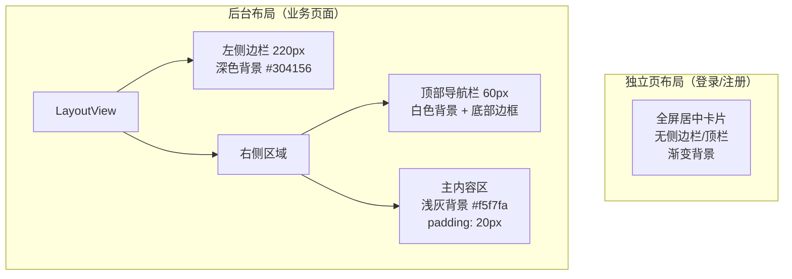

# 前端界面设计

> AI 个性化私人健康管理系统 · 界面设计文档
> 版本 1.0 | 2026-06-14

---

## 1. 设计概述

### 1.1 UI 框架

系统使用 **Element Plus 2.14** 作为 UI 组件库，在此基础上进行定制化样式开发。全局采用中文语言包。

### 1.2 设计原则

| 原则 | 说明 |
|------|------|
| 一致性 | 所有页面统一使用 Element Plus 组件风格，自定义样式遵循其设计变量 |
| 响应式 | 支持桌面端（≥768px）和小屏适配，使用 CSS Grid + Flexbox |
| 反馈清晰 | 加载有 Loading 动画，空数据有空状态占位，错误有 Toast 提示 |
| 色彩语义 | 成功=绿色、警告=橙色、危险=红色、信息=蓝色，与 Element Plus 保持一致 |
| AI 差异化 | AI 相关页面使用渐变色、加载动画，突出智能化体验 |

---

## 2. 整体布局

### 2.1 两种布局模式



### 2.2 后台布局线框图
![[Pasted image 20260614211124.png]]

## 3. 色彩体系

### 3.1 主色调

| 用途 | 色值 | 使用场景 |
|------|------|----------|
| 主题蓝 | `#409eff` | 按钮、链接、选中态、图表折线 |
| 主题深蓝 | `#304156` | 侧边栏背景 |
| 成功绿 | `#67c23a` | 成功状态、低风险、饮食建议 |
| 警告橙 | `#e6a23c` | 中风险、中等警告 |
| 危险红 | `#f56c6c` | 高风险、删除操作、已读数红点 |
| AI 紫 | `#6366f1` / `#8b5cf6` | AI 功能入口渐变 |

### 3.2 背景色

| 用途 | 色值 |
|------|------|
| 主内容区背景 | `#f5f7fa` |
| 卡片/表格背景 | `#fff` |
| 输入区域浅底 | `#fafafa` / `#f0f9ff` |
| 免责声明背景 | `#fdf6ec` |

### 3.3 文字色

| 用途 | 色值 |
|------|------|
| 主要文字 | `#303133` |
| 常规文字 | `#606266` |
| 辅助文字 | `#909399` |
| 占位/禁用 | `#c0c4cc` |

### 3.4 侧边栏菜单色

| 项目 | 色值 |
|------|------|
| 菜单背景 | `#304156` |
| 菜单文字 | `#bfcbd9` |
| 菜单激活 | `#409eff` |
| 分割线文字 | `#6b7b8d` |

---

## 4. 页面设计

### 4.1 登录页

```
┌──────────────────────────────────────────────────┐
│                                                  │
│          (渐变背景 #667eea → #764ba2)             │
│                                                  │
│            ┌──────────────────┐                  │
│            │                  │                  │
│            │  AI个性化健康     │                  │
│            │  管理系统         │                  │
│            │                  │                  │
│            │  手机号 [______] │                  │
│            │  密码   [______] │                  │
│            │                  │                  │
│            │  [ 登 录 ]       │                  │
│            │                  │                  │
│            │  还没有账号？     │                  │
│            │  立即注册 →       │                  │
│            └──────────────────┘                  │
│                      400px 宽白色卡片             │
│                      圆角 12px                    │
│                      阴影 0 8px 32px              │
└──────────────────────────────────────────────────┘
```

**设计要点：**
- 紫色渐变全屏背景，营造科技感
- 白色居中卡片，圆角 + 阴影
- 表单左对齐，标签宽度 80px
- 登录按钮 full-width，高度 40px

### 4.2 注册页

- 与登录页布局一致，背景改为浅灰 `#f5f7fa`
- 额外增加"用户名"和"确认密码"字段
- 底部链接改为"已有账号？立即登录"

### 4.3 首页（HomeView）

```
┌─────────────────────────────────────────────────┐
│ ┌─────────────────────────────────────────────┐ │
│ │ 🏠 早上好，用户名 👋                         │ │
│ │ 2026年6月14日 · 星期日           6 功能模块   │ │
│ │ "最好的医生是自己，最好的药物是时间。"  85 健康评分 │ │
│ └─────────────────────────────────────────────┘ │
│                                                 │
│ ⚡ 快捷入口                                     │
│ ┌──────────┐ ┌──────────┐ ┌──────────┐         │
│ │ 💪 健康  │ │ 🧬 AI    │ │ 📋 AI    │         │
│ │ 数据     │ │ 健康画像  │ │ 健康计划  │         │
│ └──────────┘ └──────────┘ └──────────┘         │
│ ┌──────────┐ ┌──────────┐ ┌──────────┐         │
│ │ 📈 健康  │ │ 📚 健康  │ │ ⏰ 健康  │         │
│ │ 趋势     │ │ 知识     │ │ 提醒     │         │
│ └──────────┘ └──────────┘ └──────────┘         │
│                                                 │
│ 📊 健康概览          💡 今日健康小贴士          │
│ ┌────────────────┐  ┌──────────────────────┐   │
│ │ 70.5kg 7.5h   │  │ 🚶 多走动            │   │
│ │ 45min  5条     │  │ 久坐后起身活动5分钟  │   │
│ └────────────────┘  └──────────────────────┘   │
└─────────────────────────────────────────────────┘
max-width: 1100px, 居中
```

**设计要点：**
- 欢迎横幅：蓝紫渐变背景，白色文字，圆角 16px
- 快捷入口：3×2 Grid，每张卡片左侧彩色竖条 + hover 上浮效果
- 底部两栏并排（1:1），响应式小屏时堆叠
- 所有卡片圆角 12px

### 4.4 健康数据管理页

```
┌──────────────────────────────────────────────┐
│ 💪 健康数据管理                              │
│ 记录和管理您的日常健康指标                    │
│                                              │
│ 📝 录入健康数据                               │
│ ┌──────────────────────────────────────────┐ │
│ │ [类型选择 v]  [数值输入]  kg             │ │
│ │ [日期时间选择器]                         │ │
│ │ [提交数据]  [批量导入(CSV)]             │ │
│ └──────────────────────────────────────────┘ │
│                                              │
│ 📋 历史记录              [类型筛选 v]         │
│ ┌──────────────────────────────────────────┐ │
│ │ 类型 │ 数值     │ 记录时间    │ 操作     │ │
│ │ ⚖️体重│70.5 kg  │ 2026-06-01 │ [删除]  │ │
│ │ 🩸血压│120mmHg  │ 2026-06-01 │ [删除]  │ │
│ │ ...   │ ...     │ ...        │ ...     │ │
│ └──────────────────────────────────────────┘ │
│                              共 X 条  < 1 > │
└──────────────────────────────────────────────┘
max-width: 960px, 居中
```

### 4.5 健康趋势页

```
┌──────────────────────────────────────────────┐
│ 📈 健康趋势图                                │
│                                              │
│ ┌─ 筛选 ──────────────────────────────────┐  │
│ │ [类型 v] [日期范围选择器] [查询] [导出] │  │
│ └──────────────────────────────────────────┘  │
│                                              │
│ ┌─ 图表 ──────────────────────────────────┐  │
│ │ 体重趋势                单位：kg         │  │
│ │ ┌────────────────────────────────────┐  │  │
│ │ │    ·                               │  │  │
│ │ │   / \    Canvas 折线图             │  │  │
│ │ │  /   \                             │  │  │
│ │ │ /     \____                        │  │  │
│ │ └────────────────────────────────────┘  │  │
│ │ 平均值 69.8  最高值 71.2  最低值 69.5   │  │
│ │ 📈 整体呈下降趋势，下降约1.5%            │  │
│ └──────────────────────────────────────────┘  │
│                                              │
│ ┌─ 数据明细 ──────────────────────────────┐  │
│ │ 日期 │ 数值 │ 单位 │ 与均值差值          │  │
│ │ 06-01│ 70.5 │ kg  │ +0.7               │  │
│ │ ...  │ ...  │ ... │ ...                │  │
│ └──────────────────────────────────────────┘  │
└──────────────────────────────────────────────┘
max-width: 1000px
```

### 4.6 AI 健康画像页

```
┌──────────────────────────────────────────────┐
│ 🧬 AI 健康画像                               │
│                                              │
│ ┌─ 操作 ──────────────────────────────────┐  │
│ │ [时间范围 v]  [✨ 生成健康画像]          │  │
│ └──────────────────────────────────────────┘  │
│                                              │
│ （生成中：旋转 Loading + "AI 正在分析..."）   │
│                                              │
│ ┌─ 健康风险等级 ──────────────────────────┐  │
│ │                    [低风险] 绿色标签     │  │
│ │  ┌──────┬──────┬──────┐                │  │
│ │  │ 低   │ 中   │ 高   │ ← 指示器      │  │
│ │  └──────┴──────┴──────┘                │  │
│ └──────────────────────────────────────────┘  │
│                                              │
│ ┌─ 🏷️ 健康标签 ───────────────────────────┐  │
│ │ [睡眠不足] [运动达标] [体重正常] ...     │  │
│ └──────────────────────────────────────────┘  │
│                                              │
│ ┌─ 📋 综合分析 ───────────────────────────┐  │
│ │ 根据您近期的健康数据，整体健康状况      │  │
│ │ 良好。体重和血压均在正常范围内...       │  │
│ │ ⚠️ 以上分析仅供参考，不构成医疗建议     │  │
│ └──────────────────────────────────────────┘  │
└──────────────────────────────────────────────┘
max-width: 900px
```

### 4.7 AI 健康计划页

```
┌──────────────────────────────────────────────┐
│ 📋 AI 个性化健康计划                         │
│                                              │
│ ┌─ 输入 ──────────────────────────────────┐  │
│ │ 健康需求：[________________]             │  │
│ │ 快捷选择：[改善睡眠] [减重管理] [控制血压]│  │
│ │          [✨ 生成健康计划]               │  │
│ └──────────────────────────────────────────┘  │
│                                              │
│ ┌─ 改善睡眠专属健康计划 ──────── [AI 生成] ┐  │
│ └──────────────────────────────────────────┘  │
│                                              │
│ ┌─ 🥗 饮食建议 ─┐ ┌─ 🏃 运动建议 ─┐        │
│ │ 绿色顶边      │ │ 蓝色顶边      │        │
│ │ 晚餐宜清淡... │ │ 每天保持30-45 │        │
│ └───────────────┘ └───────────────┘        │
│                                              │
│ ┌─ 😴 睡眠建议 ──────────────────────────┐  │
│ │ 紫色顶边                                │  │
│ │ 固定作息时间，建议每晚22:30前上床...     │  │
│ └──────────────────────────────────────────┘  │
│                                              │
│ ⚠️ 以上计划仅供参考，请咨询专业医生         │
└──────────────────────────────────────────────┘
max-width: 960px
```

### 4.8 健康提醒页

```
┌──────────────────────────────────────────────┐
│ ⏰ 健康提醒设置                              │
│                                              │
│ ℹ️ 设置提醒后，系统将在指定时间弹出提醒通知  │
│                                              │
│ ┌─ 新增 ──────────────────────────────────┐  │
│ │ [类型 v]  [时间选择器]  [+ 添加提醒]    │  │
│ └──────────────────────────────────────────┘  │
│                                              │
│ ┌─ 提醒列表 ──────────────────────────────┐  │
│ │ 类型 │ 时间   │ 状态  │ 操作            │  │
│ │ 💊   │ 08:30  │ 已开启│ [开关] [编辑]   │  │
│ │ 🏃   │ 18:00  │ 已开启│ [开关] [编辑]   │  │
│ │ 😴   │ 22:30  │ 已关闭│ [开关] [编辑]   │  │
│ └──────────────────────────────────────────┘  │
└──────────────────────────────────────────────┘

全局弹窗（右下角，到时自动弹出）：
┌──────────────────────┐
│ 💊 吃药时间到    [✕] │
│ ⏰ 08:30             │
│                      │
│ 请按时服药，保持     │
│ 健康从规律用药开始。 │
│                      │
│ [稍后提醒] [已完成]  │
└──────────────────────┘
380px 宽，圆角 16px，右下角滑入动画
```

### 4.9 管理员数据统计页

```
┌──────────────────────────────────────────────┐
│ 📊 健康数据统计                              │
│                                              │
│ ┌─ 筛选 ──────────────────────────────────┐  │
│ │ [日期范围选择器] [查询]                  │  │
│ └──────────────────────────────────────────┘  │
│                                              │
│ ┌──────┐ ┌──────┐ ┌──────┐ ┌──────┐ ┌────┐ │
│ │ 👥128│ │📋3560│ │✅85  │ │⚠️32  │ │🔴11│ │
│ │用户  │ │数据  │ │低风险│ │中风险│ │高危│ │
│ └──────┘ └──────┘ └──────┘ └──────┘ └────┘ │
│                                              │
│ ┌─ 🎯 风险等级分布 ───────────────────────┐  │
│ │ 低风险 ████████████████████ 85          │  │
│ │ 中风险 ███████ 32                       │  │
│ │ 高风险 ███ 11                            │  │
│ └──────────────────────────────────────────┘  │
│                                              │
│ ┌─ 📅 每日数据录入量 ─────────────────────┐  │
│ │ Canvas 柱状图                            │  │
│ └──────────────────────────────────────────┘  │
└──────────────────────────────────────────────┘
max-width: 1100px
```

---

## 5. 通用组件设计

### 5.1 LoadingSpinner

```
┌────────────────────┐
│       ⟳ (旋转)      │
│  AI 正在分析您的    │
│  健康数据...        │
└────────────────────┘
```

- 使用 Element Plus `Loading` 图标，CSS `@keyframes spin` 旋转动画
- 可配置图标大小（默认 32px）和文字
- 垂直居中排列，文字灰色

### 5.2 EmptyState

```
┌────────────────────┐
│       📄 (图标)      │
│   暂无健康数据      │
└────────────────────┘
```

- 48px 灰色图标 + 描述文字
- 文字通过 prop 传入，默认"暂无数据"
- 在健康数据列表、趋势图、AI 画像等多个场景复用

### 5.3 卡片组件

所有内容卡片遵循统一规范：
- `el-card` + `shadow="never"`（列表卡片）/ `shadow="hover"`（交互卡片）
- 圆角 12px
- 内边距由 el-card 默认提供（20px）
- 卡片间距 20px（`margin-bottom: 20px`）

### 5.4 表单布局

- 筛选项使用 `el-form :inline="true"` 水平排列
- 表单项使用 `flex-wrap: wrap` 适应窄屏
- 标签宽度统一 80px（登录/注册页）或不设宽度（筛选栏）

---

## 6. 响应式设计

### 6.1 断点

| 断点 | 布局变化 |
|------|----------|
| ≥769px | 默认桌面布局 |
| ≤768px | 侧边栏折叠、Grid 单列、卡片堆叠 |

### 6.2 响应式适配（以首页为例）

```css
@media (max-width: 768px) {
  .welcome-banner { flex-direction: column; }
  .quick-grid { grid-template-columns: 1fr; }
  .bottom-section { grid-template-columns: 1fr; }
}
```

---

## 7. 交互规范

### 7.1 加载状态

| 场景 | 处理方式 |
|------|----------|
| 数据列表加载 | `v-loading` 指令 + 表格骨架 |
| AI 生成中 | `LoadingSpinner` 组件 + 文字提示 |
| 表单提交中 | 按钮 `:loading` 属性 + 禁用 |

### 7.2 空状态

所有列表/图表在无数据时显示 `EmptyState` 组件，而非空白区域。

### 7.3 错误提示

- 表单验证错误 → Element Plus 表单校验提示（红色文字）
- 业务错误 → `ElMessage.error()` 顶部浮动提示
- AI 服务异常 → 特殊处理，精简提示文案
- 401 → 自动跳转登录，不显示 toast

### 7.4 成功提示

- 操作成功 → `ElMessage.success()` 绿色提示
- 3 秒自动消失

### 7.5 确认操作

- 删除操作 → `el-popconfirm` 气泡确认框
- 管理员启用/禁用用户 → `ElMessageBox.confirm` 模态确认框

---

## 8. 动画与过渡

| 元素 | 动画 | 说明 |
|------|------|------|
| 快捷卡片 hover | `translateY(-3px)` + `box-shadow` | 0.25s ease |
| 侧边栏菜单 hover | Element Plus 内置过渡 | — |
| 提醒弹窗出现 | `slideUp` 0.35s（translateY + opacity） | 右下角滑入 |
| 提醒弹窗消失 | `fade` 0.3s（opacity） | 淡出 |
| Loading 图标 | `spin` 1s linear infinite | 持续旋转 |
| 风险指示器定位 | `left` 0.6s ease | 平滑移动到目标位置 |
