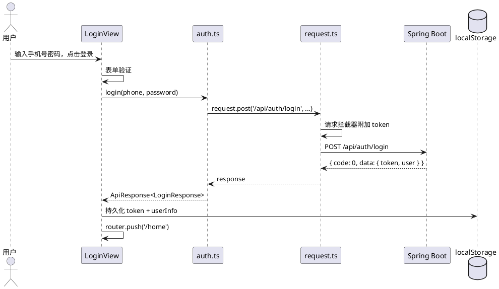
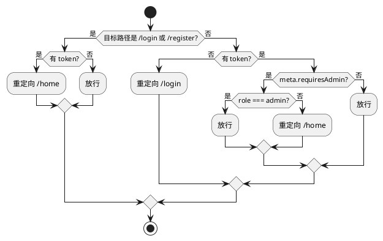
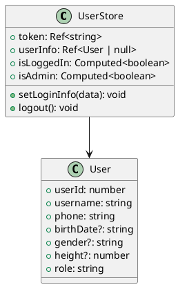

# 前端文档 UML 图表制作指南

> 当前文档使用 Mermaid 语法（Obsidian 可渲染），但导出 PDF / 其他 Markdown 编辑器兼容性差。
> 以下按图表类型推荐制作工具和入门步骤。

---

## 推荐工具总览

| 工具 | 类型 | 价格 | 适合场景 | 导出格式 |
|------|------|------|----------|----------|
| **Draw.io** | 桌面/在线 | 免费 | 架构图、组件图、部署图 | PNG/SVG/PDF/XML |
| **PlantUML** | 文本生成 | 免费 | 时序图、类图、状态图 | PNG/SVG |
| **StarUML** | 桌面 | 学生免费 | 完整 UML 2.x 建模 | PNG/PDF |
| **Figma** | 在线 | 免费（个人） | 界面原型、线框图 | PNG/SVG/PDF |
| **Excalidraw** | 在线 | 免费 | 手绘风架构图、流程图 | PNG/SVG |

---

## 各图表类型对应工具

### 1. 架构图 / 分层图

**推荐：Draw.io（diagrams.net）**

- 下载桌面版或访问 app.diagrams.net
- 创建新图 → 选择 "Cloud" 或 "Blank Diagram"
- 左侧图形库拖拽矩形/圆形 → 连线 → 加文字
- 导出：File → Export as → PNG (300dpi)

**操作步骤：**
```
1. 左侧拖入 "Container" 形状作为每一层
2. 内部拖入 "Rectangle" 代表组件
3. 使用 "箭头" 连接各层
4. 右键 → Edit Style 调颜色
5. File → Export as PNG
```

### 2. 组件树图 / 层次结构图

**推荐：Draw.io** 或 **Excalidraw**

Draw.io 做法：
- 左侧搜索 "tree" → 拖入树形布局
- 或手动矩形 + 连线：使用 "Waypoints" 调整连线路径
- 善用 Ctrl+G 编组，Ctrl+D 复制

Excalidraw 做法（手绘风格，更适合演示）：
- excalidraw.com → 直接拖画
- 导出 PNG（带透明背景可选）

### 3. 路由结构图

**推荐：Draw.io**

- 本质是树状结构图
- 用矩形表示每个路由节点，内部写路径名和组件名
- 用连线表达父子关系

### 4. 时序图（登录流程、AI 生成流程等）

**推荐：PlantUML**（文本 → 图形，精准且专业）

安装方式：
1. VS Code 装 `PlantUML` 插件（jebbs.plantuml）
2. 按 `Alt+D` 预览，右键导出 PNG/SVG

或者在线：plantuml.com/plantuml/ → 粘贴代码 → 生成图片

**登录时序示例代码：**


### 5. 状态图（路由守卫、提醒状态机等）

**推荐：PlantUML**

**路由守卫状态图示例：**


### 6. 类图（类型定义、Store 结构）

**推荐：PlantUML** 或 **StarUML**

PlantUML 类图示例：


### 7. 界面原型 / 线框图

**推荐：Figma** 或 **Excalidraw**

Figma 做法：
1. 注册免费账号 → 新建 Design File
2. Frame 工具选择桌面尺寸 (1440×900)
3. 用 Rectangle + Text 搭界面骨架
4. 导出：选中 Frame → Export → PNG 2x

Excalidraw 更简单，手绘风格更适合课程文档：
- 画矩形框代表页面区域
- 画小矩形代表组件
- 添加文字标注
- 导出 PNG

### 8. 数据流图

**推荐：Draw.io**

- 使用圆角矩形表示处理节点
- 使用平行四边形表示数据存储
- 使用箭头表示数据流向
- 不同颜色区分层次（视图层/接口层/后端）

---

## 快速上手建议

**如果你只想装一个工具：装 Draw.io Desktop**

- 免费、离线、功能全
- 架构图、组件图、数据流图、部署图都能画
- 导出 PNG 300dpi 插到 Word/PDF 里完全清晰
- 下载：https://github.com/jgraph/drawio-desktop/releases

**如果时序图/类图要专业：加装 PlantUML**

- VS Code 插件即装即用
- 代码写图 → 版本可控 → 不会出现"源文件丢了改不了"的尴尬
- 所有 PlantUML 代码已写在上面的示例中，直接粘贴即可

---

## 图表文件命名建议

```
docs/diagrams/
├── architecture.drawio         # 架构图源文件
├── architecture.png            # 导出图片
├── component-tree.drawio
├── component-tree.png
├── login-sequence.puml         # PlantUML 源文件
├── login-sequence.png
├── route-structure.drawio
├── route-structure.png
├── class-diagram.puml
├── class-diagram.png
└── ...
```
