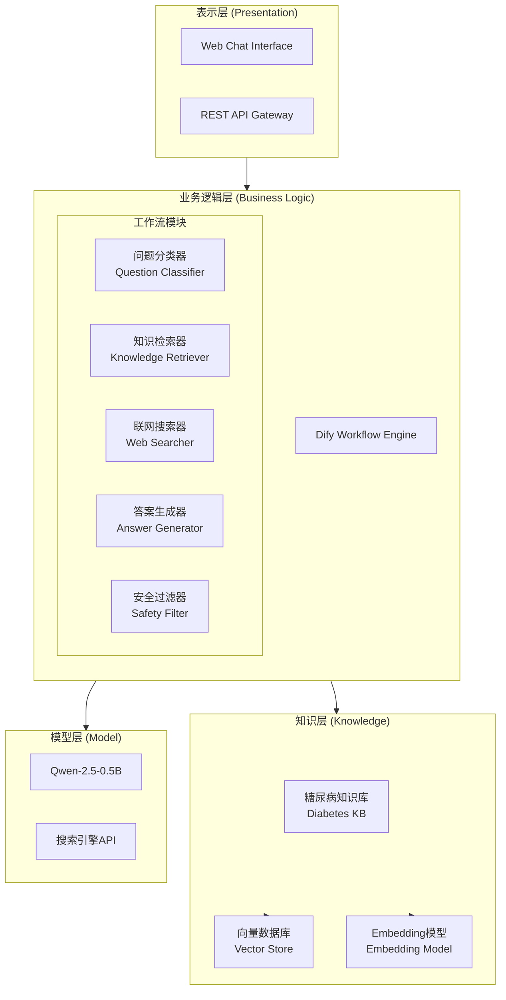
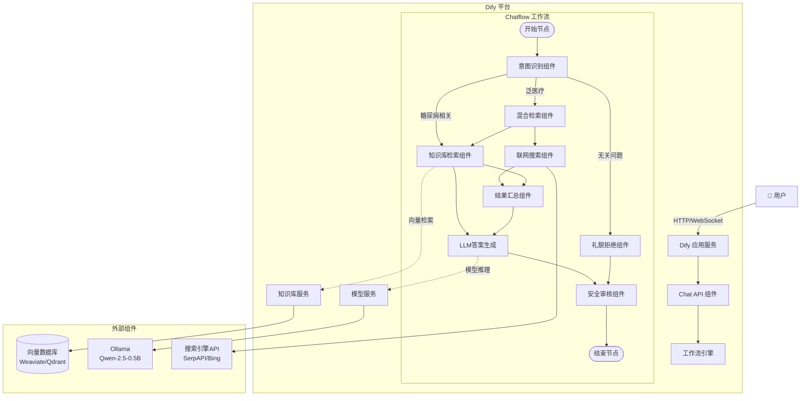
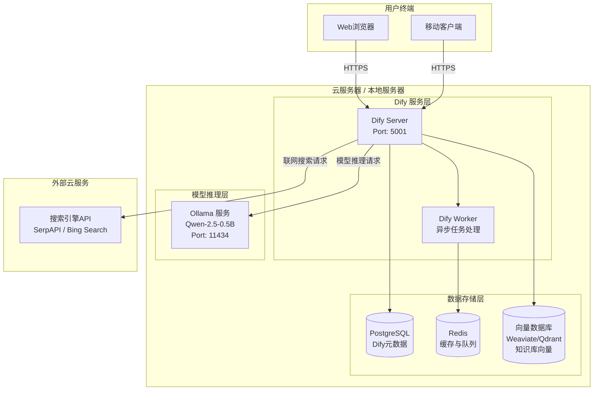
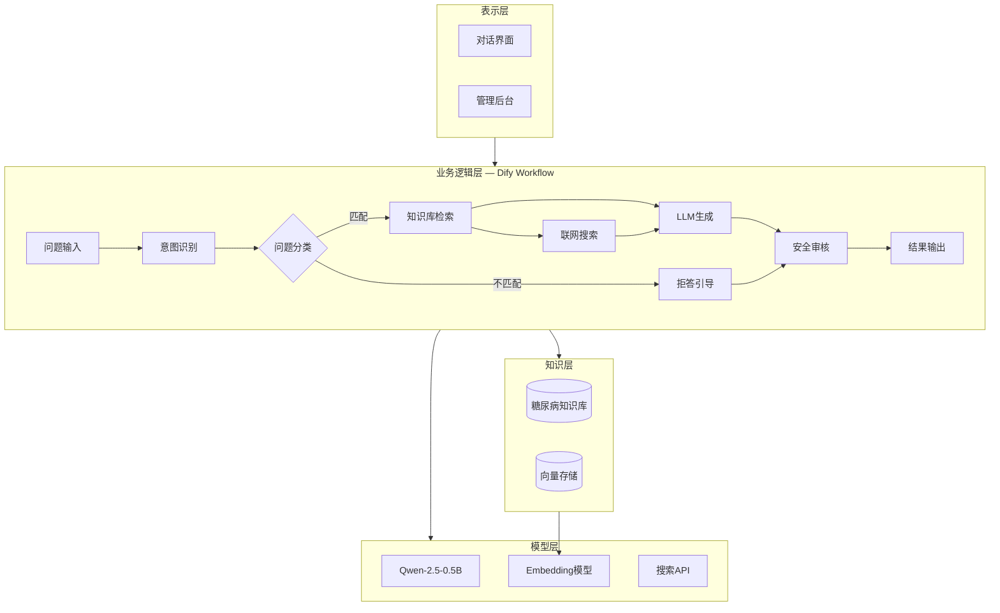
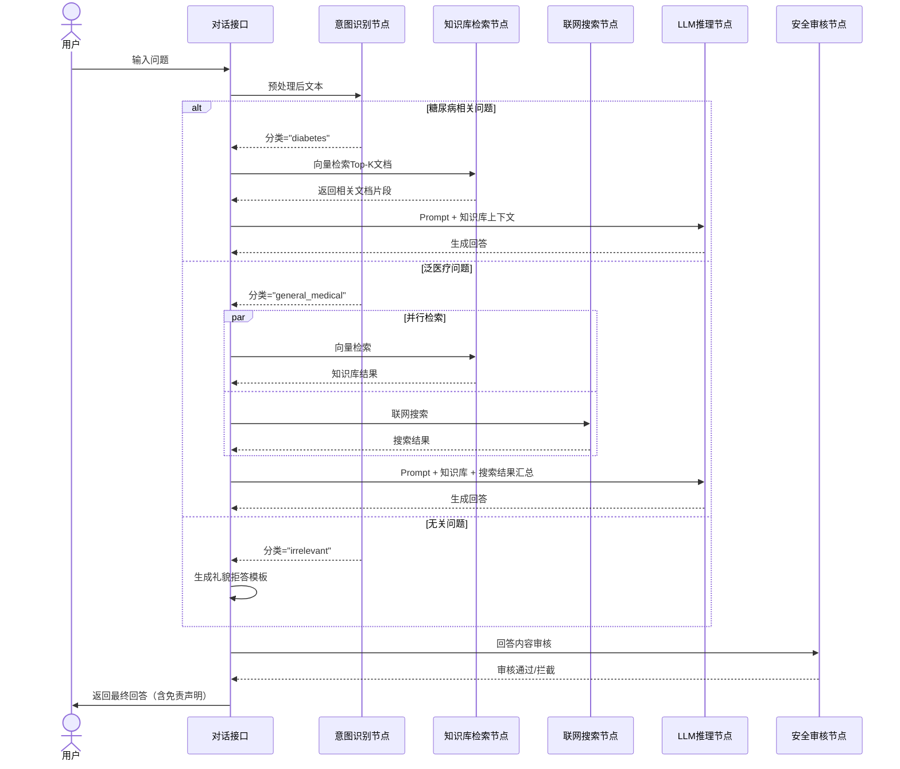
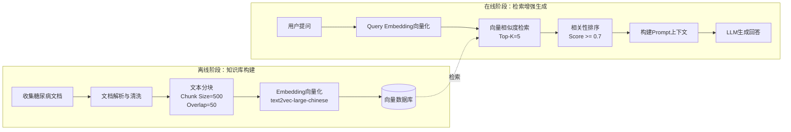
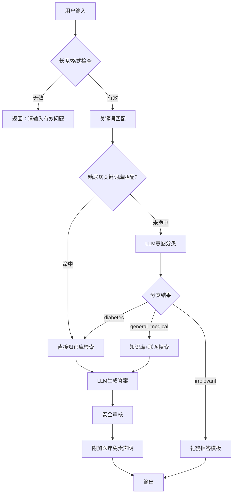

# 基于Dify平台的智慧医疗对话系统——软件设计报告

---

## 一、项目概述

### 1.1 项目背景

随着大语言模型（LLM）技术的快速发展，智能对话系统在医疗健康领域的应用日益广泛。本项目基于Dify平台，设计并实现一款面向糖尿病患者的智慧医疗对话系统，通过整合大语言模型与专业知识库，为用户提供精准、安全、可靠的医疗咨询服务。

### 1.2 项目目标

- 构建糖尿病专科知识库，提供医疗级精准解答
- 基于Dify工作流实现知识检索与生成的深度融合
- 集成联网搜索能力，补充知识库覆盖范围
- 建立问题域识别机制，对非糖尿病问题合理引导

### 1.3 技术选型

| 技术组件 | 选型方案 | 选型理由 |
|---------|---------|---------|
| 平台框架 | Dify | 开源LLM应用开发平台，支持可视化工作流编排、知识库管理、模型接入 |
| 推理模型 | Qwen-2.5-0.5B | 轻量级大语言模型，本地部署成本低，推理速度快，适合医疗场景的精准问答 |
| Embedding模型 | text2vec-large-chinese | 中文语义向量化能力强，适合医疗文本检索 |
| 向量数据库 | Weaviate / Qdrant | 高性能向量检索，支持语义相似度匹配 |
| 搜索引擎API | SerpAPI / Bing Search API | 获取实时医疗资讯与文献补充 |

---

## 二、功能陈述

### 2.1 知识库加载与管理

系统构建专用糖尿病知识库，包含以下内容源：

- **临床指南**：《中国2型糖尿病防治指南》《ADA糖尿病诊疗标准》
- **药物信息**：常用降糖药物（二甲双胍、胰岛素、GLP-1受体激动剂等）的用法用量与注意事项
- **饮食管理**：糖尿病饮食原则、食物GI值表、食谱推荐
- **运动建议**：适合糖尿病患者的运动类型、强度与频率
- **并发症防治**：糖尿病肾病、视网膜病变、足病等并发症的预防与管理
- **血糖监测**：自我血糖监测方法、目标范围与记录方式

**加载流程**：

1. 文档预处理（PDF/Word/Markdown解析、文本清洗、分块）
2. 文本向量化（Embedding模型转换为向量）
3. 向量入库（存储至向量数据库，建立索引）
4. 检索验证（测试查询，评估召回精度）

### 2.2 大模型选型与配置

选择 **Qwen-2.5-0.5B** 作为核心推理模型：

| 特性 | 说明 |
|------|------|
| 参数量 | 0.5B，轻量高效 |
| 部署方式 | 本地部署（Ollama / vLLM），无需GPU也可运行 |
| 推理速度 | 毫秒级响应，满足对话系统实时性要求 |
| 中文能力 | 通义千问系列，中文理解与生成能力优异 |
| 可定制性 | 支持Prompt调优与Few-shot学习，适配医疗领域 |

在Dify平台中通过自定义模型供应商接入Ollama部署的Qwen模型，配置参数如下：

- Temperature: 0.3（降低随机性，确保医疗回答的稳定性）
- Top-P: 0.8
- Max Tokens: 2048
- Context Window: 8192

### 2.3 问答交互过程

系统问答交互分为以下阶段：

**Phase 1 — 问题接收与预处理**
- 接收用户自然语言输入
- 文本规范化（纠错、统一术语）

**Phase 2 — 问题域分类**
- 通过意图识别节点判断问题是否属于糖尿病相关领域
- 分类标签：`糖尿病相关问题` / `泛医疗问题` / `无关问题`

**Phase 3 — 知识检索**
- 糖尿病相关问题：从知识库检索Top-K相关文档片段
- 泛医疗问题：结合知识库检索 + 联网搜索
- 无关问题：礼貌拒绝，引导用户提出糖尿病相关问题

**Phase 4 — 答案生成**
- 将检索结果作为上下文注入Prompt
- LLM基于上下文生成最终回答
- 对知识库未覆盖的部分，补充联网搜索结果

**Phase 5 — 回答输出与安全审核**
- 输出格式化回答（含引用来源标注）
- 敏感内容过滤与医疗免责声明

### 2.4 模型响应示例

**场景一：糖尿病相关问题（知识库命中）**

> **用户**：糖尿病患者可以吃水果吗？
>
> **系统**：糖尿病患者可以适量食用水果，但需注意以下几点：
> 1. **选择低GI水果**：如苹果、梨、柚子、樱桃等，GI值<55为宜
> 2. **控制摄入量**：每日水果摄入建议不超过150-200克
> 3. **合理安排时间**：建议在两餐之间食用，避免餐后立即进食水果
> 4. **监测血糖**：初次尝试某种水果后，建议监测餐后2小时血糖
>
> 📚 参考来源：《中国2型糖尿病防治指南（2024版）》第8章 饮食治疗

**场景二：超出知识范围**

> **用户**：如何治疗肺癌？
>
> **系统**：您好，本系统专注于糖尿病相关的医疗咨询服务。您的问题超出了当前知识范围。
> 建议您：
> 1. 前往正规医院肿瘤科就诊咨询
> 2. 咨询专业医生获取个性化诊疗建议
>
> 如需了解糖尿病相关知识（如饮食管理、血糖控制、并发症预防等），欢迎继续提问。

**场景三：知识库未完全覆盖 + 联网搜索补充**

> **用户**：2025年最新获批的糖尿病新药有哪些？
>
> **系统**：根据最新检索信息，2025年获批的糖尿病新药包括：
> 1. **XXXX（某GLP-1/GIP双受体激动剂）**：于2025年3月获FDA批准...
> 2. ...
>
> 🌐 数据来源：联网搜索 - FDA官方公告（2025年3月）
> 📚 参考来源：知识库 - 《糖尿病药物学》第3章

---

## 三、UML设计图

### 3.1 包图（Package Diagram）



### 3.2 构件图（Component Diagram）



### 3.3 部署图（Deployment Diagram）



---

## 四、软件架构与工作流设计

### 4.1 系统总体架构

系统采用**四层架构**设计：表示层、业务逻辑层、知识层、模型层。



### 4.2 核心工作流详细设计



### 4.3 知识库检索增强生成（RAG）流程



### 4.4 问题域分类策略



**糖尿病关键词库（部分）**：

```
糖尿病, 血糖, 胰岛素, 糖化血红蛋白, 二甲双胍, 低血糖, 高血糖,
1型糖尿病, 2型糖尿病, 妊娠糖尿病, 糖耐量, 空腹血糖, 餐后血糖,
糖尿病肾病, 糖尿病视网膜病变, 糖尿病足, 酮症酸中毒,
GLP-1, SGLT-2, DPP-4, GI值, 碳水化合物计数, 胰岛素抵抗...
```

---

## 五、Prompt工程设计

### 5.1 系统Prompt

```
你是一个专注于糖尿病的智能医疗助手。你的职责是：
1. 基于知识库内容，为用户提供准确的糖尿病相关医疗咨询
2. 回答时引用知识库来源，增强可信度
3. 对于不确定的内容，诚实告知并建议咨询专业医生
4. 不在知识范围内的医疗问题，礼貌告知用户并引导至糖尿病话题

重要约束：
- 不提供个人化的用药建议，所有药物信息仅供参考
- 紧急症状请引导用户立即就医
- 每次回答结尾附加医疗免责声明
- 回答风格专业但通俗易懂
```

### 5.2 检索增强Prompt模板

```
基于以下参考资料回答用户问题。如果资料不足以回答问题，请如实说明，不要编造信息。

【参考资料】
{knowledge_context}

【联网搜索结果】
{web_search_results}

【用户问题】
{user_question}

【回答要求】
1. 优先使用知识库资料，联网搜索作为补充
2. 结构化呈现关键信息
3. 标注信息来源（知识库 / 联网搜索）
4. 如有重要的医学注意事项，单独列出提醒
```

---

## 六、安全与合规设计

### 6.1 内容安全策略

| 安全措施 | 实现方式 |
|---------|---------|
| 敏感词过滤 | 预置敏感词库，输入输出双向过滤 |
| 医疗免责声明 | 每次回答自动附加免责声明 |
| 紧急识别 | 识别"晕厥""呼吸困难""胸痛"等危急关键词，引导紧急就医 |
| 个人信息保护 | 不收集、不存储用户个人身份信息 |
| 回答可追溯 | 每条回答标注知识来源，便于验证 |

### 6.2 医疗免责声明模板

> ⚠️ 免责声明：本系统提供的内容仅供参考，不构成医疗诊断、治疗建议或用药指导。如有健康问题，请及时咨询专业医生。如遇紧急情况，请立即拨打120急救电话。

---

## 七、评估指标

| 指标维度 | 指标名称 | 目标值 |
|---------|---------|-------|
| 检索质量 | 知识库召回率（Recall@5） | ≥ 90% |
| 检索质量 | 知识库精确率（Precision@5） | ≥ 85% |
| 回答质量 | 答案准确率（人工评估） | ≥ 85% |
| 安全问题 | 糖尿病问题识别准确率 | ≥ 95% |
| 安全问题 | 无关问题拒答率 | ≥ 98% |
| 用户体验 | 平均响应时间 | ≤ 3秒 |
| 用户体验 | 用户满意度评分 | ≥ 4.0/5.0 |

---

## 八、总结

本系统基于Dify平台，以Qwen-2.5-0.5B为推理核心，构建了一套完整的糖尿病智慧医疗对话解决方案。通过"知识库检索+联网搜索+LLM生成"的RAG架构，实现了精准、安全、可追溯的医疗问答服务。系统在问题域识别、多源知识融合、安全合规等方面进行了专项设计，确保为用户提供可靠的糖尿病健康咨询服务。
