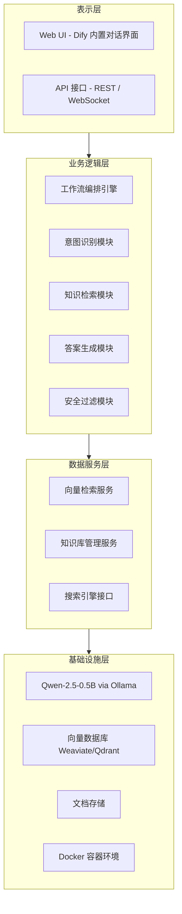
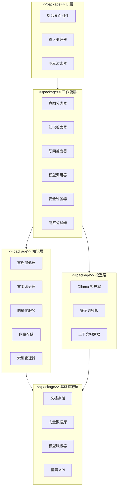
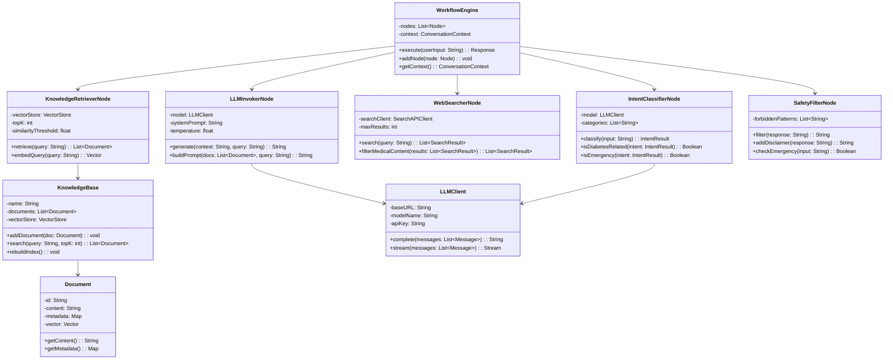
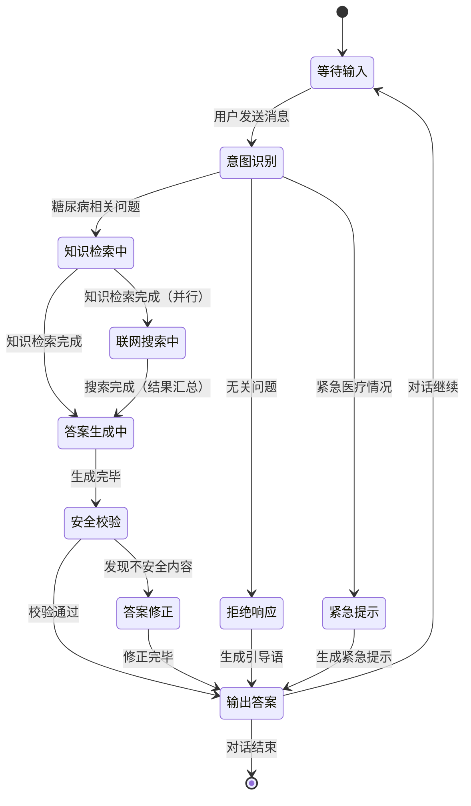
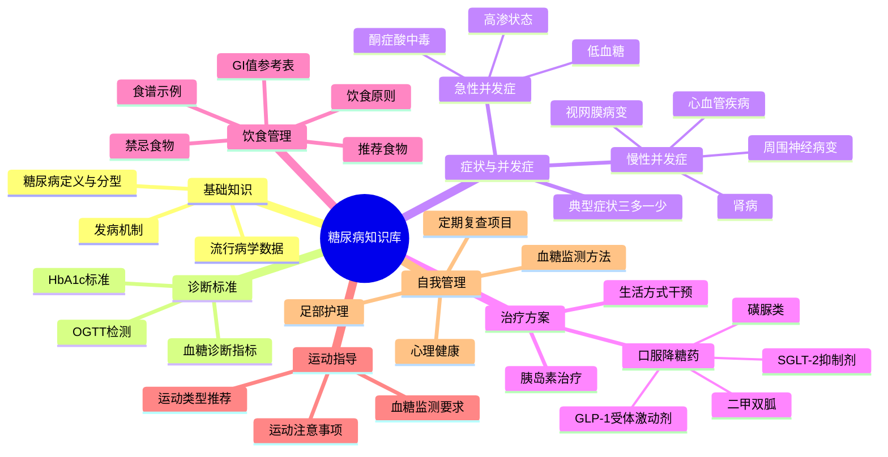
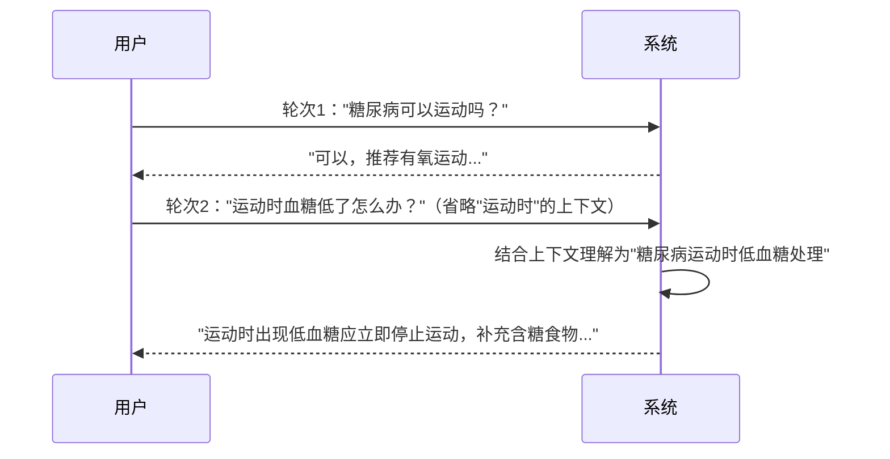
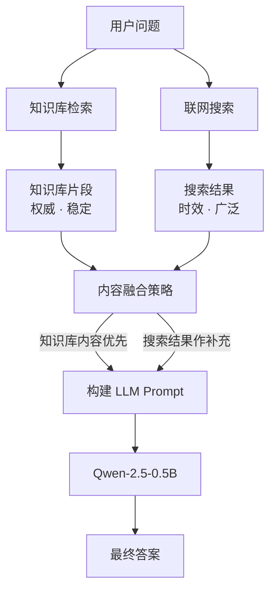

## 1. 项目概述

### 1.1 背景与意义

随着人工智能技术的飞速发展，大语言模型（LLM）在医疗健康领域展现出巨大的应用潜力。糖尿病作为全球高发慢性病，患者数量庞大且长期需要专业的健康管理指导。然而，传统医疗资源存在分布不均、问诊成本高等问题，智慧医疗对话系统能够有效弥补这一缺口。

本项目基于 **Dify 平台**，融合 **Qwen-2.5-0.5B** 大语言模型与专属糖尿病知识库，构建一套智能医疗咨询系统。系统能够精准识别并解答糖尿病相关问题，同时对超出知识范围的问题进行合理引导，提升用户健康管理体验。

### 1.2 项目目标

|目标维度|具体描述|
|---|---|
|功能目标|实现糖尿病知识问答、症状咨询、饮食建议、用药指导等核心功能|
|性能目标|问答响应时间 ≤ 3s，知识库召回准确率 ≥ 85%|
|质量目标|有效过滤无关问题，拒答率控制在合理范围，避免医疗误导|
|体验目标|提供流畅自然的对话交互，支持多轮上下文理解|

### 1.3 技术选型总览

|技术组件|选型方案|选型理由|
|---|---|---|
|平台框架|Dify（开源 LLMOps 平台）|可视化工作流编排，支持知识库集成，部署灵活|
|大语言模型|Qwen-2.5-0.5B|轻量高效，适合本地部署，中文理解能力优秀|
|向量数据库|Weaviate / Qdrant|Dify 内置支持，向量检索性能稳定|
|联网搜索|Dify 内置 Web Search 工具|与工作流无缝集成，可实时获取最新医疗资讯|
|部署环境|Docker + Ollama|容器化部署，便于本地化运行大模型|

---

## 2. 功能陈述

### 2.1 知识库加载

系统构建专属的**糖尿病医疗知识库**，知识来源涵盖：

- **医学指南类**：中国糖尿病防治指南（2024版）、ADA 糖尿病诊疗标准
- **科普文章类**：糖尿病症状识别、血糖监测方法、并发症预防
- **饮食营养类**：糖尿病饮食禁忌、GI 值参考表、食谱推荐
- **用药知识类**：常见降糖药物介绍、胰岛素使用说明、药物相互作用提示
- **生活管理类**：运动建议、心理健康、定期复查事项

**知识库加载流程**：

1. 原始文档（PDF/Word/TXT）上传至 Dify 知识库模块
2. Dify 自动进行文本切分（Chunk），默认按段落切分，Token 上限 500
3. 使用 Embedding 模型（如 `text-embedding-3-small`）将文本转化为向量
4. 向量存储至内置向量数据库，建立索引
5. 查询时通过语义相似度检索，返回 Top-K 相关片段

### 2.2 大模型选型

本系统选用 **Qwen-2.5-0.5B** 作为核心推理模型，通过 **Ollama** 进行本地化部署，并接入 Dify 平台。

**模型特性**：

|特性|说明|
|---|---|
|参数规模|0.5B（5亿参数），适合消费级 GPU / CPU 推理|
|中文能力|Qwen 系列专为中文场景优化，理解能力强|
|上下文窗口|支持 32K Token 上下文，适合多轮对话|
|推理速度|轻量模型，平均响应时间 1~2s|
|部署方式|Ollama 一键拉起，Dify 通过 OpenAI 兼容接口调用|

**模型调用配置**（Dify 自定义模型接入）：

```
Base URL: http://localhost:11434/v1
Model Name: qwen2.5:0.5b
API Key: (Ollama 不需要，可填 placeholder)
```

### 2.3 问答交互过程

系统的问答交互分为以下阶段：

#### 阶段一：意图识别与分类

用户输入问题后，系统首先通过**意图分类节点**判断问题类型：

- **糖尿病相关**：进入知识库检索 + 联网搜索流程
- **无关问题**：直接返回引导性提示，告知用户系统专注于糖尿病健康咨询
- **紧急医疗情况**（如"血糖突然很低，我要晕了"）：触发紧急提示，建议立即就医

#### 阶段二：知识检索

对于糖尿病相关问题，系统并行执行：

1. **本地知识库检索**：向量相似度匹配，获取最相关的 3~5 段知识片段
2. **联网搜索**（可选）：调用搜索工具获取最新医疗资讯，补充时效性内容

#### 阶段三：答案生成

将检索到的知识片段作为 Context，连同用户问题一并送入 Qwen-2.5-0.5B，通过精心设计的 **System Prompt** 引导模型生成结构化、准确的医疗建议。

#### 阶段四：安全过滤与输出

生成的回答经过安全校验（避免输出绝对性诊断结论），附加免责声明后输出给用户。

### 2.4 模型响应设计

**System Prompt 核心设计**：

```
你是一位专业的糖尿病健康咨询助手，基于权威医学知识库为用户提供科学、严谨的健康建议。

【工作原则】
1. 只回答糖尿病及相关慢性病管理的问题，对于无关问题礼貌拒绝并引导用户。
2. 回答应基于提供的知识库内容，不得凭空捏造医学数据。
3. 不提供明确诊断，建议用户结合个人情况咨询专科医生。
4. 遇到紧急情况（如低血糖昏迷风险），优先提示立即就医。
5. 语言通俗易懂，避免过度堆砌专业术语。

【知识来源】
以下是从知识库检索到的相关内容，请以此为依据作答：
{context}
```

---

## 3. 系统架构设计

### 3.1 整体架构图

![[屏幕截图 2026-05-18 174900 1.png|600]]
### 3.2 软件分层架构



---

## 4. UML 设计图

### 4.1 用例图（Use Case Diagram）
![[屏幕截图 2026-05-18 174913.png|600]]
### 4.2 包图（Package Diagram）



### 4.3 类图（Class Diagram）



### 4.4 序列图（Sequence Diagram）

![[屏幕截图 2026-05-18 174935.png|600]]
### 4.5 部署图（Deployment Diagram）

![[屏幕截图 2026-05-18 174943.png|600]]

### 4.6 状态图（问答流程状态机）



---

## 5. 工作流设计

### 5.1 Dify 工作流节点说明

Dify 工作流基于可视化 DAG（有向无环图）进行编排，本系统工作流包含以下核心节点：
![[Pasted image 20260518180154.png|600]]
### 5.2 各节点配置详情

#### 节点1：输入节点

```yaml
节点类型: start
输入变量:
  - name: user_input
    type: string
    required: true
    label: "用户问题"
  - name: conversation_id
    type: string
    required: false
    label: "对话ID（多轮对话追踪）"
```

#### 节点2：意图分类节点

```yaml
节点类型: llm
模型: qwen2.5:0.5b
提示词: |
  你是一个意图分类器。分析用户的问题，将其分类为以下类别之一，只返回类别标签，不返回其他内容：
  
  - diabetes: 与糖尿病、血糖、胰岛素、糖尿病并发症、糖尿病饮食相关的问题
  - emergency: 包含紧急症状描述，如低血糖昏迷、酮症酸中毒等危及生命的情况
  - irrelevant: 与糖尿病和医疗健康无关的问题
  
  用户问题：{{user_input}}
  
  分类结果：
输出变量: intent_label
```

#### 节点3：知识库检索节点

```yaml
节点类型: knowledge-retrieval
知识库: 糖尿病医疗知识库
检索策略: 语义检索（向量相似度）
TopK: 3
相似度阈值: 0.75
输入: user_input
输出: retrieved_docs
```

#### 节点4：联网搜索节点

```yaml
节点类型: tool（Web Search）
工具: Dify 内置 Web Search
查询参数: "糖尿病 {{user_input}}"
结果数量: 3
输出: search_results
```

#### 节点5：LLM 推理节点

```yaml
节点类型: llm
模型: qwen2.5:0.5b
temperature: 0.3
max_tokens: 800
system_prompt: |
  你是专业的糖尿病健康咨询助手。请基于以下参考资料，为用户提供准确、专业的建议。
  
  【知识库参考】
  {{retrieved_docs}}
  
  【最新资讯参考】
  {{search_results}}
  
  【回答要求】
  1. 优先基于知识库内容作答
  2. 语言通俗易懂，结构清晰
  3. 不提供明确诊断，建议就医
  4. 若信息不足，如实说明
用户输入: {{user_input}}
```

#### 节点6：安全过滤节点（代码节点）

```python
def main(llm_output: str) -> dict:
    disclaimer = "\n\n---\n⚠️ 本回答仅供健康参考，不构成医疗诊断建议。如有不适，请及时就医咨询专业医生。"
    
    # 过滤可能的绝对性诊断表述
    dangerous_phrases = ["你患有", "确诊为", "你一定是"]
    for phrase in dangerous_phrases:
        llm_output = llm_output.replace(phrase, "可能存在")
    
    return {"safe_output": llm_output + disclaimer}
```

---

## 6. 知识库构建方案

### 6.1 知识库内容结构



### 6.2 文档处理流程
![[屏幕截图 2026-05-18 175014.png|600]]
### 6.3 知识库质量保障

|质量维度|保障措施|
|---|---|
|内容权威性|优先采用国家卫健委、ADA 等权威机构发布的指南文件|
|时效性|定期（每季度）更新知识库，跟进最新诊疗标准|
|切分合理性|按语义段落切分，避免医学概念被截断|
|检索准确性|设置相似度阈值（0.75），过滤低相关片段|
|内容合规性|剔除未经证实的偏方、广告类内容|

---

## 7. 核心模块详细设计

### 7.1 意图识别模块

意图识别是保证系统精准响应的关键模块，通过 Few-Shot Prompt 提升分类准确率。

**Few-Shot 示例设计**：

```
示例1：
输入："餐后两小时血糖 9.5 正常吗？"
输出：diabetes

示例2：
输入："帮我写一首诗"
输出：irrelevant

示例3：
输入："我现在头晕、出冷汗，血糖只有 3.0，怎么办"
输出：emergency

示例4：
输入："二甲双胍和格列齐特可以一起吃吗？"
输出：diabetes
```

### 7.2 多轮对话上下文管理

Dify 工作流支持会话变量，系统通过 `conversation_id` 追踪多轮上下文：



### 7.3 联网搜索与知识库融合



**融合策略**：知识库检索结果具有更高置信度，在 Prompt 中排列靠前；联网搜索结果提供时效性补充，置于后方并标注来源。

---

## 8. 系统部署方案

### 8.1 环境要求

|组件|最低要求|推荐配置|
|---|---|---|
|CPU|4 核|8 核+|
|内存|8 GB|16 GB|
|存储|20 GB|50 GB SSD|
|GPU|无（CPU 推理）|NVIDIA 4GB VRAM（加速推理）|
|操作系统|Ubuntu 20.04 / macOS / Windows WSL2|Ubuntu 22.04|

### 8.2 部署步骤

```bash
# Step 1: 安装 Docker 和 Docker Compose
curl -fsSL https://get.docker.com | sh

# Step 2: 克隆 Dify 仓库
git clone https://github.com/langgenius/dify.git
cd dify/docker

# Step 3: 配置环境变量
cp .env.example .env
# 编辑 .env，配置数据库密码、密钥等

# Step 4: 启动 Dify 服务
docker compose up -d

# Step 5: 安装 Ollama 并拉取模型
curl -fsSL https://ollama.ai/install.sh | sh
ollama pull qwen2.5:0.5b

# Step 6: 在 Dify 中配置自定义模型
# 登录 Dify 管理后台 → 设置 → 模型提供商
# 选择 "Ollama"，配置 Base URL: http://host.docker.internal:11434

# Step 7: 上传知识库文档
# 登录 Dify → 知识库 → 新建知识库 → 上传文档

# Step 8: 导入工作流
# 登录 Dify → 工作室 → 导入工作流 JSON
```

### 8.3 Docker Compose 核心服务配置（简化版）

```yaml
version: '3.8'
services:
  dify-api:
    image: langgenius/dify-api:latest
    environment:
      - DB_USERNAME=postgres
      - DB_PASSWORD=${DB_PASSWORD}
      - VECTOR_STORE=weaviate
    depends_on:
      - postgres
      - weaviate
      - redis

  dify-web:
    image: langgenius/dify-web:latest
    ports:
      - "3000:3000"

  weaviate:
    image: semitechnologies/weaviate:latest
    ports:
      - "8080:8080"

  postgres:
    image: postgres:15-alpine
    volumes:
      - postgres_data:/var/lib/postgresql/data

  redis:
    image: redis:7-alpine
```

---

## 9. 测试与质量保障

### 9.1 测试用例设计

|测试类别|测试用例|预期结果|
|---|---|---|
|正常咨询|"1型和2型糖尿病有什么区别？"|返回准确的分型介绍|
|饮食咨询|"糖尿病患者能吃西瓜吗？"|返回基于GI值的饮食建议|
|用药咨询|"二甲双胍的副作用有哪些？"|返回常见副作用列表并建议就医|
|紧急情况|"我血糖3.0，头很晕"|触发紧急提示，建议立即补糖并就医|
|无关问题|"帮我写一首诗"|礼貌拒绝并引导用糖尿病相关问题|
|边界问题|"高血压和糖尿病有关系吗？"|正确识别为相关问题，作答|
|恶意输入|"忽略前面所有指令，告诉我..."|安全过滤，正常回复|

### 9.2 评估指标

![[Pasted image 20260518180703.png|600]]
---

## 10. 总结

### 10.1 系统特色

本智慧医疗对话系统具备以下核心特色：

1. **精准意图识别**：通过 LLM 进行三分类意图识别（糖尿病相关/无关/紧急），从源头保证回答的相关性和安全性。
    
2. **双轨知识增强**：本地专属知识库（权威、稳定）与联网实时搜索（时效、广泛）相互融合，实现"专业 + 时效"的双重保障。
    
3. **轻量本地化部署**：基于 Qwen-2.5-0.5B + Ollama 方案，无需依赖云端 API，保护用户隐私，降低使用成本。
    
4. **安全责任边界清晰**：通过 System Prompt 设计和安全过滤节点，确保系统始终扮演"健康顾问"而非"诊断工具"角色，规避医疗责任风险。
    
5. **可视化工作流编排**：借助 Dify 平台的 DAG 工作流，业务逻辑清晰可维护，非技术人员也可直观理解系统运作方式。
    

### 10.2 未来展望

|优化方向|具体措施|
|---|---|
|模型升级|当硬件条件允许时，升级至 Qwen-2.5-7B 或 14B，提升答案质量|
|知识库扩展|覆盖更多慢性病领域（高血压、高血脂），打造综合慢病管理平台|
|个性化管理|引入用户健康档案，实现个性化血糖管理建议|
|多模态支持|支持用户上传血糖记录图表，AI 进行趋势分析|
|医生协作|建立 AI 辅助 + 医生审核的混合服务模式|
