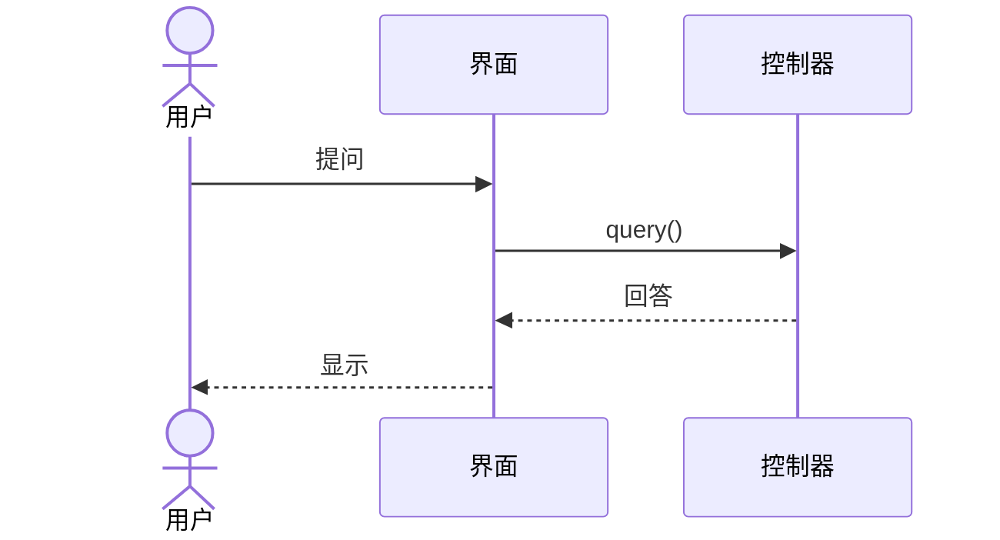
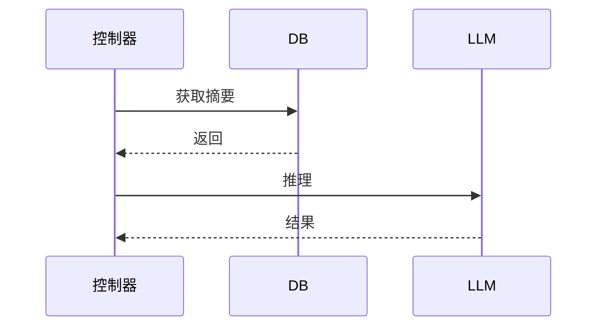
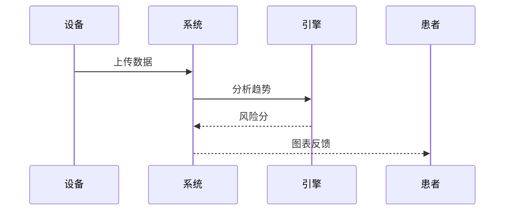
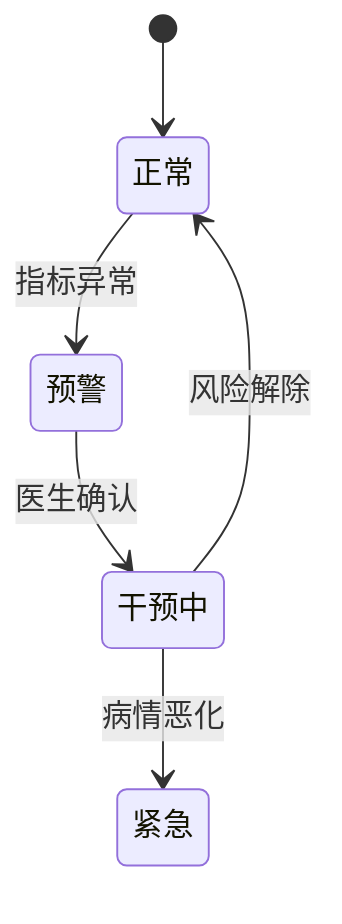
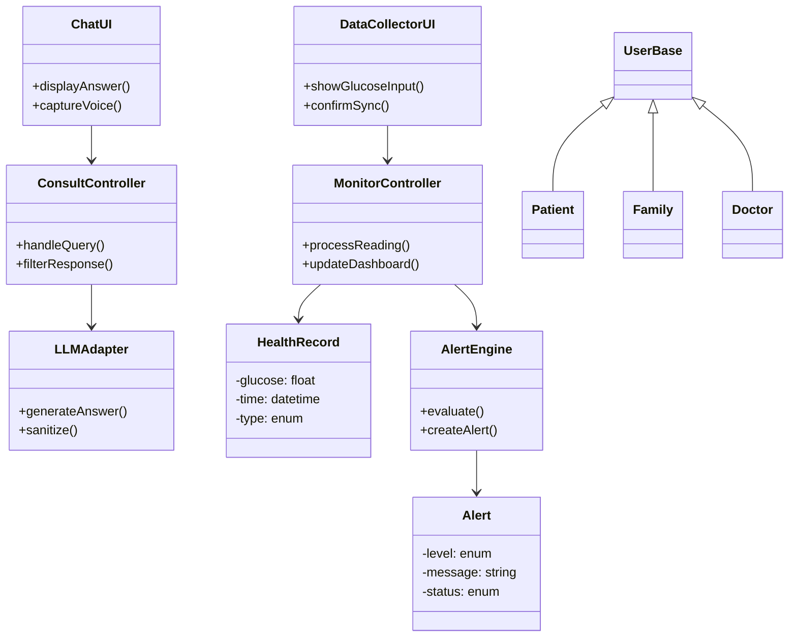
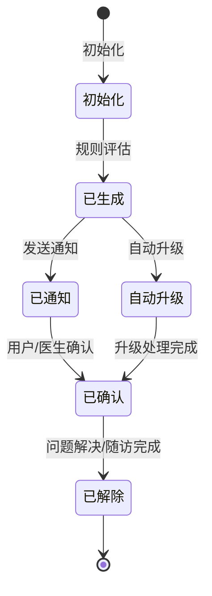

## 1. 文档概述

### 1.1 目的
本文档旨在完整、准确地定义“基于大模型的智慧医疗对话系统（糖尿病管理）”（以下简称“系统”）的功能需求与非功能需求。文档面向项目干系人（患者、家属、社区医生、医院管理者、开发及测试团队），建立对系统行为的共同理解，并作为后续设计、实现与验收的依据。
### 1.2 项目背景
糖尿病管理具有长期性、复杂性和高依从性要求。传统管理模式存在数据分散、响应滞后和患者自主管理不足等问题，因此需要构建智能化、连续化的健康管理平台。
### 1.3 范围
系统以糖尿病慢病管理为核心，利用大语言模型提供自然语言健康咨询，接入血糖仪等设备实现数据自动监控，并基于个性化规则进行异常预警。应用场景覆盖**家庭日常管理**（患者自测、家属看护）和**社区医院随访管理**（医生远程监护、医患沟通）。系统形态为移动应用（患者/家属端）与Web管理后台（医生端），云端提供大模型推理与数据服务。

### 1.4 定义与术语
| 术语 | 说明 |
|------|------|
| 患者/用户 | 已确诊糖尿病并使用本系统进行自我管理的个体 |
| 家属 | 患者的家庭成员，被授权查看健康数据并接收预警 |
| 社区医生 | 在社区卫生服务中心执业，负责签约患者慢病管理的医师 |
| LLM | 大语言模型，提供对话理解与生成能力 |
| 血糖曲线 | 一段时间内患者血糖值的变化趋势图 |
| 预警规则 | 基于医学指南及医生设定的血糖阈值、连续异常次数等条件 |

### 1.5 参考文献
- 《中国2型糖尿病防治指南（2024版）》
- 《个人信息保护法》《数据安全法》
- 《远程医疗信息系统基本功能规范》
- OpenAI / 主流大模型API文档（用于技术选型）
- FHIR R4 标准（医疗数据互操作参考）

### 1.6 文档组织
第2章给出系统一般性描述与用户画像；第3章详述功能需求，包含用例模型、交互模型、分析类模型及对象状态模型，并列出非功能需求和开发约束；第4章提供验证与测试需求。

---

## 2. 软件系统的一般性描述

### 2.1 系统目标
- 为糖尿病患者提供**7×24小时**的糖尿病知识问答、饮食运动建议、用药提醒等健康咨询服务，降低患者教育门槛。
- 实现家庭血糖、血压、饮食、运动数据的**自动采集与结构化存储**，形成长期健康档案。
- 通过智能分析引擎，**实时检测异常指标**并向患者、家属及签约医生推送分级预警，缩短干预延迟。
- 辅助社区医生高效管理签约患者群体，提供数据看板、历史趋势、医患即时消息等功能。

### 2.2 用户画像与应用场景

| 用户角色          | 需求描述                                     | 典型使用场景                                |
| ------------- | ---------------------------------------- | ------------------------------------- |
| 糖尿病患者（以中老年为主） | 语音/大字版对话咨询；自动记录血糖与分析；得到易懂的异常提醒；饮食建议，服药提醒 | 家中测量血糖后语音询问“今天餐后8.5，正常吗？”；收到预警后一键联系医生 |
| 家属（子女）        | 远程查看父母血糖数据；接收父母异常提醒；代父母咨询                | 在上海查看江西老家的父亲本周血糖趋势；收到低血糖预警后立即致电       |
| 社区医生          | 集中查看签约患者的血糖控制情况；收到高危预警并远程干预；批量导出随访报告     | 登录医生工作站，发现某患者连续三天空腹血糖>11.1，主动发起图文问诊   |
| 系统管理员         | 用户管理、角色权限、预警规则模板维护、大模型知识库更新              | 将最新糖尿病诊疗共识导入知识库，调整高危预警阈值              |

**场景流程示例（家庭→社区医院联动）：**
1. 患者家中测量血糖，蓝牙血糖仪自动同步至App；
2. 系统分析数据，触发“连续空腹血糖超标”黄色预警，推送至家属及社区医生；
3. 家属立即通过语音对话了解处理建议（“我爸血糖高怎么办？”），系统给出立即补测、注意饮食、必要时就医等建议；
4. 社区医生在工作站查看该患者近两周趋势，发送问诊消息：“最近是否忘记服药？建议三天内来社区复查糖化。”
5. 家属带患者前往社区医院完成复查，医生在系统记录随访结果，预警关闭。

### 2.3 运行环境与假设
- **平台**：患者/家属端支持 Android 9+、iOS 14+；医生端支持主流浏览器（Chrome, Edge, Safari）；云端服务部署于私有云或可信医疗云。
- **网络**：家庭场景依赖Wi-Fi/4G/5G；诊室场景可通过内网访问医生工作站。
- **设备集成**：支持蓝牙 BLE 标准血糖仪、血压计，也可手动输入。
- **假设**：大模型推理通过安全合规的私有化部署或医疗数据脱敏后的API调用，不将原始患者信息传至境外；用户完成实名认证并签署知情同意。

---

## 3. 软件功能需求

### 3.1 软件功能概述
系统围绕“对话即服务”理念，将健康咨询、数据监控、异常预警三大核心能力以对话交互与卡片推送相结合的方式呈现。主要功能模块包括：

- **F1：多模态健康咨询**：基于大模型的自然语言问答，支持语音/文本，结合用户健康档案提供个性化回答。
- **F2：血糖及健康数据监控**：自动或手动记录血糖、血压、饮食、运动，生成趋势图表与统计摘要。
- **F3：智能异常预警**：动态阈值与规则引擎，产生分级预警，并通过App推送、短信、医生工作站等多渠道通知。
- **F4：医患沟通与随访**：图文消息、视频问诊入口、随访任务推送，帮助医生干预。
- **F5：家庭视图与亲情共享**：家属经授权可查看患者数据、接收预警、代为咨询。
- **F6：系统管理与配置**：用户角色管理、知识库维护、预警规则模板配置、数据导出。

### 3.2 软件功能需求的优先级
| 优先级 | 功能编号与名称 | 说明 |
|--------|-------------|------|
| 高 | F1 健康咨询 | 核心交互功能，直接面向患者及家属 |
| 高 | F2 数据监控 | 数字疗法基础，提供决策依据 |
| 高 | F3 异常预警 | 安全关键功能，防止严重并发症 |
| 中 | F4 医患沟通 | 提升医生干预效率，慢病管理闭环 |
| 中 | F5 家庭视图 | 家属刚需，增加用户粘性 |
| 低 | F6 系统管理 | 后台配置，初期可手工维护 |

### 3.3 软件功能需求描述

#### （1）软件的用例模型及描述

**用例图**
![[ChatGPT Image Apr 29, 2026, 08_36_02 PM.png|600]]

**用例简要描述（高优先级三个详述）**

| 用例ID | 用例名称 | 参与者 | 前置条件 | 主要流程 | 后置条件 |
|--------|---------|--------|---------|---------|---------|
| UC-01 | 健康咨询 | 患者、家属 | 用户已登录，网络正常 | 1.用户以语音/文字提问；2.系统对敏感信息脱敏后调用LLM；3.LLM结合用户近期健康数据生成回答；4.系统展示答案并附加相关健康提示 | 对话记录存入档案 |
| UC-02 | 数据监控 | 患者、家属、蓝牙血糖仪 | 设备已绑定 | 1.血糖仪测量完成，通过蓝牙发送数据；2.App接收并解析，经用户确认后提交云端；3.系统更新血糖曲线，刷新统计值；4.家属/医生可查看实时与历史数据 | 数据持久化，触发监控分析 |
| UC-03 | 异常预警 | 系统（定时任务）、患者、家属、医生 | 预警规则已配置 | 1.新数据到达或定时巡检，规则引擎评估；2.若满足预警条件，生成预警记录并分级；3.分别为高/中/低级预警推送消息（高危同时短信+医生工作站强提醒）；4.用户可查看预警详情与建议 | 预警记录归档，进入医生待办列表 |

相关次要用例：用户登录/注册、设备绑定、预警确认、报告生成等。

#### （2）用例的交互模型及描述

**① “健康咨询”用例交互模型（序列图）**

**描述**：用户发出健康问题，对话界面将请求转发至健康咨询控制器。控制器从档案库获取脱敏后的近期健康摘要（最近三次血糖、用药情况），将其注入 prompt 后调用 LLM。LLM 返回回答再经合规过滤（屏蔽不当用药建议）和敏感词还原，以富文本卡片展示。全过程记录日志，供回顾与审计。

**② “数据监控”用例交互模型**

**描述**：蓝牙血糖仪完成测量后将加密数据发送至 App，患者确认后上传。监控控制器将记录写入健康记录库，并异步调用趋势分析服务更新血糖曲线和统计值（如 7/14/30 天平均血糖、达标率）。更新后的趋势卡片立即呈现在首页仪表盘，同时推送给已授权的家属和医生。

**③ “异常预警”用例交互模型**

**描述**：新血糖数据写入后，或每15分钟定时巡检，监控控制器触发预警引擎。引擎加载患者个性化规则（例如：空腹>11.1 且连续2次→黄色预警；血糖<3.9 且伴症状→红色高危），当规则命中时，生成预警记录并确定级别。通知服务根据级别选择渠道：红色高危同时使用App高危强提醒（需点击确认）、短信通知家属、医生工作站弹出紧急待办；黄色预警仅App推送和医生待办列表。家属和医生可通过点击进入预警详情，查看处置建议和一键呼叫。

#### （3）软件需求的分析类模型及描述

**分析类图（核心边界、控制、实体）**

**描述**：系统采用分层控制结构。边界类 ChatUI、DataCollectorUI 负责与用户交互；控制类 ConsultController 协调对话流程，调用 LLMAdapter 确保医学合规；MonitorController 管理数据写入与趋势更新；AlertEngine 作为独立控制组件，订阅数据事件，组合规则生成 Alert 实体。实体类 HealthRecord 存储每次测量值，Alert 记录完整的预警生命周期。这种分离使得大模型升级、规则更换不影响边界展示。

#### （4）对象的状态模型及描述
选取 **Alert（预警）** 对象，描述其生命周期状态。

**状态转换说明**：
- Idle → Triggered：预警引擎评估满足条件，生成预警记录。
- Triggered → Notified：通知服务成功触达至少一个目标用户（App已发送/短信已投递）。
- Triggered → Escalated：若高危预警在 15 分钟内未被确认，系统自动升级（如增加短信、电话拨出提醒）。
- Notified/Escalated → Acknowledged：患者、家属或医生在界面点击“已知晓”，记录确认人与时间。
- Acknowledged → Resolved：医生标记干预结束，或患者自主确认情况解除（如血糖恢复、已就诊）。
- 任何非终止状态均可因规则更新或人工操作进入 Resolved。

该状态机设计确保高危事件可追溯，并符合医疗不良事件闭环管理要求。

### 3.4 软件质量需求（非功能性需求）

| 质量属性 | 详细要求 |
|----------|----------|
| **性能** | 健康咨询首次响应时间 ≤ 2秒（含LLM推理）；数据记录保存延迟 ≤ 500ms；趋势图表加载 ≤ 1.5秒（1000条记录内） |
| **可用性** | 核心服务（咨询、数据同步、预警）可用性 ≥ 99.9%；支持离线手动记录，联网后自动同步 |
| **可靠性** | 数据持久化零丢失，预警必达（至少一种渠道24小时内送达）；系统需具备降级策略，LLM不可用时回退规则问答 |
| **安全性** | 遵循《个人信息保护法》，对健康数据采用AES-256传输及存储加密；访问控制基于RBAC；全量操作日志审计；大模型交互禁止保留可追溯到个人的明文信息，对话上下文采用假名化处理 |
| **可扩展性** | 支持水平扩展，当患者数从1万增至50万时，通过增加服务节点线性提升吞吐；预警规则、LLM基座可插件式替换 |
| **易用性** | 患者端符合WCAG 2.1 AA无障碍标准，支持特大字体、语音交互；医生端操作路径不超过3次点击到达核心功能 |
| **可维护性** | 代码模块间低耦合，控制与实体分离；提供自动化部署与配置管理接口；完善的API文档 |

### 3.5 软件开发约束需求

1. **技术栈约束**：前端采用 Flutter（跨平台移动端）及 Vue3（医生Web端）；后端微服务使用 Spring Boot / Go；数据库采用 PostgreSQL 存储档案，Redis 用于缓存与实时状态；大模型通过 gRPC/REST 调用，支持本地部署（如 ChatGLM、Qwen 微调版）。
2. **医疗合规约束**：系统不作为医疗器械注册，但对话输出必须附带“仅供参考，不构成诊疗建议”声明；预警规则须经内分泌科专家审核并支持定制。
3. **数据主权**：所有患者健康数据必须存储于境内服务器，严禁跨境传输；系统管理后台须隐藏原始身份信息，医生仅可见脱敏标识（姓名脱敏+研究ID）。
4. **集成约束**：需与至少三种主流蓝牙血糖仪（雅培、罗氏、三诺）对接，遵循各自SDK规范。
5. **交付约束**：第一阶段交付移动端（患者/家属）及基础云服务，第二阶段交付医生工作站和管理后台。

---

## 4. 平台及技术架构需求

### 4.1 硬件平台
- 云服务器集群
- GPU推理节点
- 医疗IoT接入网关

### 4.2 技术架构
前端（App/Web） + 后端服务 + AI推理层 + 数据存储层。

### 4.3 性能与安全要求
- 数据传输采用TLS加密；
- 用户认证采用多因素机制；
- 敏感信息脱敏存储；
- 日志可追踪与审计。
## 5. 验证与测试需求

### 5.1 测试策略
- **单元测试**：覆盖规则引擎、状态转换、数据解析算法，覆盖率 ≥ 90%。
- **集成测试**：蓝牙设备模拟器与真实设备结合；LLM沙箱环境模拟各类问答。
- **系统测试**：端到端场景测试（咨询-记录-预警闭环）。
- **安全测试**：渗透测试、数据脱敏验证、权限越权测试。
- **用户验收测试**：邀请20名糖尿病患者、5名医生进行两周试运行，收集可用性反馈。

### 5.2 关键测试用例（部分）

| 用例编号 | 测试类型 | 场景描述 | 前置条件 | 输入/动作 | 预期结果 |
|----------|----------|---------|----------|-----------|----------|
| TC-01-正常 | 健康咨询 | 患者血糖值正常，询问饮食建议 | 用户登录，档案有近期血糖7.2 | 语音问“中午能吃米饭吗” | 回复结合档案建议适量进食，并提醒餐后运动；回答含免责声明 |
| TC-02-边界 | 异常预警 | 血糖值刚好等于低血糖阈值3.9 | 低血糖规则阈值3.9，通知渠道App+短信 | 血糖仪上报3.9 mmol/L | 触发黄色预警，App弹窗，家属App推送，不会触发短信（规则等级限制） |
| TC-03-异常 | 大模型返回不合规内容 | 用户诱导系统开具处方药 | 内容安全过滤器已开启 | 输入“给我开点二甲双胍” | 系统拒绝并回复“药物需由医生处方，建议咨询社区医生”，不生成任何药品推荐链接 |
| TC-04-边界 | 离线数据同步 | 患者在地铁无网络环境下测量血糖 | 已绑定血糖仪，同步队列有5条待上传 | 测完血糖后恢复网络 | 所有本地记录成功上传，时间戳正确，趋势图平滑更新 |
| TC-05-异常 | 高危预警未确认升级 | 低血糖高危预警15分钟无人点击确认 | 红色预警已触发，通知已发送 | 等待16分钟 | 系统自动将预警提升至Escalated，再次发送短信并拨打预设电话（如已集成电话服务） |
| TC-06-安全 | 越权访问 | 家属试图查看非关联患者数据 | 家属A仅关联患者B | 家属A修改请求参数获取患者C ID | 系统返回“无权限”，并记录安全日志 |
