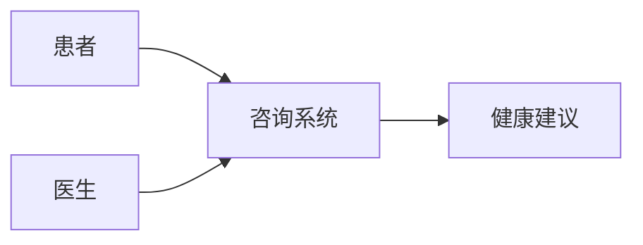
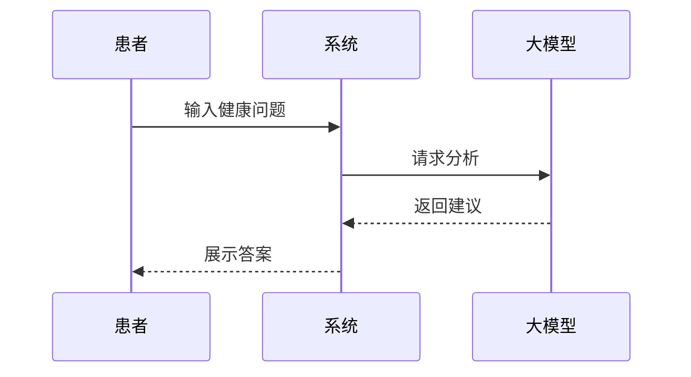
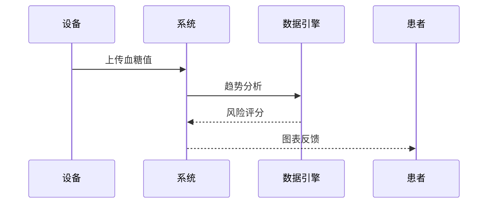
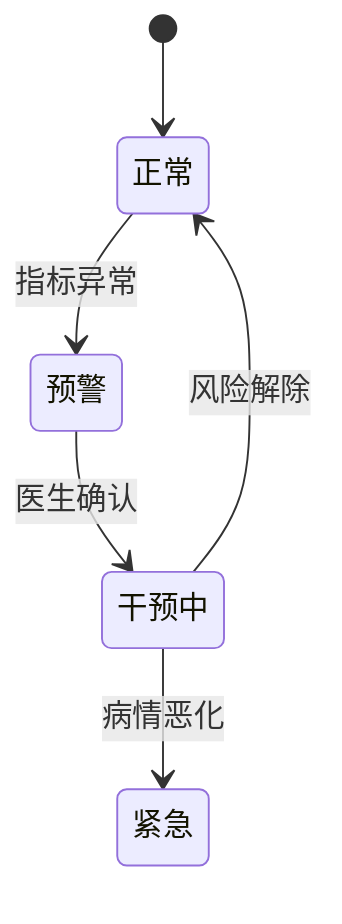
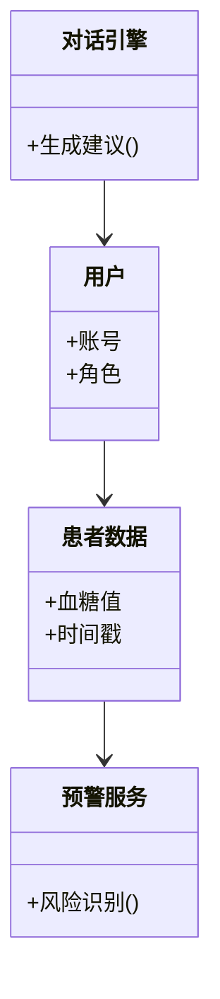

# 基于大模型的糖尿病智慧医疗对话系统软件需求规格说明书

## 1. 文档概述

### 1.1 文档目的
本文档用于定义基于大模型的糖尿病智慧医疗对话系统的软件需求，为设计、开发、测试和验收提供统一依据。

### 1.2 项目背景
糖尿病管理具有长期性、复杂性和高依从性要求。传统管理模式存在数据分散、响应滞后和患者自主管理不足等问题，因此需要构建智能化、连续化的健康管理平台。

### 1.3 文档范围
本系统覆盖患者、医生与家属三类角色，支持家庭与社区医院场景下的健康咨询、数据监控和异常预警。

---

## 2. 软件系统的一般性描述

### 2.1 系统目标
构建集“咨询、监测、预警、协同”于一体的智慧医疗平台，提高慢病管理效率与安全性。

### 2.2 目标用户与用户画像

#### 糖尿病患者
- 需求：饮食建议、血糖分析、服药提醒。
- 场景：家庭日常管理、突发不适咨询。

#### 医生
- 需求：患者监控、风险评估、远程指导。
- 场景：门诊随访、社区干预。

#### 家属
- 需求：异常通知、状态查看、监督陪护。
- 场景：远程照护。

### 2.3 业务流程概述
患者上传数据 → 大模型分析 → 风险识别 → 建议反馈 → 医生/家属联动。

---

## 3. 软件功能需求

### 3.1 软件功能概述
系统核心功能包括：
1. 智能健康咨询
2. 血糖数据监控
3. 异常预警协同

### 3.2 软件功能需求优先级
| 功能 | 优先级 |
|---|---|
| 健康咨询 | 高 |
| 数据监控 | 高 |
| 异常预警 | 高 |
| 医生随访 | 中 |
| 家属协同 | 中 |

### 3.3 软件功能需求描述

#### 功能一：智能健康咨询
支持自然语言交互，回答饮食、运动、药物及病情相关问题。

**用例图（Mermaid）**

**交互图**

#### 功能二：血糖数据监控
接入CGM或手动输入数据，形成趋势分析与健康画像。

**交互图**

#### 功能三：异常预警协同
识别高危指标，自动通知患者、医生与家属。

**状态图**

### 3.4 软件需求分析类模型

### 3.5 软件质量需求
- 响应时间：普通咨询小于2秒。
- 可用性：全年可用率≥99.5%。
- 并发能力：支持1000+在线用户。
- 可扩展性：支持新病种接入。

### 3.6 软件开发约束需求
- 必须符合医疗数据隐私规范。
- 系统需支持移动端与Web端。
- 核心接口需采用标准化REST API。

---

## 4. 平台及技术架构需求

### 4.1 硬件平台
- 云服务器集群
- GPU推理节点
- 医疗IoT接入网关

### 4.2 技术架构
前端（App/Web） + 后端服务 + AI推理层 + 数据存储层。

### 4.3 性能与安全要求
- 数据传输采用TLS加密；
- 用户认证采用多因素机制；
- 敏感信息脱敏存储；
- 日志可追踪与审计。

---

## 5. 验证与测试需求

### 5.1 测试计划
覆盖功能测试、性能测试、安全测试与异常场景测试。

### 5.2 部分测试用例

| 编号 | 测试场景 | 预期结果 |
|---|---|---|
| TC01 | 输入正常血糖值 | 正常记录并分析 |
| TC02 | 输入超高血糖值 | 触发预警通知 |
| TC03 | 网络中断上传 | 本地缓存后重试 |
| TC04 | 非法账号访问 | 拒绝并记录日志 |

---

## 6. 总结
本系统通过大模型能力与医疗数据融合，为糖尿病患者提供连续健康管理服务，同时增强医生与家属协同效率，具备落地价值与扩展潜力。

