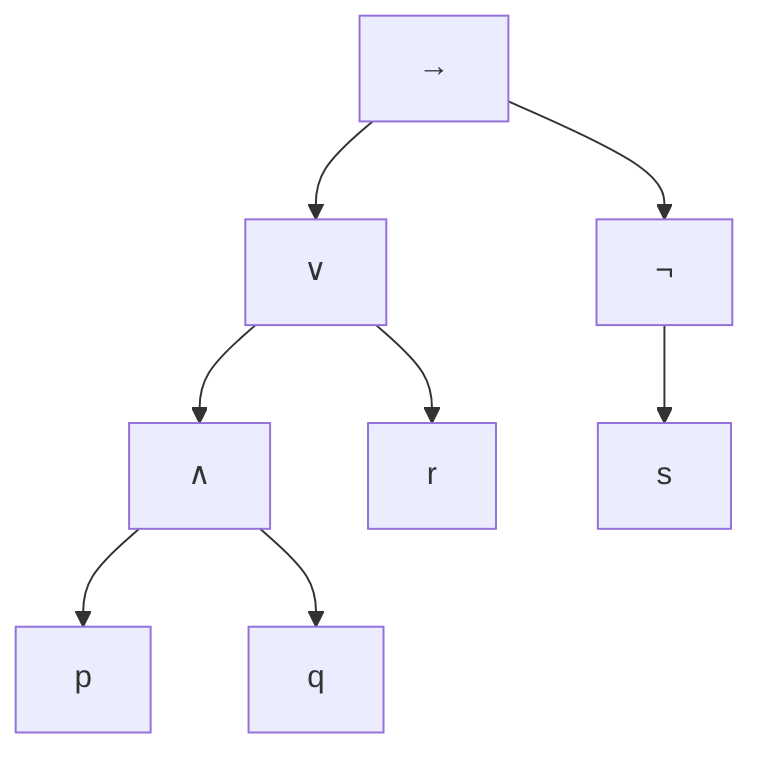

---
tags:
  - 数理逻辑
  - 命题逻辑
  - 语法与语义
  - 联结词完备集
  - 结构归纳
  - 课程笔记
课程: 数理逻辑
章节: 第二章 命题逻辑的语法与语义
教材:
---

> [!info] 本章定位
> 本章建立命题逻辑的对象及其解释方法. 理解主线有四点：① 公式是按有限构造规则生成的符号串，括号保证结构可识别；② 真值赋值先定义在原子上，再按公式结构递归扩展；③ 逻辑等值比较全部赋值下的真值，等值置换依赖联结词的真值函数性质；④ 联结词完备性讨论表达任意真值函数的能力，结构归纳既能证明表达能力，也能通过不变量证明表达限制.

**材料范围**：刘咏梅，2026 年秋季《第二讲：命题逻辑的语法与语义》，`Lec02-PropSynSem-Post.pdf`，全部 31 页. 课件说明部分内容取自周晓聪老师课件. 本文核对并转写图片中的归纳定义、语法树、真值表、等值式与真值函数表；补充证明及例题分别标明，未读取教材或其他未指定课件.

## 目录

- [[#1. 语法与语义的分工|1. 语法与语义的分工]]
- [[#2. 公式的递归定义与语法树|2. 公式的递归定义与语法树]]
	- [[#2.1 符号与公式的生成规则|2.1 符号与公式的生成规则]]
	- [[#2.2 归纳定义中的最小性|2.2 归纳定义中的最小性]]
	- [[#2.3 抽象语法树|2.3 抽象语法树]]
- [[#3. 结构归纳法|3. 结构归纳法]]
- [[#4. 唯一可读性定理|4. 唯一可读性定理]]
	- [[#4.1 符号权重与前缀引理|4.1 符号权重与前缀引理]]
	- [[#4.2 用结构归纳证明权重引理|4.2 用结构归纳证明权重引理]]
	- [[#4.3 从前缀性质证明唯一分解|4.3 从前缀性质证明唯一分解]]
- [[#5. 子公式与出现次数|5. 子公式与出现次数]]
- [[#6. 真值赋值与真值表|6. 真值赋值与真值表]]
	- [[#6.1 从原子赋值扩展到公式|6.1 从原子赋值扩展到公式]]
	- [[#6.2 课件真值表的逐列计算|6.2 课件真值表的逐列计算]]
- [[#7. 满足、可满足、有效、等值与后承|7. 满足、可满足、有效、等值与后承]]
	- [[#7.1 满足与可满足性|7.1 满足与可满足性]]
	- [[#7.2 有效性与逻辑等值|7.2 有效性与逻辑等值]]
	- [[#7.3 逻辑后承与反模型|7.3 逻辑后承与反模型]]
- [[#8. 等值式与等值置换|8. 等值式与等值置换]]
	- [[#8.1 基本逻辑等值式模式|8.1 基本逻辑等值式模式]]
	- [[#8.2 等值置换定理及其证明|8.2 等值置换定理及其证明]]
- [[#9. 真值函数、编号与公式等值类|9. 真值函数、编号与公式等值类]]
	- [[#9.1 真值函数与编号约定|9.1 真值函数与编号约定]]
	- [[#9.2 一元与二元真值函数全表|9.2 一元与二元真值函数全表]]
	- [[#9.3 为什么等值类数为双重指数|9.3 为什么等值类数为双重指数]]
- [[#10. 联结词完备集|10. 联结词完备集]]
	- [[#10.1 完备性的定义与基本完备集|10.1 完备性的定义与基本完备集]]
	- [[#10.2 通过互相定义缩减联结词|10.2 通过互相定义缩减联结词]]
	- [[#10.3 用偶数性证明一个集合不完备|10.3 用偶数性证明一个集合不完备]]
	- [[#10.4 或非单独构成完备集|10.4 或非单独构成完备集]]
- [[#11. 例题|11. 例题]]
- [[#12. 易错点速查|12. 易错点速查]]
- [[#13. 知识点速查|13. 知识点速查]]

---

## 1. 语法与语义的分工

对应课件第 4 页.

**语法**研究符号串的结构及其构造、操作规则. 例如“$((p\land q)\to r)$ 是否是公式”“它的主联结词是什么”是语法问题，不依赖 $p,q,r$ 的真假.

**语义**研究这些符号串在解释下的含义. 例如“$p=1,q=1,r=0$ 时该公式是否为真”“它是否对所有赋值都成立”是语义问题.

本章暂不使用形式证明来定义真值或逻辑后承. [[Chapter 3 命题逻辑自然演绎系统]] 才建立 $\vdash$ 所表示的语法推导；[[Chapter 4 命题逻辑自然演绎系统的可靠性和完备性]] 再证明它与语义后承 $\models$ 的联系.

## 2. 公式的递归定义与语法树

### 2.1 符号与公式的生成规则

对应课件第 5—6 页. 语言使用命题原子 $p,q,r,\ldots$，一元联结词 $\neg$，二元联结词 $\land,\lor,\to,\leftrightarrow$，以及左右圆括号. 讨论符号串时，每个原子视为一个完整符号，即一个记号；原子名称的书写长度不影响下面的结构分析.

> [!note] 定义：命题公式
> 公式集合是满足以下生成规则的最小集合：
> 1. 每个命题原子 $p$ 都是公式.
> 2. 若 $A$ 是公式，则 $(\neg A)$ 是公式.
> 3. 若 $A,B$ 是公式，$c\in\{\land,\lor,\to,\leftrightarrow\}$，则 $(AcB)$ 是公式.
>
> 只有经过有限次上述构造得到的符号串才是公式.

例如由 $p,q$ 构造 $(p\land q)$，再构造 $(\neg(p\land q))$，是合法过程；$p\land$ 缺少第二个分量，不是公式. 省略括号的 $\neg(p\land q)$ 是完整公式 $(\neg(p\land q))$ 的书写简化.

**为什么需要括号**：若没有额外优先级与结合约定，$p\lor q\land r$ 可能表示 $p\lor(q\land r)$，也可能表示 $(p\lor q)\land r$. 定义阶段采用完整括号，使每一次构造的范围明确；后续省略括号必须能按约定恢复，不能把括号视为随意可删的装饰.

### 2.2 归纳定义中的最小性

对应课件第 7 页. 一般的归纳定义包含基本元素、构造规则与最小性声明. 前两者要求集合包含哪些对象，最小性排除无法由规则构造的额外对象.

课件例子取整数 $3,5$ 为基本元素，并允许由已得的 $a,b$ 构造 $a+b$. 由零次加法得到 $3,5$；增加一步可得 $6,8,10$；继续可得 $9,11,12,13,15,\ldots$. 精确说，该集合是 $\{3a+5b:a,b\in\mathbb N_0,\ a+b\geq1\}$，不是任意一个包含 $3,5$ 且对加法封闭的更大集合.

同一个数可以有不同构造树，例如 $13=(3+5)+5=3+(5+5)$. 所以“有归纳定义”本身不保证“构造唯一”；命题公式的唯一可读性还需要利用其具体符号规则证明.

对公式而言，最小性保证不存在无限长的公式，也不存在不以某个生成规则收尾的“例外公式”. 这为结构归纳提供了依据.

### 2.3 抽象语法树

对应课件第 8 页. 公式的抽象语法树保留联结词及子公式的层次关系，省去用于分界的括号：原子是叶节点，否定节点有一个子节点，二元联结词节点有按左右顺序排列的两个子节点.

课件例子 $(((p\land q)\lor r)\to(\neg s))$ 的结构如下，根节点表示其主联结词 $\to$.

以 $\land$ 为根的子树对应 $(p\land q)$，以 $\lor$ 为根的子树对应 $((p\land q)\lor r)$. 不同位置即使出现相同原子，也对应不同叶节点；不能因标签相同就把树节点合并.

## 3. 结构归纳法

对应课件第 10 页. 设要证明每个公式 $A$ 都具有性质 $P(A)$. 根据生成规则，结构归纳分为以下三类任务.

| 构造情形 | 归纳假设 | 应证明的结论 |
|---|---|---|
| 原子 $p$ | 无 | 对任意原子有 $P(p)$ |
| $(\neg B)$ | $P(B)$ | $P((\neg B))$ |
| $(BcC)$ | $P(B)$ 与 $P(C)$ | 对每个二元 $c$ 有 $P((BcC))$ |

这里不是对某个特定例子逐个检查，而是覆盖全部生成规则. 任何公式均由有限次规则生成，因此其构造树可由叶向根应用这些步骤，最终得到 $P(A)$.

与按长度归纳相比，结构归纳直接按照最后使用的构造规则分类. 尚未证明唯一可读性时，也可以沿任一生成过程证明性质；唯一可读性进一步保证由公式符号串确定的结构本身没有歧义.

归纳假设只对直接子公式使用，不能把待证复合公式本身具有的性质作为已知. 若目标涉及原公式与某种转换结果之间的关系，归纳命题应同时交代转换规则及所保持的性质.

## 4. 唯一可读性定理

### 4.1 符号权重与前缀引理

对应课件第 9、11 页. 本节在完整括号语法下讨论符号串的**完全相同**，而不是逻辑等值.

**权重定义**：令 $w(\neg)=0$，每个二元联结词及左括号的权重为 $1$，每个原子及右括号的权重为 $-1$. 符号串 $s$ 的权重 $w(s)$ 为其中全部符号权重之和，空串权重为 $0$.

**真前缀**是长度严格小于整个符号串、从首符号开始的连续部分. 本文允许空串作为真前缀，它的权重为 $0$，不影响结论.

> [!abstract] 前缀权重引理
> 每个公式 $A$ 满足 $w(A)=-1$，且它的每个真前缀 $s$ 都满足 $w(s)\geq0$.

### 4.2 用结构归纳证明权重引理

**原子情形**：若 $A=p$，则 $w(A)=-1$；唯一可能的真前缀是空串，权重为 $0$.

**否定情形**：设 $A=(\neg B)$，归纳假设给出 $w(B)=-1$，且 $B$ 的真前缀权重非负. 整式权重为 $1+0-1-1=-1$.

真前缀可能停在左括号之后、否定号之后、$B$ 的某个真前缀之后，或完整 $B$ 之后但尚未读右括号. 前三类权重分别为 $1$、$1$、$1+w(s)\geq1$；最后一类为 $1+w(B)=0$. 加上空串情形，全部非负.

**二元情形（补全课件留题）**：设 $A=(BcC)$，其中 $c$ 为任意二元联结词. 由归纳假设 $w(B)=w(C)=-1$，故整式权重为 $1-1+1-1-1=-1$.

按照前缀终止的位置，非空真前缀可分为以下几类.

| 前缀形态 | 权重 | 非负的依据 |
|---|---|---|
| 左括号，或左括号后接 $B$ 的真前缀 $s$ | $1$ 或 $1+w(s)$ | 对 $B$ 的归纳假设 |
| 已读完整 $B$，未读 $c$ | $1+w(B)=0$ | $w(B)=-1$ |
| 已读 $c$，或随后接 $C$ 的真前缀 $t$ | $1+w(B)+1=1$ 或 $1+w(t)$ | 对 $C$ 的归纳假设 |
| 已读完整 $C$，未读最后右括号 | $1+w(B)+1+w(C)=0$ | 两个子公式的权重 |

这些位置穷尽全部真前缀，故二元情形成立. 结构归纳完成，引理得证.

### 4.3 从前缀性质证明唯一分解

**引理的推论**：一个公式不可能是另一个公式的真前缀. 否则前者作为公式权重应为 $-1$，作为后者真前缀权重又应非负，矛盾.

> [!important] 唯一可读性定理：二元分解
> 设 $A,B,A',B'$ 都是公式，$c,c'$ 都是二元联结词. 若符号串 $(AcB)=(A'c'B')$，则 $A=A'$、$c=c'$、$B=B'$.

**证明，先确定左子公式**：去掉相同的首个左括号，$A,A'$ 都是剩余同一个符号串的前缀. 若长度不同，较短者就是较长者的真前缀，与上面的推论矛盾. 所以长度相同，且两者是同一串相同长度的前缀，故 $A=A'$.

**再确定主联结词与右子公式**：$A$ 结束后的下一个符号分别是 $c,c'$，由原串相同可知 $c=c'$. 去掉已匹配的前部及最后右括号，剩余部分相同，故 $B=B'$. 定理得证.

**为什么这给出整个语法树唯一**：原子以原子符号开始，复合公式以左括号开始，二者不会混淆. 左括号之后若为 $\neg$，就只能是 $(\neg A)$；二元公式的左子公式首符号只能是原子或左括号，不会以 $\neg$ 开头. 否定式的内部公式由去掉固定外壳唯一确定；二元式的分解由定理唯一确定. 对各子公式重复这一论证，就得到唯一语法树.

本定理用的是语法相等 $=$. 例如 $(p\land q)$ 与 $(q\land p)$ 虽然逻辑等值，却不是同一个符号串，不能作为唯一可读性定理中的相同输入.

## 5. 子公式与出现次数

对应课件第 12 页.

> [!note] 定义：子公式
> 公式 $A$ 的子公式，是 $A$ 中本身也构成公式的连续子串；在语法树中，它对应某个节点及其全部后代组成的子树. 原公式自身也算子公式.

例如 $p,q,(p\land q),(\neg(p\land q))$ 都是 $(\neg(p\land q))$ 的子公式，$p\land$ 不是. 使用省略括号写法时，应先恢复所指结构，不能仅依据省略后的字面片段判定.

课件例子 $(((p\land q)\lor r)\leftrightarrow(\neg s))$ 的不同子公式有 $p,q,r,s$、$(p\land q)$、$((p\land q)\lor r)$、$(\neg s)$ 和整个公式，共 $8$ 个. 它有 $4$ 次原子出现、$4$ 次联结词出现，语法树也恰有 $8$ 个节点.

**出现次数**按树节点计数，即使两个节点对应同一个公式，也分别计入. 因而任意公式的子公式出现总次数，等于原子出现次数加联结词出现次数.

**不同子公式数**按公式符号串去重. 例如 $(p\land p)$ 有 $3$ 次子公式出现，但只有 $p$ 和 $(p\land p)$ 两种不同子公式.

课件的“子公式个数等于原子个数加联结词个数”按出现次数理解才普遍成立. 若按不同公式种类理解，重复子公式会使该等式失效.

## 6. 真值赋值与真值表

### 6.1 从原子赋值扩展到公式

对应课件第 14 页.

> [!note] 定义：真值赋值
> 真值赋值是从原子集合到 $\{T,F\}$ 的映射 $\tau$. 本文也用 $1,0$ 分别表示 $T,F$，用 $A^\tau$ 或 $\tau(A)$ 表示公式在该赋值下的真值.

赋值先在原子上给定，然后按结构递归扩展：$\neg A$ 真当且仅当 $A$ 假；$A\land B$ 真当且仅当两者都真；$A\lor B$ 真当且仅当至少一个真；$A\to B$ 真当且仅当 $A$ 假或 $B$ 真；$A\leftrightarrow B$ 真当且仅当两者真值相同.

| $A$ | $B$ | $\neg A$ | $A\land B$ | $A\lor B$ | $A\to B$ | $A\leftrightarrow B$ |
|---|---|---|---|---|---|---|
| 0 | 0 | 1 | 0 | 0 | 1 | 1 |
| 0 | 1 | 1 | 0 | 1 | 1 | 0 |
| 1 | 0 | 0 | 0 | 1 | 0 | 0 |
| 1 | 1 | 0 | 1 | 1 | 1 | 1 |

唯一可读性确保每个复合公式有确定的最外层构造；递归只访问较小子公式，最终到达原子，所以原子赋值能唯一扩展为全部公式的赋值. 蕴涵的真值不要求前件、后件具有因果联系，而严格按照上表定义.

**补充：变量局部性**. 若两个赋值在 $A$ 中出现的全部原子上相同，则它们给 $A$ 的真值相同. 可对 $A$ 作结构归纳：原子情形由条件保证；复合情形的子公式值相同，同一真值函数输出也相同. 因而只需枚举公式实际涉及的有限变量，其他原子的取值不会改变结果.

### 6.2 课件真值表的逐列计算

对应课件第 15 页. 定义 $B=r\lor(p\land\neg q)$，$C=r\to(p\land q)$，$A=B\land C$. 先固定变量顺序 $(p,q,r)$，按 $000,001,\ldots,111$ 枚举赋值，再按依赖顺序计算子公式.

| 编码 | $p$ | $q$ | $r$ | $\neg q$ | $p\land\neg q$ | $B$ | $p\land q$ | $C$ | $A$ |
|---|---|---|---|---|---|---|---|---|---|
| $000$ | 0 | 0 | 0 | 1 | 0 | 0 | 0 | 1 | 0 |
| $001$ | 0 | 0 | 1 | 1 | 0 | 1 | 0 | 0 | 0 |
| $010$ | 0 | 1 | 0 | 0 | 0 | 0 | 0 | 1 | 0 |
| $011$ | 0 | 1 | 1 | 0 | 0 | 1 | 0 | 0 | 0 |
| $100$ | 1 | 0 | 0 | 1 | 1 | 1 | 0 | 1 | 1 |
| $101$ | 1 | 0 | 1 | 1 | 1 | 1 | 0 | 0 | 0 |
| $110$ | 1 | 1 | 0 | 0 | 0 | 0 | 1 | 1 | 0 |
| $111$ | 1 | 1 | 1 | 0 | 0 | 1 | 1 | 1 | 1 |

例如 $100$ 行的 $C$ 为真，因为蕴涵前件 $r=0$；而 $101$ 行的 $C$ 为假，因为 $r=1$ 但 $p\land q=0$. 最终 $A$ 恰有 $100,111$ 两个成真赋值. 相同例子在 [[Chapter 5 命题逻辑范式和 SAT 求解器#4.3 课件真值表的完整推导|第五章主范式]] 中继续用于构造主 DNF 与主 CNF.

## 7. 满足、可满足、有效、等值与后承

### 7.1 满足与可满足性

对应课件第 16 页. 下列概念分别说明，避免把“给定赋值下真”和“存在某个赋值下真”合并为一个条件.

**满足公式**：若 $A^\tau=T$，称 $\tau$ 满足 $A$，记作 $\tau\models A$.

**满足公式集**：若对每个 $A\in\Phi$ 都有 $\tau\models A$，称 $\tau$ 满足 $\Phi$，记作 $\tau\models\Phi$. 条件要求同一个赋值同时满足全部成员.

**可满足**：若存在至少一个 $\tau$ 满足公式 $A$，称 $A$ 可满足；若存在一个 $\tau$ 满足公式集 $\Phi$，称 $\Phi$ 可满足.

**不可满足**：若不存在满足赋值，称相应公式或公式集不可满足. 对单个公式而言，这意味着它在每个赋值下都为假，也称矛盾式或永假式.

例如 $p\land q$ 可满足，取 $p=q=1$；$p\land\neg p$ 不可满足，因为任意赋值都不能使 $p$ 与 $\neg p$ 同真.

课件的公式集 $\{b\lor r,\neg b,b\to r\}$ 可满足：取 $b=0,r=1$，第一项由 $r$ 满足，第二项为真，第三项因前件假而为真. 加入 $\neg r$ 后不可满足：$\neg b,\neg r$ 强迫 $b=r=0$，与 $b\lor r$ 冲突.

### 7.2 有效性与逻辑等值

**有效式**：若对任意赋值 $\tau$ 都有 $A^\tau=T$，称 $A$ 有效或永真，记作 $\models A$. 有效的命题公式也称重言式，例如 $p\lor\neg p$.

**逻辑等值**：若对任意共同变量上的赋值 $\tau$，$A^\tau=B^\tau$，称 $A,B$ 逻辑等值，记作 $A\equiv B$. 课件也用 $A\Leftrightarrow B$ 或 $A\Longleftrightarrow B$ 表示元语言中的等值关系，本文统一用 $\equiv$，与对象语言联结词 $\leftrightarrow$ 分开.

例如 $p\to q\equiv\neg q\to\neg p$，因为两者仅在 $p=1,q=0$ 时为假，其他行都真. 但它们语法结构不同，不是同一个公式串.

由双蕴涵语义可得 $A\equiv B$ 当且仅当 $\models A\leftrightarrow B$. 左侧是关于两个公式的语义关系，右侧是说一个双蕴涵公式有效；二者等价不表示符号处于同一个语言层次.

有效式一定可满足，而可满足式未必有效，例如原子 $p$. 非有效也不等于不可满足：$p$ 既有成真赋值，也有成假赋值. 从定义还可得 $A$ 有效当且仅当 $\neg A$ 不可满足.

### 7.3 逻辑后承与反模型

对应课件第 17 页.

> [!note] 定义：逻辑后承
> 若对任意赋值 $\tau$，只要 $\tau\models\Phi$ 就有 $\tau\models A$，则称 $A$ 为 $\Phi$ 的逻辑推论，记作 $\Phi\models A$.

例如 $\{p\lor q,\neg p\}\models q$：前提已排除 $p$ 为真，析取仍真就要求 $q$ 真. 又如 $\{p\to q,\neg q\}\models\neg p$：若还令 $p$ 真，蕴涵就迫使 $q$ 真，与第二前提冲突.

**反模型**：若 $\tau\models\Phi$ 但 $\tau\not\models A$，则 $\tau$ 是该后承断言的反模型，直接证明 $\Phi\not\models A$. 单独使结论为假还不够，全部前提也必须为真.

逻辑等值可写为两个方向的后承：$A\equiv B$ 当且仅当 $\{A\}\models B$ 且 $\{B\}\models A$. 由定义还可得：$\Phi\models A$ 当且仅当 $\Phi\cup\{\neg A\}$ 不可满足. 对有限 $\Phi$，可以将其写为一个合取公式，转入 [[Chapter 5 命题逻辑范式和 SAT 求解器]] 的 SAT 问题.

若 $\Phi$ 不可满足，它语义后承任意 $A$，因为根本不存在前提全真的反模型. 这个结论来自后承的全称定义，并不表示某个矛盾赋值使一切都真.

## 8. 等值式与等值置换

### 8.1 基本逻辑等值式模式

对应课件第 18 页. 下表的 $A,B,C$ 代表任意公式，替换模式字母时应对同一字母作一致替换. $0$ 表示任意永假式，例如 $p\land\neg p$；$1$ 表示任意永真式，例如 $p\lor\neg p$. 它们是这里的语义简记，不是第 2 节公式语法新加入的原始常量.

| 名称 | 等值式模式 |
|---|---|
| 同一律 | $A\land1\equiv A$；$A\lor0\equiv A$ |
| 零律 | $A\land0\equiv0$；$A\lor1\equiv1$ |
| 矛盾律 | $A\land\neg A\equiv0$ |
| 排中律 | $A\lor\neg A\equiv1$ |
| 双重否定律 | $\neg\neg A\equiv A$ |
| 幂等律 | $A\land A\equiv A$；$A\lor A\equiv A$ |
| 交换律 | $A\land B\equiv B\land A$；$A\lor B\equiv B\lor A$ |
| 结合律 | $A\land(B\land C)\equiv(A\land B)\land C$；$A\lor(B\lor C)\equiv(A\lor B)\lor C$ |
| 分配律 | $A\lor(B\land C)\equiv(A\lor B)\land(A\lor C)$ |
| 分配律的对偶形式（补充） | $A\land(B\lor C)\equiv(A\land B)\lor(A\land C)$ |
| 吸收律 | $A\land(A\lor B)\equiv A$；$A\lor(A\land B)\equiv A$ |
| 德摩根律 | $\neg(A\land B)\equiv\neg A\lor\neg B$；$\neg(A\lor B)\equiv\neg A\land\neg B$ |
| 蕴涵等值式 | $A\to B\equiv\neg A\lor B$ |
| 双蕴涵等值式 | $A\leftrightarrow B\equiv(A\to B)\land(B\to A)$ |

这些是语义等值模式，可通过相应原子真值表逐行验证，再一致替换为任意公式. 对偶分配律在课件图片中没有单独列出，本文补充列出，便于后续范式转换.

### 8.2 等值置换定理及其证明

对应课件第 19—20 页. 等值演算把一次次局部变形串成整体等值结论：每一步由等值置换保证，整条链再由等值关系的传递性保证. 等值关系具有自反性、对称性和传递性，分别来自真值相等的相应性质.

> [!important] 等值置换定理
> 若 $B\equiv B'$，在公式 $A$ 中选择 $B$ 的一处或多处完整子公式出现，用 $B'$ 替换得到 $A'$，则 $A\equiv A'$.

**证明安排**：允许“本层没有选择任何出现”的情形，此时公式保持原样. 对 $A$ 作结构归纳，并区分替换是否直接选中整个 $A$；这样可覆盖只替换一部分出现的情况.

**选中整个公式**：此时 $A=B$，$A'=B'$，由前提已知 $A\equiv A'$.

**原子且未被选中**：原子没有更小子公式，替换不发生，故 $A'=A$.

**否定情形**：若 $A=\neg A_1$ 且根部未被选中，则替换只在 $A_1$ 内进行，得到 $A_1'$. 由归纳假设 $A_1\equiv A_1'$，任意赋值下两者真值相同，取否定后仍相同，故 $\neg A_1\equiv\neg A_1'$.

**二元情形（补全课件留题）**：若 $A=A_1cA_2$ 且根部未被选中，分别在左右子公式内替换，得到 $A_1',A_2'$. 归纳假设给出 $A_1\equiv A_1'$ 与 $A_2\equiv A_2'$；某一侧没有替换时也由自反性成立. 任取赋值 $\tau$，两个输入真值逐一相同，同一个二元联结词 $c$ 的输出便相同，因此 $A_1cA_2\equiv A_1'cA_2'$. 结构归纳完成.

替换要求整棵子公式结构，而不是任意字符片段；新公式不额外携带某个特定赋值条件. 若只知道 $B,B'$ 在某一次赋值下相同，不能推出对全部赋值的等值置换结论.

例如由 $q\to r\equiv\neg q\lor r$，可在 $p\land(q\to r)$ 中替换该子公式，得到 $p\land(q\to r)\equiv p\land(\neg q\lor r)$. 这里外层合取即使不是被使用的基本等值模式，也由置换定理保持语义.

## 9. 真值函数、编号与公式等值类

### 9.1 真值函数与编号约定

对应课件第 21、23—24 页.

> [!note] 定义：真值函数
> 对 $n\geq1$，一个 $n$ 元真值函数是映射 $f:\{0,1\}^n\to\{0,1\}$. 它的输入共有 $2^n$ 个，输出由各输入行上的真值完全确定.

固定变量顺序 $(p_1,\ldots,p_n)$，把输入按二进制从全 $0$ 到全 $1$ 排列. 课件从上到下读取输出列，把第一个输出作为最高位，得到函数编号 $k$，记为 $f_k^{(n)}$. 例如二元合取的输出列是 $0001$，所以是 $f_1^{(2)}$；三元输出列 $01010000$ 的编号为十进制 $80$，即 $f_{80}^{(3)}$.

编号依赖输入变量顺序、输入行顺序和输出位读取方向. 不能把函数编号与某一成真输入行的编号混为一谈：前者编码整列输出，后者只编码一个输入组合.

固定变量表后，每个公式定义一个真值函数. 公式没有使用某个列出的变量时，仍可看成关于整个变量表的函数，只是其值不依赖那个变量.

### 9.2 一元与二元真值函数全表

对应课件第 24—25、29 页. 一元函数共有 $2^2=4$ 个.

| 编号 | 在 $p=0,1$ 下的输出列 | 一个表达式 |
|---|---|---|
| $f_0^{(1)}$ | $00$ | $p\land\neg p$ |
| $f_1^{(1)}$ | $01$ | $p$ |
| $f_2^{(1)}$ | $10$ | $\neg p$ |
| $f_3^{(1)}$ | $11$ | $p\lor\neg p$ |

二元函数共有 $2^4=16$ 个，以下输出列统一按 $(p,q)=00,01,10,11$ 排列. 为便于纵向阅读，将课件横排的两组表转为一张逐行表.

| 编号 | 输出列 | 一个表达式 | 名称或说明 |
|---|---|---|---|
| $f_0^{(2)}$ | $0000$ | $p\land\neg p$ | 恒假，语义上也可视为零元常量 |
| $f_1^{(2)}$ | $0001$ | $p\land q$ | 与 |
| $f_2^{(2)}$ | $0010$ | $\neg(p\to q)$ | 等值于 $p\land\neg q$ |
| $f_3^{(2)}$ | $0011$ | $p$ | 第一投影，不依赖 $q$ |
| $f_4^{(2)}$ | $0100$ | $\neg p\land q$ | 仅 $01$ 行真 |
| $f_5^{(2)}$ | $0101$ | $q$ | 第二投影，不依赖 $p$ |
| $f_6^{(2)}$ | $0110$ | $\neg(p\leftrightarrow q)$ | 异或，也记为 $p\oplus q$ |
| $f_7^{(2)}$ | $0111$ | $p\lor q$ | 或 |
| $f_8^{(2)}$ | $1000$ | $\neg(p\lor q)$ | 或非，也记为 $p\downarrow q$ |
| $f_9^{(2)}$ | $1001$ | $p\leftrightarrow q$ | 双蕴涵 |
| $f_{10}^{(2)}$ | $1010$ | $\neg q$ | 不依赖 $p$ |
| $f_{11}^{(2)}$ | $1011$ | $q\to p$ | 逆向蕴涵 |
| $f_{12}^{(2)}$ | $1100$ | $\neg p$ | 不依赖 $q$ |
| $f_{13}^{(2)}$ | $1101$ | $p\to q$ | 蕴涵 |
| $f_{14}^{(2)}$ | $1110$ | $\neg(p\land q)$ | 与非，也记为 $p\uparrow q$ |
| $f_{15}^{(2)}$ | $1111$ | $p\lor\neg p$ | 恒真，语义上也可视为零元常量 |

课件把恒真、恒假视为零元运算，是从“其输出不依赖输入”的角度分类；上表把它们也列为二元函数，是在固定定义域 $\{0,1\}^2$ 下讨论. 两种观察角度相容，不表示它们在原始公式语法中自动成为新的符号.

### 9.3 为什么等值类数为双重指数

固定 $n\geq1$ 个可使用的原子，一个真值函数有 $2^n$ 行输出，每行可独立选择 $0$ 或 $1$，所以共有 $2^{2^n}$ 个函数. 对 $n=2$，即 $2^4=16$ 个.

同一真值函数可以有无穷多个语法不同的公式，例如 $p$、$\neg\neg p$、$p\land p$、反复添加双重否定得到的公式都等值. 所以 $2^{2^n}$ 数的是不同语义等值类，而不是公式符号串数.

计数给出了等值类数的上界；要得到“恰好”，还需证明每个真值函数都能由公式表达. 下一节给出按成真行构造公式的方法，补足这个存在性环节. 这里“由 $n$ 个原子构成”是指允许使用固定的这 $n$ 个原子，不要求每个原子都实际出现在公式中，也不要求函数真正依赖每个输入.

## 10. 联结词完备集

### 10.1 完备性的定义与基本完备集

对应课件第 26 页.

> [!note] 定义：联结词完备集
> 若对任意 $n\geq1$ 和任意 $n$ 元真值函数，都存在仅使用变量 $p_1,\ldots,p_n$ 以及集合 $\Omega$ 中联结词的公式表示该函数，则称 $\Omega$ 为真值函数的完备集.

允许重复使用同一个变量，也允许某些变量不出现. 此处完备性讨论**函数表达能力**；它与第四章“语义后承必可形式证明”的证明系统完备性研究对象不同.

**基本结论**：$\{\neg,\land,\lor\}$ 是完备集. 课件引用离散数学中的主析取范式给出结论；为使本章论证自足，下面补充其构造理由.

固定函数 $f$，对每个输出为 $1$ 的输入 $\boldsymbol b=(b_1,\ldots,b_n)$，构造项 $t_{\boldsymbol b}$：若 $b_i=1$，取文字 $p_i$；若 $b_i=0$，取文字 $\neg p_i$；把全部 $n$ 个文字合取. 该项恰好在输入 $\boldsymbol b$ 时为真.

把所有这类项析取，就得到与 $f$ 输出相同的公式. 因为一个输入使析取真，当且仅当它等于某个被列出的成真输入. 若根本没有成真输入，则改用 $p_1\land\neg p_1$ 表示恒假；$n\geq1$ 保证可以选择 $p_1$. 这样所有函数均有表达式，既证明完备性，也完成第 9.3 节等值类计数的下界证明.

此构造不保证公式短小：可能列出指数多个输入行. 主范式的正式定义及其与 CNF 的关系将在 [[Chapter 5 命题逻辑范式和 SAT 求解器]] 中继续讨论.

### 10.2 通过互相定义缩减联结词

对应课件第 27 页. 若已经有一个完备集，且其每个联结词都能用另一个集合 $\Omega$ 表达，则可以对公式递归替换这些联结词，得到只含 $\Omega$ 的等值公式. 因而 $\Omega$ 也完备；等值置换定理保证转换保持真值.

| 新的完备集 | 被省略运算的表达式 | 推出完备性的理由 |
|---|---|---|
| $\{\neg,\lor\}$ | $A\land B\equiv\neg(\neg A\lor\neg B)$ | 能表达基本完备集中的合取 |
| $\{\neg,\land\}$ | $A\lor B\equiv\neg(\neg A\land\neg B)$ | 能表达基本完备集中的析取 |
| $\{\neg,\to\}$ | $A\land B\equiv\neg(A\to\neg B)$ | 先模拟 $\{\neg,\land\}$ |

第三行的右侧之所以表示合取，是因为 $A\to\neg B\equiv\neg A\lor\neg B$，再取否定即得 $A\land B$. 证明完备性时只须模拟某个已知完备集，不必为每个函数重新设计公式.

仅仅证明某个集合能表达几个常用函数还不够，除非这些函数本身已构成完备集. 相反，证明不完备不要求列举全部不能表达的函数，只需找一个共同不变量与一个违反它的目标函数.

### 10.3 用偶数性证明一个集合不完备

对应课件第 28 页. 要证明 $\{\neg,\leftrightarrow\}$ 不完备，不能只说“暂时没有找到合取的表示”，需要证明任何表达式都受某种限制.

> [!abstract] 二变量偶数性引理
> 只由原子 $p,q$ 和联结词 $\neg,\leftrightarrow$ 构成的任意公式，在四种赋值 $00,01,10,11$ 中都有偶数个成真赋值.

**证明，对公式结构归纳**. 原子 $p$ 与 $q$ 各有两种成真赋值，满足偶数性.

若 $A=\neg B$，设 $B$ 有 $k$ 个成真赋值，由归纳假设 $k$ 为偶数，$A$ 的成真赋值数就是 $4-k$，仍为偶数.

若 $A=B\leftrightarrow C$，令 $T_B,T_C$ 为两子公式的成真赋值集合. 双蕴涵为假恰好要求两者真值不同，即赋值属于对称差 $T_B\mathbin{\triangle}T_C$. 其大小为 $|T_B|+|T_C|-2|T_B\cap T_C|$；前两项由归纳假设为偶数，最后一项也是偶数，故对称差大小为偶数. 双蕴涵的成真赋值数为 $4-|T_B\mathbin{\triangle}T_C|$，同样为偶数. 这补全了课件中“容易证明”的关键步骤.

**不完备结论**：二元合取 $p\land q$ 只有 $11$ 一个成真赋值，违反上述不变量，所以无法用 $\neg,\leftrightarrow$ 表达. 因为不能表达这个二元函数，该联结词集合不是完备集.

该引理固定在两个变量的四行真值表上使用，不能无条件套到任意变量数. 例如只用一个变量时，原子 $p$ 本身就只有一个成真赋值. 本证明只需找到二元表达能力的缺口，已经足以否定对所有元数的完备性.

### 10.4 或非单独构成完备集

对应课件第 29—30 页. 任意真值函数都可被看作一个新的逻辑运算符，定义其输入输出表即可. 课件特别介绍或非 $\downarrow$ 与与非 $\uparrow$；本节证明其指定的或非完备性.

**或非定义**：$A\downarrow B$ 的语义为 $\neg(A\lor B)$，仅在两输入都假时为真，真值函数为 $f_8^{(2)}$.

**与非定义**：$A\uparrow B$ 的语义为 $\neg(A\land B)$，仅在两输入都真时为假，真值函数为 $f_{14}^{(2)}$. 课件还用“谢弗运算”指称与非；本文不将它与或非混写.

> [!important] 定理：$\{\downarrow\}$ 是完备集
> 或非运算可以定义否定与析取，因此能模拟已知完备集 $\{\neg,\lor\}$.

具体地，$A\downarrow A\equiv\neg A$，因为两份相同输入的析取仍是 $A$. 又有 $(A\downarrow B)\downarrow(A\downarrow B)\equiv\neg\neg(A\lor B)\equiv A\lor B$. 于是对任意只含否定、析取的公式递归进行这两种替换，就得到只含 $\downarrow$ 的等值公式，定理得证.

这也回答第 27 页“完备集是否一定包含否定运算符”的问题：不需要把 $\neg$ 作为原始成员，但必须具有足够的组合表达能力，使否定等函数能由它表达.

**课件的非结合性说明**：$\downarrow$ 不满足结合律. 取 $p=0,q=0,r=1$，则 $(p\downarrow q)\downarrow r=1\downarrow1=0$，而 $p\downarrow(q\downarrow r)=0\downarrow0=1$. 因而多次或非必须保留括号，不能写成含糊的连续运算串.

## 11. 例题

本节为围绕课件难点补充的 6 道例题. 课件自身的语法树、子公式计数、完整真值表、可满足性实例、函数枚举与完备性证明已在相应正文展开.

### 11.1 用结构关系计数公式成分

证明对任意公式，原子出现次数 $a$ 与二元联结词出现次数 $b$ 满足 $a=b+1$. 否定的出现次数是否影响这一关系？

> [!example]- 解析
> 对公式作结构归纳. 原子情形 $a=1,b=0$，等式成立. 否定构造只增加一个一元联结词，不改变 $a,b$，所以保持等式.
>
> 对 $BcC$，由归纳假设 $a_B=b_B+1$、$a_C=b_C+1$，新公式的 $a=a_B+a_C$，$b=b_B+b_C+1$. 所以 $a=(b_B+1)+(b_C+1)=b+1$. 覆盖全部构造，命题得证.
>
> 若还有 $u$ 个否定节点，树节点总数为 $a+b+u=2b+u+1$. 否定不改变 $a=b+1$，但会增加子公式出现次数. 这里必须按出现次数计数，不能把重复变量去重.

### 11.2 满足、可满足与后承的区别

设 $\Phi=\{p\lor q,p\to q\}$. 求其在变量 $(p,q)$ 上的全部模型，并判断是否有 $\Phi\models q$、$\Phi\models p$.

> [!example]- 解析
> 若 $q=0$，第一个前提要求 $p=1$，而第二个前提此时为假，所以没有模型. 若 $q=1$，两个前提都真，无论 $p$ 取何值. 因此全部模型为 $01$ 与 $11$.
>
> 有模型说明 $\Phi$ 可满足. 每个模型都使 $q=1$，所以 $\Phi\models q$. 但模型 $01$ 使 $p=0$，因此它是 $\Phi\models p$ 的反模型，故 $\Phi\not\models p$. “某个模型满足 $p$”不等于“所有模型满足 $p$”.

### 11.3 通过等值置换逐步演算

化简 $\neg(p\to q)\lor(p\land q)$，并标明使用的等值式.

> [!example]- 解析
> 先在否定内部用蕴涵等值式置换，得到 $\neg(\neg p\lor q)\lor(p\land q)$. 再用德摩根律与双重否定律得到 $(p\land\neg q)\lor(p\land q)$.
>
> 反向使用合取对析取的分配律，得到 $p\land(\neg q\lor q)$；由排中律和同一律，得到 $p\land1\equiv p$. 因而原式等值于 $p$.
>
> 每一步既使用具体的基本模式，也依赖等值置换允许在较大公式内部进行替换. 最后用传递性连接各步，而不是只凭外观相似声称等值.

### 11.4 从函数编号恢复表达式

按课件编号约定，求 $f_{11}^{(2)}(p,q)$ 的一个公式，并说明交换变量后会发生什么.

> [!example]- 解析
> $11$ 的四位二进制是 $1011$. 按输入行 $00,01,10,11$，只有第二行 $01$ 输出为假，即 $p=0,q=1$ 时假. 这正是 $q\to p$ 的真值条件，所以 $f_{11}^{(2)}(p,q)=q\to p$.
>
> 交换变量得到 $p\to q$，输出列为 $1101$，编号变为 $13$. 两函数并不等值；例如 $p=0,q=1$ 时，前者假、后者真. 函数输入有顺序，变量交换不保证保持函数.

### 11.5 构造只含或非的合取公式

将 $p\land q$ 表示为只含 $\downarrow$ 的公式，并解释为什么它不与前面的不完备性证明冲突.

> [!example]- 解析
> 先分别得到 $p\downarrow p\equiv\neg p$ 与 $q\downarrow q\equiv\neg q$. 再构造 $(p\downarrow p)\downarrow(q\downarrow q)$，其语义为 $\neg(\neg p\lor\neg q)$，由德摩根律等值于 $p\land q$.
>
> $\{\neg,\leftrightarrow\}$ 的偶数性不变量只适用于由那两种联结词构成的公式，并不适用于加入或非的新语言. 或非自身的二元真值表就有一个成真行，因此它能越过那个表达限制.

### 11.6 为什么只有蕴涵仍不完备

不允许额外常量，只使用原子与 $\to$，能否表达否定函数 $\neg p$？给出覆盖所有此类公式的理由.

> [!example]- 解析
> 在把所有原子都赋为 $1$ 的赋值下，每个只含 $\to$ 的公式都为真. 对结构归纳即可证明：原子真；若左右子公式均真，则其蕴涵 $1\to1$ 也真.
>
> 但 $\neg p$ 在 $p=1$ 时为假，因此不可能等值于上述任何公式. 所以 $\{\to\}$ 不完备. 这是用“保持全真输入”不变量说明不完备的补充例子，与正文用偶数性限制表达能力的方法相同.
>
> 条件“不允许额外常量”不能省略：若另有永假常量 $0$，则 $p\to0$ 可以表示 $\neg p$. 讨论完备集时必须明确可用符号范围.

## 12. 易错点速查

| 易错点 | 正确条件或论证依据 |
|---|---|
| 语法正确就意味着公式真 | 公式身份由生成规则决定，真假还需给定赋值 |
| 任何归纳定义都有唯一构造 | 加法生成集合可以多种构造同一数；公式唯一性需额外证明 |
| 忽略最小性声明 | 只要求包含基本元素且对规则封闭，可能加入不应出现的对象 |
| 把省略括号后的写法当作原始文法 | 语法证明先采用完整括号，简写须能恢复结构 |
| 唯一可读性把等值公式认成同一串 | 定理比较符号串相等，不比较真值等价 |
| 权重引理只算整体权重 | 还需检查所有真前缀，否则不能排除公式互为真前缀 |
| 子公式个数一律按不同公式计 | 树节点数是出现次数；去重后的种类数可能更少 |
| 公式集每项分别可满足就整体可满足 | 必须有同一个赋值满足全部项 |
| 可满足等同有效 | 前者是存在量词，后者是全称量词 |
| 非有效等同不可满足 | 同时有真行与假行的公式既可满足又非有效 |
| $A\leftrightarrow B$ 就是 $A\equiv B$ | 前者是公式，后者是关于全部赋值的元语言关系 |
| 结论假就足以构造反模型 | 还要保证全部前提真 |
| 等值置换可以替换任意字符片段 | 应选中完整子公式出现，且替换前后在全部赋值下等值 |
| $2^{2^n}$ 是公式总个数 | 它是固定变量表上真值函数及公式语义等值类的个数 |
| 把函数编号与输入编号混淆 | 函数编号编码整列 $2^n$ 位输出，不是某一输入行 |
| $n$ 元函数一定依赖全部 $n$ 个输入 | 投影、恒值函数都可忽略部分或全部输入 |
| 证明完备性必须逐个表达所有函数 | 可以模拟一个已经证明完备的联结词集合 |
| 不能找到表达式就足以证明不完备 | 应给出对所有可构造公式成立的不变量与违反它的函数 |
| 二变量偶数性任意推广到所有元数 | 本证明固定在四行真值表中；一变量原子就有奇数个真行 |
| 完备集必须把 $\neg$ 列为成员 | 或非可组合定义否定，单元素集合也可完备 |
| 或非默认满足结合律 | 它不结合，复合表达式必须保留括号 |
| 将联结词完备性当作证明系统完备性 | 两者分别讨论函数表达能力与语义后承的可证性 |

## 13. 知识点速查

### 13.1 本章概念与方法总表

| 对象或结论 | 关键条件 | 核心方法 |
|---|---|---|
| 公式 | 有限次生成、最小封闭集合 | 原子／否定／二元构造 |
| 唯一可读性 | 完整括号、固定元数的联结词 | 权重为 $-1$，真前缀权重非负 |
| 结构归纳 | 覆盖全部生成规则 | 从直接子公式性质推出复合性质 |
| 子公式出现次数 | 保留重复位置 | 等于语法树节点数 |
| 真值赋值 | 原子到二值集的映射 | 沿语法树递归扩展 |
| $\tau\models A$ | 一个给定赋值使式真 | 逐层计算真值 |
| 可满足／有效 | 存在模型／全部赋值为模型 | 区分存在与全称条件 |
| 等值 | 全部赋值下真值相同 | 真值表、等值演算 |
| 后承 | 前提全真则结论真 | 找反模型可否定后承 |
| 等值置换 | 完整子公式、全赋值等值 | 对外层公式结构归纳 |
| 真值函数数 | 固定 $n\geq1$ 个允许变量 | $2^n$ 个输出行各有两种选择 |
| 联结词完备性 | 能表达所有元数的全部真值函数 | 成真行构造或模拟已知完备集 |
| 联结词不完备性 | 找到无法表达的一个目标函数 | 对全部公式建立共同不变量 |

### 13.2 五条核心思想与章节衔接

1. 公式先是有限生成的符号对象，语义再解释它；唯一可读性把字符串、语法树与递归求值联系起来.
2. 结构归纳来自生成规则，关键是选对覆盖全部情形的归纳命题，而不是只验证若干例子.
3. 满足、可满足、有效、等值、后承的区别主要在量化对象及量词条件：单个赋值、存在赋值或任意赋值不能混用.
4. 一个公式表达一个真值函数，同一函数对应许多公式；基本等值式与置换定理允许改变写法而保持函数不变.
5. 完备性可通过表达已知完备集证明，不完备性可通过所有表达式共有的不变量证明；两种任务需要不同证据.

[[Chapter 3 命题逻辑自然演绎系统]] 在本章语法与语义基础上加入形式推导. [[Chapter 4 命题逻辑自然演绎系统的可靠性和完备性]] 用结构归纳及其他归纳证明两者的对应关系. [[Chapter 5 命题逻辑范式和 SAT 求解器]] 则进一步研究等值转换、真值表主范式及可满足性算法. 第一章目前无笔记，故不建立缺失链接.

### 13.3 课件附带的课程说明

对应第 2 页，以下为该版本课件记录的课程安排，作为材料内容保留，不属于命题逻辑定理.

- 课程主体参照教材，课堂有补充拓展；作业与期末考核以课堂课件为主，二者有出入时以课堂讲授为准.
- 课前发预习版，课后发完整版课件.
- 使用超星签到、开展课堂活动及布置作业.
- 一次课堂活动答对加 $2$ 分，计入课程总成绩，累计最多加 $10$ 分.
- 期末开卷，可携带纸质教材、课件和作业打印件，不允许电子设备.

这些是所读课件的原始说明，并非本次另行核实的最新通知. 课件未提供可确定的教材书目信息，因此 frontmatter 的“教材”字段留空.

### 13.4 课件覆盖与辨析记录

| PDF 页码 | 内容 | 本文对应 |
|---|---|---|
| 1—3 | 封面、来源致谢、课程说明、提要 | 本章材料范围与第 13.3 节 |
| 4—6 | 语法语义、符号、公式递归定义 | 第 1、2.1 节 |
| 7—8 | 集合归纳定义、构造树、抽象语法树 | 第 2.2—2.3 节 |
| 9—11 | 唯一可读性、结构归纳、权重引理 | 第 3、4 节，补全二元情形与唯一分解证明 |
| 12 | 子公式及计数例子 | 第 5 节，区分出现次数与去重后的种类数 |
| 13—15 | 提要、赋值递归语义、完整真值表 | 第 6 节 |
| 16—17 | 满足、可满足、有效、等值、逻辑推论 | 第 7 节，独立分段定义并解释全部例子 |
| 18—20 | 等值式表、等值演算、置换定理 | 第 8 节，补全二元情况及未替换原子情况 |
| 21—22 | 不等值公式个数、提要 | 第 9.3、10.1 节，补足可表达性环节 |
| 23—25 | 真值函数、编号、枚举、表达式 | 第 9.1—9.2 节，完整转写一元与二元函数 |
| 26—27 | 完备集、基本完备集、联结词互定义 | 第 10.1—10.2 节 |
| 28 | $\{\neg,\leftrightarrow\}$ 不完备 | 第 10.3 节，展开双蕴涵偶数性证明 |
| 29—30 | 函数视为运算、异或／或非／与非、或非完备 | 第 9.2、10.4 节，保留不结合性反例 |
| 31 | 本讲提要回顾 | 全篇结构与第 13.1—13.2 节 |

**材料处理边界**：本篇只摄入第二讲课件；没有读取默认目录中的教材、补充证明 PDF 或其他讲课件. 图表均转写为 Markdown、LaTeX 或语法树，无外部图片依赖. 权重、真值计算和函数表达式可作有限实例核验；一般定理仍以正文中的完整数学证明为依据.
