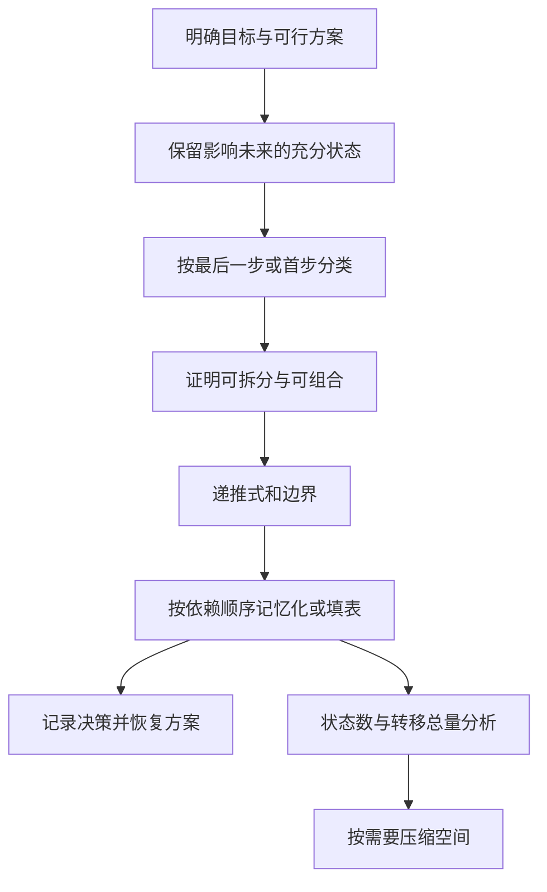

---
tags:
  - 算法设计
  - 动态规划
  - 最优子结构
  - 背包问题
  - 序列比对
  - 区间动态规划
  - 课程笔记
课程: 算法设计与分析
章节: 第 3 章 动态规划
教材:
---
 
> [!info] 本章定位
>
> 本章从一段共享后缀的路线出发，学习如何把整套选择变成能反复使用的小问题。先用路线理解状态，再用矩阵链掌握区间依赖，继而讨论资源分配与序列问题。理解本章有四个关键：
>
> 1. **状态是对子问题的完整描述。** 被省略的历史不能改变后续合法选择及其代价，否则两个看似相同的状态不能合并。
> 2. **递推式来自对最优解最后一步的分类。** 分类必须穷尽、可组合，再用替换论证证明子解的最优性。
> 3. **计算顺序由依赖关系决定。** 表格的行列只是存储形式，前缀问题常按前缀递增，区间问题常按长度递增。
> 4. **最优值和最优解是两种输出。** 值表回答「最好是多少」，决策表回答「怎么得到」；压缩空间前要先确认是否仍需恢复方案。

> [!info]- 来源与约定
>
> 依据《第 3 章 动态规划》课件全部 125 页整理。页码为 PDF 页序，章节覆盖见文末折叠表。标为「补充」的内容是解释、推导或自拟例题；教材未明确，元数据留空。
> 默认下标从 1 开始，空区间左端点大于右端点；数值算法采用单位代价模型。「备忘录」泛指结果表，自顶向下缓存称记忆化搜索，自底向上计算称填表。

## 目录

> [!info]- 展开章节与小节目录
>
> - [[#1. 从一段路线理解动态规划|1. 从一段路线理解动态规划]]
> 	- [[#1.1 为什么到达同一个结点后可以共用答案|1.1 为什么到达同一个结点后可以共用答案]]
> 	- [[#1.2 最优性原理究竟保证了哪一步|1.2 最优性原理究竟保证了哪一步]]
> 	- [[#1.3 重叠子问题与结果复用|1.3 重叠子问题与结果复用]]
> 	- [[#1.4 如何判断状态有没有丢失必要信息|1.4 如何判断状态有没有丢失必要信息]]
> 	- [[#1.5 同一递推为何有记忆化与填表两种实现|1.5 同一递推为何有记忆化与填表两种实现]]
> 	- [[#1.6 把一个新问题写成 DP 的工作顺序|1.6 把一个新问题写成 DP 的工作顺序]]
> - [[#2. 分层图最短路径：完整填表与反例|2. 分层图最短路径：完整填表与反例]]
> 	- [[#2.1 从输入图到最短后缀递推|2.1 从输入图到最短后缀递推]]
> 	- [[#2.2 一项一项理解逆序计算|2.2 一项一项理解逆序计算]]
> 	- [[#2.3 为什么只存长度不够恢复路线|2.3 为什么只存长度不够恢复路线]]
> 	- [[#2.4 目标改成模 10 后，原递推为什么失效|2.4 目标改成模 10 后，原递推为什么失效]]
> - [[#3. 矩阵链乘与区间动态规划|3. 矩阵链乘与区间动态规划]]
> 	- [[#3.1 优化对象是括号化方式|3.1 优化对象是括号化方式]]
> 	- [[#3.2 从两个括号化反推出状态与决策|3.2 从两个括号化反推出状态与决策]]
> 	- [[#3.3 先手算三矩阵，再安排整张表|3.3 先手算三矩阵，再安排整张表]]
> 	- [[#3.4 五矩阵的值表与括号恢复|3.4 五矩阵的值表与括号恢复]]
> 	- [[#3.5 为什么不能枚举括号：Catalan 数及相关计数|3.5 为什么不能枚举括号：Catalan 数及相关计数]]
> - [[#4. 投资分配：把总预算分给前几个项目|4. 投资分配：把总预算分给前几个项目]]
> 	- [[#4.1 收益表为什么不能按最高收益贪心分配|4.1 收益表为什么不能按最高收益贪心分配]]
> 	- [[#4.2 固定最后一个项目后，剩下什么问题|4.2 固定最后一个项目后，剩下什么问题]]
> 	- [[#4.3 逐行填表，再逆着预算恢复方案|4.3 逐行填表，再逆着预算恢复方案]]
> 	- [[#4.4 为什么有二维表，时间却是三因子|4.4 为什么有二维表，时间却是三因子]]
> - [[#5. 背包问题：同一行依赖与容量方向|5. 背包问题：同一行依赖与容量方向]]
> 	- [[#5.1 本章主体是完全背包|5.1 本章主体是完全背包]]
> 	- [[#5.2 从枚举件数到只判断取不取一件|5.2 从枚举件数到只判断取不取一件]]
> 	- [[#5.3 课件实例与方案回溯|5.3 课件实例与方案回溯]]
> 	- [[#5.4 一维优化与 0-1 背包对照|5.4 一维优化与 0-1 背包对照]]
> 	- [[#5.5 复杂度、伪多项式与推广|5.5 复杂度、伪多项式与推广]]
> - [[#6. 最长公共子序列：比较两个前缀的结尾|6. 最长公共子序列：比较两个前缀的结尾]]
> 	- [[#6.1 先区分子序列与连续子串|6.1 先区分子序列与连续子串]]
> 	- [[#6.2 为什么状态需要两个前缀长度|6.2 为什么状态需要两个前缀长度]]
> 	- [[#6.3 小表展示每个格子的来源|6.3 小表展示每个格子的来源]]
> 	- [[#6.4 从方向表恢复序列|6.4 从方向表恢复序列]]
> - [[#7. 图像变位压缩：枚举最后一段|7. 图像变位压缩：枚举最后一段]]
> 	- [[#7.1 压缩格式与目标函数|7.1 压缩格式与目标函数]]
> 	- [[#7.2 为什么固定最后一段就只剩一个前缀|7.2 为什么固定最后一段就只剩一个前缀]]
> 	- [[#7.3 课件算例、回溯与复杂度|7.3 课件算例、回溯与复杂度]]
> - [[#8. 最大子段和：只保留对后面有用的片段|8. 最大子段和：只保留对后面有用的片段]]
> 	- [[#8.1 连续性使前缀最大值还不够|8.1 连续性使前缀最大值还不够]]
> 	- [[#8.2 两个状态分别管延长与全局最优|8.2 两个状态分别管延长与全局最优]]
> 	- [[#8.3 空段约定与常数空间恢复|8.3 空段约定与常数空间恢复]]
> 	- [[#8.4 与枚举、分治的比较|8.4 与枚举、分治的比较]]
> - [[#9. RNA 二级结构：非交叉约束产生区间分解|9. RNA 二级结构：非交叉约束产生区间分解]]
> 	- [[#9.1 简化模型的合法配对|9.1 简化模型的合法配对]]
> 	- [[#9.2 按右端点是否匹配分类|9.2 按右端点是否匹配分类]]
> 	- [[#9.3 用一条八位置链看区间依赖|9.3 用一条八位置链看区间依赖]]
> 	- [[#9.4 记录配对决策并恢复结构|9.4 记录配对决策并恢复结构]]
> - [[#10. 序列比对与编辑距离|10. 序列比对与编辑距离]]
> 	- [[#10.1 编辑操作及前缀状态|10.1 编辑操作及前缀状态]]
> 	- [[#10.2 从一张小表理解插入、删除和替换|10.2 从一张小表理解插入、删除和替换]]
> 	- [[#10.3 计算顺序、回溯与课件实例|10.3 计算顺序、回溯与课件实例]]
> 	- [[#10.4 与 LCS 共用前缀，但目标不同|10.4 与 LCS 共用前缀，但目标不同]]
> - [[#11. 最优二叉检索树：把访问概率纳入区间代价|11. 最优二叉检索树：把访问概率纳入区间代价]]
> 	- [[#11.1 成功与失败检索的统一模型|11.1 成功与失败检索的统一模型]]
> 	- [[#11.2 子区间权重与空树边界|11.2 子区间权重与空树边界]]
> 	- [[#11.3 枚举树根的递推及证明|11.3 枚举树根的递推及证明]]
> 	- [[#11.4 填表、实例和复杂度|11.4 填表、实例和复杂度]]
> - [[#12. 例题|12. 例题]]
> 	- [[#12.1 例题 1：为什么余数最优不能直接接后缀|12.1 例题 1：为什么余数最优不能直接接后缀]]
> 	- [[#12.2 例题 2：求矩阵链的全部关键切分|12.2 例题 2：求矩阵链的全部关键切分]]
> 	- [[#12.3 例题 3：Catalan 下标与递归调用次数|12.3 例题 3：Catalan 下标与递归调用次数]]
> 	- [[#12.4 例题 4：投资预算能否默认用完|12.4 例题 4：投资预算能否默认用完]]
> 	- [[#12.5 例题 5：投资实例如何回溯到 61|12.5 例题 5：投资实例如何回溯到 61]]
> 	- [[#12.6 例题 6：同一个更新式为何需要不同遍历方向|12.6 例题 6：同一个更新式为何需要不同遍历方向]]
> 	- [[#12.7 例题 7：完全背包实例的取舍与伪多项式|12.7 例题 7：完全背包实例的取舍与伪多项式]]
> 	- [[#12.8 例题 8：LCS 表与正序输出|12.8 例题 8：LCS 表与正序输出]]
> 	- [[#12.9 例题 9：分段压缩不能忽略段头|12.9 例题 9：分段压缩不能忽略段头]]
> 	- [[#12.10 例题 10：最大子段和的负数边界|12.10 例题 10：最大子段和的负数边界]]
> 	- [[#12.11 例题 11：RNA 的距离与不交叉条件|12.11 例题 11：RNA 的距离与不交叉条件]]
> 	- [[#12.12 例题 12：编辑距离的上界为何不是答案|12.12 例题 12：编辑距离的上界为何不是答案]]
> 	- [[#12.13 例题 13：失败概率为什么也要加一层代价|12.13 例题 13：失败概率为什么也要加一层代价]]
> 	- [[#12.14 例题 14：最优二叉检索树并非总选最大概率作根|12.14 例题 14：最优二叉检索树并非总选最大概率作根]]
> - [[#13. 易错点速查|13. 易错点速查]]
> - [[#14. 知识点速查|14. 知识点速查]]
> 	- [[#14.1 状态、转移和复杂度总表|14.1 状态、转移和复杂度总表]]
> 	- [[#14.2 结构主线与五条核心思想|14.2 结构主线与五条核心思想]]
> 	- [[#14.3 章节衔接|14.3 章节衔接]]

---

## 1. 从一段路线理解动态规划

### 1.1 为什么到达同一个结点后可以共用答案

先看课件分层路线图中的一小部分。两条来路都经过 $B_4$，从 $B_4$ 往后有两种走法：

```text
A3 --1--\                 /--1--> C3 --7--> 终点
         >---- B4 -------<
A4 --2--/                 \--4--> C4 --1--> 终点
```

从 $B_4$ 出发，经 $C_3$ 还要走 $1+7=8$，经 $C_4$ 只要走 $4+1=5$。因此，无论先前从 $A_3$ 还是 $A_4$ 到达这里，后半段的最佳选择都是经过 $C_4$，最短后缀长度都是 5。

这一步带来两个变化。第一，不必为两条来路分别重算 $B_4$ 的后半段，可以保存一次答案，之后共用。第二，选择出边时不能只看当前边长：边长 1 比 4 小，但后续成本更大，必须比较**当前代价加剩余最优代价**。

把刚才的一句话变成符号，定义 $F(v)$ 为「已经位于结点 $v$，从这里到任一终点最少还要走多少」。于是

$$
F(B_4)=\min\{1+F(C_3),\;4+F(C_4)\}
=\min\{8,5\}=5.
$$

$F(B_4)$ 只回答**未来还需付出的代价**，不包含来路已经走过的长度。这样一来，$A_3$ 和 $A_4$ 就能够使用同一个结果，而不必各存一份。

> [!important] 状态与转移分别回答什么
>
> **状态**描述「当前要解决哪个剩余问题」；**转移**描述「做出某个选择后，剩余问题变成什么」。本例中状态是结点 $v$，选择是出边 $(v,u)$，新状态是 $u$。

这个例子也是本章的共同结构：先描述剩余问题，再枚举下一步选择，最后把相同剩余问题的计算合并起来。矩阵链、背包和序列问题只是状态与选择的形式不同。

### 1.2 最优性原理究竟保证了哪一步

为什么可以把完整路径中的某段换成「这一段的最短走法」？因为起终点相同，换完后仍能接上前后两段，且总长度按加法减少。

这就是本例中最优子结构的来源。一般地，**最优子结构**指原问题的最优解可以由相应子问题的最优解组成。Bellman 的**最优性原理**强调：最优策略到达某个状态后，余下策略应当是从该状态出发的最优策略。

这里的「相应子问题」不能省略。例如固定了背包第一件物品是否选择后，剩余子问题不仅要删掉这件物品，还必须扣掉已经占用的容量。

> [!important]- 替换论证：如何证明子方案必须最优（补充展开）
>
> 目标是证明「整体最优 ⇒ 对应子方案最优」。
>
> 1. 假设整体方案最优，但其中一个子方案不是指定状态下的最优方案。
> 2. 取一个更好的同状态子方案。先检查它能否替换原子方案：外部连接、剩余资源、禁止事项等约束必须仍然成立。
> 3. 若替换后整体仍合法，且总目标严格改善，就与整体最优矛盾。
>
> 最关键的是第 2 步。若两个子方案的接口不同，或新方案使用了外部已经占用的资源，替换就没有依据。

最优性原理不能倒过来用：任意选几个各自最优的子方案，并不保证能拼出整体最优。必须先固定一个兼容的划分，再说明子解如何合法组合，最后比较所有可能划分。

### 1.3 重叠子问题与结果复用

在路线例子中，从 $A_3$ 与 $A_4$ 递归向后求解，都会遇到 $F(B_4)$。这种「不同求解分支产生同一子问题」的现象称为**重叠子问题**。

最优子结构和重叠子问题的作用不同：前者使我们能够**正确地递推**，后者使保存答案能够**减少重复计算**。有最优子结构，并不自动说明缓存一定有显著收益。

| 比较维度 | 分治 | 动态规划 |
|---|---|---|
| 典型子问题关系 | 不同递归分支相对独立 | 不同分支大量遇到同一状态 |
| 结果怎样使用 | 子调用返回后参与合并 | 同一状态算一次，后续直接读取 |
| 正确性重点 | 划分完整、合并不遗漏 | 状态充分、决策完整、子解可替换 |
| 时间分析重点 | 递归树的总工作量 | 不同状态的转移工作量之和 |

动态规划（Dynamic Programming，DP）并非某个固定公式，而是一种组织计算的方法。课件介绍 Bellman 等人在多阶段决策研究中发展了这一方法；它被用于资源分配、生产调度、库存管理、设备更新和最优控制等问题。

**阶段不一定是真实时间。** 本章也会用项目编号、物品编号、字符串前缀长度、区间长度来安排求解进程。计数问题同样可以使用 DP，只是合并候选时用求和，而非最大值或最小值。

### 1.4 如何判断状态有没有丢失必要信息

一个状态可以省略历史，前提是：省略后，后续合法选择、每个选择的增量代价和结束条件都不会改变。同状态下过去已付出的费用可以不同，但剩余问题必须相同。

用课件的三个判别问题比较：

| 问题 | 固定决策后真正的剩余问题 | 能否直接替换子解 |
|---|---|---|
| 分层图最短路 | 从当前结点到终点的最短后缀 | 可以，来路不限制后面的结点 |
| 0-1 背包 | 剩余物品、扣除已用重量后的容量 | 可以，物品集合和容量确定后独立 |
| 一般图最长简单路 | 当前位置、目标、已访问结点集合 | 只留端点不够，替换路径可能重复外部结点 |

课件的最长简单路反例中，$q\to r\to t$ 是一条最长的 $q$ 到 $t$ 的简单路；但它的子路径 $q\to r$ 并不是两端点间最长的简单路，因为还存在 $q\to s\to t\to r$。若用后者替换，再接原来的 $r\to t$，会重复顶点 $t$，所以拼接非法。

> [!warning] 失效的是当前划分，不必然是所有 DP 方法
>
> 一般图最长简单路可把已访问集合加入状态，但状态数通常呈指数增长；DAG 没有环，反而可以按拓扑序求最长路。判断递推是否成立，必须连同图的类型与状态一起讨论。

普通最短路的子路径最优性还要求最短值有意义，并能合法替换子路径；一般图若存在相关负环，不能直接套本章的分层图算法。下一节继续只讨论分层无环图。

### 1.5 同一递推为何有记忆化与填表两种实现

仍以 $F(B_4)$ 为例。有两种方式保证它不被重复计算：

- **记忆化搜索**：需要它时递归计算，第一次得到 5 就保存；以后任何分支再请求它，直接返回 5。
- **自底向上填表**：先算终点附近的 $F(C_3),F(C_4)$，再主动算出 $F(B_4)$，然后计算更靠前的结点。

二者使用相同的状态定义和转移，区别在于**何时访问一个状态**。记忆化沿请求向下展开；填表预先安排依赖顺序。自底向上的顺序，本质上是让每次读取的子状态已经求出。

结果表以外，有时还要保存「取得最优值时选了谁」。例如 $F(B_4)=5$ 是最优值，而选择 $C_4$ 是恢复路径需要的决策。**最优值、一个最优方案、全部最优方案**是不同输出要求，不能混为一谈。

> [!tip]- 实现与空间的几个边界
>
> 记忆化需要区分「尚未计算」与合法值 0，可单独记录是否计算过；填表需要正确初始化边界及不可达状态。
> 两者都可能保存大量状态，记忆化还需要递归栈。滚动数组可以删去不再会被读取的旧值，但历史决策也可能随之丢失。若要恢复方案，必须另外保存信息或重新计算。
> 课件「递归空间少、迭代空间多」针对其朴素递归和完整填表的比较，并非所有实现的通则。

### 1.6 把一个新问题写成 DP 的工作顺序

先写清目标：求值还是求方案、允许空解还是必须非空、资源是上限还是必须用完。然后依次回答：

| 要回答的问题 | 路线问题中的答案 |
|---|---|
| 用什么参数界定剩余问题？ | 当前结点 $v$ |
| 表项精确表示什么？ | $F(v)$ 是从 $v$ 到终点的最短后缀长度 |
| 一个方案的第一步或最后一步有哪些可能？ | 遍历每条出边 $(v,u)$ |
| 做出选择后，余下能否单独最优求解？ | 能，且能合法接上该边 |
| 初值、不可达值是什么？ | 终点为 0，不可达为 $+\infty$ |
| 按什么顺序才能读到已知值？ | 从后面的层向前计算 |
| 如何输出实际选择？ | 保存最优后继并沿它回溯 |

最后才分析时间：**把所有不同状态的工作量加起来**，再加初始化和恢复方案的成本。若状态 $s$ 的候选决策集合为 $\mathcal A(s)$，每次转移是常数时间，则核心工作量为 $\sum_s|\mathcal A(s)|$。矩阵链虽只有二维表，但每项要枚举切分，总时间仍可达三次方。

## 2. 分层图最短路径：完整填表与反例

### 2.1 从输入图到最短后缀递推

现在回到完整课件实例。输入包括起点集合 $S$、终点集合 $T$、中间结点和边长 $c(v,u)$；各层为 $S,A,B,C,T$，边都从左向右。输出是从某个起点到某个终点的最短路径和长度。

![[Ch3-20261020-p14-分层图.png]]

已经定义 $F(v)$ 为最短后缀。到达终点后无需再走，所以 $F(t)=0$；在其他结点，必须选择一条实际存在的出边，故

$$
F(v)=\min_{(v,u)\in E}\{c(v,u)+F(u)\}.
$$

无后继能通向终点时令 $F(v)=+\infty$。原问题允许任选起点，因此最终答案是 $\min_{s\in S}F(s)$，而非某一个固定起点的表项。

### 2.2 一项一项理解逆序计算

先算 $C$ 层，因为它们只依赖终点。例如 $C_4$ 到 $T_4,T_5$ 的边长为 1、6，故 $F(C_4)=1$。再往左，每项都比较「先走一条边，再接已知最优后缀」。

| 当前状态 | 可用候选及其原因 | 新值 |
|---|---|---|
| $C_4$ | 终点后缀均为 0，比较 $1+0,6+0$ | 1 |
| $B_4$ | 已知 $F(C_3)=7,F(C_4)=1$，比较 $1+7,4+1$ | 5 |
| $A_3$ | 已知 $F(B_3)=7,F(B_4)=5$，比较 $3+7,1+5$ | 6 |
| $S_3$ | 已知 $F(A_2)=8,F(A_3)=6$，比较 $5+8,4+6$ | 10 |

完整各层结果是：

| 层 | 按图中从上到下的结点顺序排列的 $F$ 值 |
|---|---|
| $C_1,C_2,C_3,C_4$ | $2,3,7,1$ |
| $B_1,B_2,B_3,B_4,B_5$ | $11,5,7,5,4$ |
| $A_1,A_2,A_3,A_4$ | $9,8,6,7$ |
| $S_1,S_2,S_3,S_4,S_5$ | $15,13,10,11,10$ |

这里的计算顺序只是依赖要求；同一层内各个结点可按任意顺序处理。用层的名字展开递推，就是 $F(C_l)=\min_m c(C_l,T_m)$，接着依次计算 $F(B_k),F(A_j),F(S_i)$。

> [!info]- 对照课件标注后的完整图
>
> ![[Ch3-20261020-p16-最短路计算.png]]

### 2.3 为什么只存长度不够恢复路线

$F(S_3)=10$ 本身不告诉我们选择了哪条边。求极小值时还应记下一个达到极小值的后继 $\operatorname{next}(v)$。

例如从 $S_3$ 开始依次读取后继，得到

$$
S_3\to A_3\to B_4\to C_4\to T_4,
\qquad 4+1+4+1=10.
$$

也可以从 $S_5$ 出发得到另一条最优路，长度为 $3+2+4+1=10$。最优值唯一不代表路径唯一；只要求一条路径时，遇到并列最优任取一个后继即可。

> [!important]- 正确性与复杂度（补充展开）
>
> **正确性**按逆层序归纳。终点初值正确；假设所有后继的 $F$ 已正确，任何从 $v$ 出发的路径都必须先取某条出边，其余成本至少为该后继的 $F$。因此任意合法路径不优于递推的最小候选。反过来，选择取得最小值的边并接其最短后缀，确实组成同样长度的合法路径，所以递推值可达到。
>
> **时间**：用邻接表时，每个结点初始化一次、每条边检查一次，共 $O(|V|+|E|)$。路径数量可能随层数指数增长，但我们不逐条枚举路径。
>
> **空间**：距离和后继各 $O(|V|)$，不含输入图；恢复一条路径至多访问 $|V|$ 个结点。逐次进入下一层，故回溯一定终止。

### 2.4 目标改成模 10 后，原递推为什么失效

现在保留四段相同的道路，每段可选长度 2 或 5，却把目标改成「总长度除以 10 的余数最小」。

![[Ch3-20261020-p20-模10反例.png]]

如果仍在每个结点只保存一个「最小后缀余数」，就可能得到下、上、上、上的总长度 11，余数 1；四段都取下方长度 5 时，总长度 20，余数 0，反而更好。

区别在于，普通总长度加上同一个前缀会保留大小关系，而取模后可能翻转。例如后缀余数 $2<5$，当前面再加 5 时，结果却是 $7>0$。只留下余数 2，意味着我们在尚不知道前缀时，就把未来可能更好的余数 5 丢掉了。

补充的修复方式是**不要只保存一个最小余数，而保存哪些余数可达到**。令 $R(v,r)$ 表示是否存在从某起点到 $v$、总长度余数为 $r$ 的路径，$r\in\{0,\ldots,9\}$。起点余数 0 可达；经过边 $(v,u)$ 时，执行

$$
R(v,r)=\text{真}\ \Longrightarrow\
R\bigl(u,(r+c(v,u))\bmod10\bigr)=\text{真}.
$$

按层传播，最后在终点的所有可达余数中选最小者。每个结点保留 10 个布尔值，时间为 $O(10(|V|+|E|))$。这次保留的是所有会影响后续目标的余数信息，因此没有过早淘汰候选。

本例提醒我们：最优性必须和**目标函数、状态及组合规则**一起判断。课件原标量递推不成立，不意味着增加充分状态后仍无法使用 DP。

## 3. 矩阵链乘与区间动态规划

### 3.1 优化对象是括号化方式

给定矩阵链 $A_1,\ldots,A_n$，其中 $A_i$ 为 $p_{i-1}\times p_i$ 矩阵；输入是维数向量 $P=(p_0,\ldots,p_n)$。矩阵顺序保持不变，只改变括号位置，使普通矩阵乘法的标量乘法总次数最小。输出最小次数和最佳括号化。

一个 $a\times b$ 矩阵乘以 $b\times c$ 矩阵，共计算 $ac$ 个元素，每个做 $b$ 次标量乘法，故代价为 $abc$。矩阵乘法满足结合律，保证结果相同，却不保证各括号化的工作量相同。

例如 $P=(10,100,5,50)$：

- $(A_1A_2)A_3$：$10\cdot100\cdot5+10\cdot5\cdot50=7500$。
- $A_1(A_2A_3)$：$100\cdot5\cdot50+10\cdot100\cdot50=75000$。

这里不涉及交换矩阵的次序，也不采用第二章的 Strassen 乘法计价。

### 3.2 从两个括号化反推出状态与决策

刚才的三个矩阵只有两种顺序，还能直接比较。矩阵增多后，不能只决定「最先乘哪两个」，因为一个选择会改变后续中间结果的维数。更稳定的看法是：**先问最后一次相乘的两个整体分别是什么**。

例如 $A_1A_2A_3$ 的最后一步只有两种：

| 最后切在哪里 | 左积 | 右积 | 还需解决的子问题 |
|---|---|---|---|
| $k=1$ | $A_1$ | $A_2A_3$ | 右子链内部怎样乘最省 |
| $k=2$ | $A_1A_2$ | $A_3$ | 左子链内部怎样乘最省 |

左右都是**连续子链**，所以用两个端点界定一个子问题即可，而不需要记录所有已经加过的括号。

定义 $m[i,j]$ 为矩阵子链 $A_i\cdots A_j$ 的最少标量乘法次数。若最后在 $k$ 处切分，左积维数为 $p_{i-1}\times p_k$，右积维数为 $p_k\times p_j$，最后相乘的代价为 $p_{i-1}p_kp_j$。因此

$$
m[i,j]=
\begin{cases}
0,&i=j,\\
\displaystyle\min_{i\le k<j}\{m[i,k]+m[k+1,j]+p_{i-1}p_kp_j\},&i<j.
\end{cases}
$$

> [!important]- 为什么固定切分后，两侧必须各自最优
>
> 最优子结构的关键在于：任意括号化的子链乘积维数固定，替换子链内部括号化不会改变外部乘法的维数与代价。如果某个子链不是最优，可以替换并改善整体；故固定 $k$ 后，两部分应各自最优。再枚举所有 $k$，得到全局最优。

记录 $s[i,j]$ 为达到最小值的切分位置。遇到并列最优，固定保留一个即可；若要求所有最优方案，则需保存全部并列切分，输出数量可能很大。

### 3.3 先手算三矩阵，再安排整张表

沿用 $P=(10,100,5,50)$，从最小子链开始：

| 次序 | 当前状态 | 计算依据 | 得到的值 |
|---|---|---|---|
| 1 | 三个 $m[i,i]$ | 单矩阵无需相乘 | 都为 0 |
| 2 | $m[1,2]$ | 只有一次乘法 $10\cdot100\cdot5$ | 5000 |
| 3 | $m[2,3]$ | 只有一次乘法 $100\cdot5\cdot50$ | 25000 |
| 4 | $m[1,3]$，切在 1 | $0+25000+10\cdot100\cdot50$ | 候选 75000 |
| 5 | $m[1,3]$，切在 2 | $5000+0+10\cdot5\cdot50$ | 最优 7500 |

计算 $m[1,3]$ 之前必须先有 $m[1,2]$ 和 $m[2,3]$。对任意区间也是如此：切分得到的两段都比当前区间短，因此按**链长递增**就能满足依赖，而按行从左到右未必可以。

> [!important]- 为什么无缓存递归仍然慢（课件递归树展开）
>
> 不带缓存时，对每个切分都重新递归计算两侧。设 $T(n)$ 只与链长有关，则
> $$T(1)=\Theta(1),\qquad T(n)=2\sum_{k=1}^{n-1}T(k)+\Theta(n).$$
> 课件用归纳给出指数下界 $\Omega(2^{n-1})$。仅统计函数调用数，$Q(1)=1$，$Q(n)=1+2\sum_{k=1}^{n-1}Q(k)$；相邻两式相减可得 $Q(n)=3Q(n-1)$（$n\ge2$），所以 $Q(n)=3^{n-1}$。
> 5 个矩阵产生 81 次调用，但不同区间只有 $5\cdot6/2=15$ 个。省下来的工作来自合并重复区间，不是只选择一个切分而跳过其他候选。

对长度 $\ell$，不同子链有 $n-\ell+1$ 个。按 $\ell=1,2,\ldots,n$ 填表时，任一切分产生的两段都比当前区间短，因此依赖已经算好。

```text
MatrixChain(P, n):
    for i = 1 .. n:
        m[i,i] = 0
    for length = 2 .. n:
        for i = 1 .. n-length+1:
            j = i+length-1
            m[i,j] = +infinity
            for k = i .. j-1:
                cost = m[i,k] + m[k+1,j] + P[i-1]*P[k]*P[j]
                if cost < m[i,j]:
                    m[i,j] = cost
                    s[i,j] = k
    return m, s
```

以上为补全边界后的伪代码。P42 用 $k=i$ 预先初始化，再枚举其余位置，与这里统一从 $+\infty$ 开始等价。

总候选切分次数为 $\sum_{\ell=2}^{n}(n-\ell+1)(\ell-1)=\frac{n(n-1)(n+1)}6$，故时间 $\Theta(n^3)$；值表和切分表空间 $\Theta(n^2)$。根据 $s$ 递归输出括号化，访问一棵含 $n$ 个叶子的二叉树，时间 $O(n)$；这里计算的是规划成本，不包括实际执行矩阵相乘。

### 3.4 五矩阵的值表与括号恢复

P44—P46：$P=(30,35,15,5,10,20)$。行是左端点 $i$，列是右端点 $j$；先填主对角线，再按链长一条条向右上方推进：

| $i\backslash j$ | 1 | 2 | 3 | 4 | 5 |
|---|---|---|---|---|---|
| 1 | 0 | 15750 | 7875 | 9375 | 11875 |
| 2 | — | 0 | 2625 | 4375 | 7125 |
| 3 | — | — | 0 | 750 | 2500 |
| 4 | — | — | — | 0 | 1000 |
| 5 | — | — | — | — | 0 |

下三角的左端点大于右端点，不对应非空矩阵子链，故不用填。右上角 $m[1,5]$ 是完整原问题的答案。

例如 $m[2,5]$ 的三个候选是 $13000,7125,11375$，故在 $k=3$ 切分。标记表中 $s[1,5]=3,s[1,3]=1,s[4,5]=4$，得到

$$
(A_1(A_2A_3))(A_4A_5).
$$

实际代价依次为 $2625+5250+1000+3000=11875$。恢复时先递归左子链，再右子链，按树结构加括号；不能仅按 $s$ 的数值顺序输出。

### 3.5 为什么不能枚举括号：Catalan 数及相关计数

P26—P29 联系了出栈顺序、找零钱、三角网格、受限制二进制串和括号化的计数。

定义 $C_n=\frac{1}{n+1}\binom{2n}{n}$，$C_0=1$。其常见模型是由 $n$ 对配对动作构成、任意前缀中关闭次数不超过打开次数的合法序列。

- 输入次序固定为 $1,\ldots,n$ 的一个栈：每个输出序列对应唯一合法的入栈/出栈过程，故可产生的出栈次序数为 $C_n$。
- $n$ 位持 5 元、$n$ 位持 10 元的观众，票价 5 元且售票处初始无零钱：任意前缀中 10 元人数不能超过 5 元人数，所以按钞票类型区分的合法队列数为 $C_n$。若每个人都视为不同个体，则还要乘 $(n!)^2$；课件按类型序列计数。
- 有 $n$ 个 0 和 $n$ 个 1 的二进制串，任意前缀满足 1 的个数不超过 0 的个数，也有 $C_n$ 种。
- 三角网格：把不能越过对角边界的向右/向下路径编码成上述二进制串，得到同一计数。必须明确起终点、边界及 $n$ 的定义，不能把无约束矩形网格的 $\binom{2n}{n}$ 直接当成答案。

> [!important]- Catalan 公式的反射计数证明（补充）
>
> **补充推导**：所有含 $n$ 个 0、$n$ 个 1 的串有 $\binom{2n}{n}$ 个。对不合法串，找到第一次「1 比 0 多一个」的位置，将从开头到该位置的整个前缀交换 0 和 1，包含使计数首次越界的那个字符。这个前缀原本多一个 1，交换后多一个 0，所以整串变成含 $n+1$ 个 0、$n-1$ 个 1。反过来，找到新串首次「0 比 1 多一个」的位置并交换同一前缀，就能恢复原不合法串。因此
>
> $$
> C_n=\binom{2n}{n}-\binom{2n}{n+1}
> =\binom{2n}{n}\left(1-\frac{n}{n+1}\right)
> =\frac{1}{n+1}\binom{2n}{n}.
> $$

矩阵链含 $n$ 个矩阵时，有 $n-1$ 次二元乘法，完全括号化数应为 **$C_{n-1}$**。课件 P29 直接写 $C_n$，需留意下标对应。由 Stirling 公式，$C_n=\Theta(4^n/n^{3/2})$；枚举所有括号化本身已是指数级。

## 4. 投资分配：把总预算分给前几个项目

### 4.1 收益表为什么不能按最高收益贪心分配

有 5 单位资金和 4 个项目，每个项目的收益不是一条固定斜率的直线，而由下表给出。$f_i(x)$ 表示给第 $i$ 项投入 $x$ 单位得到的收益；投入量必须是非负整数。

| $x$ | $f_1(x)$ | $f_2(x)$ | $f_3(x)$ | $f_4(x)$ |
|---|---|---|---|---|
| 0 | 0 | 0 | 0 | 0 |
| 1 | 11 | 0 | 2 | 20 |
| 2 | 12 | 5 | 10 | 21 |
| 3 | 13 | 10 | 30 | 22 |
| 4 | 14 | 15 | 32 | 23 |
| 5 | 15 | 20 | 40 | 24 |

把 5 单位全投到第 3 项，只得到 40；但分成 $(1,0,3,1)$，收益却是 $11+0+30+20=61$。原因是不同投入档位的增量收益不同：第 4 项的第一单位收益很高，第 3 项的第 3 单位收益又明显跃升。只盯着某一行的最大值，无法评价资金在不同项目间的搭配。

一般输入为总资金 $m$、项目数 $n$ 及收益表 $f_i(x)$，输出分配 $(x_1,\ldots,x_n)$，使

$$
\sum_{i=1}^{n}x_i=m,\qquad x_i\in\mathbb Z_{\ge0},
\qquad\max\sum_{i=1}^{n}f_i(x_i).
$$

这里假设项目收益可以相加，并且某项的收益只取决于投给它的资金；若项目之间存在联动，仅记录项目编号与预算通常还不够。

### 4.2 固定最后一个项目后，剩下什么问题

不必一次确定全部投入。先固定第 $k$ 项拿到 $t$，其余 $x-t$ 交给前 $k-1$ 项。这使剩余任务仍然是同一类资金分配问题。

定义 $F_k(x)$ 为「把**恰好** $x$ 单位投给前 $k$ 个项目所能得到的最大收益」。两个参数各有不同职责：$k$ 限定可选项目，$x$ 限定要分配的资源。

例如求 $F_2(3)$ 时，第二项可以拿到 0、1、2、3；对应的全部候选为：

| 第 2 项投入 $t$ | 第 1 项剩余投入 $3-t$ | 两部分收益 | 总收益 |
|---|---|---|---|
| 0 | 3 | $f_1(3)+f_2(0)$ | 13 |
| 1 | 2 | $f_1(2)+f_2(1)$ | 12 |
| 2 | 1 | $f_1(1)+f_2(2)$ | 16 |
| 3 | 0 | $f_1(0)+f_2(3)$ | 10 |

因此 $F_2(3)=16$，选择的并不是某个项目自己收益最大的档位。推广到任意 $k,x$，得到

$$
F_k(x)=\max_{0\le t\le x}\{F_{k-1}(x-t)+f_k(t)\}.
$$

> [!important]- 递推的最优性与边界
>
> 固定 $t$ 后，末项目收益为 $f_k(t)$。若剩余资金的分配不是前 $k-1$ 项的最优方案，则替换成更优分配，不改变预算和末项目收益，却能改善总收益，矛盾。因此余下应取 $F_{k-1}(x-t)$。枚举所有 $t$ 覆盖全部合法分配，每个候选也确实可拼接，所以递推成立。
>
> 初值为 $F_0(0)=0$，$F_0(x)=-\infty$（$x>0$），表示零个项目不能消耗正资金。若所有 $f_i(0)=0$，则 $F_k(0)=0$；也可直接初始化 $F_1(x)=f_1(x)$。

> [!warning]- 「恰好投入」与「预算不超过」的区别
>
> 原模型要求用完资金，本节据此定义状态。课件部分文字写成「不超过 $x$」，却使用 $F_1(x)=f_1(x)$。如果允许闲置，第一行应为 $\max_{0\le t\le x}f_1(t)$，或者增加收益恒为 0 的虚拟项目。
> 课件实例的收益随投入不减，追加未用资金不会降低收益，所以两种目标的最优值一致；一般收益函数则未必一致，见例题 4。

### 4.3 逐行填表，再逆着预算恢复方案

递推只读上一阶段 $k-1$，因此先求前 1 项的各预算，再求前 2 项、前 3 项，直到前 4 项。**矩阵链按区间长度，投资按项目阶段**，这是依赖关系不同的结果。

| $x$ | $F_1(x)$ | $F_2(x)$ | $F_3(x)$ | $F_4(x)$ |
|---|---|---|---|---|
| 0 | 0 | 0 | 0 | 0 |
| 1 | 11 | 11 | 11 | 20 |
| 2 | 12 | 12 | 13 | 31 |
| 3 | 13 | 16 | 30 | 33 |
| 4 | 14 | 21 | 41 | 50 |
| 5 | 15 | 26 | 43 | 61 |

求每个表项时，另记 $a[k,x]$ 为达到最大值的末项目投入。对最终 $F_4(5)$，第 4 项投入 $t=0..5$ 的候选为 $43,61,51,35,34,24$，所以记下 $a[4,5]=1$。

接着按刚才的决策倒着缩小问题：

| 当前状态 | 读取决策 | 输出的投入 | 下一状态 |
|---|---|---|---|
| $(4,5)$ | $a[4,5]=1$ | $x_4=1$ | $(3,4)$ |
| $(3,4)$ | $a[3,4]=3$ | $x_3=3$ | $(2,1)$ |
| $(2,1)$ | $a[2,1]=0$ | $x_2=0$ | $(1,1)$ |
| $(1,1)$ | 只剩第 1 项 | $x_1=1$ | 结束 |

最终为 $(1,0,3,1)$，预算之和为 5、收益为 61。恢复时不是逐行取各行最大的格子，而是沿**当前剩余预算**所指向的格子走。

### 4.4 为什么有二维表，时间却是三因子

表有 $O(nm)$ 项；预算为 $x$ 的一项要尝试 $x+1$ 种投入，因此总时间为 $\Theta(nm^2)$，不是 $O(nm)$。完整值表及决策表空间为 $\Theta(nm)$，恢复方案每步减少一个项目，时间 $O(n)$。

> [!info]- 对照课件的精确运算计数与空间压缩
>
> 第一行直接给定，后 $n-1$ 行在 $x=1..m$ 上每项需要 $x+1$ 次收益相加、$x$ 次候选比较。求和分别为 $\frac12(n-1)m(m+3)$ 与 $\frac12(n-1)m(m+1)$。
> 只求最优值时可保留相邻两行，空间 $O(m)$；保存完整决策表恢复投入，空间仍为 $O(nm)$。若收益表显式列出每个整数投入的收益，其输入长度也随 $m$ 增长，不能脱离表示方式机械套用背包的伪多项式结论。

## 5. 背包问题：同一行依赖与容量方向

### 5.1 本章主体是完全背包

投资问题分配的是资金，背包分配的是有限容量。不同之处在于，一类物品每多拿一件，就消耗固定重量、增加固定价值；「是否还能重复拿这一类」将直接决定递推下标。

先明确本节规则：每类物品都可取多件，这是**完全背包**。课件开头用 0-1 背包说明最优性原理，但这里的主算法不是 0-1 背包。

输入 $n$ 类物品，每类重量 $w_i$、价值 $v_i$，容量 $b$；这里 $w_i,v_i,b$ 为正整数。求

$$
\max\sum_{i=1}^{n}v_ix_i,\qquad
\sum_{i=1}^{n}w_ix_i\le b,\quad x_i\in\mathbb Z_{\ge0}.
$$

这个模型是非负整数规划；若取消整数约束允许实数数量，就成了不同的线性规划模型。这里允许剩余容量，物品不可分割。

定义 $F_k(y)$ 为只用前 $k$ 类物品、总重量**不超过** $y$ 的最大价值。$F_0(y)=0$，$F_k(0)=0$；负容量不可行，若统一引用则记 $F_k(y)=-\infty$（$y<0$）。

### 5.2 从枚举件数到只判断取不取一件

例如重量 $w=(2,3,4,7)$、价值 $v=(1,3,5,9)$、容量 10。先考虑前三类。若第 3 类取 $t$ 件，只能 $t=0,1,2$，因此

$$
F_3(10)=\max\{F_2(10),\;F_2(6)+5,\;F_2(2)+10\}
=\max\{9,11,11\}=11.
$$

每个候选都把这类物品的数量一次决定完，再把剩余容量交给前两类。这给出了直接的数量枚举法：

直接枚举第 $k$ 类数量 $t$：

$$
F_k(y)=\max_{0\le t\le\lfloor y/w_k\rfloor}
\{F_{k-1}(y-tw_k)+tv_k\}.
$$

与投资问题类似，只是允许的资源用量受物品重量限制。直接实现这一式，每个表项可能枚举很多数量。

另一种分类是「没有第 $k$ 类物品」或「至少有一件」：

$$
F_k(y)=
\begin{cases}
F_{k-1}(y),&y<w_k,\\
\max\{F_{k-1}(y),F_k(y-w_k)+v_k\},&y\ge w_k.
\end{cases}
$$

为什么只取一件就覆盖了可能取很多件的情况？因为取完这一件后，余下状态仍然是 $F_k(y-w_k)$，它还可以选择第 $k$ 类；反复使用该分支，任何合法件数都会被覆盖。正重量保证容量严格下降，不会无限递归。

> [!important]- 最优子结构与两个递推的等价性
>
> 无第 $k$ 类物品时，最优值为 $F_{k-1}(y)$。有至少一件时，拿走其中一件，剩余容量为 $y-w_k$，且仍可使用前 $k$ 类。如果余下装法不是最优，换成更好装法再加回这件，就能改善整体，所以此类最佳值是 $F_k(y-w_k)+v_k$。
> 将这一项继续展开，就依次得到取 1、2、3 等件时的所有数量候选；直到容量不足，正好与数量枚举式相同。

看一次同一行的具体传播：只考虑重量 2、价值 1 的第 1 类，$F_1(2)=F_1(0)+1=1$，$F_1(4)=F_1(2)+1=2$。容量 4 读取的是**同一类已经更新过的容量 2**，所以能表示两件。

第一行也可直接写成 $F_1(y)=\lfloor y/w_1\rfloor v_1$。按物品编号递增、每行容量从小到大计算，保证同一行较小容量已求得。

### 5.3 课件实例与方案回溯

给定 $v=(1,3,5,9)$、$w=(2,3,4,7)$、$b=10$：

> [!info]- 完整容量值表（容量 0 到 10）
>
> | $k\backslash y$ | 0 | 1 | 2 | 3 | 4 | 5 | 6 | 7 | 8 | 9 | 10 |
> |---|---|---|---|---|---|---|---|---|---|---|---|
> | 1 | 0 | 0 | 1 | 1 | 2 | 2 | 3 | 3 | 4 | 4 | 5 |
> | 2 | 0 | 0 | 1 | 3 | 3 | 4 | 6 | 6 | 7 | 9 | 9 |
> | 3 | 0 | 0 | 1 | 3 | 5 | 5 | 6 | 8 | 10 | 10 | 11 |
> | 4 | 0 | 0 | 1 | 3 | 5 | 5 | 6 | 9 | 10 | 10 | 12 |

令 $i_k(y)$ 记录某个最优装法中所用物品的最大编号；若最优装法为空则记 0。若不取当前类更好，复制 $i_{k-1}(y)$；否则记 $k$，并以「至少取一件」的方式处理并列。

从 $y=10$ 开始，$i_4(10)=4$，取第 4 类，剩余容量 3；在不大于该编号的类中继续查找，得到 $i_4(3)=2$，取第 2 类，容量归零。结果 $x=(0,1,0,1)$，重量 $3+7=10$，价值 $3+9=12$。课件用更新当前最大类编号的方式继续查表，得到相同结果。

也可直接根据完整 $F$ 表回溯：若跳过当前类仍能达到该值，令 $k\leftarrow k-1$；否则取一件、令 $y\leftarrow y-w_k$，保持 $k$ 不变。每次物品数量增加或类编号减少，故正重量保证终止。

### 5.4 一维优化与 0-1 背包对照

以下是补充的统一写法，$D[y]$ 表示当前已处理类、容量不超过 $y$ 的最优值，初始均为 0：

```text
完全背包：
for k = 1 .. n:
    for y = w[k] .. b:                 // 容量递增
        D[y] = max(D[y], D[y-w[k]] + v[k])

0-1 背包：
for k = 1 .. n:
    for y = b down to w[k]:            // 容量递减
        D[y] = max(D[y], D[y-w[k]] + v[k])
```

可把一维表理解成二维表的「覆写存储」：同一个内存格在物品轮次开始时存上一行，更新后存当前行。循环方向决定了读到哪一行。

完全背包容量递增时，$D[y-w_k]$ 已经包含当前类的选择，允许重复取；0-1 背包递减时，$D[y-w_k]$ 尚未在当前轮更新，仍代表上一行，避免同一件被重复使用。

0-1 背包二维递推为 $F_k(y)=\max\{F_{k-1}(y),F_{k-1}(y-w_k)+v_k\}$（能装下时）。只有第二项的阶段下标不同，含义却完全不同。

> [!warning] 容量上限与恰好装满不能混用
>
> 本节所有容量都允许不装满，因此初始化为 0 正确。如果状态改为恰好达到重量 $y$，应仅令 $D[0]=0$，其余为 $-\infty$；否则不可达重量会被误认为可用。

### 5.5 复杂度、伪多项式与推广

二选一递推有 $O(nb)$ 个表项，每项 $O(1)$，时间 $O(nb)$；完整表空间 $O(nb)$，一维值表空间 $O(b)$。按件回溯最坏要输出 $O(b/w_{\min})$ 件，连同跳过物品类的步骤为 $O(n+b/w_{\min})$；若只要各类数量，可合并连续同类决策。

这里的 $O(nb)$ 比投资分配少一个资源因子，原因是每项不再枚举全部件数，而是利用同一行的较小容量把枚举工作复用起来。

**伪多项式**：$b$ 用二进制表示时只需 $\Theta(\log b)$ 位，$O(nb)$ 是容量数值的多项式，不一定是输入位长的多项式。容量从 $2^{10}$ 到 $2^{20}$，表示长度只增加 10 位，容量循环却增长约 1024 倍。

课件列出的推广：

| 变形 | 新限制或状态变化 |
|---|---|
| 有限数量背包 | $0\le x_i\le n_i$，数量枚举需增加上界 |
| 0-1 背包 | $x_i\in\{0,1\}$，每件只用一次 |
| 多背包 | 多个背包容量 $B_1,\ldots,B_m$，需决定物品分给哪一个背包并满足各自约束 |
| 二维背包 | 同时限制重量 $b$ 和体积 $y$，常用状态 $F_k(c_1,c_2)$ |

推广的共同点是把影响后续可行性的资源补入状态；状态维数上升也会迅速增加时间和空间。

## 6. 最长公共子序列：比较两个前缀的结尾

### 6.1 先区分子序列与连续子串

给定 $X=\texttt{ABCBDAB}$、$Y=\texttt{BDCABA}$，我们希望保留两串都能按原顺序出现的尽可能多的字符。比如 $\texttt{BCBA}$ 在 $X$ 中选位置 $(2,3,4,6)$，在 $Y$ 中选位置 $(1,3,5,6)$，长度为 4。

它可以跳过中间字符，所以是**子序列**；它在这些位置上并不连续，所以不能据此说它是共同子串。

严格地，$Z=(z_1,\ldots,z_k)$ 是 $X=(x_1,\ldots,x_m)$ 的子序列，当且仅当存在严格递增下标 $i_1<\cdots<i_k$，使 $z_t=x_{i_t}$。同时是 $X,Y$ 的子序列时称公共子序列；长度最大的称最长公共子序列（LCS），可能不唯一。

如果枚举较短串所有子序列，有 $2^m$ 种，再每次扫描长串检查是否出现，设 $m\le n$，时间为 $O(n2^m)$。要避免这个枚举，可以从两串的**结尾字符是否相同**找分类。

### 6.2 为什么状态需要两个前缀长度

先用更小的补充例子 $X=\texttt{ABC}$、$Y=\texttt{AC}$。当两个末字符都是 C 时，可以把这个共同的 C 放在答案末尾，余下只需比较 $\texttt{AB}$ 与 $\texttt{A}$；当比较 B 与 A 时，两者不能配成同一个位置，至少要舍去某一侧末字符。

每次缩短某个前缀，因此定义

$$
C[i,j]=X[1..i]\text{ 与 }Y[1..j]\text{ 的 LCS 长度}.
$$

$i$ 和 $j$ 是两串各自的进度，不能只存「已经匹配多少个字符」：同样长度的匹配可能发生在不同位置，后面剩余的字符不同。

末字符相同时取对角前驱并加 1；不同时，比较删去 X 末字符、删去 Y 末字符两种结果：

$$
C[i,j]=
\begin{cases}
0,&i=0\text{ 或 }j=0,\\
C[i-1,j-1]+1,&x_i=y_j,\\
\max\{C[i-1,j],C[i,j-1]\},&x_i\ne y_j.
\end{cases}
$$

> [!important]- 为什么相同时只用对角项，不必另与左、上比较
>
> 设 $x_i=y_j=c$。把两短前缀的一个 LCS 接上 c，能得到长度 $C[i-1,j-1]+1$，所以至少有这么长。
> 反过来，取任一最长公共子序列。若它没有用到任一末位置，就可以再追加 c，矛盾。因此它至少用到了一个末位置，最后字符一定是 c；若只用了某一串的末位置，可以把另一串中最后一个 c 的匹配位置移到该串末位置，不改变顺序和长度。
> 删去最后这对 c，余下位于两个短前缀中，长度至多为 $C[i-1,j-1]$。上下界相同，故公式成立。
>
> 若 $x_i\ne y_j$，公共子序列不可能同时使用两个末位置；至少有一侧末位置未用，故落入两个短前缀问题之一。两个候选本身也都是原前缀的合法公共子序列，因此取它们的最大值恰好正确。

### 6.3 小表展示每个格子的来源

对 $\texttt{ABC}$ 与 $\texttt{AC}$，包括空前缀的表为：

| $X$ 前缀 $\backslash$ $Y$ 前缀 | 空 | A | AC |
|---|---|---|---|
| 空 | 0 | 0 | 0 |
| A | 0 | 1 | 1 |
| AB | 0 | 1 | 1 |
| ABC | 0 | 1 | 2 |

其中三格最能说明规则：

- $C[1,1]$：A 与 A 相同，读空前缀对角值 0，加 1 得 1。
- $C[2,1]$：B 与 A 不同，比较 $C[1,1]=1$ 和 $C[2,0]=0$，得 1，意思是舍去 B 不损失最优长度。
- $C[3,2]$：C 与 C 相同，读 $C[2,1]=1$，加 1 得 2，对应 AC。

从上到下、每行从左到右计算时，左、上、左上均已知。边界一行一列都是 0，因为空串没有非空公共子序列。

### 6.4 从方向表恢复序列

计算值时，匹配记 $\nwarrow$；不匹配且上方值更大或相等时记 $\uparrow$，否则记 $\leftarrow$。方向说明当前最优值从哪里来，不是说明接下来在原字符串中向哪个方向阅读。

从右下角回溯，小例子沿 $\nwarrow,\uparrow,\nwarrow$ 依次遇到 C、A，发现顺序是反的。因此要收集后反转，或递归到更短前缀后再输出：

```text
PrintLCS(B, X, i, j):
    if i == 0 or j == 0:
        return
    if B[i,j] == diagonal:
        PrintLCS(B, X, i-1, j-1)
        output X[i]
    else if B[i,j] == up:
        PrintLCS(B, X, i-1, j)
    else:
        PrintLCS(B, X, i, j-1)
```

课件完整实例同样逆序发现 $X[6],X[4],X[3],X[2]$，正序为 BCBA。完整值表与具体回溯见例题 8。

> [!warning]- 课件回溯次序的修正
>
> P76 在对角分支中先输出字符再递归，顺序打印会得到反序。上面把输出放到递归之后；这是对实际输出顺序的调整，不改变值表。

填表有 $mn$ 项、每项常数次比较，时间 $\Theta(mn)$，完整值表和方向表空间 $\Theta(mn)$。回溯每步至少减少一个下标，遇到 0 就停止，时间 $O(m+n)$。只求长度可保留两行，空间 $O(\min(m,n))$；直接删除历史行后，不能再按原方向表方案恢复完整答案。

## 7. 图像变位压缩：枚举最后一段

### 7.1 压缩格式与目标函数

考虑课件中的像素片段 $(10,12,15,255,1,2)$。按原始灰度格式，每个像素占 8 位，总共 48 位。若小数值可用更少位数存储，前三项只需各 4 位，末两项只需各 2 位；但值 255 需要 8 位。

真正的难点不在计算单个数的位宽，而在决定哪些相邻像素放在同一段。段内共用一个位宽，可以少写格式说明；混入一个大值，又会迫使其他像素一起扩宽。

本节输入是灰度序列 $p_i\in\{0,\ldots,255\}$，原始长度为 $8n$ 位；目标是在指定的分段格式下求最省空间的连续划分。课件称「黑白图像存储」，这里实际采用 256 级灰度值。

把序列划成若干**连续**段。第 $t$ 段长度为 $l_t\le256$，同段像素使用统一位宽 $b_t\le8$；每段头部 11 位，其中长度字段 8 位、位宽字段 3 位。总成本

$$
\sum_t(11+l_tb_t),\qquad
b_t=\left\lceil\log_2\left(1+\max_{p\in S_t}p\right)\right\rceil.
$$

> [!info]- 零灰度与段头字段的格式约定
>
> 上式在全零段上给出位宽 0。课件未说明是否允许 0 位段；若格式至少要求 1 位，应采用 $\max\{1,\lceil\log_2(M+1)\rceil\}$，其中 $M$ 是该段最大灰度。下面正灰度算例不受影响。
> 同样，8 位不能直接以普通无符号数表示 256，3 位不能直接表示 8。可把长度 $1..256$ 存成 $l-1$，位宽 $1..8$ 存成 $b-1$；这是补充的一种可行编码，课件并未规定这种字段解释。

### 7.2 为什么固定最后一段就只剩一个前缀

仍看 6 个像素。如果最后一段只有 $(2)$，前面要解决前 5 个像素；若最后一段是 $(1,2)$，前面只剩前 4 个像素；若最后一段向左扩展到 255，就会强迫整个末段使用 8 位。

因此可以枚举**最后一段的长度**，不必直接枚举全部分段边界。最后一段固定后，它的灰度和位宽就确定，前缀怎样分段不会再影响它。

令 $S[i]$ 为前 $i$ 个像素的最少总存储位数，$S[0]=0$。令 $B(a,b)$ 表示像素 $p_a,\ldots,p_b$ 所需的统一位宽。若最后一段长为 $j$，则它占位置 $i-j+1..i$，前面的部分应最优，因此

$$
S[i]=\min_{1\le j\le\min(i,256)}
\{S[i-j]+jB(i-j+1,i)+11\}.
$$

> [!important]- 递推为什么没有漏解或引入非法解
>
> 任意合法划分都有唯一的末段长度 $j$，且 $j\le\min(i,256)$，所以一定被枚举到。固定末段后，若前缀划分不最优，替换它可减少总位数而不改变末段，因此应使用 $S[i-j]$。
> 反过来，一个前缀最优划分与该末段相接，覆盖整个前缀、连续不重叠、长度合法，所以每个候选都是合法划分。两方向合起来给出最优值。

按 $i$ 递增填表；对固定 $i$，从 $j=1$ 向左扩展末段，维护段内最大位宽，加入一个像素时只需取一次最大值，而非重新扫描整段。记录 $L[i]$ 为最优末段长度。

```text
Compress(P, n):
    S[0] = 0
    for i = 1 .. n:
        S[i] = +infinity
        width = 0
        for length = 1 .. min(i, 256):
            width = max(width, bit_width(P[i-length+1]))
            candidate = S[i-length] + length*width + 11
            if candidate < S[i]:
                S[i] = candidate
                L[i] = length
    return S, L
```

这里 `bit_width` 必须遵循前述零值约定。此伪代码把课件 P85「先计算不含当前段头的候选，循环后统一加 11」改写为每次直接计算完整候选，两者等价。

### 7.3 课件算例、回溯与复杂度

P82 的 12 个像素为 $(10,12,15,255,1,2,1,1,2,2,1,1)$：

- 划成 $(10,12,15)$、$(255)$、后 8 个像素三段，位宽分别为 $4,8,2$，成本 $3\cdot11+3\cdot4+8+8\cdot2=69$ 位。
- 整体一段，成本 $11+12\cdot8=107$ 位。
- 每像素一段，成本 $12\cdot11+3\cdot4+8+5\cdot1+3\cdot2=163$ 位。

这些分法说明「各段都用最少位宽」并不自动意味着「总分段方式最优」。原始未压缩长度为 96 位，有些分段反而更长。

开头的 6 像素例子也说明压缩格式未必总能小于原始 48 位；这里要优化的是指定格式内部的成本，实际系统还可另外允许选择不压缩，这不是课件本状态的输出。

P86 的 6 像素算例为 $(10,12,15,255,1,2)$，有 $S[1..5]=(15,19,23,42,50)$、$L[1..5]=(1,2,3,1,2)$。计算第 6 项，末段长度从 1 到 6 的总候选依次为 $63,57,58,62,66,59$，故 $S[6]=57,L[6]=2$。

回溯：从 $i=n$ 取最后一段长度 $L[i]$，再令 $i\leftarrow i-L[i]$，直到 0；得到的是逆序段列表，最后反转。该例长度依次恢复为 $2,1,3$，正序为 $3,1,2$，对应 $(10,12,15)\mid(255)\mid(1,2)$。

若最大段长记为 $M$，时间为 $O(nM)$；课件固定 $M=256$，所以写成 $O(n)$。若没有维护扩展段的最大位宽，而是每个候选都重新扫描，分析会多出一个段长因子。值表和段长表空间 $O(n)$，回溯最坏 $O(n)$；只求位数时可保留最近 $M$ 个前缀值，但完整恢复方案需要额外历史信息。

## 8. 最大子段和：只保留对后面有用的片段

### 8.1 连续性使前缀最大值还不够

给定 $A=(-2,11,-4,13,-5,-2)$，要求找一个**连续**片段，使元素和最大。不能把 11 和 13 直接相加并跳过中间的 $-4$；合法的最佳片段是 $11-4+13=20$，下标为 $[2,4]$。

课件允许什么也不取，所以全负数时答案为 0。形式上，目标是

$$
\operatorname{OPT}=\max\left\{0,\max_{1\le l\le r\le n}\sum_{k=l}^{r}A[k]\right\}.
$$

容易想到只记「前 $i$ 项的最佳答案」，但它未必能接上 $A[i+1]$：例如前缀到第 6 项时，最佳片段停在第 4 项，若直接接下一项，就跳过了第 5、6 项，破坏连续性。

为了知道能否合法向后延长，必须额外控制**当前片段的右端点**。这就是结尾状态的动机。

### 8.2 两个状态分别管延长与全局最优

定义 $E[i]$ 为以位置 $i$ 结尾、必须包含 $A[i]$ 的非空连续子段最大和。任意这样的片段只有两种结构：

- 长度为 1，只含 $A[i]$。
- 长度大于 1，删去末项后，是以 $i-1$ 结尾的某个非空片段；为了让总和尽量大，应使用其中最好的 $E[i-1]$。

所以

$$
E[1]=A[1],\qquad E[i]=\max\{A[i],E[i-1]+A[i]\}.
$$

再定义允许空段的全局前缀最优值 $G[i]$。新加入的位置 $i$ 要么没有改变原最优，要么是新最优片段的右端点，因此

$$
G[0]=0,\qquad G[i]=\max\{G[i-1],E[i]\}.
$$

例子的完整扫描过程是：

| $i$ | $A[i]$ | 只取当前项 | 延长上一结尾片段 | $E[i]$ | $G[i]$ |
|---|---|---|---|---|---|
| 1 | -2 | -2 | 无前项 | -2 | 0 |
| 2 | 11 | 11 | $-2+11=9$ | 11 | 11 |
| 3 | -4 | -4 | $11-4=7$ | 7 | 11 |
| 4 | 13 | 13 | $7+13=20$ | 20 | 20 |
| 5 | -5 | -5 | $20-5=15$ | 15 | 20 |
| 6 | -2 | -2 | $15-2=13$ | 13 | 20 |

第 3 步虽加入负数，仍应保留和为 7 的结尾片段，因为它可与后面的 13 连成更优片段；第 6 步的 $E[6]=13$ 又说明最终应返回 $G[6]=20$，不能返回最后一个结尾状态。

> [!important]- 正确性：丢弃负前缀到底保留了什么
>
> 对任意结尾为 $i$ 的长度大于 1 的片段，删去末项后其和至多为 $E[i-1]$，故其总和至多为 $E[i-1]+A[i]$；这个上界可通过延长某个最优结尾片段达到。与长度 1 的情况比较，就完整覆盖了当前所有片段。
> 若 $E[i-1]<0$，接上它会使 $A[i]$ 变小，所以从 $i$ 重新开始更好；若它为正，延长更好。这个规则是递推比较的结果，而非「遇到负元素就丢弃」的规则。

### 8.3 空段约定与常数空间恢复

若改用允许丢弃负片段的结尾状态，可以写成 $B[0]=0$、$B[i]=\max\{0,B[i-1]+A[i]\}$，再对所有 $B[i]$ 取最大。这套定义允许当前为空，必须与非空 $E[i]$ 区分。

| 要求 | 结尾状态 | 最终答案 |
|---|---|---|
| 允许空段 | 可用非空 $E$，也可用可为空的 $B$ | $\max\{0,E[1],\ldots,E[n]\}$ |
| 必须非空 | 使用 $E[1]=A[1]$ | $\max_i E[i]$，不能再与 0 比较 |

只需输出一个区间时，不必保存全部 $E$。扫描中保存当前结尾和、当前起点，以及历史最优区间即可：

```text
MaxSubarrayAllowEmpty(A, n):
    best = 0
    ending = 0
    best_interval = empty
    start = 1
    for i = 1 .. n:
        if ending <= 0:
            ending = A[i]
            start = i
        else:
            ending = ending + A[i]
        if ending > best:
            best = ending
            best_interval = [start, i]
    return best, best_interval
```

重新开始时更新当前起点；发现更大值时一起保存起点与终点。如果全局最优始终是 0，就保留空区间。每项只处理一次，时间 $\Theta(n)$，额外空间 $O(1)$；显式存全部结尾值则空间 $O(n)$。

> [!warning]- 课件初值与状态定义的统一
>
> P94 的状态要求包含末元素，P95 却在首元素非正时把初值设为 0。这混用了非空状态与允许空段的答案。上面将 $E$ 和 $G$ 分开，初值、递推与目标完全对应；P96 的扫描变量与整体允许空段答案可作同样解释。

### 8.4 与枚举、分治的比较

课件还给出两种解法。它们有助于理解线性算法到底省去了什么：

| 方法 | 如何覆盖全部片段 | 时间 |
|---|---|---|
| 三重枚举 | 枚举两个端点，每次重新把段内元素相加 | $\Theta(n^3)$ |
| 补充的累加枚举 | 固定左端点，向右扩展时复用前一次段和；或用前缀和 | $\Theta(n^2)$ |
| 分治 | 比较完全在左、完全在右、跨中点三类片段 | $O(n\log n)$ |
| 本节 DP | 对同一右端点，只留下能够给未来带来最大增量的一个结尾值 | $\Theta(n)$ |

> [!info]- 分治的跨中点处理
>
> 设中点为 $c$。跨中点的非空片段必须由「左半以 $c$ 结尾的后缀」和「右半以 $c+1$ 开始的前缀」组成。分别线性扫描求这两个最大和 $S_1,S_2$，与左右递归答案比较。
> 每层额外 $O(n)$，$T(n)=2T(n/2)+O(n)$，基础规模 1 时返回 $\max\{0,A[i]\}$，得到 $O(n\log n)$。核心仍是用边界约束保证两段能连续拼接。

## 9. RNA 二级结构：非交叉约束产生区间分解

### 9.1 简化模型的合法配对

前面的分段问题把序列切成连续块；这里允许两个相隔较远的位置配对，但要求这些配对形成不交叉的结构。正是这个限制，使固定一对位置后，内外两段能够独立求解。

RNA 一级结构是字母 $A,C,G,U$ 构成的核苷酸链，二级结构由链上位置的配对形成。连续嵌套的配对可构成臂，末端围出发夹环，臂间还可出现内环；本章不建模这些环的具体能量，只优化合法配对数。

![[Ch3-20261020-p98-RNA配对规则.png]]

本章简化规则：

1. 仅允许 $A$ 与 $U$、$C$ 与 $G$ 配对，顺序可互换。
2. 位置 $i<j$ 配对须满足 $j-i\ge4$，避免过短末端环。
3. 每个位置最多属于一个配对。
4. 不允许交叉配对：不能同时有 $(a,c)$ 和 $(b,d)$，其中 $a<b<c<d$；允许嵌套 $(a,d),(b,c)$，也允许分离的两对。

真实稳定性目标是较小的自由能；课件采用「合法配对数最多」作为简化目标，不应将其等同于完整的生物物理预测模型。

### 9.2 按右端点是否匹配分类

定义 $C[i,j]$ 为子链 $S[i..j]$ 的最大合法配对数，空区间为 0。当 $j-i<4$，没有距离足够的配对，$C[i,j]=0$。

若右端点 $j$ 不参与配对，得到 $C[i,j-1]$。若它与 $k$ 配对，则必须 $i\le k\le j-4$ 且两碱基互补。由于不交叉、端点只能使用一次，剩余配对只能分布在互不冲突的 $[i,k-1]$ 和 $[k+1,j-1]$ 两段，于是

$$
C[i,j]=\max\left\{
C[i,j-1],\quad
\max_{\substack{i\le k\le j-4\\\operatorname{pair}(S[k],S[j])}}
\{1+C[i,k-1]+C[k+1,j-1]\}
\right\}.
$$

若没有可配对的 $k$，只保留未配对分支。

> [!warning]- P102 的配对条件补充
>
> 课件公式列出了距离范围，却未显式写出 $S[k]$ 与 $S[j]$ 互补的条件。若只检查距离，会把 $A$ 与 $A$ 等不合法组合也算成一对，必须补上碱基条件。

> [!important]- 为什么选定一对后可以拆成两个区间
>
> 固定配对 $(k,j)$。不能再用 $k,j$ 配别的位置；若一个位置在 $[i,k-1]$，另一个在 $[k+1,j-1]$，这条新配对就与 $(k,j)$ 交叉，因此不合法。所有其余配对只能完全落在左区间或内区间，两部分没有共享端点，也不会互相交叉。
> 任何合法解都能按 $j$ 是否配对、与谁配对归入一个分支，所以枚举完整。每个分支中，若某一子区间结构不是最优，替换它仍不越过区间边界，可以改善总配对数。因此应使用两个子区间最优值。
> 反过来，把两个合法子区间结构与 $(k,j)$ 合并也必然合法，故递推给出的候选都能达到。

### 9.3 用一条八位置链看区间依赖

以补充链 $S=\texttt{AACCCCUU}$ 为例。位置 1、2 是 A，位置 7、8 是 U，其他均为 C。先把所有距离不足 4 的区间设为 0，再按区间长度逐渐放大。

| 当前区间 | 检查右端点的配对 | 计算结果 |
|---|---|---|
| $[2,7]$ | $j=7$ 为 U，可与位置 2 的 A 配；内部 $[3,6]$ 无合法配对 | $1+0+0=1$ |
| $[1,7]$ | 位置 7 可与位置 1 或 2 配，但另一端点无法再使用位置 7 | 1 |
| $[1,8]$ | 不配位置 8 时为 1；与位置 1 配时可再使用内区间 $[2,7]$ | $1+C[2,7]=2$ |

最优配对为 $(1,8),(2,7)$，一个包住另一个。若改成 $(1,7),(2,8)$，每对单独都合法，但组合交叉，不能进入递推的合法候选。

### 9.4 记录配对决策并恢复结构

按区间长度递增计算，每个状态检查至多 $O(n)$ 个 $k$；状态 $O(n^2)$ 个，所以时间 $O(n^3)$、值表和决策表空间 $O(n^2)$。

记录决策是「$j$ 不配对」还是「$j$ 与 $k$ 配对」。回溯时前者进入 $[i,j-1]$，后者输出 $(k,j)$ 后递归两个区间。区间不断拆开或缩短，每个位置处理常数次，记录决策后的恢复时间 $O(n)$；若回溯时每次重新寻找最优 $k$，需要另计枚举成本。

上例还可独立检查最优上界：链中没有 G，C 不能参与配对；只有两个 A 和两个 U，最多形成 2 对。构造已达到上界，与填表结果一致。

## 10. 序列比对与编辑距离

### 10.1 编辑操作及前缀状态

LCS 问「两串最多能共同保留什么」，编辑距离则问「把一串变成另一串最少要改几次」。例如把 $\texttt{ab}$ 改成 $\texttt{acb}$，在 a 后插入 c 即可；不能因为末字符 b 相同，就认为两个完整串已经相等。

序列比对把字符和空位对齐，用于文本、语言演化及蛋白质或 DNA 比较。空位对应插入或删除，错配可对应替换。

本章编辑距离是将 $X$ 转为 $Y$ 所需的最少单字符操作数，允许插入、删除和替换，每次代价 1；相同字符对齐代价 0。不包含将相邻字符交换作为一步的操作。

仍用两个前缀作为剩余问题的边界：一个参数说明已经处理了多少源字符，另一个说明已经形成了多少目标字符。

定义 $D[i,j]$ 为 $X[1..i]$ 转成 $Y[1..j]$ 的最少编辑次数。空串边界为 $D[i,0]=i,D[0,j]=j$。按最后一个对齐步骤分类：

| 最后一步 | 前驱状态 | 增加代价 |
|---|---|---|
| 删除 $X[i]$ | $(i-1,j)$ | 1 |
| 在当前源前缀尾部插入目标字符 $Y[j]$ | $(i,j-1)$ | 1 |
| 将 $X[i]$ 替换为 $Y[j]$ | $(i-1,j-1)$ | 1 |
| 两个相同末字符直接匹配 | $(i-1,j-1)$ | 0 |

因此

$$
D[i,j]=\min\{D[i-1,j]+1,D[i,j-1]+1,D[i-1,j-1]+[X[i]\ne Y[j]]\}.
$$

其中 $[P]$ 在命题 $P$ 成立时为 1，否则为 0。P107 的插入一行容易被理解成插入位置固定为原下标；这里按前缀对齐描述，恢复实际编辑脚本时位置会随先前操作变化。

### 10.2 从一张小表理解插入、删除和替换

对 $X=\texttt{ab}$、$Y=\texttt{acb}$，从空前缀开始填表：

| 源前缀 $\backslash$ 目标前缀 | 空 | a | ac | acb |
|---|---|---|---|---|
| 空 | 0 | 1 | 2 | 3 |
| a | 1 | 0 | 1 | 2 |
| ab | 2 | 1 | 1 | 1 |

边界的 1、2、3 表示从空串造出目标前缀只能逐个插入。内部格子的意义则不同：

- $D[1,2]$ 把 a 变成 ac，插入候选 $D[1,1]+1=1$ 最小；源前缀不缩短，因为新产生的是目标字符 c。
- $D[2,2]$ 把 ab 变成 ac，替换候选 $D[1,1]+1=1$ 最小；这次同时消耗源 b 和目标 c。
- $D[2,3]$ 两个末字符都是 b，对角匹配代价为 0，故读 $D[1,2]+0=1$。

这样，最后一格的 1 不只是「某次操作做得到」的记录，而是所有最后一步候选比较后的最小值。

> [!important]- 正确性：前缀对齐的最短网格路径
>
> 把对齐表示为从 $(0,0)$ 到 $(m,n)$ 的路径：向下消耗一个源字符，是删除；向右形成一个目标字符，是插入；对角同时消耗两边，是匹配或替换。边的代价正是递推中的 0 或 1。
> 一个单字符插删替换方案可整理为这种保持字符先后顺序的对齐；反复编辑同一字符或先插入再删除等多余步骤可以去掉，因而这种路径表示不会漏掉更优方案。
> 到达 $(i,j)$ 的最后一条边只有这三种前驱。如果最优路径的前驱部分不是该前驱状态的最短路径，用更短前驱替换即可减少总成本，矛盾。反过来，每个前驱最优路径接上对应操作都能形成合法转化，所以枚举式既给下界也能达到。

### 10.3 计算顺序、回溯与课件实例

按行从左到右填表即可，时间 $\Theta(mn)$、完整表空间 $\Theta(mn)$。存前驱方向后从右下角回溯，逆序得到操作，反转后输出；长度至多 $m+n$。只求距离可压缩到 $O(\min(m,n))$ 空间。

课件 P106 用一条包含 6 次操作的编辑路径说明距离不超过 6。按图中实际中间串，其可行步骤为：

```text
vintner -> intner       删除开头 v
intner  -> wintner      开头插入 w
wintner -> wrintner     在 w 后插入 r
wrintner -> writner     删除原 i 后面的 n
writner -> writer       删除 t 后面的 n
writer -> writers      末尾插入 s
```

这说明距离至多为 6，并不证明最少是 6。DP 得到实际最小值为 **5**，详见例题。可行方案上界与最优值必须区分。

### 10.4 与 LCS 共用前缀，但目标不同

两者都用两个前缀作状态，但 LCS 在末字符不同时舍去某侧字符，编辑距离还允许以一次替换同时处理两个不同字符。

| 问题 | 当前两个字符不相同时怎样处理 | 当前值表达什么 |
|---|---|---|
| LCS | 舍去某一侧的末位置 | 最多能保留多少共同字符 |
| 编辑距离 | 可以删除、插入，也可以直接替换 | 最少需要付出多少编辑操作 |

补充：如果只允许插入和删除，单位代价下距离为 $m+n-2L$，其中 $L$ 是 LCS 长度；保留一个 LCS，删除源中其余字符并插入目标中其余字符即可达到该值。任意插删方案中被保留的字符都形成公共子序列，所以至少要付出这个数量。允许一次替换计 1 后该等式通常不成立，例如 $\texttt{a}\to\texttt{b}$ 的替换距离为 1，而插删距离为 2。

## 11. 最优二叉检索树：把访问概率纳入区间代价

### 11.1 成功与失败检索的统一模型

给定有序关键字 $20<40<60$，把谁放在根上会影响检索成本。如果 40 作根，查 40 一次就成功，查 20 或 60 则还需向下一层；若经常查 20，把 20 提到根可能更好，但也会增加其他查询的深度。

二叉检索树要求左子树关键字更小、右子树更大。检索先比较当前根：相等则成功，更小走左边，更大走右边，走到空位置则失败。因此题目不是任意排列结点，而是在保持中序关键字次序的所有树形中，优化平均检索代价。

还要考虑**不存在的查询**。对 20、40、60，有四种失败区间：

| 外部叶子 | 查询范围 |
|---|---|
| $L_0$ | 小于 20 |
| $L_1$ | 大于 20、小于 40 |
| $L_2$ | 大于 40、小于 60 |
| $L_3$ | 大于 60 |

例如查 35，会沿具体树形一路比较后落入 $L_1$；它没有成功关键字，却仍然产生检索成本。

用 $L_0,\ldots,L_n$ 表示 $n+1$ 个失败间隙。令关键字 $x_i$ 的访问概率为 $b_i$，间隙 $L_j$ 的概率为 $a_j$，均非负且总和为 1。课件写成交替序列 $P=(a_0,b_1,a_1,\ldots,b_n,a_n)$。

一般设 $x_1<\cdots<x_n$。根深度为 0，访问一个深度为 2 的关键字时，需要依次比较根、它的孩子、该关键字，共 3 次。失败叶本身没有关键字可比；若它深度为 3，说明之前经过了 3 个关键字，所以只计 3 次。

因此成功检索关键字需 $1+d(x_i)$ 次结点比较，失败检索到间隙需 $d(L_j)$ 次关键字比较，因此目标是

$$
\operatorname{cost}(T)=\sum_{i=1}^n b_i(1+d(x_i))
+\sum_{j=0}^n a_jd(L_j).
$$

通俗理解：经常访问的关键字或间隙应尽量位于浅处，但关键字次序固定，一个根的选择同时改变左右两边全部对象的深度，不能简单按单点概率从大到小排成树。

### 11.2 子区间权重与空树边界

定义子问题为关键字区间 $[i,j]$，包含 $x_i,\ldots,x_j$ 及间隙 $L_{i-1},\ldots,L_j$。其权重为

$$
W[i,j]=\sum_{q=i}^{j}b_q+\sum_{p=i-1}^{j}a_p.
$$

比如子树只含关键字 40，它仍包含「落在 20 与 40 之间」和「落在 40 与 60 之间」两类失败查询。这就是区间 $[i,j]$ 必须从 $a_{i-1}$ 一直带到 $a_j$ 的原因。

子区间概率不重新归一化：如果某个子树只承接总概率 0.2 的查询，它对整棵树的贡献就应保持这个权重，而不能把它当作概率 1 的独立查询集合直接相加。

令 $m[i,j]$ 为子树根视为深度 0 时，该区间的最小**未归一化加权比较次数**。空关键字区间 $[i,i-1]$ 只含一个间隙，比较次数为 0，因此 $m[i,i-1]=0$；但 $W[i,i-1]=a_{i-1}$ 并不为 0。

> [!info]- 空树成本为什么是 0，而权重不是 0
>
> 空子树表示检索已经走到一个外部叶子。这个子问题内部不再比较任何关键字，所以 $m[i,i-1]=0$；但仍可能有概率 $a_{i-1}$ 的查询到达这里，所以 $W[i,i-1]=a_{i-1}$。
> 把它挂到某个根下时，这些查询会多比较一次根，费用恰由权重项计入。有些教材把失败叶也计额外一次代价，空树初值会不同；不能与本章计数约定混用。

### 11.3 枚举树根的递推及证明

这次最后的结构选择不是切一刀做乘法，而是决定**当前区间的树根**。一旦选定 $x_k$，有序性强制所有更小关键字在左边、更大关键字在右边，子问题没有其他划分方式。

若根为 $x_k$，左右关键字区间为 $[i,k-1]$ 和 $[k+1,j]$。子树内所有成功和失败查询都比作为独立子树时多经过一次根比较，根关键字本身比较一次，所以

> [!important]- 逐项推导固定根时的代价
>
> $$
> \begin{aligned}
> m[i,j]\big|_k
> &=m[i,k-1]+W[i,k-1]\\
> &\quad+m[k+1,j]+W[k+1,j]+b_k\\
> &=m[i,k-1]+m[k+1,j]+W[i,j].
> \end{aligned}
> $$

可以把新增的根比较分三部分核对：左侧查询多比较一次、右侧查询多比较一次、恰好查到根的查询比较一次。它们的总概率为

$$W[i,k-1]+b_k+W[k+1,j]=W[i,j].$$

左右分别包含失败间隙 $L_{i-1}..L_{k-1}$ 和 $L_k..L_j$，没有重复或遗漏。因而无论选哪一个根，新增的这一层成本总是同一个 $W[i,j]$；根的优劣体现在左右子树代价之和。

因此

$$
m[i,j]=W[i,j]+\min_{i\le k\le j}
\{m[i,k-1]+m[k+1,j]\},\qquad m[i,i-1]=0.
$$

> [!important]- 为什么能独立优化两棵子树
>
> 固定根后，左右关键字和失败间隙的范围都确定。替换左子树时，它的总概率、相对于根增加的一层成本、右子树均不变；更优左子树只会减少左子树内部费用。因此整体最优必用左右各自的最优子树。
> 反过来，任一候选根配上两棵最优子树，仍满足二叉检索树次序，是合法候选。枚举全部根后就得到全局最优。

### 11.4 填表、实例和复杂度

按关键字区间长度递增填表，记录最优根 $r[i,j]$。权重可用前缀和 $O(1)$ 查询，或利用 $W[i,j]=W[i,j-1]+b_j+a_j$ 累加；空区间权重先初始化为 $a_{i-1}$。这样每个根候选为常数时间，时间 $O(n^3)$，空间 $O(n^2)$。恢复时用 $r$ 建根，再递归两个子区间，时间 $O(n)$。

课件 P112—P113 使用关键字 $1,\ldots,6$，成功概率 $b=(0.1,0.2,0.2,0.1,0.1,0.05)$，失败概率 $a=(0.04,0.01,0.02,0.02,0.07,0.05,0.04)$。根为 4、左右子树分别以 2 和 6 为根的树，成功部分代价为 1.8，失败部分为 0.71，总计 2.51；课件另一棵较偏斜的树为 $2.3+0.95=3.25$。高度较小有帮助，但最终比较的是概率加权成本，不只是高度。

再看 P116—P122 的五关键字例子，按同一计价规则实际填表。输入为 $S=(A,B,C,D,E)$：

$$
b=(0.1,0.3,0.1,0.2,0.1),\qquad
a=(0.04,0.02,0.02,0.05,0.06,0.01).
$$

区间 $[2,4]$ 的权重为 $0.3+0.1+0.2+0.02+0.02+0.05+0.06=0.75$。最终根选 $B$，左为 $A$，右子树根为 $D$、左右孩子为 $C,E$；有 $m[1,1]=0.16,m[3,5]=0.88,W[1,5]=1$，得到总平均比较次数 $1+0.16+0.88=2.04$。

为说明 2.04 不仅是可行树的代价，还需要比较所有根。短区间已算好后，五个完整候选为：

| 候选根 | $W[1,5]+m[1,k-1]+m[k+1,5]$ |
|---|---|
| A | 2.69 |
| B | 2.04 |
| C | 2.23 |
| D | 2.13 |
| E | 2.65 |

每次更换根，左右区间同时变化，所以应比较完整代价，而非只比较 $b_k$。

记录 $r[1,5]=2$ 表示根为 B，再递归读取 $r[1,1]$ 和 $r[3,5]$，才能恢复整棵树。空区间表示外部叶子，是恢复的停止条件。

## 12. 例题

前面的随文小例子用于跟着算法走；下面的题目进一步检查是否会选择状态、处理边界并证明结论。标为「补充自拟」的题目不属于课件原题。

### 12.1 例题 1：为什么余数最优不能直接接后缀

【课件 P20 展开】四段路，每段长度只能选 2 或 5，最小化总长度模 10。比较「对每个结点只存最小后缀余数」与「存所有可达余数」。

> [!example]- 解析
>
> 设 $k$ 段中有 $q$ 段选 5，总长度为 $2k+3q$。四段的全部可能总长为 $8,11,14,17,20$，余数为 $8,1,4,7,0$，所以最优是四段都选 5。
> 后三段的可能余数为 $6,9,2,5$，若只留下最小的 2，会丢弃余数 5；但前面再选 5 时，余数 5 正好变为 0。丢弃的信息恰好决定整体最优。
> 补入余数维度可保存全部可达状态。结论是原标量最小值不满足可组合性，不是禁止对该问题设计更充分的 DP。

### 12.2 例题 2：求矩阵链的全部关键切分

【课件 P44—P46 展开】$P=(30,35,15,5,10,20)$，解释 $m[1,5]=11875$ 和最优括号化。

> [!example]- 解析
>
> 对 $[1,5]$ 的 $k=1,2,3,4$，候选分别为：
> $0+7125+30\cdot35\cdot20=28125$；
> $15750+2500+30\cdot15\cdot20=27250$；
> $7875+1000+30\cdot5\cdot20=11875$；
> $9375+0+30\cdot10\cdot20=15375$。
> 故主切分为 3。子链 $[1,3]$ 在 1 切开，形成 $A_1(A_2A_3)$；右子链为 $A_4A_5$，最终为 $(A_1(A_2A_3))(A_4A_5)$。
> 注意最后相乘是 $30\times5$ 与 $5\times20$ 的矩阵，代价是 3000；不能用原子矩阵 $A_3$ 的 $15\times5$ 维数替代整个左积维数。

### 12.3 例题 3：Catalan 下标与递归调用次数

【补充自拟】5 个矩阵有多少种括号化？为什么无缓存递归有 81 次调用，而不同状态只有 15 个？

> [!example]- 解析
>
> 括号化数为 $C_4=\frac15\binom84=14$，不是 $C_5=42$。矩阵是叶子，二元乘法是内部结点，5 个叶子对应 4 个内部结点。
> 递归求最小值时，对于每个切分都各求一次左右最优，并不把左右方案逐一做笛卡尔积枚举；它会从不同分支反复进入相同子区间。调用数递推 $Q(n)=1+2\sum_{k=1}^{n-1}Q(k)$ 给出 $Q(5)=3^4=81$。
> 不同状态由 $1\le i\le j\le5$ 的区间决定，共 15 个。方案数、调用数、不同状态数是三个不同计数对象。

### 12.4 例题 4：投资预算能否默认用完

【补充自拟】只有一个项目，$f(0)=0,f(1)=10,f(2)=1$，预算 2。解释「恰好投入 2」和「投入不超过 2」的答案，以及课件初值的适用范围。

> [!example]- 解析
>
> 恰好投入 2 时只有投入 2 这一种预算选择，收益为 1，故 $F_1(2)=f(2)=1$。
> 预算上限为 2、允许闲置时，能选投入 0、1、2，最优为投入 1，收益 10。此时第一行应为 $G_1(2)=\max_{0\le t\le2}f(t)=10$。
> 课件实例每个项目收益都随投入不减，任何未花完的资金可以追加而不损失收益，所以两种目标最优值一致；离开这个条件，就不能混用状态定义。

### 12.5 例题 5：投资实例如何回溯到 61

【课件 P50—P55 展开】采用正文收益表，求 5 单位分给 4 个项目的最优方案。

> [!example]- 解析
>
> 枚举第 4 项投入 $t=0,1,2,3,4,5$，候选 $F_3(5-t)+f_4(t)$ 分别为 $43,61,51,35,34,24$，选 $t=1$。
> 在余下 4 单位中，第 3 项投入 3 可得 $F_2(1)+30=11+30=41$，优于投入 0、1、2、4 的候选；故 $x_3=3$。
> 余下 1 单位在前两项分配，$f_1(1)+f_2(0)=11$ 优于 $f_1(0)+f_2(1)=0$，得到 $(1,0,3,1)$。检查预算 $1+0+3+1=5$、收益 $11+0+30+20=61$。

### 12.6 例题 6：同一个更新式为何需要不同遍历方向

【补充自拟】只有一类物品，重量 2、价值 3，容量 4。分别按完全背包和 0-1 背包求解。

> [!example]- 解析
>
> 初始容量上限表均为 0。完全背包递增更新时，$D[2]=3$，之后 $D[4]=D[2]+3=6$，对应两件，合法。
> 0-1 背包递减更新时，先算 $D[4]$，读取的 $D[2]$ 仍为上一行的 0，因此得 3；后面更新 $D[2]=3$。最终只能取一件。
> 若 0-1 情况也递增，就会在容量 4 使用当前轮刚写入的 $D[2]$，把同一件物品重复用两次。方向的依据是新旧阶段依赖，而不是要背诵某种循环模板。

### 12.7 例题 7：完全背包实例的取舍与伪多项式

【课件 P63—P66 展开】$w=(2,3,4,7)$、$v=(1,3,5,9)$、$b=10$，解释最优值 12 及其复杂度。

> [!example]- 解析
>
> 因为两件第 4 类重达 14，容量 10 只能取 0 或 1 件。先把这两种情况拆开，再讨论第 3 类的数量：
>
> | 第 4 类件数 | 第 3 类件数 | 留给前两类的容量 | 总价值的最大值 |
> |---|---|---|---|
> | 0 | 0 | 10 | $F_2(10)=9$ |
> | 0 | 1 | 6 | $F_2(6)+5=11$ |
> | 0 | 2 | 2 | $F_2(2)+10=11$ |
> | 1 | 0 | 3 | $F_2(3)+9=12$ |
>
> $F_2(10),F_2(6),F_2(2),F_2(3)$ 可直接在重量为 2、3 的两类中枚举第 2 类数量得到；它们分别为 9、6、1、3。表中分支已穷尽第 3、4 类的合法数量，所以 12 不仅可行，而且不可能被更优组合超过。最优分支为第 4 类一件、第 2 类一件。
> 重量和为 10，价值为 12；最优子结构和表中候选比较共同保证不存在更好的合法组合，不能仅凭该组合可行就宣布最优。
> 时间 $O(nb)$ 中 $b$ 是数值。即使每个表项常数时间，二进制输入仅增加一位就可能使容量循环翻倍，这正是伪多项式的含义。

### 12.8 例题 8：LCS 表与正序输出

【课件 P69、P77 展开】$X=\texttt{ABCBDAB}$、$Y=\texttt{BDCABA}$，求一个 LCS，并验证它是否连续。

> [!example]- 解析
>
> 逐行的 $C[i,1..6]$ 为：
>
> | $X$ 前缀末字符 | B | D | C | A | B | A |
> |---|---|---|---|---|---|---|
> | A | 0 | 0 | 0 | 1 | 1 | 1 |
> | B | 1 | 1 | 1 | 1 | 2 | 2 |
> | C | 1 | 1 | 2 | 2 | 2 | 2 |
> | B | 1 | 1 | 2 | 2 | 3 | 3 |
> | D | 1 | 2 | 2 | 2 | 3 | 3 |
> | A | 1 | 2 | 2 | 3 | 3 | 4 |
> | B | 1 | 2 | 2 | 3 | 4 | 4 |
>
> 从 $(7,6)$ 在并列时向上回溯，依次选中 $X[6]=A,X[4]=B,X[3]=C,X[2]=B$。这些是逆序发现的字符，正序输出为 $\texttt{BCBA}$。
> 它在 $X$ 中对应下标 $(2,3,4,6)$，在 $Y$ 中对应 $(1,3,5,6)$，不是两个字符串中的共同连续子串。另有不同的长度 4 公共子序列，最优值不保证唯一方案。

### 12.9 例题 9：分段压缩不能忽略段头

【课件 P86 展开】$P=(10,12,15,255,1,2)$，求最优压缩与末段候选。

> [!example]- 解析
>
> 位宽分别为 $(4,4,4,8,1,2)$。对末段逐渐向左扩展，每次都重新核对段内最大位宽，而不是累加各像素原来的位宽：
>
> | 末段长 $j$ | 最优前缀 $S[6-j]$ | 末段统一位宽 $B$ | $S[6-j]+jB+11$ |
> |---|---|---|---|
> | 1 | 50 | 2 | 63 |
> | 2 | 42 | 2 | 57 |
> | 3 | 23 | 8 | 58 |
> | 4 | 19 | 8 | 62 |
> | 5 | 15 | 8 | 66 |
> | 6 | 0 | 8 | 59 |
>
> 从长度 2 增加到 3 时，255 被纳入末段，统一位宽立刻从 2 上升为 8，这是这一例的关键变化。
> 最小者为 57，末段是 $(1,2)$。前缀 $S[4]=42$ 对应前三个像素一段、255 单独一段，故最终分段为 $(10,12,15)\mid(255)\mid(1,2)$。
> 总成本 $23+19+15=57$；只比较像素有效位数会倾向于过多分段，漏掉每段 11 位的固定开销。

### 12.10 例题 10：最大子段和的负数边界

【补充自拟】分别对 $(-5,-2,-7)$ 和 $(-2,11,-4,13,-5,-2)$ 求允许空段与要求非空的答案。

> [!example]- 解析
>
> 第一组非空结尾状态为 $(-5,-2,-7)$，非空全局最优为 $-2$；允许空段则与 0 比较得到 0。不能用初始全局最优 0 的程序回答「必须非空」的题目。
> 第二组结尾状态为 $(-2,11,7,20,15,13)$，全局最大为 20，对应 $[2,4]$。两种空段约定在有正解时一致。
> 最后一个结尾状态为 13，说明最终答案应扫描所有结尾位置，不能直接返回 $E[n]$。

### 12.11 例题 11：RNA 的距离与不交叉条件

【补充自拟】对于 $S=\texttt{AACCCCUU}$，比较 $(1,8),(2,7)$ 和 $(1,7),(2,8)$ 两组配对。

> [!example]- 解析
>
> 两组均为 AU 配对，且所有端点距离至少为 4，也没有端点复用。但第一组为 $1<2<7<8$ 下的外层 $(1,8)$、内层 $(2,7)$，是合法嵌套；第二组满足 $1<2<7<8$ 却连接 $(1,7),(2,8)$，是交叉，非法。
> 在递推中选择 $(1,8)$，剩余内区间是 $[2,7]$，可再选 $(2,7)$；递推的区间划分天然排除了交叉候选。
> 链中只有 2 个 A、2 个 U 且没有 G，因此最多 2 对，第一组达到该上界，最优值为 2。若不检查碱基条件，会错误地让 C 彼此配对。

### 12.12 例题 12：编辑距离的上界为何不是答案

【课件 P106 的补充求解】求 $\texttt{vintner}$ 到 $\texttt{writers}$ 的单位编辑距离。

> [!example]- 解析
>
> 六步方案只说明距离不超过 6。把「删除 v 后再插入 w」改成一次替换，即得到五步方案：
>
> ```text
> vintner -> wintner     v 替换为 w
> wintner -> wrintner    第二位前插入 r
> wrintner -> writner    删除 i 后的 n
> writner -> writer     删除 t 后的 n
> writer -> writers     末尾插入 s
> ```
>
> 五次合法操作给出上界 5。再按正文递推填入完整值表，行列标签依次表示前缀的末字符：
>
> | 源前缀末字符 | 空 | w | r | i | t | e | r | s |
> |---|---|---|---|---|---|---|---|---|
> | 空 | 0 | 1 | 2 | 3 | 4 | 5 | 6 | 7 |
> | v | 1 | 1 | 2 | 3 | 4 | 5 | 6 | 7 |
> | i | 2 | 2 | 2 | 2 | 3 | 4 | 5 | 6 |
> | n | 3 | 3 | 3 | 3 | 3 | 4 | 5 | 6 |
> | t | 4 | 4 | 4 | 4 | 3 | 4 | 5 | 6 |
> | n | 5 | 5 | 5 | 5 | 4 | 4 | 5 | 6 |
> | e | 6 | 6 | 6 | 6 | 5 | 4 | 5 | 6 |
> | r | 7 | 7 | 6 | 7 | 6 | 5 | 4 | 5 |
>
> 例如第 2 个源字符 i 与第 3 个目标字符 i 相同，所以该格从左上角读 2，不增加费用；最后 r 与 s 不同，则比较删除、插入、替换三个候选，最小为 5。所有更短前缀的最优值已经算出，三种最后一步又是穷尽分类，因此 $D[7,7]=5$ 是最优值；结合五步方案，距离恰为 5。
> 替换、插入、删除操作后的字符串长度与位置会改变，不能在原串下标上机械执行后续操作。

### 12.13 例题 13：失败概率为什么也要加一层代价

【课件 P116—P122 展开】使用五关键字概率，解释以 $B$ 为根时的总代价 2.04。

> [!example]- 解析
>
> 左子树仅含 A，根比较成本为 $b_A+a_0+a_1=0.1+0.04+0.02=0.16$。
> 右子树含 C、D、E，以 D 为根。其总概率为 $0.1+0.2+0.1+0.02+0.05+0.06+0.01=0.54$；两个单关键字子树成本分别为 $0.1+0.02+0.05=0.17$ 和 $0.1+0.06+0.01=0.17$，故 $m[3,5]=0.54+0.17+0.17=0.88$。
> 将两棵子树放到 B 下，所有查询先多比较一次 B，总概率为 1，于是候选成本 $1+0.16+0.88=2.04$。完整枚举各根后该候选最优。
> 若遗漏失败概率增加的层数，就会少算沿树下降直到空隙时经过的关键字比较。若对每棵子树重新归一化后直接相加，也会改变整体概率权重。

### 12.14 例题 14：最优二叉检索树并非总选最大概率作根

【补充自拟】仅有 $A<B$，成功概率 $b_A=0.4,b_B=0.3$，失败概率 $a_0=0,a_1=0,a_2=0.3$，求最佳根。

> [!example]- 解析
>
> 总概率为 1。以 A 为根，B 为右孩子，成功成本为 $0.4+2\cdot0.3=1.0$；失败间隙 $L_2$ 深度为 2，成本为 $2\cdot0.3=0.6$，总成本 1.6。
> 以 B 为根，A 为左孩子，成功成本为 $0.3+2\cdot0.4=1.1$；$L_2$ 直接位于 B 的右侧，失败成本为 $0.3$，总成本 1.4。
> 虽然 A 的成功概率更大，B 作根更优。根的选择影响整个区间的成功与失败检索，必须比较完整加权代价。

## 13. 易错点速查

| 易错点 | 正确处理 |
|---|---|
| 整体最优与局部最优互为充要 | 子方案最优通常是必要性质，拼接还需状态和可行性保证 |
| 用「不能套当前递推」证明「不能用任何 DP」 | 检查是否能增加余数、访问集合等充分状态；同时核算状态数量 |
| 递归调用次数等于不同状态数 | 无缓存可能反复进入同一状态；填表分析只数不同状态及转移 |
| 矩阵链有 $n$ 个矩阵便对应 $C_n$ | 完全括号化对应 $C_{n-1}$ |
| 矩阵链成本公式下标随意 | 最后相乘成本为 $p_{i-1}p_kp_j$ |
| 二维表都按行填 | 区间递推常按长度，资源递推按阶段；要检查依赖 |
| 投资「恰好」和「不超过」混用 | 明确是否允许闲置，按定义设置第一行和不可达值 |
| 完全背包和 0-1 背包同一行依赖相同 | 前者取当前类后仍允许取当前类，后者只能用上一阶段 |
| 一维背包任意方向都可 | 完全背包容量递增，0-1 容量递减，理由是新旧阶段依赖 |
| 恰好装满也全部初始化为 0 | 正容量初值为不可达 $-\infty$ |
| $O(nb)$ 一定是输入位长的多项式 | 二进制容量的表示长度为 $\Theta(\log b)$ |
| LCS 等同最长公共子串 | 子序列只要求相对顺序，不要求连续 |
| LCS 逆向回溯时直接顺序打印 | 先递归再输出，或收集后反转 |
| 压缩只计算像素位宽 | 每段增加 11 位，段长上限也必须满足 |
| 压缩的 $O(n)$ 与段长上限无关 | 固定 256 才能视为常数，通用上限 $M$ 为 $O(nM)$ |
| 零灰度位宽和字段编码无需约定 | 数学位宽为 0 与格式至少 1 位要区分，256 和 8 可采用偏移存储 |
| 最大子段和返回最后一个结尾状态 | 还要对所有结尾取最大，并处理是否允许空段 |
| RNA 只检查索引距离 | 还须互补碱基、不重复端点、不交叉 |
| RNA 配对数等价真实自由能 | 本章只是简化的计数模型 |
| 给一个编辑脚本便证明最优 | 只能给上界，需要最优递推或独立下界 |
| 检索树只考虑成功概率 | 失败间隙也有访问概率及比较成本 |
| 最优检索树子区间概率重新归一化 | 用原概率的加权成本；若归一化，合并时必须恢复区间权重 |
| 空检索树没有关键字所以无概率 | 比较成本为 0，但间隙概率通常不为 0 |
| 压缩值表后仍可照常用历史决策回溯 | 要另外保存决策或重新计算；空间分析包括恢复方案所需信息 |

## 14. 知识点速查

### 14.1 状态、转移和复杂度总表

| 问题 | 状态含义与主要决策 | 时间 | 完整表空间 |
|---|---|---|---|
| 分层最短路 | $F(v)$：最短后缀；枚举出边 | $O(V+E)$ | $O(V)$，不含图 |
| 矩阵链 | $m[i,j]$：区间最小乘法数；最后切分 $k$ | $\Theta(n^3)$ | $\Theta(n^2)$ |
| 投资分配 | $F_k(x)$：前 $k$ 项恰好投入 $x$；末项目投入 $t$ | $\Theta(nm^2)$ | $\Theta(nm)$ |
| 完全背包 | $F_k(y)$：前 $k$ 类容量上限 $y$；取一件或不取 | $O(nb)$ | $O(nb)$ |
| LCS | $C[i,j]$：两前缀的最长公共子序列长度 | $\Theta(mn)$ | $\Theta(mn)$ |
| 图像压缩 | $S[i]$：前缀最少位数；末段长 $j\le M$ | $O(nM)$，固定 $M=256$ 为 $O(n)$ | $O(n)$ |
| 最大子段和 | $E[i]$：非空且以 $i$ 结尾的最大和 | $\Theta(n)$ | $O(n)$；扫描实现 $O(1)$ |
| RNA 简化配对 | $C[i,j]$：区间最大配对数；右端点配谁 | $O(n^3)$ | $O(n^2)$ |
| 编辑距离 | $D[i,j]$：前缀转化最少操作数 | $\Theta(mn)$ | $\Theta(mn)$ |
| 最优检索树 | $m[i,j]$：区间最小加权比较数；树根 $k$ | $O(n^3)$ | $O(n^2)$ |

表中成本包含值表计算；方案恢复还要根据正文说明计入输出与回溯成本。背包、LCS、编辑距离等可压缩仅求值空间，不能无条件将其解释为完整方案输出的空间。

### 14.2 结构主线与五条核心思想



1. 状态相同必须意味着剩余问题相同；历史若仍影响合法性，就还没有描述完整。
2. 枚举的决策是递推的来源，替换论证是最优性的依据，两个步骤不能省略。
3. 记忆化把递归树中相同的结点合并，填表用依赖顺序保证每项只算一次。
4. 复杂度取决于不同状态和每项决策量，而不是表格维数本身或递归深度。
5. 最优值、一个最优方案、全部最优方案具有不同输出要求，空间和时间应随要求分析。

### 14.3 章节衔接

前置基础：[[算法设计/Chapter 1 基础知识]] 的渐近分析、归纳法与递推方程；[[算法设计/Chapter 2 分治策略]] 的递归、矩阵乘法、分治正确性和最大子问题成本分析。本章将「按递归树重复求解」改为「按状态依赖图共享结果」。后续学习贪心方法时，可继续比较是否能进一步证明每个状态只需保留一种无需回退的选择。

> [!info]- 课件页码与正文对应
>
> | PDF 页序 | 对应正文 |
> |---|---|
> | P1—P12 | 第 1 节：背景、最优性、判别例、两项性质、记忆化和空间 |
> | P13—P22 | 第 2 节：分层最短路、依赖、完整实例及模 10 反例 |
> | P23—P29 | 第 3 节：矩阵乘法成本、Catalan 与四类计数联系 |
> | P30—P48 | 第 3 节：递推、递归树、状态数、迭代、值表与回溯 |
> | P49—P57 | 第 4 节：投资建模、收益表、填表、恢复与操作计数 |
> | P58—P67 | 第 5 节：完全背包、两种递推、标记、实例、伪多项式及推广 |
> | P68—P78 | 第 6 节：子序列定义、LCS 性质、递推、方向表和恢复 |
> | P79—P87 | 第 7 节：变位压缩格式、成本、末段递推、算例与恢复 |
> | P88—P96 | 第 8 节：最大子段和的枚举、分治、动态规划和初值 |
> | P97—P103 | 第 9 节：RNA 结构、匹配约束、区间分解和复杂度 |
> | P104—P109 | 第 10 节：序列比对、编辑脚本、前缀递推和复杂度 |
> | P110—P123 | 第 11 节：检索树、成功与失败概率、权重递推、实例 |
> | P124—P125 | 第 1、13、14 节：设计要点、标记、总工作量与空间限制 |
>
> 压缩格式对全零段位宽、长度 256 和位宽 8 的具体字段编码未明确；相关约定及补充解释见第 7 节。
